# Page: Overview

# Overview

<details>
<summary>Relevant source files</summary>

The following files were used as context for generating this wiki page:

- [.devcontainer/dev-with-python/Dockerfile](.devcontainer/dev-with-python/Dockerfile)
- [.devcontainer/dev/Dockerfile](.devcontainer/dev/Dockerfile)
- [.github/actions/create-venv-for-tests/action.yml](.github/actions/create-venv-for-tests/action.yml)
- [.github/instructions/typescript.instructions.md](.github/instructions/typescript.instructions.md)
- [.github/workflows/build-test.yml](.github/workflows/build-test.yml)
- [.nvmrc](.nvmrc)
- [.vscode/launch.json](.vscode/launch.json)
- [.vscode/tasks.json](.vscode/tasks.json)
- [CHANGELOG.md](CHANGELOG.md)
- [CONTRIBUTING.md](CONTRIBUTING.md)
- [README.md](README.md)
- [build/azure-pipeline.pre-release.yml](build/azure-pipeline.pre-release.yml)
- [build/azure-pipeline.stable.yml](build/azure-pipeline.stable.yml)
- [gulpfile.js](gulpfile.js)
- [package-lock.json](package-lock.json)
- [package.json](package.json)
- [src/api.pythonIntegration.d.ts](src/api.pythonIntegration.d.ts)
- [src/api.unstable.d.ts](src/api.unstable.d.ts)
- [src/extension.common.ts](src/extension.common.ts)
- [src/extension.node.ts](src/extension.node.ts)
- [src/extension.web.ts](src/extension.web.ts)
- [src/kernels/raw/finder/jupyterPaths.node.ts](src/kernels/raw/finder/jupyterPaths.node.ts)
- [src/kernels/raw/finder/jupyterPaths.node.unit.test.ts](src/kernels/raw/finder/jupyterPaths.node.unit.test.ts)
- [src/platform/common/cache.ts](src/platform/common/cache.ts)
- [src/platform/common/temp.node.ts](src/platform/common/temp.node.ts)
- [src/platform/common/temp.ts](src/platform/common/temp.ts)
- [src/platform/telemetry/startupTelemetry.ts](src/platform/telemetry/startupTelemetry.ts)
- [src/platform/vscode-path/platform.ts](src/platform/vscode-path/platform.ts)
- [src/standalone/devTools/clearCache.ts](src/standalone/devTools/clearCache.ts)
- [src/test/constants.node.ts](src/test/constants.node.ts)
- [src/test/index.node.ts](src/test/index.node.ts)
- [src/test/mocks/mementos.ts](src/test/mocks/mementos.ts)
- [src/test/standardTest.node.ts](src/test/standardTest.node.ts)
- [src/test/web/customReporter.ts](src/test/web/customReporter.ts)

</details>


This document provides a comprehensive overview of the VS Code Jupyter extension architecture, covering its core purpose, major subsystems, and how they interact to provide Jupyter notebook support within Visual Studio Code.

The VS Code Jupyter extension is a comprehensive system that brings Jupyter notebook functionality to Visual Studio Code, supporting both local and remote kernel execution, multiple programming languages, and integration with the Python extension ecosystem. This overview covers the extension's architecture, activation flow, and key subsystems that enable notebook editing, kernel management, and code execution.

For specific implementation details about individual subsystems, see the following related pages:
- Extension Infrastructure: [Extension Infrastructure](#2)
- Kernel Management: [Kernel Management](#3) 
- Notebook System: [Notebook System](#4)
- Interactive Window: [Interactive Window](#5)
- Python Integration: [Python Integration](#6)

## Extension Purpose and Capabilities

The Jupyter extension transforms VS Code into a powerful notebook editing environment by providing:

- **Multi-kernel support**: Execute code in Python, Julia, R, C#, and other Jupyter-compatible kernels
- **Dual environment support**: Works both in desktop VS Code and browser-based environments (vscode.dev, GitHub Codespaces)
- **Kernel management**: Automatic discovery and management of local Python environments, remote Jupyter servers, and kernel specifications
- **Interactive execution**: Both traditional notebook interface and Interactive Window for script-based development
- **Python ecosystem integration**: Deep integration with the Python extension for environment discovery and IntelliSense

Sources: [package.json:1-52](), [README.md:1-50]()

## High-Level System Architecture

The extension follows a modular service-oriented architecture with dependency injection, supporting both Node.js (desktop) and Web (browser) environments through platform-specific implementations.

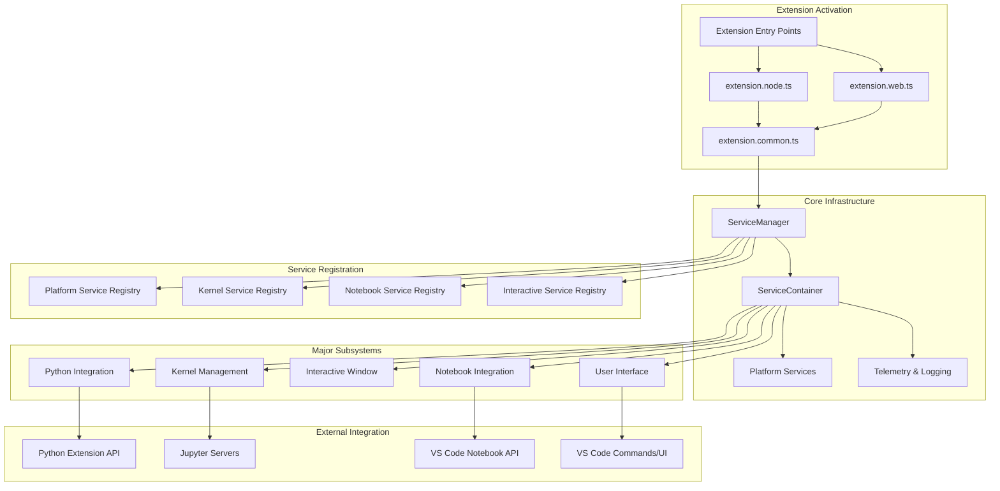

Sources: [src/extension.node.ts:75-130](), [src/extension.web.ts:80-120](), [src/extension.common.ts:158-175]()

## Extension Activation Flow

The extension uses a carefully orchestrated activation sequence that initializes services, registers components, and prepares the environment for notebook operations.

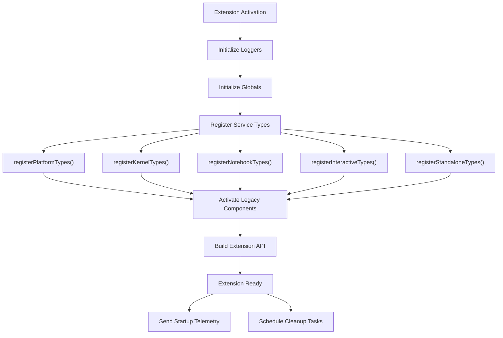

Sources: [src/extension.node.ts:213-240](), [src/extension.common.ts:158-175](), [src/extension.node.ts:45-50]()

## Core Subsystem Overview

### Platform Infrastructure

The platform layer provides foundational services that abstract away environment-specific implementations, enabling the extension to run in both Node.js and Web environments.

| Component | Node Implementation | Web Implementation | Purpose |
|-----------|--------------------|--------------------|---------|
| File System | `IFileSystemNode` | `IFileSystemWeb` | File operations and path handling |
| Process Execution | `IPythonExecutionFactory` | Not Available | Running Python interpreters |
| Environment Variables | `ICustomEnvironmentVariablesProvider` | Limited Support | Environment configuration |
| Crypto | `ICryptoUtils` | Web Crypto API | Encryption/hashing operations |

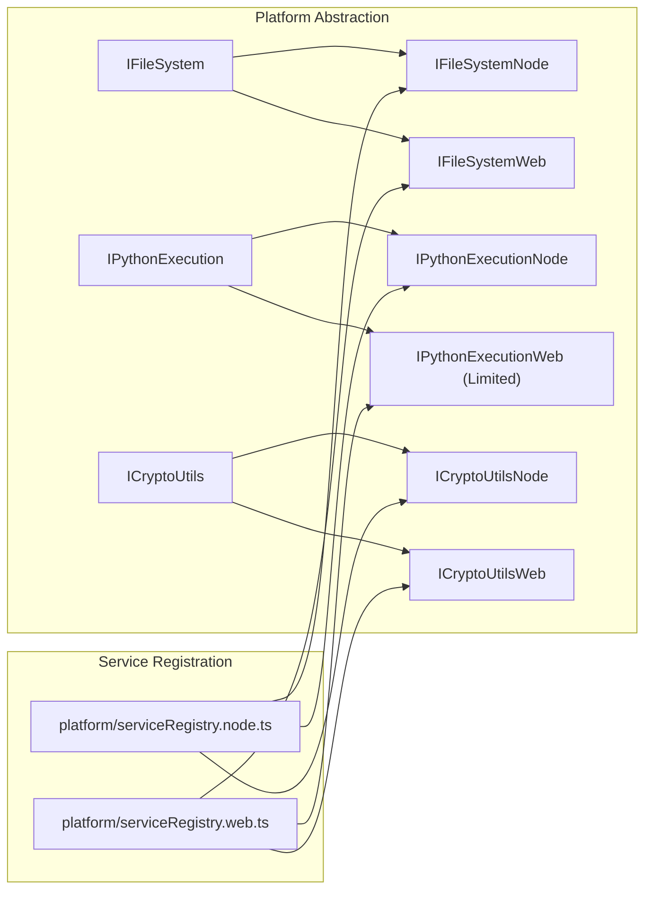

Sources: [src/platform/serviceRegistry.node.ts](), [src/platform/serviceRegistry.web.ts](), [src/platform/common/platform/types.ts]()

### Kernel Management System

The kernel management system handles discovery, instantiation, and lifecycle management of Jupyter kernels across different connection types and environments.

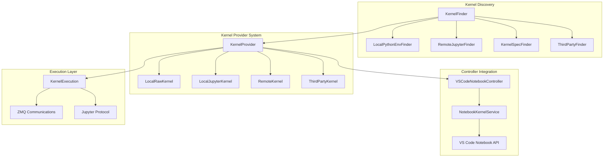

Sources: [src/kernels/kernelProvider.ts](), [src/kernels/kernelFinder.ts](), [src/notebooks/controllers/]()

### Python Environment Integration

The extension integrates deeply with the Python extension to discover interpreters and manage Python-specific kernels, providing seamless environment switching and kernel creation.

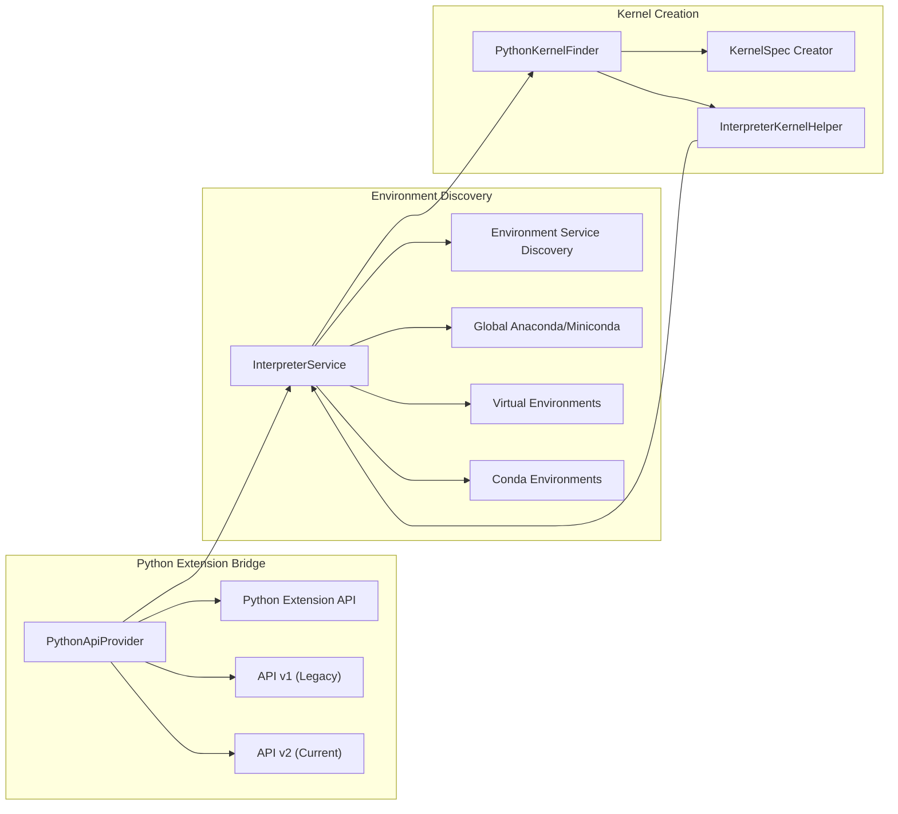

Sources: [src/platform/api/pythonApi.ts](), [src/platform/interpreter/](), [src/kernels/raw/finder/]()

## Configuration and Command System

The extension provides extensive configuration options and commands that integrate with VS Code's command palette and settings system.

### Key Configuration Categories

| Category | Examples | Purpose |
|----------|----------|---------|
| Kernel Management | `jupyter.kernels.filter` | Control kernel discovery and display |
| Logging | `jupyter.logging.level` | Debug and troubleshooting |
| Python Integration | `jupyter.pythonPath` | Python interpreter selection |
| Server Connections | `jupyter.allowUnauthorizedRemoteConnection` | Security settings |
| UI Behavior | `jupyter.showOnlyOneTypeOfKernel` | Kernel picker behavior |

### Command Architecture

The extension registers over 80 commands covering notebook operations, kernel management, debugging, and development tools.

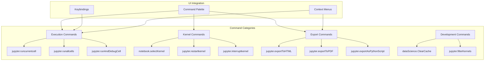

Sources: [package.json:249-784](), [package.json:129-248]()

## Development and Testing Infrastructure

The extension includes comprehensive testing infrastructure supporting both unit and integration testing across desktop and web environments.

### Testing Architecture

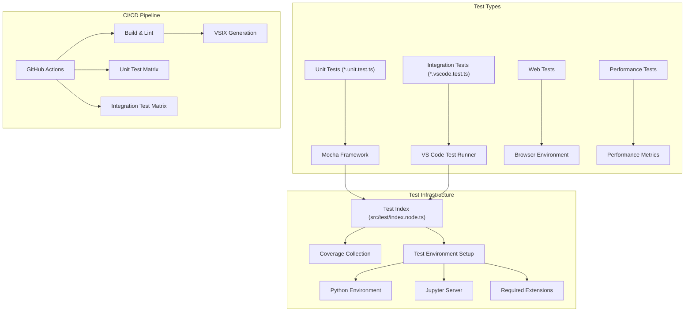

Sources: [src/test/index.node.ts:1-50](), [.github/workflows/build-test.yml:1-100](), [src/test/standardTest.node.ts:1-50]()

## Extension Pack and Dependencies

The Jupyter extension operates as part of an extension pack, providing a complete notebook development environment through coordinated extensions.

### Extension Pack Components

| Extension | Purpose | Integration |
|-----------|---------|-------------|
| `ms-toolsai.jupyter-keymap` | Jupyter-compatible keybindings | Keyboard shortcuts |
| `ms-toolsai.jupyter-renderers` | Rich output rendering (plots, widgets) | Output display |
| `ms-toolsai.vscode-jupyter-slideshow` | Presentation mode | Notebook export |
| `ms-toolsai.vscode-jupyter-cell-tags` | Cell metadata management | Notebook structure |

### Key Dependencies

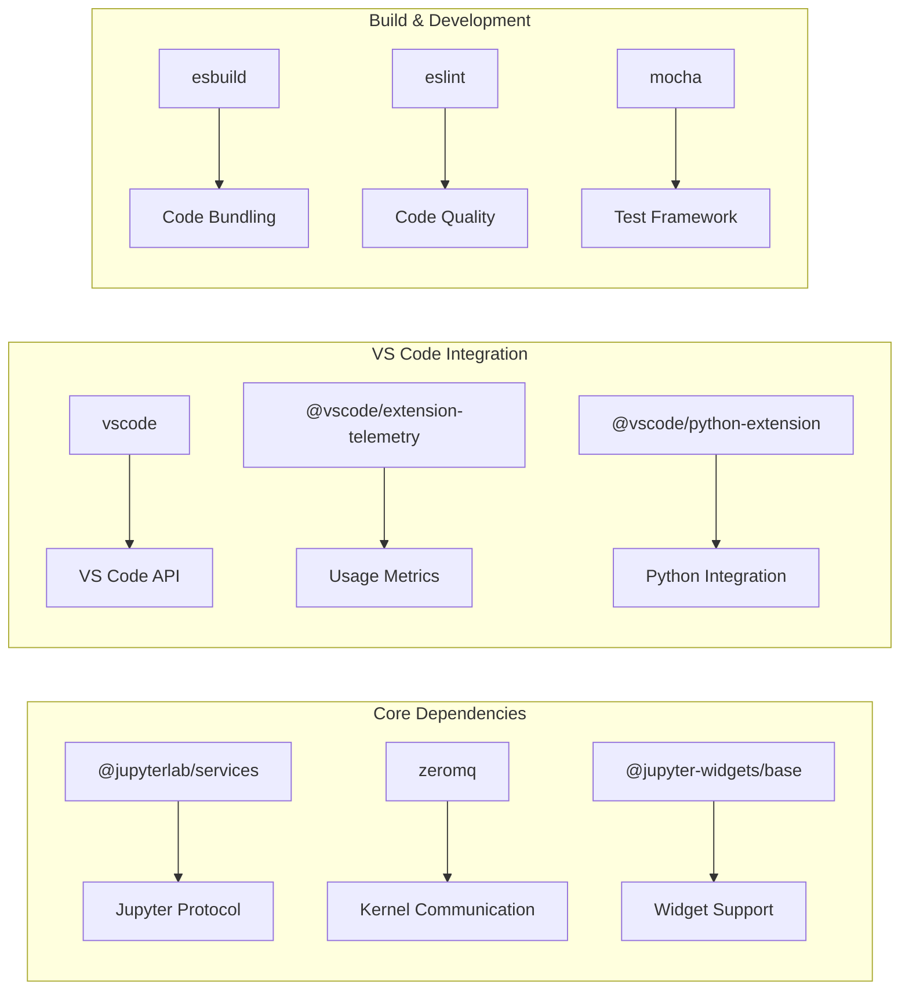

Sources: [package.json:10-25](), [package-lock.json:12-73]()

This architecture enables the VS Code Jupyter extension to provide a comprehensive notebook development environment that seamlessly integrates with VS Code's existing capabilities while supporting the full spectrum of Jupyter ecosystem features.

---

# Page: Extension Infrastructure

# Extension Infrastructure

<details>
<summary>Relevant source files</summary>

The following files were used as context for generating this wiki page:

- [.devcontainer/dev-with-python/Dockerfile](.devcontainer/dev-with-python/Dockerfile)
- [.devcontainer/dev/Dockerfile](.devcontainer/dev/Dockerfile)
- [.github/actions/create-venv-for-tests/action.yml](.github/actions/create-venv-for-tests/action.yml)
- [.github/instructions/typescript.instructions.md](.github/instructions/typescript.instructions.md)
- [.github/workflows/build-test.yml](.github/workflows/build-test.yml)
- [.nvmrc](.nvmrc)
- [.vscode/launch.json](.vscode/launch.json)
- [.vscode/tasks.json](.vscode/tasks.json)
- [CHANGELOG.md](CHANGELOG.md)
- [CONTRIBUTING.md](CONTRIBUTING.md)
- [README.md](README.md)
- [build/azure-pipeline.pre-release.yml](build/azure-pipeline.pre-release.yml)
- [build/azure-pipeline.stable.yml](build/azure-pipeline.stable.yml)
- [gulpfile.js](gulpfile.js)
- [package-lock.json](package-lock.json)
- [package.json](package.json)
- [src/api.pythonIntegration.d.ts](src/api.pythonIntegration.d.ts)
- [src/api.unstable.d.ts](src/api.unstable.d.ts)
- [src/extension.common.ts](src/extension.common.ts)
- [src/extension.node.ts](src/extension.node.ts)
- [src/extension.web.ts](src/extension.web.ts)
- [src/kernels/raw/finder/jupyterPaths.node.ts](src/kernels/raw/finder/jupyterPaths.node.ts)
- [src/kernels/raw/finder/jupyterPaths.node.unit.test.ts](src/kernels/raw/finder/jupyterPaths.node.unit.test.ts)
- [src/platform/common/cache.ts](src/platform/common/cache.ts)
- [src/platform/common/temp.node.ts](src/platform/common/temp.node.ts)
- [src/platform/common/temp.ts](src/platform/common/temp.ts)
- [src/platform/telemetry/startupTelemetry.ts](src/platform/telemetry/startupTelemetry.ts)
- [src/platform/vscode-path/platform.ts](src/platform/vscode-path/platform.ts)
- [src/standalone/devTools/clearCache.ts](src/standalone/devTools/clearCache.ts)
- [src/test/constants.node.ts](src/test/constants.node.ts)
- [src/test/index.node.ts](src/test/index.node.ts)
- [src/test/mocks/mementos.ts](src/test/mocks/mementos.ts)
- [src/test/standardTest.node.ts](src/test/standardTest.node.ts)
- [src/test/web/customReporter.ts](src/test/web/customReporter.ts)

</details>


This document covers the core infrastructure systems that enable the VS Code Jupyter extension to function. This includes extension activation and lifecycle management, the service registry and dependency injection system, telemetry collection, and the build/development infrastructure.

For information about kernel management, see [Kernel Management](#3). For notebook-specific functionality, see [Notebook System](#4). For Python environment integration, see [Python Integration](#6).

## Extension Activation and Lifecycle

The VS Code Jupyter extension supports both desktop (Node.js) and web environments through separate entry points that share common initialization logic.

### Activation Entry Points

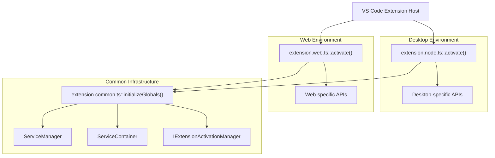

**Activation Flow**

The extension activation follows a consistent pattern across both environments:

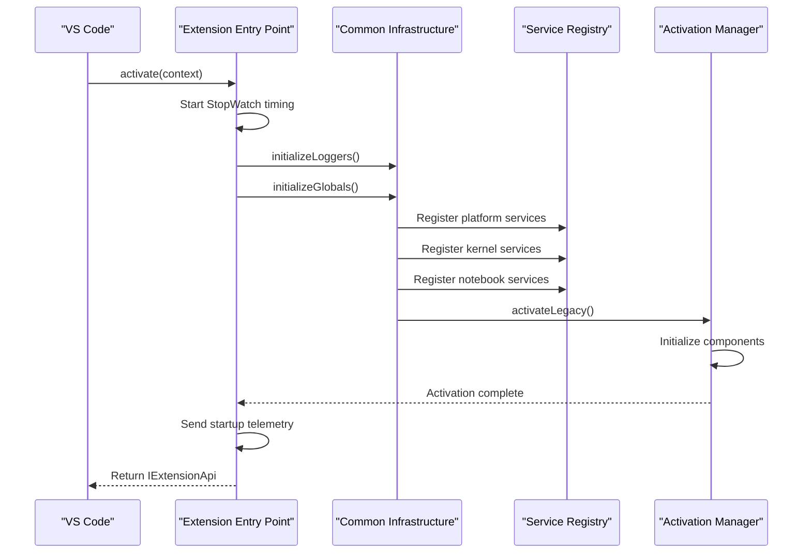

**Sources:** [src/extension.node.ts:78-129](), [src/extension.web.ts:80-120](), [src/extension.common.ts:50-150]()

### Service Registration Architecture

The extension uses a modular service registration system where each major component registers its services independently:

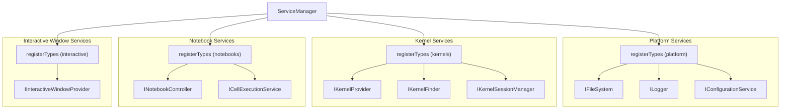

**Sources:** [src/extension.node.ts:219-239](), [src/platform/serviceRegistry.node.ts](), [src/kernels/serviceRegistry.node.ts](), [src/notebooks/serviceRegistry.node.ts]()

### Extension Context and Lifecycle Management

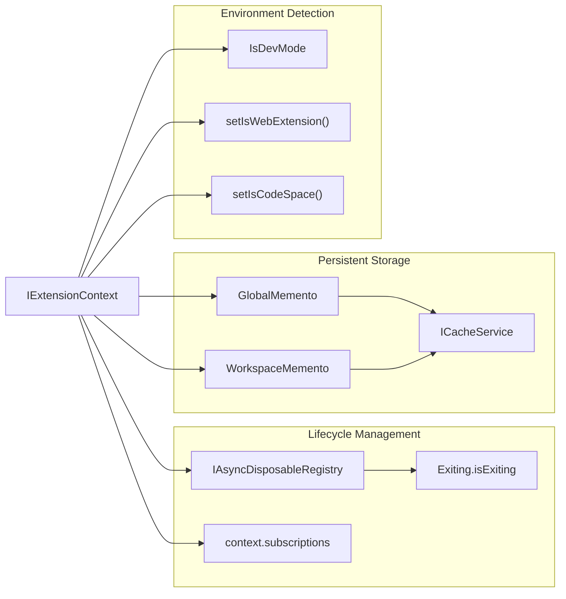

**Sources:** [src/extension.node.ts:90-94](), [src/extension.common.ts:158-170](), [src/platform/common/types.ts]()

## Telemetry and Monitoring

The extension implements comprehensive telemetry collection to monitor performance, usage patterns, and error conditions.

### Telemetry Architecture

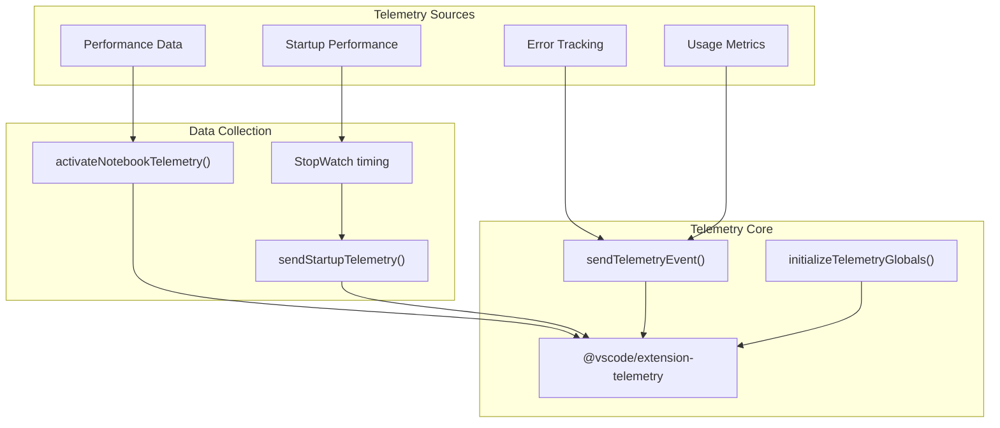

**Startup Performance Tracking**

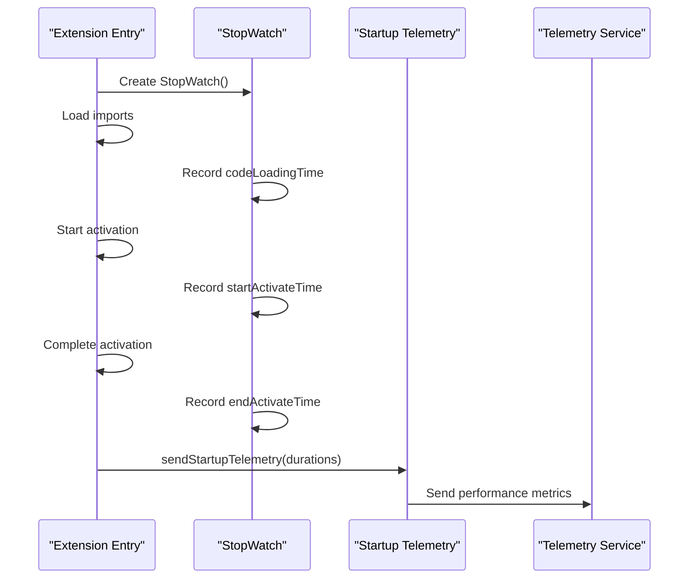

**Sources:** [src/extension.node.ts:4-27](), [src/platform/telemetry/startupTelemetry.ts](), [src/kernels/telemetry/notebookTelemetry.ts]()

### Error Handling and Reporting

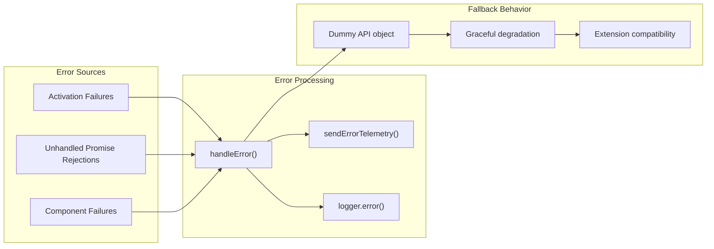

**Sources:** [src/extension.node.ts:103-129](), [src/extension.common.ts:140-150](), [src/platform/telemetry/startupTelemetry.ts:50-80]()

## Service Registry and Dependency Injection

The extension uses Inversify as its dependency injection framework, providing a robust service architecture that supports both testing and modularity.

### Service Container Architecture

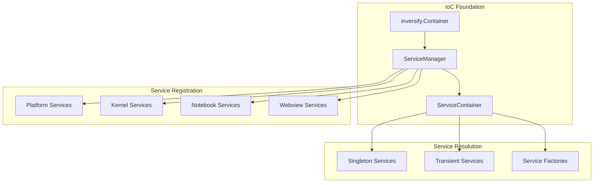

**Platform-Specific Service Registration**

The extension supports different service implementations for Node.js and web environments:

| Service Category | Node.js Implementation | Web Implementation |
|------------------|------------------------|-------------------|
| File System | `IFileSystemNode` | `IFileSystemWeb` |
| Process Execution | `IPythonExecutionFactory` | Not available |
| Terminals | `ITerminalManager` | `ITerminalManagerWeb` |
| Crypto | `ICryptoUtils` (native) | `ICryptoUtils` (web) |

**Service Lifecycle Management**

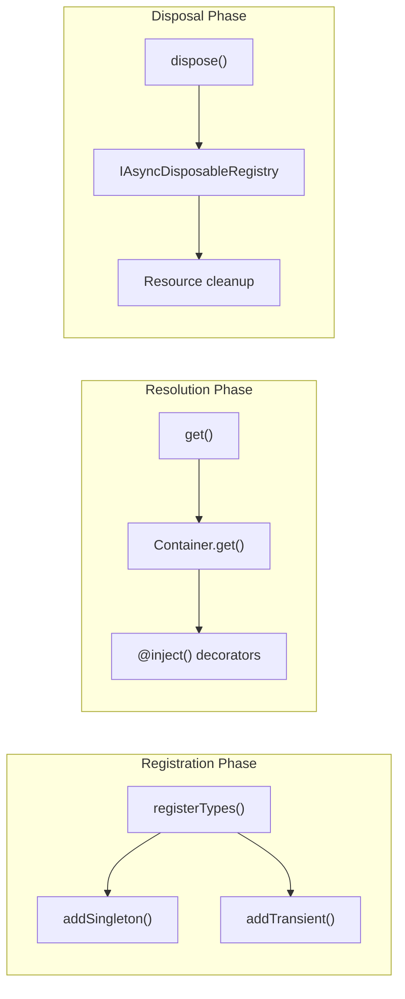

**Sources:** [src/platform/ioc/serviceManager.ts](), [src/platform/ioc/container.ts](), [src/extension.common.ts:158-170]()

## Build and Development Infrastructure

The extension includes comprehensive build tooling that supports both development and production scenarios across multiple platforms.

### Build Configuration System

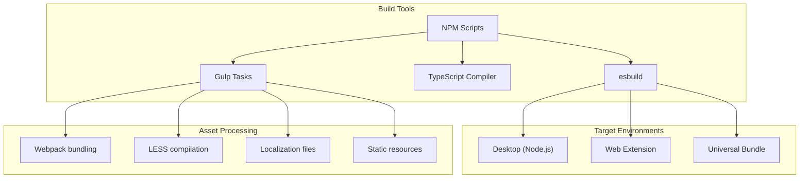

**Development Workflow**

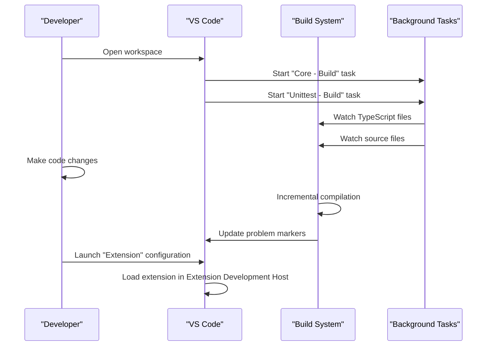

**Package.json Configuration Structure**

| Configuration Section | Purpose | Key Elements |
|----------------------|---------|--------------|
| `activationEvents` | When extension loads | `onLanguage:python`, `onNotebook:jupyter-notebook` |
| `contributes.commands` | Available commands | Jupyter execution, kernel management |
| `contributes.keybindings` | Keyboard shortcuts | Cell execution, navigation |
| `contributes.walkthroughs` | User onboarding | Getting started guide |
| `main` / `browser` | Entry points | Desktop vs web extension |

**Sources:** [package.json:53-63](), [gulpfile.js:26-287](), [.vscode/tasks.json:10-48](), [build/azure-pipeline.stable.yml]()

### Testing Infrastructure

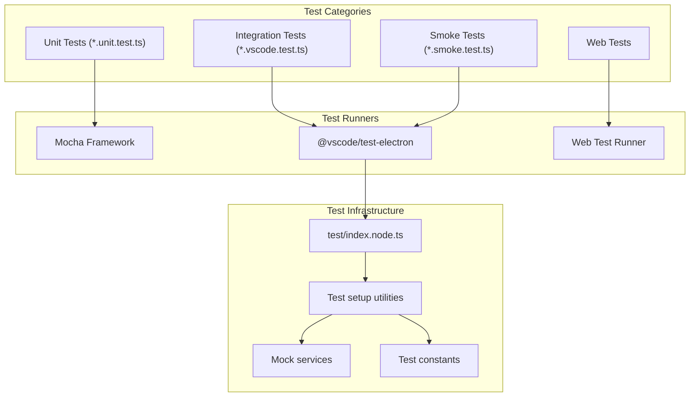

**Sources:** [src/test/index.node.ts:81-150](), [src/test/standardTest.node.ts:56-200](), [.vscode/launch.json:240-270]()

---

# Page: Extension Activation and Lifecycle

# Extension Activation and Lifecycle

<details>
<summary>Relevant source files</summary>

The following files were used as context for generating this wiki page:

- [src/api.pythonIntegration.d.ts](src/api.pythonIntegration.d.ts)
- [src/api.unstable.d.ts](src/api.unstable.d.ts)
- [src/extension.common.ts](src/extension.common.ts)
- [src/extension.node.ts](src/extension.node.ts)
- [src/extension.web.ts](src/extension.web.ts)
- [src/kernels/raw/finder/jupyterPaths.node.ts](src/kernels/raw/finder/jupyterPaths.node.ts)
- [src/kernels/raw/finder/jupyterPaths.node.unit.test.ts](src/kernels/raw/finder/jupyterPaths.node.unit.test.ts)
- [src/platform/common/cache.ts](src/platform/common/cache.ts)
- [src/platform/common/temp.node.ts](src/platform/common/temp.node.ts)
- [src/platform/common/temp.ts](src/platform/common/temp.ts)
- [src/platform/telemetry/startupTelemetry.ts](src/platform/telemetry/startupTelemetry.ts)
- [src/standalone/devTools/clearCache.ts](src/standalone/devTools/clearCache.ts)

</details>


This document covers the activation and deactivation lifecycle of the VS Code Jupyter extension, including timing tracking, service registration, error handling, and platform-specific differences. For information about specific service registration and dependency injection patterns, see [Service Registry and Dependency Injection](#2.3). For telemetry collection during activation, see [Telemetry and Monitoring](#2.2).

## Activation Entry Points

The VS Code Jupyter extension has two platform-specific entry points that share common activation logic:

- **Desktop Extension**: [src/extension.node.ts]() - Full featured desktop extension with Node.js capabilities
- **Web Extension**: [src/extension.web.ts]() - Browser-compatible version with limited functionality

Both entry points implement the same VS Code extension lifecycle methods:
- `activate(context: IExtensionContext): Promise<IExtensionApi>`
- `deactivate(): Thenable<void>`

### Activation Flow Diagram

```mermaid
graph TD
    Start["Extension Activation Start"] --> Timing["Initialize StopWatch"]
    Timing --> Logger["Initialize Loggers"]
    Logger --> Platform{"Platform Check"}
    
    Platform -->|Desktop| NodeSetup["Node-specific Setup<br/>- Username/Home obfuscation<br/>- Chat activation<br/>- Execution analysis"]
    Platform -->|Web| WebSetup["Web-specific Setup<br/>- setImmediate polyfill<br/>- Limited functionality"]
    
    NodeSetup --> Common["Common Activation Path"]
    WebSetup --> Common
    
    Common --> Services["Service Registration"]
    Services --> Activate["Component Activation"]
    Activate --> API["Build Public API"]
    API --> Success["Send Success Telemetry"]
    
    Common --> Error["Error Handler"]
    Error --> Fallback["Return Fallback API"]
    Error --> ErrorTelemetry["Send Error Telemetry"]
```

Sources: [src/extension.node.ts:78-130](), [src/extension.web.ts:80-120](), [src/extension.common.ts:50-180]()

## Performance Tracking

The extension implements comprehensive performance tracking from the very beginning of the activation process using a `StopWatch` class that measures elapsed time in milliseconds.

### Timing Measurements

| Phase | Measurement | Description |
|-------|------------|-------------|
| `codeLoadingTime` | Import completion | Time to load all module dependencies |
| `startActivateTime` | Activation start | When `activate()` function begins |
| `endActivateTime` | Activation end | When activation completes successfully |
| `totalActivateTime` | Full duration | Complete activation time |

```mermaid
graph LR
    T0["Extension Load Start"] --> T1["Code Loading Complete<br/>(codeLoadingTime)"]
    T1 --> T2["Activation Start<br/>(startActivateTime)"]
    T2 --> T3["Activation End<br/>(endActivateTime)"]
    T3 --> T4["Total Time<br/>(totalActivateTime)"]
```

The `StopWatch` is initialized immediately at module load time:

```javascript
// Do not move this line of code (used to measure extension load times).
const stopWatch = new StopWatch();
```

Sources: [src/extension.node.ts:4-27](), [src/extension.web.ts:4-27](), [src/platform/telemetry/startupTelemetry.ts:10-43]()

## Service Registration and Initialization

The extension uses a dependency injection container to manage services. The activation process registers services in a specific order to ensure dependencies are available when needed.

### Service Registration Order

```mermaid
graph TD
    Context["Extension Context<br/>IExtensionContext"] --> Core["Core Services<br/>- ServiceContainer<br/>- ServiceManager<br/>- DisposableRegistry"]
    
    Core --> Memento["State Management<br/>- GlobalMemento<br/>- WorkspaceMemento"]
    
    Memento --> Channels["Output Channels<br/>- StandardOutputChannel<br/>- JupyterOutputChannel"]
    
    Channels --> Platform["Platform Services<br/>registerPlatformTypes()"]
    
    Platform --> Kernels["Kernel Services<br/>registerKernelTypes()"]
    
    Kernels --> Notebooks["Notebook Services<br/>registerNotebookTypes()"]
    
    Notebooks --> Interactive["Interactive Services<br/>registerInteractiveTypes()"]
    
    Interactive --> Standalone["Standalone Services<br/>registerStandaloneTypes()"]
    
    Standalone --> Webviews["Webview Services<br/>registerWebviewTypes()"]
```

Sources: [src/extension.node.ts:232-239](), [src/extension.web.ts:185-193](), [src/extension.common.ts:109-132]()

### Platform-Specific Differences

The desktop and web versions have different service registration patterns:

| Service Type | Desktop (Node) | Web |
|-------------|----------------|-----|
| Platform Services | `platform/serviceRegistry.node` | `platform/serviceRegistry.web` |
| Kernel Services | `kernels/serviceRegistry.node` | `kernels/serviceRegistry.web` |
| Terminal Services | Not registered | `terminals/serviceRegistry.web` |
| Chat Services | Full chat activation | Not available |
| Execution Analysis | Full analysis features | Not available |

Sources: [src/extension.node.ts:45-50](), [src/extension.web.ts:56-62]()

## Global State and Configuration

During activation, the extension initializes global state and configuration that affects the entire extension lifecycle.

### Development Mode Detection

The extension detects development mode using multiple criteria:

```typescript
const isDevMode = 
    !isTestExecution() &&
    (context.extensionMode === ExtensionMode.Development ||
     workspace.getConfiguration('jupyter').get<boolean>('development', false));
```

Development mode enables additional features like cache clearing commands and enhanced logging.

### Environment Setup

The extension configures global environment variables and settings:

- **Code Spaces Detection**: Sets `jupyter.webExtension` context based on `env.uiKind`
- **Home Directory**: Configures logging home directory for file path obfuscation
- **Extension Context**: Registers VS Code context variables for command enabling

Sources: [src/extension.node.ts:219-230](), [src/extension.web.ts:175-183](), [src/extension.common.ts:172-179]()

## Error Handling and Recovery

The extension implements comprehensive error handling to ensure graceful degradation when activation fails.

### Error Handling Flow

```mermaid
graph TD
    ActivationStart["Activation Begins"] --> TryBlock["Try Activation"]
    
    TryBlock -->|Success| Success["Successful Activation<br/>- Send success telemetry<br/>- Return full API"]
    
    TryBlock -->|Error| ErrorHandler["Error Handler<br/>handleError()"]
    
    ErrorHandler --> Telemetry["Send Error Telemetry<br/>sendErrorTelemetry()"]
    
    Telemetry --> UserNotification["Show Error Message<br/>to User"]
    
    UserNotification --> FallbackAPI["Return Fallback API<br/>- Dummy implementations<br/>- Prevent extension crashes"]
    
    FallbackAPI --> DependentExtensions["Dependent Extensions<br/>Continue Working"]
```

### Fallback API Implementation

When activation fails, the extension returns a fallback API object with dummy implementations to prevent dependent extensions (like the Python extension) from failing:

```typescript
return {
    ready: Promise.resolve(),
    registerPythonApi: noop,
    registerRemoteServerProvider: () => ({ dispose: noop }),
    getKernelService: () => Promise.resolve(undefined),
    // ... other safe dummy implementations
};
```

Sources: [src/extension.node.ts:103-129](), [src/extension.web.ts:96-119](), [src/extension.common.ts:134-160]()

## Cache Management and Cleanup

The extension manages various caches and temporary files throughout its lifecycle, with cleanup occurring both during activation and deactivation.

### Cache Cleanup During Activation

The extension automatically cleans up old cache entries and temporary directories:

- **Old Global State Keys**: Removes deprecated cache keys from previous versions
- **Workspace State**: Cleans up old cell execution cache entries  
- **Temporary Directories**: Removes temporary directories from previous extension versions

### Cache Keys Removed

The extension maintains a list of deprecated cache keys that are automatically removed:

```typescript
const GlobalMementoKeyPrefixesToRemove = [
    'JUPYTER_LOCAL_KERNELSPECS',
    'JUPYTER_REMOTE_KERNELSPECS', 
    'user-jupyter-server-uri-list-v2',
    'CACHE_KEY_FOR_JUPYTER_KERNEL_PATHS',
    // ... other deprecated keys
];
```

Sources: [src/platform/common/cache.ts:33-66](), [src/platform/common/temp.node.ts:36-48](), [src/standalone/devTools/clearCache.ts:12-37]()

## Deactivation Process

The extension implements a clean deactivation process to properly dispose of resources and stop background operations.

### Deactivation Flow

```mermaid
graph TD
    DeactivateCall["deactivate() Called"] --> ExitingFlag["Set Exiting.isExiting = true"]
    
    ExitingFlag --> CheckContainer["Check Activated Service Container"]
    
    CheckContainer -->|Exists| GetRegistry["Get IAsyncDisposableRegistry"]
    CheckContainer -->|Missing| DirectReturn["Return Promise.resolve()"]
    
    GetRegistry --> DisposeAll["Dispose All Registered Services"]
    
    DisposeAll --> StopAnalysis["Deactivate Execution Analysis<br/>(Node only)"]
    
    StopAnalysis --> Complete["Deactivation Complete"]
    DirectReturn --> Complete
```

### Resource Disposal

The deactivation process ensures all registered disposable resources are properly cleaned up:

1. **Service Disposal**: All services registered with `IAsyncDisposableRegistry` are disposed
2. **Background Tasks**: Execution analysis and other background operations are stopped
3. **Event Listeners**: All event subscriptions are cleaned up
4. **Temporary Files**: Some temporary resources may be cleaned up

Sources: [src/extension.node.ts:132-145](), [src/extension.web.ts:122-133]()

## Extension API Construction

The final phase of activation constructs the public API that other extensions can use to interact with the Jupyter extension.

### API Building Process

The `buildApi` function creates the public API interface using the activated service container:

```mermaid
graph LR
    ActivationPromise["Activation Promise"] --> APIBuilder["buildApi()"]
    ServiceManager["Service Manager"] --> APIBuilder
    ServiceContainer["Service Container"] --> APIBuilder
    ExtensionContext["Extension Context"] --> APIBuilder
    
    APIBuilder --> PublicAPI["IExtensionApi<br/>- ready Promise<br/>- Kernel services<br/>- Server management<br/>- Python integration"]
```

The API provides access to:
- Kernel management services
- Remote server registration
- Python environment integration
- Notebook opening capabilities

Sources: [src/extension.node.ts:173-174](), [src/extension.web.ts:155-156](), [src/standalone/api.ts]()

---

# Page: Telemetry and Monitoring

# Telemetry and Monitoring

<details>
<summary>Relevant source files</summary>

The following files were used as context for generating this wiki page:

- [src/gdpr.ts](src/gdpr.ts)
- [src/kernels/raw/launcher/kernelLauncher.node.ts](src/kernels/raw/launcher/kernelLauncher.node.ts)
- [src/kernels/raw/session/rawNotebookSupportedService.node.ts](src/kernels/raw/session/rawNotebookSupportedService.node.ts)
- [src/kernels/raw/session/zeromq.node.ts](src/kernels/raw/session/zeromq.node.ts)
- [src/kernels/telemetry/helper.ts](src/kernels/telemetry/helper.ts)
- [src/kernels/telemetry/sendKernelTelemetryEvent.ts](src/kernels/telemetry/sendKernelTelemetryEvent.ts)
- [src/notebooks/telemetry/kernelTelemetry.ts](src/notebooks/telemetry/kernelTelemetry.ts)
- [src/platform/common/constants.ts](src/platform/common/constants.ts)
- [src/platform/common/platform/linuxDistro.node.ts](src/platform/common/platform/linuxDistro.node.ts)
- [src/platform/telemetry/index.ts](src/platform/telemetry/index.ts)
- [src/telemetry.ts](src/telemetry.ts)
- [src/telemetryGenerator.node.ts](src/telemetryGenerator.node.ts)

</details>


This document covers the telemetry and monitoring infrastructure used throughout the VS Code Jupyter extension to collect usage analytics, performance metrics, and error information. The system is designed with privacy compliance in mind and includes automatic GDPR classification for all collected data.

For information about testing and quality assurance processes, see [Testing Infrastructure](#9.1). For details about configuration and settings management, see [Settings and Commands](#8.1).

## System Overview

The telemetry system operates as a layered architecture that collects, classifies, and transmits usage data to help improve the extension. All events must be pre-defined with explicit GDPR classifications and are validated at build time.

### Core Architecture

```mermaid
graph TB
    subgraph "Event Definitions"
        IEventNamePropertyMapping["IEventNamePropertyMapping"]
        TelemetryEventInfo["TelemetryEventInfo&lt;T&gt;"]
        SharedPropertyMapping["SharedPropertyMapping"]
    end
    
    subgraph "Core Infrastructure"
        sendTelemetryEvent["sendTelemetryEvent()"]
        getTelemetryReporter["getTelemetryReporter()"]
        TelemetryReporter["@vscode/extension-telemetry"]
    end
    
    subgraph "Domain-Specific Helpers"
        sendKernelTelemetryEvent["sendKernelTelemetryEvent()"]
        trackKernelResourceInformation["trackKernelResourceInformation()"]
        getContextualPropsForTelemetry["getContextualPropsForTelemetry()"]
    end
    
    subgraph "GDPR Compliance"
        gdprGenerator["telemetryGenerator.node.ts"]
        gdprFile["gdpr.ts (auto-generated)"]
        PropertyClassification["Property Classifications"]
    end
    
    subgraph "Decorators"
        capturePerfTelemetry["@capturePerfTelemetry"]
        captureUsageTelemetry["@captureUsageTelemetry"]
    end
    
    IEventNamePropertyMapping --> sendTelemetryEvent
    TelemetryEventInfo --> IEventNamePropertyMapping
    SharedPropertyMapping --> sendTelemetryEvent
    
    sendTelemetryEvent --> getTelemetryReporter
    getTelemetryReporter --> TelemetryReporter
    
    sendKernelTelemetryEvent --> sendTelemetryEvent
    trackKernelResourceInformation --> getContextualPropsForTelemetry
    getContextualPropsForTelemetry --> sendTelemetryEvent
    
    capturePerfTelemetry --> sendTelemetryEvent
    captureUsageTelemetry --> sendTelemetryEvent
    
    IEventNamePropertyMapping --> gdprGenerator
    gdprGenerator --> gdprFile
    PropertyClassification --> gdprFile
```

Sources: [src/telemetry.ts:1-503](), [src/platform/telemetry/index.ts:1-356](), [src/gdpr.ts:1-50]()

## Event Definition System

All telemetry events are centrally defined in the `IEventNamePropertyMapping` class, which serves as the single source of truth for all events collected by the extension.

### Event Structure

```mermaid
graph LR
    subgraph "Event Definition"
        EventName["Event Name (key)"]
        TelemetryEventInfo["TelemetryEventInfo&lt;Properties&gt;"]
    end
    
    subgraph "Event Metadata"
        IEventData["IEventData"]
        Owner["owner: string"]
        Feature["feature: Feature[]"]
        Source["source: EventSource"]
    end
    
    subgraph "Property Classification"
        Properties["properties: {...}"]
        Measures["measures: {...}"]
        PropertyData["IPropertyDataNonMeasurement"]
        MeasureData["IPropertyDataMeasurement"]
    end
    
    EventName --> TelemetryEventInfo
    TelemetryEventInfo --> IEventData
    TelemetryEventInfo --> Properties
    TelemetryEventInfo --> Measures
    
    IEventData --> Owner
    IEventData --> Feature
    IEventData --> Source
    
    Properties --> PropertyData
    Measures --> MeasureData
```

Sources: [src/telemetry.ts:452-503](), [src/telemetry.ts:79-163]()

### Property Classifications

Each telemetry property must include GDPR classification metadata:

| Classification | Purpose | Description |
|----------------|---------|-------------|
| `SystemMetaData` | `FeatureInsight`/`PerformanceAndHealth` | Non-personal system information |
| `PublicNonPersonalData` | `FeatureInsight` | User-provided non-personal data |
| `EndUserPseudonymizedInformation` | `FeatureInsight` | Hashed user identifiers |
| `CallstackOrException` | `PerformanceAndHealth` | Error data and stack traces |
| `CustomerContent` | Various | User-generated content (minimal use) |

Sources: [src/telemetry.ts:90-95](), [src/telemetry.ts:182-255]()

## Core Telemetry Infrastructure

### Event Transmission

The `sendTelemetryEvent` function is the primary API for transmitting telemetry data:

```typescript
sendTelemetryEvent<P extends IEventNamePropertyMapping, E extends keyof P>(
    eventName: E,
    measures?: PickType<UnionToIntersection<R>, number>,
    properties?: ExcludeType<R, number>,
    ex?: Error
)
```

Key features:
- Type-safe event names and properties
- Automatic shared property injection
- Error information extraction
- GDPR-compliant data sanitization

Sources: [src/platform/telemetry/index.ts:121-143](), [src/platform/telemetry/index.ts:171-207]()

### Shared Properties

The `SharedPropertyMapping` class defines properties attached to all telemetry events:

| Property | Type | Description |
|----------|------|-------------|
| `isInsiderExtension` | `'true' \| 'false'` | Whether running Insider extension |
| `rawKernelSupported` | `'true' \| 'false'` | ZMQ/raw kernel support availability |
| `isPythonExtensionInstalled` | `'true' \| 'false'` | Python extension installation status |

Sources: [src/platform/telemetry/index.ts:338-353](), [src/telemetry.ts:182-198]()

## Performance Monitoring

### Performance Decorators

The system provides decorators for automatic performance measurement:

```mermaid
graph TB
    subgraph "Performance Decorators"
        capturePerfTelemetry["@capturePerfTelemetry"]
        captureUsageTelemetry["@captureUsageTelemetry"]
    end
    
    subgraph "Measurement Process"
        StopWatch["StopWatch.start()"]
        MethodExecution["Method Execution"]
        DurationCapture["Duration Capture"]
        EventSending["Event Transmission"]
    end
    
    subgraph "Event Properties"
        DurationMeasurement["duration: number"]
        FirstTime["firstTime?: boolean"]
        Failed["failed?: boolean"]
    end
    
    capturePerfTelemetry --> StopWatch
    StopWatch --> MethodExecution
    MethodExecution --> DurationCapture
    DurationCapture --> EventSending
    
    EventSending --> DurationMeasurement
    EventSending --> FirstTime
    EventSending --> Failed
```

Sources: [src/platform/telemetry/index.ts:232-301](), [src/platform/telemetry/index.ts:308-333]()

### Kernel Performance Tracking

Kernel operations include specialized performance tracking:

```typescript
// Example from kernel launcher
sendTelemetryEvent(
    Telemetry.KernelLauncherPerf,
    { duration: stopWatch.elapsedTime },
    { resourceType: getResourceType(resource) }
);
```

Sources: [src/kernels/raw/launcher/kernelLauncher.node.ts:173-177]()

## Domain-Specific Telemetry

### Kernel Telemetry

The kernel subsystem includes comprehensive telemetry for monitoring kernel lifecycle and performance:

```mermaid
graph TB
    subgraph "Kernel Events"
        KernelStart["NotebookStart"]
        KernelExecution["ExecuteCell/ExecuteCode"]
        KernelCrash["KernelCrash"]
        KernelInterrupt["NotebookInterrupt"]
    end
    
    subgraph "Context Tracking"
        trackKernelResourceInformation["trackKernelResourceInformation()"]
        ContextualTelemetryProps["ContextualTelemetryProps"]
        ResourceTracking["trackedInfo Map"]
    end
    
    subgraph "Kernel Properties"
        kernelConnectionType["kernelConnectionType"]
        kernelLanguage["kernelLanguage"] 
        pythonEnvironmentType["pythonEnvironmentType"]
        kernelSessionId["kernelSessionId"]
    end
    
    KernelStart --> trackKernelResourceInformation
    KernelExecution --> trackKernelResourceInformation
    trackKernelResourceInformation --> ContextualTelemetryProps
    ContextualTelemetryProps --> ResourceTracking
    
    ResourceTracking --> kernelConnectionType
    ResourceTracking --> kernelLanguage
    ResourceTracking --> pythonEnvironmentType
    ResourceTracking --> kernelSessionId
```

Sources: [src/kernels/telemetry/helper.ts:50-157](), [src/kernels/telemetry/sendKernelTelemetryEvent.ts:9-29]()

### ZeroMQ Support Monitoring

The extension monitors ZeroMQ binary availability for local kernel support:

```typescript
// Platform-specific ZMQ telemetry
sendTelemetryEvent(Telemetry.ZMQSupport, undefined, {
    distro_id: distro.id,
    distro_version_id: distro.version_id,
    failed,
    alpine: platformInfo.alpine,
    libc: platformInfo.libc,
    armv: platformInfo.armv,
    zmqarch: platformInfo.zmqarch
});
```

Sources: [src/kernels/raw/session/zeromq.node.ts:84-93](), [src/kernels/raw/session/rawNotebookSupportedService.node.ts:16-46]()

## Error Monitoring

### Error Enrichment

The system automatically enriches error telemetry with contextual information:

```mermaid
graph LR
    subgraph "Error Processing"
        ErrorOccurrence["Error Occurrence"]
        populateTelemetryWithErrorInfo["populateTelemetryWithErrorInfo()"]
        ErrorProperties["TelemetryErrorProperties"]
    end
    
    subgraph "Error Context"
        failed["failed: boolean"]
        failureCategory["failureCategory: string"]
        failureSubCategory["failureSubCategory: string"]
        stackTrace["stackTrace: string"]
        pythonErrorInfo["Python Error Info"]
    end
    
    ErrorOccurrence --> populateTelemetryWithErrorInfo
    populateTelemetryWithErrorInfo --> ErrorProperties
    
    ErrorProperties --> failed
    ErrorProperties --> failureCategory
    ErrorProperties --> failureSubCategory
    ErrorProperties --> stackTrace
    ErrorProperties --> pythonErrorInfo
```

Sources: [src/telemetry.ts:218-255](), [src/platform/telemetry/index.ts:181-193]()

### Kernel Crash Monitoring

Kernel process crashes are monitored with detailed exit information:

```typescript
// Kernel exit telemetry
sendKernelTelemetryEvent(
    resource,
    Telemetry.RawKernelSessionKernelProcessExited,
    exitCode ? { exitCode } : undefined,
    {
        exitReason: getTelemetrySafeErrorMessageFromPythonTraceback(reason)
    }
);
```

Sources: [src/kernels/raw/launcher/kernelLauncher.node.ts:147-155]()

## GDPR Compliance System

### Automatic Documentation Generation

The extension includes a build-time tool that generates GDPR-compliant documentation:

```mermaid
graph TB
    subgraph "Generation Process"
        TelemetryDefinitions["src/telemetry.ts"]
        telemetryGenerator["telemetryGenerator.node.ts"]
        TypeScriptAnalysis["TypeScript AST Analysis"]
        GDPRGeneration["GDPR Documentation"]
    end
    
    subgraph "Output Artifacts"
        gdprFile["src/gdpr.ts"]
        ValidationErrors["Validation Errors"]
        CSVExport["CSV Documentation"]
    end
    
    TelemetryDefinitions --> telemetryGenerator
    telemetryGenerator --> TypeScriptAnalysis
    TypeScriptAnalysis --> GDPRGeneration
    
    GDPRGeneration --> gdprFile
    GDPRGeneration --> ValidationErrors
    GDPRGeneration --> CSVExport
```

Sources: [src/telemetryGenerator.node.ts:394-431](), [src/gdpr.ts:1-20]()

### Event Validation

The system validates that all telemetry events have proper GDPR classifications:

| Validation Rule | Description |
|-----------------|-------------|
| Property Classification | All properties must have valid GDPR classification |
| Owner Assignment | Each event must have an assigned owner |
| Comment Requirements | Properties must include descriptive comments |
| Measurement Validation | Numeric properties must be marked as measurements |

Sources: [src/telemetryGenerator.node.ts:376-430]()

## Configuration and Privacy Controls

### Telemetry Enablement

The system respects VS Code's telemetry settings:

```typescript
function isTelemetryDisabled(): boolean {
    const settings = workspace.getConfiguration('telemetry').inspect<boolean>('enableTelemetry')!;
    return settings.globalValue === false ? true : false;
}
```

### Test Environment Handling

Telemetry is automatically disabled during test execution, with exceptions for performance measurements on CI:

```typescript
function isPerfMeasurementOnCI(eventName: string) {
    return (
        eventName === Telemetry.NativeNotebookEditPerformance ||
        eventName === Telemetry.JupyterNotebookExecutionPerformance ||
        eventName === Telemetry.NativeNotebookExecutionPerformance
    );
}
```

Sources: [src/platform/telemetry/index.ts:43-56](), [src/platform/telemetry/index.ts:149-155]()

---

# Page: Service Registry and Dependency Injection

# Service Registry and Dependency Injection

<details>
<summary>Relevant source files</summary>

The following files were used as context for generating this wiki page:

- [src/api.proposed.kernelStartHook.d.ts](src/api.proposed.kernelStartHook.d.ts)
- [src/kernels/kernel.ts](src/kernels/kernel.ts)
- [src/kernels/kernelProvider.base.ts](src/kernels/kernelProvider.base.ts)
- [src/kernels/kernelProvider.node.ts](src/kernels/kernelProvider.node.ts)
- [src/kernels/kernelProvider.node.unit.test.ts](src/kernels/kernelProvider.node.unit.test.ts)
- [src/kernels/kernelProvider.web.ts](src/kernels/kernelProvider.web.ts)
- [src/kernels/kernelProvider.web.unit.test.ts](src/kernels/kernelProvider.web.unit.test.ts)
- [src/kernels/kernelStatusProvider.ts](src/kernels/kernelStatusProvider.ts)
- [src/kernels/serviceRegistry.node.ts](src/kernels/serviceRegistry.node.ts)
- [src/kernels/serviceRegistry.web.ts](src/kernels/serviceRegistry.web.ts)
- [src/kernels/types.ts](src/kernels/types.ts)
- [src/notebooks/serviceRegistry.node.ts](src/notebooks/serviceRegistry.node.ts)
- [src/notebooks/serviceRegistry.web.ts](src/notebooks/serviceRegistry.web.ts)
- [src/platform/constants.ts](src/platform/constants.ts)
- [src/standalone/userJupyterServer/serverSelectorForTests.ts](src/standalone/userJupyterServer/serverSelectorForTests.ts)
- [src/test/client/api.vscode.test.ts](src/test/client/api.vscode.test.ts)

</details>


This document covers the dependency injection system and service registry infrastructure used throughout the VS Code Jupyter extension. The system uses the inversify pattern to manage service creation, dependency resolution, and lifecycle management across kernel management, notebook operations, and platform services.

For information about extension activation and lifecycle, see [Extension Activation and Lifecycle](#2.1).

## Service Manager Architecture

The extension uses a centralized `IServiceManager` that acts as an inversion of control (IoC) container. Service registration occurs through module-specific `registerTypes` functions that configure service bindings, lifecycle management, and dependency relationships.

```mermaid
graph TB
    subgraph "IoC Container"
        ServiceManager["IServiceManager<br/>Central IoC Container"]
    end
    
    subgraph "Registration Modules"
        KernelRegistry["kernelServiceRegistry.node.ts<br/>registerTypes()"]
        NotebookRegistry["notebookServiceRegistry.node.ts<br/>registerTypes()"]
        PlatformRegistry["platformServiceRegistry<br/>registerTypes()"]
    end
    
    subgraph "Service Categories"
        KernelServices["Kernel Services<br/>IKernelProvider<br/>IKernelFinder<br/>IKernelSessionFactory"]
        NotebookServices["Notebook Services<br/>INotebookEditorProvider<br/>IDebuggingManager<br/>IExportUtil"]
        PlatformServices["Platform Services<br/>IFileSystem<br/>IConfigurationService<br/>ILogger"]
    end
    
    KernelRegistry --> ServiceManager
    NotebookRegistry --> ServiceManager
    PlatformRegistry --> ServiceManager
    
    ServiceManager --> KernelServices
    ServiceManager --> NotebookServices
    ServiceManager --> PlatformServices
```

**Sources:** [src/kernels/serviceRegistry.node.ts:52-147](), [src/notebooks/serviceRegistry.node.ts:44-122](), [src/platform/ioc/types.ts]()

## Service Registration Patterns

Services are registered using type-safe binding methods that specify service lifetime, interface contracts, and implementation classes. The registration process supports singleton registration, multi-binding, and conditional registration based on platform capabilities.

```mermaid
graph LR
    subgraph "Registration Methods"
        AddSingleton["serviceManager.addSingleton<I>(symbol, impl)"]
        AddBinding["serviceManager.addBinding(impl, interface)"]
        MultiInject["@multiInject() for arrays"]
    end
    
    subgraph "Service Symbols"
        IKernelProvider["IKernelProvider = Symbol('IKernelProvider')"]
        IKernelFinder["IKernelFinder = Symbol('IKernelFinder')"]
        IExtActivation["IExtensionSyncActivationService"]
    end
    
    subgraph "Implementation Classes"
        KernelProvider["KernelProvider"]
        KernelFinder["KernelFinder"] 
        ActivationImpl["Activation"]
    end
    
    AddSingleton --> IKernelProvider
    IKernelProvider --> KernelProvider
    AddBinding --> IExtActivation
    IExtActivation --> ActivationImpl
```

**Key Registration Examples:**

| Registration Pattern | Purpose | Example |
|---------------------|---------|---------|
| `addSingleton<T>(symbol, impl)` | Single instance services | `IKernelProvider` → `KernelProvider` |
| `addBinding(impl, interface)` | Multi-interface binding | `KernelStatusProvider` → `IExtensionSyncActivationService` |
| `addSingleton<T>(symbol, impl, identifier)` | Named instances | `IJupyterVariables` with `Identifiers.ALL_VARIABLES` |

**Sources:** [src/kernels/serviceRegistry.node.ts:69-114](), [src/kernels/types.ts:543-579](), [src/notebooks/serviceRegistry.node.ts:86-105]()

## Dependency Injection Implementation

Services use constructor injection with the `@injectable()` decorator and `@inject()` for dependencies. The system supports both interface-based injection and multi-injection for service arrays.

```mermaid
graph TB
    subgraph "Service Definition"
        Injectable["@injectable()<br/>class KernelProvider"]
        Constructor["constructor(<br/>  @inject(IAsyncDisposableRegistry)<br/>  @inject(IKernelSessionFactory)<br/>  @multiInject(ITracebackFormatter)<br/>)"]
    end
    
    subgraph "Dependency Resolution"
        SymbolLookup["Symbol → Implementation"]
        InstanceCreation["new KernelProvider(deps...)"]
        CircularCheck["Circular Dependency Detection"]
    end
    
    subgraph "Injected Dependencies"
        AsyncDisposable["IAsyncDisposableRegistry"]
        SessionFactory["IKernelSessionFactory"] 
        Formatters["ITracebackFormatter[]"]
    end
    
    Injectable --> Constructor
    Constructor --> SymbolLookup
    SymbolLookup --> InstanceCreation
    InstanceCreation --> AsyncDisposable
    InstanceCreation --> SessionFactory
    InstanceCreation --> Formatters
```

**Sources:** [src/kernels/kernelProvider.node.ts:38-57](), [src/kernels/kernelProvider.web.ts:36-50](), [src/notebooks/controllers/kernelSource/notebookKernelSourceSelector.ts]()

## Service Categories and Organization

The service registry organizes services into logical categories based on functionality. Each category has dedicated registration modules that handle platform-specific implementations and feature availability.

### Kernel Services
Core services for kernel discovery, creation, and lifecycle management:

| Service | Interface | Implementation | Lifecycle |
|---------|-----------|----------------|-----------|
| Kernel Provider | `IKernelProvider` | `KernelProvider` | Singleton |
| Kernel Finder | `IKernelFinder` | `KernelFinder` | Singleton |
| Session Factory | `IKernelSessionFactory` | Platform-specific | Singleton |
| Dependency Service | `IKernelDependencyService` | `KernelDependencyService` | Singleton |

### Notebook Services  
Services for notebook editing, execution, and debugging:

| Service | Interface | Implementation | Lifecycle |
|---------|-----------|----------------|-----------|
| Editor Provider | `INotebookEditorProvider` | `NotebookEditorProvider` | Singleton |
| Debugging Manager | `INotebookDebuggingManager` | `DebuggingManager` | Singleton + Activation |
| Export Utilities | `IExportUtil` | Platform-specific | Singleton |

**Sources:** [src/kernels/serviceRegistry.node.ts:69-96](), [src/notebooks/serviceRegistry.node.ts:86-105]()

## Platform-Specific Registration

The system provides separate registration modules for Node.js and Web environments, allowing platform-specific service implementations while maintaining consistent interfaces.

```mermaid
graph TB
    subgraph "Node.js Platform"
        NodeKernels["kernels/serviceRegistry.node.ts"]
        NodeNotebooks["notebooks/serviceRegistry.node.ts"] 
        NodeServices["• KernelLauncher<br/>• RawKernelSessionFactory<br/>• JupyterPaths<br/>• FileSystem"]
    end
    
    subgraph "Web Platform"
        WebKernels["kernels/serviceRegistry.web.ts"]
        WebNotebooks["notebooks/serviceRegistry.web.ts"]
        WebServices["• RemoteOnly Kernels<br/>• Limited File Access<br/>• Browser APIs"]
    end
    
    subgraph "Shared Interfaces"
        CommonTypes["• IKernelProvider<br/>• IKernelFinder<br/>• INotebookEditorProvider<br/>• IExportUtil"]
    end
    
    NodeKernels --> CommonTypes
    WebKernels --> CommonTypes
    NodeNotebooks --> CommonTypes
    WebNotebooks --> CommonTypes
```

**Platform Differences:**

| Feature | Node.js Implementation | Web Implementation |
|---------|----------------------|-------------------|
| Raw Kernels | `RawKernelSessionFactory` | `RawNotebookSupportedService` (disabled) |
| File System | `FileSystem` with full access | Browser-limited file access |
| Kernel Launch | `KernelLauncher` for local processes | Remote-only connections |
| Working Directory | `KernelWorkingDirectory` | Not available |

**Sources:** [src/kernels/serviceRegistry.node.ts:52-146](), [src/kernels/serviceRegistry.web.ts:44-106](), [src/notebooks/serviceRegistry.node.ts:44-122]()

## Service Lifecycle Management

The service registry manages different service lifecycles including singletons, activation services, and disposable resources. Services can participate in extension activation and provide cleanup through disposal patterns.

### Activation Services
Services implementing `IExtensionSyncActivationService` are automatically activated during extension startup:

```typescript
// Registration with automatic activation
serviceManager.addSingleton<IExtensionSyncActivationService>(
    IExtensionSyncActivationService, 
    KernelStatusProvider
);
serviceManager.addBinding(IKernelStatusProvider, IExtensionSyncActivationService);
```

### Multi-Interface Binding
Services can implement multiple interfaces and be accessible through different service contracts:

```mermaid
graph LR
    subgraph "Service Implementation"
        KernelStatusProvider["KernelStatusProvider<br/>@injectable()"]
    end
    
    subgraph "Interface Contracts"
        IKernelStatus["IKernelStatusProvider"]
        IActivation["IExtensionSyncActivationService"]
    end
    
    subgraph "Registration"
        Singleton["addSingleton(IKernelStatusProvider, impl)"]
        Binding["addBinding(impl, IExtensionSyncActivation)"]
    end
    
    KernelStatusProvider --> IKernelStatus
    KernelStatusProvider --> IActivation
    Singleton --> IKernelStatus
    Binding --> IActivation
```

**Sources:** [src/kernels/serviceRegistry.node.ts:92-93](), [src/kernels/kernelStatusProvider.ts:19-44](), [src/platform/activation/types.ts]()

---

# Page: Kernel Management

# Kernel Management

<details>
<summary>Relevant source files</summary>

The following files were used as context for generating this wiki page:

- [src/api.proposed.kernelStartHook.d.ts](src/api.proposed.kernelStartHook.d.ts)
- [src/kernels/kernel.ts](src/kernels/kernel.ts)
- [src/kernels/kernelProvider.base.ts](src/kernels/kernelProvider.base.ts)
- [src/kernels/kernelProvider.node.ts](src/kernels/kernelProvider.node.ts)
- [src/kernels/kernelProvider.node.unit.test.ts](src/kernels/kernelProvider.node.unit.test.ts)
- [src/kernels/kernelProvider.web.ts](src/kernels/kernelProvider.web.ts)
- [src/kernels/kernelProvider.web.unit.test.ts](src/kernels/kernelProvider.web.unit.test.ts)
- [src/kernels/kernelStatusProvider.ts](src/kernels/kernelStatusProvider.ts)
- [src/kernels/serviceRegistry.node.ts](src/kernels/serviceRegistry.node.ts)
- [src/kernels/serviceRegistry.web.ts](src/kernels/serviceRegistry.web.ts)
- [src/kernels/types.ts](src/kernels/types.ts)
- [src/notebooks/serviceRegistry.node.ts](src/notebooks/serviceRegistry.node.ts)
- [src/notebooks/serviceRegistry.web.ts](src/notebooks/serviceRegistry.web.ts)
- [src/platform/constants.ts](src/platform/constants.ts)
- [src/standalone/userJupyterServer/serverSelectorForTests.ts](src/standalone/userJupyterServer/serverSelectorForTests.ts)
- [src/test/client/api.vscode.test.ts](src/test/client/api.vscode.test.ts)

</details>


This document covers the complete kernel management system in the VS Code Jupyter extension, which is responsible for discovering, creating, managing, and executing code against Jupyter kernels. The system handles both local and remote kernels, provides lifecycle management, and serves as the foundation for notebook and interactive window execution.

For information about notebook controllers and VS Code integration, see [Notebook Controllers](#4.1). For details about Python environment discovery, see [Environment Discovery](#6.2).

## System Overview

The kernel management system is built around a three-layer architecture that separates kernel discovery, lifecycle management, and execution coordination. The system supports multiple kernel types including local Python interpreters, kernel specifications, remote Jupyter servers, and third-party provided kernels.

```mermaid
graph TB
    subgraph "Kernel Discovery Layer"
        KF["KernelFinder"] --> LPF["LocalPythonAndRelatedNonPythonKernelSpecFinder"]
        KF --> LKF["LocalKnownPathKernelSpecFinder"] 
        KF --> CKF["ContributedLocalKernelSpecFinder"]
        KF --> RKF["RemoteKernelFinder"]
    end
    
    subgraph "Kernel Provider Layer"
        KP["KernelProvider"] --> K["Kernel"]
        TKP["ThirdPartyKernelProvider"] --> TK["ThirdPartyKernel"]
        KP --> KE["NotebookKernelExecution"]
    end
    
    subgraph "Session Layer"
        KSF["KernelSessionFactory"] --> JKS["JupyterKernelSession"]
        KSF --> RKS["RawKernelSession"]
        K --> KSF
        TK --> KSF
    end
    
    subgraph "Connection Types"
        LKSM["LocalKernelSpecConnectionMetadata"]
        PKM["PythonKernelConnectionMetadata"]  
        RKSM["RemoteKernelSpecConnectionMetadata"]
        LRKM["LiveRemoteKernelConnectionMetadata"]
    end
    
    KF --> KP
    KF --> TKP
    
    LKSM --> K
    PKM --> K
    RKSM --> K
    LRKM --> K
```

**Sources**: [src/kernels/types.ts:525-579](), [src/kernels/kernelProvider.base.ts:25-122](), [src/kernels/kernelFinder.ts]()

## Core Kernel Types and Abstractions

The system defines several key abstractions that form the foundation of kernel management. The base kernel interface `IBaseKernel` provides common functionality, while specialized implementations handle different kernel types.

```mermaid
graph TB
    subgraph "Kernel Abstractions"
        IBK["IBaseKernel"] --> IK["IKernel"]
        IBK --> ITK["IThirdPartyKernel"]
        IK --> K["Kernel"]
        ITK --> TK["ThirdPartyKernel"]
    end
    
    subgraph "Connection Metadata Types"
        KCM["KernelConnectionMetadata"] --> LKCM["LocalKernelConnectionMetadata"]
        KCM --> RKCM["RemoteKernelConnectionMetadata"]
        LKCM --> LKSM["LocalKernelSpecConnectionMetadata"]
        LKCM --> PKM["PythonKernelConnectionMetadata"]
        RKCM --> RKSM["RemoteKernelSpecConnectionMetadata"]
        RKCM --> LRKM["LiveRemoteKernelConnectionMetadata"]
    end
    
    subgraph "Session Types"
        IKS["IKernelSession"] --> IJKS["IJupyterKernelSession"]
        IKS --> IRKS["IRawKernelSession"]
    end
    
    K --> KCM
    TK --> KCM
    K --> IKS
    TK --> IKS
```

The `BaseKernel` class provides core functionality including status management, lifecycle hooks, and execution coordination. All kernels extend this base to inherit common behavior while specializing for their specific use cases.

**Sources**: [src/kernels/types.ts:345-429](), [src/kernels/kernel.ts:119-244](), [src/kernels/types.ts:55-295]()

## Kernel Provider System

The kernel provider system manages kernel instances and their lifecycle. It uses a factory pattern to create kernels and maintains mappings between notebooks/resources and their associated kernels.

```mermaid
graph TB
    subgraph "Provider Hierarchy"
        IBKP["IBaseKernelProvider<T>"] --> IKP["IKernelProvider"]
        IBKP --> ITKP["IThirdPartyKernelProvider"]
        IKP --> BCKP["BaseCoreKernelProvider"]
        ITKP --> BTKP["BaseThirdPartyKernelProvider"]
        BCKP --> KP_NODE["KernelProvider.node"]
        BCKP --> KP_WEB["KernelProvider.web"]
        BTKP --> TKP_NODE["ThirdPartyKernelProvider.node"]
        BTKP --> TKP_WEB["ThirdPartyKernelProvider.web"]
    end
    
    subgraph "Kernel Storage"
        KP_NODE --> KBND["kernelsByNotebook: WeakMap"]
        KP_NODE --> KBID["kernelsById: Map"]
        KP_NODE --> EXEC["executions: WeakMap"]
    end
    
    subgraph "Events"
        KP_NODE --> OCK["onDidCreateKernel"]
        KP_NODE --> OSK["onDidStartKernel"]
        KP_NODE --> ORK["onDidRestartKernel"]
        KP_NODE --> ODK["onDidDisposeKernel"]
        KP_NODE --> OPIK["onDidPostInitializeKernel"]
    end
```

The provider maintains weak references to notebooks to automatically clean up kernels when notebooks are closed, while using strong references by ID for programmatic access.

**Sources**: [src/kernels/kernelProvider.base.ts:25-190](), [src/kernels/kernelProvider.node.ts:38-118](), [src/kernels/types.ts:524-579]()

## Kernel Connection Metadata

Connection metadata describes how to connect to or start a kernel. The system supports four primary connection types, each with specific metadata requirements and connection procedures.

| Connection Type | Class | Use Case | Key Properties |
|----------------|-------|----------|----------------|
| Local Kernel Spec | `LocalKernelSpecConnectionMetadata` | Kernels started from local kernel.json specs | `kernelSpec`, `interpreter?` |
| Python Interpreter | `PythonKernelConnectionMetadata` | Python kernels started directly from interpreter | `interpreter`, `kernelSpec` |
| Remote Kernel Spec | `RemoteKernelSpecConnectionMetadata` | Kernels started on remote Jupyter servers | `kernelSpec`, `baseUrl`, `serverProviderHandle` |
| Live Remote Kernel | `LiveRemoteKernelConnectionMetadata` | Connect to existing remote kernels | `kernelModel`, `baseUrl`, `serverProviderHandle` |

```mermaid
graph LR
    subgraph "Connection Factories"
        LKSM["LocalKernelSpecConnectionMetadata::create()"]
        PKM["PythonKernelConnectionMetadata::create()"]
        RKSM["RemoteKernelSpecConnectionMetadata::create()"]
        LRKM["LiveRemoteKernelConnectionMetadata::create()"]
    end
    
    subgraph "Serialization"
        BKCM["BaseKernelConnectionMetadata::fromJSON()"]
        LKSM --> JSON1["toJSON()"]
        PKM --> JSON2["toJSON()"]
        RKSM --> JSON3["toJSON()"]
        LRKM --> JSON4["toJSON()"]
        JSON1 --> BKCM
        JSON2 --> BKCM
        JSON3 --> BKCM
        JSON4 --> BKCM
    end
```

All connection metadata classes support JSON serialization for persistence and provide hashed IDs for telemetry and caching purposes.

**Sources**: [src/kernels/types.ts:55-295](), [src/kernels/types.ts:301-328]()

## Kernel Lifecycle Management

The kernel lifecycle is managed through a series of hooks and events that coordinate startup, execution, interruption, restart, and disposal operations. The `BaseKernel` class orchestrates these operations while maintaining consistent state.

```mermaid
graph TB
    subgraph "Lifecycle States"
        UNKNOWN["unknown"] --> STARTING["starting"]
        STARTING --> IDLE["idle"]
        IDLE --> BUSY["busy"]
        BUSY --> IDLE
        IDLE --> RESTARTING["restarting"]
        RESTARTING --> IDLE
        IDLE --> TERMINATING["terminating"]
        BUSY --> TERMINATING
        TERMINATING --> DEAD["dead"]
    end
    
    subgraph "Lifecycle Operations"
        START["start()"] --> STARTING
        EXECUTE["execute()"] --> BUSY
        INTERRUPT["interrupt()"] --> IDLE
        RESTART["restart()"] --> RESTARTING
        DISPOSE["dispose()"] --> TERMINATING
    end
    
    subgraph "Hooks and Events"
        START --> WS["hook: willStart"]
        RESTART --> WR["hook: willRestart"] 
        INTERRUPT --> WI["hook: willInterrupt"]
        DISPOSE --> WC["hook: willCancel"]
        IDLE --> DS["hook: didStart"]
        RESTARTING --> RC["hook: restartCompleted"]
        IDLE --> IC["hook: interruptCompleted"]
    end
```

The hook system allows external components to participate in kernel lifecycle events, enabling features like progress reporting, telemetry, and cleanup operations.

**Sources**: [src/kernels/kernel.ts:246-366](), [src/kernels/types.ts:330-336](), [src/kernels/kernel.ts:367-451]()

## Kernel Session Management

Kernel sessions provide the communication layer between the kernel management system and actual kernel processes. The system supports different session types depending on the kernel connection method.

```mermaid
graph TB
    subgraph "Session Factory"
        KSF["KernelSessionFactory"] --> IJSC["IJupyterServerConnector"]
        KSF --> IRKSF["IRawKernelSessionFactory"]
        IJSC --> IJC["IJupyterConnection"]
        IJC --> IJKS["IJupyterKernelSession"]
        IRKSF --> IRKS["IRawKernelSession"]
    end
    
    subgraph "Session Types"
        IJKS --> RJ["kind: 'remoteJupyter'"]
        IJKS --> LJ["kind: 'localJupyter'"]
        IRKS --> LR["kind: 'localRaw'"]
    end
    
    subgraph "Session Capabilities"
        IJKS --> JL["JupyterLab Protocol"]
        IRKS --> DP["Direct Process"]
        JL --> WS["WebSocket Communication"]
        DP --> ST["Stdio Communication"]
    end
```

Sessions abstract the communication protocol differences between raw kernel processes and Jupyter server connections, providing a unified interface for kernel operations.

**Sources**: [src/kernels/types.ts:606-620](), [src/kernels/types.ts:737-743](), [src/kernels/types.ts:721-735]()

## Service Registration and Dependency Injection

The kernel management system uses dependency injection to manage component relationships and enable platform-specific implementations. Services are registered differently for Node.js and web environments.

```mermaid
graph TB
    subgraph "Core Services"
        IKF["IKernelFinder"] --> KF["KernelFinder"]
        IKP["IKernelProvider"] --> KP_IMPL["KernelProvider.node|web"]
        ITKP["IThirdPartyKernelProvider"] --> TKP_IMPL["ThirdPartyKernelProvider.node|web"]
        IKSF["IKernelSessionFactory"] --> KSF_IMPL["KernelSessionFactory.node|web"]
    end
    
    subgraph "Platform Specific - Node"
        IRNS["IRawNotebookSupportedService"] --> RNS_NODE["RawNotebookSupportedService"]
        IKL["IKernelLauncher"] --> KL["KernelLauncher"]
        IRKSF["IRawKernelSessionFactory"] --> RKSF["RawKernelSessionFactory"]
        IKWD["IKernelWorkingDirectory"] --> KWD["KernelWorkingDirectory"]
    end
    
    subgraph "Platform Specific - Web"
        IRNS --> RNS_WEB["RawNotebookSupportedService (stub)"]
    end
    
    subgraph "Support Services"
        ISCP["IStartupCodeProviders"] --> SCP["KernelStartupCodeProviders"]
        IKDS["IKernelDependencyService"] --> KDS["KernelDependencyService"]
        IKSP["IKernelStatusProvider"] --> KSP["KernelStatusProvider"]
    end
```

The registration system enables different implementations for Node.js (supporting raw kernels) and web (Jupyter server only) while maintaining the same interfaces.

**Sources**: [src/kernels/serviceRegistry.node.ts:52-146](), [src/kernels/serviceRegistry.web.ts:44-106]()

## Kernel Discovery System

The kernel discovery system finds available kernels from multiple sources and presents them as connection options. Discovery is coordinated by the `KernelFinder` which aggregates results from specialized finder components.

```mermaid
graph TB
    subgraph "Kernel Finder Coordination"
        KF["KernelFinder"] --> LPNPF["LocalPythonAndRelatedNonPythonKernelSpecFinder"]
        KF --> LKPF["LocalKnownPathKernelSpecFinder"]
        KF --> CLKSF["ContributedLocalKernelSpecFinder"]
        KF --> IKF["IContributedKernelFinder[]"]
    end
    
    subgraph "Discovery Sources"
        LPNPF --> PE["Python Environments"]
        LPNPF --> KS["Kernel Specs"]
        LKPF --> JP["Jupyter Paths"]
        LKPF --> SYS["System Kernel Specs"]
        CLKSF --> EXT["Extension Contributions"]
        IKF --> TP["Third Party Finders"]
    end
    
    subgraph "Remote Discovery"
        RKF["RemoteKernelFinder"] --> JS["Jupyter Servers"]
        RKF --> LK["Live Kernels"]
        RKF --> RS["Remote Specs"]
    end
    
    subgraph "Connection Metadata Output"
        PE --> PKM["PythonKernelConnectionMetadata"]
        KS --> LKSM["LocalKernelSpecConnectionMetadata"]
        SYS --> LKSM
        JS --> RKSM["RemoteKernelSpecConnectionMetadata"]
        LK --> LRKM["LiveRemoteKernelConnectionMetadata"]
    end
```

The discovery system runs continuously and updates available kernels as environments change, kernel specs are added, or remote servers are configured.

**Sources**: [src/kernels/kernelFinder.ts](), [src/kernels/raw/finder/localPythonAndRelatedNonPythonKernelSpecFinder.node.ts](), [src/kernels/raw/finder/localKnownPathKernelSpecFinder.node.ts]()

## Integration with VS Code

The kernel management system integrates with VS Code through several coordination mechanisms that bridge the kernel abstraction with VS Code's notebook API and user interface components.

```mermaid
graph TB
    subgraph "VS Code Integration Points"
        KP["KernelProvider"] --> NC["NotebookController"]
        KP --> NKE["NotebookKernelExecution"]
        NC --> VSC_NB["VS Code Notebook API"]
        NKE --> VSC_EXEC["VS Code Execution API"]
    end
    
    subgraph "User Interface"
        KSP["KernelStatusProvider"] --> PR["Progress Reporting"]
        KRI["KernelRefreshIndicator"] --> UI["Status Bar Updates"]
        KCM["KernelCrashMonitor"] --> ERR["Error Notifications"]
    end
    
    subgraph "Lifecycle Coordination"
        KARM["KernelAutoReconnectMonitor"] --> AUTO["Automatic Reconnection"]
        KARSM["KernelAutoRestartMonitor"] --> RESTART["Restart on Crash"]
        KST["KernelStartupTelemetry"] --> TEL["Telemetry Events"]
    end
    
    subgraph "Third Party API"
        TPKP["ThirdPartyKernelProvider"] --> API["Extension API"]
        API --> EXT["External Extensions"]
    end
```

The integration layer ensures that kernel lifecycle events are properly reflected in the VS Code user interface and that external extensions can participate in the kernel ecosystem.

**Sources**: [src/kernels/kernelStatusProvider.ts:19-121](), [src/notebooks/controllers/types.ts](), [src/kernels/kernelProvider.node.ts:80-117]()

---

# Page: Kernel Types and Abstractions

# Kernel Types and Abstractions

<details>
<summary>Relevant source files</summary>

The following files were used as context for generating this wiki page:

- [src/api.proposed.kernelStartHook.d.ts](src/api.proposed.kernelStartHook.d.ts)
- [src/kernels/kernel.ts](src/kernels/kernel.ts)
- [src/kernels/kernelProvider.base.ts](src/kernels/kernelProvider.base.ts)
- [src/kernels/kernelProvider.node.ts](src/kernels/kernelProvider.node.ts)
- [src/kernels/kernelProvider.node.unit.test.ts](src/kernels/kernelProvider.node.unit.test.ts)
- [src/kernels/kernelProvider.web.ts](src/kernels/kernelProvider.web.ts)
- [src/kernels/kernelProvider.web.unit.test.ts](src/kernels/kernelProvider.web.unit.test.ts)
- [src/kernels/kernelStatusProvider.ts](src/kernels/kernelStatusProvider.ts)
- [src/kernels/serviceRegistry.node.ts](src/kernels/serviceRegistry.node.ts)
- [src/kernels/serviceRegistry.web.ts](src/kernels/serviceRegistry.web.ts)
- [src/kernels/types.ts](src/kernels/types.ts)
- [src/notebooks/serviceRegistry.node.ts](src/notebooks/serviceRegistry.node.ts)
- [src/notebooks/serviceRegistry.web.ts](src/notebooks/serviceRegistry.web.ts)
- [src/platform/constants.ts](src/platform/constants.ts)
- [src/standalone/userJupyterServer/serverSelectorForTests.ts](src/standalone/userJupyterServer/serverSelectorForTests.ts)
- [src/test/client/api.vscode.test.ts](src/test/client/api.vscode.test.ts)

</details>


This document covers the core type system and abstractions used for kernel management in the VS Code Jupyter extension. It focuses on the fundamental interfaces, connection metadata structures, and provider patterns that enable the extension to work with different types of kernels (local Python interpreters, local kernel specs, remote Jupyter servers, and live remote kernels).

For information about kernel discovery mechanisms, see [Kernel Discovery](#3.2). For details about remote Jupyter server connections, see [Remote Jupyter Servers](#3.3).

## Core Kernel Interface Hierarchy

The kernel system is built around a hierarchy of interfaces that abstract different kernel types and their capabilities.

```mermaid
graph TD
    IBaseKernel["IBaseKernel<br/>Base kernel interface"]
    IKernel["IKernel<br/>First-party kernels"]
    IThirdPartyKernel["IThirdPartyKernel<br/>Third-party kernels"]
    
    IBaseKernel --> IKernel
    IBaseKernel --> IThirdPartyKernel
    
    IKernel --> |"creator: 'jupyterExtension'"| FirstPartyImpl["Kernel<br/>src/kernels/kernel.ts"]
    IThirdPartyKernel --> |"creator: '3rdPartyExtension'"| ThirdPartyImpl["ThirdPartyKernel<br/>src/kernels/kernel.ts"]
    
    BaseKernelImpl["BaseKernel<br/>src/kernels/kernel.ts:119"]
    FirstPartyImpl --> BaseKernelImpl
    ThirdPartyImpl --> BaseKernelImpl
    
    IBaseKernel --> |provides| Sessions["IKernelSession<br/>Communication layer"]
    Sessions --> IJupyterKernelSession["IJupyterKernelSession<br/>Jupyter protocol"]
    Sessions --> IRawKernelSession["IRawKernelSession<br/>Direct kernel launch"]
    
    IKernel --> |"execution"| INotebookKernelExecution["INotebookKernelExecution<br/>Cell execution interface"]
```

The `IBaseKernel` interface defines the fundamental kernel operations and properties that all kernels must support:

- **Lifecycle management**: `start()`, `restart()`, `interrupt()`, `dispose()`, `shutdown()`
- **Status tracking**: `status`, `onStatusChanged`, lifecycle events
- **Connection metadata**: `kernelConnectionMetadata` property
- **Session access**: `session` property providing low-level communication
- **Resource association**: `uri` and `resourceUri` for file/notebook association
- **Hook system**: `addHook()` for lifecycle event handling
- **Post-initialization**: `onPostInitialized` event for extension coordination

The `BaseKernel` abstract class provides the core implementation, handling status management, lifecycle events, and the hook system for extensibility.

**Sources**: [src/kernels/types.ts:345-428](), [src/kernels/kernel.ts:119-244]()

## Connection Metadata Type System

Connection metadata encapsulates all information needed to start or connect to a kernel. The type system uses a discriminated union pattern with `kind` properties for type safety.

```mermaid
graph TD
    BaseClass["BaseKernelConnectionMetadata<br/>Factory methods"]
    
    Union["KernelConnectionMetadata<br/>Union type"]
    Local["LocalKernelConnectionMetadata"]
    Remote["RemoteKernelConnectionMetadata"]
    
    Union --> Local
    Union --> Remote
    
    Local --> LocalSpec["LocalKernelSpecConnectionMetadata<br/>kind: 'startUsingLocalKernelSpec'"]
    Local --> Python["PythonKernelConnectionMetadata<br/>kind: 'startUsingPythonInterpreter'"]
    
    Remote --> LiveRemote["LiveRemoteKernelConnectionMetadata<br/>kind: 'connectToLiveRemoteKernel'"]
    Remote --> RemoteSpec["RemoteKernelSpecConnectionMetadata<br/>kind: 'startUsingRemoteKernelSpec'"]
    
    BaseClass -.-> |"fromJSON()"| Union
```

Each connection metadata type serves a specific kernel startup scenario:

| Connection Type | Purpose | Key Properties |
|-----------------|---------|----------------|
| `LocalKernelSpecConnectionMetadata` | Start kernel using local kernel spec JSON | `kernelSpec`, optional `interpreter` |
| `PythonKernelConnectionMetadata` | Start kernel using Python interpreter | `kernelSpec`, `interpreter` (required) |
| `LiveRemoteKernelConnectionMetadata` | Connect to existing remote kernel | `kernelModel`, `baseUrl`, `serverProviderHandle` |
| `RemoteKernelSpecConnectionMetadata` | Start new kernel on remote server | `kernelSpec`, `baseUrl`, `serverProviderHandle` |

**Sources**: [src/kernels/types.ts:55-314]()

## Kernel Session Abstractions

Kernel sessions provide the communication layer between the extension and running kernel processes. The session hierarchy abstracts different kernel launch mechanisms.

```mermaid
graph TD
    IBaseKernelSession["IBaseKernelSession&lt;T&gt;<br/>Base session interface"]
    
    IJupyterKernelSession["IJupyterKernelSession<br/>kind: 'remoteJupyter' | 'localJupyter'"]
    IRawKernelSession["IRawKernelSession<br/>kind: 'localRaw'"]
    
    IBaseKernelSession --> IJupyterKernelSession
    IBaseKernelSession --> IRawKernelSession
    
    Union["IKernelSession<br/>Union type"]
    IJupyterKernelSession --> Union
    IRawKernelSession --> Union
    
    SessionFactory["IKernelSessionFactory<br/>create(options)"]
    JupyterFactory["JupyterKernelSessionFactory<br/>Jupyter protocol sessions"]
    RawFactory["RawKernelSessionFactory<br/>Direct kernel launch"]
    
    SessionFactory --> JupyterFactory
    SessionFactory --> RawFactory
    
    JupyterFactory --> IJupyterKernelSession
    RawFactory --> IRawKernelSession
```

The session type determines the communication protocol:

- **Jupyter Sessions** (`IJupyterKernelSession`): Use Jupyter's WebSocket-based protocol for both local and remote kernels
- **Raw Sessions** (`IRawKernelSession`): Launch kernels directly as processes and communicate via stdio/ZMQ

**Sources**: [src/kernels/types.ts:605-618](), [src/kernels/raw/session/rawKernelSessionFactory.node.ts:23-74]()

## Provider Architecture

The provider pattern manages kernel lifecycle and maintains mappings between resources (notebooks/files) and their associated kernels. Providers are registered in the service container and act as the primary factory for kernel instances.

```mermaid
graph TD
    IBaseKernelProvider["IBaseKernelProvider&lt;T&gt;<br/>Common provider interface"]
    
    IKernelProvider["IKernelProvider<br/>First-party kernels"]
    IThirdPartyKernelProvider["IThirdPartyKernelProvider<br/>Third-party kernels"]
    
    IBaseKernelProvider --> IKernelProvider
    IBaseKernelProvider --> IThirdPartyKernelProvider
    
    BaseImpl["BaseCoreKernelProvider<br/>src/kernels/kernelProvider.base.ts"]
    ThirdPartyBaseImpl["BaseThirdPartyKernelProvider<br/>src/kernels/kernelProvider.base.ts"]
    
    IKernelProvider --> BaseImpl
    IThirdPartyKernelProvider --> ThirdPartyBaseImpl
    
    NodeImpl["KernelProvider<br/>src/kernels/kernelProvider.node.ts"]
    WebImpl["KernelProvider<br/>src/kernels/kernelProvider.web.ts"]
    
    BaseImpl --> NodeImpl
    BaseImpl --> WebImpl
    
    ServiceRegistry["registerTypes()<br/>src/kernels/serviceRegistry.*.ts"]
    ServiceRegistry --> |"addSingleton"| IKernelProvider
    ServiceRegistry --> |"addSingleton"| IThirdPartyKernelProvider
    
    NodeImpl --> |manages| NotebookKernelMapping["kernelsByNotebook: WeakMap<br/>NotebookDocument → Kernel"]
    ThirdPartyBaseImpl --> |manages| UriKernelMapping["kernelsByUri: Map<br/>string → ThirdPartyKernel"]
    
    NodeImpl --> |creates| NotebookKernelExecution["NotebookKernelExecution<br/>Cell execution wrapper"]
```

**Key Provider Responsibilities**:

- **Kernel Creation**: `getOrCreate()` methods ensure one kernel per resource
- **Lifecycle Management**: Automatic disposal when notebooks close
- **Event Coordination**: Forward kernel events to extension-wide listeners
- **Resource Mapping**: Maintain associations between files/notebooks and kernels
- **Execution Management**: Create `INotebookKernelExecution` instances for cell execution

The providers use different storage strategies:
- **First-party kernels**: `WeakMap<NotebookDocument, Kernel>` - automatically cleans up when notebooks are GC'd
- **Third-party kernels**: `Map<string, ThirdPartyKernel>` - manual cleanup via dispose/close events

Providers are registered as singletons in the service container, with platform-specific implementations for Node.js and web environments.

**Sources**: [src/kernels/kernelProvider.base.ts:25-318](), [src/kernels/kernelProvider.node.ts:39-180](), [src/kernels/serviceRegistry.node.ts:114-115]()

## Kernel Specification Structure

The `IJupyterKernelSpec` interface represents kernel specification metadata used to launch kernels. This closely mirrors the Jupyter kernel spec format but includes VS Code-specific extensions.

```mermaid
graph TD
    IJupyterKernelSpec["IJupyterKernelSpec"]
    
    CoreProps["Core Properties<br/>name, display_name<br/>language, executable<br/>argv[], env"]
    
    Metadata["metadata?<br/>Additional attributes"]
    VSCodeMeta["metadata.vscode?<br/>originalSpecFile<br/>originalDisplayName"]
    InterpreterMeta["metadata.interpreter?<br/>Python environment info"]
    
    IJupyterKernelSpec --> CoreProps
    IJupyterKernelSpec --> Metadata
    Metadata --> VSCodeMeta
    Metadata --> InterpreterMeta
    
    Usage1["LocalKernelSpecConnectionMetadata<br/>kernelSpec property"]
    Usage2["PythonKernelConnectionMetadata<br/>kernelSpec property"]
    Usage3["RemoteKernelSpecConnectionMetadata<br/>kernelSpec property"]
    
    IJupyterKernelSpec -.-> Usage1
    IJupyterKernelSpec -.-> Usage2
    IJupyterKernelSpec -.-> Usage3
```

**Key Properties**:

| Property | Type | Purpose |
|----------|------|---------|
| `name` | `string` | Kernel identifier (e.g., "python3", "julia-1.6") |
| `display_name` | `string` | Human-readable name for UI |
| `language` | `string?` | Primary language (e.g., "python", "julia") |
| `executable` | `string` | Command to launch kernel (`argv[0]`) |
| `argv` | `string[]` | Full command line arguments |
| `metadata.vscode.originalSpecFile` | `string?` | Path to source kernel spec file |
| `metadata.interpreter` | `object?` | Associated Python environment info |

**Sources**: [src/kernels/types.ts:620-692]()

## Type Guards and Utility Functions

The kernel type system includes several utility functions for type discrimination and safe type narrowing.

```mermaid
graph TD
    TypeGuards["Type Guard Functions"]
    
    ConnectionGuards["Connection Type Guards"]
    isLocalConnection["isLocalConnection()<br/>KernelConnectionMetadata → boolean"]
    isRemoteConnection["isRemoteConnection()<br/>KernelConnectionMetadata → boolean"]
    
    KernelGuards["Kernel State Guards"] 
    isKernelDead["isKernelDead()<br/>IBaseKernel → boolean"]
    isKernelSessionDead["isKernelSessionDead()<br/>IKernelSession → boolean"]
    
    TypeGuards --> ConnectionGuards
    TypeGuards --> KernelGuards
    
    ConnectionGuards --> isLocalConnection
    ConnectionGuards --> isRemoteConnection
    KernelGuards --> isKernelDead
    KernelGuards --> isKernelSessionDead
    
    LocalTypes["LocalKernelConnectionMetadata<br/>startUsingLocalKernelSpec<br/>startUsingPythonInterpreter"]
    RemoteTypes["RemoteKernelConnectionMetadata<br/>connectToLiveRemoteKernel<br/>startUsingRemoteKernelSpec"]
    
    isLocalConnection -.-> LocalTypes
    isRemoteConnection -.-> RemoteTypes
```

These utilities enable safe type narrowing in TypeScript:

```typescript
// Type narrowing example
if (isLocalConnection(kernelConnection)) {
    // kernelConnection is now typed as LocalKernelConnectionMetadata
    // Can safely access interpreter property
}

if (isKernelDead(kernel)) {
    // Handle dead kernel state
}
```

**Sources**: [src/kernels/types.ts:316-328](), [src/kernels/kernel.ts:94-113]()

---

# Page: Kernel Discovery and Selection

# Kernel Discovery and Selection

<details>
<summary>Relevant source files</summary>

The following files were used as context for generating this wiki page:

- [src/kernels/helpers.ts](src/kernels/helpers.ts)
- [src/kernels/raw/finder/contributedKerneFinder.node.unit.test.ts](src/kernels/raw/finder/contributedKerneFinder.node.unit.test.ts)
- [src/kernels/raw/finder/contributedLocalKernelSpecFinder.node.ts](src/kernels/raw/finder/contributedLocalKernelSpecFinder.node.ts)
- [src/kernels/raw/finder/contributedLocalKernelSpecFinder.node.unit.test.ts](src/kernels/raw/finder/contributedLocalKernelSpecFinder.node.unit.test.ts)
- [src/kernels/raw/finder/interpreterKernelSpecFinderHelper.node.ts](src/kernels/raw/finder/interpreterKernelSpecFinderHelper.node.ts)
- [src/kernels/raw/finder/interpreterKernelSpecFinderHelper.node.unit.test.ts](src/kernels/raw/finder/interpreterKernelSpecFinderHelper.node.unit.test.ts)
- [src/kernels/raw/finder/localKernelSpecFinderBase.node.ts](src/kernels/raw/finder/localKernelSpecFinderBase.node.ts)
- [src/kernels/raw/finder/localKnownPathKernelSpecFinder.node.ts](src/kernels/raw/finder/localKnownPathKernelSpecFinder.node.ts)
- [src/kernels/raw/finder/localPythonAndRelatedNonPythonKernelSpecFinder.node.ts](src/kernels/raw/finder/localPythonAndRelatedNonPythonKernelSpecFinder.node.ts)
- [src/kernels/raw/finder/localPythonAndRelatedNonPythonKernelSpecFinder.node.unit.test.ts](src/kernels/raw/finder/localPythonAndRelatedNonPythonKernelSpecFinder.node.unit.test.ts)
- [src/notebooks/controllers/kernelSource/baseKernelSelector.ts](src/notebooks/controllers/kernelSource/baseKernelSelector.ts)
- [src/notebooks/controllers/kernelSource/localNotebookKernelSourceSelector.node.ts](src/notebooks/controllers/kernelSource/localNotebookKernelSourceSelector.node.ts)
- [src/notebooks/controllers/kernelSource/localPythonEnvKernelSourceSelector.node.ts](src/notebooks/controllers/kernelSource/localPythonEnvKernelSourceSelector.node.ts)
- [src/notebooks/controllers/kernelSource/quicPickKernelItemProvider.unit.test.ts](src/notebooks/controllers/kernelSource/quicPickKernelItemProvider.unit.test.ts)
- [src/notebooks/controllers/kernelSource/quickPickKernelItemProvider.ts](src/notebooks/controllers/kernelSource/quickPickKernelItemProvider.ts)
- [src/notebooks/controllers/kernelSource/types.ts](src/notebooks/controllers/kernelSource/types.ts)
- [src/platform/api/pythonApi.ts](src/platform/api/pythonApi.ts)
- [src/platform/api/types.ts](src/platform/api/types.ts)
- [src/platform/common/utils/localize.ts](src/platform/common/utils/localize.ts)
- [src/platform/interpreter/activation/types.ts](src/platform/interpreter/activation/types.ts)
- [src/platform/interpreter/contracts.ts](src/platform/interpreter/contracts.ts)
- [src/platform/interpreter/environmentActivationService.node.ts](src/platform/interpreter/environmentActivationService.node.ts)
- [src/platform/interpreter/globalPythonExePathService.node.ts](src/platform/interpreter/globalPythonExePathService.node.ts)
- [src/platform/interpreter/helpers.ts](src/platform/interpreter/helpers.ts)

</details>


## Purpose and Scope

The kernel discovery and selection system is responsible for finding all available Jupyter kernels and providing user interfaces for selecting them. The discovery component finds and manages kernels from local Python interpreters, custom kernel specifications, and remote Jupyter servers. The selection component provides multi-step UI workflows that allow users to choose kernels through VS Code's quick pick interface.

This system provides a unified interface for discovering, caching, tracking changes to available kernels, and presenting them to users in an organized, filterable format.

For information about how selected kernels are actually started and managed during execution, see [Kernel Types and Abstractions](#3.1). For details about connecting to remote Jupyter servers, see [Remote Jupyter Servers](#3.3).

## System Architecture

The kernel discovery system is built around a plugin-like architecture where different `IContributedKernelFinder` implementations discover kernels from various sources, and a central `KernelFinder` orchestrates and aggregates the results.

```mermaid
graph TB
    KernelFinder["KernelFinder<br/>Central Orchestrator"]
    
    subgraph "Local Kernel Discovery"
        LocalPython["LocalPythonAndRelatedNonPythonKernelSpecFinder<br/>Python Environment Kernels"]
        LocalKnown["LocalKnownPathKernelSpecFinder<br/>Global Kernel Specs"]
        ContributedLocal["ContributedLocalKernelSpecFinder<br/>Local Finder Coordinator"]
    end
    
    subgraph "Remote Kernel Discovery"
        RemoteFinder["RemoteKernelFinder<br/>Per-Server Instance"]
        RemoteController["RemoteKernelFinderController<br/>Manages Remote Finders"]
    end
    
    subgraph "Discovery Results"
        LocalKernels["LocalKernelConnectionMetadata<br/>Python Interpreters & Kernel Specs"]
        RemoteKernels["RemoteKernelConnectionMetadata<br/>Remote Specs & Live Sessions"]
    end
    
    KernelFinder --> ContributedLocal
    KernelFinder --> RemoteController
    
    ContributedLocal --> LocalPython
    ContributedLocal --> LocalKnown
    
    RemoteController --> RemoteFinder
    
    LocalPython --> LocalKernels
    LocalKnown --> LocalKernels
    RemoteFinder --> RemoteKernels
    
    KernelFinder --> LocalKernels
    KernelFinder --> RemoteKernels
```

Sources: [src/kernels/kernelFinder.ts:15-155](), [src/kernels/internalTypes.ts:14-32](), [src/kernels/raw/finder/contributedLocalKernelSpecFinder.node.ts:29-207]()

## Local Kernel Discovery

Local kernel discovery finds kernels available on the local machine, including Python interpreters and custom kernel specifications installed in standard locations.

### Discovery Architecture

```mermaid
graph TB
    subgraph "Python Extension Integration"
        InterpreterService["IInterpreterService<br/>Python Environment Discovery"]
        PythonAPI["PythonExtension.environments<br/>Known Environments Cache"]
    end
    
    subgraph "Kernel Spec Discovery"
        JupyterPaths["JupyterPaths<br/>Standard Jupyter Locations"]
        LocalKernelSpecFinder["LocalKernelSpecFinder<br/>Kernel Spec File Loader"]
        GlobalPythonFinder["GlobalPythonKernelSpecFinder<br/>Global Python Kernel Specs"]
    end
    
    subgraph "Per-Interpreter Discovery"
        InterpreterSpecificFinder["InterpreterSpecificKernelSpecsFinder<br/>Environment-Specific Kernels"]
        findKernelSpecsInInterpreter["findKernelSpecsInInterpreter()<br/>Discovers Specs in Python Env"]
    end
    
    subgraph "Results"
        PythonKernelMeta["PythonKernelConnectionMetadata<br/>Python Interpreter Kernels"]
        LocalKernelSpecMeta["LocalKernelSpecConnectionMetadata<br/>Custom Kernel Specs"]
    end
    
    InterpreterService --> PythonAPI
    PythonAPI --> InterpreterSpecificFinder
    
    JupyterPaths --> LocalKernelSpecFinder
    LocalKernelSpecFinder --> GlobalPythonFinder
    LocalKernelSpecFinder --> findKernelSpecsInInterpreter
    
    InterpreterSpecificFinder --> findKernelSpecsInInterpreter
    findKernelSpecsInInterpreter --> PythonKernelMeta
    findKernelSpecsInInterpreter --> LocalKernelSpecMeta
    
    GlobalPythonFinder --> LocalKernelSpecMeta
```

Sources: [src/kernels/raw/finder/localPythonAndRelatedNonPythonKernelSpecFinder.node.ts:46-371](), [src/kernels/raw/finder/interpreterKernelSpecFinderHelper.node.ts:138-325](), [src/kernels/raw/finder/interpreterKernelSpecFinderHelper.node.ts:53-130]()

### Discovery Process

The local discovery process involves multiple stages:

| Stage | Finder Class | Responsibility |
|-------|--------------|----------------|
| **Cache Loading** | `LocalPythonAndRelatedNonPythonKernelSpecFinder` | Load previously cached kernels from memento storage |
| **Global Specs** | `LocalKnownPathKernelSpecFinder` | Find kernel specs in standard Jupyter locations |
| **Python Environments** | `InterpreterSpecificKernelSpecsFinder` | Discover kernels within each Python environment |
| **Interpreter Creation** | `createInterpreterKernelSpec()` | Generate default kernel specs for Python interpreters |

**Cache Management**: The system uses persistent caching with the key `localPythonKernelsCacheKey()` to store discovered kernels between sessions. Cache entries include the extension version to invalidate outdated data.

**Environment Tracking**: The discovery system listens to Python extension events via `IInterpreterService.onDidChangeInterpreters` and `onDidRemoveInterpreter` to update the kernel list when Python environments are added or removed.

Sources: [src/kernels/raw/finder/localPythonAndRelatedNonPythonKernelSpecFinder.node.ts:130-183](), [src/kernels/raw/finder/interpreterKernelSpecFinderHelper.node.ts:48-51](), [src/kernels/raw/finder/localKernelSpecFinderBase.node.ts:246-284]()

## Remote Kernel Discovery

Remote kernel discovery finds kernels available on Jupyter servers, including both kernel specifications and live running sessions.

### Remote Discovery Architecture

```mermaid
graph TB
    subgraph "Server Management"
        JupyterServerProviderHandle["JupyterServerProviderHandle<br/>Server Identity"]
        JupyterConnection["JupyterConnection<br/>Connection Factory"]
        IJupyterConnection["IJupyterConnection<br/>Server Connection Info"]
    end
    
    subgraph "Remote Discovery"
        RemoteKernelFinder["RemoteKernelFinder<br/>Per-Server Finder"]
        JupyterLabHelper["JupyterLabHelper<br/>Jupyter Lab API Client"]
    end
    
    subgraph "Discovery Methods"
        getKernelSpecs["getKernelSpecs()<br/>Available Kernel Types"]
        getRunningSessions["getRunningSessions()<br/>Active Sessions"]
        getRunningKernels["getRunningKernels()<br/>Running Kernel Info"]
    end
    
    subgraph "Cache Management"
        RemoteKernelSpecCacheFileName["RemoteKernelSpecCacheFileName<br/>Persistent Cache File"]
        CacheDataFormat["CacheDataFormat<br/>Cache Structure"]
        JupyterRemoteCachedKernelValidator["IJupyterRemoteCachedKernelValidator<br/>Cache Validation"]
    end
    
    subgraph "Results"
        RemoteKernelSpecMeta["RemoteKernelSpecConnectionMetadata<br/>Server Kernel Specs"]
        LiveRemoteKernelMeta["LiveRemoteKernelConnectionMetadata<br/>Running Sessions"]
    end
    
    JupyterServerProviderHandle --> JupyterConnection
    JupyterConnection --> IJupyterConnection
    IJupyterConnection --> RemoteKernelFinder
    
    RemoteKernelFinder --> JupyterLabHelper
    JupyterLabHelper --> getKernelSpecs
    JupyterLabHelper --> getRunningSessions
    JupyterLabHelper --> getRunningKernels
    
    RemoteKernelFinder --> RemoteKernelSpecCacheFileName
    RemoteKernelSpecCacheFileName --> CacheDataFormat
    CacheDataFormat --> JupyterRemoteCachedKernelValidator
    
    getKernelSpecs --> RemoteKernelSpecMeta
    getRunningSessions --> LiveRemoteKernelMeta
    getRunningKernels --> LiveRemoteKernelMeta
```

Sources: [src/kernels/jupyter/finder/remoteKernelFinder.ts:46-462](), [src/kernels/jupyter/finder/remoteKernelFinder.ts:327-390](), [src/kernels/jupyter/finder/remoteKernelFinder.ts:40-43]()

### Remote Discovery Process

**Connection Establishment**: Each `RemoteKernelFinder` instance manages discovery for a single Jupyter server identified by a `JupyterServerProviderHandle`. The finder creates connections through `JupyterConnection.createConnectionInfo()`.

**Kernel Enumeration**: The system queries three different endpoint types:
- **Kernel Specs** (`getKernelSpecs()`): Available kernel types on the server
- **Running Sessions** (`getRunningSessions()`): Active notebook/console sessions  
- **Running Kernels** (`getRunningKernels()`): Detailed kernel execution information

**Cache Strategy**: Remote kernels are cached in `RemoteKernelSpecCacheFileName` with a `CacheDataFormat` that includes:
- Extension version for cache invalidation
- Per-server cache keys using `generateIdFromRemoteProvider()`
- Separate validation for live kernels vs kernel specs

**Live Kernel Updates**: The system automatically refreshes remote kernel lists when:
- A new kernel is started (`onDidStartKernel`) 
- A kernel is disposed (`onDidDisposeKernel` with `REMOTE_KERNEL_REFRESH_INTERVAL` delay)

Sources: [src/kernels/jupyter/finder/remoteKernelFinder.ts:174-199](), [src/kernels/jupyter/finder/remoteKernelFinder.ts:392-451](), [src/kernels/jupyter/finder/remoteKernelFinder.ts:36-38](), [src/kernels/jupyter/finder/remoteKernelFinder.ts:143-166]()

## Kernel Finder Orchestration

The `KernelFinder` class serves as the central orchestrator that manages all kernel discovery sources and provides a unified view of available kernels.

### Registration and Lifecycle

```mermaid
graph LR
    subgraph "Finder Registration"
        IContributedKernelFinder["IContributedKernelFinder<br/>Discovery Plugin Interface"]
        registerKernelFinder["registerKernelFinder()<br/>Plugin Registration"]
        ContributedKernelFinderKind["ContributedKernelFinderKind<br/>Finder Type Enum"]
    end
    
    subgraph "Event Coordination"
        onDidChangeKernels["onDidChangeKernels<br/>Kernel List Changes"]
        onDidChangeStatus["onDidChangeStatus<br/>Discovery Status"]
        onDidChangeRegistrations["onDidChangeRegistrations<br/>Finder Registration Changes"]
    end
    
    subgraph "Result Aggregation"
        connectionFinderMapping["connectionFinderMapping<br/>Kernel ID to Finder Map"]
        kernels["kernels<br/>Unified Kernel List"]
    end
    
    IContributedKernelFinder --> registerKernelFinder
    registerKernelFinder --> ContributedKernelFinderKind
    
    registerKernelFinder --> onDidChangeKernels
    registerKernelFinder --> onDidChangeStatus
    registerKernelFinder --> onDidChangeRegistrations
    
    onDidChangeKernels --> connectionFinderMapping
    connectionFinderMapping --> kernels
```

Sources: [src/kernels/kernelFinder.ts:52-85](), [src/kernels/kernelFinder.ts:87-143](), [src/kernels/internalTypes.ts:8-12]()

### Kernel Prioritization

The `KernelFinder.kernels` property implements a prioritization strategy when combining results from multiple discovery sources:

| Priority | Finder Kind | Rationale |
|----------|-------------|-----------|
| **Highest** | `LocalPythonEnvironment` | Python interpreter kernels have the most complete metadata |
| **Medium** | `LocalKernelSpec` | Custom kernel specs, but filtered to avoid duplicates |
| **Lowest** | `Remote` | Remote kernels from all registered servers |

The system prevents duplicate entries by tracking `loadedKernelSpecFiles` and giving preference to kernels discovered through the Python extension, which have richer interpreter metadata.

Sources: [src/kernels/kernelFinder.ts:87-143](), [src/kernels/internalTypes.ts:8-12]()

## Caching and Validation

The discovery system implements sophisticated caching to improve startup performance and handle network connectivity issues.

### Cache Architecture

```mermaid
graph TB
    subgraph "Local Cache"
        Memento["Memento<br/>VS Code Storage API"]
        localPythonKernelsCacheKey["localPythonKernelsCacheKey<br/>Local Cache Key"]
        LocalCacheFormat["extensionVersion + kernels[]<br/>Local Cache Structure"]
    end
    
    subgraph "Remote Cache"
        GlobalStorageUri["context.globalStorageUri<br/>Extension Global Storage"]
        RemoteKernelSpecCacheFileName["RemoteKernelSpecCacheFileName<br/>Remote Cache File"]
        CacheDataFormat["CacheDataFormat<br/>extensionVersion + data{}"]
    end
    
    subgraph "Validation"
        isValidCachedKernel["isValidCachedKernel()<br/>Local Kernel Validation"]
        IJupyterRemoteCachedKernelValidator["IJupyterRemoteCachedKernelValidator<br/>Remote Kernel Validation"]
    end
    
    subgraph "Cache Invalidation"
        ExtensionVersion["env.extensionVersion<br/>Version-based Invalidation"]
        FileExistence["fs.exists()<br/>File-based Validation"]
        InterpreterChanges["onDidChangeInterpreters<br/>Environment-based Invalidation"]
    end
    
    Memento --> localPythonKernelsCacheKey
    localPythonKernelsCacheKey --> LocalCacheFormat
    
    GlobalStorageUri --> RemoteKernelSpecCacheFileName
    RemoteKernelSpecCacheFileName --> CacheDataFormat
    
    LocalCacheFormat --> isValidCachedKernel
    CacheDataFormat --> IJupyterRemoteCachedKernelValidator
    
    ExtensionVersion --> LocalCacheFormat
    ExtensionVersion --> CacheDataFormat
    FileExistence --> isValidCachedKernel
    InterpreterChanges --> LocalCacheFormat
```

Sources: [src/kernels/raw/finder/interpreterKernelSpecFinderHelper.node.ts:48-51](), [src/kernels/jupyter/finder/remoteKernelFinder.ts:40-43](), [src/kernels/raw/finder/localKernelSpecFinderBase.node.ts:300-315]()

### Cache Validation Strategy

**Local Kernel Validation**: The `isValidCachedKernel()` method checks:
- **Interpreter Kernels**: Verify the interpreter executable still exists
- **Kernel Spec Kernels**: Verify both the spec file and associated interpreter exist

**Remote Kernel Validation**: Uses `IJupyterRemoteCachedKernelValidator.isValid()` to validate:
- **Kernel Specs**: Always considered invalid (fetch fresh from server)
- **Live Kernels**: Check if the session is still active and usable

**Version-based Invalidation**: All caches include `env.extensionVersion` to automatically invalidate when the extension is updated, preventing compatibility issues with cache format changes.

Sources: [src/kernels/raw/finder/localKernelSpecFinderBase.node.ts:300-315](), [src/kernels/jupyter/finder/remoteKernelFinder.ts:453-461](), [src/kernels/raw/finder/localKernelSpecFinderBase.node.ts:266-268]()

## Integration Points

The kernel discovery system integrates with several other extension components:

**Python Extension Integration**: Discovery depends heavily on `IInterpreterService` for Python environment information and listens to interpreter change events to maintain up-to-date kernel lists.

**Service Registration**: Kernel finders are registered through the IoC container in `registerTypes()` functions, with different registration patterns for desktop vs web environments.

**Extension Activation**: Most kernel finders implement `IExtensionSyncActivationService` and are activated during extension startup through the `activate()` method.

**Telemetry Integration**: The system reports kernel discovery metrics through `sendKernelSpecTelemetry()` to track usage patterns and performance.

Sources: [src/kernels/jupyter/serviceRegistry.node.ts:55-125](), [src/kernels/raw/finder/helper.ts:1-30](), [src/kernels/raw/finder/localKnownPathKernelSpecFinder.node.ts:46-57]()

---

# Page: Remote Jupyter Servers

# Remote Jupyter Servers

<details>
<summary>Relevant source files</summary>

The following files were used as context for generating this wiki page:

- [src/api.internal.d.ts](src/api.internal.d.ts)
- [src/kernels/internalTypes.ts](src/kernels/internalTypes.ts)
- [src/kernels/jupyter/connection/jupyterConnection.ts](src/kernels/jupyter/connection/jupyterConnection.ts)
- [src/kernels/jupyter/connection/jupyterConnection.unit.test.ts](src/kernels/jupyter/connection/jupyterConnection.unit.test.ts)
- [src/kernels/jupyter/connection/jupyterServerProviderRegistry.ts](src/kernels/jupyter/connection/jupyterServerProviderRegistry.ts)
- [src/kernels/jupyter/connection/serverUriStorage.ts](src/kernels/jupyter/connection/serverUriStorage.ts)
- [src/kernels/jupyter/connection/serverUriStorage.unit.test.ts](src/kernels/jupyter/connection/serverUriStorage.unit.test.ts)
- [src/kernels/jupyter/finder/remoteKernelFinder.ts](src/kernels/jupyter/finder/remoteKernelFinder.ts)
- [src/kernels/jupyter/finder/remoteKernelFinder.unit.test.ts](src/kernels/jupyter/finder/remoteKernelFinder.unit.test.ts)
- [src/kernels/jupyter/finder/remoteKernelFinderController.ts](src/kernels/jupyter/finder/remoteKernelFinderController.ts)
- [src/kernels/jupyter/jupyterUtils.ts](src/kernels/jupyter/jupyterUtils.ts)
- [src/kernels/jupyter/serviceRegistry.node.ts](src/kernels/jupyter/serviceRegistry.node.ts)
- [src/kernels/jupyter/serviceRegistry.web.ts](src/kernels/jupyter/serviceRegistry.web.ts)
- [src/kernels/jupyter/types.ts](src/kernels/jupyter/types.ts)
- [src/kernels/kernelFinder.ts](src/kernels/kernelFinder.ts)
- [src/notebooks/controllers/kernelSource/remoteNotebookKernelSourceSelector.ts](src/notebooks/controllers/kernelSource/remoteNotebookKernelSourceSelector.ts)
- [src/notebooks/controllers/remoteKernelControllerWatcher.ts](src/notebooks/controllers/remoteKernelControllerWatcher.ts)
- [src/notebooks/controllers/remoteKernelControllerWatcher.unit.test.ts](src/notebooks/controllers/remoteKernelControllerWatcher.unit.test.ts)
- [src/standalone/userJupyterHubServer/jupyterHubPasswordConnect.ts](src/standalone/userJupyterHubServer/jupyterHubPasswordConnect.ts)
- [src/standalone/userJupyterServer/jupyterPasswordConnect.ts](src/standalone/userJupyterServer/jupyterPasswordConnect.ts)
- [src/standalone/userJupyterServer/jupyterPasswordConnect.unit.test.ts](src/standalone/userJupyterServer/jupyterPasswordConnect.unit.test.ts)
- [src/standalone/userJupyterServer/userServerUriProvider.unit.test.ts](src/standalone/userJupyterServer/userServerUriProvider.unit.test.ts)
- [src/standalone/userJupyterServer/userServerUrlProvider.ts](src/standalone/userJupyterServer/userServerUrlProvider.ts)
- [src/test/datascience/.vscode/settings.json](src/test/datascience/.vscode/settings.json)
- [src/test/datascience/dsTestSetup.ts](src/test/datascience/dsTestSetup.ts)
- [src/test/datascience/jupyter/connection.vscode.test.ts](src/test/datascience/jupyter/connection.vscode.test.ts)

</details>


This document covers the system for connecting to and managing remote Jupyter servers in the VS Code Jupyter extension. It includes server discovery, authentication, kernel enumeration, and connection management for external Jupyter instances.

For information about local kernel management, see [Kernel Discovery and Selection](#3.2). For notebook controller integration, see [Notebook Controllers](#4.1).

## Overview

The remote Jupyter server system enables users to connect to Jupyter servers running on remote machines, cloud instances, or other network locations. The system handles server discovery through multiple providers, manages authentication credentials, discovers available kernels, and maintains connection state.

**Core Server Connection Flow**

```mermaid
graph TB
    User["User"] --> UI["UserJupyterServerUrlProvider"]
    UI --> Validate["JupyterConnection.validateRemoteUri()"]
    Validate --> Connect["createJupyterConnectionInfo()"]
    Connect --> Session["JupyterLabHelper"]
    Session --> Kernels["listKernelsFromConnection()"]
    Kernels --> Cache["RemoteKernelFinder.writeToCache()"]
    Cache --> Storage["IJupyterServerUriStorage"]
    
    UI --> Auth["JupyterPasswordConnect"]
    Auth --> Headers["requestHeaders"]
    Headers --> Connect
```

Sources: [src/standalone/userJupyterServer/userServerUrlProvider.ts:305-625](), [src/kernels/jupyter/connection/jupyterConnection.ts:41-66](), [src/kernels/jupyter/finder/remoteKernelFinder.ts:327-390]()

## Server Provider Architecture

The extension supports multiple server providers through a pluggable architecture. Each provider implements the `JupyterServerProvider` interface and is registered via `IJupyterServerProviderRegistry`.

**Provider Registration and Management**

```mermaid
graph TB
    Registry["IJupyterServerProviderRegistry"] --> Collections["JupyterServerCollection[]"]
    Collections --> Provider["JupyterServerProvider"]
    Provider --> |"provideJupyterServers()"| Servers["JupyterServer[]"]
    Provider --> |"resolveJupyterServer()"| ConnInfo["connectionInformation"]
    
    UserProvider["UserJupyterServerUrlProvider"] --> |implements| Provider
    ThirdParty["Third-party Providers"] --> |implements| Provider
    
    Registry --> Watcher["RemoteKernelControllerWatcher"]
    Watcher --> |monitors| Provider
    Watcher --> |"onDidChangeServers"| Updates["Server Updates"]
```

Sources: [src/kernels/jupyter/types.ts:245-259](), [src/standalone/userJupyterServer/userServerUrlProvider.ts:79-147](), [src/notebooks/controllers/remoteKernelControllerWatcher.ts:20-44]()

## Server Identification and Storage

Each remote server is uniquely identified by a `JupyterServerProviderHandle` containing the extension ID, provider ID, and server handle. The system maintains an MRU (Most Recently Used) list of servers.

**Server Handle Structure**

```mermaid
graph TB
    Handle["JupyterServerProviderHandle"] --> ExtId["extensionId: string"]
    Handle --> ProviderId["id: string"] 
    Handle --> ServerHandle["handle: string"]
    
    Handle --> |"generateIdFromRemoteProvider()"| UniqueId["Unique Server ID"]
    UniqueId --> |stored in| Storage["IJupyterServerUriStorage"]
    Storage --> |"StorageMRUItem[]"| Memento["VS Code Memento"]
    
    Storage --> Entry["IJupyterServerUriEntry"]
    Entry --> Time["time: number"]
    Entry --> DisplayName["displayName: string"]
    Entry --> Provider["provider: JupyterServerProviderHandle"]
```

Sources: [src/kernels/jupyter/types.ts:117-131](), [src/kernels/jupyter/connection/serverUriStorage.ts:14-31](), [src/kernels/jupyter/jupyterUtils.ts:190-209]()

## Authentication and Connection Security

The system handles various authentication scenarios including password-protected servers, token-based authentication, and certificate validation.

**Authentication Flow**

```mermaid
graph TB
    URL["Server URL"] --> Parse["UserJupyterServerUriInput.parseUserUriAndGetValidationError()"]
    Parse --> Password["JupyterPasswordConnect.getPasswordConnectionInfo()"]
    Password --> |needs password?| NeedsPwd["needPassword()"]
    NeedsPwd --> |yes| GetPwd["getSessionCookie()"]
    NeedsPwd --> |no| Direct["Direct Connection"]
    
    GetPwd --> XSRF["getXSRFToken()"]
    XSRF --> Headers["requestHeaders"]
    Headers --> Validate["validateRemoteUri()"]
    
    Validate --> |cert errors| CertHandler["handleSelfCertsError()"]
    CertHandler --> |allow| Settings["allowUnauthorizedRemoteConnection"]
    CertHandler --> |deny| Reject["Connection Rejected"]
    
    Validate --> |success| Connection["IJupyterConnection"]
```

Sources: [src/standalone/userJupyterServer/jupyterPasswordConnect.ts:98-183](), [src/kernels/jupyter/jupyterUtils.ts:43-81](), [src/kernels/jupyter/connection/jupyterConnection.ts:68-132]()

## Remote Kernel Discovery

Once connected to a server, the system discovers available kernels through the `RemoteKernelFinder` which queries both running kernels and available kernel specifications.

**Kernel Discovery Process**

```mermaid
graph TB
    Finder["RemoteKernelFinder"] --> Connection["IJupyterConnection"]
    Connection --> LabHelper["JupyterLabHelper.create()"]
    LabHelper --> Running["getRunningKernels()"]
    LabHelper --> Specs["getKernelSpecs()"] 
    LabHelper --> Sessions["getRunningSessions()"]
    
    Running --> LiveKernels["LiveRemoteKernelConnectionMetadata[]"]
    Specs --> SpecKernels["RemoteKernelSpecConnectionMetadata[]"]
    Sessions --> SessionData["Session.IModel[]"]
    
    LiveKernels --> Cache["writeToCache()"]
    SpecKernels --> Cache
    Cache --> File["RemoteKernelSpecCacheFileName"]
    Cache --> Memory["this.cache"]
    
    Finder --> |"onDidChangeKernels"| Events["Kernel Change Events"]
```

Sources: [src/kernels/jupyter/finder/remoteKernelFinder.ts:327-390](), [src/kernels/jupyter/finder/remoteKernelFinder.ts:46-123](), [src/kernels/jupyter/finder/remoteKernelFinder.ts:392-451]()

## Kernel Selection UI

The kernel selection interface allows users to choose between different remote servers and their available kernels through a multi-step picker UI.

**Selection Interface Components**

```mermaid
graph TB
    Selector["RemoteNotebookKernelSourceSelector"] --> MultiStep["MultiStepInput"]
    MultiStep --> ServerPick["getRemoteServersFromProvider()"]
    ServerPick --> ServerItems["ContributedKernelFinderQuickPickItem[]"]
    ServerPick --> CommandItems["KernelProviderItemsQuickPickItem[]"]
    
    ServerItems --> ServerProvider["JupyterServerProvider.provideJupyterServers()"]
    CommandItems --> CommandProvider["JupyterServerCommandProvider.provideCommands()"]
    
    ServerPick --> KernelPick["selectRemoteKernelFromPicker()"]
    KernelPick --> ProviderPick["BaseProviderBasedQuickPick"]
    ProviderPick --> KernelItems["RemoteKernelConnectionMetadata[]"]
    
    KernelItems --> Result["Selected Kernel"]
```

Sources: [src/notebooks/controllers/kernelSource/remoteNotebookKernelSourceSelector.ts:137-239](), [src/notebooks/controllers/kernelSource/remoteNotebookKernelSourceSelector.ts:540-583]()

## Connection Lifecycle Management

The system tracks server connections and automatically manages their lifecycle, including cleanup of stale connections and validation of cached servers.

**Connection Management**

```mermaid
graph TB
    Controller["RemoteKernelFinderController"] --> Registry["IJupyterServerProviderRegistry"]
    Registry --> |"onDidChangeCollections"| Changes["Collection Changes"]
    Changes --> Added["Added Collections"]
    Changes --> Removed["Removed Collections"]
    
    Added --> CreateFinder["createRemoteKernelFinder()"]
    Removed --> DisposeFinder["disposeFinder()"]
    
    ServerProvider["JupyterServerProvider"] --> |"onDidChangeServers"| ServerChanges["Server Changes"]
    ServerChanges --> Validate["validateAndCreateFinder()"]
    Validate --> |valid| Keep["Keep Finder"]
    Validate --> |invalid| Remove["Remove from Storage"]
    
    Watcher["RemoteKernelControllerWatcher"] --> Monitor["Monitor Server Changes"]
    Monitor --> Controllers["IVSCodeNotebookController[]"]
    Monitor --> |invalid servers| Dispose["controller.dispose()"]
```

Sources: [src/kernels/jupyter/finder/remoteKernelFinderController.ts:33-120](), [src/notebooks/controllers/remoteKernelControllerWatcher.ts:45-127]()

## Connection Information Creation

The `createJupyterConnectionInfo` function transforms server URIs into `IJupyterConnection` objects with proper authentication headers and WebSocket configuration.

**Connection Creation Details**

```mermaid
graph TB
    ServerUri["IJupyterServerUri"] --> CreateConn["createJupyterConnectionInfo()"]
    Handle["JupyterServerProviderHandle"] --> CreateConn
    RequestCreator["IJupyterRequestCreator"] --> CreateConn
    
    CreateConn --> BaseUrl["baseUrl"]
    CreateConn --> Token["token"]
    CreateConn --> AuthHeader["authorizationHeader"]
    CreateConn --> WSUrl["wsUrl (http -> ws)"]
    
    AuthHeader --> |token auth| TokenHeader["Authorization: token xyz"]
    BaseUrl --> ServerSettings["ServerConnection.ISettings"]
    WSUrl --> WebSocket["WebSocket Constructor"]
    
    ServerSettings --> Connection["IJupyterConnection"]
    Connection --> Settings["connection.settings"]
    Settings --> LabServices["@jupyterlab/services"]
```

Sources: [src/kernels/jupyter/jupyterUtils.ts:83-179](), [src/kernels/jupyter/connection/jupyterConnection.ts:41-66]()

## Key Types and Interfaces

| Type | Purpose | Key Properties |
|------|---------|----------------|
| `JupyterServerProviderHandle` | Unique server identifier | `extensionId`, `id`, `handle` |
| `IJupyterConnection` | Connection instance | `baseUrl`, `token`, `settings`, `serverProviderHandle` |
| `RemoteKernelConnectionMetadata` | Remote kernel metadata | Base class for remote kernel types |
| `LiveRemoteKernelConnectionMetadata` | Active remote kernel | `kernelModel`, running session info |
| `RemoteKernelSpecConnectionMetadata` | Remote kernel spec | `kernelSpec`, available but not running |
| `IJupyterServerUri` | Server connection details | `baseUrl`, `token`, `authorizationHeader` |

Sources: [src/kernels/jupyter/types.ts:117-131](), [src/kernels/types.ts:15-20](), [src/api.ts:1-50]()

## Caching and Performance

The system implements sophisticated caching to minimize server requests and improve performance, especially for frequently accessed remote servers.

**Cache Management**

```mermaid
graph TB
    Cache["RemoteKernelFinder.cache"] --> Memory["In-Memory Cache"]
    Cache --> File["File-based Cache"]
    File --> GlobalStorage["context.globalStorageUri"]
    GlobalStorage --> CacheFile["RemoteKernelSpecCacheFileName"]
    
    Update["updateCache()"] --> Fetch["getListOfKernelsWithCachedConnection()"]
    Fetch --> |success| WriteCache["writeToCache()"]
    Fetch --> |failure| FallbackCache["Load from cache only"]
    
    WriteCache --> Validate["isValidCachedKernel()"]
    Validate --> Live["Live kernels: validate with server"]
    Validate --> Spec["Kernel specs: always refresh"]
    
    Events["onDidStartKernel / onDidDisposeKernel"] --> Refresh["Trigger cache refresh"]
```

Sources: [src/kernels/jupyter/finder/remoteKernelFinder.ts:201-236](), [src/kernels/jupyter/finder/remoteKernelFinder.ts:237-265](), [src/kernels/jupyter/finder/remoteKernelFinder.ts:392-451]()

---

# Page: Notebook System

# Notebook System

<details>
<summary>Relevant source files</summary>

The following files were used as context for generating this wiki page:

- [src/notebooks/controllers/commands/installPythonControllerCommands.ts](src/notebooks/controllers/commands/installPythonControllerCommands.ts)
- [src/notebooks/controllers/connectionDisplayData.ts](src/notebooks/controllers/connectionDisplayData.ts)
- [src/notebooks/controllers/controllerRegistration.ts](src/notebooks/controllers/controllerRegistration.ts)
- [src/notebooks/controllers/controllerRegistration.unit.test.ts](src/notebooks/controllers/controllerRegistration.unit.test.ts)
- [src/notebooks/controllers/kernelSource/kernelSourceCommandHandler.ts](src/notebooks/controllers/kernelSource/kernelSourceCommandHandler.ts)
- [src/notebooks/controllers/serviceRegistry.node.ts](src/notebooks/controllers/serviceRegistry.node.ts)
- [src/notebooks/controllers/serviceRegistry.web.ts](src/notebooks/controllers/serviceRegistry.web.ts)
- [src/notebooks/controllers/types.ts](src/notebooks/controllers/types.ts)
- [src/notebooks/controllers/vscodeNotebookController.ts](src/notebooks/controllers/vscodeNotebookController.ts)
- [src/notebooks/controllers/vscodeNotebookController.unit.test.ts](src/notebooks/controllers/vscodeNotebookController.unit.test.ts)
- [src/test/datascience/jupyter/kernels/installationPrompts.vscode.test.ts](src/test/datascience/jupyter/kernels/installationPrompts.vscode.test.ts)
- [src/test/datascience/notebook/controllerDefaultService.ts](src/test/datascience/notebook/controllerDefaultService.ts)
- [src/test/datascience/notebook/controllerPreferredService.ts](src/test/datascience/notebook/controllerPreferredService.ts)
- [src/test/datascience/notebook/kernelCrashes.vscode.test.ts](src/test/datascience/notebook/kernelCrashes.vscode.test.ts)
- [src/test/datascience/notebook/kernelRankingHelper.ts](src/test/datascience/notebook/kernelRankingHelper.ts)
- [src/test/datascience/notebook/remoteNotebookEditor.vscode.common.test.ts](src/test/datascience/notebook/remoteNotebookEditor.vscode.common.test.ts)
- [src/test/datascience/notebook/remoteNotebookEditor.vscode.test.ts](src/test/datascience/notebook/remoteNotebookEditor.vscode.test.ts)
- [src/test/datascience/variableView/variableViewHelpers.ts](src/test/datascience/variableView/variableViewHelpers.ts)

</details>


The Notebook System integrates with VS Code's native notebook API to provide Jupyter functionality within `.ipynb` files and interactive windows. It creates and manages `NotebookController` instances through the `IControllerRegistration` interface, handles cell execution via `VSCodeNotebookController`, and connects notebooks to kernels through the `IKernelProvider` system.

## Purpose and Scope

The Notebook System implements the bridge between VS Code's notebook API and Jupyter kernels. The core components include:

- **Controller Registration** - `ControllerRegistration` class manages controller lifecycle based on available `KernelConnectionMetadata`
- **Controller Implementation** - `VSCodeNotebookController` handles cell execution and kernel communication
- **Kernel Source Selection** - `KernelSourceCommandHandler` provides kernel picker integration
- **Display Data Management** - `IConnectionDisplayDataProvider` generates controller labels and descriptions

This system enables execution of Jupyter notebooks and interactive Python code using local interpreters, kernel specifications, and remote Jupyter servers.

## Architecture Overview

**Notebook Controller System Architecture**

```mermaid
graph TB
    subgraph "VS Code Notebook API"
        notebooks_createNotebookController["notebooks.createNotebookController()"]
        NotebookDocument["NotebookDocument"]
        NotebookController["NotebookController"]
        NotebookCellExecution["NotebookCellExecution"]
    end
    
    subgraph "Controller Registration"
        ControllerRegistration["ControllerRegistration"]
        IKernelFinder["IKernelFinder"]
        loadControllers["loadControllers()"]
        createNotebookControllers["createNotebookControllers()"]
    end
    
    subgraph "Controller Implementation"
        VSCodeNotebookController["VSCodeNotebookController"]
        handleExecution["handleExecution()"]
        executeQueuedCells["executeQueuedCells()"]
        connectToKernel["connectToKernel()"]
        onDidChangeSelectedNotebooks["onDidChangeSelectedNotebooks()"]
    end
    
    subgraph "Kernel Source Commands"
        KernelSourceCommandHandler["KernelSourceCommandHandler"]
        ILocalPythonNotebookKernelSourceSelector["ILocalPythonNotebookKernelSourceSelector"]
        IRemoteNotebookKernelSourceSelector["IRemoteNotebookKernelSourceSelector"]
    end
    
    subgraph "Display Data"
        IConnectionDisplayDataProvider["IConnectionDisplayDataProvider"]
        ConnectionDisplayData["ConnectionDisplayData"]
    end
    
    IKernelFinder --> ControllerRegistration
    ControllerRegistration --> loadControllers
    loadControllers --> createNotebookControllers
    createNotebookControllers --> VSCodeNotebookController
    VSCodeNotebookController --> notebooks_createNotebookController
    
    NotebookController --> handleExecution
    handleExecution --> executeQueuedCells
    executeQueuedCells --> connectToKernel
    
    KernelSourceCommandHandler --> ILocalPythonNotebookKernelSourceSelector
    KernelSourceCommandHandler --> IRemoteNotebookKernelSourceSelector
    
    IConnectionDisplayDataProvider --> ConnectionDisplayData
    ConnectionDisplayData --> VSCodeNotebookController
    
    onDidChangeSelectedNotebooks --> VSCodeNotebookController
```

**Sources:** [src/notebooks/controllers/vscodeNotebookController.ts:91-769](), [src/notebooks/controllers/controllerRegistration.ts:38-369](), [src/notebooks/controllers/kernelSource/kernelSourceCommandHandler.ts:54-325](), [src/notebooks/controllers/types.ts:22-137]()

## Controller Registration and Lifecycle

The `ControllerRegistration` class implements `IControllerRegistration` and manages the complete lifecycle of `VSCodeNotebookController` instances based on available `KernelConnectionMetadata`. It activates as an `IExtensionSyncActivationService` and monitors changes through `IKernelFinder`.

**Controller Registration Flow**

```mermaid
flowchart TD
    activate["ControllerRegistration.activate()"]
    kernelFinderChange["kernelFinder.onDidChangeKernels"]
    loadControllers["loadControllers()"]
    getKernels["kernelFinder.kernels"]
    createNotebookControllers["createNotebookControllers()"]
    batchAdd["batchAdd()"]
    addImpl["addImpl()"]
    VSCodeNotebookController_create["VSCodeNotebookController.create()"]
    notebooks_createNotebookController["notebooks.createNotebookController()"]
    registeredControllers["registeredControllers Map<string, IVSCodeNotebookController>"]
    
    activate --> kernelFinderChange
    kernelFinderChange --> loadControllers
    loadControllers --> getKernels
    getKernels --> createNotebookControllers
    createNotebookControllers --> batchAdd
    batchAdd --> addImpl
    addImpl --> VSCodeNotebookController_create
    VSCodeNotebookController_create --> notebooks_createNotebookController
    notebooks_createNotebookController --> registeredControllers
    
    subgraph "Controller Types"
        JupyterNotebookView["JupyterNotebookView"]
        InteractiveWindowView["InteractiveWindowView"]
    end
    
    addImpl --> JupyterNotebookView
    addImpl --> InteractiveWindowView
```

The registration system creates two controllers per `KernelConnectionMetadata`: one for `JupyterNotebookView` and one for `InteractiveWindowView`. Controllers use `getControllerId()` to generate unique IDs and are automatically disposed via `canControllerBeDisposed()` when kernels become unavailable.

**Sources:** [src/notebooks/controllers/controllerRegistration.ts:83-100](), [src/notebooks/controllers/controllerRegistration.ts:102-141](), [src/notebooks/controllers/controllerRegistration.ts:244-349](), [src/notebooks/controllers/controllerRegistration.ts:359-364]()

## Controller Selection and Kernel Association

When a user selects a controller, the `VSCodeNotebookController` handles the selection through its `onDidChangeSelectedNotebooks` event handler and establishes kernel connections via `KernelConnector.connectToNotebookKernel()`.

**Controller Selection Flow**

```mermaid
flowchart TD
    userSelect["User selects controller in VS Code"]
    onDidChangeSelectedNotebooks["controller.onDidChangeSelectedNotebooks"]
    checkTrusted["workspace.isTrusted check"]
    onDidSelectController["onDidSelectController()"]
    sendKernelTelemetry["sendKernelTelemetryEvent(Telemetry.SwitchKernel)"]
    updateNotebookMetadata["updateNotebookDocumentMetadata()"]
    kernelProviderGetOrCreate["kernelProvider.getOrCreate()"]
    checkAutoStart{"disableJupyterAutoStart?<br/>isLocalConnection?<br/>trustedKernelPaths.isTrusted?"}
    connectToKernel["connectToKernel()"]
    updateCellLanguages["updateCellLanguages()"]
    trackControllerSelection["trackControllerCreation()"]
    
    userSelect --> onDidChangeSelectedNotebooks
    onDidChangeSelectedNotebooks --> checkTrusted
    checkTrusted -->|"workspace.isTrusted = true"| onDidSelectController
    checkTrusted -->|"not trusted"| stop["Stop execution"]
    onDidSelectController --> sendKernelTelemetry
    onDidSelectController --> updateNotebookMetadata
    onDidSelectController --> kernelProviderGetOrCreate
    onDidSelectController --> updateCellLanguages
    onDidSelectController --> checkAutoStart
    checkAutoStart -->|"auto-start enabled"| connectToKernel
    checkAutoStart -->|"disabled"| trackControllerSelection
    connectToKernel --> trackControllerSelection
```

The `updateCellLanguages()` method ensures cell language compatibility by calling `languages.setTextDocumentLanguage()` when cells don't match the controller's `supportedLanguages` from `NotebookCellLanguageService.getSupportedLanguages()`.

**Sources:** [src/notebooks/controllers/vscodeNotebookController.ts:395-455](), [src/notebooks/controllers/vscodeNotebookController.ts:708-768](), [src/notebooks/controllers/vscodeNotebookController.ts:474-492](), [src/notebooks/controllers/vscodeNotebookController.ts:193-218]()

## Cell Execution Flow

VS Code triggers cell execution through the `handleExecution()` method registered as the controller's execution handler. The `VSCodeNotebookController` manages cell queuing, kernel connection, and execution coordination.

**Cell Execution Sequence**

```mermaid
sequenceDiagram
    participant VSCode as "VS Code Notebook API"
    participant VSCodeNotebookController as "VSCodeNotebookController"
    participant CellExecutionCreator as "CellExecutionCreator"
    participant KernelConnector as "KernelConnector"
    participant IKernelProvider as "IKernelProvider"
    participant KernelExecution as "INotebookKernelExecution"
    
    VSCode->>VSCodeNotebookController: "handleExecution(cells, notebook)"
    VSCodeNotebookController->>VSCodeNotebookController: "executeQueuedCells()"
    VSCodeNotebookController->>CellExecutionCreator: "getOrCreate(cell, controller)"
    CellExecutionCreator-->>VSCodeNotebookController: "NotebookCellExecution"
    VSCodeNotebookController->>VSCodeNotebookController: "startKernel(notebook)"
    VSCodeNotebookController->>KernelConnector: "connectToNotebookKernel()"
    KernelConnector->>IKernelProvider: "get/create kernel"
    IKernelProvider-->>KernelConnector: "IKernel instance"
    KernelConnector-->>VSCodeNotebookController: "connected kernel"
    VSCodeNotebookController->>IKernelProvider: "getKernelExecution(kernel)"
    IKernelProvider-->>VSCodeNotebookController: "kernelExecution"
    VSCodeNotebookController->>KernelExecution: "executeCell(cell)"
    KernelExecution-->>VSCode: "cell outputs and status updates"
```

The execution system uses `cellQueue` to manage multiple cell execution requests and `runningCellExecutions` to track active executions. Error handling includes `endCellAndDisplayErrorsInCell()` for kernel failures and `IDataScienceErrorHandler` for user-friendly error messages.

**Sources:** [src/notebooks/controllers/vscodeNotebookController.ts:358-394](), [src/notebooks/controllers/vscodeNotebookController.ts:543-655](), [src/notebooks/controllers/vscodeNotebookController.ts:524-540](), [src/notebooks/controllers/vscodeNotebookController.ts:657-671]()

## Display Data and Controller Metadata

The `IConnectionDisplayDataProvider` interface generates display information for controllers in VS Code's kernel picker. The `ConnectionDisplayData` class implements `IConnectionDisplayData` with dynamic updates through `onDidChange` events.

| Property | Interface | Purpose | Example |
|----------|-----------|---------|---------|
| `label` | `IConnectionDisplayData.label` | Primary display name | "Python 3.9.7" |
| `description` | `IConnectionDisplayData.description` | Additional context | "/usr/local/bin/python" |
| `category` | `IConnectionDisplayData.category` | Grouping classification | `DataScience.kernelCategoryForConda` |
| `serverDisplayName` | `IConnectionDisplayData.serverDisplayName` | Remote server context | "Jupyter Server" |

**Display Data Generation**

```mermaid
graph LR
    KernelConnectionMetadata["KernelConnectionMetadata"]
    getKernelConnectionCategory["getKernelConnectionCategory()"]
    ConnectionDisplayDataProvider["ConnectionDisplayDataProvider"]
    ConnectionDisplayData["ConnectionDisplayData"]
    updateDisplayData["updateDisplayData()"]
    VSCodeNotebookController["VSCodeNotebookController"]
    
    KernelConnectionMetadata --> getKernelConnectionCategory
    getKernelConnectionCategory --> ConnectionDisplayDataProvider
    ConnectionDisplayDataProvider --> ConnectionDisplayData
    ConnectionDisplayData --> updateDisplayData
    updateDisplayData --> VSCodeNotebookController
    
    subgraph "Category Types"
        kernelCategoryForConda["DataScience.kernelCategoryForConda"]
        kernelCategoryForJupyterKernel["DataScience.kernelCategoryForJupyterKernel"]
        kernelCategoryForRemoteJupyterKernel["DataScience.kernelCategoryForRemoteJupyterKernel"]
    end
    
    getKernelConnectionCategory --> kernelCategoryForConda
    getKernelConnectionCategory --> kernelCategoryForJupyterKernel
    getKernelConnectionCategory --> kernelCategoryForRemoteJupyterKernel
```

The `getKernelConnectionCategory()` function maps connection types to localized category strings, while `updateDisplayData()` refreshes controller labels and descriptions when kernel information changes.

**Sources:** [src/notebooks/controllers/connectionDisplayData.ts:13-81](), [src/notebooks/controllers/types.ts:125-137](), [src/notebooks/controllers/vscodeNotebookController.ts:344-357](), [src/notebooks/controllers/vscodeNotebookController.ts:195-204]()

## Integration with VS Code Notebook API

The notebook system leverages several key VS Code notebook APIs to provide seamless integration:

- `notebooks.createNotebookController()` - Creates controller instances that appear in kernel picker
- `NotebookController.executionHandler` - Handles cell execution requests from VS Code  
- `NotebookController.interruptHandler` - Handles kernel interruption requests
- `NotebookCellExecution` - Manages individual cell execution state and outputs
- `NotebookController.onDidChangeSelectedNotebooks` - Monitors controller selection changes

The controllers support execution ordering, multiple programming languages, and custom renderer scripts for development scenarios.

**Sources:** [src/notebooks/controllers/vscodeNotebookController.ts:196-219](), [src/notebooks/controllers/vscodeNotebookController.ts:493-514](), [src/notebooks/controllers/vscodeNotebookController.ts:516-522]()

---

# Page: Notebook Controllers

# Notebook Controllers

<details>
<summary>Relevant source files</summary>

The following files were used as context for generating this wiki page:

- [src/notebooks/controllers/commands/installPythonControllerCommands.ts](src/notebooks/controllers/commands/installPythonControllerCommands.ts)
- [src/notebooks/controllers/connectionDisplayData.ts](src/notebooks/controllers/connectionDisplayData.ts)
- [src/notebooks/controllers/controllerRegistration.ts](src/notebooks/controllers/controllerRegistration.ts)
- [src/notebooks/controllers/controllerRegistration.unit.test.ts](src/notebooks/controllers/controllerRegistration.unit.test.ts)
- [src/notebooks/controllers/kernelSource/kernelSourceCommandHandler.ts](src/notebooks/controllers/kernelSource/kernelSourceCommandHandler.ts)
- [src/notebooks/controllers/serviceRegistry.node.ts](src/notebooks/controllers/serviceRegistry.node.ts)
- [src/notebooks/controllers/serviceRegistry.web.ts](src/notebooks/controllers/serviceRegistry.web.ts)
- [src/notebooks/controllers/types.ts](src/notebooks/controllers/types.ts)
- [src/notebooks/controllers/vscodeNotebookController.ts](src/notebooks/controllers/vscodeNotebookController.ts)
- [src/notebooks/controllers/vscodeNotebookController.unit.test.ts](src/notebooks/controllers/vscodeNotebookController.unit.test.ts)
- [src/test/datascience/jupyter/kernels/installationPrompts.vscode.test.ts](src/test/datascience/jupyter/kernels/installationPrompts.vscode.test.ts)
- [src/test/datascience/notebook/controllerDefaultService.ts](src/test/datascience/notebook/controllerDefaultService.ts)
- [src/test/datascience/notebook/controllerPreferredService.ts](src/test/datascience/notebook/controllerPreferredService.ts)
- [src/test/datascience/notebook/kernelCrashes.vscode.test.ts](src/test/datascience/notebook/kernelCrashes.vscode.test.ts)
- [src/test/datascience/notebook/kernelRankingHelper.ts](src/test/datascience/notebook/kernelRankingHelper.ts)
- [src/test/datascience/notebook/remoteNotebookEditor.vscode.common.test.ts](src/test/datascience/notebook/remoteNotebookEditor.vscode.common.test.ts)
- [src/test/datascience/notebook/remoteNotebookEditor.vscode.test.ts](src/test/datascience/notebook/remoteNotebookEditor.vscode.test.ts)
- [src/test/datascience/variableView/variableViewHelpers.ts](src/test/datascience/variableView/variableViewHelpers.ts)

</details>


## Purpose and Scope

The Notebook Controller system provides the integration layer between VS Code's native notebook API and the Jupyter kernel infrastructure. It implements VS Code's `NotebookController` interface to handle cell execution requests and manages the lifecycle of kernel connections for both Jupyter notebooks (`.ipynb` files) and Interactive Windows.

The system consists of controller implementations that wrap VS Code's native `NotebookController` objects with Jupyter-specific functionality, a registration system that manages controller lifecycles based on available kernel connections, and display data providers that present kernel information in the VS Code kernel picker.

For information about kernel management and discovery, see [Kernel Management](3). For details about cell execution mechanics, see [Cell Execution](4.2).

## System Architecture

The Notebook Controller system consists of three main components: controller implementation, registration management, and display data providers. Controllers serve as the bridge between VS Code's notebook UI and the underlying kernel execution system.

### Overall Architecture

```mermaid
graph TB
    subgraph "VS Code Native API"
        notebooks["notebooks.createNotebookController()"]
        NotebookController["NotebookController"]
        NotebookDocument["NotebookDocument"]
        NotebookCell["NotebookCell"]
    end
    
    subgraph "Controller System"
        VSCodeNotebookController["VSCodeNotebookController"]
        ControllerRegistration["ControllerRegistration"]
        IVSCodeNotebookController["IVSCodeNotebookController"]
        IControllerRegistration["IControllerRegistration"]
    end
    
    subgraph "Display System"
        ConnectionDisplayDataProvider["ConnectionDisplayDataProvider"]
        IConnectionDisplayDataProvider["IConnectionDisplayDataProvider"]
        IConnectionDisplayData["IConnectionDisplayData"]
    end
    
    subgraph "Kernel System"
        IKernelProvider["IKernelProvider"]
        KernelConnector["KernelConnector"]
        KernelConnectionMetadata["KernelConnectionMetadata"]
        IKernel["IKernel"]
    end
    
    subgraph "Services"
        NotebookCellLanguageService["NotebookCellLanguageService"]
        IConfigurationService["IConfigurationService"]
        IPythonExtensionChecker["IPythonExtensionChecker"]
        IServiceContainer["IServiceContainer"]
    end
    
    notebooks --> NotebookController
    NotebookController --> VSCodeNotebookController
    VSCodeNotebookController -.implements.-> IVSCodeNotebookController
    ControllerRegistration -.implements.-> IControllerRegistration
    
    ControllerRegistration --> VSCodeNotebookController
    ControllerRegistration --> KernelConnectionMetadata
    
    VSCodeNotebookController --> IKernelProvider
    VSCodeNotebookController --> KernelConnector
    VSCodeNotebookController --> IConnectionDisplayDataProvider
    
    ConnectionDisplayDataProvider -.implements.-> IConnectionDisplayDataProvider
    ConnectionDisplayDataProvider --> IConnectionDisplayData
    
    VSCodeNotebookController --> NotebookCellLanguageService
    VSCodeNotebookController --> IConfigurationService
    VSCodeNotebookController --> IPythonExtensionChecker
    VSCodeNotebookController --> IServiceContainer
```

Sources: [src/notebooks/controllers/vscodeNotebookController.ts:91-219](), [src/notebooks/controllers/controllerRegistration.ts:38-83](), [src/notebooks/controllers/types.ts:22-97](), [src/notebooks/controllers/connectionDisplayData.ts:1-82]()

## VSCodeNotebookController Implementation

The `VSCodeNotebookController` class is the core implementation that wraps a VS Code `NotebookController` and provides Jupyter-specific functionality. Each controller instance is associated with a specific `KernelConnectionMetadata` and handles execution requests for either Jupyter notebooks or Interactive Windows.

### Controller Class Structure

```mermaid
graph TB
    subgraph VSCodeNotebookController["VSCodeNotebookController"]
        controller["controller: NotebookController"]
        kernelConnection["kernelConnection: KernelConnectionMetadata"]
        _viewType["_viewType: string"]
        
        subgraph "State Management"
            associatedDocuments["associatedDocuments: WeakMap<NotebookDocument, Promise<void>>"]
            notebookKernels["notebookKernels: WeakMap<NotebookDocument, IKernel>"]
            cellQueue["cellQueue: WeakMap<NotebookDocument, NotebookCell[]>"]
            runningCellExecutions["runningCellExecutions: WeakMap<NotebookDocument, NotebookCellExecution>"]
        end
        
        subgraph "Core Methods"
            handleExecution["handleExecution(cells, notebook)"]
            handleInterrupt["handleInterrupt(notebook)"]
            startKernel["startKernel(notebook)"]
            restoreConnection["restoreConnection(notebook)"]
            executeQueuedCells["executeQueuedCells(doc)"]
        end
        
        subgraph "Event Emitters"
            _onNotebookControllerSelectionChanged["_onNotebookControllerSelectionChanged"]
            _onConnecting["_onConnecting"]
            _onDidDispose["_onDidDispose"]
        end
    end
    
    subgraph "Dependencies"
        kernelProvider["kernelProvider: IKernelProvider"]
        languageService["languageService: NotebookCellLanguageService"]
        displayDataProvider["displayDataProvider: IConnectionDisplayDataProvider"]
        serviceContainer["serviceContainer: IServiceContainer"]
    end
    
    handleExecution --> cellQueue
    cellQueue --> executeQueuedCells
    executeQueuedCells --> startKernel
    startKernel --> kernelProvider
    
    kernelConnection --> displayDataProvider
    controller --> handleExecution
    controller --> handleInterrupt
```

Sources: [src/notebooks/controllers/vscodeNotebookController.ts:91-219](), [src/notebooks/controllers/vscodeNotebookController.ts:542-656]()

### Controller Factory Method

Controllers are created using a static factory method that properly initializes all dependencies:

```mermaid
graph LR
    VSCodeNotebookControllerCreate["VSCodeNotebookController.create()"]
    Parameters["kernelConnection, id, _viewType, kernelProvider, context, disposableRegistry, languageService, configuration, extensionChecker, serviceContainer, displayDataProvider, jupyterVariablesProvider"]
    Constructor["VSCodeNotebookController constructor"]
    VariableProvider["controller.variableProvider = jupyterVariablesProvider"]
    
    VSCodeNotebookControllerCreate --> Parameters
    Parameters --> Constructor
    Constructor --> VariableProvider
```

Sources: [src/notebooks/controllers/vscodeNotebookController.ts:143-178]()

### Cell Execution Flow

When VS Code requests cell execution, the controller follows a structured flow to connect to kernels and execute cells:

```mermaid
sequenceDiagram
    participant VSCode as "VS Code Notebook UI"
    participant Controller as "VSCodeNotebookController"
    participant CellExecutionCreator as "CellExecutionCreator"
    participant KernelConnector as "KernelConnector"
    participant KernelProvider as "IKernelProvider"
    participant Kernel as "IKernel"
    participant KernelExecution as "INotebookKernelExecution"
    
    VSCode->>Controller: handleExecution(cells, notebook)
    Controller->>Controller: executeQueuedCells(doc)
    
    loop For each cell
        Controller->>CellExecutionCreator: getOrCreate(cell, controller, true)
        CellExecutionCreator-->>Controller: NotebookCellExecution
    end
    
    Controller->>Controller: startKernel(notebook)
    Controller->>KernelConnector: connectToNotebookKernel(kernelConnection, serviceContainer, options, displayOptions, disposables)
    KernelConnector-->>Controller: IKernel
    
    Controller->>KernelProvider: getKernelExecution(kernel)
    KernelProvider-->>Controller: INotebookKernelExecution
    
    loop For each queued cell
        Controller->>KernelExecution: executeCell(cell)
        KernelExecution-->>VSCode: execution results via NotebookCellExecution
    end
```

Sources: [src/notebooks/controllers/vscodeNotebookController.ts:358-394](), [src/notebooks/controllers/vscodeNotebookController.ts:543-655](), [src/notebooks/controllers/vscodeNotebookController.ts:657-671]()

### Kernel Connection and Auto-Start Logic

The controller implements sophisticated logic for kernel auto-starting based on configuration and trust settings:

| Condition | Auto-Start Behavior |
|-----------|-------------------|
| `disableJupyterAutoStart = true` | No auto-start |
| Remote kernel connection | No auto-start |
| Local connection + trusted kernel path | Auto-start enabled |
| Python kernel + no Python extension | No auto-start |

Sources: [src/notebooks/controllers/vscodeNotebookController.ts:754-767]()

## ControllerRegistration System

The `ControllerRegistration` class manages the lifecycle of all notebook controllers, creating and disposing them based on available kernel connections. It implements `IControllerRegistration` and `IExtensionSyncActivationService` to integrate with the extension's service system.

### Registration Class Architecture

```mermaid
graph TB
    subgraph ControllerRegistration["ControllerRegistration"]
        registeredControllers["registeredControllers: Map<string, IVSCodeNotebookController>"]
        registeredMetadatas["registeredMetadatas: Map<string, KernelConnectionMetadata>"]
        selectedControllers["selectedControllers: WeakMap<NotebookDocument, IVSCodeNotebookController>"]
        
        subgraph "Event Emitters"
            changeEmitter["changeEmitter: EventEmitter<IVSCodeNotebookControllerUpdateEvent>"]
            selectedEmitter["selectedEmitter: EventEmitter<{notebook, controller}>"]
            selectionChangedEmitter["selectionChangedEmitter: EventEmitter<{notebook, controller, selected}>"]
        end
        
        subgraph "Core Methods"
            activate["activate()"]
            loadControllers["loadControllers()"]
            createNotebookControllers["createNotebookControllers()"]
            addOrUpdate["addOrUpdate(metadata, types)"]
            get["get(metadata, notebookType)"]
            getSelected["getSelected(document)"]
        end
        
        subgraph "Helper Methods"
            batchAdd["batchAdd(metadatas, types)"]
            addImpl["addImpl(metadata, types, triggerChangeEvent)"]
            getControllerId["getControllerId(metadata, viewType)"]
            canControllerBeDisposed["canControllerBeDisposed(controller)"]
        end
    end
    
    subgraph "Dependencies"
        kernelFinder["kernelFinder: IKernelFinder"]
        pythonEnvFilter["pythonEnvFilter: PythonEnvironmentFilter"]
        serverUriStorage["serverUriStorage: IJupyterServerUriStorage"]
        extensionChecker["extensionChecker: IPythonExtensionChecker"]
        serviceContainer["serviceContainer: IServiceContainer"]
    end
    
    activate --> loadControllers
    loadControllers --> createNotebookControllers
    createNotebookControllers --> batchAdd
    batchAdd --> addImpl
    addImpl --> registeredControllers
    addImpl --> registeredMetadatas
    
    kernelFinder --> loadControllers
    pythonEnvFilter --> loadControllers
    serverUriStorage --> loadControllers
```

Sources: [src/notebooks/controllers/controllerRegistration.ts:38-100](), [src/notebooks/controllers/controllerRegistration.ts:102-141](), [src/notebooks/controllers/controllerRegistration.ts:213-350]()

### Controller Lifecycle Management

The registration system monitors various events to maintain an up-to-date set of controllers:

```mermaid
graph LR
    subgraph "Event Sources"
        KernelFinderChanges["kernelFinder.onDidChangeKernels"]
        FilterChanges["pythonEnvFilter.onDidChange"]
        ServerChanges["serverUriStorage.onDidChange"]
        ServerRemoval["serverUriStorage.onDidRemove"]
    end
    
    subgraph "Registration Actions"
        LoadControllers["loadControllers()"]
        OnDidChangeFilter["onDidChangeFilter()"]
        OnDidRemoveServers["onDidRemoveServers()"]
        MonitorDeletion["monitorDeletionOfConnections()"]
    end
    
    subgraph "Controller Operations"
        CreateControllers["createNotebookControllers()"]
        DisposeControllers["controller.dispose()"]
        UpdateControllers["addOrUpdate()"]
    end
    
    KernelFinderChanges --> LoadControllers
    FilterChanges --> OnDidChangeFilter
    ServerChanges --> OnDidChangeFilter
    ServerRemoval --> OnDidRemoveServers
    
    LoadControllers --> CreateControllers
    OnDidChangeFilter --> UpdateControllers
    OnDidRemoveServers --> DisposeControllers
    MonitorDeletion --> DisposeControllers
```

Sources: [src/notebooks/controllers/controllerRegistration.ts:83-96](), [src/notebooks/controllers/controllerRegistration.ts:157-178](), [src/notebooks/controllers/controllerRegistration.ts:185-204]()

### Controller Creation and ID Generation

Controllers are created dynamically based on discovered kernel connections. Each `KernelConnectionMetadata` can generate controllers for both notebook and interactive views:

| View Type | Controller ID Format | Purpose |
|-----------|---------------------|---------|
| `JupyterNotebookView` (`jupyter-notebook`) | `{metadata.id}` | Handles `.ipynb` file execution |
| `InteractiveWindowView` (`interactive`) | `{metadata.id} (Interactive)` | Handles Interactive Window execution |

The `getControllerId()` method implements this logic:

```typescript
// Simplified logic from getControllerId()
const id = viewType === JupyterNotebookView 
    ? metadata.id 
    : `${metadata.id}${InteractiveControllerIdSuffix}`;
```

Sources: [src/notebooks/controllers/controllerRegistration.ts:359-364](), [src/notebooks/controllers/types.ts:20]()

### Controller Factory Integration

The registration system uses `VSCodeNotebookController.create()` to instantiate controllers with all required dependencies:

```mermaid
graph LR
    addImpl["addImpl()"] 
    VSCodeNotebookControllerCreate["VSCodeNotebookController.create()"]
    Dependencies["kernelConnection, id, viewType, kernelProvider, context, disposables, languageService, configuration, extensionChecker, serviceContainer, displayDataProvider, jupyterVariablesProvider"]
    
    addImpl --> VSCodeNotebookControllerCreate
    VSCodeNotebookControllerCreate --> Dependencies
```

Sources: [src/notebooks/controllers/controllerRegistration.ts:284-297]()

## VS Code Notebook API Integration

The controller system implements VS Code's native notebook controller interface through the `notebooks.createNotebookController()` API, providing execution capabilities and kernel picker integration.

### Native API Integration Points

```mermaid
graph TB
    subgraph "VS Code Native API"
        notebooksCreateNotebookController["notebooks.createNotebookController(id, viewType, label, handler, rendererScripts)"]
        NotebookController["NotebookController"]
        
        subgraph "NotebookController Properties"
            interruptHandler["interruptHandler?"]
            supportsExecutionOrder["supportsExecutionOrder"]
            supportedLanguages["supportedLanguages"]
            onDidChangeSelectedNotebooks["onDidChangeSelectedNotebooks"]
            onDidReceiveMessage["onDidReceiveMessage"]
        end
        
        subgraph "NotebookController Methods"
            postMessage["postMessage()"]
            asWebviewUri["asWebviewUri()"]
            updateNotebookAffinity["updateNotebookAffinity()"]
            dispose["dispose()"]
        end
    end
    
    subgraph "Extension Implementation"
        VSCodeNotebookController["VSCodeNotebookController"]
        handleExecution["handleExecution(cells, notebook)"]
        handleInterrupt["handleInterrupt(notebook)"]
        updateDisplayData["updateDisplayData()"]
        getRendererScripts["getRendererScripts()"]
    end
    
    notebooksCreateNotebookController --> NotebookController
    NotebookController --> handleExecution
    NotebookController --> handleInterrupt
    
    VSCodeNotebookController --> notebooksCreateNotebookController
    handleExecution --> VSCodeNotebookController
    handleInterrupt --> VSCodeNotebookController
    updateDisplayData --> NotebookController
    getRendererScripts --> notebooksCreateNotebookController
```

Sources: [src/notebooks/controllers/vscodeNotebookController.ts:196-219](), [src/notebooks/controllers/vscodeNotebookController.ts:493-514](), [src/notebooks/controllers/vscodeNotebookController.ts:516-522]()

### Controller Configuration

The `VSCodeNotebookController` configures the native controller with Jupyter-specific settings:

```typescript
// Key configuration from constructor
this.controller.interruptHandler = this.handleInterrupt.bind(this);
this.controller.supportsExecutionOrder = true;
this.controller.supportedLanguages = this.languageService.getSupportedLanguages(kernelConnection);
```

Sources: [src/notebooks/controllers/vscodeNotebookController.ts:207-210]()

## Connection Display Data System

The system provides rich display information for kernel selection through the `IConnectionDisplayDataProvider` interface and its implementations, which generate labels, descriptions, and categories for the VS Code kernel picker.

### Display Data Interface Structure

```mermaid
graph TB
    subgraph IConnectionDisplayData["IConnectionDisplayData"]
        onDidChange["onDidChange: Event<IConnectionDisplayData>"]
        label["label: string"]
        description["description: string | undefined"]
        detail["detail: string"]
        category["category: string"]
        serverDisplayName["serverDisplayName?: string"]
        dispose["dispose()"]
    end
    
    subgraph ConnectionDisplayData["ConnectionDisplayData (Implementation)"]
        _onDidChange["_onDidChange: EventEmitter<ConnectionDisplayData>"]
        getDescription["getDescription?: () => string"]
        triggerChange["triggerChange()"]
        constructor["constructor(label, description, detail, category, serverDisplayName?, getDescription?)"]
    end
    
    subgraph IConnectionDisplayDataProvider["IConnectionDisplayDataProvider"]
        getDisplayData["getDisplayData(connection: KernelConnectionMetadata): IConnectionDisplayData"]
    end
    
    IConnectionDisplayData <-.implements.- ConnectionDisplayData
    IConnectionDisplayDataProvider --> IConnectionDisplayData
```

Sources: [src/notebooks/controllers/types.ts:125-137](), [src/notebooks/controllers/connectionDisplayData.ts:13-36]()

### Kernel Connection Categories

The `getKernelConnectionCategory()` function maps different kernel connection types to user-friendly categories:

| Connection Kind | Category Function | Category Label |
|----------------|------------------|----------------|
| `connectToLiveRemoteKernel` | `DataScience.kernelCategoryForJupyterSession` | "Existing Jupyter Session" |
| `startUsingRemoteKernelSpec` | `DataScience.kernelCategoryForRemoteJupyterKernel` | "Remote Jupyter Kernel" |
| `startUsingLocalKernelSpec` | `DataScience.kernelCategoryForJupyterKernel` | "Jupyter Kernel" |
| `startUsingPythonInterpreter` + Conda | `DataScience.kernelCategoryForConda` | "Conda" |
| `startUsingPythonInterpreter` + Virtual Env | `DataScience.kernelCategoryForVirtual` | "Virtual Environment" |
| `startUsingPythonInterpreter` + Global | `DataScience.kernelCategoryForGlobal` | "Global Python" |

Sources: [src/notebooks/controllers/connectionDisplayData.ts:38-81]()

### Platform-Specific Implementations

The system provides different implementations for Node.js and Web environments:

```mermaid
graph LR
    subgraph "Node.js Implementation"
        ConnectionDisplayDataProviderNode["ConnectionDisplayDataProvider (Node)"]
        IPlatformService["IPlatformService"]
        IJupyterServerProviderRegistry["IJupyterServerProviderRegistry"]
        IInterpreterService["IInterpreterService"]
    end
    
    subgraph "Web Implementation"
        ConnectionDisplayDataProviderWeb["ConnectionDisplayDataProvider (Web)"]
        IJupyterServerProviderRegistryWeb["IJupyterServerProviderRegistry"]
    end
    
    ConnectionDisplayDataProviderNode --> IPlatformService
    ConnectionDisplayDataProviderNode --> IJupyterServerProviderRegistry
    ConnectionDisplayDataProviderNode --> IInterpreterService
    
    ConnectionDisplayDataProviderWeb --> IJupyterServerProviderRegistryWeb
```

Sources: [src/notebooks/controllers/serviceRegistry.node.ts:25-28](), [src/notebooks/controllers/serviceRegistry.web.ts:16-19]()

## Error Handling and Reliability

The controller system includes comprehensive error handling for kernel failures, connection issues, and execution problems:

### Error Recovery Mechanisms

- **Kernel Death Detection**: Monitors kernel status and displays appropriate error messages
- **Connection Restoration**: Supports reconnection to live remote kernels on startup
- **Execution Queuing**: Manages cell execution order and handles interruption gracefully
- **Trusted Path Validation**: Ensures only trusted kernel paths are auto-started

Sources: [src/notebooks/controllers/vscodeNotebookController.ts:223-291](), [src/notebooks/controllers/vscodeNotebookController.ts:583-608](), [src/notebooks/controllers/vscodeNotebookController.ts:758-767]()

---

# Page: Cell Execution

# Cell Execution

<details>
<summary>Relevant source files</summary>

The following files were used as context for generating this wiki page:

- [src/kernels/execution/cellDisplayIdTracker.ts](src/kernels/execution/cellDisplayIdTracker.ts)
- [src/kernels/execution/cellExecution.ts](src/kernels/execution/cellExecution.ts)
- [src/kernels/execution/cellExecutionCreator.ts](src/kernels/execution/cellExecutionCreator.ts)
- [src/kernels/execution/cellExecutionMessageHandler.ts](src/kernels/execution/cellExecutionMessageHandler.ts)
- [src/kernels/execution/cellExecutionQueue.ts](src/kernels/execution/cellExecutionQueue.ts)
- [src/kernels/execution/codeExecution.ts](src/kernels/execution/codeExecution.ts)
- [src/kernels/execution/helpers.ts](src/kernels/execution/helpers.ts)
- [src/kernels/execution/helpers.unit.test.ts](src/kernels/execution/helpers.unit.test.ts)
- [src/kernels/execution/types.ts](src/kernels/execution/types.ts)
- [src/kernels/jupyter/interpreter/jupyterInterpreterDependencyService.node.ts](src/kernels/jupyter/interpreter/jupyterInterpreterDependencyService.node.ts)
- [src/kernels/jupyter/interpreter/jupyterInterpreterSubCommandExecutionService.node.ts](src/kernels/jupyter/interpreter/jupyterInterpreterSubCommandExecutionService.node.ts)
- [src/kernels/jupyter/interpreter/jupyterInterpreterSubCommandExecutionService.unit.test.ts](src/kernels/jupyter/interpreter/jupyterInterpreterSubCommandExecutionService.unit.test.ts)
- [src/kernels/kernelExecution.ts](src/kernels/kernelExecution.ts)
- [src/platform/common/utils/events.ts](src/platform/common/utils/events.ts)
- [src/platform/common/utils/lifecycle.ts](src/platform/common/utils/lifecycle.ts)
- [src/test/datascience/notebook/intellisense/completion.vscode.common.test.ts](src/test/datascience/notebook/intellisense/completion.vscode.common.test.ts)
- [src/test/datascience/notebook/intellisense/completionProvider.vscode.common.test.ts](src/test/datascience/notebook/intellisense/completionProvider.vscode.common.test.ts)
- [src/test/datascience/notebook/stackTraceParsing.vscode.test.ts](src/test/datascience/notebook/stackTraceParsing.vscode.test.ts)

</details>


This document covers the cell execution system in the VS Code Jupyter extension, which is responsible for executing notebook cells and managing their lifecycle from submission to completion. This includes handling kernel communication, processing outputs, managing execution queues, and integrating with VS Code's notebook API.

For information about notebook controllers and kernel management, see [Notebook Controllers](#4.1). For details about kernel discovery and selection, see [Kernel Discovery and Selection](#3.2).

## Architecture Overview

The cell execution system is built around several key components that work together to provide reliable and efficient cell execution:

```mermaid
graph TB
    NotebookKernelExecution["NotebookKernelExecution<br/>(Main orchestrator)"]
    CellExecutionQueue["CellExecutionQueue<br/>(Manages execution order)"]
    CellExecutionFactory["CellExecutionFactory<br/>(Creates execution objects)"]
    CellExecution["CellExecution<br/>(Individual cell execution)"]
    CellExecutionMessageHandler["CellExecutionMessageHandler<br/>(Processes Jupyter messages)"]
    CellExecutionCreator["CellExecutionCreator<br/>(VS Code integration)"]
    
    NotebookKernelExecution --> CellExecutionQueue
    CellExecutionQueue --> CellExecutionFactory
    CellExecutionFactory --> CellExecution
    CellExecution --> CellExecutionMessageHandler
    CellExecutionFactory --> CellExecutionCreator
    
    subgraph "VS Code API"
        NotebookCellExecution["NotebookCellExecution<br/>(VS Code API)"]
    end
    
    subgraph "Jupyter Kernel"
        KernelConnection["Kernel.IKernelConnection<br/>(Jupyter Lab Services)"]
    end
    
    CellExecutionCreator --> NotebookCellExecution
    CellExecutionMessageHandler --> KernelConnection
```

Sources: [src/kernels/kernelExecution.ts:52-98](), [src/kernels/execution/cellExecution.ts:37-54](), [src/kernels/execution/cellExecutionMessageHandler.ts:85](), [src/kernels/execution/cellExecutionCreator.ts:123-164]()

## Core Execution Flow

The cell execution process follows a well-defined sequence from user interaction to completion:

```mermaid
sequenceDiagram
    participant User
    participant NotebookKernelExecution
    participant CellExecutionQueue
    participant CellExecution
    participant CellExecutionMessageHandler
    participant Kernel
    
    User->>NotebookKernelExecution: executeCell(cell)
    NotebookKernelExecution->>CellExecutionQueue: queueCell(cell)
    CellExecutionQueue->>CellExecution: start(session)
    CellExecution->>Kernel: requestExecute(code)
    Kernel-->>CellExecutionMessageHandler: IOPub messages
    CellExecutionMessageHandler->>CellExecution: Process outputs
    CellExecution->>NotebookKernelExecution: Execution complete
    NotebookKernelExecution->>User: Cell finished
```

The main entry point is `NotebookKernelExecution.executeCell`, which:

1. **Queues the cell** - Creates or reuses a `CellExecutionQueue` for the notebook [src/kernels/kernelExecution.ts:157-193]()
2. **Starts execution** - The queue processes cells in order via `CellExecutionQueue.executeQueuedCells` [src/kernels/execution/cellExecutionQueue.ts:189-311]()
3. **Creates execution objects** - `CellExecutionFactory.create` generates `CellExecution` instances [src/kernels/execution/cellExecution.ts:142-151]()
4. **Sends to kernel** - `CellExecution.execute` submits code using `kernel.requestExecute` [src/kernels/execution/cellExecution.ts:394-502]()
5. **Handles responses** - `CellExecutionMessageHandler` processes all Jupyter messages [src/kernels/execution/cellExecutionMessageHandler.ts:483-537]()

Sources: [src/kernels/kernelExecution.ts:157-193](), [src/kernels/execution/cellExecutionQueue.ts:189-311](), [src/kernels/execution/cellExecution.ts:142-151](), [src/kernels/execution/cellExecution.ts:394-502](), [src/kernels/execution/cellExecutionMessageHandler.ts:483-537]()

## Message Processing and Output Handling

The `CellExecutionMessageHandler` is responsible for processing all IOPub messages from Jupyter and converting them to VS Code notebook outputs:

```mermaid
graph TB
    IOPubMessage["Jupyter IOPub Messages"]
    CellExecutionMessageHandler["CellExecutionMessageHandler"]
    
    IOPubMessage --> CellExecutionMessageHandler
    
    subgraph "Message Types"
        ExecuteResult["execute_result"]
        DisplayData["display_data"] 
        StreamMsg["stream"]
        ErrorMsg["error"]
        StatusMsg["status"]
        CommMsg["comm messages"]
    end
    
    CellExecutionMessageHandler --> ExecuteResult
    CellExecutionMessageHandler --> DisplayData
    CellExecutionMessageHandler --> StreamMsg
    CellExecutionMessageHandler --> ErrorMsg
    CellExecutionMessageHandler --> StatusMsg
    CellExecutionMessageHandler --> CommMsg
    
    subgraph "Output Processing"
        cellOutputToVSCCellOutput["cellOutputToVSCCellOutput<br/>(helpers.ts)"]
        addToCellData["addToCellData<br/>(message handler)"]
        NotebookCellOutput["NotebookCellOutput<br/>(VS Code API)"]
    end
    
    ExecuteResult --> cellOutputToVSCCellOutput
    DisplayData --> cellOutputToVSCCellOutput
    StreamMsg --> cellOutputToVSCCellOutput
    ErrorMsg --> cellOutputToVSCellOutput
    cellOutputToVSCCellOutput --> addToCellData
    addToCellData --> NotebookCellOutput
```

Key message handling methods include:

- **`handleIOPub`** - Main message dispatcher that routes messages by type [src/kernels/execution/cellExecutionMessageHandler.ts:483-537]()
- **`handleExecuteResult`** - Processes execution results and display data [src/kernels/execution/cellExecutionMessageHandler.ts:504-505]()
- **`handleStreamMessage`** - Handles stdout/stderr streams [src/kernels/execution/cellExecutionMessageHandler.ts:513-514]()
- **`handleError`** - Processes error messages and exceptions [src/kernels/execution/cellExecutionMessageHandler.ts:521-522]()
- **`addToCellData`** - Converts Jupyter outputs to VS Code format [src/kernels/execution/cellExecutionMessageHandler.ts:621-699]()

The `cellOutputToVSCCellOutput` function in helpers.ts handles the conversion between Jupyter's nbformat and VS Code's NotebookCellOutput format [src/kernels/execution/helpers.ts:129-163]().

Sources: [src/kernels/execution/cellExecutionMessageHandler.ts:483-537](), [src/kernels/execution/helpers.ts:129-163](), [src/kernels/execution/cellExecutionMessageHandler.ts:621-699]()

## Execution Queue Management

The `CellExecutionQueue` manages the sequential execution of cells and code within a notebook, ensuring proper ordering and handling cancellation:

| Queue State | Description | Action |
|-------------|-------------|---------|
| Empty | No pending executions | Ready for new cells |
| Processing | Cells being executed | Queue additional cells |
| Failed | Error or cancellation | Cancel remaining cells |

```mermaid
stateDiagram-v2
    [*] --> Empty
    Empty --> Processing: queueCell()
    Processing --> Processing: queueCell()
    Processing --> Empty: All cells complete
    Processing --> Failed: Cell error/cancel
    Failed --> Empty: New queue created
    
    state Processing {
        [*] --> ExecutingCell
        ExecutingCell --> WaitingForKernel
        WaitingForKernel --> ProcessingOutput
        ProcessingOutput --> ExecutingCell: Next cell
        ProcessingOutput --> [*]: Queue empty
    }
```

The queue supports both cell execution and code execution (for extensions):

- **`queueCell`** - Adds notebook cells to execution queue [src/kernels/execution/cellExecutionQueue.ts:62-64]()
- **`queueCode`** - Adds extension code to execution queue [src/kernels/execution/cellExecutionQueue.ts:68-71]()
- **`cancel`** - Cancels all pending executions [src/kernels/execution/cellExecutionQueue.ts:137-143]()
- **`waitForCompletion`** - Waits for specific cells to complete [src/kernels/execution/cellExecutionQueue.ts:161-167]()

Sources: [src/kernels/execution/cellExecutionQueue.ts:22-53](), [src/kernels/execution/cellExecutionQueue.ts:62-71](), [src/kernels/execution/cellExecutionQueue.ts:137-167]()

## VS Code Integration Layer

The `CellExecutionCreator` and `NotebookCellExecutionWrapper` provide the bridge between the internal execution system and VS Code's notebook API:

```mermaid
graph TB
    subgraph "Internal System"
        CellExecution["CellExecution"]
        CellExecutionFactory["CellExecutionFactory"]
    end
    
    subgraph "VS Code Bridge"
        CellExecutionCreator["CellExecutionCreator<br/>(Static factory)"]
        NotebookCellExecutionWrapper["NotebookCellExecutionWrapper<br/>(API adapter)"]
    end
    
    subgraph "VS Code API"
        NotebookCellExecution["NotebookCellExecution"]
        IKernelController["IKernelController"]
    end
    
    CellExecutionFactory --> CellExecutionCreator
    CellExecutionCreator --> NotebookCellExecutionWrapper
    NotebookCellExecutionWrapper --> NotebookCellExecution
    IKernelController --> NotebookCellExecution
    CellExecution --> NotebookCellExecutionWrapper
```

The `NotebookCellExecutionWrapper` provides important functionality:

- **Multiple start support** - Allows `start()` to be called multiple times safely [src/kernels/execution/cellExecutionCreator.ts:59-76]()
- **Automatic disposal** - Cleans up when execution completes [src/kernels/execution/cellExecutionCreator.ts:77-91]()
- **Controller switching** - Handles kernel changes during execution [src/kernels/execution/cellExecutionCreator.ts:125-146]()

The static `CellExecutionCreator` manages the lifecycle:

- **`getOrCreate`** - Creates or reuses execution objects [src/kernels/execution/cellExecutionCreator.ts:125-147]()
- **`get`** - Retrieves existing execution for a cell [src/kernels/execution/cellExecutionCreator.ts:148-150]()

Sources: [src/kernels/execution/cellExecutionCreator.ts:22-118](), [src/kernels/execution/cellExecutionCreator.ts:123-164]()

## Error Handling and Cancellation

The execution system provides robust error handling and cancellation support at multiple levels:

### Cancellation Flow

```mermaid
graph TB
    UserCancel["User cancels execution"]
    KernelInterrupt["Kernel interrupt"]
    CellExecution["CellExecution.cancel()"]
    MessageHandler["CellExecutionMessageHandler.dispose()"]
    QueueCancel["CellExecutionQueue.cancel()"]
    
    UserCancel --> KernelInterrupt
    UserCancel --> CellExecution
    CellExecution --> MessageHandler
    CellExecution --> QueueCancel
    
    subgraph "Cleanup Actions"
        DisposeRequest["Dispose kernel request"]
        ClearOutputs["Clear pending outputs"]
        UpdateStatus["Update cell status"]
    end
    
    MessageHandler --> DisposeRequest
    MessageHandler --> ClearOutputs
    CellExecution --> UpdateStatus
```

### Error Types and Handling

| Error Type | Handler | Action |
|------------|---------|---------|
| Kernel errors | `CellExecution.completedWithErrors` | Display in cell output |
| Session disposed | `SessionDisposedError` | Show connection error |
| Execution timeout | Request cancellation | Interrupt kernel |
| Message processing | `CellExecutionMessageHandler._onErrorHandlingIOPubMessage` | Log and continue |

The `CellExecution.cancel` method supports both graceful and forced cancellation:

```typescript
// Graceful cancellation - waits for kernel response
await cellExecution.cancel(false);

// Forced cancellation - immediately stops execution  
await cellExecution.cancel(true);
```

Error location detection is provided by `findErrorLocation` in helpers.ts, which parses Python stack traces to highlight the specific line in a cell that caused an error [src/kernels/execution/helpers.ts:find]().

Sources: [src/kernels/execution/cellExecution.ts:252-273](), [src/kernels/execution/cellExecution.ts:286-334](), [src/kernels/execution/cellExecutionMessageHandler.ts:251-273](), [src/kernels/execution/cellExecutionQueue.ts:137-143]()

## State Management and Tracking

The execution system maintains detailed state information for monitoring and debugging:

### Cell State Tracking

The `NotebookCellStateTracker` provides execution state monitoring:

```mermaid
stateDiagram-v2
    [*] --> Pending: Cell queued
    Pending --> Executing: Kernel starts processing
    Executing --> Idle: Execution complete/cancelled
    Idle --> Pending: Cell re-executed
    
    note right of Pending: NotebookCellExecutionState.Pending
    note right of Executing: NotebookCellExecutionState.Executing  
    note right of Idle: NotebookCellExecutionState.Idle
```

### Execution Tracking

Multiple systems track execution state:

- **`activeNotebookCellExecution`** - Maps notebooks to currently executing cells [src/kernels/execution/cellExecutionMessageHandler.ts:73]()
- **`NotebookCellStateTracker`** - Tracks detailed state transitions with timing [src/kernels/execution/helpers.ts:88-105]()
- **`CellExecutionCreator._map`** - Maps cells to their execution wrappers [src/kernels/execution/cellExecutionCreator.ts:124]()

### Display ID Tracking

For advanced output scenarios like widgets, the system tracks display IDs:

- **`CellOutputDisplayIdTracker`** - Maps display IDs to cells for output updates [src/kernels/execution/cellDisplayIdTracker.ts:15-91]()
- **Widget output handling** - Manages complex widget interactions [src/kernels/execution/cellExecutionMessageHandler.ts:547-607]()

Sources: [src/kernels/execution/helpers.ts:88-105](), [src/kernels/execution/cellExecutionMessageHandler.ts:73](), [src/kernels/execution/cellExecutionCreator.ts:124](), [src/kernels/execution/cellDisplayIdTracker.ts:15-91]()

---

# Page: Interactive Window

# Interactive Window

<details>
<summary>Relevant source files</summary>

The following files were used as context for generating this wiki page:

- [src/interactive-window/InteractiveControllerHelper.ts](src/interactive-window/InteractiveControllerHelper.ts)
- [src/interactive-window/InteractiveWindowController.ts](src/interactive-window/InteractiveWindowController.ts)
- [src/interactive-window/helpers.ts](src/interactive-window/helpers.ts)
- [src/interactive-window/interactiveWindow.ts](src/interactive-window/interactiveWindow.ts)
- [src/interactive-window/interactiveWindowProvider.ts](src/interactive-window/interactiveWindowProvider.ts)
- [src/interactive-window/systemInfoCell.ts](src/interactive-window/systemInfoCell.ts)
- [src/interactive-window/types.ts](src/interactive-window/types.ts)
- [src/notebooks/controllers/kernelConnector.ts](src/notebooks/controllers/kernelConnector.ts)
- [src/notebooks/export/exportBase.node.ts](src/notebooks/export/exportBase.node.ts)
- [src/notebooks/export/exportDialog.ts](src/notebooks/export/exportDialog.ts)
- [src/notebooks/export/exportFileOpener.ts](src/notebooks/export/exportFileOpener.ts)
- [src/notebooks/export/exportToHTML.ts](src/notebooks/export/exportToHTML.ts)
- [src/notebooks/export/exportToPDF.ts](src/notebooks/export/exportToPDF.ts)
- [src/notebooks/export/exportToPython.ts](src/notebooks/export/exportToPython.ts)
- [src/notebooks/export/exportToPythonPlain.ts](src/notebooks/export/exportToPythonPlain.ts)
- [src/notebooks/export/exportUtil.ts](src/notebooks/export/exportUtil.ts)
- [src/notebooks/export/fileConverter.ts](src/notebooks/export/fileConverter.ts)
- [src/notebooks/notebookCommandListener.ts](src/notebooks/notebookCommandListener.ts)

</details>


The Interactive Window system provides a REPL-style Python development environment within VS Code, allowing users to execute code from Python files interactively and see results in a notebook-like interface. This system enables rapid prototyping and exploratory data analysis by combining the benefits of script-based development with interactive execution.

For information about the underlying notebook system that Interactive Windows are built upon, see [Notebook System](#2). For details about kernel management and connection, see [Kernel Management](#3).

## Architecture Overview

The Interactive Window system consists of several key components that work together to provide seamless code execution from Python files into a REPL environment.

### Core Components Relationship

```mermaid
graph TB
    subgraph "InteractiveWindowProvider"
        IWProvider["InteractiveWindowProvider<br/>Factory & Management"]
        IWCache["InteractiveWindowCache<br/>Session Persistence"]
        CreationModes["Creation Modes<br/>single | multiple | perFile"]
    end
    
    subgraph "InteractiveWindow"
        IWClass["InteractiveWindow<br/>Main Implementation"]
        IWController["InteractiveWindowController<br/>Kernel Management"]
        CellMatcher["CellMatcher<br/>Cell Boundary Detection"]
        CodeGenerator["CodeGeneratorFactory<br/>Code Transformation"]
    end
    
    subgraph "Editor Integration"
        CellFactory["CellFactory<br/>Cell Creation"]
        CodeWatcher["DataScienceCodeLensProvider<br/>Code Lens Integration"]
        FileIntegration["Editor Integration<br/>Python File Support"]
    end
    
    subgraph "VS Code UI"
        NotebookEditor["NotebookEditor<br/>Interactive UI"]
        InputBox["Input Box<br/>REPL Input"]
        TabManagement["Tab Management<br/>Window Lifecycle"]
    end
    
    IWProvider --> IWClass
    IWProvider --> IWCache
    IWProvider --> CreationModes
    
    IWClass --> IWController
    IWClass --> CellMatcher
    IWClass --> CodeGenerator
    
    FileIntegration --> CellFactory
    CodeWatcher --> IWProvider
    FileIntegration --> CellMatcher
    
    IWClass --> NotebookEditor
    NotebookEditor --> InputBox
    IWProvider --> TabManagement
```

**Sources:** [src/interactive-window/interactiveWindow.ts:68-644](), [src/interactive-window/interactiveWindowProvider.ts:86-504](), [src/interactive-window/types.ts:23-56]()

### Integration with VS Code Notebook API

The Interactive Window leverages VS Code's native notebook infrastructure while providing a specialized REPL experience.

```mermaid
graph LR
    subgraph "VS Code Native"
        NotebookAPI["NotebookDocument<br/>Core Document Model"]
        NotebookEditor["NotebookEditor<br/>UI Component"]
        TabInput["TabInputInteractiveWindow<br/>Tab Management"]
    end
    
    subgraph "Extension Layer"
        IWindow["InteractiveWindow<br/>Business Logic"]
        IController["InteractiveController<br/>Execution Management"] 
        KernelProvider["IKernelProvider<br/>Kernel Access"]
    end
    
    subgraph "File Integration"
        PythonFile["Python File<br/>.py Source"]
        CellRanges["Cell Ranges<br/>##%% Markers"]
        RunCommands["Run Commands<br/>Execute Code"]
    end
    
    NotebookAPI --> IWindow
    NotebookEditor --> IWindow
    TabInput --> IWindow
    
    IWindow --> IController
    IController --> KernelProvider
    
    PythonFile --> CellRanges
    CellRanges --> RunCommands
    RunCommands --> IWindow
```

**Sources:** [src/interactive-window/interactiveWindow.ts:14-24](), [src/interactive-window/interactiveWindowProvider.ts:287-346](), [src/interactive-window/types.ts:4-11]()

## Core Classes and Interfaces

### InteractiveWindow Class

The `InteractiveWindow` class serves as the main implementation of the interactive environment, managing the notebook document, kernel connections, and code execution.

| Property | Type | Purpose |
|----------|------|---------|
| `notebookDocument` | `NotebookDocument` | Underlying VS Code notebook |
| `inputUri` | `Uri` | URI of the input box editor |
| `owner` | `Resource` | Associated Python file |
| `submitters` | `Uri[]` | Files that have submitted code |
| `controller` | `InteractiveController` | Kernel management |

Key methods include:
- `addCode(code: string, file: Uri, line: number)` - Execute code from a file
- `debugCode(code: string, file: Uri, line: number)` - Debug code execution
- `showInteractiveEditor()` - Display the interactive window UI
- `exportAs()` - Export to various formats

**Sources:** [src/interactive-window/interactiveWindow.ts:68-114](), [src/interactive-window/interactiveWindow.ts:276-325]()

### InteractiveWindowProvider

The `InteractiveWindowProvider` acts as a factory and manager for Interactive Window instances, handling creation modes and lifecycle management.

```mermaid
graph TB
    subgraph "Creation Modes"
        Single["single<br/>One window for all files"]
        Multiple["multiple<br/>Last active or new"]
        PerFile["perFile<br/>One window per file"]
    end
    
    subgraph "Provider Operations"
        GetOrCreate["getOrCreate()<br/>Main Entry Point"]
        GetExisting["getExisting()<br/>Find Matching Window"]
        Create["create()<br/>New Window Creation"]
        RestoreWindows["restoreWindows()<br/>Session Restore"]
    end
    
    subgraph "Cache Management"
        WindowCache["_windows: InteractiveWindow[]<br/>Active Windows"]
        Memento["WorkspaceMemento<br/>Persistence"]
        TabGroups["window.tabGroups<br/>VS Code Integration"]
    end
    
    Single --> GetExisting
    Multiple --> GetExisting  
    PerFile --> GetExisting
    
    GetOrCreate --> GetExisting
    GetOrCreate --> Create
    
    Create --> WindowCache
    RestoreWindows --> WindowCache
    WindowCache --> Memento
    RestoreWindows --> TabGroups
```

**Sources:** [src/interactive-window/interactiveWindowProvider.ts:182-206](), [src/interactive-window/interactiveWindowProvider.ts:411-439](), [src/interactive-window/interactiveWindowProvider.ts:117-180]()

## Interactive Window Lifecycle

### Window Creation and Initialization

The creation process involves multiple steps to set up the notebook document, input editor, and kernel connection.

```mermaid
sequenceDiagram
    participant User
    participant Provider as "InteractiveWindowProvider"
    participant VSCode as "VS Code API"
    participant Window as "InteractiveWindow"
    participant Controller as "InteractiveController"
    
    User->>Provider: getOrCreate(resource)
    Provider->>Provider: getInteractiveMode()
    Provider->>Provider: getExisting() or create()
    
    alt Creating New Window
        Provider->>VSCode: commands.executeCommand('interactive.open')
        VSCode-->>Provider: {inputUri, notebookEditor}
        Provider->>Window: new InteractiveWindow()
        Window->>Controller: initController()
        Window->>Window: ensureInitialized()
        Controller->>Controller: startKernel()
    end
    
    Provider-->>User: InteractiveWindow instance
```

**Sources:** [src/interactive-window/interactiveWindowProvider.ts:217-285](), [src/interactive-window/interactiveWindow.ts:191-216]()

### Code Execution Flow

When code is submitted from a Python file, it goes through several transformation and execution stages.

```mermaid
graph TB
    subgraph "Code Input"
        PythonCode["Python File Code<br/>Raw Source"]
        CellMarkers["Cell Markers<br/>#%% Boundaries"]
        CellMatcher["CellMatcher<br/>Parse Cells"]
    end
    
    subgraph "Code Processing"
        GenerateCode["generateInteractiveCode()<br/>Transform Code"]
        CreateCell["addNotebookCell()<br/>Create NotebookCell"]
        Metadata["InteractiveCellMetadata<br/>Source Tracking"]
    end
    
    subgraph "Execution"
        KernelExec["KernelExecution<br/>Execute Cell"]
        CodeGen["CodeGenerator<br/>Debug Code Gen"]
        OutputDisplay["Output Display<br/>Results"]
    end
    
    PythonCode --> CellMarkers
    CellMarkers --> CellMatcher
    CellMatcher --> GenerateCode
    
    GenerateCode --> CreateCell
    CreateCell --> Metadata
    
    CreateCell --> KernelExec
    Metadata --> CodeGen
    KernelExec --> OutputDisplay
```

**Sources:** [src/interactive-window/interactiveWindow.ts:327-398](), [src/interactive-window/interactiveWindow.ts:520-594](), [src/interactive-window/helpers.ts:18-38]()

## Code Execution from Python Files

### Cell Detection and Processing

The system automatically detects cell boundaries in Python files using configurable markers and processes them for execution.

The `CellMatcher` class handles detection of cell boundaries using patterns like `#%%` and processes the code for execution:

```python
# %%
import pandas as pd
data = pd.read_csv('data.csv')

# %%
data.head()
```

The `generateInteractiveCode` function transforms the raw cell code by:
1. Removing cell markers
2. Trimming leading/trailing whitespace  
3. Uncommenting magic commands if configured
4. Applying proper indentation

**Sources:** [src/interactive-window/editor-integration/cellMatcher.ts](), [src/interactive-window/helpers.ts:23-38]()

### Integration with Code Lenses

The extension provides code lenses in Python files that allow direct execution to Interactive Windows.

```mermaid
graph LR
    subgraph "Python Editor"
        CodeLens["Run Cell<br/>Debug Cell"]
        CellBoundary["#%% Marker<br/>Cell Definition"]
        FileContent["Python Code<br/>Source File"]
    end
    
    subgraph "Code Lens Provider"
        DataScienceProvider["IDataScienceCodeLensProvider<br/>Lens Generation"]
        Commands["Commands<br/>RunAllCells, DebugCell"]
        Watcher["CodeWatcher<br/>File Monitoring"]
    end
    
    subgraph "Execution"
        IWProvider["InteractiveWindowProvider<br/>Window Management"]
        IWindow["InteractiveWindow<br/>Code Execution"]
        Results["Interactive Results<br/>Output Display"]
    end
    
    FileContent --> CellBoundary
    CellBoundary --> CodeLens
    CodeLens --> DataScienceProvider
    DataScienceProvider --> Commands
    Commands --> Watcher
    
    Watcher --> IWProvider
    IWProvider --> IWindow
    IWindow --> Results
```

**Sources:** [src/test/datascience/helpers.ts:148-172](), [src/interactive-window/types.ts:58-78]()

## Integration with VS Code UI

### Tab and Editor Management

Interactive Windows integrate seamlessly with VS Code's tab system and editor management.

The system handles:
- **Tab Persistence**: Windows are restored when VS Code restarts using `TabInputInteractiveWindow`
- **View Columns**: Configurable placement (beside, active, secondGroup)
- **Focus Management**: Proper focus handling between input box and notebook
- **Title Generation**: Meaningful titles based on associated files

**Sources:** [src/interactive-window/interactiveWindowProvider.ts:348-361](), [src/interactive-window/interactiveWindowProvider.ts:117-180]()

### Input Box and REPL Experience

The Interactive Window provides a dedicated input box for REPL-style interaction separate from the notebook cells.

Key features include:
- **Dedicated Input Editor**: Separate text editor for typing code
- **Command Integration**: `interactive.execute`, `interactive.input.clear`, `interactive.input.focus`
- **History Management**: Previous commands and cell execution tracking
- **Multi-line Support**: Complex code blocks and cell execution

**Sources:** [src/interactive-window/interactiveWindow.ts:221-242](), [src/test/datascience/interactiveWindow.vscode.common.test.ts:177-195]()

### Export and Sharing

Interactive Windows support exporting to multiple formats for sharing and documentation.

The export system provides:
- **Notebook Export**: Convert to `.ipynb` format via `export()` method
- **Python Script Export**: Export as executable Python file via `exportAs()`
- **Format Selection**: Different export formats based on platform (web vs desktop)
- **File Dialog Integration**: Native save dialogs for export destination

**Sources:** [src/interactive-window/interactiveWindow.ts:596-643](), [src/test/datascience/interactiveWindow.vscode.test.ts:119-157]()

---

# Page: Interactive Window System

# Interactive Window System

<details>
<summary>Relevant source files</summary>

The following files were used as context for generating this wiki page:

- [src/interactive-window/InteractiveControllerHelper.ts](src/interactive-window/InteractiveControllerHelper.ts)
- [src/interactive-window/InteractiveWindowController.ts](src/interactive-window/InteractiveWindowController.ts)
- [src/interactive-window/generatedCodeStoreManager.ts](src/interactive-window/generatedCodeStoreManager.ts)
- [src/interactive-window/helpers.ts](src/interactive-window/helpers.ts)
- [src/interactive-window/interactiveWindow.ts](src/interactive-window/interactiveWindow.ts)
- [src/interactive-window/interactiveWindowProvider.ts](src/interactive-window/interactiveWindowProvider.ts)
- [src/interactive-window/outputs/tracebackFormatter.ts](src/interactive-window/outputs/tracebackFormatter.ts)
- [src/interactive-window/systemInfoCell.ts](src/interactive-window/systemInfoCell.ts)
- [src/interactive-window/types.ts](src/interactive-window/types.ts)
- [src/notebooks/controllers/kernelConnector.ts](src/notebooks/controllers/kernelConnector.ts)
- [src/notebooks/debugger/debugLocationTrackerFactory.ts](src/notebooks/debugger/debugLocationTrackerFactory.ts)
- [src/notebooks/export/exportBase.node.ts](src/notebooks/export/exportBase.node.ts)
- [src/notebooks/export/exportDialog.ts](src/notebooks/export/exportDialog.ts)
- [src/notebooks/export/exportFileOpener.ts](src/notebooks/export/exportFileOpener.ts)
- [src/notebooks/export/exportToHTML.ts](src/notebooks/export/exportToHTML.ts)
- [src/notebooks/export/exportToPDF.ts](src/notebooks/export/exportToPDF.ts)
- [src/notebooks/export/exportToPython.ts](src/notebooks/export/exportToPython.ts)
- [src/notebooks/export/exportToPythonPlain.ts](src/notebooks/export/exportToPythonPlain.ts)
- [src/notebooks/export/exportUtil.ts](src/notebooks/export/exportUtil.ts)
- [src/notebooks/export/fileConverter.ts](src/notebooks/export/fileConverter.ts)
- [src/notebooks/notebookCommandListener.ts](src/notebooks/notebookCommandListener.ts)
- [src/notebooks/outputs/tracebackFormatter.ts](src/notebooks/outputs/tracebackFormatter.ts)
- [src/test/datascience/helpers.ts](src/test/datascience/helpers.ts)
- [src/test/datascience/interactiveDebugging.vscode.test.ts](src/test/datascience/interactiveDebugging.vscode.test.ts)
- [src/test/datascience/interactiveWindow.vscode.common.test.ts](src/test/datascience/interactiveWindow.vscode.common.test.ts)
- [src/test/datascience/interactiveWindow.vscode.test.ts](src/test/datascience/interactiveWindow.vscode.test.ts)

</details>


The Interactive Window System provides an interactive Python execution environment that allows users to execute code from Python files in a REPL-like interface. Unlike notebooks, the Interactive Window maintains a connection to source files and supports cell-based execution using `# %%` markers while preserving the original file structure.

For information about notebook execution and controllers, see [Notebook System](#4). For details about kernel management and connections, see [Kernel Management](#3).

## Architecture Overview

The Interactive Window System consists of three primary layers: the provider layer for window lifecycle management, the window layer for execution and user interaction, and the controller layer for kernel management.

### Core Components Architecture

```mermaid
graph TB
    subgraph "Provider Layer"
        IWProvider["InteractiveWindowProvider"]
        IWCache["InteractiveWindowCache"]
        TabTracker["Tab Groups Integration"]
    end
    
    subgraph "Window Layer"
        IWindow["InteractiveWindow"]
        NIWindow["NotebookInteractiveWindow"]
        SystemInfo["SystemInfoCell"]
        CellMatcher["CellMatcher"]
    end
    
    subgraph "Controller Layer"
        IWController["InteractiveWindowController"]
        ControllerFactory["InteractiveControllerFactory"]
        ControllerHelper["IInteractiveControllerHelper"]
    end
    
    subgraph "VS Code Integration"
        NotebookDocument["NotebookDocument"]
        NotebookEditor["NotebookEditor"]
        InputBox["Input Text Editor"]
    end
    
    subgraph "Kernel Integration"
        KernelProvider["IKernelProvider"]
        KernelExecution["Kernel Execution"]
        KernelConnector["KernelConnector"]
    end
    
    IWProvider --> IWindow
    IWProvider --> NIWindow
    IWProvider --> IWCache
    IWProvider --> TabTracker
    
    IWindow --> IWController
    IWindow --> SystemInfo
    IWindow --> CellMatcher
    
    IWController --> ControllerFactory
    IWController --> ControllerHelper
    
    IWindow --> NotebookDocument
    IWindow --> NotebookEditor
    IWindow --> InputBox
    
    IWController --> KernelProvider
    IWController --> KernelExecution
    ControllerHelper --> KernelConnector
```

Sources: [src/interactive-window/interactiveWindowProvider.ts:86-504](), [src/interactive-window/interactiveWindow.ts:68-644](), [src/interactive-window/InteractiveWindowController.ts:18-298]()

### Window Creation and Lifecycle

The Interactive Window lifecycle involves provider-managed creation, VS Code integration, and kernel initialization with automatic restoration across VS Code sessions.

```mermaid
graph TB
    Request["getOrCreate(resource, connection?)"]
    
    subgraph "Creation Process"
        CheckExisting["getExisting(resource, mode)"]
        CreateNew["create(resource, mode, connection)"]
        
        subgraph "VS Code Integration"
            CreateEditor["createEditor()"]
            InteractiveOpen["interactive.open command"]
            NotebookOpen["workspace.openNotebookDocument"]
        end
        
        InitController["initController()"]
        EnsureInit["ensureInitialized()"]
    end
    
    subgraph "Restoration"
        RestoreWindows["restoreWindows()"]
        WorkspaceMemento["workspaceMemento.get()"]
        TabGroups["window.tabGroups.all"]
    end
    
    Request --> CheckExisting
    CheckExisting --> CreateNew
    CreateNew --> CreateEditor
    CreateEditor --> InteractiveOpen
    CreateEditor --> NotebookOpen
    CreateNew --> InitController
    InitController --> EnsureInit
    
    RestoreWindows --> WorkspaceMemento
    RestoreWindows --> TabGroups
```

Sources: [src/interactive-window/interactiveWindowProvider.ts:182-286](), [src/interactive-window/interactiveWindowProvider.ts:117-180](), [src/interactive-window/interactiveWindow.ts:191-216]()

## Window Modes and Management

The Interactive Window supports three distinct operational modes that determine how windows are created and associated with source files.

| Mode | Description | Window Behavior | Use Case |
|------|-------------|-----------------|----------|
| `single` | One window for entire workspace | Shared across all files | Simple interactive development |
| `multiple` | Multiple independent windows | New window per request | Parallel development workflows |
| `perFile` | One window per source file | File-specific association | Isolated file development |

The mode selection includes user prompting when transitioning from single to multiple file usage:

Sources: [src/interactive-window/interactiveWindowProvider.ts:363-398](), [src/interactive-window/interactiveWindowProvider.ts:411-439]()

## Code Execution Workflow

The Interactive Window processes Python code through a multi-stage pipeline that handles cell parsing, code generation, kernel execution, and metadata management.

### Execution Pipeline

```mermaid
graph TB
    SubmitCode["submitCode(code, fileUri, line, isDebug)"]
    
    subgraph "Code Processing"
        CellMatching["CellMatcher.isEmptyCell()"]
        MarkdownSplit["parseForComments() split"]
        CellGeneration["generateInteractiveCode()"]
    end
    
    subgraph "Cell Creation"
        AddNotebook["addNotebookCell()"]
        CellData["NotebookCellData creation"]
        ChainUpdates["chainWithPendingUpdates()"]
    end
    
    subgraph "Kernel Execution"
        StartKernel["controller.startKernel()"]
        GenerateCode["generateCodeAndAddMetadata()"]
        ExecuteCell["kernelExecution.executeCell()"]
    end
    
    subgraph "Debug Support"
        NewDebugMode["useNewDebugMode()"]
        DebuggingManager["debuggingManager.start()"]
        InteractiveDebugger["interactiveWindowDebugger.attach()"]
    end
    
    SubmitCode --> CellMatching
    CellMatching --> MarkdownSplit
    MarkdownSplit --> CellGeneration
    
    CellGeneration --> AddNotebook
    AddNotebook --> CellData
    CellData --> ChainUpdates
    
    ChainUpdates --> StartKernel
    StartKernel --> GenerateCode
    GenerateCode --> ExecuteCell
    
    ExecuteCell --> NewDebugMode
    NewDebugMode --> DebuggingManager
    NewDebugMode --> InteractiveDebugger
```

Sources: [src/interactive-window/interactiveWindow.ts:276-398](), [src/interactive-window/interactiveWindow.ts:400-450](), [src/interactive-window/interactiveWindow.ts:520-563]()

### Code Generation and Metadata

The system generates executable code from source cells and maintains metadata for debugging and source mapping:

```mermaid
graph LR
    SourceCode["Original Source Code"]
    
    subgraph "Processing Steps"
        StripMarkers["Strip cell markers (#%%)"]
        RemoveLeading["Remove leading/trailing lines"]
        UncommentMagics["Uncomment magic commands"]
        DedentCode["Dedent code blocks"]
    end
    
    subgraph "Metadata Creation"
        InteractiveMetadata["InteractiveCellMetadata"]
        GeneratedCode["Generated code mapping"]
        SourceMapping["Source line mapping"]
    end
    
    ExecutableCode["Final Executable Code"]
    
    SourceCode --> StripMarkers
    StripMarkers --> RemoveLeading
    RemoveLeading --> UncommentMagics
    UncommentMagics --> DedentCode
    
    DedentCode --> ExecutableCode
    DedentCode --> InteractiveMetadata
    InteractiveMetadata --> GeneratedCode
    InteractiveMetadata --> SourceMapping
```

Sources: [src/interactive-window/helpers.ts:18-38](), [src/interactive-window/interactiveWindow.ts:572-594]()

## Controller and Kernel Management

The `InteractiveWindowController` manages kernel lifecycle, connection state, and initialization procedures for Interactive Windows.

### Controller Responsibilities

```mermaid
graph TB
    subgraph "Kernel Lifecycle"
        StartKernel["startKernel()"]
        CreateKernel["createKernel()"]
        KernelRestart["onRestarted handler"]
        DisconnectKernel["disconnect()"]
    end
    
    subgraph "File Management"
        SetFileInKernel["setFileInKernel()"]
        FileVariable["__file__ variable setup"]
        ModeHandling["Mode-specific behavior"]
    end
    
    subgraph "System Information"
        SetInfoMessage["setInfoMessageCell()"]
        SystemInfoCell["SystemInfoCell management"]
        MessageUpdates["updateMessage()"]
    end
    
    subgraph "Controller Selection"
        ListenSelection["listenForControllerSelection()"]
        ControllerChange["Controller change handling"]
        MetadataUpdate["Metadata updates"]
    end
    
    StartKernel --> CreateKernel
    CreateKernel --> SetFileInKernel
    SetFileInKernel --> FileVariable
    FileVariable --> ModeHandling
    
    KernelRestart --> SetFileInKernel
    KernelRestart --> SystemInfoCell
    
    StartKernel --> SetInfoMessage
    SetInfoMessage --> SystemInfoCell
    SystemInfoCell --> MessageUpdates
    
    ListenSelection --> ControllerChange
    ControllerChange --> MetadataUpdate
    ControllerChange --> DisconnectKernel
```

Sources: [src/interactive-window/InteractiveWindowController.ts:48-135](), [src/interactive-window/InteractiveWindowController.ts:137-163](), [src/interactive-window/InteractiveWindowController.ts:172-201]()

## System Information and Status

The Interactive Window displays system information cells that provide feedback about kernel status, connections, and errors.

### System Info Cell Management

The `SystemInfoCell` class manages markdown cells that display kernel connection status and error information:

```mermaid
graph LR
    subgraph "Cell States"
        StartMessage["Starting kernel message"]
        RestartMessage["Restarting kernel message"]
        ConnectedMessage["Connected message"]
        ErrorMessage["Error message"]
    end
    
    subgraph "Cell Operations"
        CreateCell["createCell()"]
        UpdateMessage["updateMessage()"]
        DeleteCell["deleteCell()"]
        ResolveCell["resolveCell()"]
    end
    
    subgraph "Message Generation"
        StartConnect["getStartConnectMessage()"]
        FinishConnect["getFinishConnectMessage()"]
        DisplayName["getDisplayNameOrNameOfKernelConnection()"]
    end
    
    StartMessage --> CreateCell
    RestartMessage --> UpdateMessage
    ConnectedMessage --> UpdateMessage
    ErrorMessage --> UpdateMessage
    
    CreateCell --> StartConnect
    UpdateMessage --> FinishConnect
    StartConnect --> DisplayName
    FinishConnect --> DisplayName
    
    UpdateMessage --> ResolveCell
    DeleteCell --> ResolveCell
```

Sources: [src/interactive-window/systemInfoCell.ts:45-115](), [src/interactive-window/systemInfoCell.ts:21-39](), [src/interactive-window/InteractiveWindowController.ts:203-257]()

## Debugging Support

The Interactive Window provides comprehensive debugging support through two different debugger implementations based on kernel capabilities.

### Debug Architecture

| Debugger Type | Condition | Implementation | Features |
|---------------|-----------|----------------|----------|
| IPyKernel 7+ | `forceIPyKernelDebugger` or remote | `IInteractiveWindowDebuggingManager` | Jupyter Protocol debugging |
| IPyKernel 6 | Local kernels | `IInteractiveWindowDebugger` | Direct kernel attachment |

The debugging workflow integrates with code generation and source mapping:

```mermaid
graph TB
    DebugCode["debugCode(code, fileUri, line)"]
    
    subgraph "Debug Mode Selection"
        UseNewDebug["useNewDebugMode()"]
        ForceIPyKernel["forceIPyKernelDebugger setting"]
        IsLocal["isLocalConnection()"]
    end
    
    subgraph "IPyKernel 7+ (New)"
        DebuggingManager["debuggingManager.start()"]
        JupyterProtocol["Jupyter debug protocol"]
    end
    
    subgraph "IPyKernel 6 (Legacy)"
        AttachDebugger["interactiveWindowDebugger.attach()"]
        UpdateSourceMaps["updateSourceMaps()"]
        EnableTracing["enable() tracing"]
    end
    
    DebugCode --> UseNewDebug
    UseNewDebug --> ForceIPyKernel
    UseNewDebug --> IsLocal
    
    UseNewDebug --> DebuggingManager
    DebuggingManager --> JupyterProtocol
    
    UseNewDebug --> AttachDebugger
    AttachDebugger --> UpdateSourceMaps
    UpdateSourceMaps --> EnableTracing
```

Sources: [src/interactive-window/interactiveWindow.ts:280-325](), [src/interactive-window/interactiveWindow.ts:415-431](), [src/interactive-window/types.ts:14-21]()

## Export Functionality

The Interactive Window supports exporting content to various formats including Python scripts and Jupyter notebooks.

### Export Implementation

The export system leverages the underlying notebook infrastructure while filtering Interactive Window-specific metadata:

```mermaid
graph LR
    subgraph "Export Triggers"
        ExportAs["exportAs() command"]
        Export["export() direct"]
        Commands["VS Code commands"]
    end
    
    subgraph "Format Selection"
        WebExtension["isWebExtension() check"]
        PythonScript["Commands.ExportAsPythonScript"]
        FullExport["Commands.Export"]
    end
    
    subgraph "Content Processing"
        GenerateCells["generateCellsFromNotebookDocument()"]
        FilterSysInfo["Filter isInteractiveWindowMessageCell"]
        ExportDialog["ExportDialog.showDialog()"]
    end
    
    subgraph "Export Execution"
        JupyterExporter["jupyterExporter.exportToFile()"]
        ExportToPython["ExportToPythonPlain"]
        FileOutput["Target file creation"]
    end
    
    ExportAs --> WebExtension
    Export --> ExportDialog
    
    WebExtension --> PythonScript
    WebExtension --> FullExport
    
    Export --> GenerateCells
    GenerateCells --> FilterSysInfo
    FilterSysInfo --> JupyterExporter
    
    PythonScript --> ExportToPython
    ExportToPython --> FileOutput
    JupyterExporter --> FileOutput
```

Sources: [src/interactive-window/interactiveWindow.ts:596-643](), [src/notebooks/export/exportToPythonPlain.ts:42-64](), [src/interactive-window/editor-integration/cellFactory.ts]()

## Error Handling and Traceback Formatting

The Interactive Window includes specialized traceback formatting that provides clickable links to source files and proper line number mapping.

### Traceback Processing

The `InteractiveWindowTracebackFormatter` processes error tracebacks to enhance debugging experience:

```mermaid
graph TB
    TracebackInput["format(cell, traceback[])"]
    
    subgraph "Format Detection"
        UseIPython8["IPython 8+ format detection"]
        REPLCheck["replTracker.isForReplEditor()"]
        StorageCheck["GeneratedCodeStorage availability"]
    end
    
    subgraph "IPython 8 Processing"
        RemoveColors["Remove background colors"]
        CellRegex["Cell execution count matching"]
        InputRegex["Input line matching"]
        GeneratedCodeMatch["Match generated code"]
    end
    
    subgraph "Link Generation"
        LineNumberRegex["LineNumberMatchRegex"]
        LinkCreation["href link creation"]
        SourceMapping["Source line mapping"]
    end
    
    TracebackInput --> REPLCheck
    REPLCheck --> UseIPython8
    UseIPython8 --> StorageCheck
    
    UseIPython8 --> RemoveColors
    RemoveColors --> CellRegex
    CellRegex --> InputRegex
    InputRegex --> GeneratedCodeMatch
    
    GeneratedCodeMatch --> LineNumberRegex
    LineNumberRegex --> LinkCreation
    LinkCreation --> SourceMapping
```

Sources: [src/interactive-window/outputs/tracebackFormatter.ts:25-211](), [src/interactive-window/outputs/tracebackFormatter.ts:59-144]()

## Integration Points

The Interactive Window System integrates with several other systems within the VS Code Jupyter extension:

| Integration | Interface | Purpose |
|-------------|-----------|---------|
| Kernel Management | `IKernelProvider` | Kernel creation and execution |
| Python Extension | `IPythonApiProvider` | Environment discovery and management |
| Notebook Controllers | `IControllerRegistration` | VS Code notebook integration |
| Error Handling | `IDataScienceErrorHandler` | Error processing and display |
| Code Generation | `ICodeGeneratorFactory` | Source-to-executable code mapping |

The system maintains compatibility with VS Code's notebook infrastructure while providing a file-centric interactive experience optimized for Python development workflows.

Sources: [src/interactive-window/types.ts:23-56](), [src/interactive-window/InteractiveControllerHelper.ts:22-173](), [src/interactive-window/interactiveWindowProvider.ts:69-81]()

---

# Page: Code Execution in Editor

# Code Execution in Editor

<details>
<summary>Relevant source files</summary>

The following files were used as context for generating this wiki page:

- [src/interactive-window/InteractiveControllerHelper.ts](src/interactive-window/InteractiveControllerHelper.ts)
- [src/interactive-window/InteractiveWindowController.ts](src/interactive-window/InteractiveWindowController.ts)
- [src/interactive-window/helpers.ts](src/interactive-window/helpers.ts)
- [src/interactive-window/interactiveWindow.ts](src/interactive-window/interactiveWindow.ts)
- [src/interactive-window/interactiveWindowProvider.ts](src/interactive-window/interactiveWindowProvider.ts)
- [src/interactive-window/systemInfoCell.ts](src/interactive-window/systemInfoCell.ts)
- [src/interactive-window/types.ts](src/interactive-window/types.ts)
- [src/notebooks/controllers/kernelConnector.ts](src/notebooks/controllers/kernelConnector.ts)
- [src/notebooks/export/exportBase.node.ts](src/notebooks/export/exportBase.node.ts)
- [src/notebooks/export/exportDialog.ts](src/notebooks/export/exportDialog.ts)
- [src/notebooks/export/exportFileOpener.ts](src/notebooks/export/exportFileOpener.ts)
- [src/notebooks/export/exportToHTML.ts](src/notebooks/export/exportToHTML.ts)
- [src/notebooks/export/exportToPDF.ts](src/notebooks/export/exportToPDF.ts)
- [src/notebooks/export/exportToPython.ts](src/notebooks/export/exportToPython.ts)
- [src/notebooks/export/exportToPythonPlain.ts](src/notebooks/export/exportToPythonPlain.ts)
- [src/notebooks/export/exportUtil.ts](src/notebooks/export/exportUtil.ts)
- [src/notebooks/export/fileConverter.ts](src/notebooks/export/fileConverter.ts)
- [src/notebooks/notebookCommandListener.ts](src/notebooks/notebookCommandListener.ts)

</details>


## Purpose and Scope

This document covers how Python code from text editors is executed in the Interactive Window environment. It details the process of taking code from a text editor, processing it into executable cells, and running it through the kernel system. For information about the Interactive Window system architecture, see [Interactive Window System](#5.1). For information about general notebook cell execution mechanisms, see [Cell Execution](#4.2).

## Overview

The code execution in editor system enables users to run Python code directly from text editors into an Interactive Window, providing a REPL-like experience while maintaining context about the source file. The system handles code preprocessing, cell creation, kernel management, and execution coordination.

```mermaid
graph TB
    subgraph "Text Editor"
        Editor["Text Editor with Python Code"]
        CodeSelection["Selected Code Block"]
    end
    
    subgraph "Interactive Window System"
        IW["InteractiveWindow"]
        Controller["InteractiveWindowController"]
        CellMatcher["CellMatcher"]
        SystemInfo["SystemInfoCell"]
    end
    
    subgraph "Notebook System"
        NotebookDoc["NotebookDocument"]
        NotebookCell["NotebookCell"]
        CellExecution["CellExecution"]
    end
    
    subgraph "Kernel System"
        Kernel["IKernel"]
        KernelExecution["KernelExecution"]
    end
    
    Editor --> CodeSelection
    CodeSelection --> IW
    IW --> CellMatcher
    IW --> Controller
    IW --> NotebookDoc
    NotebookDoc --> NotebookCell
    Controller --> Kernel
    NotebookCell --> CellExecution
    CellExecution --> KernelExecution
    Kernel --> KernelExecution
    Controller --> SystemInfo
```

**Code Execution Flow Overview**

Sources: [src/interactive-window/interactiveWindow.ts:1-645](), [src/interactive-window/InteractiveWindowController.ts:1-299]()

## Core Components

### InteractiveWindow Class

The `InteractiveWindow` class serves as the primary coordinator for code execution from editors. It manages the lifecycle of code submission, cell creation, and execution orchestration.

| Method | Purpose | Key Functionality |
|--------|---------|-------------------|
| `addCode()` | Execute code normally | Calls `submitCode()` with debug=false |
| `debugCode()` | Execute code in debug mode | Handles file saving and calls `submitCode()` with debug=true |
| `submitCode()` | Core submission logic | Processes code, creates cells, manages execution |
| `createExecutionPromise()` | Execution coordination | Starts kernel, generates metadata, executes cell |

Sources: [src/interactive-window/interactiveWindow.ts:276-278](), [src/interactive-window/interactiveWindow.ts:288-325](), [src/interactive-window/interactiveWindow.ts:327-398](), [src/interactive-window/interactiveWindow.ts:401-450]()

### InteractiveWindowController

The `InteractiveWindowController` manages kernel lifecycle and connection state for the Interactive Window.

```mermaid
graph TB
    subgraph "InteractiveWindowController"
        Controller["InteractiveWindowController"]
        KernelPromise["kernel: Deferred<IKernel>"]
        NotebookController["controller: NotebookController"]
        Metadata["metadata: KernelConnectionMetadata"]
    end
    
    subgraph "Kernel Lifecycle"
        StartKernel["startKernel()"]
        CreateKernel["createKernel()"]
        SetFileInKernel["setFileInKernel()"]
        HandleRestart["Handle Restart Events"]
    end
    
    subgraph "System Info Management"
        SystemInfoCell["SystemInfoCell"]
        SetInfoMessage["setInfoMessageCell()"]
        UpdateMessage["updateMessage()"]
    end
    
    Controller --> KernelPromise
    Controller --> NotebookController
    Controller --> Metadata
    Controller --> StartKernel
    StartKernel --> CreateKernel
    StartKernel --> SetFileInKernel
    StartKernel --> HandleRestart
    Controller --> SystemInfoCell
    SystemInfoCell --> SetInfoMessage
    SystemInfoCell --> UpdateMessage
```

**InteractiveWindowController Architecture**

Sources: [src/interactive-window/InteractiveWindowController.ts:18-39](), [src/interactive-window/InteractiveWindowController.ts:48-101](), [src/interactive-window/InteractiveWindowController.ts:203-221]()

## Code Submission Flow

### Entry Points

Code execution begins through two primary entry points in the `InteractiveWindow` class:

- **`addCode(code: string, file: Uri, line: number)`** - Standard execution mode
- **`debugCode(code: string, fileUri: Uri, line: number)`** - Debug execution mode

Both methods ultimately call the internal `submitCode()` method with appropriate flags.

Sources: [src/interactive-window/interactiveWindow.ts:276-278](), [src/interactive-window/interactiveWindow.ts:288-325]()

### Code Processing Pipeline

```mermaid
graph LR
    subgraph "Input Processing"
        RawCode["Raw Code String"]
        EmptyCheck["cellMatcher.isEmptyCell()"]
        OwnerUpdate["updateOwners()"]
    end
    
    subgraph "Code Analysis"
        SplitLines["splitLines()"]
        MarkdownCheck["matcher.isMarkdown()"]
        ParseComments["parseForComments()"]
        CellSplit["Split into Multiple Cells"]
    end
    
    subgraph "Cell Creation"
        CellMapping["Map Cells to Promises"]
        AddNotebookCell["addNotebookCell()"]
        GenerateMetadata["Generate Cell Metadata"]
    end
    
    subgraph "Execution"
        CreateExecution["createExecutionPromise()"]
        KernelExecution["Kernel Execution"]
    end
    
    RawCode --> EmptyCheck
    EmptyCheck --> OwnerUpdate
    OwnerUpdate --> SplitLines
    SplitLines --> MarkdownCheck
    MarkdownCheck --> ParseComments
    ParseComments --> CellSplit
    CellSplit --> CellMapping
    CellMapping --> AddNotebookCell
    AddNotebookCell --> GenerateMetadata
    GenerateMetadata --> CreateExecution
    CreateExecution --> KernelExecution
```

**Code Processing Pipeline**

The `submitCode()` method implements this pipeline with the following key steps:

1. **Empty Cell Check** - Uses `CellMatcher.isEmptyCell()` to skip empty submissions
2. **Owner Management** - Updates file ownership tracking via `updateOwners()`
3. **Code Splitting** - Handles mixed markdown/code content by splitting into separate cells
4. **Cell Creation** - Maps each code segment to a notebook cell creation promise
5. **Execution Queuing** - Creates execution promises for each cell

Sources: [src/interactive-window/interactiveWindow.ts:327-398](), [src/interactive-window/interactiveWindow.ts:337-356](), [src/interactive-window/interactiveWindow.ts:359-394]()

### Cell Creation and Metadata

The `addNotebookCell()` method creates properly formatted notebook cells with Interactive Window-specific metadata:

```mermaid
graph TB
    subgraph "Cell Creation Process"
        CodeInput["Input Code String"]
        Settings["Configuration Settings"]
        CellMatcher["CellMatcher"]
        
        StripCode["Strip Cell Markers"]
        ProcessCode["generateInteractiveCode()"]
        CreateCellData["NotebookCellData"]
        
        Metadata["InteractiveCellMetadata"]
        Interactive["Interactive Context"]
        UUID["Generate UUID"]
        
        InsertCell["Insert into NotebookDocument"]
        ReturnCell["Return NotebookCell"]
    end
    
    CodeInput --> CellMatcher
    Settings --> CellMatcher
    CellMatcher --> StripCode
    StripCode --> ProcessCode
    ProcessCode --> CreateCellData
    
    Interactive --> Metadata
    UUID --> Metadata
    Metadata --> CreateCellData
    
    CreateCellData --> InsertCell
    InsertCell --> ReturnCell
```

**Cell Creation and Metadata Flow**

The cell metadata includes:
- `interactiveWindowCellMarker` - Original cell marker from source
- `interactive` - Context information (file URI, line index, original source)  
- `id` - Unique identifier for the cell

Sources: [src/interactive-window/interactiveWindow.ts:520-563](), [src/interactive-window/interactiveWindow.ts:543-554]()

## Execution Process

### Kernel Management and Startup

The `createExecutionPromise()` method coordinates kernel startup and code execution:

```mermaid
graph TB
    subgraph "Execution Preparation"
        StartKernel["controller.startKernel()"]
        WaitForCell["await notebookCellPromise"]
        KernelPromise["await kernelPromise"]
    end
    
    subgraph "Code Generation"
        GenerateCode["generateCodeAndAddMetadata()"]
        CodeGenerator["codeGeneratorFactory.getOrCreate()"]
        UpdateMetadata["Update Cell Metadata"]
    end
    
    subgraph "Debug Setup"
        DebugCheck["if (isDebug)"]
        NewDebugMode["useNewDebugMode()"]
        IPyKernelDebugger["debuggingManager.start()"]
        OldDebugger["interactiveWindowDebugger.attach()"]
    end
    
    subgraph "Execution"
        GetExecution["kernelProvider.getKernelExecution()"]
        ExecuteCell["execution.executeCell()"]
        HandleResult["Handle Success/Failure"]
    end
    
    StartKernel --> WaitForCell
    WaitForCell --> KernelPromise
    KernelPromise --> GenerateCode
    GenerateCode --> CodeGenerator
    CodeGenerator --> UpdateMetadata
    UpdateMetadata --> DebugCheck
    DebugCheck --> NewDebugMode
    NewDebugMode --> IPyKernelDebugger
    NewDebugMode --> OldDebugger
    IPyKernelDebugger --> GetExecution
    OldDebugger --> GetExecution
    GetExecution --> ExecuteCell
    ExecuteCell --> HandleResult
```

**Execution Process Flow**

Sources: [src/interactive-window/interactiveWindow.ts:401-450](), [src/interactive-window/interactiveWindow.ts:407-408](), [src/interactive-window/interactiveWindow.ts:414-442]()

### Debug Mode Execution

Debug mode execution involves additional setup and file handling:

1. **File Saving** - Ensures unsaved files are saved before debugging
2. **Debug Mode Detection** - Uses `useNewDebugMode()` to determine debug protocol
3. **Debugger Attachment** - Attaches appropriate debugger (IPyKernel 7 vs older versions)
4. **Source Map Updates** - Updates debugger source mappings for generated code

Sources: [src/interactive-window/interactiveWindow.ts:288-325](), [src/interactive-window/interactiveWindow.ts:280-286](), [src/interactive-window/interactiveWindow.ts:415-431]()

### Code Generation and Metadata

The system generates execution-ready code through the `generateCodeAndAddMetadata()` method:

```mermaid
graph LR
    subgraph "Code Generation"
        CellMetadata["getInteractiveCellMetadata()"]
        CodeGeneratorFactory["codeGeneratorFactory.getOrCreate()"]
        GenerateCode["generateCode()"]
    end
    
    subgraph "Metadata Update"
        NewMetadata["Combine Original + Generated"]
        WorkspaceEdit["WorkspaceEdit"]
        ApplyEdit["workspace.applyEdit()"]
    end
    
    CellMetadata --> CodeGeneratorFactory
    CodeGeneratorFactory --> GenerateCode
    GenerateCode --> NewMetadata
    NewMetadata --> WorkspaceEdit
    WorkspaceEdit --> ApplyEdit
```

**Code Generation and Metadata Update**

This process:
- Retrieves the cell's Interactive Window metadata
- Generates execution-ready code (handling debug flags and kernel type)
- Updates cell metadata with generated code information
- Applies changes to the notebook document

Sources: [src/interactive-window/interactiveWindow.ts:572-594](), [src/interactive-window/interactiveWindow.ts:581-583](), [src/interactive-window/interactiveWindow.ts:590-593]()

## Code Processing Utilities

### CellMatcher and Code Formatting

The `CellMatcher` class handles cell type detection and code formatting:

- **Cell Type Detection** - Determines if code is markdown or executable
- **Marker Processing** - Handles cell markers like `#%%`
- **Code Formatting** - Strips markers and processes magic commands

The `generateInteractiveCode()` function in helpers processes raw code for execution:

```mermaid
graph LR
    subgraph "Code Processing Steps"
        SplitLines["splitLines()"]
        StripMarker["stripFirstMarkerNoConcat()"]
        RemoveEmpty["removeLinesFromFrontAndBackNoConcat()"]
        AddLinefeeds["appendLineFeed()"]
        UncommentMagics["uncommentMagicCommands()"]
        DedentCode["dedentCode()"]
    end
    
    SplitLines --> StripMarker
    StripMarker --> RemoveEmpty
    RemoveEmpty --> AddLinefeeds
    AddLinefeeds --> UncommentMagics
    UncommentMagics --> DedentCode
```

**Code Processing Pipeline in generateInteractiveCode()**

Sources: [src/interactive-window/helpers.ts:23-38](), [src/interactive-window/editor-integration/cellMatcher.ts]()

### System Information Management

The `SystemInfoCell` class manages status messages during kernel operations:

- **Connection Messages** - Shows kernel startup/restart status
- **Error Handling** - Displays error messages when kernel operations fail
- **Dynamic Updates** - Updates messages as operations progress

Sources: [src/interactive-window/systemInfoCell.ts:45-115](), [src/interactive-window/systemInfoCell.ts:21-39]()

This system provides a comprehensive solution for executing Python code from text editors in the Interactive Window environment, handling everything from code preprocessing to kernel execution and result display.

---

# Page: Python Integration

# Python Integration

<details>
<summary>Relevant source files</summary>

The following files were used as context for generating this wiki page:

- [src/kernels/helpers.ts](src/kernels/helpers.ts)
- [src/kernels/raw/finder/contributedKerneFinder.node.unit.test.ts](src/kernels/raw/finder/contributedKerneFinder.node.unit.test.ts)
- [src/kernels/raw/finder/contributedLocalKernelSpecFinder.node.ts](src/kernels/raw/finder/contributedLocalKernelSpecFinder.node.ts)
- [src/kernels/raw/finder/contributedLocalKernelSpecFinder.node.unit.test.ts](src/kernels/raw/finder/contributedLocalKernelSpecFinder.node.unit.test.ts)
- [src/kernels/raw/finder/interpreterKernelSpecFinderHelper.node.ts](src/kernels/raw/finder/interpreterKernelSpecFinderHelper.node.ts)
- [src/kernels/raw/finder/interpreterKernelSpecFinderHelper.node.unit.test.ts](src/kernels/raw/finder/interpreterKernelSpecFinderHelper.node.unit.test.ts)
- [src/kernels/raw/finder/localKernelSpecFinderBase.node.ts](src/kernels/raw/finder/localKernelSpecFinderBase.node.ts)
- [src/kernels/raw/finder/localKnownPathKernelSpecFinder.node.ts](src/kernels/raw/finder/localKnownPathKernelSpecFinder.node.ts)
- [src/kernels/raw/finder/localPythonAndRelatedNonPythonKernelSpecFinder.node.ts](src/kernels/raw/finder/localPythonAndRelatedNonPythonKernelSpecFinder.node.ts)
- [src/kernels/raw/finder/localPythonAndRelatedNonPythonKernelSpecFinder.node.unit.test.ts](src/kernels/raw/finder/localPythonAndRelatedNonPythonKernelSpecFinder.node.unit.test.ts)
- [src/platform/api/pythonApi.ts](src/platform/api/pythonApi.ts)
- [src/platform/api/types.ts](src/platform/api/types.ts)
- [src/platform/interpreter/activation/types.ts](src/platform/interpreter/activation/types.ts)
- [src/platform/interpreter/contracts.ts](src/platform/interpreter/contracts.ts)
- [src/platform/interpreter/environmentActivationService.node.ts](src/platform/interpreter/environmentActivationService.node.ts)
- [src/platform/interpreter/globalPythonExePathService.node.ts](src/platform/interpreter/globalPythonExePathService.node.ts)
- [src/platform/interpreter/helpers.ts](src/platform/interpreter/helpers.ts)

</details>


This document covers how the VS Code Jupyter extension integrates with the Python extension to discover, manage, and activate Python environments for use as Jupyter kernels. This integration enables automatic detection of Python interpreters, virtual environments, conda environments, and their associated kernel specifications.

For information about kernel discovery in general, see [Kernel Management](#3). For details about notebook execution, see [Cell Execution](#4.2).

## Architecture Overview

The Python integration system consists of three main subsystems that work together to bridge the Jupyter extension with the Python extension:

```mermaid
graph TB
    subgraph "Python Extension Bridge"
        PythonAPI["IPythonApiProvider<br/>OldPythonApiProvider"]
        ExtChecker["IPythonExtensionChecker<br/>PythonExtensionChecker"]
        InterpreterSvc["IInterpreterService<br/>InterpreterService"]
    end
    
    subgraph "Environment Discovery"
        LocalPythonFinder["LocalPythonAndRelatedNonPythonKernelSpecFinder"]
        InterpreterKernelFinder["InterpreterSpecificKernelSpecsFinder"]
        GlobalKernelFinder["GlobalPythonKernelSpecFinder"]
    end
    
    subgraph "Environment Activation"
        ActivationSvc["IEnvironmentActivationService<br/>EnvironmentActivationService"]
        GlobalExecPaths["GlobalPythonExecutablePathService"]
    end
    
    subgraph "Python Extension API"
        PythonExt["@vscode/python-extension<br/>PythonExtension"]
        Environments["environments API"]
        PythonAPI2["legacy Python API"]
    end
    
    PythonExt --> PythonAPI
    Environments --> InterpreterSvc
    PythonAPI2 --> PythonAPI
    
    ExtChecker --> PythonAPI
    PythonAPI --> InterpreterSvc
    
    InterpreterSvc --> LocalPythonFinder
    InterpreterSvc --> ActivationSvc
    LocalPythonFinder --> InterpreterKernelFinder
    LocalPythonFinder --> GlobalKernelFinder
    
    ActivationSvc --> GlobalExecPaths
```

**Sources:** [src/platform/api/pythonApi.ts:1-687](), [src/kernels/raw/finder/localPythonAndRelatedNonPythonKernelSpecFinder.node.ts:1-372](), [src/platform/interpreter/environmentActivationService.node.ts:1-250]()

## Python Extension Bridge

The bridge layer handles communication with the Python extension and provides a unified interface for the Jupyter extension to access Python environment information.

### API Provider System

```mermaid
graph LR
    JupyterExt["Jupyter Extension"] --> IPythonApiProvider
    IPythonApiProvider --> OldPythonApiProvider
    OldPythonApiProvider --> PythonExtChecker["PythonExtensionChecker"]
    OldPythonApiProvider --> PythonExtAPI["Python Extension API"]
    
    PythonExtAPI --> NewAPI["getNewApi()<br/>@vscode/python-extension"]
    PythonExtAPI --> LegacyAPI["getApi()<br/>legacy PythonApi"]
    
    NewAPI --> EnvironmentsAPI["environments.known<br/>environments.resolveEnvironment"]
    LegacyAPI --> JupyterHooks["jupyter.registerHooks()"]
```

The `OldPythonApiProvider` class manages access to both modern and legacy Python extension APIs:

- **New API Access**: [src/platform/api/pythonApi.ts:149-162]() - Uses `@vscode/python-extension` for environment discovery
- **Legacy API Support**: [src/platform/api/pythonApi.ts:145-148]() - Maintains backward compatibility with older Python extension versions  
- **Extension Detection**: [src/platform/api/pythonApi.ts:177-184]() - Automatically detects when Python extension is installed

### Interpreter Service

The `InterpreterService` provides the main interface for working with Python environments:

```mermaid
graph TB
    InterpreterService --> getActiveInterpreter["getActiveInterpreter(resource)"]
    InterpreterService --> getInterpreterDetails["getInterpreterDetails(pythonPath)"]
    InterpreterService --> refreshInterpreters["refreshInterpreters(forceRefresh)"]
    InterpreterService --> resolveEnvironment["resolveEnvironment(id)"]
    
    getActiveInterpreter --> PythonAPI
    getInterpreterDetails --> PythonAPI
    refreshInterpreters --> PythonAPI
    resolveEnvironment --> PythonAPI
    
    PythonAPI["Python Extension API"] --> CachedEnvs["getCachedEnvironments()"]
    PythonAPI --> ResolvedEnv["resolvedPythonEnvToJupyterEnv()"]
```

Key responsibilities include:
- **Environment Resolution**: [src/platform/api/pythonApi.ts:377-385]() - Resolves environment IDs to full environment details
- **Active Interpreter Detection**: [src/platform/api/pythonApi.ts:422-485]() - Finds the active Python interpreter for a given workspace
- **Change Notifications**: [src/platform/api/pythonApi.ts:614-685]() - Listens for environment changes from Python extension

**Sources:** [src/platform/api/pythonApi.ts:303-686](), [src/platform/interpreter/contracts.ts:1-47]()

## Environment Discovery System

The environment discovery system finds Python environments and their associated kernel specifications through multiple specialized finders.

### Discovery Architecture

```mermaid
graph TB
    subgraph "Main Finder"
        LocalPythonFinder["LocalPythonAndRelatedNonPythonKernelSpecFinder"]
    end
    
    subgraph "Interpreter-Specific Discovery"
        InterpreterFinder["InterpreterSpecificKernelSpecsFinder"]
        findKernelSpecsInInterpreter["findKernelSpecsInInterpreter()"]
    end
    
    subgraph "Global Discovery"
        GlobalFinder["GlobalPythonKernelSpecFinder"]
        findMatchingInterpreter["findMatchingInterpreter()"]
    end
    
    LocalPythonFinder --> InterpreterFinder
    LocalPythonFinder --> GlobalFinder
    
    InterpreterFinder --> findKernelSpecsInInterpreter
    GlobalFinder --> findMatchingInterpreter
    
    findKernelSpecsInInterpreter --> KernelSpecs["Kernel Specs in<br/>sys.prefix/share/jupyter/kernels"]
    findMatchingInterpreter --> GlobalKernelSpecs["Global Kernel Specs<br/>with interpreter matching"]
```

### Python Environment Discovery Process

The `LocalPythonAndRelatedNonPythonKernelSpecFinder` orchestrates the discovery process:

1. **Get Python Environments**: [src/kernels/raw/finder/localPythonAndRelatedNonPythonKernelSpecFinder.node.ts:295-296]() - Retrieves environments from Python extension
2. **Create Finder Instances**: [src/kernels/raw/finder/localPythonAndRelatedNonPythonKernelSpecFinder.node.ts:300-308]() - Creates `InterpreterSpecificKernelSpecsFinder` for each environment
3. **Discover Kernels**: [src/kernels/raw/finder/localPythonAndRelatedNonPythonKernelSpecFinder.node.ts:321-331]() - Searches for kernel specs in parallel

### Interpreter-Specific Kernel Discovery

For each Python environment, the system searches for kernel specifications:

```mermaid
graph LR
    PythonEnv["Python Environment"] --> SysPrefix["getSysPrefix(interpreter)"]
    SysPrefix --> KernelPath["sys.prefix/share/jupyter/kernels"]
    KernelPath --> SearchKernels["findKernelSpecsInPaths()"]
    SearchKernels --> LoadSpecs["loadKernelSpec() for each"]
    LoadSpecs --> FilterDefaults["Filter default Python kernels"]
    FilterDefaults --> CreateMetadata["Create KernelConnectionMetadata"]
```

Key implementation details:
- **Kernel Path Construction**: [src/kernels/raw/finder/interpreterKernelSpecFinderHelper.node.ts:60-67]() - Builds search path from interpreter's `sys.prefix`
- **Default Kernel Filtering**: [src/kernels/raw/finder/interpreterKernelSpecFinderHelper.node.ts:242-256]() - Hides default Python kernel specs when custom ones exist
- **Non-Python Kernel Support**: [src/kernels/raw/finder/interpreterKernelSpecFinderHelper.node.ts:132-137]() - Discovers Java, R, Julia kernels in Python environments

**Sources:** [src/kernels/raw/finder/localPythonAndRelatedNonPythonKernelSpecFinder.node.ts:294-332](), [src/kernels/raw/finder/interpreterKernelSpecFinderHelper.node.ts:138-325]()

### Global Kernel Spec Matching

The `GlobalPythonKernelSpecFinder` matches global kernel specifications to Python interpreters:

```mermaid
graph TB
    GlobalKernelSpec["Global Kernel Spec"] --> CheckLanguage["language === 'python'?"]
    CheckLanguage --> MetadataMatch["Check metadata.interpreter.path"]
    CheckLanguage --> ArgvMatch["Check argv[0] path"]
    
    MetadataMatch --> FindInterpreter["Find matching interpreter"]
    ArgvMatch --> FindInterpreter
    
    FindInterpreter --> ExactMatch["areInterpreterPathsSame()"]
    FindInterpreter --> ResolveDetails["interpreterService.getInterpreterDetails()"]
    
    ExactMatch --> CreateConnection["Create KernelConnectionMetadata"]
    ResolveDetails --> CreateConnection
```

The matching process prioritizes:
1. **Metadata Path**: [src/kernels/raw/finder/interpreterKernelSpecFinderHelper.node.ts:408-422]() - Checks `metadata.interpreter.path`
2. **Argv Path**: [src/kernels/raw/finder/interpreterKernelSpecFinderHelper.node.ts:434-456]() - Matches first argument in `argv`
3. **Interpreter Resolution**: [src/kernels/raw/finder/interpreterKernelSpecFinderHelper.node.ts:461-482]() - Resolves path to interpreter details

**Sources:** [src/kernels/raw/finder/interpreterKernelSpecFinderHelper.node.ts:332-576]()

## Environment Activation

The environment activation system manages Python environment variables and activation for kernel execution.

### Activation Service Architecture

```mermaid
graph TB
    ActivationService["EnvironmentActivationService"] --> Cache["activatedEnvVariablesCache"]
    ActivationService --> PythonAPI["getActivatedEnvironmentVariables()"]
    ActivationService --> CustomEnvVars["ICustomEnvironmentVariablesProvider"]
    
    PythonAPI --> PythonExt["Python Extension API"]
    CustomEnvVars --> UserSettings["User-defined env vars"]
    
    Cache --> MergedEnvVars["Merged Environment Variables"]
    PythonExt --> MergedEnvVars
    UserSettings --> MergedEnvVars
    
    MergedEnvVars --> KernelExecution["Kernel Process Environment"]
```

### Environment Variable Resolution

The activation process follows these steps:

1. **Cache Check**: [src/platform/interpreter/environmentActivationService.node.ts:77-86]() - Check for cached environment variables
2. **Python Extension Query**: [src/platform/interpreter/environmentActivationService.node.ts:167-178]() - Get activated variables from Python extension
3. **Custom Variables**: [src/platform/interpreter/environmentActivationService.node.ts:156-158]() - Merge user-defined environment variables
4. **Global Python Paths**: [src/platform/interpreter/globalPythonExePathService.node.ts:30-46]() - Add user site-packages paths for global interpreters

### Caching Strategy

Environment variables are cached to improve performance:

- **Cache Timeout**: [src/platform/interpreter/environmentActivationService.node.ts:28]() - 60 second cache expiration
- **Resource-Specific**: [src/platform/interpreter/environmentActivationService.node.ts:77]() - Cached per workspace resource and interpreter
- **Invalidation**: [src/platform/interpreter/environmentActivationService.node.ts:46-48]() - Cache cleared on interpreter or env var changes

**Sources:** [src/platform/interpreter/environmentActivationService.node.ts:30-250](), [src/platform/interpreter/globalPythonExePathService.node.ts:17-102]()

## Data Flow and Type Conversion

The Python integration system handles conversion between Python extension types and Jupyter extension types.

### Type Conversion Pipeline

```mermaid
graph LR
    PythonExtTypes["Python Extension Types"] --> Conversion["Type Conversion"]
    Conversion --> JupyterTypes["Jupyter Types"]
    
    subgraph "Python Extension Types"
        Environment
        ResolvedEnvironment
        EnvironmentPath
    end
    
    subgraph "Conversion Functions"
        resolvedPythonEnvToJupyterEnv["resolvedPythonEnvToJupyterEnv()"]
        pythonEnvToJupyterEnv["pythonEnvToJupyterEnv()"]
        deserializePythonEnvironment["deserializePythonEnvironment()"]
    end
    
    subgraph "Jupyter Types"
        PythonEnvironment
        KernelConnectionMetadata
        LocalKernelSpecConnectionMetadata
    end
    
    Environment --> resolvedPythonEnvToJupyterEnv
    ResolvedEnvironment --> resolvedPythonEnvToJupyterEnv
    EnvironmentPath --> pythonEnvToJupyterEnv
    
    resolvedPythonEnvToJupyterEnv --> PythonEnvironment
    pythonEnvToJupyterEnv --> PythonEnvironment
    deserializePythonEnvironment --> PythonEnvironment
```

### Key Conversion Functions

- **Environment Resolution**: [src/platform/interpreter/helpers.ts:229-254]() - Converts Python `Environment` to Jupyter `PythonEnvironment`
- **Serialization Support**: [src/platform/api/pythonApi.ts:52-67](), [src/platform/api/pythonApi.ts:91-102]() - Handles serialization for caching
- **URI Handling**: [src/platform/api/pythonApi.ts:68-89]() - Manages file system path conversions

### Environment Information Helpers

The system provides various helper functions for accessing environment information:

```mermaid
graph TB
    Environment --> getCachedEnvironment["getCachedEnvironment(interpreter)"]
    Environment --> getEnvironmentType["getEnvironmentType(interpreter)"]
    Environment --> getPythonEnvironmentName["getPythonEnvironmentName(interpreter)"]
    Environment --> getCachedVersion["getCachedVersion(interpreter)"]
    
    getCachedEnvironment --> CondaCheck["isCondaEnvironmentWithoutPython()"]
    getEnvironmentType --> TypeMapping["EnvironmentType enum mapping"]
    getPythonEnvironmentName --> DisplayName["User-friendly display name"]
    getCachedVersion --> VersionInfo["Python version details"]
```

These helpers provide:
- **Environment Type Detection**: [src/platform/interpreter/helpers.ts:87-121]() - Maps Python extension types to Jupyter `EnvironmentType` enum
- **Display Name Generation**: [src/platform/interpreter/helpers.ts:15-63]() - Creates user-friendly environment names
- **Conda Environment Handling**: [src/platform/interpreter/helpers.ts:136-146]() - Special handling for conda environments without Python

**Sources:** [src/platform/interpreter/helpers.ts:1-255](), [src/platform/api/pythonApi.ts:52-102]()

---

# Page: Python Extension Bridge

# Python Extension Bridge

<details>
<summary>Relevant source files</summary>

The following files were used as context for generating this wiki page:

- [src/kernels/helpers.ts](src/kernels/helpers.ts)
- [src/kernels/raw/finder/contributedKerneFinder.node.unit.test.ts](src/kernels/raw/finder/contributedKerneFinder.node.unit.test.ts)
- [src/kernels/raw/finder/contributedLocalKernelSpecFinder.node.ts](src/kernels/raw/finder/contributedLocalKernelSpecFinder.node.ts)
- [src/kernels/raw/finder/contributedLocalKernelSpecFinder.node.unit.test.ts](src/kernels/raw/finder/contributedLocalKernelSpecFinder.node.unit.test.ts)
- [src/kernels/raw/finder/interpreterKernelSpecFinderHelper.node.ts](src/kernels/raw/finder/interpreterKernelSpecFinderHelper.node.ts)
- [src/kernels/raw/finder/interpreterKernelSpecFinderHelper.node.unit.test.ts](src/kernels/raw/finder/interpreterKernelSpecFinderHelper.node.unit.test.ts)
- [src/kernels/raw/finder/localKernelSpecFinderBase.node.ts](src/kernels/raw/finder/localKernelSpecFinderBase.node.ts)
- [src/kernels/raw/finder/localKnownPathKernelSpecFinder.node.ts](src/kernels/raw/finder/localKnownPathKernelSpecFinder.node.ts)
- [src/kernels/raw/finder/localPythonAndRelatedNonPythonKernelSpecFinder.node.ts](src/kernels/raw/finder/localPythonAndRelatedNonPythonKernelSpecFinder.node.ts)
- [src/kernels/raw/finder/localPythonAndRelatedNonPythonKernelSpecFinder.node.unit.test.ts](src/kernels/raw/finder/localPythonAndRelatedNonPythonKernelSpecFinder.node.unit.test.ts)
- [src/platform/api/pythonApi.ts](src/platform/api/pythonApi.ts)
- [src/platform/api/types.ts](src/platform/api/types.ts)
- [src/platform/interpreter/activation/types.ts](src/platform/interpreter/activation/types.ts)
- [src/platform/interpreter/contracts.ts](src/platform/interpreter/contracts.ts)
- [src/platform/interpreter/environmentActivationService.node.ts](src/platform/interpreter/environmentActivationService.node.ts)
- [src/platform/interpreter/globalPythonExePathService.node.ts](src/platform/interpreter/globalPythonExePathService.node.ts)
- [src/platform/interpreter/helpers.ts](src/platform/interpreter/helpers.ts)

</details>


This document covers how the VS Code Jupyter extension bridges with the Microsoft Python extension to provide Python environment management, IntelliSense support, and kernel functionality. The bridge establishes a communication layer between the two extensions, enabling seamless environment discovery, activation, and Python-specific features for Jupyter notebooks.

For information about kernel management and types, see [Kernel Management](#3). For details about extension activation and lifecycle, see [Extension Activation and Lifecycle](#5.1).

## Overview

The Python extension bridge consists of several key components that establish communication channels and shared functionality between the Jupyter and Python extensions:

```mermaid
graph TB
    subgraph "Jupyter Extension"
        CHECKER["PythonExtensionChecker<br/>Extension Detection"]
        API_PROVIDER["OldPythonApiProvider<br/>API Access"]
        INTERPRETER_SERVICE["InterpreterService<br/>Environment Management"]
        ENV_ACTIVATION["EnvironmentActivationService<br/>Environment Variables"]
        PYLANCE_SERVICE["NotebookPythonPathService<br/>IntelliSense Integration"]
    end
    
    subgraph "Python Extension"
        PYTHON_API["Python Extension API<br/>Environment Discovery"]
        PYTHON_ENVS["Python Environments<br/>Interpreter Management"]
        PYLANCE["Pylance<br/>Language Server"]
    end
    
    subgraph "VS Code"
        EXTENSIONS["Extension Host<br/>Extension Management"]
        NOTEBOOKS["Notebook API<br/>Document Management"]
    end
    
    CHECKER --> EXTENSIONS
    API_PROVIDER --> PYTHON_API
    INTERPRETER_SERVICE --> PYTHON_ENVS
    ENV_ACTIVATION --> PYTHON_API
    PYLANCE_SERVICE --> PYLANCE
    
    PYTHON_API --> PYTHON_ENVS
    PYLANCE --> NOTEBOOKS
```

**Python Extension Integration Architecture**

The integration provides environment discovery, activation, and IntelliSense support through multiple service layers that communicate with the Python extension's API.

Sources: [src/platform/api/pythonApi.ts:1-687](), [src/platform/api/types.ts:1-99](), [src/standalone/intellisense/notebookPythonPathService.node.ts:1-161]()

## Extension Detection and Activation

The `PythonExtensionChecker` class monitors the Python extension's installation status and handles activation:

```mermaid
graph LR
    STARTUP["Extension Startup"] --> CHECK_INSTALLED["Check isPythonExtensionInstalled"]
    CHECK_INSTALLED --> INSTALLED{Python Extension<br/>Installed?}
    
    INSTALLED -->|Yes| CHECK_ACTIVE["Check isPythonExtensionActive"]
    INSTALLED -->|No| SHOW_PROMPT["showPythonExtensionInstallRequiredPrompt"]
    
    CHECK_ACTIVE --> ACTIVE{Extension<br/>Active?}
    ACTIVE -->|Yes| HOOK_API["Hook Python API"]
    ACTIVE -->|No| ACTIVATE["Activate Python Extension"]
    
    SHOW_PROMPT --> INSTALL_PROMPT["Show Install Dialog"]
    INSTALL_PROMPT --> INSTALL["installPythonExtension"]
    
    ACTIVATE --> HOOK_API
    HOOK_API --> REGISTER_HOOKS["registerHooks"]
```

**Python Extension Detection and Activation Flow**

The system automatically detects and activates the Python extension, prompting users to install it if missing.

Key methods in `PythonExtensionChecker`:

- `isPythonExtensionInstalled`: Checks if the Python extension is available
- `isPythonExtensionActive`: Verifies the extension is activated
- `showPythonExtensionInstallRequiredPrompt()`: Shows installation dialog
- `directlyInstallPythonExtension()`: Programmatically installs the extension

Sources: [src/platform/api/pythonApi.ts:228-299](), [src/platform/api/types.ts:19-26]()

## Python API Provider

The `OldPythonApiProvider` class manages access to the Python extension's API and handles the integration lifecycle:

```mermaid
graph TD
    INIT["OldPythonApiProvider<br/>Initialization"] --> REGISTER["registerHooks"]
    REGISTER --> PYTHON_ACTIVATE["Python Extension<br/>Activation"]
    
    PYTHON_ACTIVATE --> GET_API["getApi"]
    GET_API --> OLD_API["Legacy Python API<br/>Jupyter Hooks"]
    
    PYTHON_ACTIVATE --> GET_NEW_API["getNewApi"]
    GET_NEW_API --> NEW_API["Modern Python API<br/>Environment Management"]
    
    OLD_API --> JUPYTER_HOOKS["jupyter.registerHooks"]
    NEW_API --> ENV_DISCOVERY["environments.known"]
    NEW_API --> ENV_RESOLVE["environments.resolveEnvironment"]
    
    ENV_DISCOVERY --> TRACK_DISCOVERY["trackInterpreterDiscovery"]
    JUPYTER_HOOKS --> SET_API["setApi"]
```

**Python API Integration Flow**

The provider manages both legacy and modern Python extension APIs, ensuring compatibility across different Python extension versions.

Key functionality:
- `getApi()`: Returns the legacy Python API for Jupyter hooks
- `getNewApi()`: Returns the modern Python extension API for environment management
- `pythonExtensionHooked`: Promise that resolves when Python extension is connected
- `onDidActivatePythonExtension`: Event fired when Python extension activates

Sources: [src/platform/api/pythonApi.ts:106-225](), [src/platform/api/types.ts:10-18]()

## Environment Management

The `InterpreterService` class provides Python environment discovery and management through the Python extension API:

```mermaid
graph TB
    subgraph "Environment Discovery"
        GET_API["getApi"] --> PYTHON_API["Python Extension API"]
        PYTHON_API --> KNOWN_ENVS["api.environments.known"]
        PYTHON_API --> RESOLVE_ENV["api.environments.resolveEnvironment"]
    end
    
    subgraph "Environment Events"
        ENV_CHANGE["onDidChangeEnvironments"] --> TRACK_ENV["trackResolvedEnvironment"]
        ACTIVE_CHANGE["onDidChangeActiveEnvironmentPath"] --> CLEAR_CACHE["Clear Active Interpreter Cache"]
        ENV_VARS_CHANGE["onDidEnvironmentVariablesChange"] --> FIRE_CHANGE["Fire Environment Variables Change"]
    end
    
    subgraph "Environment Operations"
        GET_ACTIVE["getActiveInterpreter"] --> RESOLVE_ACTIVE["Resolve Active Environment"]
        GET_DETAILS["getInterpreterDetails"] --> FIND_MATCH["Find Matching Environment"]
        FIND_MATCH --> RESOLVE_DETAILS["Resolve Environment Details"]
    end
    
    KNOWN_ENVS --> ENV_CHANGE
    RESOLVE_ENV --> TRACK_ENV
    RESOLVE_ACTIVE --> TRACK_ENV
    RESOLVE_DETAILS --> TRACK_ENV
```

**Environment Management System**

The service manages Python environment discovery, caching, and event handling through the Python extension's environment API.

Core methods:
- `getActiveInterpreter(resource)`: Gets the active Python interpreter for a resource
- `getInterpreterDetails(pythonPath)`: Resolves detailed information about a Python environment
- `refreshInterpreters(forceRefresh)`: Triggers environment discovery refresh
- `resolveEnvironment(id)`: Resolves an environment by ID using the new API

Sources: [src/platform/api/pythonApi.ts:304-686](), [src/platform/interpreter/contracts.ts:8-47]()

## Environment Activation

The `EnvironmentActivationService` handles Python environment activation and environment variable management:

```mermaid
graph TD
    subgraph "Activation Process"
        GET_ACTIVATED["getActivatedEnvironmentVariables"] --> RESOLVE_ENV["resolveEnvironment"]
        RESOLVE_ENV --> PYTHON_API["Python Extension API"]
        PYTHON_API --> GET_VARS["api.getActivatedEnvironmentVariables"]
    end
    
    subgraph "Fallback Handling"
        GET_VARS --> SUCCESS{Success?}
        SUCCESS -->|Yes| MERGE_CUSTOM["Merge Custom Variables"]
        SUCCESS -->|No| FALLBACK["Fallback Environment Setup"]
        
        FALLBACK --> CONDA_PREFIX["Set CONDA_PREFIX for Conda"]
        FALLBACK --> COPY_PROCESS["Copy Process Environment"]
        FALLBACK --> MERGE_CUSTOM
    end
    
    subgraph "Path Management"
        MERGE_CUSTOM --> GET_EXEC_PATH["getExecutablesPath"]
        GET_EXEC_PATH --> PREPEND_PATH["Prepend PATH with Python bin"]
        PREPEND_PATH --> FINAL_ENV["Final Environment Variables"]
    end
```

**Environment Activation Flow**

The service activates Python environments and manages environment variables, with fallback mechanisms for edge cases.

Key features:
- Caches activated environment variables for performance
- Handles Conda environment activation
- Manages PATH variable setup for Python executables
- Provides fallback mechanisms when Python extension activation fails

Sources: [src/platform/interpreter/environmentActivationService.node.ts:31-293](), [src/platform/interpreter/activation/types.ts:7-14]()

## IntelliSense Integration

The `NotebookPythonPathService` provides Python path information to Pylance for notebook IntelliSense:

```mermaid
graph LR
    subgraph "Registration"
        ACTIVATE["activate"] --> CHECK_PYLANCE["isUsingPylance"]
        CHECK_PYLANCE --> REGISTER["registerJupyterPythonPathFunction"]
    end
    
    subgraph "Path Resolution"
        PYTHON_PATH_FUNC["_jupyterPythonPathFunction"] --> FIND_NOTEBOOK["findAssociatedNotebookDocument"]
        FIND_NOTEBOOK --> GET_CONTROLLER["getSelected Controller"]
        GET_CONTROLLER --> REMOTE_CHECK{Remote<br/>Connection?}
        
        REMOTE_CHECK -->|Yes| EXECUTE_CODE["Execute Python Code<br/>to get sys.executable"]
        REMOTE_CHECK -->|No| GET_INTERPRETER["Get Local Interpreter"]
        
        EXECUTE_CODE --> RETURN_REMOTE["Return Remote Python Path"]
        GET_INTERPRETER --> RETURN_LOCAL["Return Local Python Path"]
    end
```

**Pylance Integration for Notebooks**

The service provides Python interpreter paths to Pylance for accurate IntelliSense in notebooks, handling both local and remote kernels.

Integration points:
- `registerJupyterPythonPathFunction()`: Registers callback with Python extension
- `_jupyterPythonPathFunction(uri)`: Resolves Python path for a notebook URI
- `isUsingPylance()`: Checks if Pylance is the active language server
- Remote kernel support through code execution to determine Python executable path

Sources: [src/standalone/intellisense/notebookPythonPathService.node.ts:25-160](), [src/standalone/intellisense/notebookPythonPathService.ts:6-18]()

## Environment Serialization

The integration includes utilities for converting between Jupyter and Python extension environment formats:

```mermaid
graph LR
    subgraph "Serialization"
        JUPYTER_ENV["PythonEnvironment<br/>(Jupyter Format)"] --> SERIALIZE["serializePythonEnvironment"]
        SERIALIZE --> PYTHON_API_ENV["PythonEnvironment_PythonApi<br/>(Python Extension Format)"]
    end
    
    subgraph "Deserialization"
        PYTHON_API_ENV --> DESERIALIZE["deserializePythonEnvironment"]
        DESERIALIZE --> JUPYTER_ENV
    end
    
    subgraph "New API Conversion"
        PYTHON_NEW_ENV["Environment<br/>(New Python API)"] --> CONVERT["pythonEnvToJupyterEnv"]
        CONVERT --> JUPYTER_ENV
    end
```

**Environment Format Conversion**

The system converts between different Python environment representations to maintain compatibility across API versions.

Key conversion functions:
- `serializePythonEnvironment()`: Converts Jupyter format to Python extension format
- `deserializePythonEnvironment()`: Converts Python extension format to Jupyter format  
- `pythonEnvToJupyterEnv()`: Converts new Python API format to Jupyter format
- `resolvedPythonEnvToJupyterEnv()`: Converts resolved environments from new API

Sources: [src/platform/api/pythonApi.ts:52-102](), [src/kernels/helpers.ts:24-25]()

## Initialization and Lifecycle

The Python API integration is initialized through several activation services:

```mermaid
graph TD
    subgraph "Activation Services"
        PYTHON_INIT["PythonApiInitialization"] --> INTERPRETER_INIT["interpreterService.initialize"]
        WORKSPACE_TRACKER["WorkspaceInterpreterTracker"] --> TRACK_ACTIVE["trackActiveInterpreters"]
        PACKAGE_TRACKER["InterpreterPackageTracker"] --> TRACK_PACKAGES["Track Notebook Packages"]
    end
    
    subgraph "Service Registration"
        SERVICE_REGISTRY["serviceRegistry.node.ts"] --> REGISTER_SERVICES["Register All Services"]
        REGISTER_SERVICES --> PYTHON_INIT
        REGISTER_SERVICES --> WORKSPACE_TRACKER
        REGISTER_SERVICES --> PACKAGE_TRACKER
    end
    
    subgraph "Event Handling"
        INTERPRETER_INIT --> ENVIRONMENT_EVENTS["Environment Change Events"]
        TRACK_ACTIVE --> WORKSPACE_EVENTS["Workspace Change Events"]
        TRACK_PACKAGES --> PACKAGE_EVENTS["Package Installation Events"]
    end
```

**Python Integration Initialization**

Multiple activation services coordinate to initialize the Python extension integration and set up event handling.

Initialization components:
- `PythonApiInitialization`: Initializes the interpreter service connection
- `WorkspaceInterpreterTracker`: Tracks active interpreters per workspace
- `InterpreterPackageTracker`: Monitors package installations in interpreters
- Service registration through dependency injection

Sources: [src/platform/interpreter/pythonApiInitialization.ts:8-16](), [src/platform/interpreter/workspaceInterpreterTracker.node.ts:18-71](), [src/notebooks/telemetry/interpreterPackageTracker.node.ts:20-56](), [src/platform/interpreter/serviceRegistry.node.ts:41-94]()

---

# Page: Environment Discovery

# Environment Discovery

<details>
<summary>Relevant source files</summary>

The following files were used as context for generating this wiki page:

- [src/kernels/helpers.ts](src/kernels/helpers.ts)
- [src/kernels/raw/finder/contributedKerneFinder.node.unit.test.ts](src/kernels/raw/finder/contributedKerneFinder.node.unit.test.ts)
- [src/kernels/raw/finder/contributedLocalKernelSpecFinder.node.ts](src/kernels/raw/finder/contributedLocalKernelSpecFinder.node.ts)
- [src/kernels/raw/finder/contributedLocalKernelSpecFinder.node.unit.test.ts](src/kernels/raw/finder/contributedLocalKernelSpecFinder.node.unit.test.ts)
- [src/kernels/raw/finder/interpreterKernelSpecFinderHelper.node.ts](src/kernels/raw/finder/interpreterKernelSpecFinderHelper.node.ts)
- [src/kernels/raw/finder/interpreterKernelSpecFinderHelper.node.unit.test.ts](src/kernels/raw/finder/interpreterKernelSpecFinderHelper.node.unit.test.ts)
- [src/kernels/raw/finder/localKernelSpecFinderBase.node.ts](src/kernels/raw/finder/localKernelSpecFinderBase.node.ts)
- [src/kernels/raw/finder/localKnownPathKernelSpecFinder.node.ts](src/kernels/raw/finder/localKnownPathKernelSpecFinder.node.ts)
- [src/kernels/raw/finder/localPythonAndRelatedNonPythonKernelSpecFinder.node.ts](src/kernels/raw/finder/localPythonAndRelatedNonPythonKernelSpecFinder.node.ts)
- [src/kernels/raw/finder/localPythonAndRelatedNonPythonKernelSpecFinder.node.unit.test.ts](src/kernels/raw/finder/localPythonAndRelatedNonPythonKernelSpecFinder.node.unit.test.ts)
- [src/platform/api/pythonApi.ts](src/platform/api/pythonApi.ts)
- [src/platform/api/types.ts](src/platform/api/types.ts)
- [src/platform/interpreter/activation/types.ts](src/platform/interpreter/activation/types.ts)
- [src/platform/interpreter/contracts.ts](src/platform/interpreter/contracts.ts)
- [src/platform/interpreter/environmentActivationService.node.ts](src/platform/interpreter/environmentActivationService.node.ts)
- [src/platform/interpreter/globalPythonExePathService.node.ts](src/platform/interpreter/globalPythonExePathService.node.ts)
- [src/platform/interpreter/helpers.ts](src/platform/interpreter/helpers.ts)

</details>


This document covers the Python environment discovery system in the VS Code Jupyter extension. Environment discovery is responsible for finding, cataloging, and managing Python interpreters and their associated kernel specifications to enable Jupyter notebook execution.

For information about the broader Python extension integration, see [Python Extension Bridge](#6.1). For details about kernel management and selection, see [Kernel Discovery and Selection](#3.2).

## Architecture Overview

The environment discovery system operates through a multi-layered architecture that bridges the Python extension's environment API with Jupyter kernel requirements:

```mermaid
graph TB
    subgraph "Python Extension Bridge"
        PA[PythonApiProvider]
        IS[InterpreterService]
        EC[PythonExtensionChecker]
    end
    
    subgraph "Environment Discovery"
        LPNF[LocalPythonAndRelatedNonPythonKernelSpecFinder]
        IKFH[InterpreterKernelSpecFinderHelper]
        GPSF[GlobalPythonKernelSpecFinder]
        ISKF[InterpreterSpecificKernelSpecsFinder]
    end
    
    subgraph "Environment Services"
        EAS[EnvironmentActivationService]
        GPES[GlobalPythonExecutablePathService]
        IH[InterpreterHelpers]
    end
    
    subgraph "Caching Layer"
        Cache[Environment Cache]
        KSCache[KernelSpec Cache]
    end
    
    PA --> IS
    IS --> LPNF
    LPNF --> IKFH
    IKFH --> GPSF
    IKFH --> ISKF
    IS --> EAS
    IS --> GPES
    IS --> IH
    LPNF --> Cache
    ISKF --> KSCache
```

Sources: [src/platform/api/pythonApi.ts:304-686](), [src/kernels/raw/finder/localPythonAndRelatedNonPythonKernelSpecFinder.node.ts:45-371](), [src/kernels/raw/finder/interpreterKernelSpecFinderHelper.node.ts:138-325]()

## Python Environment Discovery Process

The `InterpreterService` serves as the primary interface for discovering and managing Python environments. It bridges the Python extension's environment API with Jupyter's requirements:

```mermaid
graph LR
    subgraph "Discovery Flow"
        PE[Python Extension API] --> CA[getCachedEnvironments]
        CA --> RF[resolvedPythonEnvToJupyterEnv]
        RF --> EV[Environment Validation]
        EV --> EC[Environment Caching]
    end
    
    subgraph "Event Handling"
        OCI[onDidChangeInterpreter]
        OCIS[onDidChangeInterpreters]  
        ORI[onDidRemoveInterpreter]
    end
    
    PE --> OCI
    PE --> OCIS
    PE --> ORI
    
    subgraph "Environment Types"
        CT[Conda]
        VE[Venv]
        PY[Pyenv]
        PP[Pipenv]
        PO[Poetry]
        GL[Global]
    end
    
    EV --> CT
    EV --> VE
    EV --> PY
    EV --> PP
    EV --> PO
    EV --> GL
```

The environment discovery process involves several key steps:

1. **Environment Enumeration**: The system queries the Python extension API through `getCachedEnvironments()` to retrieve known Python environments
2. **Environment Mapping**: Raw Python extension environments are converted to Jupyter-compatible format via `resolvedPythonEnvToJupyterEnv()`  
3. **Type Detection**: Environment types (Conda, Venv, etc.) are determined using `getEnvironmentType()`
4. **Validation**: Environments are validated to ensure they still exist and are accessible

Sources: [src/platform/interpreter/helpers.ts:223-254](), [src/platform/api/pythonApi.ts:362-418](), [src/platform/interpreter/helpers.ts:87-121]()

## Kernel Specification Discovery

For each discovered Python environment, the system searches for associated kernel specifications that can be used to start Jupyter kernels:

```mermaid
graph TB
    subgraph "Kernel Spec Discovery"
        EI[Environment Interpreter] --> SP[getSysPrefix]
        SP --> KP[Kernel Search Paths]
        KP --> FS[findKernelSpecsInPaths]
        FS --> LS[loadKernelSpec]
        LS --> VS[Validate Specs]
        VS --> CK[Create Kernel Metadata]
    end
    
    subgraph "Search Locations"
        GS["{sysPrefix}/share/jupyter/kernels"]
        ES[Environment Specific Paths]
        GP[Global Jupyter Paths]
    end
    
    subgraph "Kernel Types"
        PK[Python Kernels]
        CK[Custom Kernels]
        NK[Non-Python Kernels]
    end
    
    KP --> GS
    KP --> ES  
    KP --> GP
    
    CK --> PK
    CK --> CK
    CK --> NK
```

The `InterpreterSpecificKernelSpecsFinder` handles discovery of kernel specifications within individual Python environments:

1. **Path Resolution**: Determines the `sysPrefix` of the Python environment using `getSysPrefix()`
2. **Kernel Spec Search**: Searches for `kernel.json` files in the environment's kernel directory
3. **Spec Loading**: Loads and parses kernel specification files
4. **Metadata Creation**: Creates `PythonKernelConnectionMetadata` or `LocalKernelSpecConnectionMetadata` objects

The system also includes logic to hide default kernel specs that are ambiguous (like generic "python3" specs) when more specific environment-based kernels are available.

Sources: [src/kernels/raw/finder/interpreterKernelSpecFinderHelper.node.ts:138-325](), [src/kernels/raw/finder/interpreterKernelSpecFinderHelper.node.ts:53-130](), [src/platform/interpreter/helpers.ts:164-181]()

## Global Kernel Specification Matching

The `GlobalPythonKernelSpecFinder` handles the complex task of matching globally installed Python kernel specifications to specific Python interpreters:

```mermaid
graph TB
    subgraph "Global Kernel Matching"
        GKS[Global Kernel Specs] --> AM[Argv Matching]
        GKS --> MM[Metadata Matching]  
        GKS --> DM[Display Name Matching]
        
        AM --> IP[Interpreter Path Check]
        MM --> MP[Metadata Path Check]
        DM --> NM[Name Matching]
        
        IP --> VAL[Validate Interpreter]
        MP --> VAL
        NM --> VAL
        
        VAL --> TI[Trusted Interpreter]
        TI --> CR[Create Connection]
    end
    
    subgraph "Matching Strategies"
        EX[Exact Path Match]
        RE[Resolve Environment]
        DN[Display Name Fallback]
    end
    
    IP --> EX
    MP --> RE
    NM --> DN
```

The matching process follows a priority-based approach:

1. **Exact Metadata Match**: Check if `kernelSpec.metadata.interpreter.path` matches a known interpreter
2. **Argv Path Match**: Check if the first argument in `kernelSpec.argv` matches an interpreter path
3. **Path Resolution**: For paths that don't directly match, use `getInterpreterDetails()` to resolve the interpreter
4. **Display Name Fallback**: As a last resort, match based on environment display names

Sources: [src/kernels/raw/finder/interpreterKernelSpecFinderHelper.node.ts:377-576]()

## Environment Activation and Variable Resolution

The `EnvironmentActivationService` handles the complex task of activating Python environments and retrieving their environment variables:

```mermaid
graph LR
    subgraph "Activation Process"
        REQ[Activation Request] --> CACHE[Check Cache]
        CACHE --> PEA[Python Extension API]
        PEA --> CEV[Custom Env Vars]
        CEV --> MERGE[Merge Variables]
        MERGE --> STORE[Store in Cache]
    end
    
    subgraph "Variable Sources"
        PYAPI[getActivatedEnvironmentVariables]
        CUSTOM[CustomEnvironmentVariablesProvider]
        SYSENV[System Environment]
    end
    
    PEA --> PYAPI
    CEV --> CUSTOM
    MERGE --> SYSENV
    
    subgraph "Cache Management"
        TIMEOUT[60s Timeout]
        CLEAR[Clear on Changes]
        RESOURCE[Resource-based Keys]
    end
    
    STORE --> TIMEOUT
    STORE --> CLEAR
    STORE --> RESOURCE
```

The activation service provides several key features:

1. **Environment Variable Retrieval**: Gets activated environment variables from the Python extension
2. **Custom Variable Integration**: Merges custom environment variables from workspace settings
3. **Caching**: Caches environment variables with a 60-second timeout for performance
4. **Progress Reporting**: Shows progress indicators during environment activation

Sources: [src/platform/interpreter/environmentActivationService.node.ts:31-118](), [src/platform/interpreter/environmentActivationService.node.ts:125-178]()

## Caching and Performance Optimization

The environment discovery system implements multiple layers of caching to optimize performance:

| Cache Type | Location | Timeout | Key Strategy |
|------------|----------|---------|--------------|
| Environment Cache | `InterpreterService` | Event-based | Interpreter ID |
| Kernel Spec Cache | `LocalKernelSpecFinder` | Persistent | Spec file path |
| Activation Variables | `EnvironmentActivationService` | 60 seconds | Resource + Interpreter |
| Memento Cache | Various finders | Session-based | Version + environment |

```mermaid
graph TB
    subgraph "Cache Hierarchy"
        MC[Memento Cache] --> KC[Kernel Cache]
        KC --> EC[Environment Cache]
        EC --> AVC[Activation Var Cache]
    end
    
    subgraph "Cache Events"
        IC[Interpreter Changes] --> CC[Clear Caches]
        EVC[Env Var Changes] --> CC
        VC[Version Changes] --> CC
    end
    
    subgraph "Performance Benefits"
        FR[Fast Refresh]
        RR[Reduced API Calls]
        UI[UI Responsiveness]
    end
    
    MC --> FR
    KC --> RR
    EC --> UI
```

The caching strategy includes:

1. **Persistent Caching**: Kernel specifications and environments are cached across VS Code sessions using `Memento`
2. **Version-based Invalidation**: Caches are tied to extension versions to prevent stale data
3. **Event-driven Updates**: Caches are cleared when interpreters change or environment variables are modified
4. **Resource-specific Keys**: Environment activation variables are cached per workspace resource

Sources: [src/kernels/raw/finder/localKernelSpecFinderBase.node.ts:246-298](), [src/platform/interpreter/environmentActivationService.node.ts:28-52](), [src/kernels/raw/finder/interpreterKernelSpecFinderHelper.node.ts:48-51]()

## Integration Points

The environment discovery system integrates with several other components of the Jupyter extension:

```mermaid
graph TB
    subgraph "Discovery System"
        ED[Environment Discovery]
    end
    
    subgraph "Integration Points"
        KF[Kernel Finder] --> ED
        NC[Notebook Controllers] --> ED  
        IW[Interactive Window] --> ED
        KS[Kernel Selector] --> ED
    end
    
    subgraph "External Dependencies"
        PE[Python Extension]
        VSC[VS Code API]
        FS[File System]
    end
    
    ED --> PE
    ED --> VSC
    ED --> FS
    
    subgraph "Output Artifacts"
        KC[Kernel Connections]
        EM[Environment Metadata]
        AS[Activation Scripts]
    end
    
    ED --> KC
    ED --> EM
    ED --> AS
```

Key integration aspects include:

1. **Kernel Provider Integration**: Discovered environments are converted to kernel connection metadata for the kernel provider system
2. **Controller Registration**: Environment-based kernels are registered as VS Code notebook controllers
3. **Telemetry Integration**: Discovery events and performance metrics are tracked for telemetry
4. **Error Handling**: Robust error handling ensures discovery failures don't break the overall system

Sources: [src/kernels/raw/finder/localPythonAndRelatedNonPythonKernelSpecFinder.node.ts:285-357](), [src/platform/api/pythonApi.ts:559-574](), [src/kernels/raw/finder/contributedLocalKernelSpecFinder.node.ts:140-161]()

---

# Page: AI and Chat Tools

# AI and Chat Tools

<details>
<summary>Relevant source files</summary>

The following files were used as context for generating this wiki page:

- [src/platform/api/python-envs/api.ts](src/platform/api/python-envs/api.ts)
- [src/standalone/chat/configureNotebook.node.ts](src/standalone/chat/configureNotebook.node.ts)
- [src/standalone/chat/configureNotebook.other.node.ts](src/standalone/chat/configureNotebook.other.node.ts)
- [src/standalone/chat/configureNotebook.python.node.ts](src/standalone/chat/configureNotebook.python.node.ts)
- [src/standalone/chat/createVirtualEnv.python.node.ts](src/standalone/chat/createVirtualEnv.python.node.ts)
- [src/standalone/chat/extension.node.ts](src/standalone/chat/extension.node.ts)
- [src/standalone/chat/helper.node.ts](src/standalone/chat/helper.node.ts)
- [src/standalone/chat/helper.ts](src/standalone/chat/helper.ts)
- [src/standalone/chat/installPackageTool.node.ts](src/standalone/chat/installPackageTool.node.ts)
- [src/standalone/chat/listPackageTool.node.ts](src/standalone/chat/listPackageTool.node.ts)
- [src/standalone/chat/restartKernelTool.node.ts](src/standalone/chat/restartKernelTool.node.ts)

</details>


This document covers the AI-powered chat tools system in the Jupyter extension, which provides language model-based tools for notebook configuration and package management. These tools integrate with VS Code's Language Model API to provide AI-assisted workflows for common notebook tasks.

For information about the broader kernel management system that these tools interact with, see [Kernel Management](#3). For details about Python environment integration, see [Python Integration](#6).

## Purpose and Architecture

The AI and Chat Tools system provides a set of language model tools that automate common notebook workflows through natural language interactions. The system is built around VS Code's `vscode.lm` API and provides tools for kernel selection, package installation, and notebook configuration.

```mermaid
graph TB
    subgraph "VS Code Language Model API"
        LM["vscode.lm.registerTool()"]
        Chat["Chat Interface"]
    end
    
    subgraph "Tool Registration System"
        Ext["extension.node.ts"]
        Base["BaseTool<T>"]
    end
    
    subgraph "Core Tools"
        Configure["ConfigureNotebookTool"]
        Install["InstallPackagesTool"] 
        List["ListPackageTool"]
        Restart["RestartKernelTool"]
    end
    
    subgraph "Language-Specific Tools"
        Python["ConfigurePythonNotebookTool"]
        NonPython["ConfigureNonPythonNotebookTool"]
    end
    
    subgraph "Integration Layer"
        Helper["helper.node.ts"]
        KernelProvider["IKernelProvider"]
        Controller["IControllerRegistration"]
    end
    
    Chat --> LM
    LM --> Ext
    Ext --> Base
    Base --> Configure
    Base --> Install
    Base --> List
    Base --> Restart
    
    Configure --> Python
    Configure --> NonPython
    
    Configure --> Helper
    Install --> Helper
    List --> Helper
    Restart --> Helper
    
    Helper --> KernelProvider
    Helper --> Controller
```

**Tool Registration and Base Architecture**

Sources: [src/standalone/chat/extension.node.ts:1-147](), [src/standalone/chat/helper.ts:48-108]()

## Tool Registration System

The chat tools are registered during extension activation through a centralized registration system that connects each tool implementation to VS Code's Language Model API.

```mermaid
graph LR
    subgraph "Extension Activation"
        Activate["activate()"]
        Context["ExtensionContext"]
        Container["IServiceContainer"]
    end
    
    subgraph "Tool Registration"
        Register["vscode.lm.registerTool()"]
        ToolName["Tool.toolName"]
        Instance["Tool Instance"]
    end
    
    subgraph "Dependency Injection"
        KernelProv["IKernelProvider"]
        ControllerReg["IControllerRegistration"]
        InstallMgr["IInstallationChannelManager"]
        NotebookCmd["INotebookCommandHandler"]
    end
    
    Activate --> Context
    Activate --> Container
    Container --> KernelProv
    Container --> ControllerReg
    Container --> InstallMgr
    Container --> NotebookCmd
    
    Context --> Register
    ToolName --> Register
    Instance --> Register
    
    KernelProv --> Instance
    ControllerReg --> Instance
    InstallMgr --> Instance
    NotebookCmd --> Instance
```

Each tool follows a common registration pattern in the activation function:

| Tool | Tool Name | Dependencies |
|------|-----------|--------------|
| `InstallPackagesTool` | `notebook_install_packages` | `IKernelProvider`, `IControllerRegistration`, `IInstallationChannelManager` |
| `ListPackageTool` | `notebook_list_packages` | `IKernelProvider`, `IControllerRegistration` |
| `ConfigureNotebookTool` | `configure_notebook` | `IControllerRegistration`, `IKernelDependencyService`, `IKernelProvider` |
| `ConfigurePythonNotebookTool` | `configure_python_notebook` | `IKernelProvider`, `IControllerRegistration` |
| `ConfigureNonPythonNotebookTool` | `configure_non_python_notebook` | `IControllerRegistration`, `IKernelProvider` |
| `RestartKernelTool` | `restart_notebook_kernel` | `IKernelProvider`, `IControllerRegistration`, `INotebookCommandHandler` |

Sources: [src/standalone/chat/extension.node.ts:20-78]()

## Base Tool Framework

All chat tools extend the `BaseTool<T>` abstract class, which provides common functionality for notebook resolution, telemetry, and error handling.

```mermaid
graph TB
    subgraph "BaseTool Framework"
        Interface["LanguageModelTool<T>"]
        BaseTool["BaseTool<T>"]
        Params["IBaseToolParams"]
    end
    
    subgraph "Core Methods"
        Invoke["invoke()"]
        Prepare["prepareInvocation()"]
        InvokeImpl["invokeImpl()"]
        PrepareImpl["prepareInvocationImpl()"]
    end
    
    subgraph "Common Services"
        Resolve["resolveNotebookFromFilePath()"]
        Telemetry["sendTelemetryEvent()"]
        Trusted["workspace.isTrusted"]
    end
    
    Interface --> BaseTool
    Params --> BaseTool
    
    BaseTool --> Invoke
    BaseTool --> Prepare
    Invoke --> InvokeImpl
    Prepare --> PrepareImpl
    
    Invoke --> Resolve
    Invoke --> Telemetry
    Invoke --> Trusted
```

The base tool provides several key services:

- **Notebook Resolution**: Converts file paths to `NotebookDocument` objects [src/standalone/chat/helper.ts:110-144]()
- **Workspace Trust Checking**: Ensures tools only run in trusted workspaces [src/standalone/chat/helper.ts:52-56]()
- **Telemetry Collection**: Tracks tool usage and failure modes [src/standalone/chat/helper.ts:67-88]()
- **Error Handling**: Categorizes errors and cancellation scenarios [src/standalone/chat/helper.ts:67-75]()

Sources: [src/standalone/chat/helper.ts:48-108](), [src/standalone/chat/helper.ts:25-27]()

## Notebook Configuration Tools

The notebook configuration system provides tools for setting up kernels and environments for different notebook types.

### ConfigureNotebookTool

The main configuration tool orchestrates the setup process based on notebook language and available environments.

```mermaid
graph TB
    subgraph "Configuration Flow"
        Start["ConfigureNotebookTool.invoke()"]
        Check["Check existing controller/kernel"]
        Language["getPrimaryLanguageOfNotebook()"]
    end
    
    subgraph "Python Path"
        IsPython["PYTHON_LANGUAGE?"]
        PythonExt["Install Python Extension"]
        Preferred["getRecommendedPythonEnvironment()"]
        CreateVenv["shouldCreateVirtualEnvForNotebook()"]
        PythonTool["ConfigurePythonNotebookTool"]
    end
    
    subgraph "Non-Python Path"
        NonPythonTool["ConfigureNonPythonNotebookTool"]
    end
    
    Start --> Check
    Check -->|"No controller/kernel"| Language
    Check -->|"Already configured"| Return["getToolResponseForConfiguredNotebook()"]
    
    Language --> IsPython
    IsPython -->|"Yes"| PythonExt
    IsPython -->|"No"| NonPythonTool
    
    PythonExt --> Preferred
    Preferred -->|"Found"| PythonTool
    Preferred -->|"None"| CreateVenv
    CreateVenv -->|"Yes"| VenvCreate["createVirtualEnvAndSelectAsKernel()"]
    CreateVenv -->|"No"| PythonTool
    VenvCreate --> PythonTool
```

The configuration tool implements sophisticated logic for Python notebooks:

1. **Extension Management**: Automatically installs the Python extension if missing [src/standalone/chat/configureNotebook.node.ts:67-76]()
2. **Environment Recommendation**: Uses preferred Python environments when available [src/standalone/chat/configureNotebook.node.ts:80-93]()
3. **Virtual Environment Creation**: Creates project-specific virtual environments [src/standalone/chat/configureNotebook.node.ts:94-119]()
4. **Fallback Selection**: Provides kernel selection UI as a fallback [src/standalone/chat/configureNotebook.node.ts:129-133]()

Sources: [src/standalone/chat/configureNotebook.node.ts:42-134](), [src/standalone/chat/configureNotebook.node.ts:60-134]()

### Python-Specific Configuration

The `ConfigurePythonNotebookTool` handles Python environment selection and kernel startup.

```mermaid
graph LR
    subgraph "Python Configuration"
        Start["ConfigurePythonNotebookTool"]
        Controller["Check selected controller"]
        Preferred["Check preferred environment"]
    end
    
    subgraph "Kernel Selection"
        Select["selectKernelAndStart()"]
        Ensure["ensureKernelSelectedAndStarted()"]
        QuickPick["notebook.selectKernel command"]
    end
    
    subgraph "Results"
        Success["getToolResponseForConfiguredNotebook()"]
        NoSelection["User did not select"]
    end
    
    Start --> Controller
    Controller -->|"None & action != 'select'"| Preferred
    Controller -->|"Selected"| Ensure
    Preferred -->|"Found"| Select
    Preferred -->|"None"| Ensure
    Select --> Ensure
    Ensure --> Success
    Ensure -->|"No kernel"| NoSelection
```

Sources: [src/standalone/chat/configureNotebook.python.node.ts:43-94]()

## Package Management Tools

The package management tools provide AI-assisted package installation and listing capabilities.

### InstallPackagesTool

The package installation tool supports multiple installation methods with automatic kernel restart.

```mermaid
graph TB
    subgraph "Installation Flow"
        Start["InstallPackagesTool.invoke()"]
        Kernel["ensureKernelSelectedAndStarted()"]
        Check["Check package list"]
    end
    
    subgraph "Installation Methods"
        EnvsExt["installPackageThroughEnvsExtension()"]
        InstallMgr["IInstallationChannelManager"]
        Fallback["Installation fallback"]
    end
    
    subgraph "Post-Installation"
        Restart["RestartKernelTool.invoke()"]
        Success["Installation complete"]
        Error["Installation failed"]
    end
    
    Start --> Check
    Check -->|"Empty list"| Error
    Check -->|"Valid list"| Kernel
    Kernel --> EnvsExt
    EnvsExt -->|"Success"| Restart
    EnvsExt -->|"Failure"| InstallMgr
    InstallMgr -->|"Success"| Restart
    InstallMgr -->|"Failure"| Error
    Restart --> Success
```

The installation process follows a priority order:

1. **Python Environments Extension**: Uses the environments extension API when available [src/standalone/chat/installPackageTool.node.ts:56]()
2. **Installation Channel Manager**: Falls back to the extension's installer service [src/standalone/chat/installPackageTool.node.ts:62-77]()
3. **Automatic Restart**: Restarts the kernel after successful installation [src/standalone/chat/installPackageTool.node.ts:85-98]()

Sources: [src/standalone/chat/installPackageTool.node.ts:28-105]()

### ListPackageTool

The package listing tool retrieves installed packages using multiple discovery methods.

```mermaid
graph LR
    subgraph "Package Discovery"
        Start["ListPackageTool.invoke()"]
        Kernel["ensureKernelSelectedAndStarted()"]
        Python["Check Python kernel"]
    end
    
    subgraph "Discovery Methods"
        EnvsAPI["getPackagesFromEnvsExtension()"]
        PipList["sendPipListRequest()"]
        Subprocess["pip list subprocess"]
    end
    
    subgraph "Response"
        Format["Format package list"]
        Return["LanguageModelToolResult"]
    end
    
    Start --> Kernel
    Kernel --> Python
    Python --> EnvsAPI
    EnvsAPI -->|"Available"| Format
    EnvsAPI -->|"Unavailable"| PipList
    PipList --> Subprocess
    Subprocess --> Format
    Format --> Return
```

Sources: [src/standalone/chat/listPackageTool.node.ts:28-60](), [src/standalone/chat/listPackageTool.node.ts:83-114]()

## Kernel Management Integration

The chat tools integrate closely with the kernel management system through helper functions that handle kernel lifecycle operations.

```mermaid
graph TB
    subgraph "Kernel Operations"
        Ensure["ensureKernelSelectedAndStarted()"]
        Select["selectKernelAndStart()"]
        Status["hasKernelStartedOrIsStarting()"]
    end
    
    subgraph "User Interaction"
        QuickPick["notebook.selectKernel command"]
        ShowDoc["showNotebookDocument()"]
        Events["onControllerSelected event"]
    end
    
    subgraph "Kernel Lifecycle"
        Controller["IControllerRegistration"]
        Provider["IKernelProvider"]
        StartKernel["controller.startKernel()"]
    end
    
    Ensure --> QuickPick
    Ensure --> Events
    QuickPick --> ShowDoc
    Events --> Controller
    
    Select --> Controller
    Controller --> StartKernel
    Provider --> Status
```

Key helper functions provide kernel management capabilities:

- **`ensureKernelSelectedAndStarted()`**: Displays kernel selector if needed and starts the selected kernel [src/standalone/chat/helper.node.ts:81-127]()
- **`selectKernelAndStart()`**: Programmatically selects a specific kernel connection [src/standalone/chat/helper.node.ts:129-170]()
- **`hasKernelStartedOrIsStarting()`**: Checks kernel status for tool availability [src/standalone/chat/helper.node.ts:203-208]()

Sources: [src/standalone/chat/helper.node.ts:81-209]()

## Virtual Environment Creation

The system includes sophisticated support for creating Python virtual environments for notebook projects.

```mermaid
graph TB
    subgraph "Environment Creation Flow"
        Should["shouldCreateVirtualEnvForNotebook()"]
        Check["Check Python extension"]
        Workspace["Check workspace folder"]
        Existing["getWorkspaceVenvOrCondaEnv()"]
    end
    
    subgraph "Creation Process"
        Tool["create_virtual_environment tool"]
        Wait["Wait for environment registration"]
        Dependencies["Install kernel dependencies"]
        Select["Select as kernel"]
    end
    
    subgraph "Environment Detection"
        Venv["Check .venv folder"]
        Conda["Check .conda folder"]
        SysPrefix["Check sys.prefix location"]
    end
    
    Should --> Check
    Check --> Workspace
    Workspace --> Existing
    Existing -->|"None found"| Tool
    Existing -->|"Found"| Skip["Skip creation"]
    
    Tool --> Wait
    Wait --> Dependencies
    Dependencies --> Select
    
    Existing --> Venv
    Existing --> Conda
    Venv --> SysPrefix
    Conda --> SysPrefix
```

The virtual environment creation process:

1. **Workspace Validation**: Ensures a workspace folder exists [src/standalone/chat/createVirtualEnv.python.node.ts:121-127]()
2. **Existing Environment Check**: Looks for `.venv` or `.conda` environments [src/standalone/chat/createVirtualEnv.python.node.ts:137-167]()
3. **Tool Invocation**: Uses the `create_virtual_environment` tool with `ipykernel` package [src/standalone/chat/createVirtualEnv.python.node.ts:43-44]()
4. **Controller Registration**: Waits for the new environment to be registered as a controller [src/standalone/chat/createVirtualEnv.python.node.ts:68-75]()
5. **Dependency Installation**: Installs missing kernel dependencies if needed [src/standalone/chat/createVirtualEnv.python.node.ts:98-108]()

Sources: [src/standalone/chat/createVirtualEnv.python.node.ts:27-111](), [src/standalone/chat/createVirtualEnv.python.node.ts:113-135]()

## Python Environments API Integration

The chat tools integrate with the Python Environments Extension API for enhanced package and environment management.

```mermaid
graph LR
    subgraph "Python Environments API"
        API["getEnvExtApi()"]
        Resolve["resolveEnvironment()"]
        Packages["getPackages()"]
        Manage["managePackages()"]
    end
    
    subgraph "Chat Tool Usage"
        Install["installPackageThroughEnvsExtension()"]
        List["getPackagesFromEnvsExtension()"]
        Tools["Chat Tools"]
    end
    
    subgraph "Environment Resolution"
        URI["Environment URI"]
        Environment["Environment Object"]
        PackageList["Package List"]
    end
    
    Tools --> Install
    Tools --> List
    Install --> API
    List --> API
    API --> Resolve
    URI --> Resolve
    Resolve --> Environment
    Environment --> Packages
    Environment --> Manage
    Packages --> PackageList
```

The integration provides several advantages:

- **Environment Resolution**: Resolves kernel URIs to environment objects [src/standalone/chat/helper.node.ts:56-61]()
- **Package Discovery**: Gets package lists without subprocess execution [src/standalone/chat/helper.node.ts:51-62]()
- **Package Management**: Installs packages through the environments extension [src/standalone/chat/helper.node.ts:64-77]()

Sources: [src/standalone/chat/helper.node.ts:50-77]()

---

# Page: Chat Tool Architecture

# Chat Tool Architecture

<details>
<summary>Relevant source files</summary>

The following files were used as context for generating this wiki page:

- [src/platform/api/python-envs/api.ts](src/platform/api/python-envs/api.ts)
- [src/standalone/chat/configureNotebook.node.ts](src/standalone/chat/configureNotebook.node.ts)
- [src/standalone/chat/configureNotebook.other.node.ts](src/standalone/chat/configureNotebook.other.node.ts)
- [src/standalone/chat/configureNotebook.python.node.ts](src/standalone/chat/configureNotebook.python.node.ts)
- [src/standalone/chat/createVirtualEnv.python.node.ts](src/standalone/chat/createVirtualEnv.python.node.ts)
- [src/standalone/chat/extension.node.ts](src/standalone/chat/extension.node.ts)
- [src/standalone/chat/helper.node.ts](src/standalone/chat/helper.node.ts)
- [src/standalone/chat/helper.ts](src/standalone/chat/helper.ts)
- [src/standalone/chat/installPackageTool.node.ts](src/standalone/chat/installPackageTool.node.ts)
- [src/standalone/chat/listPackageTool.node.ts](src/standalone/chat/listPackageTool.node.ts)
- [src/standalone/chat/restartKernelTool.node.ts](src/standalone/chat/restartKernelTool.node.ts)

</details>


## Purpose and Scope

The Chat Tool Architecture provides AI-powered tools that integrate with VS Code's Language Model API to help users configure Jupyter notebooks, manage Python packages, and perform kernel operations through natural language interactions. This system bridges conversational AI with the extension's kernel management and notebook infrastructure.

For information about the broader kernel management system that these tools interact with, see [Kernel Management](#3). For details about notebook controllers and execution, see [Notebook System](#4).

## Base Tool Framework

The chat tool system is built around a common base architecture that provides shared functionality for tool registration, validation, and execution.

### Core Abstractions

```mermaid
classDiagram
    class BaseTool {
        -toolName: string
        +invoke(options, token)
        +prepareInvocation(options, token)
        #invokeImpl(options, notebook, token)*
        #prepareInvocationImpl(options, notebook, token)*
    }
    
    class IBaseToolParams {
        +filePath: string
    }
    
    class LanguageModelTool {
        <<interface>>
        +invoke(options, token)
        +prepareInvocation(options, token)
    }
    
    BaseTool ..|> LanguageModelTool
    BaseTool --> IBaseToolParams
    
    class InstallPackagesTool {
        +toolName: "notebook_install_packages"
        +invokeImpl()
        +prepareInvocationImpl()
    }
    
    class ListPackageTool {
        +toolName: "notebook_list_packages"
        +invokeImpl()
        +prepareInvocationImpl()
    }
    
    class ConfigureNotebookTool {
        +toolName: "configure_notebook"
        +invokeImpl()
        +prepareInvocationImpl()
    }
    
    class RestartKernelTool {
        +toolName: "restart_notebook_kernel"
        +invokeImpl()
        +prepareInvocationImpl()
    }
    
    BaseTool <|-- InstallPackagesTool
    BaseTool <|-- ListPackageTool
    BaseTool <|-- ConfigureNotebookTool
    BaseTool <|-- RestartKernelTool
```

The `BaseTool` abstract class provides common functionality including workspace trust validation, notebook resolution from file paths, error handling, and telemetry collection. All concrete tools extend this base and implement the abstract methods `invokeImpl` and `prepareInvocationImpl`.

**Sources**: [src/standalone/chat/helper.ts:48-108](), [src/standalone/chat/installPackageTool.node.ts:18-26](), [src/standalone/chat/listPackageTool.node.ts:19-25]()

### Tool Registration and Activation

```mermaid
graph TB
    subgraph "Extension Activation"
        activate["activate(context, serviceContainer)"]
        serviceContainer["IServiceContainer"]
    end
    
    subgraph "Tool Registration"
        lmRegister["vscode.lm.registerTool()"]
        toolInstances["Tool Instances"]
    end
    
    subgraph "Dependency Injection"
        kernelProvider["IKernelProvider"]
        controllerReg["IControllerRegistration"]
        installManager["IInstallationChannelManager"]
        kernelDeps["IKernelDependencyService"]
        commandHandler["INotebookCommandHandler"]
    end
    
    activate --> serviceContainer
    serviceContainer --> kernelProvider
    serviceContainer --> controllerReg
    serviceContainer --> installManager
    serviceContainer --> kernelDeps
    serviceContainer --> commandHandler
    
    kernelProvider --> toolInstances
    controllerReg --> toolInstances
    installManager --> toolInstances
    kernelDeps --> toolInstances
    commandHandler --> toolInstances
    
    toolInstances --> lmRegister
    lmRegister --> context["context.subscriptions"]
```

All tools are registered during extension activation through the VS Code Language Model API. The registration process injects necessary services from the service container into each tool instance.

**Sources**: [src/standalone/chat/extension.node.ts:20-78]()

## Tool Implementations

### Package Management Tools

The system provides two complementary tools for Python package management:

```mermaid
graph LR
    subgraph "Package Management Flow"
        listTool["ListPackageTool"]
        installTool["InstallPackagesTool"]
        restartTool["RestartKernelTool"]
        
        listTool --> installTool
        installTool --> restartTool
    end
    
    subgraph "Package Sources"
        envsExt["Python Environments Extension"]
        pipCommand["pip list subprocess"]
        installChannels["IInstallationChannelManager"]
    end
    
    subgraph "Installation Methods"
        envsExtInstall["installPackageThroughEnvsExtension()"]
        channelInstall["installer.installModule()"]
    end
    
    listTool --> envsExt
    listTool --> pipCommand
    
    installTool --> envsExtInstall
    installTool --> channelInstall
    installTool --> restartTool
```

**ListPackageTool** (`notebook_list_packages`) retrieves the current packages in a kernel's Python environment. It first attempts to use the Python Environments extension API for better performance, then falls back to executing `pip list --format json` commands directly in the kernel.

**InstallPackagesTool** (`notebook_install_packages`) installs Python packages and automatically restarts the kernel. It tries the Python Environments extension first, then uses the extension's installation channel manager as a fallback.

**Sources**: [src/standalone/chat/listPackageTool.node.ts:19-81](), [src/standalone/chat/installPackageTool.node.ts:18-105](), [src/standalone/chat/helper.node.ts:19-77]()

### Notebook Configuration Tools

The notebook configuration system uses a hierarchical approach to handle different scenarios:

```mermaid
graph TB
    subgraph "Configuration Tool Hierarchy"
        mainTool["ConfigureNotebookTool"]
        pythonTool["ConfigurePythonNotebookTool"]
        otherTool["ConfigureNonPythonNotebookTool"]
        
        mainTool --> pythonTool
        mainTool --> otherTool
    end
    
    subgraph "Python Configuration Flow"
        checkController["Check Selected Controller"]
        checkPreferred["getRecommendedPythonEnvironment()"]
        checkVenv["shouldCreateVirtualEnvForNotebook()"]
        createVenv["createVirtualEnvAndSelectAsKernel()"]
        selectKernel["User Kernel Selection"]
        
        checkController --> checkPreferred
        checkPreferred --> checkVenv
        checkVenv --> createVenv
        checkVenv --> selectKernel
        createVenv --> selectKernel
    end
    
    subgraph "External Integrations"
        pythonExt["Python Extension Installation"]
        envsAPI["Python Environments Extension"]
        lmTool["copilot_installExtension"]
        createEnvTool["create_virtual_environment"]
    end
    
    mainTool --> pythonExt
    pythonExt --> lmTool
    createVenv --> createEnvTool
    createVenv --> envsAPI
```

**ConfigureNotebookTool** (`configure_notebook`) serves as the main entry point that determines notebook language and delegates to appropriate specialized tools. For Python notebooks, it can automatically install the Python extension, recommend environments, or create virtual environments.

**Sources**: [src/standalone/chat/configureNotebook.node.ts:31-134](), [src/standalone/chat/configureNotebook.python.node.ts:34-141](), [src/standalone/chat/createVirtualEnv.python.node.ts:27-111]()

### Kernel Management Tools

```mermaid
graph LR
    subgraph "Kernel Operations"
        restartTool["RestartKernelTool"]
        commandHandler["INotebookCommandHandler"]
        
        restartTool --> commandHandler
    end
    
    subgraph "Kernel State Validation"
        hasKernel["hasKernelStartedOrIsStarting()"]
        kernelProvider["IKernelProvider"]
        controllerReg["IControllerRegistration"]
        
        restartTool --> hasKernel
        hasKernel --> kernelProvider
        hasKernel --> controllerReg
    end
    
    subgraph "User Confirmation"
        prepareInvocation["prepareInvocationImpl()"]
        confirmMessages["confirmationMessages"]
        
        restartTool --> prepareInvocation
        prepareInvocation --> confirmMessages
    end
```

**RestartKernelTool** (`restart_notebook_kernel`) restarts notebook kernels with user confirmation. It validates that an active kernel exists before proceeding and provides appropriate error messages if no kernel is available.

**Sources**: [src/standalone/chat/restartKernelTool.node.ts:17-62]()

## Integration Points

### VS Code Language Model Integration

```mermaid
sequenceDiagram
    participant User
    participant VSCode
    participant LM as "Language Model"
    participant Tool as "Chat Tool"
    participant Notebook as "Notebook System"
    
    User->>VSCode: Natural language request
    VSCode->>LM: Process request
    LM->>Tool: prepareInvocation()
    Tool->>Tool: Validate notebook state
    Tool-->>LM: PreparedToolInvocation
    LM->>User: Show confirmation dialog
    User->>LM: Confirm action
    LM->>Tool: invoke()
    Tool->>Notebook: Execute operation
    Notebook-->>Tool: Result
    Tool-->>LM: LanguageModelToolResult
    LM-->>User: Success message
```

The tools integrate with VS Code's Language Model API through two main phases: preparation (where user confirmation is requested) and invocation (where the actual work is performed).

**Sources**: [src/standalone/chat/helper.ts:91-97](), [src/standalone/chat/installPackageTool.node.ts:107-137]()

### Kernel and Controller Integration

```mermaid
graph TB
    subgraph "Tool Dependencies"
        chatTool["Chat Tools"]
        kernelProvider["IKernelProvider"]
        controllerReg["IControllerRegistration"]
        installManager["IInstallationChannelManager"]
        kernelDeps["IKernelDependencyService"]
    end
    
    subgraph "Kernel Operations"
        ensureKernel["ensureKernelSelectedAndStarted()"]
        selectKernel["selectKernelAndStart()"]
        kernelSelection["notebook.selectKernel command"]
        startKernel["controller.startKernel()"]
    end
    
    subgraph "Python Integration"
        pythonApi["Python Extension API"]
        envsApi["Python Environments API"]
        preferredEnv["getRecommendedPythonEnvironment()"]
    end
    
    chatTool --> kernelProvider
    chatTool --> controllerReg
    chatTool --> ensureKernel
    
    ensureKernel --> kernelSelection
    ensureKernel --> startKernel
    selectKernel --> kernelSelection
    selectKernel --> startKernel
    
    chatTool --> preferredEnv
    preferredEnv --> pythonApi
    chatTool --> envsApi
```

The chat tools heavily integrate with the extension's kernel management system, using controller registration to track selected kernels and kernel providers to access running kernel instances.

**Sources**: [src/standalone/chat/helper.node.ts:81-170](), [src/notebooks/controllers/preferredKernelConnectionService.node.ts]()

### Telemetry and Error Handling

All tools implement comprehensive telemetry collection and error handling:

| Tool Event | Data Collected | Error Categories |
|------------|----------------|------------------|
| Tool Invocation | `toolName`, `resourceHash`, `failed`, `failureCategory` | `cancelled`, `error`, custom categories |
| Configure Notebook | `isPython`, `installedPythonExtension`, `createdEnv` | Environment-specific errors |
| Package Management | Package lists, installation success | Package installation failures |

**Sources**: [src/standalone/chat/helper.ts:67-87](), [src/standalone/chat/helper.ts:29-45]()

---

# Page: Package Management Tools

# Package Management Tools

<details>
<summary>Relevant source files</summary>

The following files were used as context for generating this wiki page:

- [src/platform/api/python-envs/api.ts](src/platform/api/python-envs/api.ts)
- [src/standalone/chat/configureNotebook.node.ts](src/standalone/chat/configureNotebook.node.ts)
- [src/standalone/chat/configureNotebook.other.node.ts](src/standalone/chat/configureNotebook.other.node.ts)
- [src/standalone/chat/configureNotebook.python.node.ts](src/standalone/chat/configureNotebook.python.node.ts)
- [src/standalone/chat/createVirtualEnv.python.node.ts](src/standalone/chat/createVirtualEnv.python.node.ts)
- [src/standalone/chat/extension.node.ts](src/standalone/chat/extension.node.ts)
- [src/standalone/chat/helper.node.ts](src/standalone/chat/helper.node.ts)
- [src/standalone/chat/helper.ts](src/standalone/chat/helper.ts)
- [src/standalone/chat/installPackageTool.node.ts](src/standalone/chat/installPackageTool.node.ts)
- [src/standalone/chat/listPackageTool.node.ts](src/standalone/chat/listPackageTool.node.ts)
- [src/standalone/chat/restartKernelTool.node.ts](src/standalone/chat/restartKernelTool.node.ts)

</details>


## Purpose and Scope

The Package Management Tools system provides AI-powered capabilities for installing and managing Python packages within Jupyter notebooks through VS Code's Language Model API. These tools enable users to interact with package management through natural language conversations, automatically handling kernel selection, package installation, and environment management.

For information about the broader chat tools architecture, see [Chat Tool Architecture](#7.1). For notebook configuration tools, see [Chat Tool Architecture](#7.1).

## Architecture Overview

The package management tools are implemented as VS Code Language Model tools that integrate with the Jupyter extension's kernel and environment management systems. The architecture consists of two main tools and supporting infrastructure:

```mermaid
graph TB
    subgraph "Language Model Integration"
        LM["VS Code Language Model API"]
        InstallTool["InstallPackagesTool"]
        ListTool["ListPackageTool"]
    end
    
    subgraph "Core Infrastructure"
        BaseTool["BaseTool<T>"]
        Helper["helper.node.ts"]
        KernelProvider["IKernelProvider"]
    end
    
    subgraph "Package Management Channels"
        EnvsExt["Python Environments Extension"]
        InstallationManager["IInstallationChannelManager"]
        PipDirect["Direct pip execution"]
    end
    
    subgraph "User Interaction"
        Confirmation["Confirmation Dialogs"]
        KernelSelection["Kernel Selection"]
        RestartTool["RestartKernelTool"]
    end
    
    LM --> InstallTool
    LM --> ListTool
    
    InstallTool --> BaseTool
    ListTool --> BaseTool
    BaseTool --> Helper
    
    InstallTool --> KernelProvider
    ListTool --> KernelProvider
    
    InstallTool --> EnvsExt
    InstallTool --> InstallationManager
    InstallTool --> PipDirect
    
    ListTool --> EnvsExt
    ListTool --> PipDirect
    
    InstallTool --> Confirmation
    InstallTool --> KernelSelection
    InstallTool --> RestartTool
    
    ListTool --> Confirmation
    ListTool --> KernelSelection
```

**Tool Registration Architecture:**
```mermaid
graph LR
    subgraph "Extension Activation"
        ExtensionContext["vscode.ExtensionContext"]
        ServiceContainer["IServiceContainer"]
    end
    
    subgraph "Tool Registration"
        RegisterInstall["vscode.lm.registerTool('notebook_install_packages')"]
        RegisterList["vscode.lm.registerTool('notebook_list_packages')"]
        RegisterRestart["vscode.lm.registerTool('restart_notebook_kernel')"]
    end
    
    subgraph "Tool Instances"
        InstallInstance["new InstallPackagesTool()"]
        ListInstance["new ListPackageTool()"]
        RestartInstance["new RestartKernelTool()"]
    end
    
    ExtensionContext --> RegisterInstall
    ExtensionContext --> RegisterList
    ExtensionContext --> RegisterRestart
    
    ServiceContainer --> InstallInstance
    ServiceContainer --> ListInstance
    ServiceContainer --> RestartInstance
    
    RegisterInstall --> InstallInstance
    RegisterList --> ListInstance
    RegisterRestart --> RestartInstance
```

Sources: [src/standalone/chat/extension.node.ts:20-78](), [src/standalone/chat/helper.ts:48-108]()

## Package Installation Tool

The `InstallPackagesTool` provides AI-powered package installation capabilities with multiple installation channels and automatic kernel management.

### Installation Flow

```mermaid
graph TD
    Start["Tool Invocation"] --> ValidateInput["Validate Package List"]
    ValidateInput --> EnsureKernel["ensureKernelSelectedAndStarted()"]
    EnsureKernel --> CheckKernel["Check Kernel Type"]
    
    CheckKernel --> TryEnvsExt["Try Python Environments Extension"]
    TryEnvsExt --> EnvsSuccess{"Success?"}
    
    EnvsSuccess -->|Yes| RestartKernel["Invoke RestartKernelTool"]
    EnvsSuccess -->|No| TryInstallationManager["Try IInstallationChannelManager"]
    
    TryInstallationManager --> InstallSuccess{"Success?"}
    InstallSuccess -->|Yes| RestartKernel
    InstallSuccess -->|No| ReturnError["Return Failure Message"]
    
    RestartKernel --> Success["Return Success Message"]
```

### Key Implementation Details

The installation tool supports multiple package installation channels with fallback logic:

| Channel | Priority | Requirements |
|---------|----------|--------------|
| Python Environments Extension | 1 | Local Python kernel with interpreter URI |
| Installation Channel Manager | 2 | Kernel with interpreter metadata |
| Direct pip execution | Not implemented | Would require kernel execution |

**Installation Channel Selection:**
```mermaid
graph LR
    KernelCheck["Kernel Connection Check"] --> PythonCheck{"isPythonKernelConnection()"}
    PythonCheck -->|Yes| LocalCheck{"Local Kernel Spec or Python Interpreter?"}
    LocalCheck -->|Yes| EnvsExt["installPackageThroughEnvsExtension()"]
    LocalCheck -->|No| InstallMgr["IInstallationChannelManager"]
    PythonCheck -->|No| Error["Error: Non-Python Kernel"]
    
    EnvsExt --> HasInterpreter{"Has Interpreter URI?"}
    HasInterpreter -->|Yes| CallEnvsAPI["getEnvExtApi().managePackages()"]
    HasInterpreter -->|No| InstallMgr
    
    InstallMgr --> GetChannels["getInstallationChannels()"]
    GetChannels --> InstallLoop["For each package: installModule()"]
```

Sources: [src/standalone/chat/installPackageTool.node.ts:28-105](), [src/standalone/chat/helper.node.ts:64-77]()

## Package Listing Tool

The `ListPackageTool` provides package discovery and listing capabilities for Python environments, supporting both the Python Environments Extension and direct pip execution.

### Listing Flow

```mermaid
graph TD
    Start["Tool Invocation"] --> EnsureKernel["ensureKernelSelectedAndStarted()"]
    EnsureKernel --> ValidateKernel["Validate Python Kernel"]
    ValidateKernel --> GetPackages["getPythonPackagesInKernel()"]
    
    GetPackages --> CheckEnvsExt{"Try Python Environments Extension"}
    CheckEnvsExt -->|Available| EnvsAPI["getPackagesFromEnvsExtension()"]
    CheckEnvsExt -->|Not Available| PipDirect["sendPipListRequest()"]
    
    EnvsAPI --> EnvsSuccess{"Success?"}
    EnvsSuccess -->|Yes| FormatResult["Format Package List"]
    EnvsSuccess -->|No| PipDirect
    
    PipDirect --> PipSuccess{"Success?"}
    PipSuccess -->|Yes| FormatResult
    PipSuccess -->|No| Error["Return Error"]
    
    FormatResult --> Return["Return LanguageModelToolResult"]
```

### Package Data Sources

The tool accesses package information through two primary channels:

**Python Environments Extension Integration:**
```mermaid
graph LR
    KernelURI["Kernel Interpreter URI"] --> ResolveEnv["envsApi.resolveEnvironment()"]
    ResolveEnv --> GetPackages["envsApi.getPackages()"]
    GetPackages --> PackageList["packageDefinition[]"]
    
    PackageList --> Format["Format as 'name==version'"]
```

**Direct pip Execution:**
```mermaid
graph LR
    Kernel["IKernel"] --> CodeExec["execCodeInBackgroundThread()"]
    CodeExec --> PipCmd["subprocess.Popen(['pip', 'list', '--format', 'json'])"]
    PipCmd --> JSONResult["Parse JSON Output"]
    JSONResult --> PackageList["packageDefinition[]"]
```

Sources: [src/standalone/chat/listPackageTool.node.ts:28-114](), [src/standalone/chat/helper.node.ts:19-62]()

## Package Management Channels

The system supports multiple package management backends with automatic fallback logic.

### Python Environments Extension Channel

When available, the Python Environments Extension provides the primary package management interface:

```typescript
// Package installation through environments extension
async function installPackageThroughEnvsExtension(
    kernelUri: vscode.Uri, 
    packages: string[]
): Promise<boolean>

// Package listing through environments extension  
async function getPackagesFromEnvsExtension(
    kernelUri: vscode.Uri
): Promise<packageDefinition[] | undefined>
```

**Integration Flow:**
```mermaid
graph TD
    GetAPI["getEnvExtApi()"] --> CheckAPI{"API Available?"}
    CheckAPI -->|Yes| ResolveEnv["resolveEnvironment(kernelUri)"]
    CheckAPI -->|No| ReturnFalse["Return false/undefined"]
    
    ResolveEnv --> ValidEnv{"Environment Found?"}
    ValidEnv -->|Yes| ManagePackages["managePackages(environment, {install: packages})"]
    ValidEnv -->|No| ReturnFalse
    
    ManagePackages --> Success["Return true"]
```

### Installation Channel Manager

The extension's built-in installation system provides fallback package management:

```mermaid
graph LR
    InstallMgr["IInstallationChannelManager"] --> GetChannels["getInstallationChannels(interpreter)"]
    GetChannels --> SelectInstaller["Select First Available Installer"]
    SelectInstaller --> InstallLoop["For Each Package"]
    InstallLoop --> InstallModule["installer.installModule()"]
```

### Direct pip Execution

For package listing, the system can execute pip commands directly in the kernel:

| Operation | Command | Output Format |
|-----------|---------|---------------|
| List packages | `pip list --format json` | JSON array of {name, version} |
| Install packages | Not implemented | Would use `pip install` |

Sources: [src/standalone/chat/helper.node.ts:50-77](), [src/standalone/chat/installPackageTool.node.ts:49-78]()

## Language Model Integration

The package management tools integrate with VS Code's Language Model API through the `BaseTool` framework.

### Tool Registration and Lifecycle

**Tool Names and Registration:**
```mermaid
graph TD
    subgraph "Tool Names"
        InstallName["'notebook_install_packages'"]
        ListName["'notebook_list_packages'"]
        RestartName["'restart_notebook_kernel'"]
    end
    
    subgraph "Registration Process"
        Context["ExtensionContext"] --> Register["vscode.lm.registerTool()"]
        Register --> Subscription["context.subscriptions.push()"]
    end
    
    subgraph "Tool Instances"
        InstallTool["InstallPackagesTool.toolName"]
        ListTool["ListPackageTool.toolName"]
        RestartTool["RestartKernelTool.toolName"]
    end
    
    InstallName --> InstallTool
    ListName --> ListTool
    RestartName --> RestartTool
    
    InstallTool --> Register
    ListTool --> Register
    RestartTool --> Register
```

### Parameter Interfaces

The tools use structured parameter interfaces for type safety:

```typescript
interface IInstallPackageParams extends IBaseToolParams {
    packageList: string[];
}

interface IBaseToolParams {
    filePath: string;
}
```

**Tool Invocation Flow:**
```mermaid
graph TD
    LMInvoke["Language Model Invokes Tool"] --> BaseTool["BaseTool.invoke()"]
    BaseTool --> ValidateWorkspace["Check workspace.isTrusted"]
    ValidateWorkspace --> ResolveNotebook["resolveNotebookFromFilePath()"]
    ResolveNotebook --> ToolImpl["Tool-specific invokeImpl()"]
    
    ToolImpl --> PrepareInvocation["prepareInvocationImpl()"]
    PrepareInvocation --> Confirmation["Show Confirmation Dialog"]
    Confirmation --> Execute["Execute Tool Logic"]
    
    Execute --> Telemetry["Send Tool Telemetry"]
    Telemetry --> Result["Return LanguageModelToolResult"]
```

Sources: [src/standalone/chat/helper.ts:48-108](), [src/standalone/chat/installPackageTool.node.ts:140-142]()

## User Interaction Flow

The package management tools provide rich user interaction through confirmation dialogs and progress messaging.

### Confirmation and Progress Messaging

**Install Tool Confirmation Flow:**
```mermaid
graph TD
    PrepareInvoke["prepareInvocationImpl()"] --> CheckKernel{"Kernel Started?"}
    
    CheckKernel -->|Yes| SimpleConfirm["Show Simple Install Confirmation"]
    CheckKernel -->|No| KernelConfirm["Show Kernel Start + Install Confirmation"]
    
    SimpleConfirm --> SimpleMsg["'Installing packages: pkg1, pkg2'"]
    KernelConfirm --> KernelMsg["'Start Kernel and Install packages?'"]
    
    SimpleMsg --> UserApprove{"User Approves?"}
    KernelMsg --> UserApprove
    
    UserApprove -->|Yes| Execute["Execute Installation"]
    UserApprove -->|No| Cancel["Cancel Operation"]
```

**List Tool Confirmation Flow:**
```mermaid
graph TD
    PrepareList["ListTool.prepareInvocationImpl()"] --> CheckStatus{"Kernel Status?"}
    
    CheckStatus -->|Running| QuickList["'Listing packages'"]
    CheckStatus -->|Not Running| StartAndList["'Start Kernel and List Packages?'"]
    
    QuickList --> Execute["Execute Listing"]
    StartAndList --> UserDecision{"User Confirms?"}
    
    UserDecision -->|Yes| Execute
    UserDecision -->|No| Cancel["Cancel Operation"]
```

### Integration with Kernel Restart

Package installation automatically triggers kernel restart to ensure new packages are available:

```mermaid
graph LR
    InstallSuccess["Package Installation Success"] --> CreateRestartOptions["Create Restart Options"]
    CreateRestartOptions --> InvokeRestart["vscode.lm.invokeTool('restart_notebook_kernel')"]
    InvokeRestart --> RestartSuccess{"Restart Success?"}
    
    RestartSuccess -->|Yes| SuccessMsg["'Installation finished, kernel restarted'"]
    RestartSuccess -->|No| PartialMsg["'Installation finished, restart failed'"]
```

### Error Handling and Telemetry

The tools implement comprehensive error handling with telemetry collection:

| Error Category | Example | Telemetry Category |
|----------------|---------|-------------------|
| Empty package list | No packages specified | `emptyPackageList` |
| No active kernel | Kernel not selected | `noActiveKernel` |
| Non-Python kernel | Julia/R kernel selected | `nonPythonKernelSelected` |
| Installation failure | Network/permission error | `error` |
| User cancellation | Dialog dismissed | `cancelled` |

Sources: [src/standalone/chat/installPackageTool.node.ts:107-137](), [src/standalone/chat/listPackageTool.node.ts:62-80](), [src/standalone/chat/helper.ts:66-88]()

---

# Page: Configuration and Localization

# Configuration and Localization

<details>
<summary>Relevant source files</summary>

The following files were used as context for generating this wiki page:

- [package.nls.json](package.nls.json)

</details>


## Purpose and Scope

This document covers the configuration and localization systems of the VS Code Jupyter extension. It explains how extension settings are defined and managed, how commands are registered and localized, and how the internationalization (i18n) system works to support multiple languages. The configuration system enables users to customize the extension's behavior, while the localization system ensures the extension can be used by developers worldwide.

For information about specific extension settings that control kernel behavior, see [Kernel Management](#3). For details about user interface components and interactive features, see [User Experience & Interface Layer](#4).

## Configuration System Overview

The VS Code Jupyter extension uses VS Code's standard configuration system, where settings are defined in `package.json` and their localized descriptions are stored in `package.nls.json`. The configuration system is organized into several categories of settings that control different aspects of the extension's behavior.

```mermaid
graph TB
    subgraph "Configuration Sources"
        PackageJson["package.json<br/>Settings Definitions"]
        UserSettings["User Settings<br/>settings.json"]
        WorkspaceSettings["Workspace Settings<br/>.vscode/settings.json"]
    end
    
    subgraph "Configuration Categories"
        JupyterCore["jupyter.*<br/>Core Settings"]
        Experiments["jupyter.experiments.*<br/>A/B Testing"]
        InteractiveWindow["jupyter.interactiveWindow.*<br/>Interactive Window"]
        Kernels["jupyter.kernels.*<br/>Kernel Management"]
        Logging["jupyter.logging.*<br/>Debug Output"]
    end
    
    subgraph "Configuration System"
        ConfigurationAPI["VS Code Configuration API"]
        SettingsProvider["Settings Provider"]
        ConfigurationWatcher["Configuration Watcher"]
    end
    
    PackageJson --> ConfigurationAPI
    UserSettings --> ConfigurationAPI
    WorkspaceSettings --> ConfigurationAPI
    
    ConfigurationAPI --> SettingsProvider
    SettingsProvider --> JupyterCore
    SettingsProvider --> Experiments
    SettingsProvider --> InteractiveWindow
    SettingsProvider --> Kernels
    SettingsProvider --> Logging
    
    ConfigurationAPI --> ConfigurationWatcher
```

**Sources:** [package.nls.json:123-246]()

## Localization System Architecture

The extension implements VS Code's standard localization pattern using `.nls.json` files. The localization system provides translated strings for commands, settings descriptions, error messages, and user interface elements.

```mermaid
graph TB
    subgraph "Localization Files"
        PackageNLS["package.nls.json<br/>Primary Localization"]
        LocaleNLS["package.nls.{locale}.json<br/>Locale-Specific Files"]
    end
    
    subgraph "Localization Keys"
        Commands["jupyter.command.*<br/>Command Titles"]
        Configuration["jupyter.configuration.*<br/>Setting Descriptions"]
        Walkthroughs["contributes.walkthroughs.*<br/>Onboarding Content"]
        DataScience["DataScience.*<br/>UI Labels"]
        LanguageTools["jupyter.languageModelTools.*<br/>AI Tool Descriptions"]
    end
    
    subgraph "VS Code Integration"
        i18nAPI["VS Code i18n API"]
        LocaleDetection["Locale Detection"]
        StringResolution["String Resolution"]
    end
    
    PackageNLS --> i18nAPI
    LocaleNLS --> i18nAPI
    
    i18nAPI --> Commands
    i18nAPI --> Configuration
    i18nAPI --> Walkthroughs
    i18nAPI --> DataScience
    i18nAPI --> LanguageTools
    
    LocaleDetection --> StringResolution
    StringResolution --> i18nAPI
```

**Sources:** [package.nls.json:1-247]()

## Command System and Localization

The extension defines numerous commands that are exposed through the Command Palette, context menus, and keyboard shortcuts. Each command has both an internal identifier and localized display strings.

### Core Command Categories

| Category | Key Pattern | Example Commands |
|----------|-------------|------------------|
| Cell Operations | `jupyter.command.jupyter.run*` | Run Cell, Run All Cells |
| Kernel Management | `jupyter.command.jupyter.*kernel*` | Restart Kernel, Interrupt Kernel |
| Export Operations | `jupyter.command.jupyter.export*` | Export to HTML, Export to PDF |
| Interactive Window | `jupyter.command.jupyter.*interactive*` | Run File Interactive, Create Interactive Window |
| Debugging | `jupyter.command.jupyter.debug*` | Debug Cell, Run by Line |
| Navigation | `jupyter.command.jupyter.*cell*` | Go to Next Cell, Select Cell |

### Command Localization Structure

```mermaid
graph LR
    subgraph "Command Definition"
        CommandId["Command ID<br/>jupyter.command.jupyter.runCell"]
        InternalName["Internal Function Name<br/>runCell"]
    end
    
    subgraph "Localization Keys"
        TitleKey["Title Key<br/>jupyter.command.jupyter.runcell.title"]
        ShortTitleKey["Short Title Key<br/>jupyter.command.jupyter.runcell.shorttitle"]
        PaletteKey["Palette Key<br/>jupyter.commandPalette.jupyter.runcell.title"]
    end
    
    subgraph "Localized Strings"
        DisplayTitle["Display Title<br/>'Run Cell'"]
        ShortTitle["Short Title<br/>'Run'"]
        PaletteTitle["Palette Title<br/>'Jupyter: Run Cell'"]
    end
    
    CommandId --> TitleKey
    CommandId --> ShortTitleKey
    CommandId --> PaletteKey
    
    TitleKey --> DisplayTitle
    ShortTitleKey --> ShortTitle
    PaletteKey --> PaletteTitle
```

**Sources:** [package.nls.json:36-117]()

## Configuration Settings Structure

The extension's configuration settings are organized hierarchically under the `jupyter` namespace. Each setting includes a localized description that explains its purpose and usage to users.

### Core Configuration Areas

| Setting Namespace | Purpose | Example Settings |
|------------------|---------|------------------|
| `jupyter.experiments.*` | A/B testing and feature flags | `enabled`, `optInto`, `optOutFrom` |
| `jupyter.logging.*` | Debug output control | `level` |
| `jupyter.kernels.*` | Kernel management | `filter`, `trusted` |
| `jupyter.interactiveWindow.*` | Interactive window behavior | `creationMode`, `viewColumn` |
| `jupyter.*` | General extension settings | `askForKernelRestart`, `themeMatplotlibPlots` |

### Deprecated Settings Migration

The extension maintains backward compatibility while migrating to a more organized settings structure:

```mermaid
graph LR
    subgraph "Legacy Settings"
        OldSetting1["jupyter.sendSelectionToInteractiveWindow"]
        OldSetting2["jupyter.codeRegularExpression"]
        OldSetting3["jupyter.defaultCellMarker"]
    end
    
    subgraph "New Settings"
        NewSetting1["jupyter.interactiveWindow.textEditor.executeSelection"]
        NewSetting2["jupyter.interactiveWindow.cellMarker.codeRegex"]
        NewSetting3["jupyter.interactiveWindow.cellMarker.default"]
    end
    
    subgraph "Migration System"
        DeprecationWarning["Deprecation Warning"]
        SettingsMigration["Settings Migration"]
    end
    
    OldSetting1 --> DeprecationWarning
    OldSetting2 --> DeprecationWarning
    OldSetting3 --> DeprecationWarning
    
    DeprecationWarning --> SettingsMigration
    SettingsMigration --> NewSetting1
    SettingsMigration --> NewSetting2
    SettingsMigration --> NewSetting3
```

**Sources:** [package.nls.json:156-199]()

## User Onboarding and Walkthroughs

The extension provides guided walkthroughs to help new users get started with Jupyter notebooks in VS Code. These walkthroughs are fully localized and provide step-by-step instructions.

### Walkthrough Structure

The main walkthrough (`jupyterWelcome`) includes four key steps:

1. **Create or Open Notebook** - Guide users to create their first `.ipynb` file
2. **Select Kernel** - Help users understand kernel selection
3. **Explore and Debug** - Introduce data viewer and run-by-line debugging
4. **Learn More** - Provide additional resources and documentation links

```mermaid
graph TB
    subgraph "Walkthrough System"
        WalkthroughDef["Walkthrough Definition<br/>contributes.walkthroughs.jupyterWelcome"]
        Steps["Walkthrough Steps"]
        MediaAssets["Media Assets<br/>Images and Demos"]
    end
    
    subgraph "Step Content"
        Step1["Create Notebook<br/>newUntitledIpynb"]
        Step2["Select Kernel<br/>selectKernel"]
        Step3["Explore & Debug<br/>exploreAndDebug"]
        Step4["Learn More<br/>dataScienceLearnMore"]
    end
    
    subgraph "Localization"
        StepTitles["Step Titles"]
        StepDescriptions["Step Descriptions"]
        MediaAltText["Media Alt Text"]
        CommandLinks["Command Links"]
    end
    
    WalkthroughDef --> Steps
    Steps --> Step1
    Steps --> Step2
    Steps --> Step3
    Steps --> Step4
    
    Step1 --> StepTitles
    Step2 --> StepDescriptions
    Step3 --> MediaAltText
    Step4 --> CommandLinks
```

**Sources:** [package.nls.json:3-35]()

## AI Integration and Language Model Tools

The extension includes AI-powered tools that integrate with VS Code's language model system. These tools have localized descriptions and help users with notebook configuration and package management.

### Language Model Tool Categories

| Tool | Identifier | Purpose |
|------|------------|---------|
| Configure Notebook | `configure_notebook` | Ensure notebook readiness and cell execution |
| List Packages | `notebook_list_packages` | Display available Python packages in kernel |
| Install Packages | `notebook_install_packages` | Install Python packages in kernel environment |

**Sources:** [package.nls.json:243-246]()

## Implementation Details

### Localization Key Patterns

The extension follows consistent naming patterns for localization keys:

- **Commands**: `jupyter.command.{commandCategory}.{commandName}.title`
- **Settings**: `jupyter.configuration.jupyter.{settingName}.description`
- **Walkthroughs**: `contributes.walkthroughs.{walkthroughId}.{stepId}.{property}`
- **UI Elements**: `DataScience.{elementName}`

### Special Localization Features

The localization system includes several advanced features:

1. **Locked Content**: Certain strings contain `{Locked='...'}` comments to prevent translation of technical terms
2. **Markdown Support**: Setting descriptions support full markdown formatting
3. **Command References**: Localized strings can reference VS Code commands using `command:` syntax
4. **Variable Substitution**: Some strings support variable replacement patterns like `${packageName}`

**Sources:** [package.nls.json:8-143]()

---

# Page: Settings and Commands

# Settings and Commands

<details>
<summary>Relevant source files</summary>

The following files were used as context for generating this wiki page:

- [package.nls.json](package.nls.json)

</details>


This document covers the settings and commands system for the VS Code Jupyter extension, including how settings and commands are defined, localized, and integrated with the VS Code UI. The system provides a comprehensive set of configuration options and user commands for managing Jupyter notebooks and kernels.

For information about localization implementation details, see [Localization](8.2). For extension activation and lifecycle management, see [Extension Activation and Lifecycle](2.1).

## Overview

The settings and commands system provides user-facing configuration options and commands for the Jupyter extension. Settings control extension behavior and user preferences, while commands provide actions users can execute through the Command Palette, keyboard shortcuts, and UI elements. All settings and commands are defined in the extension's contribution points and localized using string resources.

```mermaid
graph TB
    subgraph "Extension Contributions"
        PackageJSON["package.json<br/>Extension Manifest"]
        Commands["Command Contributions<br/>Command Definitions"]
        Settings["Configuration Contributions<br/>Setting Definitions"]
        Walkthroughs["Walkthrough Contributions<br/>User Onboarding"]
    end
    
    subgraph "Localization Layer"
        PackageNLS["package.nls.json<br/>Localized Strings"]
        CommandTitles["Command Titles & Descriptions"]
        SettingDescriptions["Setting Descriptions"]
        WalkthroughContent["Walkthrough Content"]
    end
    
    subgraph "Runtime Implementation"
        ConfigService["Configuration Service<br/>Settings Access"]
        CommandHandlers["Command Handlers<br/>Command Implementation"]
        UIIntegration["UI Integration<br/>Menus, Keybindings"]
    end
    
    PackageJSON --> Commands
    PackageJSON --> Settings
    PackageJSON --> Walkthroughs
    
    Commands --> CommandTitles
    Settings --> SettingDescriptions
    Walkthroughs --> WalkthroughContent
    
    CommandTitles --> PackageNLS
    SettingDescriptions --> PackageNLS
    WalkthroughContent --> PackageNLS
    
    Commands --> CommandHandlers
    Settings --> ConfigService
    Commands --> UIIntegration
```

**Sources:** [package.nls.json:1-247]()

## Command System

The extension provides a comprehensive set of commands for notebook and kernel management, organized into logical categories:

### Core Jupyter Commands

| Command ID | Title | Description |
|------------|-------|-------------|
| `jupyter.clearCache` | Clear Cache | Clears Jupyter extension cache |
| `jupyter.selectJupyterInterpreter` | Select Interpreter to Start Jupyter Server | Choose Python interpreter for Jupyter |
| `jupyter.restartkernelandrunallcells` | Restart Kernel and Run All Cells | Restart kernel and execute all cells |
| `jupyter.interruptkernel` | Interrupt Kernel | Stop kernel execution |
| `jupyter.restartkernel` | Restart Kernel | Restart the current kernel |

**Sources:** [package.nls.json:36-117]()

### Cell Management Commands

```mermaid
graph LR
    subgraph "Cell Execution Commands"
        RunCell["jupyter.runcell<br/>Run Cell"]
        RunCurrentCell["jupyter.runcurrentcell<br/>Run Current Cell"]
        RunCurrentCellAdvance["jupyter.runcurrentcelladvance<br/>Run Current Cell And Advance"]
        RunAllCells["jupyter.runallcells<br/>Run All Cells"]
        RunAbove["jupyter.runallcellsabove<br/>Run Above"]
        RunBelow["jupyter.runcellandallbelow<br/>Run Below"]
    end
    
    subgraph "Cell Manipulation Commands"
        InsertBelow["jupyter.insertCellBelow<br/>Insert Cell Below"]
        InsertAbove["jupyter.insertCellAbove<br/>Insert Cell Above"]
        DeleteCells["jupyter.deleteCells<br/>Delete Selected Cells"]
        MoveCellsUp["jupyter.moveCellsUp<br/>Move Selected Cells Up"]
        MoveCellsDown["jupyter.moveCellsDown<br/>Move Selected Cells Down"]
    end
    
    subgraph "Cell Type Commands"
        ToMarkdown["jupyter.changeCellToMarkdown<br/>Change Cell to Markdown"]
        ToCode["jupyter.changeCellToCode<br/>Change Cell to Code"]
    end
```

**Sources:** [package.nls.json:44-78]()

### Interactive Window Commands

The extension provides specialized commands for the Interactive Window:

| Command ID | Title | Context |
|------------|-------|---------|
| `jupyter.runFileInteractive` | Run Current File in Interactive Window | Execute entire file |
| `jupyter.debugFileInteractive` | Debug Current File in Interactive Window | Debug entire file |
| `jupyter.execSelectionInteractive` | Run Selection/Line in Interactive Window | Execute selected code |
| `jupyter.createnewinteractive` | Create Interactive Window | Create new interactive session |

**Sources:** [package.nls.json:48-82]()

### Debugging Commands

```mermaid
graph TB
    subgraph "Debug Control Commands"
        RunByLine["jupyter.runByLine<br/>Run by Line"]
        RunByLineNext["jupyter.runByLineNext<br/>Run Next Line"]
        RunByLineStop["jupyter.runByLineStop<br/>Continue Execution"]
        DebugCell["jupyter.debugCell<br/>Debug Cell"]
        DebugCurrentCell["jupyter.debugcurrentcell<br/>Debug Current Cell"]
    end
    
    subgraph "Standard Debug Commands"
        DebugStepOver["jupyter.debugstepover<br/>Step Over"]
        DebugContinue["jupyter.debugcontinue<br/>Continue"]
        DebugStop["jupyter.debugstop<br/>Stop"]
    end
    
    subgraph "Interactive Debug Commands"
        RunToLine["jupyter.runtoline<br/>Run To Line in Interactive Window"]
        RunFromLine["jupyter.runfromline<br/>Run From Line in Interactive Window"]
    end
```

**Sources:** [package.nls.json:44-62]()

## Configuration Settings

The extension provides extensive configuration options organized into logical categories. Each setting has a localized description defined in `package.nls.json`.

### Jupyter Server Settings

| Setting | Description | Type |
|---------|-------------|------|
| `jupyter.allowUnauthorizedRemoteConnection` | Allow connecting to https Jupyter servers without valid certificates | boolean |
| `jupyter.jupyterLaunchTimeout` | Amount of time (in ms) to wait for Jupyter server to start | number |
| `jupyter.jupyterLaunchRetries` | Number of times to attempt to connect to Jupyter | number |
| `jupyter.useDefaultConfigForJupyter` | Create a default empty Jupyter config when running locally | boolean |
| `jupyter.notebookFileRoot` | Root directory for Jupyter notebooks and Interactive Window | string |

**Sources:** [package.nls.json:147-151]()

### Interactive Window Settings

```mermaid
graph TB
    subgraph "Interactive Window Configuration"
        CreationMode["jupyter.interactiveWindow.creationMode<br/>Behavior: perFile, single, multiple"]
        ViewColumn["jupyter.interactiveWindow.viewColumn<br/>Where to open: beside, active, secondGroup"]
        TextEditor["jupyter.interactiveWindow.textEditor<br/>Editor integration settings"]
        CodeLens["jupyter.interactiveWindow.codeLens<br/>Code lens configuration"]
        CellMarker["jupyter.interactiveWindow.cellMarker<br/>Cell marker settings"]
    end
    
    subgraph "Text Editor Settings"
        ExecuteSelection["executeSelection<br/>Send selection to Interactive Window"]
        AutoMoveToNext["autoMoveToNextCell<br/>Move to next cell after execution"]
        AutoAddNewCell["autoAddNewCell<br/>Add new cell when running last cell"]
        CellFolding["cellFolding<br/>Enable folding regions for cells"]
        MagicCommands["magicCommandsAsComments<br/>Uncomment magic commands"]
    end
    
    TextEditor --> ExecuteSelection
    TextEditor --> AutoMoveToNext
    TextEditor --> AutoAddNewCell
    TextEditor --> CellFolding
    TextEditor --> MagicCommands
```

**Sources:** [package.nls.json:153-212]()

### Kernel and Execution Settings

| Setting | Description | Default |
|---------|-------------|---------|
| `jupyter.askForKernelRestart` | Warn before restarting a kernel | true |
| `jupyter.excludeUserSitePackages` | Add PYTHONNOUSERSITE to prevent global site-packages | false |
| `jupyter.runStartupCommands` | Commands to run when kernel starts/restarts | [] |
| `jupyter.debugJustMyCode` | Only step through user-written code when debugging | true |
| `jupyter.showVariableViewWhenDebugging` | Show Variable View during Run by Line | true |

**Sources:** [package.nls.json:145-178, 204-211]()

### Widget and Rendering Settings

```mermaid
graph LR
    subgraph "Widget Configuration"
        WidgetSources["jupyter.widgetScriptSources<br/>CDN sources for widget scripts"]
        CDNOptions["CDN Options<br/>jsdelivr, unpkg, custom"]
        CustomTemplate["Custom URL Template<br/>${packageName}, ${fileName}, ${moduleVersion}"]
    end
    
    subgraph "Data Handling"
        LargeDataFrames["jupyter.askForLargeDataFrames<br/>Warn before opening large data"]
        ThemeMatplotlib["jupyter.themeMatplotlibPlots<br/>Theme matplotlib outputs"]
        ExportWithOutput["jupyter.exportWithOutputEnabled<br/>Export with cell outputs"]
    end
    
    WidgetSources --> CDNOptions
    CDNOptions --> CustomTemplate
```

**Sources:** [package.nls.json:134-147]()

## Walkthrough and Onboarding

The extension provides a comprehensive walkthrough system to help users get started with Jupyter notebooks:

### Jupyter Welcome Walkthrough

```mermaid
graph TB
    subgraph "Getting Started Steps"
        CreateNotebook["Step 1: Create or open a Jupyter Notebook<br/>Create .ipynb file or use Command Palette"]
        SelectKernel["Step 2: Select a Jupyter Kernel<br/>Choose environment for notebook execution"]
        ExploreDebug["Step 3: Explore data and debug<br/>Data Viewer and Run by Line features"]
        LearnMore["Step 4: Find out more<br/>Additional resources and tutorials"]
    end
    
    subgraph "Feature Highlights"
        DataViewer["Data Viewer<br/>View, sort, filter data tables"]
        RunByLine["Run by Line<br/>Debug notebooks line-by-line"]
        CommandPalette["Command Palette Integration<br/>Jupyter commands discovery"]
        PythonIntegration["Python Extension Integration<br/>Environment management"]
    end
    
    CreateNotebook --> SelectKernel
    SelectKernel --> ExploreDebug
    ExploreDebug --> LearnMore
    
    ExploreDebug --> DataViewer
    ExploreDebug --> RunByLine
    LearnMore --> CommandPalette
    LearnMore --> PythonIntegration
```

**Sources:** [package.nls.json:3-35]()

### Command Integration

The walkthrough integrates with VS Code commands to provide interactive onboarding:

| Walkthrough Action | Command | Purpose |
|-------------------|---------|---------|
| Create New Notebook | `ipynb.newUntitledIpynb` | Create new .ipynb file |
| Open Command Palette | `workbench.action.showCommands` | Access Jupyter commands |
| Open Folder | `workbench.action.files.openFolder` | Open workspace |
| Clone Repository | `git.clone` | Clone project from Git |
| Search Python Extension | `workbench.extensions.search` | Install Python extension |

**Sources:** [package.nls.json:7-31]()

## Deprecated Settings Migration

The extension maintains backward compatibility by automatically migrating deprecated settings to their new equivalents:

### Migration Categories

| Old Setting | New Setting | Migration Type |
|-------------|-------------|----------------|
| `jupyter.sendSelectionToInteractiveWindow` | `jupyter.interactiveWindow.textEditor.executeSelection` | Interactive Window |
| `jupyter.interactiveWindowMode` | `jupyter.interactiveWindow.creationMode` | Interactive Window |
| `jupyter.enableCellCodeLens` | `jupyter.interactiveWindow.codeLens.enable` | Code Lens |
| `jupyter.addGotoCodeLenses` | `jupyter.interactiveWindow.codeLens.enableGotoCell` | Code Lens |
| `jupyter.codeRegularExpression` | `jupyter.interactiveWindow.cellMarker.codeRegex` | Cell Markers |
| `jupyter.markdownRegularExpression` | `jupyter.interactiveWindow.cellMarker.markdownRegex` | Cell Markers |
| `jupyter.pythonCompletionTriggerCharacters` | `jupyter.completionTriggerCharacters` | Completion |

**Sources:** [package.nls.json:156-224]()

### Deprecation Messages

```mermaid
graph TB
    subgraph "Deprecation Handling"
        DetectDeprecated["Detect Deprecated Settings<br/>Settings with deprecationMessage"]
        ShowWarning["Show Deprecation Warning<br/>Inform user of migration"]
        AutoMigrate["Automatic Migration<br/>Copy values to new settings"]
        RemoveOld["Remove Old Settings<br/>Clean up deprecated entries"]
    end
    
    subgraph "User Communication"
        DeprecationMessage["Setting deprecation message<br/>Links to new setting"]
        SettingsUI["VS Code Settings UI<br/>Shows deprecated badge"]
        Documentation["Extension Documentation<br/>Migration guide"]
    end
    
    DetectDeprecated --> ShowWarning
    ShowWarning --> AutoMigrate
    AutoMigrate --> RemoveOld
    
    ShowWarning --> DeprecationMessage
    DeprecationMessage --> SettingsUI
    SettingsUI --> Documentation
```

**Sources:** [package.nls.json:156-224]()

## AI and Language Model Integration

The extension integrates with VS Code's language model tools to provide AI-powered assistance:

### Chat Tools Configuration

| Tool | Display Name | Purpose |
|------|--------------|---------|
| `jupyter.languageModelTools.configure_notebook` | Configure Jupyter Notebook | Ensure notebook is ready for use |
| `jupyter.languageModelTools.notebook_list_packages` | List Packages | List Python packages in kernel |
| `jupyter.languageModelTools.notebook_install_packages` | Install Packages | Install Python packages in kernel |

**Sources:** [package.nls.json:243-246]()

### Experimental Features

The extension provides experimental feature flags for advanced functionality:

```mermaid
graph LR
    subgraph "Experiment Configuration"
        ExperimentsEnabled["jupyter.experiments.enabled<br/>Enable/disable A/B tests"]
        OptInto["jupyter.experiments.optInto<br/>Explicitly join experiments"]
        OptOutFrom["jupyter.experiments.optOutFrom<br/>Explicitly avoid experiments"]
    end
    
    subgraph "Advanced Features"
        ExtendedCompletions["jupyter.enableExtendedPythonKernelCompletions<br/>Enhanced IntelliSense"]
        NotebookRepl["jupyter.interactiveWindowNotebookRepl<br/>Notebook-based Interactive Window"]
        KernelCompletions["jupyter.enableKernelCompletions<br/>Kernel-based completions"]
    end
    
    ExperimentsEnabled --> OptInto
    ExperimentsEnabled --> OptOutFrom
    
    OptInto --> ExtendedCompletions
    OptInto --> NotebookRepl
    OptInto --> KernelCompletions
```

**Sources:** [package.nls.json:123-223]()

## Settings Usage Patterns

Components throughout the extension access settings through the `IConfigurationService`:

```mermaid
graph LR
    subgraph "Configuration Access Pattern"
        Component["Extension Component<br/>(CodeWatcher, InteractiveWindow, etc.)"]
        IConfigurationService["IConfigurationService.getSettings()"]
        JupyterSettings["JupyterSettings Instance"]
        SettingAccess["Direct Property Access<br/>settings.enableCellCodeLens<br/>settings.codeRegularExpression"]
    end
    
    subgraph "Change Notifications"
        OnDidChange["settings.onDidChange Event"]
        ComponentUpdate["Component Updates Configuration"]
        DebounceChange["Debounced Change Notification"]
    end
    
    Component --> IConfigurationService
    IConfigurationService --> JupyterSettings
    JupyterSettings --> SettingAccess
    
    JupyterSettings --> OnDidChange
    OnDidChange --> ComponentUpdate
    ComponentUpdate --> DebounceChange
```

Common usage patterns include:

1. **Direct Property Access**: `configService.getSettings(resource).enableCellCodeLens`
2. **Change Listening**: `settings.onDidChange` event subscription
3. **Resource-Scoped Settings**: `getSettings(documentUri)` for document-specific configuration
4. **System Variable Resolution**: `settings.createSystemVariables(resource)`

**Sources:** [src/interactive-window/editor-integration/codewatcher.ts:74](), [src/platform/common/configSettings.ts:157-159]()

## Configuration Service Integration

The configuration service integrates with VS Code's settings system and provides additional functionality:

| Method | Purpose | Example Usage |
|--------|---------|---------------|
| `getSettings(resource?)` | Get settings for resource | `configService.getSettings(documentUri)` |
| `updateSetting(setting, value, resource?, target?)` | Update individual setting | `updateSetting('enableCellCodeLens', true)` |
| `updateSectionSetting(section, setting, value, resource?, target?)` | Update nested setting | `updateSectionSetting('interactiveWindow', 'mode', 'single')` |

The service automatically handles:
- Workspace folder detection and scoping
- Settings inheritance and precedence
- System variable resolution (`${workspaceFolder}`, `${fileDirname}`, etc.)
- Change event debouncing and propagation

**Sources:** [src/platform/common/types.ts:130-141](), [src/platform/common/configSettings.ts:223-271]()

---

# Page: Localization

# Localization

<details>
<summary>Relevant source files</summary>

The following files were used as context for generating this wiki page:

- [package.nls.json](package.nls.json)

</details>


The localization system in the VS Code Jupyter extension provides internationalization (i18n) support for all user-facing text, including command titles, configuration descriptions, walkthrough content, and UI labels. This system follows VS Code's standard localization framework using `.nls.json` files to define translatable strings.

For information about extension configuration settings, see [Settings and Commands](#8.1).

## Localization Architecture

The extension's localization system is built around a single primary localization file that contains all translatable strings organized in a hierarchical structure.

```mermaid
graph TB
    subgraph "VS Code Extension System"
        PackageJson["package.json<br/>Extension manifest"]
        PackageNLS["package.nls.json<br/>English localization strings"]
        VSCodeAPI["VS Code Localization API<br/>Runtime string resolution"]
    end
    
    subgraph "String Categories"
        Commands["Command Titles<br/>jupyter.command.*"]
        Config["Configuration Descriptions<br/>jupyter.configuration.*"]
        Walkthroughs["Walkthrough Content<br/>contributes.walkthroughs.*"]
        UI["UI Labels<br/>DataScience.*"]
        Tools["Language Model Tools<br/>jupyter.languageModelTools.*"]
    end
    
    subgraph "Extension Code"
        ExtensionTS["Extension Implementation<br/>src/extension.ts"]
        CommandHandlers["Command Handlers<br/>Various command implementations"]
        ConfigurationManager["Configuration Manager<br/>Settings management"]
    end
    
    PackageJson --> PackageNLS
    PackageNLS --> Commands
    PackageNLS --> Config
    PackageNLS --> Walkthroughs
    PackageNLS --> UI
    PackageNLS --> Tools
    
    VSCodeAPI --> PackageNLS
    ExtensionTS --> VSCodeAPI
    CommandHandlers --> VSCodeAPI
    ConfigurationManager --> VSCodeAPI
    
    Commands --> CommandHandlers
    Config --> ConfigurationManager
```

**Localization System Overview**
This diagram shows how the extension's localization system integrates with VS Code's i18n framework to provide translated strings throughout the extension.

Sources: [package.nls.json:1-247]()

## String Organization and Structure

The localization strings are organized into several major categories, each following specific naming conventions and serving different purposes within the extension.

### Command Localization

Command titles and descriptions are organized under the `jupyter.command` namespace, providing user-facing names for all extension commands.

| Category | Pattern | Example |
|----------|---------|---------|
| Interactive Window | `jupyter.command.jupyter.*Interactive*` | `runFileInteractive.title` |
| Cell Operations | `jupyter.command.jupyter.*cell*` | `runcurrentcell.title` |
| Kernel Management | `jupyter.command.jupyter.*kernel*` | `restartkernel.title` |
| Export Functions | `jupyter.command.jupyter.export*` | `exportToPDF.title` |
| Debug Commands | `jupyter.command.jupyter.debug*` | `debugCell.title` |

Sources: [package.nls.json:36-117]()

### Configuration Localization

Configuration settings use the `jupyter.configuration.jupyter` namespace to provide descriptions for all user-configurable options.

```mermaid
graph LR
    subgraph "Configuration Categories"
        Logging["Logging Settings<br/>logging.level.*"]
        Experiments["A/B Testing<br/>experiments.*"]
        Widgets["Widget Configuration<br/>widgetScriptSources"]
        Kernels["Kernel Settings<br/>kernels.*"]
        Interactive["Interactive Window<br/>interactiveWindow*"]
        Python["Python Integration<br/>python*"]
    end
    
    subgraph "Localization Structure"
        Description["Setting Description<br/>.description"]
        MarkdownDesc["Markdown Description<br/>.markdownDescription"]
        Deprecation["Deprecation Message<br/>.deprecationMessage"]
        EnumDesc["Enum Descriptions<br/>.enumDescriptions"]
    end
    
    Logging --> Description
    Experiments --> MarkdownDesc
    Widgets --> MarkdownDesc
    Kernels --> Description
    Interactive --> Deprecation
    Python --> Description
```

**Configuration Localization Structure**
This diagram illustrates how different types of configuration settings are localized with various description formats.

Sources: [package.nls.json:123-224]()

### Complex Localization Entries

Some localization entries include additional metadata for translators, particularly for strings containing locked elements that should not be translated.

```mermaid
graph TB
    subgraph "Simple String Entry"
        SimpleKey["Key: 'jupyter.command.clearCache.title'"]
        SimpleValue["Value: 'Clear Cache'"]
        SimpleKey --> SimpleValue
    end
    
    subgraph "Complex String Entry"
        ComplexKey["Key: 'contributes.walkthroughs...description'"]
        ComplexObject["Object with message and comment"]
        ComplexKey --> ComplexObject
        
        subgraph "Complex Object Structure"
            Message["message: Translatable text with placeholders"]
            Comment["comment: Array of locked elements"]
            ComplexObject --> Message
            ComplexObject --> Comment
        end
    end
    
    subgraph "Locked Elements"
        Commands["command: references"]
        URLs["URL paths"]
        TechnicalTerms["Technical syntax"]
        
        Comment --> Commands
        Comment --> URLs
        Comment --> TechnicalTerms
    end
```

**Complex Localization Entry Structure**
This diagram shows how complex localization entries preserve technical elements while allowing translation of user-facing text.

Sources: [package.nls.json:6-34](), [package.nls.json:137-143]()

## Walkthrough Localization

The extension includes an extensive walkthrough system to help users get started with Jupyter notebooks, with all content fully localized.

### Walkthrough Structure

| Component | Localization Key | Purpose |
|-----------|-----------------|---------|
| Title | `contributes.walkthroughs.jupyterWelcome.title` | Main walkthrough title |
| Description | `contributes.walkthroughs.jupyterWelcome.description` | Overview description |
| Step Titles | `contributes.walkthroughs.jupyterWelcome.steps.*.title` | Individual step titles |
| Step Content | `contributes.walkthroughs.jupyterWelcome.steps.*.description` | Step instructions |
| Media Alt Text | `contributes.walkthroughs.jupyterWelcome.steps.*.media.altText` | Accessibility text |

The walkthrough content includes embedded commands and links that are marked as locked elements to prevent translation of technical references.

Sources: [package.nls.json:3-35]()

## Language Model Tools Localization

The extension includes AI-powered tools for notebook configuration and package management, with localized descriptions for user interaction.

```mermaid
graph LR
    subgraph "Language Model Tools"
        ConfigureTool["configure_notebook<br/>Notebook setup assistant"]
        ListTool["notebook_list_packages<br/>Package listing tool"]
        InstallTool["notebook_install_packages<br/>Package installation tool"]
    end
    
    subgraph "Localization Keys"
        DisplayName["displayName<br/>Tool title for UI"]
        UserDesc["userDescription<br/>Tool description for users"]
    end
    
    ConfigureTool --> DisplayName
    ConfigureTool --> UserDesc
    ListTool --> UserDesc
    InstallTool --> UserDesc
```

**Language Model Tools Localization**
This diagram shows how AI-powered tools are localized for user interaction.

Sources: [package.nls.json:243-246]()

## Deprecated Settings Migration

The localization system includes deprecation messages for settings that have been moved or renamed, helping users migrate to current configuration options.

### Deprecation Pattern

Many settings follow a migration pattern where old settings are deprecated in favor of new, more specific namespaces:

- Old: `jupyter.*` → New: `jupyter.interactiveWindow.*`
- Old: `jupyter.*` → New: `jupyter.interactiveWindow.textEditor.*`
- Old: `jupyter.*` → New: `jupyter.interactiveWindow.codeLens.*`

Each deprecated setting includes a `deprecationMessage` that references the new setting path.

Sources: [package.nls.json:156-224]()

## Technical Implementation

The localization system integrates with VS Code's built-in internationalization framework:

1. **String Resolution**: VS Code automatically loads the appropriate `.nls.json` file based on the user's locale
2. **Fallback Mechanism**: If a localized string is not available, VS Code falls back to the base `package.nls.json` file
3. **Dynamic Loading**: Localization strings are loaded at extension activation time
4. **Command Integration**: Command titles and descriptions are automatically applied to VS Code's command palette

The extension's localization files follow the standard VS Code naming convention:
- `package.nls.json` - English (base language)
- `package.nls.{locale}.json` - Locale-specific translations (when available)

Sources: [package.nls.json:1-247]()

---

# Page: Development and Testing

# Development and Testing

<details>
<summary>Relevant source files</summary>

The following files were used as context for generating this wiki page:

- [.eslintrc.js](.eslintrc.js)
- [src/test/datascience/notebook/executionService.vscode.test.ts](src/test/datascience/notebook/executionService.vscode.test.ts)
- [src/test/datascience/notebook/helper.ts](src/test/datascience/notebook/helper.ts)
- [src/test/datascience/notebook/interruptRestart.vscode.test.ts](src/test/datascience/notebook/interruptRestart.vscode.test.ts)
- [src/test/datascience/notebook/nonPythonKernels.vscode.test.ts](src/test/datascience/notebook/nonPythonKernels.vscode.test.ts)

</details>


This document covers the development infrastructure, testing framework, and quality assurance processes for the VS Code Jupyter extension. It includes code quality enforcement through ESLint, comprehensive testing infrastructure, and test execution patterns.

The testing system provides extensive utilities for notebook testing, kernel management, and execution validation across multiple environments and kernel types.

## Code Quality and Linting

The extension enforces strict code quality standards through ESLint with comprehensive architectural constraints. The linting configuration prevents circular dependencies and enforces module boundaries to maintain clean architecture.

### ESLint Architectural Constraints

The linting system enforces strict import restrictions to maintain architectural boundaries:

```mermaid
graph TB
    subgraph "platform_module"[Platform Module]
        PLATFORM["src/platform"]
    end
    
    subgraph "telemetry_module"[Telemetry Module]
        TELEMETRY["src/telemetry"]
    end
    
    subgraph "kernels_module"[Kernels Module]
        KERNELS["src/kernels"]
    end
    
    subgraph "notebooks_module"[Notebooks Module]
        NOTEBOOKS["src/notebooks"]
    end
    
    subgraph "interactive_module"[Interactive Window Module]
        INTERACTIVE["src/interactive-window"]
    end
    
    subgraph "webviews_module"[Webviews Module]
        WEBVIEWS["src/webviews"]
    end
    
    subgraph "standalone_module"[Standalone Module]
        STANDALONE["src/standalone"]
    end
    
    KERNELS --> PLATFORM
    KERNELS --> TELEMETRY
    NOTEBOOKS --> PLATFORM
    NOTEBOOKS --> TELEMETRY
    NOTEBOOKS --> KERNELS
    INTERACTIVE --> PLATFORM
    INTERACTIVE --> TELEMETRY
    INTERACTIVE --> KERNELS
    INTERACTIVE --> NOTEBOOKS
    WEBVIEWS -.-> PLATFORM
    WEBVIEWS -.-> TELEMETRY
    STANDALONE -.-> WEBVIEWS
```

**Sources:** [.eslintrc.js:140-209]()

### Import Restriction Rules

The ESLint configuration includes specific rules for maintaining module boundaries:

| Restriction | Target | Allowed Dependencies | Purpose |
|-------------|--------|---------------------|---------|
| Kernels Module | `src/kernels/**` | `platform`, `telemetry` | Core kernel functionality isolation |
| Notebooks Module | `src/notebooks/**` | `platform`, `telemetry`, `kernels` | Notebook controller separation |
| Interactive Window | `src/interactive-window/**` | `platform`, `telemetry`, `kernels`, `notebooks` | Interactive execution isolation |
| Platform Module | `src/platform/**` | None (self-contained) | Foundation layer isolation |
| Webviews Module | Core components | Prohibited | UI layer separation |
| Standalone Module | Other components | Prohibited | Independent tool isolation |

**Sources:** [.eslintrc.js:170-208]()

### TypeScript and Code Standards

The linting configuration enforces TypeScript best practices and code quality:

```mermaid
graph LR
    subgraph "typescript_rules"[TypeScript Rules]
        NO_EXPLICIT_ANY["@typescript-eslint/no-explicit-any"]
        NO_FLOATING_PROMISES["@typescript-eslint/no-floating-promises"]
        NO_UNUSED_VARS["@typescript-eslint/no-unused-vars"]
        NO_USE_BEFORE_DEFINE["@typescript-eslint/no-use-before-define"]
    end
    
    subgraph "custom_rules"[Custom Rules]
        NODE_IMPORTS["local-rules/node-imports"]
        DONT_USE_PROCESS["local-rules/dont-use-process"]
        DONT_USE_FSPATH["local-rules/dont-use-fspath"]
        DONT_USE_FILENAME["local-rules/dont-use-filename"]
    end
    
    subgraph "test_overrides"[Test Overrides]
        TEST_EXPLICIT_ANY["Allow explicit any in tests"]
        TEST_RESTRICTED_IMPORTS["Disable import restrictions"]
    end
    
    NO_EXPLICIT_ANY --> NODE_IMPORTS
    NO_FLOATING_PROMISES --> DONT_USE_PROCESS
    NODE_IMPORTS --> TEST_EXPLICIT_ANY
    DONT_USE_PROCESS --> TEST_RESTRICTED_IMPORTS
```

**Sources:** [.eslintrc.js:31-67](), [.eslintrc.js:211-256]()

## Testing Infrastructure

The extension employs a comprehensive testing infrastructure built around notebook testing, kernel management, and execution validation. The system provides extensive helper utilities for creating test environments and validating notebook behavior.

### Notebook Test Helper Architecture

The core testing infrastructure centers around notebook test helpers that manage the complete test lifecycle:

```mermaid
graph TB
    subgraph "test_services"[Test Services]
        GET_SERVICES["getServices()"]
        CONTROLLER_REGISTRATION["IControllerRegistration"]
        KERNEL_FINDER["IKernelFinder"]
        KERNEL_PROVIDER["IKernelProvider"]
        INTERPRETER_SERVICE["IInterpreterService"]
    end
    
    subgraph "notebook_creation"[Notebook Creation]
        CREATE_EMPTY_PYTHON["createEmptyPythonNotebook()"]
        CREATE_TEMPORARY_NOTEBOOK["createTemporaryNotebook()"]
        CREATE_FROM_FILE["createTemporaryNotebookFromFile()"]
        GENERATE_TEMP_PATH["generateTemporaryFilePath()"]
    end
    
    subgraph "cell_management"[Cell Management]
        INSERT_CODE_CELL["insertCodeCell()"]
        INSERT_MARKDOWN_CELL["insertMarkdownCell()"]
        DELETE_CELL["deleteCell()"]
        DELETE_ALL_CELLS["deleteAllCellsAndWait()"]
    end
    
    subgraph "execution_helpers"[Execution Helpers]
        WAIT_FOR_EXECUTION["waitForExecutionCompletedSuccessfully()"]
        WAIT_FOR_ERRORS["waitForExecutionCompletedWithErrors()"]
        WAIT_FOR_TEXT_OUTPUT["waitForTextOutput()"]
        WAIT_FOR_QUEUED["waitForQueuedForExecution()"]
    end
    
    GET_SERVICES --> CONTROLLER_REGISTRATION
    GET_SERVICES --> KERNEL_FINDER
    CREATE_EMPTY_PYTHON --> INSERT_CODE_CELL
    CREATE_TEMPORARY_NOTEBOOK --> GENERATE_TEMP_PATH
    INSERT_CODE_CELL --> WAIT_FOR_EXECUTION
    WAIT_FOR_EXECUTION --> WAIT_FOR_TEXT_OUTPUT
```

**Sources:** [src/test/datascience/notebook/helper.ts:113-129](), [src/test/datascience/notebook/helper.ts:285-313](), [src/test/datascience/notebook/helper.ts:153-168]()

### Kernel Selection and Management

The test infrastructure provides sophisticated kernel selection and management capabilities:

```mermaid
graph TB
    subgraph "kernel_selection"[Kernel Selection]
        WAIT_FOR_KERNEL_CHANGE["waitForKernelToChange()"]
        SELECT_DEFAULT_CONTROLLER["selectDefaultController()"]
        GET_DEFAULT_KERNEL_CONNECTION["getDefaultKernelConnection()"]
        WAIT_FOR_AUTO_SELECT["waitForKernelToGetAutoSelected()"]
    end
    
    subgraph "connection_types"[Connection Types]
        ACTIVE_INTERPRETER["getActiveInterpreterKernelConnection()"]
        REMOTE_PYTHON["getDefaultPythonRemoteKernelConnectionForActiveInterpreter()"]
        LOCAL_KERNEL_SPEC["startUsingLocalKernelSpec"]
        PYTHON_INTERPRETER["startUsingPythonInterpreter"]
    end
    
    subgraph "controller_management"[Controller Management]
        CONTROLLER_PREFERRED["ControllerPreferredService"]
        COMPUTE_PREFERRED["computePreferred()"]
        GET_SELECTED["getSelected()"]
        WAIT_FOR_ACTIVE_EDITOR["waitForActiveNotebookEditor()"]
    end
    
    WAIT_FOR_KERNEL_CHANGE --> SELECT_DEFAULT_CONTROLLER
    GET_DEFAULT_KERNEL_CONNECTION --> ACTIVE_INTERPRETER
    GET_DEFAULT_KERNEL_CONNECTION --> REMOTE_PYTHON
    SELECT_DEFAULT_CONTROLLER --> CONTROLLER_PREFERRED
    WAIT_FOR_AUTO_SELECT --> COMPUTE_PREFERRED
```

**Sources:** [src/test/datascience/notebook/helper.ts:426-549](), [src/test/datascience/notebook/helper.ts:612-621](), [src/test/datascience/notebook/helper.ts:697-834]()

### Test Execution Utilities

The testing framework provides comprehensive utilities for validating cell execution and output:

```mermaid
classDiagram
    class NotebookTestHelper {
        +waitForExecutionCompletedSuccessfully(cell, timeout)
        +waitForExecutionCompletedWithErrors(cell)
        +waitForCellExecutionToComplete(cell)
        +waitForTextOutput(cell, text, outputIndex, isExact)
        +waitForOutputs(cell, expectedCount, timeout)
        +waitForCellHavingOutput(cell)
        +getCellOutputs(cell): string
        +hasErrorOutput(outputs): boolean
    }
    
    class ExecutionStateHelper {
        +waitForExecutionInProgress(cell, timeout)
        +waitForQueuedForExecution(cell, timeout)
        +waitForQueuedForExecutionOrExecuting(cell, timeout)
        +waitForCellExecutionState(cell, state, disposables, timeout)
        +assertVSCCellIsNotRunning(cell)
    }
    
    class NotebookCellStateTracker {
        +getCellState(cell): NotebookCellExecutionState
        +getCellStatus(cell): string
    }
    
    NotebookTestHelper --> ExecutionStateHelper
    ExecutionStateHelper --> NotebookCellStateTracker
```

**Sources:** [src/test/datascience/notebook/helper.ts:954-974](), [src/test/datascience/notebook/helper.ts:1018-1064](), [src/test/datascience/notebook/helper.ts:940-953]()

## Test Categories and Execution Patterns

The extension supports multiple test categories with specialized execution patterns and environment configurations.

### Kernel Execution Tests

The core execution tests validate notebook cell execution across different environments and scenarios:

```mermaid
graph TB
    subgraph "execution_test_suite"[Execution Test Suite]
        KERNEL_EXECUTION["Kernel Execution @kernelCore"]
        EXECUTION_SERVICE["executionService.vscode.test.ts"]
        TEST_NOTEBOOK_DOCUMENT["TestNotebookDocument"]
        KERNEL_EXECUTION_INTERFACE["INotebookKernelExecution"]
    end
    
    subgraph "test_scenarios"[Test Scenarios]
        BASIC_EXECUTION["Execute cell using VSCode Kernel @mandatory"]
        STREAMED_OUTPUT["Testing streamed output"]
        ERROR_HANDLING["Verify output & metadata for executed cell with errors"]
        DISPLAY_UPDATES["Updating display data"]
        CLEAR_OUTPUT["Clearing output via code"]
        BACKGROUND_THREADS["More messages from background threads"]
    end
    
    subgraph "execution_validation"[Execution Validation]
        WAIT_FOR_COMPLETION["waitForExecutionCompletedSuccessfully()"]
        WAIT_FOR_TEXT["waitForTextOutput()"]
        GET_CELL_OUTPUTS["getCellOutputs()"]
        HAS_ERROR_OUTPUT["hasErrorOutput()"]
        ASSERT_EXECUTION_ORDER["assertExecutionOrderOfCells()"]
    end
    
    KERNEL_EXECUTION --> EXECUTION_SERVICE
    EXECUTION_SERVICE --> TEST_NOTEBOOK_DOCUMENT
    BASIC_EXECUTION --> WAIT_FOR_COMPLETION
    STREAMED_OUTPUT --> WAIT_FOR_TEXT
    ERROR_HANDLING --> HAS_ERROR_OUTPUT
```

**Sources:** [src/test/datascience/notebook/executionService.vscode.test.ts:71-139](), [src/test/datascience/notebook/executionService.vscode.test.ts:140-147](), [src/test/datascience/notebook/executionService.vscode.test.ts:447-469]()

### Non-Python Kernel Tests

Specialized tests for non-Python kernels validate multi-language support:

```mermaid
graph TB
    subgraph "non_python_test_suite"[Non-Python Test Suite]
        NON_PYTHON_KERNELS["Non-Python Kernel @nonPython"]
        DENO_TESTS["simpleDeno.ipynb test file"]
        PYTHON_EXTENSION_CHECKER["PythonExtensionChecker"]
        PREFERRED_CONTROLLER["ControllerPreferredService"]
    end
    
    subgraph "deno_specific_tests"[Deno Specific Tests]
        AUTO_PICK_DENO["Automatically pick Deno kernel when opening a Deno Notebook"]
        RUN_DENO_NOTEBOOK["Can run a Deno notebook"]
        TYPESCRIPT_EXECUTION["TypeScript cell execution"]
    end
    
    subgraph "kernel_selection_logic"[Kernel Selection Logic]
        COMPUTE_PREFERRED["computePreferred()"]
        START_USING_LOCAL_KERNEL_SPEC["startUsingLocalKernelSpec"]
        TYPESCRIPT_LANGUAGE["kernelSpec.language === 'typescript'"]
        CONTROLLER_CREATION["createKernelController()"]
    end
    
    NON_PYTHON_KERNELS --> DENO_TESTS
    AUTO_PICK_DENO --> COMPUTE_PREFERRED
    RUN_DENO_NOTEBOOK --> START_USING_LOCAL_KERNEL_SPEC
    TYPESCRIPT_EXECUTION --> CONTROLLER_CREATION
```

**Sources:** [src/test/datascience/notebook/nonPythonKernels.vscode.test.ts:28-53](), [src/test/datascience/notebook/nonPythonKernels.vscode.test.ts:75-93](), [src/test/datascience/notebook/nonPythonKernels.vscode.test.ts:94-125]()

### Interrupt and Restart Tests

Critical tests for kernel lifecycle management:

```mermaid
graph TB
    subgraph "interrupt_restart_suite"[Restart/Interrupt/Cancel/Errors @kernelCore]
        INTERRUPT_TESTS["Interrupt Tests"]
        RESTART_TESTS["Restart Tests"]
        KERNEL_LIFECYCLE["Kernel Lifecycle Management"]
        IJUPYTER_SETTINGS["IJupyterSettings"]
    end
    
    subgraph "interrupt_scenarios"[Interrupt Scenarios]
        INTERRUPT_WITH_CANCEL["Interrupting kernel with Cancelling token will cancel cell execution"]
        INTERRUPT_AND_RERUN["Interrupt and running cells again should only run the necessary cells"]
        KERNEL_INTERRUPT["kernel.interrupt()"]
        WAIT_FOR_STOPPED["waitForStoppedEvent()"]
    end
    
    subgraph "restart_scenarios"[Restart Scenarios]
        RESTART_CANCEL_EXECUTION["Restarting kernel will cancel cell execution & we can re-run a cell"]
        RESTART_DURING_RUN_ALL["Restarting kernel during run all will skip the rest of the cells"]
        RESTART_AFTER_DEATH["Can restart a kernel after it dies"]
        KERNEL_RESTART["kernel.restart()"]
        ON_RESTARTED_EVENT["onRestarted event"]
    end
    
    subgraph "validation_helpers"[Validation Helpers]
        CLICK_OK_FOR_RESTART["clickOKForRestartPrompt()"]
        CREATE_EVENT_HANDLER["createEventHandler()"]
        WAIT_FOR_EXECUTION_WITH_ERRORS["waitForExecutionCompletedWithErrors()"]
        NOTEBOOK_CELL_STATE_TRACKER["NotebookCellStateTracker"]
    end
    
    INTERRUPT_TESTS --> INTERRUPT_WITH_CANCEL
    RESTART_TESTS --> RESTART_CANCEL_EXECUTION
    INTERRUPT_WITH_CANCEL --> KERNEL_INTERRUPT
    RESTART_CANCEL_EXECUTION --> KERNEL_RESTART
    KERNEL_RESTART --> ON_RESTARTED_EVENT
    ON_RESTARTED_EVENT --> CREATE_EVENT_HANDLER
```

**Sources:** [src/test/datascience/notebook/interruptRestart.vscode.test.ts:39-103](), [src/test/datascience/notebook/interruptRestart.vscode.test.ts:105-133](), [src/test/datascience/notebook/interruptRestart.vscode.test.ts:134-185]()

### Test Environment Configuration

Test suites require careful setup and teardown with kernel management:

```mermaid
sequenceDiagram
    participant SUITE as "Test Suite"
    participant SETUP as "Suite Setup"
    participant HELPER as "Test Helpers"
    participant KERNEL as "Kernel Provider"
    participant CLEANUP as "Cleanup"
    
    SUITE->>SETUP: suiteSetup()
    SETUP->>HELPER: initialize() API
    SETUP->>HELPER: startJupyterServer()
    SETUP->>KERNEL: getDefaultKernelConnection()
    SETUP->>KERNEL: kernelProvider.getOrCreate()
    KERNEL->>KERNEL: kernel.start()
    
    loop For each test
        SUITE->>HELPER: setup() - clear notebook.cells
        SUITE->>HELPER: execute test logic
        SUITE->>CLEANUP: teardown()
        CLEANUP->>CLEANUP: captureScreenShot() [on failure]
    end
    
    SUITE->>CLEANUP: suiteTeardown()
    CLEANUP->>CLEANUP: closeNotebooksAndCleanUpAfterTests()
    CLEANUP->>CLEANUP: shutdownAllNotebooks()
```

**Sources:** [src/test/datascience/notebook/executionService.vscode.test.ts:82-127](), [src/test/datascience/notebook/helper.ts:364-385](), [src/test/datascience/notebook/helper.ts:315-321]()

## Debug Testing Infrastructure

The extension includes specialized debugging test infrastructure for testing debugger functionality and Run by Line features.

### Debug Test Architecture

```mermaid
graph TB
    subgraph "Debug_Test_Components"
        DEBUG_MANAGER["IDebuggingManager<br/>Debug session management"]
        DEBUG_ADAPTER["getDebugSessionAndAdapter<br/>Adapter access"]
        STOPPED_EVENT["waitForStoppedEvent<br/>Breakpoint handling"]
    end
    
    subgraph "Variable_Testing"
        VAR_PROVIDER["ITestVariableViewProvider<br/>Variable inspection"]
        VAR_MATCHER["waitForVariablesToMatch<br/>State verification"]
        TEST_WEBVIEW["ITestWebviewHost<br/>UI testing interface"]
    end
    
    subgraph "Debug_Commands"
        RUN_BY_LINE["Commands.RunByLine<br/>Step debugging"]
        RUN_BY_LINE_NEXT["Commands.RunByLineNext<br/>Step execution"]
        RUN_BY_LINE_STOP["Commands.RunByLineStop<br/>Stop debugging"]
        INTERRUPT_KERNEL["Commands.InterruptKernel<br/>Kernel interruption"]
    end
    
    DEBUG_MANAGER --> DEBUG_ADAPTER
    DEBUG_ADAPTER --> STOPPED_EVENT
    VAR_PROVIDER --> VAR_MATCHER
    VAR_MATCHER --> TEST_WEBVIEW
    RUN_BY_LINE --> RUN_BY_LINE_NEXT
    RUN_BY_LINE_NEXT --> RUN_BY_LINE_STOP
```

**Sources:** [src/test/datascience/debugger.vscode.test.ts:37-343](), [src/test/datascience/variableView/variableView.vscode.test.ts:32-351]()

### Test Lifecycle Management

Debug tests require careful lifecycle management with setup and teardown procedures:

```mermaid
sequenceDiagram
    participant SUITE as "Test Suite"
    participant SETUP as "Suite Setup"
    participant TEST as "Individual Test"
    participant TEARDOWN as "Teardown"
    
    SUITE->>SETUP: suiteSetup()
    SETUP->>SETUP: initialize() API
    SETUP->>SETUP: closeNotebooksAndCleanUpAfterTests()
    SETUP->>SETUP: prewarmNotebooks()
    SETUP->>TEST: ready for tests
    
    loop For each test
        TEST->>TEST: setup() - create notebook
        TEST->>TEST: execute test logic
        TEST->>TEARDOWN: teardown() - cleanup
        TEARDOWN->>TEARDOWN: closeNotebooks()
        TEARDOWN->>TEARDOWN: captureScreenShot() [on failure]
    end
    
    SUITE->>TEARDOWN: suiteTeardown()
    TEARDOWN->>TEARDOWN: final cleanup
```

**Sources:** [src/test/datascience/debugger.vscode.test.ts:43-71](), [src/test/datascience/debugger.vscode.test.ts:99-108]()

## Performance Testing

The extension includes specialized performance testing infrastructure for measuring notebook and execution performance.

### Performance Test Categories

Performance tests are categorized by their focus areas and execution environments:

```mermaid
graph TD
    subgraph "Notebook_Performance"
        NB_PERF["@notebookPerformance<br/>UI responsiveness"]
        NB_NO_EXT["without Jupyter & Python<br/>Baseline performance"]
        NB_STICKY["notebook.stickyScroll.enabled<br/>Scroll performance"]
    end
    
    subgraph "Execution_Performance"
        EXEC_PERF["@executionPerformance<br/>Code execution speed"]
        EXEC_WITH_EXT["with Jupyter & Python<br/>Full stack performance"]
        EXEC_METRICS["Performance metrics<br/>Timing and memory"]
    end
    
    subgraph "Performance_Environment"
        PERF_FLAG["VSC_JUPYTER_PERF_TEST<br/>Performance mode"]
        INSIDERS_CHANNEL["VSC_JUPYTER_CI_TEST_VSC_CHANNEL<br/>VS Code version"]
        PERF_EXT["vscode-notebook-perf<br/>Performance extension"]
    end
    
    NB_PERF --> NB_NO_EXT
    NB_NO_EXT --> NB_STICKY
    EXEC_PERF --> EXEC_WITH_EXT
    EXEC_WITH_EXT --> EXEC_METRICS
    PERF_FLAG --> PERF_EXT
```

**Sources:** [.vscode/launch.json:323-354](), [.vscode/launch.json:356-385](), [src/test/standardTest.node.ts:51-53]()

This comprehensive development and testing infrastructure ensures code quality, functionality verification, and performance optimization across multiple environments and use cases. The system supports both automated CI/CD workflows and interactive development debugging, providing developers with the tools needed to maintain and extend the extension effectively.

---

# Page: Testing Infrastructure

# Testing Infrastructure

<details>
<summary>Relevant source files</summary>

The following files were used as context for generating this wiki page:

- [.eslintrc.js](.eslintrc.js)
- [.github/test_plan.md](.github/test_plan.md)
- [.gitignore](.gitignore)
- [.vscode-test.mjs](.vscode-test.mjs)
- [.vscode/settings.json](.vscode/settings.json)
- [.vscodeignore](.vscodeignore)
- [build/conda-nonconda-test-requirements.txt](build/conda-nonconda-test-requirements.txt)
- [build/conda-test-requirements.yml](build/conda-test-requirements.yml)
- [build/venv-test-ipywidgets7-requirements.txt](build/venv-test-ipywidgets7-requirements.txt)
- [build/venv-test-ipywidgets8-requirements.txt](build/venv-test-ipywidgets8-requirements.txt)
- [src/notebooks/controllers/ipywidgets/scriptSourceProvider/remoteIPyWidgetScriptManager.ts](src/notebooks/controllers/ipywidgets/scriptSourceProvider/remoteIPyWidgetScriptManager.ts)
- [src/test/common.test.require.ts](src/test/common.test.require.ts)
- [src/test/common.ts](src/test/common.ts)
- [src/test/constants.ts](src/test/constants.ts)
- [src/test/datascience/debugger.vscode.test.ts](src/test/datascience/debugger.vscode.test.ts)
- [src/test/datascience/interactiveDebugging.vscode.common.ts](src/test/datascience/interactiveDebugging.vscode.common.ts)
- [src/test/datascience/interactiveWindowRemote.vscode.test.ts](src/test/datascience/interactiveWindowRemote.vscode.test.ts)
- [src/test/datascience/jupyterServer.node.ts](src/test/datascience/jupyterServer.node.ts)
- [src/test/datascience/manualTestFiles/manualTestFile.py](src/test/datascience/manualTestFiles/manualTestFile.py)
- [src/test/datascience/manualTestFiles/manualTestFileNoCells.py](src/test/datascience/manualTestFiles/manualTestFileNoCells.py)
- [src/test/datascience/notebook/executionService.vscode.test.ts](src/test/datascience/notebook/executionService.vscode.test.ts)
- [src/test/datascience/notebook/exportFull.vscode.test.ts](src/test/datascience/notebook/exportFull.vscode.test.ts)
- [src/test/datascience/notebook/helper.ts](src/test/datascience/notebook/helper.ts)
- [src/test/datascience/notebook/interruptRestart.vscode.test.ts](src/test/datascience/notebook/interruptRestart.vscode.test.ts)
- [src/test/datascience/notebook/nonPythonKernels.vscode.test.ts](src/test/datascience/notebook/nonPythonKernels.vscode.test.ts)
- [src/test/datascience/notebook/remote.vscode.common.test.ts](src/test/datascience/notebook/remote.vscode.common.test.ts)
- [src/test/datascience/notebook/remote.vscode.web.test.ts](src/test/datascience/notebook/remote.vscode.web.test.ts)
- [src/test/datascience/notebook/standard_widgets.ipynb](src/test/datascience/notebook/standard_widgets.ipynb)
- [src/test/datascience/variableView/variableView.vscode.test.ts](src/test/datascience/variableView/variableView.vscode.test.ts)
- [src/test/datascience/widgets/notebooks/slider_widgets.ipynb](src/test/datascience/widgets/notebooks/slider_widgets.ipynb)
- [src/test/datascience/widgets/standardWidgets.vscode.common.test.ts](src/test/datascience/widgets/standardWidgets.vscode.common.test.ts)
- [src/test/datascience/widgets/thirdpartyWidgets.vscode.common.test.ts](src/test/datascience/widgets/thirdpartyWidgets.vscode.common.test.ts)
- [src/test/extension.serviceRegistry.vscode.test.ts](src/test/extension.serviceRegistry.vscode.test.ts)
- [src/test/platform/common/process/proc.node.vscode.test.ts](src/test/platform/common/process/proc.node.vscode.test.ts)
- [src/test/standalone/api/kernels/api.vscode.common.test.ts](src/test/standalone/api/kernels/api.vscode.common.test.ts)
- [src/test/testRunner.ts](src/test/testRunner.ts)
- [src/test/unittests.ts](src/test/unittests.ts)

</details>


This document covers the comprehensive testing infrastructure for the VS Code Jupyter extension, including test types, execution frameworks, utilities, and configuration. The testing system supports multiple execution environments (desktop VS Code, web, and unit testing) with extensive automation for setup, teardown, and validation.

For information about code quality enforcement and architectural constraints, see [Code Quality and Architecture](#7.1). For details about CI/CD workflows and automated builds, see [CI/CD and Release Process](#7.4).

## Test Types and Organization

The extension employs a multi-layered testing strategy with different test types serving specific validation purposes:

```mermaid
graph TB
    subgraph "Test Types"
        UNIT["Unit Tests<br/>*.unit.test.ts"]
        VSCODE["VS Code Integration Tests<br/>*.vscode.test.ts"]
        SMOKE["Smoke Tests<br/>*.smoke.test.ts"]
        WEB["Web Tests<br/>extension.web.bundle"]
        PERF["Performance Tests<br/>@executionPerformance<br/>@notebookPerformance"]
        DEBUG["Debugger Tests<br/>@debugger"]
    end
    
    subgraph "Test Execution Environments"
        NODE["Node.js Environment<br/>Mocha Runner"]
        EXTENSION_HOST["VS Code Extension Host<br/>vscode-test"]
        WEB_WORKER["Web Worker Environment<br/>Browser Testing"]
    end
    
    subgraph "Test Configuration"
        LAUNCH_JSON[".vscode/launch.json<br/>Debug Configurations"]
        CONSTANTS["src/test/constants.ts<br/>Test Settings"]
        ENV_VARS["Environment Variables<br/>TEST_FILES_SUFFIX<br/>VSC_JUPYTER_CI_TEST_GREP"]
    end
    
    UNIT --> NODE
    VSCODE --> EXTENSION_HOST
    SMOKE --> EXTENSION_HOST
    WEB --> WEB_WORKER
    PERF --> EXTENSION_HOST
    DEBUG --> EXTENSION_HOST
    
    LAUNCH_JSON --> EXTENSION_HOST
    CONSTANTS --> NODE
    CONSTANTS --> EXTENSION_HOST
    ENV_VARS --> NODE
    ENV_VARS --> EXTENSION_HOST
```

**Test Type Classification**

| Test Type | Pattern | Environment | Purpose |
|---|---|---|---|
| Unit Tests | `*.unit.test.ts` | Node.js | Isolated component testing without VS Code API |
| VS Code Tests | `*.vscode.test.ts` | Extension Host | Full VS Code integration testing |
| Smoke Tests | `*.smoke.test.ts` | Extension Host | Critical path validation |
| Web Tests | Web bundle | Browser | Web extension functionality |
| Performance Tests | `@executionPerformance`<br/>`@notebookPerformance` | Extension Host | Performance benchmarking |
| Debugger Tests | `@debugger` | Extension Host | Debugging functionality validation |

Sources: [.vscode/launch.json:1-441](), [src/test/constants.ts:1-74](), [src/test/index.node.ts:84-135]()

## Test Execution Framework

The test execution framework provides multiple entry points and configuration options for different testing scenarios:

```mermaid
graph TD
    subgraph "Test Entry Points"
        INDEX_NODE["src/test/index.node.ts<br/>Main Test Runner"]
        STANDARD_TEST["src/test/standardTest.node.ts<br/>VS Code Integration"]
        UNITTESTS["src/test/unittests.ts<br/>Unit Test Setup"]
        TEST_RUNNER["src/test/testRunner.ts<br/>Legacy Runner"]
    end
    
    subgraph "Test Framework Components"
        MOCHA["Mocha Test Framework<br/>TDD Interface"]
        COVERAGE["setupCoverage()<br/>NYC Coverage"]
        ROOT_HOOKS["rootHooks<br/>Global Setup/Teardown"]
        INITIALIZE["initialize()<br/>Extension Activation"]
    end
    
    subgraph "VS Code Test Infrastructure"
        VSCODE_TEST["@vscode/test-electron<br/>downloadAndUnzipVSCode"]
        EXTENSION_DEVELOPMENT["extensionDevelopmentPath<br/>Extension Under Test"]
        PYTHON_EXT["Python Extension<br/>Dependency Installation"]
        USER_DATA["User Data Directory<br/>Temporary Settings"]
    end
    
    INDEX_NODE --> MOCHA
    INDEX_NODE --> COVERAGE
    INDEX_NODE --> ROOT_HOOKS
    STANDARD_TEST --> VSCODE_TEST
    STANDARD_TEST --> PYTHON_EXT
    UNITTESTS --> COVERAGE
    
    MOCHA --> INITIALIZE
    VSCODE_TEST --> EXTENSION_DEVELOPMENT
    VSCODE_TEST --> USER_DATA
    PYTHON_EXT --> EXTENSION_DEVELOPMENT
```

**Key Framework Classes and Functions**

- `configure()`: Sets up Mocha options, reporters, and test file patterns [src/test/index.node.ts:84-135]()
- `activateExtensionScript()`: Ensures Python extension is loaded before tests [src/test/index.node.ts:146-157]()
- `installPythonExtension()`: Installs required dependencies for VS Code tests [src/test/standardTest.node.ts:83-97]()
- `createSettings()`: Creates temporary VS Code settings for test isolation [src/test/standardTest.node.ts:124-154]()

Sources: [src/test/index.node.ts:1-237](), [src/test/standardTest.node.ts:1-231](), [src/test/unittests.ts:1-42]()

## Test Utilities and Helpers

The testing infrastructure provides extensive utilities for common testing patterns and scenarios:

**Test Utilities Architecture**

```mermaid
graph LR
    subgraph "Core Test Utilities"
        COMMON["src/test/common.ts<br/>waitForCondition, TestEventHandler"]
        NOTEBOOK_HELPER["src/test/datascience/notebook/helper.ts<br/>Notebook Test Functions"]
        JUPYTER_SERVER["JupyterServer<br/>src/test/datascience/jupyterServer.node.ts"]
    end
    
    subgraph "Notebook Testing Functions"
        GET_SERVICES["getServices()<br/>Service Container Access"]
        CREATE_NOTEBOOK["createEmptyPythonNotebook()<br/>Test Notebook Creation"]
        INSERT_CELLS["insertCodeCell(), insertMarkdownCell()<br/>Cell Management"]
        WAIT_EXECUTION["waitForExecutionCompletedSuccessfully()<br/>Execution Monitoring"]
    end
    
    subgraph "Test Lifecycle Management"
        CLEANUP["closeNotebooksAndCleanUpAfterTests()<br/>Resource Cleanup"]
        SCREENSHOT["captureScreenShot()<br/>Failure Documentation"]
        KERNEL_MGMT["waitForKernelToGetAutoSelected()<br/>Kernel Selection"]
        SERVER_MGMT["startJupyterServer(), stopJupyterServer()<br/>Server Lifecycle"]
    end
    
    COMMON --> GET_SERVICES
    NOTEBOOK_HELPER --> CREATE_NOTEBOOK
    NOTEBOOK_HELPER --> INSERT_CELLS
    NOTEBOOK_HELPER --> WAIT_EXECUTION
    
    NOTEBOOK_HELPER --> CLEANUP
    NOTEBOOK_HELPER --> SCREENSHOT
    NOTEBOOK_HELPER --> KERNEL_MGMT
    JUPYTER_SERVER --> SERVER_MGMT
```

**Key Utility Functions**

The `TestEventHandler` class provides comprehensive event testing capabilities:
- `assertFired()`: Validates that events were triggered [src/test/common.ts:168-170]()
- `assertFiredExactly()`: Checks exact event count [src/test/common.ts:171-180]()
- `assertFiredAtLeast()`: Validates minimum event count [src/test/common.ts:181-191]()

The `waitForCondition()` function enables robust async testing:
- Polls conditions with configurable intervals [src/test/common.ts:45-52]()
- Supports cancellation tokens and timeouts [src/test/common.ts:51]()
- Provides detailed error messages [src/test/common.ts:48]()

**Notebook Testing Helper Functions**

The notebook helper provides specialized functions for Jupyter testing:
- `getServices()`: Access to service container and components [src/test/datascience/notebook/helper.ts:113-129]()
- `createEmptyPythonNotebook()`: Creates test notebooks with Python kernels [src/test/datascience/notebook/helper.ts:285-313]()
- `insertCodeCell()`: Programmatically adds code cells [src/test/datascience/notebook/helper.ts:153-168]()
- `waitForKernelToGetAutoSelected()`: Ensures kernel selection completes [src/test/datascience/notebook/helper.ts:697-735]()
- `closeNotebooksAndCleanUpAfterTests()`: Comprehensive test cleanup [src/test/datascience/notebook/helper.ts:364-385]()

**Test Environment API**

The `IExtensionTestApi` interface provides access to the extension's service container:
```typescript
interface IExtensionTestApi extends IExtensionApi {
    serviceContainer: IServiceContainer;
    serviceManager: IServiceManager;
}
```

Sources: [src/test/common.ts:1-288](), [src/test/datascience/notebook/helper.ts:1-1600](), [src/test/datascience/jupyterServer.node.ts:1-400]()

## Test Environment Configuration

The test environment configuration system manages settings, dependencies, and runtime parameters across different test execution modes:

**Configuration Architecture**

```mermaid
graph TB
    subgraph "Configuration Sources"
        LAUNCH_CONFIG[".vscode/launch.json<br/>Debug Launch Configurations"]
        ENV_VARIABLES["Environment Variables<br/>VSC_JUPYTER_CI_TEST_GREP<br/>TEST_FILES_SUFFIX<br/>CI_PYTHON_PATH"]
        CONSTANTS_FILE["src/test/constants.ts<br/>TestSettingsType"]
        ESLINT_CONFIG[".eslintrc.js<br/>Test-specific Linting Rules"]
    end
    
    subgraph "Test Execution Modes"
        UNIT_MODE["Unit Test Mode<br/>setUnitTestExecution(true)"]
        INTEGRATION_MODE["Integration Test Mode<br/>Extension Host Required"]
        SMOKE_MODE["Smoke Test Mode<br/>IS_SMOKE_TEST()"]
        PERF_MODE["Performance Test Mode<br/>IS_PERF_TEST()"]
    end
    
    subgraph "Runtime Configuration"
        TEST_SETTINGS["testSettings Object<br/>isSmokeTest, isPerfTest<br/>isRemoteNativeTest"]
        TIMEOUT_CONFIG["TEST_TIMEOUT: 25000<br/>MAX_EXTENSION_ACTIVATION_TIME: 180000"]
        RETRY_CONFIG["TEST_RETRYCOUNT: 0<br/>IS_CI_SERVER"]
    end
    
    LAUNCH_CONFIG --> INTEGRATION_MODE
    ENV_VARIABLES --> TEST_SETTINGS
    CONSTANTS_FILE --> TEST_SETTINGS
    ESLINT_CONFIG --> UNIT_MODE
    
    TEST_SETTINGS --> UNIT_MODE
    TEST_SETTINGS --> SMOKE_MODE
    TEST_SETTINGS --> PERF_MODE
    TIMEOUT_CONFIG --> TEST_SETTINGS
    RETRY_CONFIG --> TEST_SETTINGS
```

**ESLint Test Configuration**

The ESLint configuration includes specific rules for test files to enforce testing best practices:

| Rule | Purpose | Test Files Only |
|---|---|---|
| `no-only-tests/no-only-tests` | Prevents committing `.only` tests | ✓ |
| `@typescript-eslint/no-explicit-any: off` | Allows `any` in tests | ✓ |
| `import/no-restricted-paths` | Prevents importing test code into production | ✓ |

Key ESLint overrides for test files:
- Test files can use `any` types for mocking [.eslintrc.js:236-240]()
- Test modules cannot be imported into production code [.eslintrc.js:145-148]()
- Platform modules are isolated from higher-level modules [.eslintrc.js:204-208]()

**Configuration Management**

The `TestSettingsType` interface defines the available test configuration options:
```typescript
type TestSettingsType = {
    isSmokeTest: boolean;
    isRemoteNativeTest: boolean;
    isNonRawNativeTest: boolean;
    isCIServer: boolean;
    isCIServerTestDebuggable: boolean;
    isCondaTest: boolean;
    isPerfTest: boolean;
};
```

Key configuration functions:
- `setTestSettings()`: Updates test configuration at runtime [src/test/constants.ts:69-71]()
- `IS_SMOKE_TEST()`: Determines if running smoke tests [src/test/constants.ts:31-33]()
- `IS_PERF_TEST()`: Checks for performance test mode [src/test/constants.ts:34-36]()

**Test Constants**

Critical timing and execution constants:
- `MAX_EXTENSION_ACTIVATION_TIME`: 180,000ms for extension startup [src/test/constants.ts:27]()
- `TEST_TIMEOUT`: 25,000ms default test timeout [src/test/constants.ts:28]()
- `defaultNotebookTestTimeout`: 60,000ms for notebook operations [src/test/datascience/notebook/helper.ts:111]()

Sources: [.eslintrc.js:1-278](), [src/test/constants.ts:1-74](), [.vscode/launch.json:1-441](), [src/test/datascience/notebook/helper.ts:110-112]()

## Manual Testing Framework

The extension includes a comprehensive manual testing framework for validation scenarios that require human interaction:

```mermaid
graph TD
    subgraph "Manual Test Structure"
        TEST_PLAN[".github/test_plan.md<br/>Comprehensive Test Plan"]
        P0_TESTS["P0 Test Scenarios<br/>Critical Functionality"]
        P1_TESTS["P1 Test Scenarios<br/>Enhanced Features"]
        P2_TESTS["P2 Test Scenarios<br/>Edge Cases"]
    end
    
    subgraph "Test Categories"
        INTERACTIVE["Interactive Window<br/>Local/Remote Jupyter"]
        NOTEBOOKS["Notebook Editor<br/>Cell Execution & UI"]
        DEBUGGING["Debugging Features<br/>Run by Line, Breakpoints"]
        VARIABLES["Variable Explorer<br/>Data Viewer Integration"]
    end
    
    subgraph "Test Assets"
        MANUAL_FILES["manualTestFiles/<br/>Test Code Samples"]
        PYTHON_FILE["manualTestFile.py<br/>Feature Demonstration"]
        NO_CELLS_FILE["manualTestFileNoCells.py<br/>Plain Python Testing"]
        NOTEBOOK_FILES["*.ipynb<br/>Widget Testing"]
    end
    
    TEST_PLAN --> P0_TESTS
    TEST_PLAN --> P1_TESTS
    TEST_PLAN --> P2_TESTS
    
    P0_TESTS --> INTERACTIVE
    P0_TESTS --> NOTEBOOKS
    P1_TESTS --> DEBUGGING
    P1_TESTS --> VARIABLES
    
    INTERACTIVE --> MANUAL_FILES
    NOTEBOOKS --> PYTHON_FILE
    DEBUGGING --> NO_CELLS_FILE
    VARIABLES --> NOTEBOOK_FILES
```

**Manual Test Organization**

Priority levels determine test execution order and importance:
- **P0 Tests**: Critical functionality that must work (Interactive Window, Notebook Editor) [.github/test_plan.md:24-139]()
- **P1 Tests**: Enhanced features and integrations (Remote servers, Commands) [.github/test_plan.md:140-252]()
- **P2 Tests**: Edge cases and advanced scenarios (Directory changes, Themes) [.github/test_plan.md:253-267]()

The manual test files provide realistic test scenarios:
- `manualTestFile.py`: Comprehensive feature demonstration including plots, widgets, and data types [src/test/datascience/manualTestFiles/manualTestFile.py:1-91]()
- `manualTestFileNoCells.py`: Plain Python file testing without cell markers [src/test/datascience/manualTestFiles/manualTestFileNoCells.py:1-22]()

Sources: [.github/test_plan.md:1-267](), [src/test/datascience/manualTestFiles/manualTestFile.py:1-91](), [src/test/datascience/manualTestFiles/manualTestFileNoCells.py:1-22]()

## Running Tests

The testing infrastructure supports multiple execution methods through VS Code launch configurations and npm scripts:

### VS Code Launch Configurations

**Primary Test Configurations**
- `Tests (Jupyter+Python Extension installed, *.vscode.test.ts)`: Full integration testing [.vscode/launch.json:183-221]()
- `Unit Tests (without VS Code, *.unit.test.ts)`: Isolated unit testing [.vscode/launch.json:291-321]()
- `Smoke Tests (*.smoke.test.ts)`: Critical path validation [.vscode/launch.json:123-151]()
- `Web Tests`: Browser-based testing [.vscode/launch.json:80-101]()

**Specialized Test Configurations**
- `Tests Notebook Performance without Jupyter & Python`: Performance benchmarking [.vscode/launch.json:323-354]()
- `Tests Execution Performance with Jupyter & Python`: Execution timing tests [.vscode/launch.json:355-385]()

### Environment Variables for Test Control

Key environment variables for test configuration:
- `VSC_JUPYTER_CI_TEST_GREP`: Filter tests by pattern [.vscode/launch.json:195]()
- `CI_PYTHON_PATH`: Specify Python interpreter for testing [.vscode/launch.json:197]()
- `VSC_JUPYTER_REMOTE_NATIVE_TEST`: Enable remote Jupyter testing [.vscode/launch.json:201]()
- `TEST_FILES_SUFFIX`: Control which test files to execute [.vscode/launch.json:200]()

### Task Automation

VS Code tasks provide convenient test execution:
- `Run Unit Tests`: Execute unit test suite [.vscode/tasks.json:49-56]()
- `Start Jupyter Server`: Set up test Jupyter environment [.vscode/tasks.json:87-99]()
- `Stop Jupyter Server`: Clean up test resources [.vscode/tasks.json:107-111]()

Sources: [.vscode/launch.json:1-441](), [.vscode/tasks.json:1-122]()

---

# Page: Code Quality and Architecture

# Code Quality and Architecture

<details>
<summary>Relevant source files</summary>

The following files were used as context for generating this wiki page:

- [.eslintrc.js](.eslintrc.js)
- [src/test/datascience/notebook/executionService.vscode.test.ts](src/test/datascience/notebook/executionService.vscode.test.ts)
- [src/test/datascience/notebook/helper.ts](src/test/datascience/notebook/helper.ts)
- [src/test/datascience/notebook/interruptRestart.vscode.test.ts](src/test/datascience/notebook/interruptRestart.vscode.test.ts)
- [src/test/datascience/notebook/nonPythonKernels.vscode.test.ts](src/test/datascience/notebook/nonPythonKernels.vscode.test.ts)

</details>


This document covers the code quality standards, architectural constraints, and organizational patterns that govern the VS Code Jupyter extension codebase. It focuses on the technical enforcement mechanisms, linting rules, and structural boundaries that maintain code quality and architectural integrity.

For information about the testing framework and test utilities, see [Testing Infrastructure](#9.1). For details about CI/CD processes and automated quality gates, see [CI/CD and Release Process](#9.3).

## Architectural Constraints and Module Boundaries

The extension enforces strict architectural boundaries through ESLint import restrictions that create a layered architecture. These constraints prevent circular dependencies and maintain clear separation of concerns.

### Core Architecture Layers

```mermaid
graph TD
    subgraph "Application Layer"
        Standalone["standalone/"]
        Webviews["webviews/"]
        Interactive["interactive-window/"]
        Notebooks["notebooks/"]
    end
    
    subgraph "Domain Layer"
        Kernels["kernels/"]
    end
    
    subgraph "Infrastructure Layer"
        Telemetry["telemetry/"]
        Platform["platform/"]
    end
    
    subgraph "Test Layer"
        Test["test/"]
    end
    
    Interactive --> Kernels
    Interactive --> Telemetry
    Interactive --> Platform
    
    Notebooks --> Kernels
    Notebooks --> Telemetry
    Notebooks --> Platform
    
    Kernels --> Telemetry
    Kernels --> Platform
    
    Telemetry --> Platform
    
    Standalone -.-> Platform
    Webviews -.-> Platform
    
    Test -.-> Interactive
    Test -.-> Notebooks
    Test -.-> Kernels
    Test -.-> Telemetry
    Test -.-> Platform
    
    style Platform fill:#f9f9f9
    style Telemetry fill:#f9f9f9
    style Kernels fill:#f0f8ff
    style Test fill:#fff5f5
```

**Sources:** [.eslintrc.js:140-210]()

### Import Restriction Rules

The codebase enforces these architectural boundaries through specific ESLint rules:

| Target Module | Allowed Imports | Restriction Purpose |
|---------------|----------------|-------------------|
| `platform/` | Only other `platform/` modules | Core infrastructure isolation |
| `telemetry/` | Only `platform/` and `telemetry/` | Telemetry system isolation |
| `kernels/` | Only `platform/`, `telemetry/`, `kernels/` | Domain layer boundary |
| `notebooks/` | `platform/`, `telemetry/`, `kernels/`, `notebooks/` | Application layer dependency management |
| `interactive-window/` | `platform/`, `telemetry/`, `kernels/`, `notebooks/` | Interactive features dependency management |
| Extension code | Cannot import from `test/` | Production/test code separation |

**Sources:** [.eslintrc.js:170-207]()

### Platform Separation Rules

The extension supports both Node.js and web environments with strict separation:

```mermaid
graph LR
    subgraph "Node Environment"
        NodeExt["extension.node.ts"]
        NodeFiles["*.node.ts files"]
    end
    
    subgraph "Web Environment"
        WebExt["extension.web.ts"]
        WebFiles["*.web.ts files"]
    end
    
    subgraph "Shared Code"
        SharedFiles["*.ts files"]
    end
    
    NodeExt --> NodeFiles
    NodeExt --> SharedFiles
    WebExt --> WebFiles
    WebExt --> SharedFiles
    
    NodeFiles -.x WebExt
    WebFiles -.x NodeExt
    NodeFiles -.x WebFiles
    WebFiles -.x NodeFiles
    
    style NodeExt fill:#e1f5fe
    style WebExt fill:#f3e5f5
```

**Sources:** [.eslintrc.js:149-167]()

## Code Quality Rules

### TypeScript Quality Standards

The extension enforces strict TypeScript coding standards through ESLint configuration:

#### Core TypeScript Rules

```typescript
// Key enforced patterns from .eslintrc.js
{
  "@typescript-eslint/no-explicit-any": "error",           // Prevents any usage
  "@typescript-eslint/no-floating-promises": "error",     // Requires promise handling
  "@typescript-eslint/no-unused-vars": "warn",           // Warns on unused variables
  "@typescript-eslint/no-use-before-define": "error"     // Prevents hoisting issues
}
```

**Sources:** [.eslintrc.js:47-66]()

#### Import and Dependency Management

The extension restricts certain imports to maintain code quality:

- **Lodash restriction**: Direct lodash imports are forbidden to reduce bundle size
- **JupyterLab imports**: Must use type-only imports or dynamic imports
- **Node.js built-ins**: Restricted through custom rules except for approved modules

**Sources:** [.eslintrc.js:127-139](), [.eslintrc.js:211-214]()

### Custom Local Rules

The extension implements custom ESLint rules for specific quality requirements:

| Rule | Purpose | Enforcement |
|------|---------|-------------|
| `local-rules/node-imports` | Controls Node.js module usage | Only allows `events` module |
| `local-rules/dont-use-process` | Prevents direct `process` usage | Forces abstraction through platform layer |
| `local-rules/dont-use-fspath` | Prevents direct `.fsPath` usage | Encourages platform-agnostic path handling |
| `local-rules/dont-use-filename` | Controls filename access patterns | Promotes consistent file handling |

**Sources:** [.eslintrc.js:211-214]()

### Header and Licensing

All source files must include the Microsoft copyright header:

```typescript
// Copyright (c) Microsoft Corporation.
// Licensed under the MIT License.
```

This is enforced through the `header/header` ESLint rule with automatic verification.

**Sources:** [.eslintrc.js:216-221]()

## Testing Architecture and Quality

### Test Organization Structure

The testing infrastructure follows a hierarchical organization that mirrors the main codebase structure:

```mermaid
graph TD
    subgraph "Test Structure"
        TestRoot["src/test/"]
        Common["common/"]
        DataScience["datascience/"]
        Notebook["notebook/"]
        
        TestRoot --> Common
        TestRoot --> DataScience
        DataScience --> Notebook
    end
    
    subgraph "Test Utilities"
        Helper["helper.ts"]
        ExecutionHelper["executionHelper.ts"]
        ControllerService["controllerPreferredService.ts"]
        
        Notebook --> Helper
        Notebook --> ExecutionHelper
        Notebook --> ControllerService
    end
    
    subgraph "Test Categories"
        Unit["Unit Tests (*.unit.ts)"]
        VSCode["VS Code Tests (*.vscode.test.ts)"]
        Integration["Integration Tests"]
        
        Helper --> Unit
        Helper --> VSCode
        Helper --> Integration
    end
    
    style Helper fill:#f0f8ff
    style TestRoot fill:#f9f9f9
```

**Sources:** [src/test/datascience/notebook/helper.ts:1-100]()

### Test Quality Patterns

#### Async Testing Infrastructure

The test infrastructure provides robust async testing utilities:

```typescript
// Key testing patterns from helper.ts
async function waitForCondition(
    condition: () => Promise<boolean>,
    timeout: number,
    errorMessage: string
): Promise<void>

async function waitForExecutionCompletedSuccessfully(
    cell: NotebookCell,
    timeout: number = defaultNotebookTestTimeout
): Promise<void>
```

**Sources:** [src/test/datascience/notebook/helper.ts:910-974]()

#### Test Environment Management

The testing framework provides comprehensive environment management:

| Function | Purpose | Usage Pattern |
|----------|---------|---------------|
| `createEmptyPythonNotebook()` | Creates test notebooks | Setup for notebook tests |
| `closeNotebooksAndCleanUpAfterTests()` | Cleanup after tests | Teardown to prevent state leakage |
| `getServices()` | Service container access | Dependency injection in tests |
| `waitForKernelToGetAutoSelected()` | Kernel selection testing | Async kernel testing |

**Sources:** [src/test/datascience/notebook/helper.ts:285-313](), [src/test/datascience/notebook/helper.ts:364-385]()

## Quality Enforcement Pipeline

### Linting Integration

The quality enforcement pipeline integrates multiple tools and configurations:

```mermaid
graph LR
    subgraph "Source Code"
        TypeScript["*.ts files"]
        React["*.tsx files"]
        Definition["*.d.ts files"]
    end
    
    subgraph "Linting Pipeline"
        ESLint["ESLint"]
        TSLint["@typescript-eslint"]
        Prettier["Prettier Integration"]
        CustomRules["Custom Local Rules"]
    end
    
    subgraph "Quality Gates"
        ImportCheck["Import Restrictions"]
        TypeCheck["Type Safety"]
        HeaderCheck["Copyright Headers"]
        TestCheck["Test Isolation"]
    end
    
    TypeScript --> ESLint
    React --> ESLint
    Definition --> ESLint
    
    ESLint --> TSLint
    ESLint --> Prettier
    ESLint --> CustomRules
    
    TSLint --> ImportCheck
    TSLint --> TypeCheck
    CustomRules --> HeaderCheck
    ImportCheck --> TestCheck
    
    style ESLint fill:#f0f8ff
    style ImportCheck fill:#fff5f5
```

**Sources:** [.eslintrc.js:1-30](), [.eslintrc.js:31-67]()

### Configuration Overrides

The linting system provides different quality standards for different file types:

#### Test File Overrides

Test files have relaxed rules to support testing scenarios:

```javascript
// Relaxed rules for test files
{
  files: ['**/*.test.ts', 'src/test/**/*.ts'],
  rules: {
    '@typescript-eslint/no-explicit-any': 'off',
    '@typescript-eslint/no-restricted-imports': 'off'
  }
}
```

**Sources:** [.eslintrc.js:234-247]()

#### Build System Overrides

Build and infrastructure files have specialized rule sets:

```javascript
// Build system overrides
{
  files: ['gulpfile.js', 'build/**/*.js'],
  rules: {
    'local-rules/node-imports': ['off'],
    'local-rules/dont-use-process': ['off'],
    'import/no-restricted-paths': ['off']
  }
}
```

**Sources:** [.eslintrc.js:224-233]()

### Parser and Environment Configuration

The ESLint configuration supports multiple TypeScript project configurations:

| Configuration File | Purpose | Environment |
|-------------------|---------|-------------|
| `tsconfig.json` | Main extension configuration | Node.js runtime |
| `tsconfig.datascience-ui.json` | UI component configuration | Browser runtime |
| `src/tsconfig.extension.node.json` | Node-specific extension code | Node.js only |
| `src/tsconfig.extension.web.json` | Web extension configuration | Browser runtime |

**Sources:** [.eslintrc.js:11-17]()

---

# Page: CI/CD and Release Process

# CI/CD and Release Process

<details>
<summary>Relevant source files</summary>

The following files were used as context for generating this wiki page:

- [.devcontainer/dev-with-python/Dockerfile](.devcontainer/dev-with-python/Dockerfile)
- [.devcontainer/dev/Dockerfile](.devcontainer/dev/Dockerfile)
- [.github/actions/build-vsix/action.yml](.github/actions/build-vsix/action.yml)
- [.github/actions/create-venv-for-tests/action.yml](.github/actions/create-venv-for-tests/action.yml)
- [.github/instructions/typescript.instructions.md](.github/instructions/typescript.instructions.md)
- [.github/workflows/build-test.yml](.github/workflows/build-test.yml)
- [.nvmrc](.nvmrc)
- [.vscode/launch.json](.vscode/launch.json)
- [.vscode/tasks.json](.vscode/tasks.json)
- [CHANGELOG.md](CHANGELOG.md)
- [CONTRIBUTING.md](CONTRIBUTING.md)
- [README.md](README.md)
- [build/.mocha-multi-reporters.config](build/.mocha-multi-reporters.config)
- [build/azure-pipeline.pre-release.yml](build/azure-pipeline.pre-release.yml)
- [build/azure-pipeline.stable.yml](build/azure-pipeline.stable.yml)
- [gulpfile.js](gulpfile.js)
- [package-lock.json](package-lock.json)
- [package.json](package.json)
- [src/platform/vscode-path/platform.ts](src/platform/vscode-path/platform.ts)
- [src/test/constants.node.ts](src/test/constants.node.ts)
- [src/test/index.node.ts](src/test/index.node.ts)
- [src/test/mocks/mementos.ts](src/test/mocks/mementos.ts)
- [src/test/standardTest.node.ts](src/test/standardTest.node.ts)
- [src/test/web/customReporter.ts](src/test/web/customReporter.ts)

</details>


This document covers the continuous integration, continuous deployment (CI/CD), and release processes for the VS Code Jupyter extension. It explains the build system, automated testing pipelines, and deployment workflows that ensure code quality and reliable releases.

For information about the testing infrastructure and test execution details, see [Testing Infrastructure](#7.2). For code quality enforcement and architectural constraints, see [Code Quality and Architecture](#7.1).

## Overview

The VS Code Jupyter extension uses GitHub Actions for CI/CD orchestration, with a sophisticated build system that handles both development and production builds. The process includes automated testing, VSIX package generation, and deployment to the Visual Studio Code Marketplace.

## Build System Architecture

The build system is designed around npm scripts and GitHub Actions composite actions that handle the complex requirements of building a VS Code extension with native dependencies.

```mermaid
flowchart TD
    subgraph "Build Process"
        NPM_CI["npm ci --ignore-scripts"]
        POSTINSTALL["npm run postinstall"]
        PACKAGE["npm run package"]
        VSIX_OUTPUT["ms-toolsai-jupyter-insiders.vsix"]
    end
    
    subgraph "Dependencies"
        ZMQ_BINARIES["ZMQ Native Binaries"]
        GITHUB_TOKEN["GitHub Token"]
        NODE_MODULES["Node Modules"]
    end
    
    subgraph "Build Configuration"
        PACKAGE_JSON["package.json"]
        WEBPACK_CONFIG["Webpack Configuration"]
        TSCONFIG["TypeScript Configuration"]
    end
    
    NPM_CI --> NODE_MODULES
    NPM_CI --> POSTINSTALL
    POSTINSTALL --> ZMQ_BINARIES
    GITHUB_TOKEN --> POSTINSTALL
    POSTINSTALL --> PACKAGE
    PACKAGE --> VSIX_OUTPUT
    
    PACKAGE_JSON --> NPM_CI
    WEBPACK_CONFIG --> PACKAGE
    TSCONFIG --> PACKAGE
```

**Sources:** [.github/actions/build-vsix/action.yml:1-24]()

### VSIX Build Process

The core build process is encapsulated in the `build-vsix` GitHub Actions composite action, which performs the following steps:

1. **Dependency Installation**: Uses `npm ci --ignore-scripts --prefer-offline --no-audit` to install dependencies quickly while skipping potentially problematic post-install scripts
2. **Post-Install Processing**: Runs `npm run postinstall` with a GitHub token to handle ZMQ binary downloads that may fail with 403 errors
3. **Package Generation**: Executes `npm run package` to create the final VSIX file

The build process specifically handles the challenge of native dependencies like ZMQ, which require special handling in CI environments.

**Sources:** [.github/actions/build-vsix/action.yml:12-23]()

## CI Pipeline Architecture

The CI pipeline orchestrates multiple phases of validation and build processes to ensure code quality and functionality.

```mermaid
flowchart TB
    subgraph "CI Triggers"
        PUSH["Push to Main"]
        PR["Pull Request"]
        SCHEDULE["Scheduled Builds"]
    end
    
    subgraph "Validation Phase"
        LINT["ESLint & Prettier"]
        TYPE_CHECK["TypeScript Compilation"]
        UNIT_TESTS["Unit Tests"]
        INTEGRATION_TESTS["Integration Tests"]
    end
    
    subgraph "Build Phase"
        BUILD_VSIX["Build VSIX Action"]
        PACKAGE_VALIDATION["Package Validation"]
    end
    
    subgraph "Test Reporting"
        SPEC_REPORTER["Spec Reporter with PID"]
        JUNIT_REPORTER["JUnit Reporter"]
        TEST_RESULTS["Test Results Aggregation"]
    end
    
    subgraph "Deployment"
        INSIDERS_RELEASE["Insiders Release"]
        STABLE_RELEASE["Stable Release"]
        MARKETPLACE["VS Code Marketplace"]
    end
    
    PUSH --> VALIDATION_PHASE
    PR --> VALIDATION_PHASE
    SCHEDULE --> VALIDATION_PHASE
    
    LINT --> BUILD_PHASE
    TYPE_CHECK --> BUILD_PHASE
    UNIT_TESTS --> TEST_REPORTING
    INTEGRATION_TESTS --> TEST_REPORTING
    
    BUILD_VSIX --> PACKAGE_VALIDATION
    SPEC_REPORTER --> TEST_RESULTS
    JUNIT_REPORTER --> TEST_RESULTS
    
    PACKAGE_VALIDATION --> DEPLOYMENT
    TEST_RESULTS --> DEPLOYMENT
```

**Sources:** [.github/actions/build-vsix/action.yml:1-24](), [build/.mocha-multi-reporters.config:1-6]()

## Test Reporting System

The extension uses a multi-reporter configuration for comprehensive test result reporting in CI environments.

### Reporter Configuration

The test reporting system is configured through `.mocha-multi-reporters.config` which enables:

| Reporter | Purpose | Configuration |
|----------|---------|---------------|
| `spec_with_pid` | Console output with process ID tracking | Custom reporter in `./build/ci/scripts/spec_with_pid` |
| `mocha-junit-reporter` | XML output for CI integration | `includePending: true` to capture incomplete tests |

The dual-reporter setup ensures both human-readable console output and machine-parseable XML results for CI system integration.

**Sources:** [build/.mocha-multi-reporters.config:1-6]()

### Test Result Processing

The JUnit reporter configuration includes pending tests (`includePending: true`), which helps identify incomplete test coverage and ensures that tests marked as pending are tracked in CI reports.

**Sources:** [build/.mocha-multi-reporters.config:3-5]()

## Release Workflow

The release process distinguishes between different release channels to support both stable and pre-release versions.

```mermaid
flowchart LR
    subgraph "Source Control"
        MAIN_BRANCH["main branch"]
        RELEASE_BRANCH["release branch"]
        TAG["Release Tag"]
    end
    
    subgraph "Build Artifacts"
        INSIDERS_VSIX["ms-toolsai-jupyter-insiders.vsix"]
        STABLE_VSIX["ms-toolsai-jupyter.vsix"]
    end
    
    subgraph "Deployment Targets"
        INSIDERS_MARKETPLACE["Insiders Marketplace"]
        STABLE_MARKETPLACE["Stable Marketplace"]
        GITHUB_RELEASES["GitHub Releases"]
    end
    
    MAIN_BRANCH --> INSIDERS_VSIX
    RELEASE_BRANCH --> STABLE_VSIX
    TAG --> GITHUB_RELEASES
    
    INSIDERS_VSIX --> INSIDERS_MARKETPLACE
    STABLE_VSIX --> STABLE_MARKETPLACE
    STABLE_VSIX --> GITHUB_RELEASES
```

**Sources:** [.github/actions/build-vsix/action.yml:7]()

### Package Naming Convention

The build system generates packages with specific naming conventions:
- **Insiders builds**: `ms-toolsai-jupyter-insiders.vsix` - for pre-release versions
- **Stable builds**: `ms-toolsai-jupyter.vsix` - for stable marketplace releases

The insiders naming convention allows for parallel distribution channels where users can opt into pre-release functionality.

**Sources:** [.github/actions/build-vsix/action.yml:7]()

## Dependency Management

The CI system handles complex dependency scenarios, particularly around native binaries and GitHub API rate limiting.

### Native Dependency Handling

The build process includes specific handling for ZMQ native binaries:

1. **Skip Scripts**: Uses `--ignore-scripts` flag to avoid running potentially problematic post-install scripts during initial dependency installation
2. **Retry Logic**: Runs `npm run postinstall` separately with GitHub token authentication to handle 403 errors when downloading ZMQ binaries
3. **Offline Preference**: Uses `--prefer-offline` to utilize cached dependencies when possible

This approach ensures reliable builds even when external binary repositories are temporarily unavailable.

**Sources:** [.github/actions/build-vsix/action.yml:12-20]()

### Authentication and Tokens

The build process uses GitHub tokens for:
- Accessing private or rate-limited repositories during dependency installation
- Authenticating with GitHub API for binary downloads
- Ensuring CI builds don't fail due to API rate limits

**Sources:** [.github/actions/build-vsix/action.yml:18-20]()

---

# Page: Issue Management and Planning

# Issue Management and Planning

<details>
<summary>Relevant source files</summary>

The following files were used as context for generating this wiki page:

- [.github/ISSUE_TEMPLATE/1_bug_report.md](.github/ISSUE_TEMPLATE/1_bug_report.md)
- [.github/ISSUE_TEMPLATE/2_bug_form.yml](.github/ISSUE_TEMPLATE/2_bug_form.yml)
- [.github/ISSUE_TEMPLATE/3_feature_request.md](.github/ISSUE_TEMPLATE/3_feature_request.md)
- [.github/ISSUE_TEMPLATE/config.yml](.github/ISSUE_TEMPLATE/config.yml)
- [.github/PULL_REQUEST_TEMPLATE.md](.github/PULL_REQUEST_TEMPLATE.md)
- [.github/actions/npm-ci/action.yml](.github/actions/npm-ci/action.yml)
- [.github/actions/set-python-conda/action.yml](.github/actions/set-python-conda/action.yml)
- [.github/actions/set-python/action.yml](.github/actions/set-python/action.yml)
- [.github/codecov.yml](.github/codecov.yml)
- [.github/workflows/aggregate-test-results.yml](.github/workflows/aggregate-test-results.yml)
- [.github/workflows/codeql-analysis.yml](.github/workflows/codeql-analysis.yml)
- [.github/workflows/copilot-setup-steps.yml](.github/workflows/copilot-setup-steps.yml)
- [.github/workflows/lock.yml](.github/workflows/lock.yml)
- [.vscode/notebooks/CITestResults.ipynb](.vscode/notebooks/CITestResults.ipynb)
- [.vscode/notebooks/jupyter.github-issues](.vscode/notebooks/jupyter.github-issues)
- [build/.nycrc](build/.nycrc)
- [build/verifyProposedApiUsage.ts](build/verifyProposedApiUsage.ts)
- [pythonFiles/aggregateTestResults.py](pythonFiles/aggregateTestResults.py)
- [pythonFiles/get-pip.py](pythonFiles/get-pip.py)
- [pythonFiles/printJupyWidgetEntryPoints.py](pythonFiles/printJupyWidgetEntryPoints.py)

</details>


This document covers the systems and processes used for managing GitHub issues, aggregating test results, and planning development work in the VS Code Jupyter extension. The issue management system includes sophisticated querying tools, automated test result analysis, and standardized workflows for handling bug reports and feature requests.

For information about the CI/CD build and test processes, see [CI/CD and Release Process](#9.3). For details about the testing infrastructure itself, see [Testing Infrastructure](#9.1).

## GitHub Issue Management System

The primary tool for issue management is a comprehensive GitHub Issues notebook that provides structured queries and workflows for triaging, organizing, and tracking issues across multiple repositories.

```mermaid
graph TB
    subgraph "Issue Management Notebook"
        GitHubIssuesNotebook[".vscode/notebooks/jupyter.github-issues"]
        RepoQueries["Repository Query Variables"]
        TeamQueries["Team Member Queries"]
        MilestoneQueries["Milestone Management"]
        TriageQueries["Triage Workflows"]
    end
    
    subgraph "Repository Configuration"
        JupyterRepo["JUPYTER_REPO"]
        JupyterInternalRepo["JUPYTER_INTERNAL_REPO"]
        DataWranglerRepo["JUPYTER_DATA_WRANGLER_REPO"]
        VSCodeRepos["VSCODE_REPOS"]
        PythonRepos["PYTHON_REPOS"]
    end
    
    subgraph "Issue Categories"
        BaseCategories["BASE_CATEGORIES"]
        FeatureAreas["JUPYTER_FEATURE_AREAS"]
        VSCodeFeatureAreas["VSCODE_FEATURE_AREAS"]
    end
    
    subgraph "Workflow States"
        TriageNeeded["triage-needed"]
        InfoNeeded["info-needed"]
        HousekeepingReview["housekeeping-review"]
        IterationCandidate["iteration-candidate"]
    end
    
    GitHubIssuesNotebook --> RepoQueries
    GitHubIssuesNotebook --> TeamQueries
    GitHubIssuesNotebook --> MilestoneQueries
    GitHubIssuesNotebook --> TriageQueries
    
    RepoQueries --> JupyterRepo
    RepoQueries --> JupyterInternalRepo
    RepoQueries --> DataWranglerRepo
    RepoQueries --> VSCodeRepos
    RepoQueries --> PythonRepos
    
    TriageQueries --> BaseCategories
    TriageQueries --> FeatureAreas
    TriageQueries --> VSCodeFeatureAreas
    
    TriageQueries --> TriageNeeded
    TriageQueries --> InfoNeeded
    TriageQueries --> HousekeepingReview
    TriageQueries --> IterationCandidate
```

**Sources:** [.vscode/notebooks/jupyter.github-issues:1-411]()

### Repository and Team Configuration

The notebook system defines variables for managing multiple repositories and team members:

| Variable | Purpose | Repositories |
|----------|---------|--------------|
| `$JUPYTER_ALL_REPOS` | All Jupyter-related repositories | `microsoft/vscode-jupyter`, `microsoft/vscode-jupyter-internal`, `microsoft/vscode-data-wrangler` |
| `$VSCODE_REPOS` | VS Code core repositories | `microsoft/vscode`, `microsoft/vscode-internalbacklog` |
| `$PYTHON_REPOS` | Python extension repository | `microsoft/vscode-python` |
| `$TEAM_AUTHOR_INCLUSION` | Team member filter for internal issues | Authors: DonJayamanne, rchiodo, greazer, rebornix, roblourens, amunger |
| `$TEAM_ASSIGNMENT` | Team member assignment filter | Assignees: DonJayamanne, rchiodo, greazer, amunger, minsa110, ronglums |

**Sources:** [.vscode/notebooks/jupyter.github-issues:18-30]()

### Issue Classification System

The system uses a hierarchical labeling approach:

```mermaid
graph TD
    subgraph "Base Categories"
        BaseCat["BASE_CATEGORIES"]
        Bug["bug"]
        FeatureRequest["feature-request"]
        Documentation["documentation"]
        Engineering["engineering"]
        PMTask["pm-task"]
        Marketing["marketing"]
        IterationPlan["iteration-plan"]
        ReleasePlan["release-plan"]
        EndgamePlan["endgame-plan"]
    end
    
    subgraph "Feature Areas"
        JupyterAreas["JUPYTER_FEATURE_AREAS"]
        KernelManagement["kernel-management"]
        NotebookExecution["notebook-execution"]
        InteractiveWindow["interactive-window"]
        DataViewer["data-viewer"]
        VariableExplorer["variable-explorer"]
        NotebookDebugging["notebook-debugging"]
        PythonEnvironment["python-environment"]
    end
    
    BaseCat --> Bug
    BaseCat --> FeatureRequest
    BaseCat --> Documentation
    BaseCat --> Engineering
    BaseCat --> PMTask
    BaseCat --> Marketing
    BaseCat --> IterationPlan
    BaseCat --> ReleasePlan
    BaseCat --> EndgamePlan
    
    JupyterAreas --> KernelManagement
    JupyterAreas --> NotebookExecution
    JupyterAreas --> InteractiveWindow
    JupyterAreas --> DataViewer
    JupyterAreas --> VariableExplorer
    JupyterAreas --> NotebookDebugging
    JupyterAreas --> PythonEnvironment
```

**Sources:** [.vscode/notebooks/jupyter.github-issues:49-50]()

### Triage Workflows

The triage system separates customer-entered issues from team-entered issues and provides structured queries for different triage scenarios:

| Query Type | Purpose | GitHub Query Pattern |
|------------|---------|---------------------|
| Customer Entered | External bug reports requiring triage | `$JUPYTER_ALL_REPOS is:issue is:open label:triage-needed $TEAM_AUTHOR_EXLUSION` |
| Team Entered | Internal issues and engineering tasks | `$JUPYTER_ALL_REPOS is:issue is:open label:triage-needed $TEAM_AUTHOR_INCLUSION` |
| VSCode Notebook | Core VS Code notebook issues | `$VSCODE_REPOS is:issue is:open label:notebook-triage` |
| Golden Scenarios | Critical user workflow blockers | `label:important label:nb-golden,iw-golden` |

**Sources:** [.vscode/notebooks/jupyter.github-issues:55-116]()

## Test Result Aggregation and Analysis

The system includes automated collection and analysis of CI test results to identify patterns, flaky tests, and reliability issues.

```mermaid
graph LR
    subgraph "Daily Aggregation Workflow"
        AggregateWorkflow[".github/workflows/aggregate-test-results.yml"]
        PythonScript["pythonFiles/aggregateTestResults.py"]
        GitHubAPI["GitHub Actions API"]
        TestArtifacts["Test Result Artifacts"]
    end
    
    subgraph "Analysis Notebook"
        CINotebook[".vscode/notebooks/CITestResults.ipynb"]
        DataDownload["Test Data Download"]
        FailureAnalysis["Failure Pattern Analysis"]
        IssueCreation["Automated Issue Creation"]
    end
    
    subgraph "Key Functions"
        GetRuns["getRuns()"]
        GetArtifactData["getArtifactData()"]
        GetResultsJson["getResultsJson()"]
        FlattenResults["flattenTestResultsToFile()"]
    end
    
    AggregateWorkflow --> PythonScript
    PythonScript --> GitHubAPI
    GitHubAPI --> TestArtifacts
    PythonScript --> GetRuns
    PythonScript --> GetArtifactData
    PythonScript --> GetResultsJson
    PythonScript --> FlattenResults
    
    CINotebook --> DataDownload
    CINotebook --> FailureAnalysis
    CINotebook --> IssueCreation
    DataDownload --> TestArtifacts
```

**Sources:** [.github/workflows/aggregate-test-results.yml:1-44](), [pythonFiles/aggregateTestResults.py:1-178](), [.vscode/notebooks/CITestResults.ipynb:1-386]()

### Automated Test Result Collection

The daily aggregation workflow runs automatically and collects test results from all CI runs:

```mermaid
flowchart TD
    CronTrigger["Daily Cron: 2 AM UTC"]
    WorkflowDispatch["Manual Trigger"]
    
    SetupPython["Setup Python Environment"]
    InstallDeps["Install requests library"]
    RunScript["Execute aggregateTestResults.py"]
    UploadArtifacts["Upload AggTestResults-*.json"]
    
    CronTrigger --> SetupPython
    WorkflowDispatch --> SetupPython
    SetupPython --> InstallDeps
    InstallDeps --> RunScript
    RunScript --> UploadArtifacts
    
    subgraph "Script Functions"
        GetRunsFunc["getRuns(createdDate)"]
        GetResultsForRun["getResultsForRun(run)"]
        FlattenToFile["flattenTestResultsToFile(runResults, filename)"]
    end
    
    RunScript --> GetRunsFunc
    RunScript --> GetResultsForRun
    RunScript --> FlattenToFile
```

**Sources:** [.github/workflows/aggregate-test-results.yml:3-36](), [pythonFiles/aggregateTestResults.py:15-143]()

### Test Result Analysis Pipeline

The analysis notebook provides tools for identifying problematic tests and creating GitHub issues automatically:

| Function | Purpose | Key Logic |
|----------|---------|-----------|
| `getRuns()` | Fetch workflow runs from GitHub API | Queries `aggregate-test-results.yml` workflow runs |
| `getArtifactData(id)` | Download test result artifacts | Downloads ZIP artifacts containing `results.json` |
| `shouldDownload(name, timestamp)` | Avoid duplicate downloads | Compares local file timestamps |
| `createIssue(title, body)` | Auto-create GitHub issues | Posts to `/repos/microsoft/vscode-jupyter/issues` with `flaky test` label |

**Sources:** [.vscode/notebooks/CITestResults.ipynb:86-327]()

## Issue Templates and Standardization

The repository provides standardized templates for consistent issue reporting and feature requests.

### Bug Report Templates

Two bug reporting options are available:

1. **Traditional Markdown Form** - [.github/ISSUE_TEMPLATE/1_bug_report.md:1-52]()
2. **Interactive YAML Form** - [.github/ISSUE_TEMPLATE/2_bug_form.yml:1-79]()

The YAML form includes structured fields:

| Field | Type | Required | Purpose |
|-------|------|----------|---------|
| `feature-focus` | checkboxes | No | Notebooks vs Interactive Window |
| `what-happened` | textarea | Yes | Bug description and steps |
| `vscode-version` | input | Yes | VS Code version info |
| `jupyter-version` | input | Yes | Extension version |
| `logs` | textarea | No | Jupyter output panel logs |
| `local-remote` | dropdown | No | Local vs remote Jupyter setup |

**Sources:** [.github/ISSUE_TEMPLATE/2_bug_form.yml:17-78]()

### Issue Template Configuration

The system redirects users to appropriate support channels before they create issues:

```mermaid
graph TD
    IssueCreation["New Issue Creation"]
    
    subgraph "Redirect Options"
        HelpSupport["Help and Support"]
        DiscordChat["Discord Chat"]
        BugReport["Bug Report"]
        FeatureRequest["Feature Request"]
    end
    
    subgraph "External Links"
        Discussions["GitHub Discussions Q&A"]
        DiscordChannel["#jupyter channel"]
    end
    
    IssueCreation --> HelpSupport
    IssueCreation --> DiscordChat
    IssueCreation --> BugReport
    IssueCreation --> FeatureRequest
    
    HelpSupport --> Discussions
    DiscordChat --> DiscordChannel
```

**Sources:** [.github/ISSUE_TEMPLATE/config.yml:1-9]()

## Automated Workflows and Housekeeping

Several automated workflows maintain repository hygiene and manage issue lifecycle.

### Thread Locking Automation

Inactive issues are automatically locked to prevent necroposting:

```mermaid
flowchart LR
    DailyCron["Daily Cron Schedule"]
    LockAction["dessant/lock-threads@v5.0.1"]
    
    subgraph "Configuration"
        InactiveDays["45 days inactive"]
        LockReason["resolved"]
        ProcessOnly["issues only"]
    end
    
    subgraph "Output"
        LockedIssues["List of locked issues"]
        LogOutput["Console output"]
    end
    
    DailyCron --> LockAction
    LockAction --> InactiveDays
    LockAction --> LockReason
    LockAction --> ProcessOnly
    LockAction --> LockedIssues
    LockAction --> LogOutput
```

**Sources:** [.github/workflows/lock.yml:1-28]()

### Housekeeping Workflows

The GitHub Issues notebook includes extensive housekeeping queries to maintain issue quality:

| Housekeeping Type | Query Purpose | Target Issues |
|-------------------|---------------|---------------|
| Uncategorized Issues | Find issues missing base labels | `$HOUSEKEEPING_REPO is:open is:issue -label:$BASE_CATEGORIES -label:triage-needed` |
| Unassigned Feature Areas | Find bugs/features without area labels | `label:bug -label:$JUPYTER_FEATURE_AREAS -label:triage-needed` |
| Info-Needed Review | Close stale info requests after 2 weeks | `label:info-needed` |
| Assignment Review | Check assigned issues not in current milestone | `$TEAM_ASSIGNMENT -$CURRENT_MILESTONE -label:info-needed` |

**Sources:** [.vscode/notebooks/jupyter.github-issues:265-386]()

## Planning and Milestone Management

The system provides comprehensive milestone and iteration planning capabilities.

### Milestone Queries

The notebook supports tracking issues across different milestone states:

```mermaid
graph TB
    subgraph "Milestone Variables"
        CurrentMilestone["CURRENT_MILESTONE"]
        RecoveryMilestone["RECOVERY_MILESTONE"]
        NextMilestone["NEXT_MILESTONE"]
    end
    
    subgraph "Planning States"
        IterationCandidate["iteration-candidate"]
        IterationPlan["iteration-plan"]
        IterationPlanDraft["iteration-plan-draft"]
        ReleasePlan["release-plan"]
        EndgamePlan["endgame-plan"]
    end
    
    subgraph "Endgame Tracking"
        TestplanItems["testplan-item"]
        VerificationNeeded["verification-needed"]
        Verified["verified"]
        OnTestplan["on-testplan"]
    end
    
    CurrentMilestone --> IterationPlan
    CurrentMilestone --> TestplanItems
    CurrentMilestone --> VerificationNeeded
    
    IterationCandidate --> NextMilestone
    IterationPlan --> EndgamePlan
    TestplanItems --> Verified
    TestplanItems --> OnTestplan
```

**Sources:** [.vscode/notebooks/jupyter.github-issues:36-40](), [.vscode/notebooks/jupyter.github-issues:170-236]()

### Endgame Process

The endgame process includes structured verification of completed work:

| Process Step | GitHub Query | Purpose |
|--------------|--------------|---------|
| Created Testplan Items | `$ALL_REPOS is:issue label:testplan-item $CURRENT_MILESTONE $TEAM_AUTHOR_INCLUSION` | Track test items created by team |
| Assigned Testplan Items | `$ALL_REPOS is:open is:issue label:testplan-item $CURRENT_MILESTONE $TEAM_ASSIGNMENT` | Track assigned test verification |
| Verification Needed | `$JUPYTER_ALL_REPOS is:closed is:issue label:verification-needed -label:verified $CURRENT_MILESTONE` | Small features needing verification |
| Bug Verification | `$JUPYTER_ALL_REPOS is:closed is:issue -label:verified -label:verification-needed label:bug $CURRENT_MILESTONE` | Closed bugs requiring verification |

**Sources:** [.vscode/notebooks/jupyter.github-issues:195-236]()