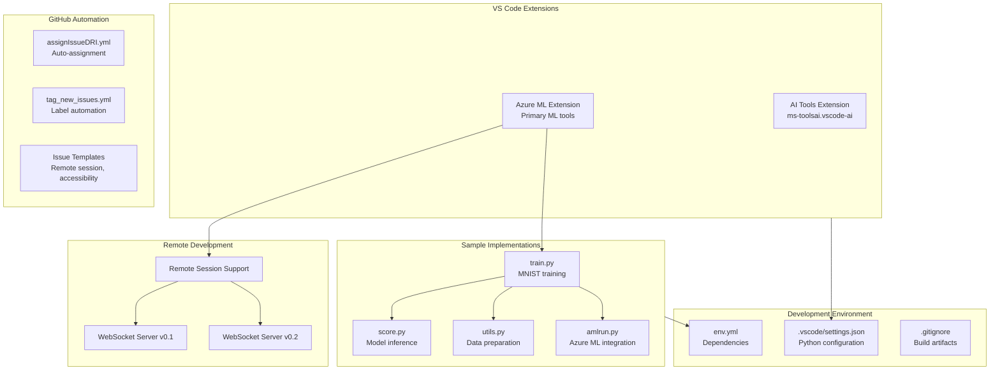
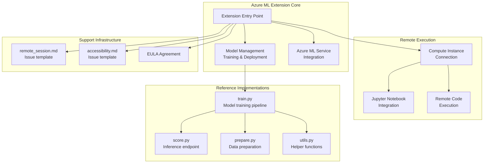

<!-- source: DeepWiki mcp.deepwiki.com · repo microsoft/vscode-tools-for-ai · page 1 Overview · fetched 2026-10-26 -->

# Overview

Relevant source files

The following files were used as context for generating this wiki page:

- [README.md](README.md)
- [archive.zip](archive.zip)
- [archive/ms-toolsai.vscode-ai-0.3.1.zip](archive/ms-toolsai.vscode-ai-0.3.1.zip)

## Purpose and Scope

This document provides an overview of the Azure Machine Learning Tools for Visual Studio Code repository, which contains a comprehensive suite of Visual Studio Code extensions and supporting infrastructure for machine learning development. The repository enables developers to build, train, and deploy machine learning models using Azure Machine Learning service directly from the VS Code interface.

The repository encompasses core VS Code extensions, remote development capabilities, sample projects, and automated GitHub workflows for issue management. For detailed information about specific extensions, see [Core Extensions](#2). For remote development features, see [Remote Development](#3). For example implementations, see [Sample Projects](#4).

Sources: [README.md:1-40]()

## Repository Architecture

The repository is organized into several interconnected systems that work together to provide a complete ML development experience:

Sources: [README.md:1-12](), [.vscode/settings.json](), [env.yml](), [.gitignore]()

## Core Extension Ecosystem

The main functionality is delivered through two primary extensions, with the Azure ML extension serving as the primary interface:

Sources: [train.py](), [score.py](), [prepare.py](), [utils.py](), [.github/ISSUE_TEMPLATE/remote_session.md](), [.github/ISSUE_TEMPLATE/accessibility.md]()

## Key Capabilities

### Machine Learning Workflow Support

The extensions provide comprehensive support for the complete ML lifecycle:

| Capability | Implementation | Key Files |
|------------|----------------|-----------|
| **Local Development** | TensorFlow, PyTorch, Jupyter integration | [train.py](), [utils.py]() |
| **Remote Training** | Azure ML compute clusters, GPU acceleration | [amlrun.py]() |
| **Model Deployment** | Cloud and edge deployment pipelines | [score.py]() |
| **Experiment Tracking** | Metrics logging, model versioning | [train.py:45-60]() |

Sources: [README.md:5-10](), [train.py](), [score.py](), [amlrun.py]()

### Remote Development Infrastructure

The repository includes sophisticated remote development capabilities:

- **WebSocket Communication**: Two versions of WebSocket servers (`v0.1` and `v0.2`) enable real-time communication with remote Azure ML resources
- **Compute Instance Integration**: Direct connection to Azure ML compute instances for remote code execution
- **Notebook Synchronization**: Jupyter notebook integration for interactive development

Sources: WebSocket server implementations, remote session templates

### Automated Issue Management

A comprehensive GitHub automation system handles issue lifecycle management:

| Workflow | File | Purpose |
|----------|------|---------|
| **DRI Assignment** | [.github/workflows/assignIssueDRI.yml]() | Automatic assignment based on rotation |
| **Issue Tagging** | [.github/workflows/tag_new_issues.yml]() | Automatic labeling with `triage-needed` |
| **Team Labeling** | [.github/workflows/team_issue_label.yaml]() | Internal team member identification |

Sources: [.github/workflows/assignIssueDRI.yml](), [.github/workflows/tag_new_issues.yml](), [.github/workflows/team_issue_label.yaml]()

## Platform Integration Points

The repository integrates with multiple external platforms and services:

### Azure Machine Learning Service
- **Model Registry**: Centralized model storage and versioning
- **Compute Management**: Dynamic scaling of training resources  
- **Experiment Tracking**: Comprehensive metrics and artifact logging

### Visual Studio Code Platform
- **Extension API**: Deep integration with VS Code's extension framework
- **Language Services**: Python development environment optimization
- **Remote Development**: Seamless remote workspace management

### Development Toolchain
- **Conda Environment**: Python 3.6.2 with ML dependencies defined in `env.yml`
- **Git Integration**: Comprehensive `.gitignore` for ML artifacts and build outputs
- **VS Code Configuration**: Optimized settings in `.vscode/settings.json`

Sources: [README.md:14-18](), [env.yml](), [.vscode/settings.json](), [.gitignore]()

---

