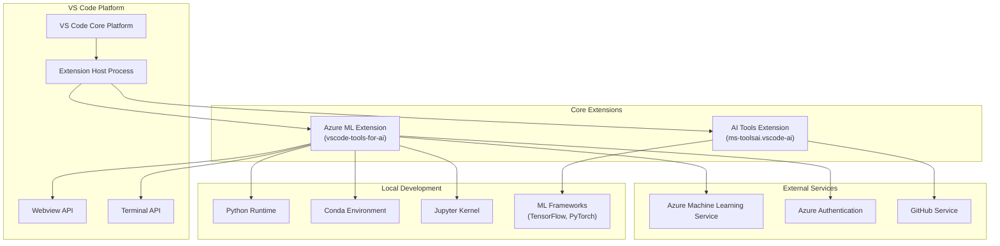
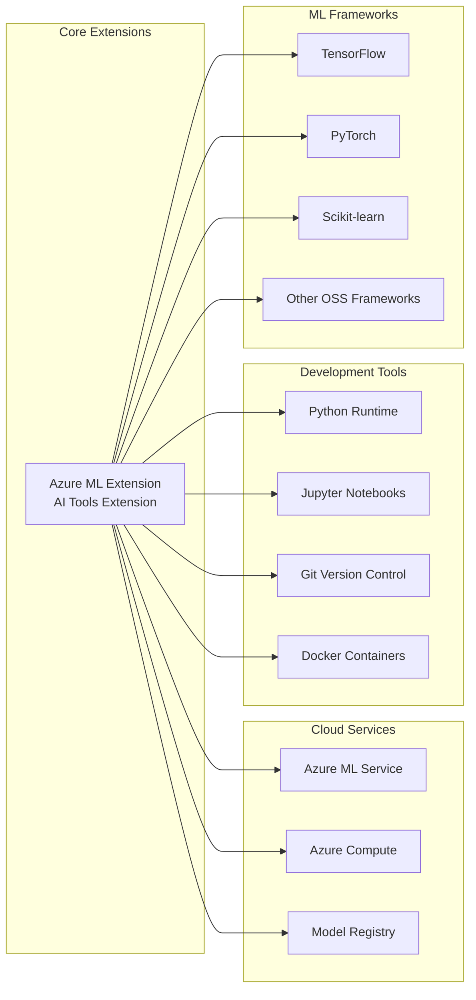

<!-- source: DeepWiki mcp.deepwiki.com · repo microsoft/vscode-tools-for-ai · page 2 Core Extensions · fetched 2026-10-26 -->

# Core Extensions

Relevant source files

The following files were used as context for generating this wiki page:

- [README.md](README.md)
- [archive.zip](archive.zip)
- [archive/ms-toolsai.vscode-ai-0.3.1.zip](archive/ms-toolsai.vscode-ai-0.3.1.zip)

This document covers the main Visual Studio Code extensions provided by the Azure Machine Learning Tools for Visual Studio Code repository. These extensions enable comprehensive machine learning development workflows directly within VS Code, from local experimentation to cloud deployment.

For detailed information about individual extensions, see [Azure Machine Learning Extension](#2.1) and [AI Tools Extension](#2.2). For remote development capabilities enabled by these extensions, see [Remote Development](#3).

## Extension Overview

The repository provides two primary VS Code extensions that work together to create a complete ML development environment:

| Extension | Package ID | Primary Purpose | Key Capabilities |
|-----------|------------|-----------------|------------------|
| Azure Machine Learning Extension | `vscode-tools-for-ai` | Core ML workflow management | Model training, deployment, Azure ML service integration |
| AI Tools Extension | `ms-toolsai.vscode-ai` | AI-powered development assistance | Intelligent code completion, ML-specific tooling |

## Architecture Overview

The core extensions integrate with multiple external services and VS Code platform capabilities to provide a seamless ML development experience:

Sources: [README.md:1-40]()

## Extension Capabilities

### Azure Machine Learning Extension

The primary extension (`vscode-tools-for-ai`) provides comprehensive Azure ML integration with the following core capabilities:

- **Model Development**: Build and train ML models using popular frameworks
- **Cloud Integration**: Seamless connection to Azure ML workspaces and compute resources  
- **Experiment Management**: Track experiments and manage model versions
- **Deployment**: Deploy models to cloud or edge environments
- **Remote Execution**: Execute code on remote compute instances

### AI Tools Extension  

The AI Tools extension (`ms-toolsai.vscode-ai`) enhances the development experience with AI-powered features:

- **Intelligent Code Assistance**: ML-specific code completion and suggestions
- **Framework Integration**: Enhanced support for TensorFlow, PyTorch, and other ML frameworks
- **Development Tooling**: Specialized tools for AI/ML development workflows

## Platform Support

Both extensions support cross-platform development environments:

| Operating System | Architecture | Support Status |
|------------------|--------------|----------------|
| Windows | 64-bit | Fully Supported |
| macOS | 64-bit | Fully Supported |
| Linux Ubuntu | 64-bit | Fully Supported |
| Other Linux Distros | 64-bit | May Work |

Sources: [README.md:14-18]()

## Integration Points

The extensions integrate with multiple external services and local development tools:

Sources: [README.md:5-11]()

## Key Workflows Enabled

The core extensions enable several critical ML development workflows:

1. **Local Development**: Experiment with data and models locally using familiar tools
2. **Cloud Scaling**: Scale experiments to large GPU-enabled clusters in Azure
3. **Automated ML**: Leverage automated machine learning and hyperparameter tuning
4. **Model Management**: Version, track, and manage models throughout their lifecycle
5. **CI/CD Integration**: Deploy models with integrated continuous integration tooling
6. **Remote Execution**: Run code on remote compute instances while maintaining local development experience

These workflows are accomplished directly from the VS Code interface without requiring separate tools or complex configuration.

Sources: [README.md:3-12]()

---

