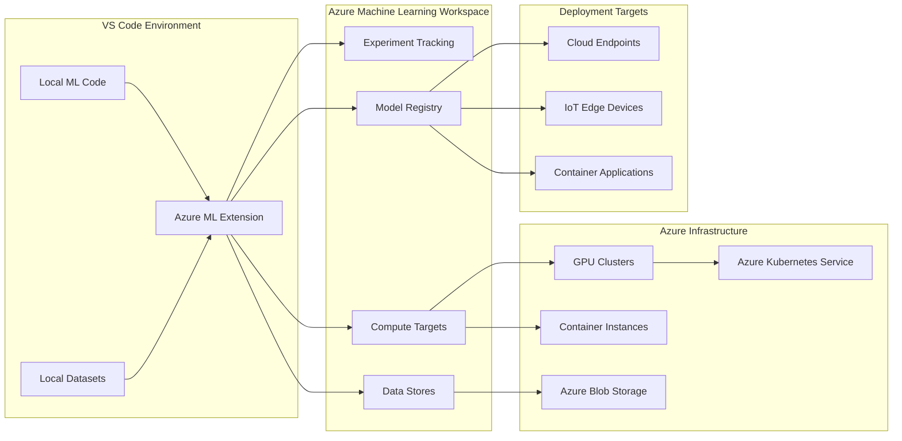

<!-- source: DeepWiki mcp.deepwiki.com · repo microsoft/vscode-tools-for-ai · page 2.1 Azure Machine Learning Extension · fetched 2026-10-26 -->

# Azure Machine Learning Extension

Relevant source files

The following files were used as context for generating this wiki page:

- [README.md](README.md)
- [archive.zip](archive.zip)

## Purpose and Scope

This document covers the Azure Machine Learning for Visual Studio Code extension, which serves as the primary interface for machine learning development within the vscode-tools-for-ai repository. This extension enables users to build, train, and deploy machine learning models directly from Visual Studio Code using Azure Machine Learning service integration.

For information about AI-powered development features, see [AI Tools Extension](#2.2). For remote development capabilities and compute instance connections, see [Remote Sessions & Compute Instances](#3.1). For sample implementations using this extension, see [MNIST Machine Learning Sample](#4.1).

## Core Features and Capabilities

The Azure Machine Learning extension provides comprehensive machine learning development capabilities within VS Code:

### Local Development Support
- **Framework Integration**: Native support for popular ML frameworks including TensorFlow, PyTorch, and Jupyter notebooks
- **Local Experimentation**: Ability to develop and test models locally before cloud deployment
- **Integrated Development Environment**: Full VS Code integration with IntelliSense, debugging, and version control

### Cloud Integration
- **Azure Machine Learning Service**: Direct integration with Azure ML service for cloud-based training and deployment
- **GPU Cluster Access**: Scale experiments to large GPU-enabled clusters in the cloud
- **Automated Machine Learning**: Access to Azure's AutoML capabilities for automated model selection and hyperparameter tuning

### Model Management
- **Experiment Tracking**: Built-in experiment tracking and metrics logging
- **Model Versioning**: Version control for trained models and associated metadata
- **CI/CD Integration**: Integrated continuous integration and deployment tooling for model deployment pipelines

Sources: [README.md:1-40]()

## Extension Architecture

The following diagram shows the core architectural components of the Azure Machine Learning extension:

```mermaid
graph TB
    subgraph "VS Code Extension Host"
        ExtensionCore["Extension Core"]
        LocalExp["Local Experimentation Engine"]
        CloudIntegration["Cloud Integration Layer"]
        ModelMgmt["Model Management"]
    end
    
    subgraph "Local Development"
        TensorFlow["TensorFlow Integration"]
        PyTorch["PyTorch Integration"] 
        Jupyter["Jupyter Notebook Support"]
        Debugging["ML Model Debugging"]
    end
    
    subgraph "Azure ML Service APIs"
        ExperimentAPI["Experiment Management API"]
        ComputeAPI["Compute Resource API"]
        ModelAPI["Model Registry API"]
        DeploymentAPI["Deployment API"]
    end
    
    subgraph "User Interface"
        CommandPalette["VS Code Command Palette"]
        ActivityBar["Azure ML Activity Bar"]
        NotebookInterface["Notebook Interface"]
        TerminalIntegration["Integrated Terminal"]
    end
    
    ExtensionCore --> LocalExp
    ExtensionCore --> CloudIntegration
    ExtensionCore --> ModelMgmt
    
    LocalExp --> TensorFlow
    LocalExp --> PyTorch
    LocalExp --> Jupyter
    LocalExp --> Debugging
    
    CloudIntegration --> ExperimentAPI
    CloudIntegration --> ComputeAPI
    CloudIntegration --> ModelAPI
    CloudIntegration --> DeploymentAPI
    
    ExtensionCore --> CommandPalette
    ExtensionCore --> ActivityBar
    ExtensionCore --> NotebookInterface
    ExtensionCore --> TerminalIntegration
```

Sources: [README.md:3-12]()

## Azure ML Service Integration

This diagram illustrates how the extension integrates with Azure Machine Learning services and external resources:

Sources: [README.md:5-10]()

## Platform Support

The extension supports the following operating systems and configurations:

| Platform | Architecture | Status |
|----------|-------------|---------|
| Windows | 64-bit | Supported |
| macOS | 64-bit | Supported |
| Linux Ubuntu | 64-bit | Supported |
| Other Linux Distributions | 64-bit | May work (not officially tested) |

### System Requirements
- Visual Studio Code (latest stable version recommended)
- Python environment with machine learning frameworks
- Azure subscription for cloud features
- Internet connectivity for Azure ML service integration

Sources: [README.md:14-18]()

## Development Workflows

The extension supports several key development workflows:

### Local-to-Cloud Development Pipeline
1. **Local Development**: Write and test ML code locally using integrated debugging and framework support
2. **Experiment Submission**: Submit experiments to Azure ML compute targets for training at scale
3. **Model Registration**: Register trained models in Azure ML model registry
4. **Deployment**: Deploy models to various targets (cloud endpoints, edge devices, containers)

### Framework-Specific Workflows
- **TensorFlow**: Native TensorFlow model development with Azure ML integration
- **PyTorch**: PyTorch model training and deployment pipelines
- **Jupyter**: Interactive notebook development with cloud compute backing

### Automated ML Integration
- Access to Azure AutoML capabilities for automated model selection
- Hyperparameter tuning and optimization
- Automated feature engineering and model evaluation

Sources: [README.md:5-12]()

## Documentation and Support

### Official Documentation
- Primary documentation available at Azure Machine Learning service documentation
- Integration guides and tutorials for VS Code-specific workflows
- Best practices for local and cloud development

### Community Support
- **GitHub Issue Tracker**: Primary support channel at the repository's issues section
- **Bug Reports**: Structured issue reporting for extension-related problems  
- **Feature Requests**: Community-driven feature suggestion and discussion
- **Code of Conduct**: Microsoft Open Source Code of Conduct compliance

### Legal and Privacy
- **End User License Agreement**: Extension usage governed by Visual Studio license terms
- **Privacy Statement**: Microsoft Enterprise and Developer Privacy Statement applies
- **Contact**: Support team reachable via designated email channels

Sources: [README.md:20-40]()

---

