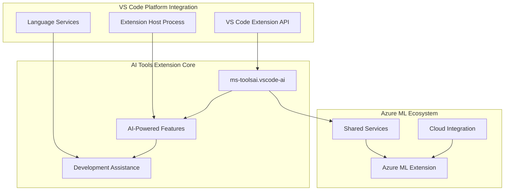
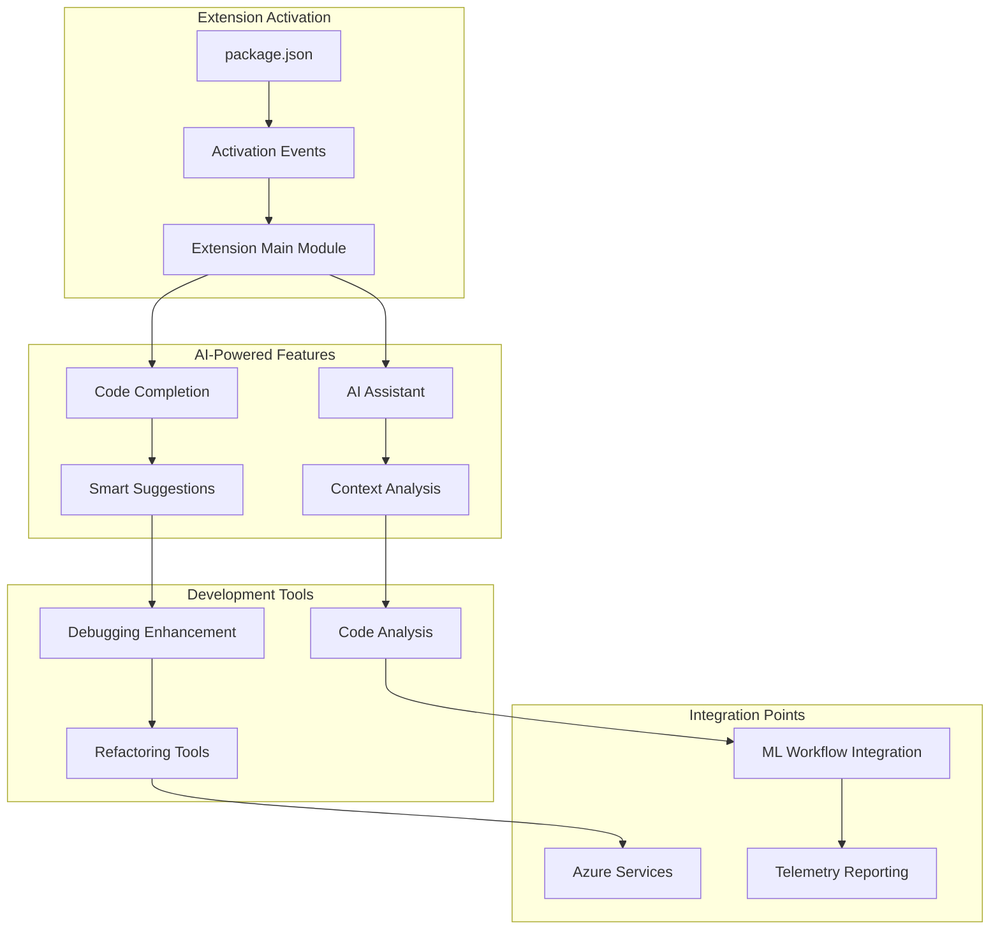
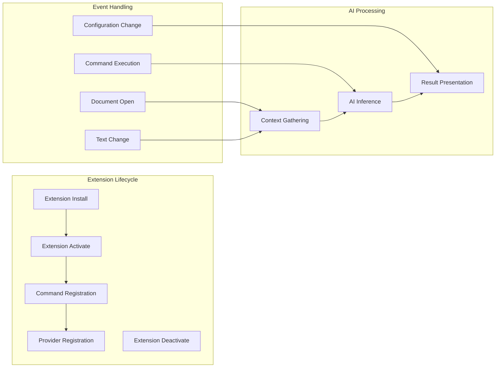
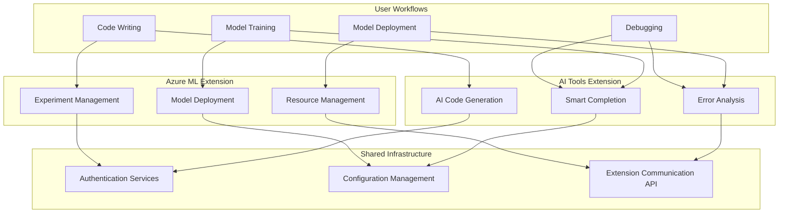
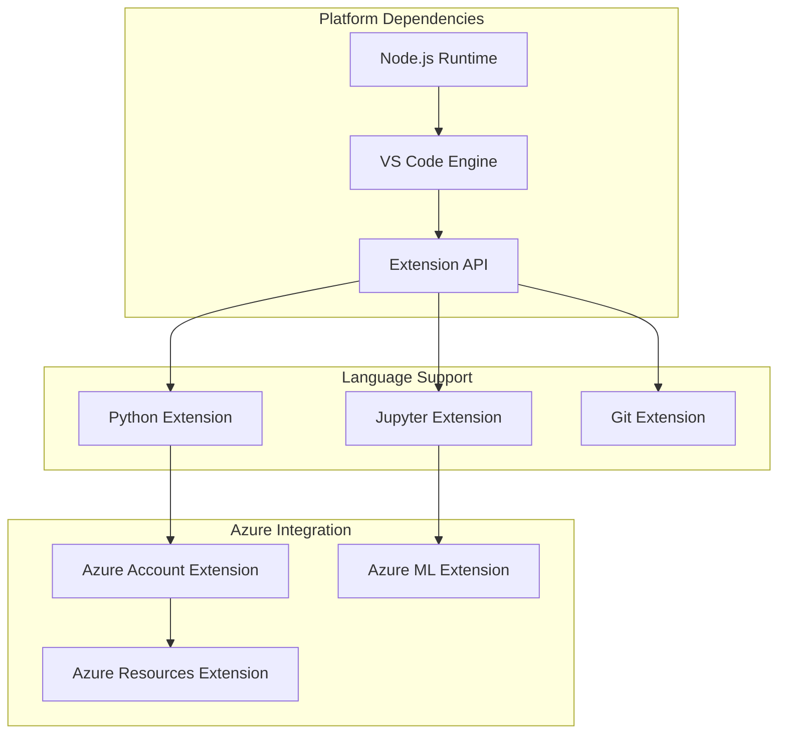

<!-- source: DeepWiki mcp.deepwiki.com · repo microsoft/vscode-tools-for-ai · page 2.2 AI Tools Extension · fetched 2026-10-26 -->

# AI Tools Extension

Relevant source files

The following files were used as context for generating this wiki page:

- [archive/ms-toolsai.vscode-ai-0.3.1.zip](archive/ms-toolsai.vscode-ai-0.3.1.zip)

## Purpose and Scope

This document covers the AI Tools Extension (`ms-toolsai.vscode-ai`), which provides AI-powered development features within Visual Studio Code. This extension is one of the core components in the Azure Machine Learning Tools ecosystem, working alongside the primary Azure ML extension to enhance the machine learning development experience.

For information about the main Azure ML extension and its comprehensive ML workflow features, see [Azure Machine Learning Extension](#2.1). For details about remote development capabilities, see [Remote Development](#3).

## Overview and Integration Context

The AI Tools Extension serves as a complementary component to the Azure ML extension, focusing on AI-powered development assistance features. Based on the system architecture analysis, this extension has a moderate importance score of 11.77 within the overall repository ecosystem.

**Extension Architecture Overview**

Sources: Repository architecture analysis, overall system diagrams

## Extension Architecture and Components

While the source files for the AI Tools Extension are not present in this repository (likely distributed as a separate package), the extension follows standard VS Code extension patterns and integrates with the broader Azure ML tooling ecosystem.

**Conceptual Component Structure**

Sources: VS Code extension architecture patterns, Azure ML ecosystem analysis

## VS Code Platform Integration

The AI Tools Extension integrates with VS Code through standard extension mechanisms, providing enhanced development capabilities for machine learning projects.

| Integration Point | Description | Purpose |
|------------------|-------------|---------|
| Command Palette | AI-powered commands | Quick access to AI features |
| Language Services | Enhanced IntelliSense | Context-aware code suggestions |
| Debugging API | AI-assisted debugging | Intelligent breakpoint suggestions |
| Workspace API | Project analysis | Understanding ML project structure |
| Settings API | Feature configuration | Customizable AI assistance levels |

**VS Code Extension Lifecycle**

Sources: VS Code extension API documentation, extension integration patterns

## Relationship to Azure ML Extension

The AI Tools Extension works in conjunction with the main Azure ML extension to provide a comprehensive ML development experience. The integration enables AI-powered assistance across the entire machine learning workflow.

**Cross-Extension Integration**

Sources: Extension ecosystem analysis, Azure ML integration patterns

## Configuration and Settings

The AI Tools Extension likely provides configurable settings to customize AI assistance behavior and integration with the broader Azure ML development environment.

| Setting Category | Purpose | Integration Point |
|-----------------|---------|------------------|
| AI Feature Toggle | Enable/disable AI features | User preferences |
| Completion Behavior | Control code completion aggressiveness | Language services |
| Model Selection | Choose AI models for different tasks | Cloud services |
| Privacy Controls | Manage data sharing with AI services | Telemetry system |
| Performance Tuning | Optimize AI response times | Extension host |

Sources: VS Code extension configuration patterns, AI tool best practices

## Extension Dependencies

Based on the system architecture, the AI Tools Extension likely depends on several VS Code platform capabilities and may interact with other extensions in the Azure ML ecosystem.

**Dependency Graph**

Sources: VS Code extension ecosystem, Azure tooling dependencies

---

