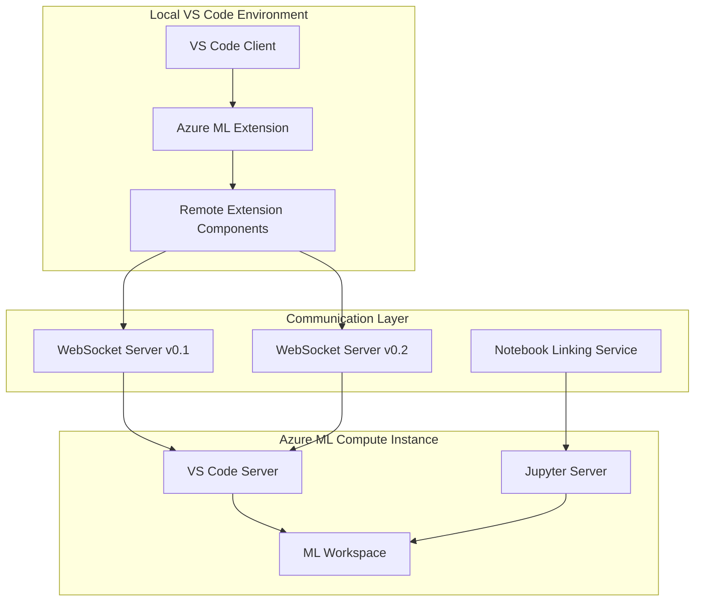
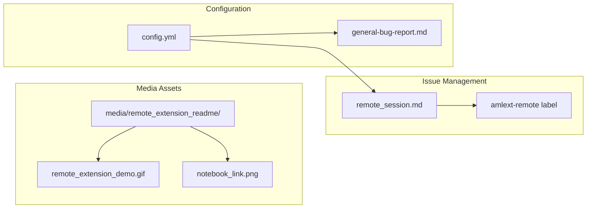

<!-- source: DeepWiki mcp.deepwiki.com · repo microsoft/vscode-tools-for-ai · page 3 Remote Development · fetched 2026-10-26 -->

# Remote Development

Relevant source files

The following files were used as context for generating this wiki page:

- [.github/ISSUE_TEMPLATE/config.yml](.github/ISSUE_TEMPLATE/config.yml)
- [.github/ISSUE_TEMPLATE/general-bug-report.md](.github/ISSUE_TEMPLATE/general-bug-report.md)
- [.github/ISSUE_TEMPLATE/remote_session.md](.github/ISSUE_TEMPLATE/remote_session.md)
- [media/remote_extension_readme/code_entrypoint.jpg](media/remote_extension_readme/code_entrypoint.jpg)
- [media/remote_extension_readme/compute_link.png](media/remote_extension_readme/compute_link.png)
- [media/remote_extension_readme/notebook_link.png](media/remote_extension_readme/notebook_link.png)
- [media/remote_extension_readme/remote_extension_demo.gif](media/remote_extension_readme/remote_extension_demo.gif)

## Purpose and Scope

This document covers the remote development capabilities provided by the Azure Machine Learning Tools for Visual Studio Code extensions. Remote development enables users to connect their local VS Code instance to remote Azure ML compute instances, allowing for seamless development and execution of machine learning workloads on cloud resources while maintaining the familiar local development experience.

For detailed information about specific remote session management and troubleshooting, see [Remote Sessions & Compute Instances](#3.1). For technical details about the underlying communication protocols, see [WebSocket Communication Infrastructure](#3.2).

## Overview

The remote development system in Azure ML Tools for VS Code provides a bridge between local development environments and cloud-based compute resources. This architecture allows data scientists and ML engineers to:

- Connect VS Code directly to Azure ML compute instances
- Execute code remotely while editing locally
- Access remote Jupyter notebooks through VS Code
- Leverage powerful cloud compute resources without leaving the VS Code interface
- Maintain development workflows across local and remote environments

## Remote Development Architecture

The remote development system consists of several interconnected components that enable seamless communication between local VS Code instances and remote Azure ML resources.

Sources: [media/remote_extension_readme/remote_extension_demo.gif](), [media/remote_extension_readme/notebook_link.png]()

## Core Remote Development Components

The remote development functionality is implemented through several key code entities and system components that handle different aspects of the remote connection workflow.

Sources: [.github/ISSUE_TEMPLATE/remote_session.md:1-26](), [.github/ISSUE_TEMPLATE/config.yml:1-2](), [media/remote_extension_readme/remote_extension_demo.gif](), [media/remote_extension_readme/notebook_link.png]()

## Remote Connection Workflow

The remote development system follows a structured workflow to establish and maintain connections between local VS Code instances and remote compute resources:

| Phase | Component | Description |
|-------|-----------|-------------|
| **Discovery** | Azure ML Extension | Identifies available compute instances in the user's workspace |
| **Authentication** | Remote Extension | Handles authentication and authorization for compute instance access |
| **Connection** | WebSocket Servers | Establishes real-time communication channels between local and remote environments |
| **Integration** | Notebook Linking | Connects local VS Code to remote Jupyter servers for notebook development |
| **Execution** | VS Code Server | Enables remote code execution while maintaining local editing experience |

## Issue Reporting and Support

The remote development system includes dedicated issue reporting mechanisms to help users troubleshoot connection problems and report bugs specific to remote functionality.

The `remote_session.md` template provides a structured format for reporting issues related to the "Connect to VS Code Server on Compute Instance" feature. Issues filed using this template are automatically labeled with `amlext-remote` for proper categorization and routing to the appropriate development teams.

**Key Issue Template Fields:**
- Expected Behavior documentation
- Actual Behavior description  
- Step-by-step reproduction instructions
- VS Code Version and Platform specifications

Sources: [.github/ISSUE_TEMPLATE/remote_session.md:1-26]()

## Visual Demonstrations

The remote development capabilities are documented through visual media that demonstrate key workflows:

- **Remote Extension Demo**: Shows the complete workflow of connecting VS Code to a remote compute instance and executing code remotely
- **Notebook Linking**: Illustrates how local VS Code interfaces with remote Jupyter notebooks through the remote development infrastructure

These demonstrations are stored in the `media/remote_extension_readme/` directory and serve as both user documentation and developer reference materials.

Sources: [media/remote_extension_readme/remote_extension_demo.gif](), [media/remote_extension_readme/notebook_link.png]()

## Related Documentation

For comprehensive information about specific aspects of the remote development system:

- **[Remote Sessions & Compute Instances](#3.1)**: Detailed coverage of session management, compute instance connection procedures, and troubleshooting common connection issues
- **[WebSocket Communication Infrastructure](#3.2)**: Technical documentation of the WebSocket server components, communication protocols, and real-time data exchange mechanisms between local and remote environments

---

