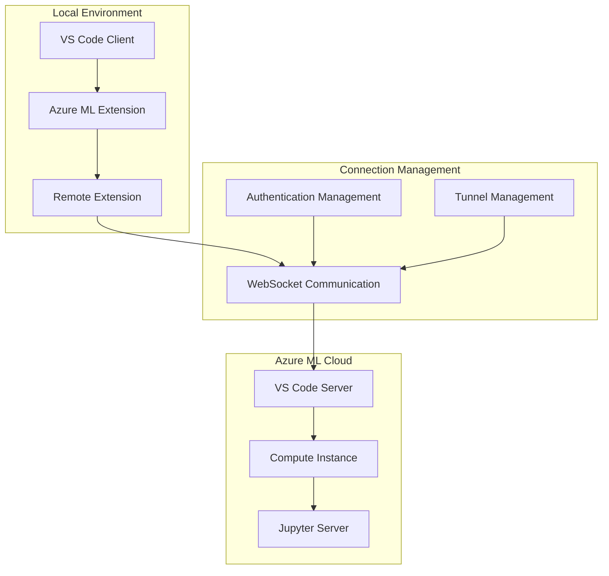
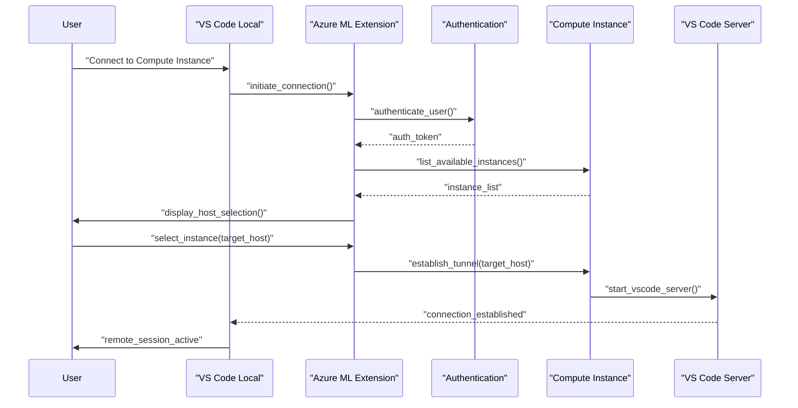
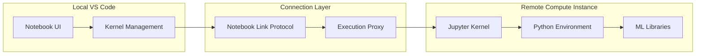

<!-- source: DeepWiki mcp.deepwiki.com · repo microsoft/vscode-tools-for-ai · page 3.1 Remote Sessions & Compute Instances · fetched 2026-10-26 -->

# Remote Sessions & Compute Instances

Relevant source files

The following files were used as context for generating this wiki page:

- [.github/ISSUE_TEMPLATE/config.yml](.github/ISSUE_TEMPLATE/config.yml)
- [.github/ISSUE_TEMPLATE/general-bug-report.md](.github/ISSUE_TEMPLATE/general-bug-report.md)
- [.github/ISSUE_TEMPLATE/remote_session.md](.github/ISSUE_TEMPLATE/remote_session.md)
- [media/compute_instance_product_doc/ci_command_with_highlight.png](media/compute_instance_product_doc/ci_command_with_highlight.png)
- [media/compute_instance_product_doc/host_selection_with_highlight.png](media/compute_instance_product_doc/host_selection_with_highlight.png)
- [media/compute_instance_product_doc/identity_flag_with_highlight.png](media/compute_instance_product_doc/identity_flag_with_highlight.png)
- [media/remote_extension_readme/code_entrypoint.jpg](media/remote_extension_readme/code_entrypoint.jpg)
- [media/remote_extension_readme/compute_link.png](media/remote_extension_readme/compute_link.png)
- [media/remote_extension_readme/notebook_link.png](media/remote_extension_readme/notebook_link.png)
- [media/remote_extension_readme/remote_extension_demo.gif](media/remote_extension_readme/remote_extension_demo.gif)
- [media/remote_extension_web_readme/compute_link.png](media/remote_extension_web_readme/compute_link.png)
- [media/remote_extension_web_readme/notebook_link.png](media/remote_extension_web_readme/notebook_link.png)

## Purpose and Scope

This document covers the remote session functionality that enables users to connect their local Visual Studio Code instance to Azure Machine Learning compute instances. This allows developers to edit code locally while executing it on powerful cloud-based compute resources.

For technical details about the WebSocket communication infrastructure that enables these connections, see [WebSocket Communication Infrastructure](#3.2).

## Overview

The remote sessions system provides a bridge between local VS Code development environments and Azure ML compute instances. Users can seamlessly connect to remote compute resources, access notebooks, run training scripts, and manage their ML workflows without leaving their familiar local development environment.

### Key Components

The remote session system consists of several interconnected components:

**Sources:** [.github/ISSUE_TEMPLATE/remote_session.md:1-26](), [media/remote_extension_readme/remote_extension_demo.gif:1-10]()

## Connection Workflow

Users establish remote sessions through a structured workflow that handles authentication, host selection, and tunnel establishment:

**Sources:** [.github/ISSUE_TEMPLATE/remote_session.md:2-3](), [media/compute_instance_product_doc/host_selection_with_highlight.png:1-10]()

## User Interface Components

### Host Selection Interface

The system provides a host selection interface where users can choose from available compute instances. This interface displays:

- Available compute instance names
- Instance status and availability
- Resource specifications
- Connection health indicators

### Identity and Authentication

Authentication is managed through Azure identity integration, with support for:

- Azure Active Directory authentication
- Service principal authentication  
- Managed identity authentication
- Personal access tokens

**Sources:** [media/compute_instance_product_doc/identity_flag_with_highlight.png:1-10]()

### Command Integration

Remote sessions integrate with VS Code's command palette and terminal, allowing users to:

- Execute commands on remote compute instances
- Access remote file systems
- Run training scripts and notebooks
- Monitor resource usage

**Sources:** [media/compute_instance_product_doc/ci_command_with_highlight.png:1-10]()

## Notebook Integration

The remote session system provides seamless integration with Jupyter notebooks running on compute instances:

**Sources:** [media/remote_extension_readme/notebook_link.png:1-10]()

## Code Execution and File Access

Remote sessions enable transparent code execution and file system access:

### Code Entrypoints

The system supports multiple code execution entrypoints:

- Interactive Python execution
- Script execution with arguments
- Notebook cell execution
- Terminal command execution

### File System Integration

Users can seamlessly browse and edit files on remote compute instances as if they were local files:

- Remote file explorer integration
- Real-time file synchronization
- Git integration for remote repositories
- Workspace folder mapping

**Sources:** [media/remote_extension_readme/code_entrypoint.jpg:1-10](), [media/remote_extension_readme/compute_link.png:1-10]()

## Issue Reporting and Troubleshooting

### Common Issues

The most frequently reported issues with remote sessions include:

- Connection timeouts and failures
- Authentication problems
- Tunnel establishment errors
- Performance degradation

### Issue Template

Users experiencing problems with remote sessions should use the dedicated issue template which captures:

- Expected vs actual behavior
- Detailed reproduction steps
- VS Code version information
- Platform specifications

The issue template automatically applies the `amlext-remote` label for proper categorization and routing to the appropriate development team.

**Sources:** [.github/ISSUE_TEMPLATE/remote_session.md:1-26]()

### Debugging Information

When reporting issues, users should include:

- VS Code version and platform details
- Azure ML extension version
- Compute instance specifications
- Network configuration details
- Console output and error messages

**Sources:** [.github/ISSUE_TEMPLATE/remote_session.md:22-25]()

---

