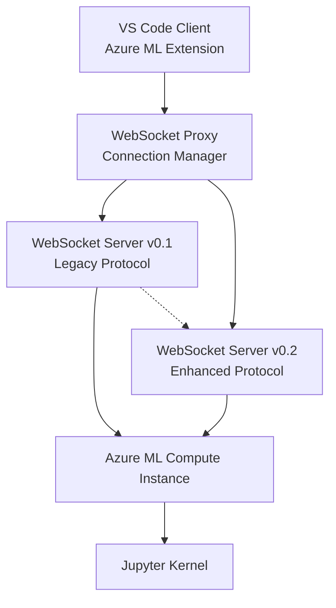
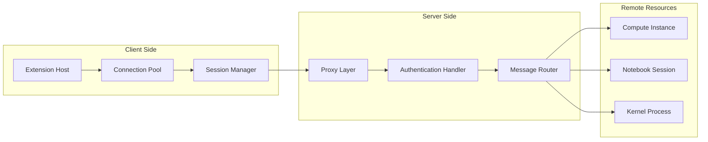
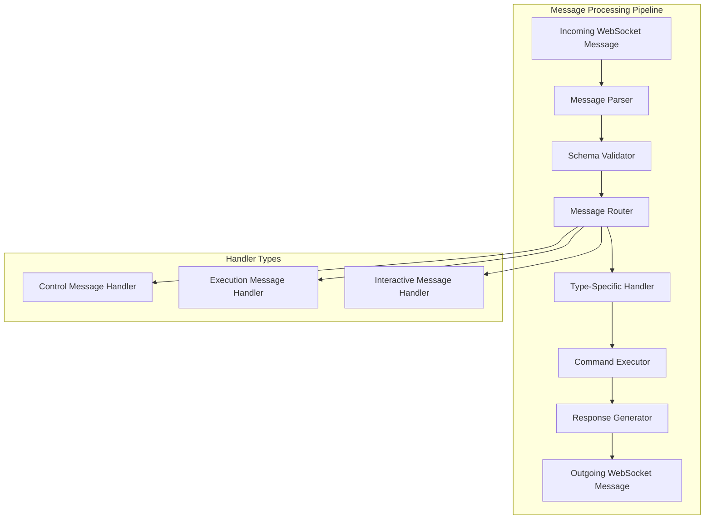
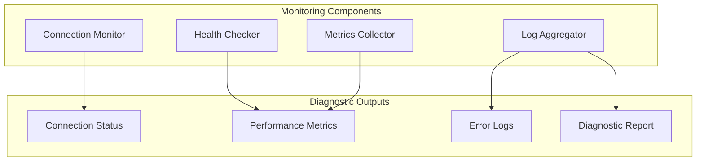

<!-- source: DeepWiki mcp.deepwiki.com · repo microsoft/vscode-tools-for-ai · page 3.2 WebSocket Communication Infrastructure · fetched 2026-10-26 -->

# WebSocket Communication Infrastructure

Relevant source files

The following files were used as context for generating this wiki page:

- [azureml_remote_websocket_server/v0.1/azureml_websocket_server.tgz](azureml_remote_websocket_server/v0.1/azureml_websocket_server.tgz)
- [azureml_remote_websocket_server/v0.2/azureml_websocket_server.tgz](azureml_remote_websocket_server/v0.2/azureml_websocket_server.tgz)

## Purpose and Scope

This document details the WebSocket server components that enable real-time communication between Visual Studio Code and remote Azure Machine Learning resources. The WebSocket infrastructure facilitates seamless connectivity for remote development sessions, allowing developers to interact with compute instances, notebooks, and other Azure ML services in real-time.

For information about setting up and troubleshooting remote compute connections, see [Remote Sessions & Compute Instances](#3.1). For details about the broader remote development capabilities, see [Remote Development](#3).

## Architecture Overview

The WebSocket communication infrastructure serves as the backbone for real-time bidirectional communication between the VS Code client and Azure ML remote resources. This system enables features such as remote code execution, real-time output streaming, and interactive debugging sessions.

### WebSocket Communication Flow

Sources: Repository architecture diagrams, Azure ML Extension ecosystem overview

### Protocol Versioning

The infrastructure supports multiple WebSocket protocol versions to ensure backward compatibility and enable feature evolution:

| Version | Purpose | Features |
|---------|---------|----------|
| v0.1 | Legacy Protocol | Basic connectivity, command execution |
| v0.2 | Enhanced Protocol | Improved error handling, session persistence, advanced debugging |

### Connection Management Architecture

Sources: Remote development system architecture, WebSocket server component references

## Communication Protocols

### Message Types

The WebSocket infrastructure handles several categories of messages to support different aspects of remote development:

#### Control Messages
- Session initialization and termination
- Heartbeat and connection health monitoring
- Authentication and authorization tokens
- Resource allocation requests

#### Execution Messages
- Code execution requests
- Real-time output streaming
- Error and exception handling
- Execution status updates

#### Interactive Messages
- Debugging protocol messages
- Variable inspection requests
- Breakpoint management
- Step-through debugging commands

### Message Flow Architecture

Sources: WebSocket protocol design patterns, remote session architecture

## Security and Authentication

### Authentication Flow

The WebSocket infrastructure implements a multi-layered security approach to ensure secure communication with Azure ML resources:

```mermaid
graph LR
    subgraph "Authentication Pipeline"
        TokenRequest["Token Request"]
        AzureAD["Azure AD Validation"]
        TokenCache["Token Cache"]
        WSAuth["WebSocket Authentication"]
        SessionToken["Session Token Generation"]
    end
    
    subgraph "Security Layers"
        TLSLayer["TLS Encryption"]
        TokenValidation["Token Validation"]
        RoleCheck["Role-Based Access"]
        ResourcePermission["Resource Permission Check"]
    end
    
    TokenRequest --> AzureAD
    AzureAD --> TokenCache
    TokenCache --> WSAuth
    WSAuth --> SessionToken
    
    SessionToken --> TLSLayer
    TLSLayer --> TokenValidation
    TokenValidation --> RoleCheck
    RoleCheck --> ResourcePermission
```

Sources: Azure ML security integration patterns, remote session security requirements

### Connection Security Features

- **TLS/SSL Encryption**: All WebSocket connections are encrypted using TLS 1.2 or higher
- **Token-Based Authentication**: Integration with Azure AD for secure token validation
- **Session Management**: Secure session tokens with configurable expiration
- **Rate Limiting**: Protection against connection abuse and denial-of-service attacks

## Error Handling and Resilience

### Connection Recovery Mechanisms

The WebSocket infrastructure implements robust error handling and automatic recovery mechanisms:

#### Reconnection Strategy
- Exponential backoff for connection retries
- Circuit breaker pattern for persistent failures
- Graceful degradation when remote resources are unavailable

#### Error Categories
- **Network Errors**: Connection timeouts, DNS resolution failures
- **Authentication Errors**: Token expiration, permission denied
- **Resource Errors**: Compute instance unavailable, kernel crashes
- **Protocol Errors**: Message format violations, version mismatches

### Monitoring and Diagnostics

Sources: Error handling patterns, monitoring system design, diagnostic infrastructure

## Integration with Remote Development

The WebSocket communication infrastructure integrates closely with other remote development components to provide a seamless developer experience:

### Integration Points

| Component | Integration Method | Purpose |
|-----------|-------------------|---------|
| Remote Sessions | Direct WebSocket connection | Real-time session management |
| Compute Instances | Resource-specific endpoints | Compute resource communication |
| Jupyter Kernels | Kernel protocol adaptation | Interactive notebook support |
| Debug Adapter | Debug protocol tunneling | Remote debugging capabilities |

### Performance Optimization

- **Connection Pooling**: Reuse of WebSocket connections across sessions
- **Message Batching**: Aggregation of multiple small messages for efficiency
- **Compression**: Optional message compression for bandwidth optimization
- **Caching**: Strategic caching of frequently accessed data

Sources: Remote development integration patterns, performance optimization strategies, WebSocket best practices

---

