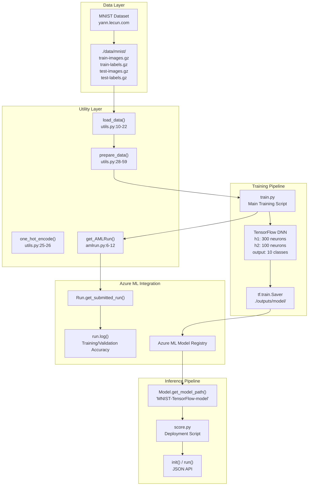

<!-- source: DeepWiki mcp.deepwiki.com · repo microsoft/vscode-tools-for-ai · page 4 Sample Projects · fetched 2026-10-26 -->

# Sample Projects

Relevant source files

The following files were used as context for generating this wiki page:

- [mnist-vscode-docs-sample/amlrun.py](mnist-vscode-docs-sample/amlrun.py)
- [mnist-vscode-docs-sample/prepare.py](mnist-vscode-docs-sample/prepare.py)
- [mnist-vscode-docs-sample/score.py](mnist-vscode-docs-sample/score.py)
- [mnist-vscode-docs-sample/train.py](mnist-vscode-docs-sample/train.py)
- [mnist-vscode-docs-sample/utils.py](mnist-vscode-docs-sample/utils.py)

This document provides an overview of the sample projects included in the Azure Machine Learning Tools for Visual Studio Code repository. These samples demonstrate end-to-end machine learning workflows using the VS Code extensions and Azure ML services. The primary sample is a complete MNIST digit classification project that showcases training, deployment, and inference workflows.

For detailed documentation of the MNIST machine learning sample implementation, see [MNIST Machine Learning Sample](#4.1). For information about VS Code extension features used by these samples, see [Azure Machine Learning Extension](#2.1).

## Purpose and Structure

The sample projects serve as practical demonstrations of machine learning development workflows using Azure ML Tools for VS Code. They illustrate key concepts including local development, Azure ML integration, model training, deployment, and inference. Each sample provides a complete, runnable example that developers can use as a starting point for their own projects.

## MNIST Sample Project Architecture

The repository includes a comprehensive MNIST digit classification sample located in the `mnist-vscode-docs-sample/` directory. This sample demonstrates the complete machine learning lifecycle from data preparation to model deployment.

### Component Architecture

Sources: [mnist-vscode-docs-sample/train.py:1-86](), [mnist-vscode-docs-sample/score.py:1-26](), [mnist-vscode-docs-sample/utils.py:1-59](), [mnist-vscode-docs-sample/amlrun.py:1-12]()

### Data Flow and Processing Pipeline

```mermaid
graph LR
    subgraph "Data Acquisition"
        Download["urllib.request.urlretrieve()<br/>MNIST gz files"]
        Extract["gzip.open()<br/>struct.unpack()"]
        Normalize["data / 255.0<br/>utils.py:51,54"]
    end
    
    subgraph "Training Flow"
        Batch["batch_size = 50<br/>train.py:25"]
        Shuffle["np.random.permutation()<br/>train.py:54-56"]
        Forward["sess.run(train_op)<br/>train.py:68"]
        Evaluate["acc_op.eval()<br/>train.py:71,73"]
        Log["run.log()<br/>train.py:77-78"]
    end
    
    subgraph "Model Persistence"
        Save["saver.save()<br/>./outputs/model/mnist-tf.model"]
        MetaGraph["mnist-tf.model.meta"]
        Registry["MNIST-TensorFlow-model"]
    end
    
    subgraph "Inference Flow"
        Load["tf.train.import_meta_graph()"]
        Restore["saver.restore()"]
        Predict["output.eval()<br/>np.argmax()"]
        JSON["json.loads()/dumps()"]
    end
    
    Download --> Extract
    Extract --> Normalize
    Normalize --> Batch
    Batch --> Shuffle
    Shuffle --> Forward
    Forward --> Evaluate
    Evaluate --> Log
    
    Forward --> Save
    Save --> MetaGraph
    MetaGraph --> Registry
    
    Registry --> Load
    Load --> Restore
    Restore --> Predict
    Predict --> JSON
```

Sources: [mnist-vscode-docs-sample/utils.py:33-47](), [mnist-vscode-docs-sample/train.py:49-85](), [mnist-vscode-docs-sample/score.py:9-26]()

## File Structure and Responsibilities

The MNIST sample project is organized into focused modules with clear separation of concerns:

| File | Primary Functions | Purpose |
|------|------------------|---------|
| `train.py` | `tf.Session()`, `train_op`, `acc_op` | Main training script with TensorFlow DNN implementation |
| `score.py` | `init()`, `run()` | Azure ML deployment interface for model inference |
| `utils.py` | `prepare_data()`, `load_data()`, `one_hot_encode()` | Data preparation and utility functions |
| `amlrun.py` | `get_AMLRun()` | Azure ML run context detection and integration |
| `prepare.py` | `download_data()`, `load_data()` | Standalone data download and visualization script |

### Training Script Architecture

The training script [mnist-vscode-docs-sample/train.py:1-86]() implements a complete deep neural network training pipeline:

**Network Definition**: [mnist-vscode-docs-sample/train.py:27-33]()
- Input layer: 784 neurons (28×28 pixel images)
- Hidden layer 1: 300 neurons with ReLU activation
- Hidden layer 2: 100 neurons with ReLU activation  
- Output layer: 10 neurons (digit classes 0-9)

**Training Configuration**: [mnist-vscode-docs-sample/train.py:19-26]()
- Learning rate: 0.01
- Epochs: 100
- Batch size: 50
- Optimizer: `tf.train.GradientDescentOptimizer`

**Azure ML Integration**: [mnist-vscode-docs-sample/train.py:47,76-78]()
- Automatic run detection via `get_AMLRun()`
- Metric logging for training and validation accuracy
- Model output to `./outputs/model/` for Azure ML artifact storage

### Inference Script Architecture  

The scoring script [mnist-vscode-docs-sample/score.py:1-26]() implements Azure ML's deployment interface:

**Model Loading**: [mnist-vscode-docs-sample/score.py:9-19]()
- Retrieves model path using `Model.get_model_path('MNIST-TensorFlow-model')`
- Restores TensorFlow graph from meta file
- Establishes session for inference

**Inference API**: [mnist-vscode-docs-sample/score.py:21-26]()
- `run()` function accepts JSON input with 'data' field
- Performs forward pass through restored model
- Returns JSON response with predicted digit classes

Sources: [mnist-vscode-docs-sample/train.py:1-86](), [mnist-vscode-docs-sample/score.py:1-26](), [mnist-vscode-docs-sample/utils.py:1-59](), [mnist-vscode-docs-sample/amlrun.py:1-12](), [mnist-vscode-docs-sample/prepare.py:1-73]()

## Integration with Azure ML Tools

The sample projects demonstrate several key integration points with the Azure ML VS Code extensions:

### Local Development Features
- **Dataset Management**: Automated download and caching of MNIST data
- **Environment Setup**: Compatible with VS Code Python environments
- **Debugging Support**: Standard Python debugging workflow for training scripts

### Azure ML Cloud Integration
- **Experiment Tracking**: Automatic metric logging when running in Azure ML
- **Model Registration**: Seamless model artifact upload and versioning
- **Compute Scaling**: Scripts designed to run on both local and cloud compute

### Deployment Workflow
- **Model Packaging**: Standardized model saving format for Azure ML
- **Inference Endpoints**: Ready-to-deploy scoring scripts with proper interfaces
- **Testing Support**: Local testing capabilities before cloud deployment

The sample structure supports the complete development lifecycle from initial experimentation to production deployment, demonstrating best practices for Azure ML integration within VS Code.

Sources: [mnist-vscode-docs-sample/train.py:47,76-78](), [mnist-vscode-docs-sample/score.py:13,22-26](), [mnist-vscode-docs-sample/amlrun.py:6-12]()

---

