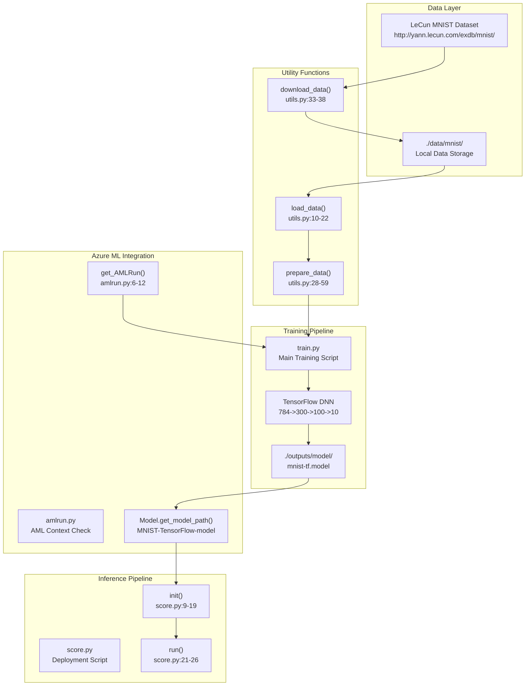
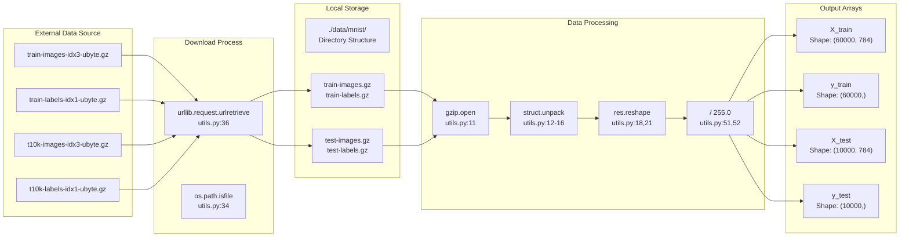
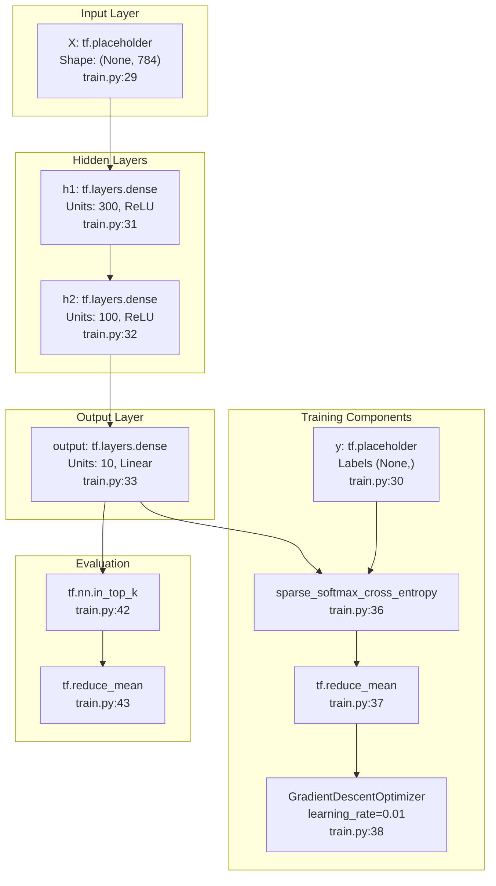
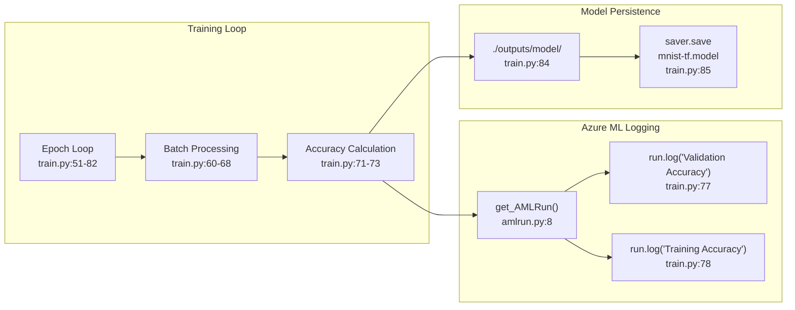
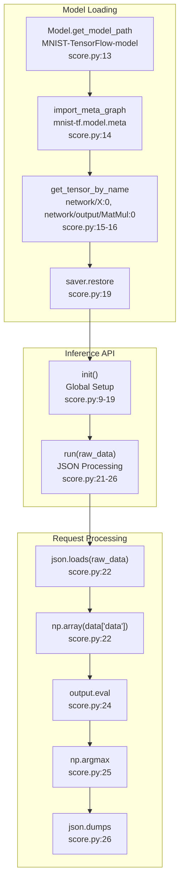
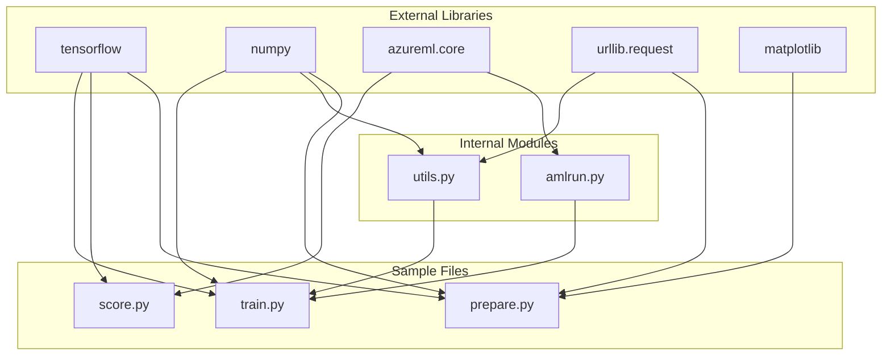

<!-- source: DeepWiki mcp.deepwiki.com · repo microsoft/vscode-tools-for-ai · page 4.1 MNIST Machine Learning Sample · fetched 2026-10-26 -->

# MNIST Machine Learning Sample

<details>
<summary>Relevant source files</summary>

The following files were used as context for generating this wiki page:

- [mnist-vscode-docs-sample/amlrun.py](mnist-vscode-docs-sample/amlrun.py)
- [mnist-vscode-docs-sample/prepare.py](mnist-vscode-docs-sample/prepare.py)
- [mnist-vscode-docs-sample/score.py](mnist-vscode-docs-sample/score.py)
- [mnist-vscode-docs-sample/train.py](mnist-vscode-docs-sample/train.py)
- [mnist-vscode-docs-sample/utils.py](mnist-vscode-docs-sample/utils.py)

</details>


## Purpose and Scope

This document covers the MNIST Machine Learning Sample project, a complete end-to-end machine learning workflow that demonstrates handwritten digit classification using TensorFlow and Azure Machine Learning integration. The sample includes data preparation, model training, inference deployment, and Azure ML experiment tracking.

The sample serves as a practical reference implementation for developers using the Azure Machine Learning VS Code extensions to build, train, and deploy machine learning models. For information about the core Azure ML extension capabilities, see [Azure Machine Learning Extension](#2.1). For remote development features, see [Remote Sessions & Compute Instances](#3.1).

## Architecture Overview

The MNIST sample implements a classic supervised learning pipeline with Azure ML integration. The system follows a modular design with separate components for data handling, training, and inference.

### System Components



Sources: [mnist-vscode-docs-sample/train.py:1-86](), [mnist-vscode-docs-sample/score.py:1-26](), [mnist-vscode-docs-sample/utils.py:1-59](), [mnist-vscode-docs-sample/amlrun.py:1-12]()

## Data Preparation Workflow

The sample includes comprehensive data handling capabilities for the MNIST dataset, with both utility functions and standalone preparation scripts.

### Data Flow Architecture



Sources: [mnist-vscode-docs-sample/utils.py:28-59](), [mnist-vscode-docs-sample/prepare.py:14-56]()

### Key Data Processing Functions

| Function | File | Purpose | Input | Output |
|----------|------|---------|-------|--------|
| `prepare_data` | utils.py:28-59 | Orchestrates complete data pipeline | dataset name, data_folder | X_train, X_test, y_train, y_test |
| `load_data` | utils.py:10-22 | Loads compressed MNIST files | filename, label flag | numpy array |
| `download_data` | utils.py:33-38 | Downloads files with caching | url, filename | Downloaded file |
| `one_hot_encode` | utils.py:25-26 | Converts labels to one-hot | array, num_classes | One-hot encoded array |

The data preparation process downloads MNIST files from Yann LeCun's website, stores them locally in `./data/mnist/`, and provides normalized numpy arrays for training and testing.

Sources: [mnist-vscode-docs-sample/utils.py:1-59]()

## Training Pipeline

The training pipeline implements a deep neural network using TensorFlow with Azure ML integration for experiment tracking and model persistence.

### Neural Network Architecture



Sources: [mnist-vscode-docs-sample/train.py:27-44]()

### Training Configuration

The training process uses the following hyperparameters defined in [mnist-vscode-docs-sample/train.py:19-25]():

| Parameter | Value | Variable Name |
|-----------|-------|---------------|
| Input Size | 784 (28×28) | `n_inputs` |
| Hidden Layer 1 | 300 neurons | `n_h1` |
| Hidden Layer 2 | 100 neurons | `n_h2` |
| Output Classes | 10 digits | `n_outputs` |
| Learning Rate | 0.01 | `learning_rate` |
| Epochs | 100 | `n_epochs` |
| Batch Size | 50 | `batch_size` |

### Azure ML Integration

The training script integrates with Azure ML through the `get_AMLRun()` function, enabling experiment tracking and metric logging:



Sources: [mnist-vscode-docs-sample/train.py:47-85](), [mnist-vscode-docs-sample/amlrun.py:6-12]()

## Inference and Deployment

The inference pipeline provides a production-ready scoring service compatible with Azure ML model deployment infrastructure.

### Deployment Interface



Sources: [mnist-vscode-docs-sample/score.py:1-26]()

### Deployment Functions

| Function | Purpose | Input | Output | Global Variables |
|----------|---------|-------|--------|------------------|
| `init()` | Initialize model and session | None | None | Sets `X`, `output`, `sess` |
| `run(raw_data)` | Process inference requests | JSON string with 'data' field | JSON array of predictions | Uses `X`, `output`, `sess` |

The scoring script expects input in the format:
```json
{
  "data": [[pixel_values_784_elements], [another_image], ...]
}
```

And returns predictions as:
```json
[0, 1, 2, 7, 9, ...]
```

Sources: [mnist-vscode-docs-sample/score.py:9-26]()

## File Structure and Dependencies

The MNIST sample consists of five core Python files that work together to provide a complete ML workflow:

| File | Primary Functions | Dependencies | Purpose |
|------|------------------|--------------|---------|
| `train.py` | Training pipeline | tensorflow, numpy, utils, amlrun | Model training and Azure ML integration |
| `score.py` | `init()`, `run()` | tensorflow, azureml.core.model | Model deployment and inference |
| `utils.py` | `prepare_data()`, `load_data()` | numpy, urllib, gzip | Data processing utilities |
| `amlrun.py` | `get_AMLRun()` | azureml.core | Azure ML context management |
| `prepare.py` | Standalone data prep | matplotlib, tensorflow | Interactive data exploration |

### Import Dependencies



Sources: [mnist-vscode-docs-sample/train.py:1-10](), [mnist-vscode-docs-sample/score.py:1-7](), [mnist-vscode-docs-sample/utils.py:1-7](), [mnist-vscode-docs-sample/amlrun.py:1-2](), [mnist-vscode-docs-sample/prepare.py:1-9]()

The sample demonstrates best practices for structuring machine learning projects with clear separation of concerns between data handling, training, and deployment components, while maintaining integration with Azure ML services for enterprise-scale ML operations.

---

