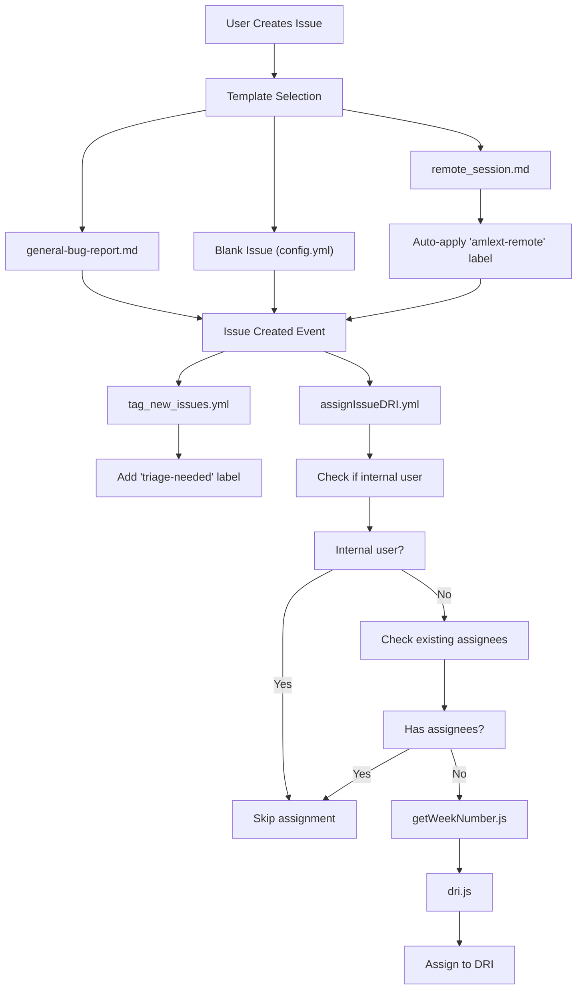
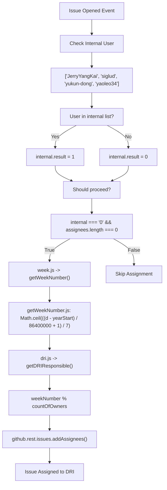

<!-- source: DeepWiki mcp.deepwiki.com · repo microsoft/vscode-tools-for-ai · page 5 GitHub Integration & Issue Management · fetched 2026-10-26 -->

# GitHub Integration & Issue Management

<details>
<summary>Relevant source files</summary>

The following files were used as context for generating this wiki page:

- [.github/ISSUE_TEMPLATE/config.yml](.github/ISSUE_TEMPLATE/config.yml)
- [.github/ISSUE_TEMPLATE/general-bug-report.md](.github/ISSUE_TEMPLATE/general-bug-report.md)
- [.github/ISSUE_TEMPLATE/remote_session.md](.github/ISSUE_TEMPLATE/remote_session.md)
- [.github/workflows/assignIssueDRI.yml](.github/workflows/assignIssueDRI.yml)
- [.github/workflows/dri.js](.github/workflows/dri.js)
- [.github/workflows/getWeekNumber.js](.github/workflows/getWeekNumber.js)
- [.github/workflows/tag_new_issues.yml](.github/workflows/tag_new_issues.yml)
- [.github/workflows/week.js](.github/workflows/week.js)

</details>


This document covers the automated GitHub issue management system that handles issue creation, assignment, labeling, and workflow automation for the Azure Machine Learning Tools for Visual Studio Code repository. The system provides structured issue reporting through templates and automated assignment of issues to team members using a rotation-based approach.

For information about other development workflow aspects, see [Development Environment & Documentation](#6). For details about the issue template structures specifically, see [Issue Templates](#5.1). For automation workflow implementation details, see [Automated Workflows](#5.2).

## System Overview

The GitHub integration system consists of three main components: issue templates that structure user reports, automated workflows that process new issues, and supporting JavaScript utilities that implement assignment logic. The system automatically assigns newly created issues to team members based on a weekly rotation schedule and applies appropriate labels for triaging.

### Issue Management Flow



**Sources:** [.github/ISSUE_TEMPLATE/remote_session.md:1-26](), [.github/ISSUE_TEMPLATE/general-bug-report.md:1-26](), [.github/ISSUE_TEMPLATE/config.yml:1-2](), [.github/workflows/assignIssueDRI.yml:1-71](), [.github/workflows/tag_new_issues.yml:1-19]()

## Issue Template System

The repository provides structured issue templates that automatically categorize and label issues based on their type. The template system guides users through providing relevant information and ensures consistent issue reporting.

### Template Configuration

| Template | File | Auto Labels | Purpose |
|----------|------|-------------|---------|
| Remote Session Issues | `remote_session.md` | `amlext-remote` | Connect to Compute Instance problems |
| General Bug Reports | `general-bug-report.md` | None | Standard bug reporting |
| Blank Issues | `config.yml` | None | Allows freeform issue creation |

### Remote Session Template Structure

The remote session template [.github/ISSUE_TEMPLATE/remote_session.md:1-26]() provides specific fields for reporting connection issues:

- **Expected Behavior**: What should happen during connection
- **Actual Behavior**: What actually occurs
- **Steps to Reproduce**: Numbered reproduction steps
- **Specifications**: VS Code version and platform information

The template automatically applies the `amlext-remote` label [.github/ISSUE_TEMPLATE/remote_session.md:5]() to categorize these issues for the remote development team.

**Sources:** [.github/ISSUE_TEMPLATE/remote_session.md:1-26](), [.github/ISSUE_TEMPLATE/general-bug-report.md:1-26](), [.github/ISSUE_TEMPLATE/config.yml:1-2]()

## DRI Assignment System

The Directly Responsible Individual (DRI) assignment system automatically assigns new external issues to team members using a weekly rotation schedule. The system prevents assignment conflicts and ensures fair distribution of incoming issues.

### DRI Assignment Logic Flow



**Sources:** [.github/workflows/assignIssueDRI.yml:17-31](), [.github/workflows/getWeekNumber.js:1-10](), [.github/workflows/dri.js:1-14]()

### Week Number Calculation

The system uses a standardized week calculation implemented in `getWeekNumber.js` [.github/workflows/getWeekNumber.js:1-10]():

```javascript
function getWeekNumber(d) {
    d = new Date(Date.UTC(d.getFullYear(), d.getMonth(), d.getDate()));
    var yearStart = new Date(Date.UTC(d.getUTCFullYear(), 0, 1));
    return Math.ceil(((d - yearStart) / 86400000 + 1) / 7);
}
```

This calculation ensures consistent week numbering across different timezones and provides the basis for DRI rotation.

### DRI Selection Algorithm

The `getDRIResponsible` function [.github/workflows/dri.js:3-12]() implements the rotation logic:

1. Parse the `DRI_OWNERS` environment variable space-separated list
2. Calculate current week number using `getWeekNumber()`
3. Use modulo operation: `weekNumber % countOfOwners` to select DRI index
4. Return the selected owner or fall back to `DRI_RESPONSIBLE_DEFAULT`

**Sources:** [.github/workflows/dri.js:1-14](), [.github/workflows/getWeekNumber.js:1-10](), [.github/workflows/week.js:1-3]()

## Automated Labeling Workflows

Two GitHub Actions workflows handle automatic labeling and assignment of issues when they are created or reopened.

### Triage Labeling Workflow

The `tag_new_issues.yml` workflow [.github/workflows/tag_new_issues.yml:1-19]() automatically adds the `triage-needed` label to all new and reopened issues. This workflow:

- Triggers on `issues: [opened, reopened]` events
- Uses `actions-ecosystem/action-add-labels@v1` action
- Requires `contents: read` and `issues: write` permissions
- Applies the `triage-needed` label unconditionally

### DRI Assignment Workflow

The `assignIssueDRI.yml` workflow [.github/workflows/assignIssueDRI.yml:1-71]() handles the complex logic for DRI assignment:

**Trigger Conditions:**
- Only runs on `issues: [opened]` events
- Repository must be `microsoft/vscode-tools-for-ai`
- Issue must not be created by internal team members
- Issue must not already have assignees

**Assignment Process:**
1. Check if issue creator is in internal user list [.github/workflows/assignIssueDRI.yml:22]()
2. Verify issue has no existing assignees [.github/workflows/assignIssueDRI.yml:30]()
3. Calculate current week number [.github/workflows/assignIssueDRI.yml:36]()
4. Determine responsible DRI [.github/workflows/assignIssueDRI.yml:50]()
5. Assign issue using GitHub REST API [.github/workflows/assignIssueDRI.yml:65-70]()

**Sources:** [.github/workflows/tag_new_issues.yml:1-19](), [.github/workflows/assignIssueDRI.yml:1-71]()

## Environment Variables and Configuration

The DRI assignment system relies on repository variables for configuration:

| Variable | Purpose | Example |
|----------|---------|---------|
| `DRI_RESPONSIBLE_DEFAULT` | Fallback assignee when DRI list is unavailable | `JerryYangKai` |
| `DRI_OWNERS` | Space-separated list of team members in rotation | `user1 user2 user3` |

The internal user detection uses a hardcoded list [.github/workflows/assignIssueDRI.yml:22](): `['JerryYangKai', 'siglud', 'yukun-dong', 'yaoleo34']` to identify team members whose issues should not be auto-assigned.

**Sources:** [.github/workflows/assignIssueDRI.yml:47-48](), [.github/workflows/dri.js:5]()

---

