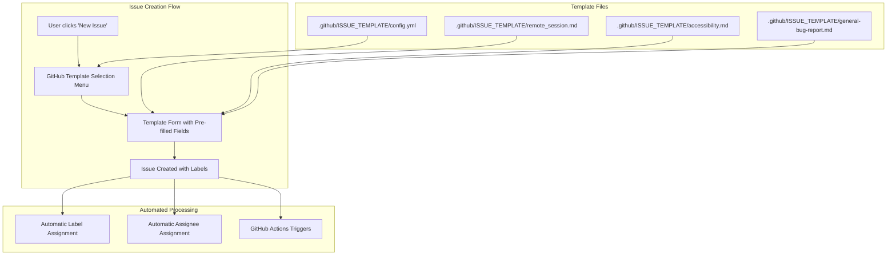
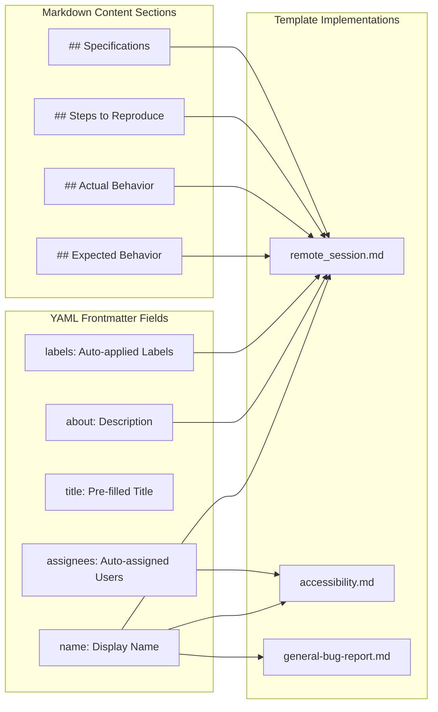
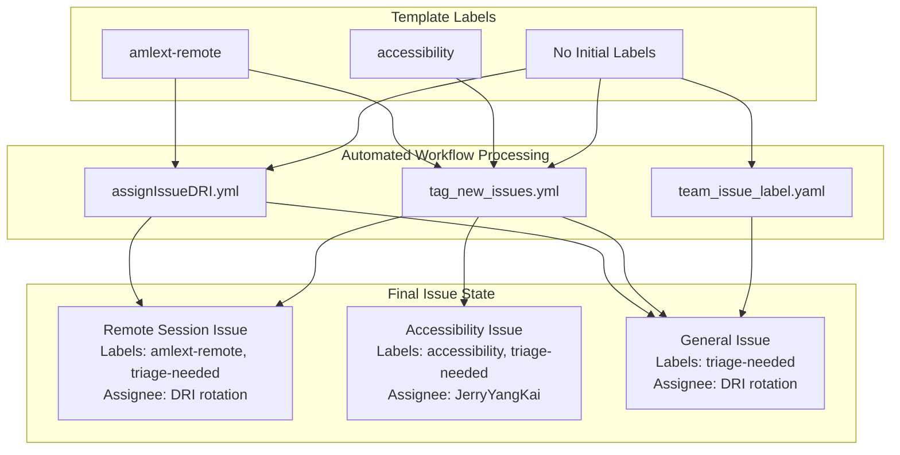

<!-- source: DeepWiki mcp.deepwiki.com · repo microsoft/vscode-tools-for-ai · page 5.1 Issue Templates · fetched 2026-10-26 -->

# Issue Templates

<details>
<summary>Relevant source files</summary>

The following files were used as context for generating this wiki page:

- [.github/ISSUE_TEMPLATE/accessibility.md](.github/ISSUE_TEMPLATE/accessibility.md)
- [.github/ISSUE_TEMPLATE/config.yml](.github/ISSUE_TEMPLATE/config.yml)
- [.github/ISSUE_TEMPLATE/general-bug-report.md](.github/ISSUE_TEMPLATE/general-bug-report.md)
- [.github/ISSUE_TEMPLATE/remote_session.md](.github/ISSUE_TEMPLATE/remote_session.md)

</details>


## Purpose and Scope

This document covers the structured issue reporting system implemented through GitHub issue templates in the Azure Machine Learning Tools for Visual Studio Code repository. The issue templates provide standardized forms for users to report specific types of problems, ensuring consistent information collection and enabling automated processing workflows.

For information about the automated workflows that process issues created from these templates, see [Automated Workflows](#5.2). For the broader context of GitHub integration, see [GitHub Integration & Issue Management](#5).

## Issue Template System Overview

The repository implements a GitHub issue template system that provides structured forms for different categories of issues. The system is configured through YAML frontmatter in markdown files located in the `.github/ISSUE_TEMPLATE/` directory.

**Issue Template Architecture**



Sources: [.github/ISSUE_TEMPLATE/remote_session.md:1-26](), [.github/ISSUE_TEMPLATE/accessibility.md:1-26](), [.github/ISSUE_TEMPLATE/general-bug-report.md:1-26](), [.github/ISSUE_TEMPLATE/config.yml:1-2]()

## Template Structure and Components

Each issue template follows a standardized structure using YAML frontmatter to define metadata and markdown content for the issue form. The templates share common fields while including specialized sections for specific issue types.

**Template Component Mapping**



Sources: [.github/ISSUE_TEMPLATE/remote_session.md:1-8](), [.github/ISSUE_TEMPLATE/accessibility.md:1-7](), [.github/ISSUE_TEMPLATE/general-bug-report.md:1-8]()

### Common Template Fields

All templates include the following standardized sections in their markdown content:

| Section | Purpose | Required Information |
|---------|---------|---------------------|
| `## Expected Behavior` | Describes what should happen | User's expected outcome |
| `## Actual Behavior` | Describes what actually happens | Current problematic behavior |
| `## Steps to Reproduce the Problem` | Provides reproduction steps | Numbered list of actions |
| `## Specifications` | Technical environment details | Version, platform, and context-specific info |

Sources: [.github/ISSUE_TEMPLATE/remote_session.md:10-26](), [.github/ISSUE_TEMPLATE/accessibility.md:9-26](), [.github/ISSUE_TEMPLATE/general-bug-report.md:10-26]()

## Individual Template Details

### Remote Session Template

The `remote_session.md` template handles issues specifically related to the "Connect to VS Code Server on Compute Instance" feature, which is a core functionality of the Azure ML extension.

**Template Configuration:**
- **Name:** "Connect to Compute Instance issue"
- **Labels:** `amlext-remote` (automatically applied)
- **Purpose:** Issues with remote compute instance connections

**Specifications Section:**
- VS Code Version
- Platform (OS information)

Sources: [.github/ISSUE_TEMPLATE/remote_session.md:1-26]()

### Accessibility Template

The `accessibility.md` template provides a specialized form for reporting accessibility-related issues and compliance problems.

**Template Configuration:**
- **Name:** "Accessibility Issue" 
- **Labels:** `accessibility` (automatically applied)
- **Assignees:** `JerryYangKai` (automatically assigned)
- **Purpose:** Accessibility fixes and compliance issues

**Enhanced Specifications Section:**
- Version information
- Platform details
- Screen Reader information (accessibility-specific)

Sources: [.github/ISSUE_TEMPLATE/accessibility.md:1-26]()

### General Bug Report Template

The `general-bug-report.md` template serves as a catch-all for general issues that don't fit the specialized categories.

**Template Configuration:**
- **Name:** "General bug report"
- **Labels:** None (relies on automated workflows for labeling)
- **Assignees:** None (relies on automated workflows for assignment)
- **Purpose:** General bugs and issues

**Minimal Specifications Section:**
- Version information
- Platform details

Sources: [.github/ISSUE_TEMPLATE/general-bug-report.md:1-26]()

## Configuration and Customization

### Template Configuration File

The `config.yml` file controls the overall behavior of the issue template system:

```yaml
blank_issues_enabled: true
```

This configuration enables users to create blank issues without using templates, providing flexibility for edge cases or internal team use.

Sources: [.github/ISSUE_TEMPLATE/config.yml:1-2]()

### Template Selection Matrix

| Template | Auto Labels | Auto Assignees | Specialized Fields | Primary Use Case |
|----------|-------------|----------------|-------------------|------------------|
| `remote_session.md` | `amlext-remote` | None | VS Code Version, Platform | Compute instance connection issues |
| `accessibility.md` | `accessibility` | `JerryYangKai` | Screen Reader info | Accessibility compliance |
| `general-bug-report.md` | None | None | Basic version/platform | General bugs and feature issues |

Sources: [.github/ISSUE_TEMPLATE/remote_session.md:5](), [.github/ISSUE_TEMPLATE/accessibility.md:4-5](), [.github/ISSUE_TEMPLATE/general-bug-report.md:5-6]()

## Integration with Automated Workflows

The issue templates work in conjunction with automated GitHub Actions workflows that process newly created issues. The labels and assignees specified in template frontmatter serve as initial conditions for workflow automation.

**Template-to-Workflow Integration:**



The templates provide the initial structure and metadata, while the automated workflows add additional labels, assign team members, and route issues for triage processing.

Sources: [.github/ISSUE_TEMPLATE/remote_session.md:5](), [.github/ISSUE_TEMPLATE/accessibility.md:4-5]()

---

