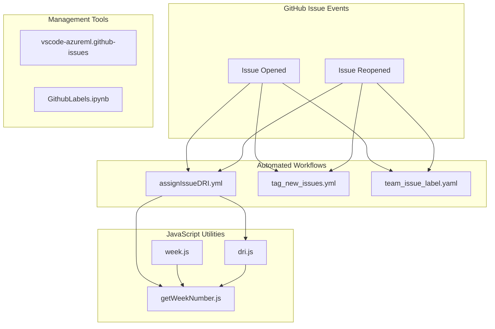
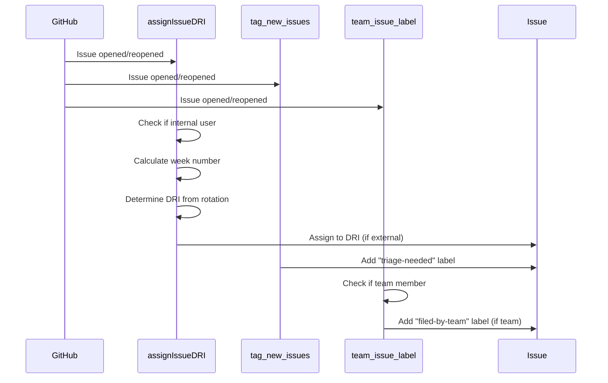
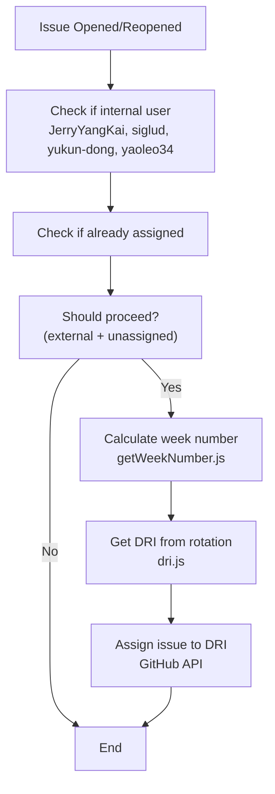
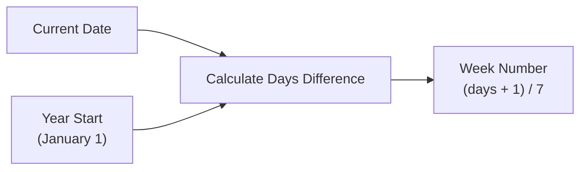

<!-- source: DeepWiki mcp.deepwiki.com · repo microsoft/vscode-tools-for-ai · page 5.2 Automated Workflows · fetched 2026-10-26 -->

# Automated Workflows

<details>
<summary>Relevant source files</summary>

The following files were used as context for generating this wiki page:

- [.github/workflows/assignIssueDRI.yml](.github/workflows/assignIssueDRI.yml)
- [.github/workflows/dri.js](.github/workflows/dri.js)
- [.github/workflows/getWeekNumber.js](.github/workflows/getWeekNumber.js)
- [.github/workflows/tag_new_issues.yml](.github/workflows/tag_new_issues.yml)
- [.github/workflows/team_issue_label.yaml](.github/workflows/team_issue_label.yaml)
- [.github/workflows/week.js](.github/workflows/week.js)
- [.vscode/notebooks/GithubLabels.ipynb](.vscode/notebooks/GithubLabels.ipynb)
- [.vscode/notebooks/vscode-azureml.github-issues](.vscode/notebooks/vscode-azureml.github-issues)

</details>


This document covers the GitHub Actions workflows that automate issue management in the vscode-tools-for-ai repository. These workflows handle automatic assignment of issues to team members, application of standardized labels, and provide tooling for issue triage and management.

For information about issue templates that work with these workflows, see [Issue Templates](#5.1).

## Overview

The repository implements three primary automated workflows triggered by GitHub issue events, along with supporting JavaScript utilities and management notebooks. These systems ensure consistent issue handling and distribute workload among team members through automated assignment and labeling.



**Workflow Execution Flow**


Sources: [.github/workflows/assignIssueDRI.yml:1-71](), [.github/workflows/tag_new_issues.yml:1-19](), [.github/workflows/team_issue_label.yaml:1-30]()

## DRI Assignment System

The Directly Responsible Individual (DRI) assignment system automatically assigns external issues to team members using a weekly rotation schedule. The system checks issue origin, calculates the current week, and assigns issues based on a predefined rotation.

**DRI Assignment Logic Flow**


The `assignIssueDRI.yml` workflow implements conditional logic to determine assignment eligibility:

1. **Internal User Check**: Uses inline Node.js to check if issue author is in the team member list [`JerryYangKai`, `siglud`, `yukun-dong`, `yaoleo34`]
2. **Assignment Check**: Verifies the issue has no existing assignees
3. **Proceed Logic**: Only assigns if the issue is from an external user and unassigned

The `getDRIResponsible()` function in `dri.js` implements the rotation logic:

```javascript
function getDRIResponsible(driOwnersString) {
    const owners = driOwnersString.split(' ');
    const countOfOwners = owners.length;
    const weekNumber = getWeekNumber(new Date());
    const responsibleIndex = weekNumber % countOfOwners;
    return owners[responsibleIndex];
}
```

**Week Number Calculation**


Sources: [.github/workflows/assignIssueDRI.yml:17-70](), [.github/workflows/dri.js:1-15](), [.github/workflows/getWeekNumber.js:1-10]()

## Issue Labeling System

Two automated labeling workflows ensure consistent issue categorization and team identification.

**Triage Labeling Workflow**

The `tag_new_issues.yml` workflow automatically applies the `triage-needed` label to all newly opened or reopened issues. This workflow uses the `actions-ecosystem/action-add-labels@v1` action and requires only `contents: read` and `issues: write` permissions.

**Team Identification Workflow**

The `team_issue_label.yaml` workflow adds the `filed-by-team` label when issues are created by internal team members. It uses a conditional check against a JSON array of team member usernames:

```yaml
if: ${{ 
  contains(
    fromJson('[
      "JerryYangKai",
      "yukun-dong", 
      "siglud"
    ]'), 
    github.actor
  ) 
}}
```

**Label Application Matrix**
| Workflow | Trigger | Label Applied | Condition |
|----------|---------|---------------|-----------|
| `tag_new_issues.yml` | Issue opened/reopened | `triage-needed` | Always |
| `team_issue_label.yaml` | Issue opened/reopened | `filed-by-team` | If author is team member |
| `assignIssueDRI.yml` | Issue opened/reopened | N/A (assigns user) | If external author |

Sources: [.github/workflows/tag_new_issues.yml:1-19](), [.github/workflows/team_issue_label.yaml:17-29]()

## Supporting Utilities and Management Tools

**JavaScript Utilities**

The workflow system includes three JavaScript utility files:

- `getWeekNumber.js`: Implements ISO week number calculation using UTC dates
- `dri.js`: Contains DRI rotation logic with fallback to `DRI_RESPONSIBLE_DEFAULT`
- `week.js`: Simple wrapper that outputs current week number for testing

**Issue Management Notebooks**

The repository includes two notebooks for advanced issue management:

**VS Code GitHub Issues Notebook** (`vscode-azureml.github-issues`)

This VS Code notebook provides queries for:
- Repository scope definitions (`$AZML_PUB_REPO`, `$AZML_PRIV_REPO`)
- Team member variables (`$TEAM_AUTHOR_EXCLUSION`, `$TEAM_ASSIGNMENT`) 
- Milestone tracking (`$CURRENT_MILESTONE`, `$RECOVERY_MILESTONE`)
- Feature area categorization (`$JUPYTER_FEATURE_AREAS`, `$VSCODE_FEATURE_AREAS`)
- Triage queries (`label:triage-needed`, `label:golden-scenario`)

**GitHub Labels Management Notebook** (`GithubLabels.ipynb`)

This Jupyter notebook uses the PyGithub library to:
- Query repository labels with specific colors (e.g., `#c5def5` for feature areas)
- Compare label consistency across multiple repositories
- Extract feature area labels for documentation

**Environment Variables and Configuration**

The workflows use GitHub repository variables:
- `DRI_RESPONSIBLE_DEFAULT`: Fallback assignee (defaults to `JerryYangKai`)
- `DRI_OWNERS`: Space-separated list of DRI rotation members

Sources: [.github/workflows/getWeekNumber.js:1-10](), [.github/workflows/week.js:1-3](), [.vscode/notebooks/vscode-azureml.github-issues:1-376](), [.vscode/notebooks/GithubLabels.ipynb:76-82]()

---

