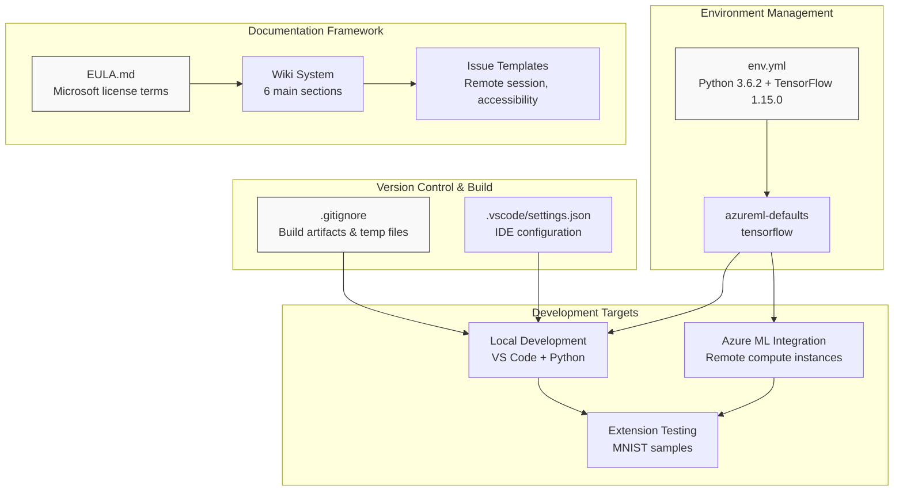
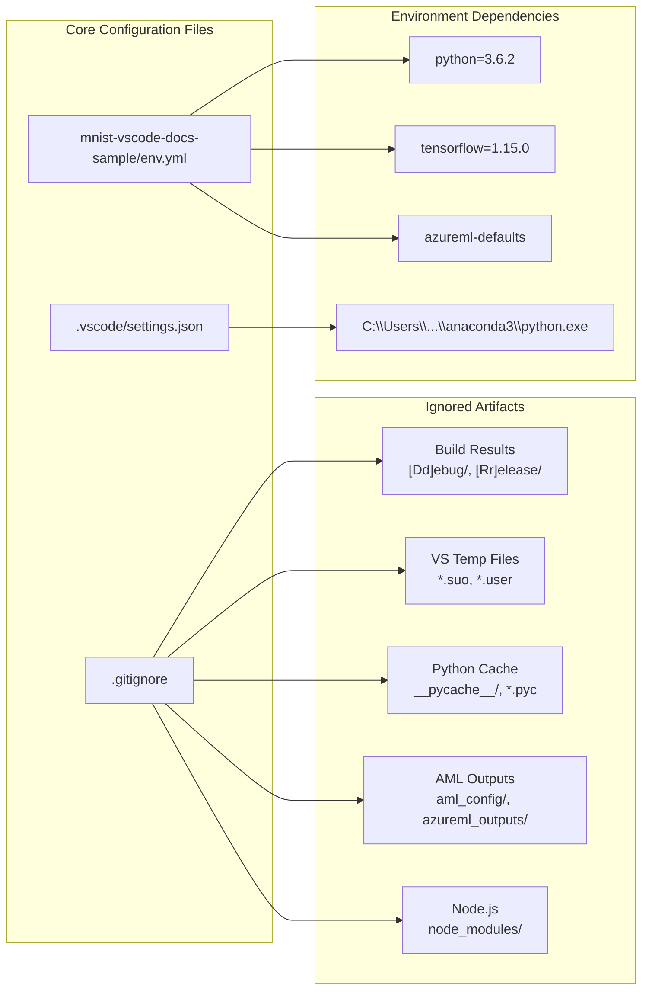
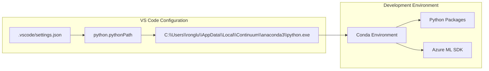
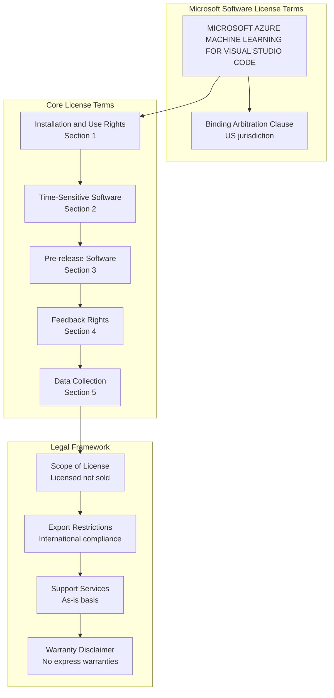

<!-- source: DeepWiki mcp.deepwiki.com · repo microsoft/vscode-tools-for-ai · page 6 Development Environment & Documentation · fetched 2026-10-26 -->

# Development Environment & Documentation

<details>
<summary>Relevant source files</summary>

The following files were used as context for generating this wiki page:

- [.gitignore](.gitignore)
- [.vscode/settings.json](.vscode/settings.json)
- [EULA.md](EULA.md)
- [mnist-vscode-docs-sample/env.yml](mnist-vscode-docs-sample/env.yml)

</details>


This page provides an overview of the development environment setup, configuration files, and supporting documentation within the Azure Machine Learning Tools for Visual Studio Code repository. It covers the essential components that enable contributors to effectively develop and maintain the extensions, as well as the documentation structure that supports users and developers.

For detailed setup instructions, see [Development Environment Setup](#6.1). For licensing, support, and security information, see [Legal, Support & Security](#6.2).

## Development Infrastructure Overview

The repository maintains a comprehensive development infrastructure that supports both local development and integration with Azure ML services. This infrastructure includes environment management, IDE configuration, version control settings, and legal documentation.

### Development Environment Architecture



**Sources:** [.gitignore:1-292](), [.vscode/settings.json:1-3](), [mnist-vscode-docs-sample/env.yml:1-9](), [EULA.md:1-55]()

### Configuration File Dependencies



**Sources:** [.gitignore:16-25](), [.gitignore:274-276](), [.gitignore:290-292](), [.gitignore:237-238](), [.vscode/settings.json:2](), [mnist-vscode-docs-sample/env.yml:5-9]()

## Version Control Configuration

The repository uses a comprehensive `.gitignore` configuration that handles multiple development environments and build systems. The ignore patterns are organized into logical sections covering Visual Studio artifacts, .NET Core outputs, Python-specific files, and Azure ML outputs.

### Key Ignore Patterns

| Category | Patterns | Purpose |
|----------|----------|---------|
| Build Artifacts | `[Dd]ebug/`, `[Rr]elease/`, `[Bb]in/`, `[Oo]bj/` | Exclude compiled binaries and build outputs |
| Visual Studio | `*.suo`, `*.user`, `.vs/` | Exclude IDE-specific temporary files |
| Python | `__pycache__/`, `*.pyc` | Exclude Python bytecode and cache |
| Node.js | `node_modules/` | Exclude npm dependencies |
| Azure ML | `**/aml_config/*`, `**/azureml_outputs/*` | Exclude Azure ML configuration and outputs |

**Sources:** [.gitignore:16-25](), [.gitignore:6-10](), [.gitignore:274-276](), [.gitignore:237-238](), [.gitignore:290-292]()

## IDE Configuration

The VS Code workspace configuration defines the Python interpreter path for the development environment. This configuration ensures consistent Python environment usage across different developer machines.

### VS Code Settings Structure



**Sources:** [.vscode/settings.json:1-3]()

## Sample Environment Configuration

The MNIST sample project includes a dedicated conda environment specification that defines the exact dependencies required for machine learning development with Azure ML integration.

### Environment Specification

The `env.yml` file defines:
- **Python Version**: 3.6.2 for compatibility with TensorFlow 1.15.0
- **TensorFlow**: 1.15.0 for neural network training
- **Azure ML SDK**: `azureml-defaults` for cloud integration
- **Package Manager**: pip for additional Python packages

```yaml
name: vs-code-azure-ml-tutorial
channels:
  - defaults
dependencies:
  - python=3.6.2
  - tensorflow=1.15.0
  - pip
  - pip:
    - azureml-defaults
```

**Sources:** [mnist-vscode-docs-sample/env.yml:1-9]()

## Legal and Licensing Framework

The repository includes comprehensive legal documentation through the Microsoft Software License Terms. The EULA defines usage rights, data collection policies, and support terms for the Azure Machine Learning VS Code extension.

### EULA Key Components

| Section | Coverage | Key Terms |
|---------|----------|-----------|
| Installation Rights | General usage permissions | Unlimited installations on user devices |
| Pre-release Software | Beta/preview disclaimers | May not operate correctly, different from commercial version |
| Data Collection | Privacy and telemetry | Information collection for service improvement |
| Export Restrictions | International compliance | Domestic and international export law compliance |
| Support Services | Microsoft obligations | "As is" support with no warranty |

**Sources:** [EULA.md:8-10](), [EULA.md:15](), [EULA.md:17](), [EULA.md:24](), [EULA.md:25]()

### License Agreement Structure



**Sources:** [EULA.md:1-7](), [EULA.md:8-10](), [EULA.md:11-14](), [EULA.md:15](), [EULA.md:16](), [EULA.md:17](), [EULA.md:18-23](), [EULA.md:24](), [EULA.md:25](), [EULA.md:37]()

## Documentation Organization

The repository documentation is structured into a hierarchical wiki system with six main sections covering different aspects of the Azure ML VS Code tools ecosystem. Each section provides focused coverage of specific functionality areas.

### Wiki Structure Overview

| Section | Title | Purpose |
|---------|-------|---------|
| 1 | Overview | Repository introduction and main components |
| 2 | Core Extensions | Azure ML and AI Tools extensions |
| 3 | Remote Development | Compute instances and WebSocket infrastructure |
| 4 | Sample Projects | MNIST ML workflow examples |
| 5 | GitHub Integration | Issue management and automation |
| 6 | Development Environment | Setup, configuration, and legal documentation |

**Sources:** Referenced from provided table of contents structure

---

