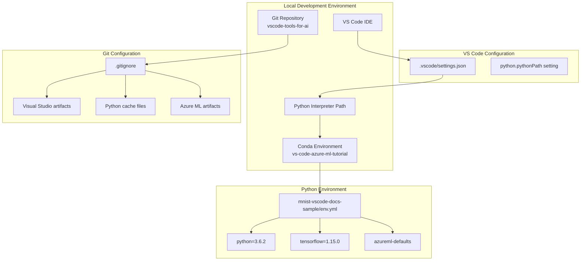
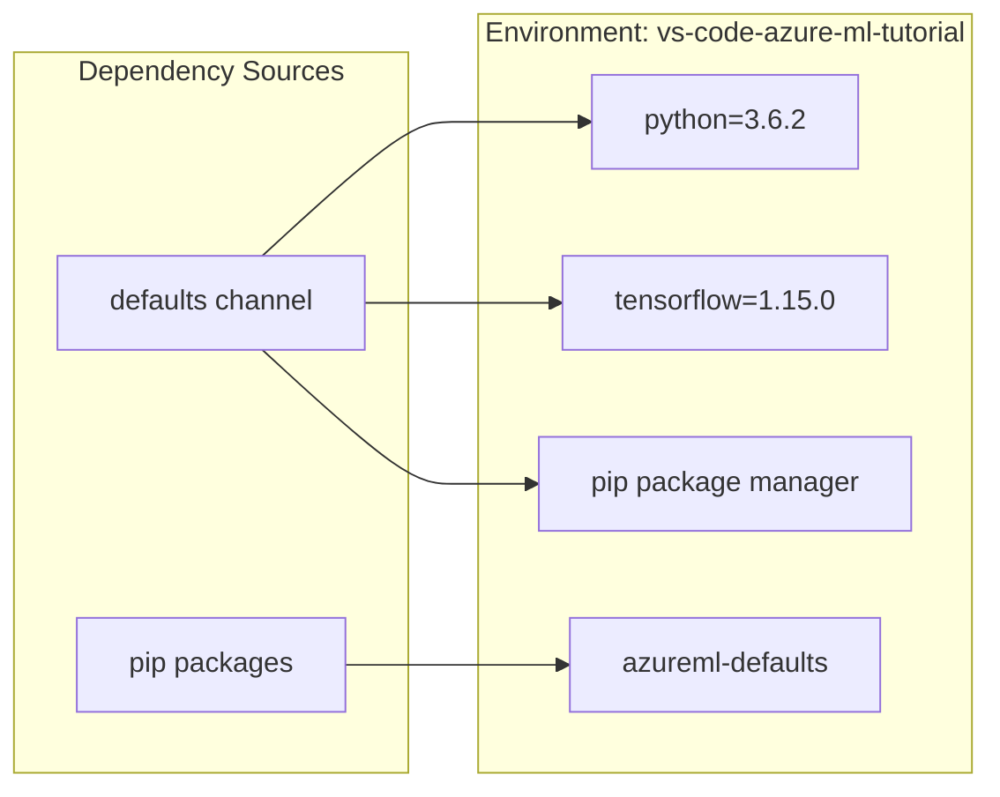
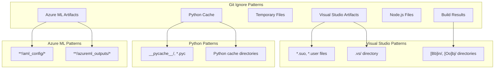
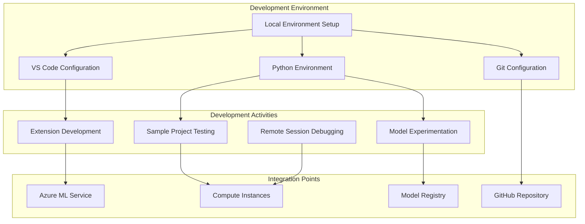

<!-- source: DeepWiki mcp.deepwiki.com · repo microsoft/vscode-tools-for-ai · page 6.1 Development Environment Setup · fetched 2026-10-26 -->

# Development Environment Setup

<details>
<summary>Relevant source files</summary>

The following files were used as context for generating this wiki page:

- [.gitignore](.gitignore)
- [.vscode/settings.json](.vscode/settings.json)
- [mnist-vscode-docs-sample/env.yml](mnist-vscode-docs-sample/env.yml)

</details>


This document covers the essential configuration and setup required for developing Azure Machine Learning Tools for Visual Studio Code extensions. It includes VS Code settings, Python environment configuration, dependency management, and Git repository setup.

For information about the core extensions themselves, see [Core Extensions](#2). For sample project development workflows, see [Sample Projects](#4).

## Purpose and Scope

This page provides developers with the necessary steps to configure their local development environment for contributing to the Azure ML Tools for VS Code repository. The setup includes configuring VS Code with proper Python paths, managing dependencies through conda environments, and understanding the Git ignore patterns that keep the repository clean.

## Development Environment Architecture



Sources: [.vscode/settings.json:1-3](), [mnist-vscode-docs-sample/env.yml:1-9](), [.gitignore:1-292]()

## VS Code Configuration

The repository includes VS Code-specific settings that configure the Python interpreter path for the development environment. The configuration ensures consistent Python execution across different development machines.

### Python Path Configuration

The VS Code settings file defines the Python interpreter path:

```json
{
    "python.pythonPath": "C:\\Users\\ronglu\\AppData\\Local\\Continuum\\anaconda3\\python.exe"
}
```

This configuration points to an Anaconda Python installation. Developers should update this path to match their local Python environment, whether using Anaconda, Miniconda, or a standard Python installation.

| Setting | Purpose | Example Value |
|---------|---------|---------------|
| `python.pythonPath` | Specifies Python interpreter for VS Code | Anaconda3 installation path |

Sources: [.vscode/settings.json:1-3]()

## Python Environment Setup

The repository provides a conda environment specification for the MNIST sample project that demonstrates the required Python dependencies for Azure ML development.

### Conda Environment Specification



The environment configuration includes:

| Component | Version | Source | Purpose |
|-----------|---------|--------|---------|
| `python` | 3.6.2 | defaults channel | Base Python runtime |
| `tensorflow` | 1.15.0 | defaults channel | Machine learning framework |
| `pip` | latest | defaults channel | Package installer |
| `azureml-defaults` | latest | pip | Azure ML SDK integration |

### Environment Creation

To create the development environment:

1. Ensure conda is installed on your system
2. Navigate to the `mnist-vscode-docs-sample` directory
3. Create the environment from the specification file
4. Activate the environment for development

Sources: [mnist-vscode-docs-sample/env.yml:1-9]()

## Git Repository Configuration

The repository uses a comprehensive `.gitignore` file to exclude development artifacts, build outputs, and temporary files from version control.

### Ignored File Categories



### Key Ignore Patterns

| Pattern Category | Examples | Lines |
|------------------|----------|-------|
| Visual Studio | `*.suo`, `*.user`, `.vs/` | [.gitignore:6-28]() |
| Build Results | `[Bb]in/`, `[Oo]bj/`, `[Dd]ebug/` | [.gitignore:15-25]() |
| Python Cache | `__pycache__/`, `*.pyc` | [.gitignore:273-275]() |
| Azure ML | `**/aml_config/*`, `**/azureml_outputs/*` | [.gitignore:290-292]() |
| Node.js | `node_modules/`, `.ntvs_analysis.dat` | [.gitignore:236-237]() |

### Azure ML Specific Exclusions

The repository specifically excludes Azure ML configuration and output directories:
- `**/aml_config/*` - Azure ML configuration files
- `**/azureml_outputs/*` - Azure ML experiment outputs

These patterns prevent sensitive configuration and large output files from being committed to version control.

Sources: [.gitignore:1-292]()

## Development Workflow Integration

The development environment setup integrates with the broader Azure ML Tools ecosystem:



The configured environment enables:
- Extension development and testing
- Local execution of Azure ML samples
- Remote debugging with compute instances  
- Model experimentation workflows
- Integration with Azure ML services

Sources: [.vscode/settings.json:1-3](), [mnist-vscode-docs-sample/env.yml:1-9](), [.gitignore:290-292]()

---

