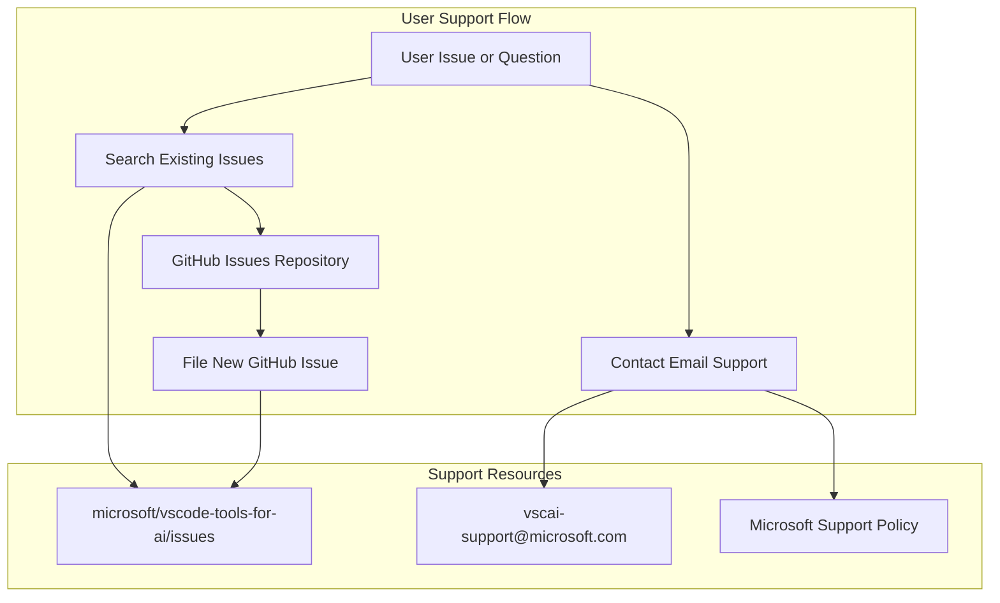
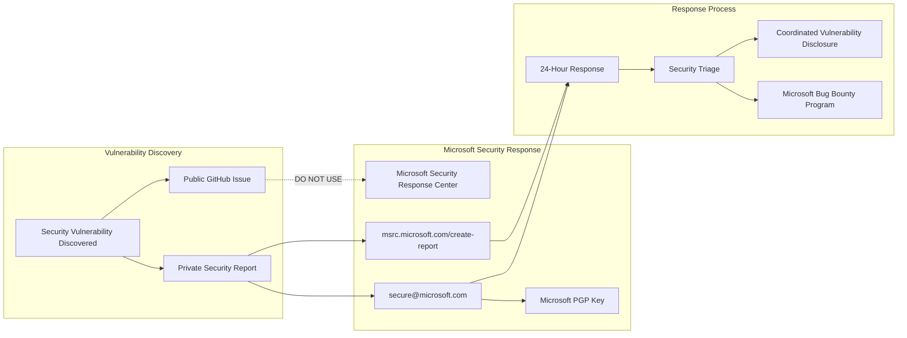

<!-- source: DeepWiki mcp.deepwiki.com · repo microsoft/vscode-tools-for-ai · page 6.2 Legal, Support & Security · fetched 2026-10-26 -->

# Legal, Support & Security

Relevant source files

The following files were used as context for generating this wiki page:

- [EULA.md](EULA.md)
- [SECURITY.md](SECURITY.md)
- [SUPPORT.md](SUPPORT.md)

This document covers the legal framework, user support channels, and security vulnerability reporting procedures for the Azure Machine Learning Tools for Visual Studio Code repository. It provides essential information about licensing terms, how to get help, and how to responsibly report security issues.

For information about development environment setup, see [Development Environment Setup](#6.1). For details about GitHub issue management workflows, see [Automated Workflows](#5.2).

## Legal Framework

The Azure Machine Learning for Visual Studio Code extension operates under Microsoft's software license terms as defined in the End User License Agreement (EULA). The software is distributed as a pre-release version with specific terms and conditions.

### License Terms and Agreement

The extension is governed by the **Microsoft Azure Machine Learning for Visual Studio Code** license agreement, which establishes the following key provisions:

| License Aspect | Description | Reference |
|---|---|---|
| **Installation Rights** | Users may install and use any number of copies on their devices | [EULA.md:9]() |
| **Third Party Software** | Includes third party applications licensed by Microsoft | [EULA.md:10]() |
| **Pre-release Status** | Software may not operate correctly and differs from commercial versions | [EULA.md:15]() |
| **Data Collection** | Software may collect usage information sent to Microsoft | [EULA.md:17]() |
| **Export Restrictions** | Users must comply with domestic and international export laws | [EULA.md:24]() |

### Warranty and Liability Limitations

The software is provided "as is" with significant warranty disclaimers and liability limitations:

- **Disclaimer of Warranty**: No express warranties, guarantees, or conditions provided [EULA.md:37]()
- **Damage Limitations**: Recovery limited to direct damages up to $5.00 USD [EULA.md:38]()
- **Support Limitations**: Microsoft not obligated to provide support services [EULA.md:25]()

**Sources**: [EULA.md:1-55]()

## Support Channels and Procedures

The project provides structured support channels for users experiencing issues or needing assistance with the extensions.

### Primary Support Channels

### Support Workflow Process

1. **Issue Search**: Users should first search [existing issues](https://github.com/microsoft/vscode-tools-for-ai/issues) to avoid duplicates [SUPPORT.md:5]()
2. **New Issue Filing**: File bug reports or feature requests as new GitHub Issues [SUPPORT.md:5]()
3. **Direct Contact**: For help and questions, contact `vscai-support@microsoft.com` [SUPPORT.md:7]()
4. **Support Scope**: Support is limited to the resources listed in the support policy [SUPPORT.md:11]()

**Sources**: [SUPPORT.md:1-12]()

## Security Vulnerability Reporting

Microsoft implements a comprehensive security vulnerability disclosure process for all repositories under its GitHub organizations, including this Azure ML tools repository.

### Security Reporting Infrastructure

### Security Reporting Requirements

**Critical Rule**: Security vulnerabilities must **NOT** be reported through public GitHub issues [SECURITY.md:11]()

### Reporting Channels

| Method | Details | Use Case |
|---|---|---|
| **MSRC Portal** | [https://msrc.microsoft.com/create-report](https://aka.ms/opensource/security/create-report) | Primary reporting method |
| **Email** | `secure@microsoft.com` | Alternative submission method |
| **PGP Encryption** | Available from Microsoft Security Response Center | Encrypted communications |

### Required Information for Security Reports

When reporting security vulnerabilities, include the following information [SECURITY.md:19-27]():

- Type of issue (buffer overflow, SQL injection, XSS, etc.)
- Full paths of affected source files
- Location of affected source code (tag/branch/commit or direct URL)
- Special configuration required to reproduce
- Step-by-step reproduction instructions
- Proof-of-concept or exploit code (if possible)
- Impact assessment and exploitation potential

### Response Timeline and Process

- **Initial Response**: Within 24 hours [SECURITY.md:17]()
- **Follow-up**: If no response received, follow up via email [SECURITY.md:17]()
- **Policy**: Microsoft follows Coordinated Vulnerability Disclosure principles [SECURITY.md:39]()
- **Bug Bounty**: Complete reports may contribute to higher bounty awards [SECURITY.md:31]()

**Sources**: [SECURITY.md:1-41]()

## Communication and Language Preferences

All communications should be conducted in English [SECURITY.md:35](). This applies to both support requests and security vulnerability reports to ensure efficient processing and response.

The security reporting system is designed to handle sensitive information through established Microsoft security channels, ensuring appropriate confidentiality and professional handling of potential vulnerabilities.

**Sources**: [SECURITY.md:35](), [SUPPORT.md:1-12](), [EULA.md:1-55]()