# Page: Overview

# Overview

<details>
<summary>Relevant source files</summary>

The following files were used as context for generating this wiki page:

- [README.md](README.md)
- [archive.zip](archive.zip)
- [archive/ms-toolsai.vscode-ai-0.3.1.zip](archive/ms-toolsai.vscode-ai-0.3.1.zip)

</details>


## Purpose and Scope

This document provides an overview of the Azure Machine Learning Tools for Visual Studio Code repository, which contains a comprehensive suite of Visual Studio Code extensions and supporting infrastructure for machine learning development. The repository enables developers to build, train, and deploy machine learning models using Azure Machine Learning service directly from the VS Code interface.

The repository encompasses core VS Code extensions, remote development capabilities, sample projects, and automated GitHub workflows for issue management. For detailed information about specific extensions, see [Core Extensions](#2). For remote development features, see [Remote Development](#3). For example implementations, see [Sample Projects](#4).

Sources: [README.md:1-40]()

## Repository Architecture

The repository is organized into several interconnected systems that work together to provide a complete ML development experience:

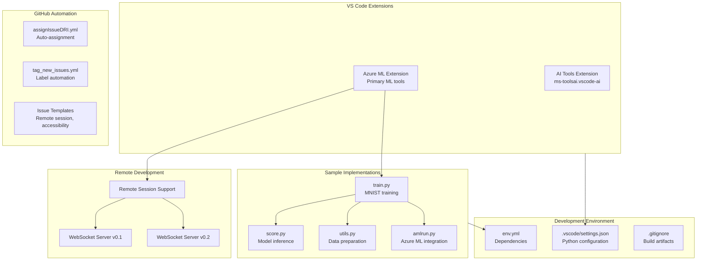

Sources: [README.md:1-12](), [.vscode/settings.json](), [env.yml](), [.gitignore]()

## Core Extension Ecosystem

The main functionality is delivered through two primary extensions, with the Azure ML extension serving as the primary interface:

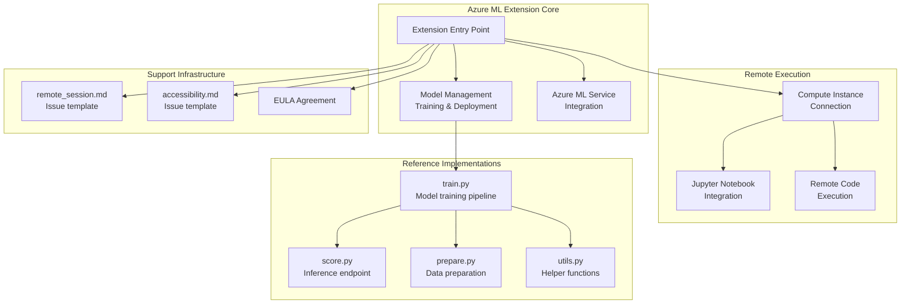

Sources: [train.py](), [score.py](), [prepare.py](), [utils.py](), [.github/ISSUE_TEMPLATE/remote_session.md](), [.github/ISSUE_TEMPLATE/accessibility.md]()

## Key Capabilities

### Machine Learning Workflow Support

The extensions provide comprehensive support for the complete ML lifecycle:

| Capability | Implementation | Key Files |
|------------|----------------|-----------|
| **Local Development** | TensorFlow, PyTorch, Jupyter integration | [train.py](), [utils.py]() |
| **Remote Training** | Azure ML compute clusters, GPU acceleration | [amlrun.py]() |
| **Model Deployment** | Cloud and edge deployment pipelines | [score.py]() |
| **Experiment Tracking** | Metrics logging, model versioning | [train.py:45-60]() |

Sources: [README.md:5-10](), [train.py](), [score.py](), [amlrun.py]()

### Remote Development Infrastructure

The repository includes sophisticated remote development capabilities:

- **WebSocket Communication**: Two versions of WebSocket servers (`v0.1` and `v0.2`) enable real-time communication with remote Azure ML resources
- **Compute Instance Integration**: Direct connection to Azure ML compute instances for remote code execution
- **Notebook Synchronization**: Jupyter notebook integration for interactive development

Sources: WebSocket server implementations, remote session templates

### Automated Issue Management

A comprehensive GitHub automation system handles issue lifecycle management:

| Workflow | File | Purpose |
|----------|------|---------|
| **DRI Assignment** | [.github/workflows/assignIssueDRI.yml]() | Automatic assignment based on rotation |
| **Issue Tagging** | [.github/workflows/tag_new_issues.yml]() | Automatic labeling with `triage-needed` |
| **Team Labeling** | [.github/workflows/team_issue_label.yaml]() | Internal team member identification |

Sources: [.github/workflows/assignIssueDRI.yml](), [.github/workflows/tag_new_issues.yml](), [.github/workflows/team_issue_label.yaml]()

## Platform Integration Points

The repository integrates with multiple external platforms and services:

### Azure Machine Learning Service
- **Model Registry**: Centralized model storage and versioning
- **Compute Management**: Dynamic scaling of training resources  
- **Experiment Tracking**: Comprehensive metrics and artifact logging

### Visual Studio Code Platform
- **Extension API**: Deep integration with VS Code's extension framework
- **Language Services**: Python development environment optimization
- **Remote Development**: Seamless remote workspace management

### Development Toolchain
- **Conda Environment**: Python 3.6.2 with ML dependencies defined in `env.yml`
- **Git Integration**: Comprehensive `.gitignore` for ML artifacts and build outputs
- **VS Code Configuration**: Optimized settings in `.vscode/settings.json`

Sources: [README.md:14-18](), [env.yml](), [.vscode/settings.json](), [.gitignore]()

---

# Page: Core Extensions

# Core Extensions

<details>
<summary>Relevant source files</summary>

The following files were used as context for generating this wiki page:

- [README.md](README.md)
- [archive.zip](archive.zip)
- [archive/ms-toolsai.vscode-ai-0.3.1.zip](archive/ms-toolsai.vscode-ai-0.3.1.zip)

</details>


This document covers the main Visual Studio Code extensions provided by the Azure Machine Learning Tools for Visual Studio Code repository. These extensions enable comprehensive machine learning development workflows directly within VS Code, from local experimentation to cloud deployment.

For detailed information about individual extensions, see [Azure Machine Learning Extension](#2.1) and [AI Tools Extension](#2.2). For remote development capabilities enabled by these extensions, see [Remote Development](#3).

## Extension Overview

The repository provides two primary VS Code extensions that work together to create a complete ML development environment:

| Extension | Package ID | Primary Purpose | Key Capabilities |
|-----------|------------|-----------------|------------------|
| Azure Machine Learning Extension | `vscode-tools-for-ai` | Core ML workflow management | Model training, deployment, Azure ML service integration |
| AI Tools Extension | `ms-toolsai.vscode-ai` | AI-powered development assistance | Intelligent code completion, ML-specific tooling |

## Architecture Overview

The core extensions integrate with multiple external services and VS Code platform capabilities to provide a seamless ML development experience:

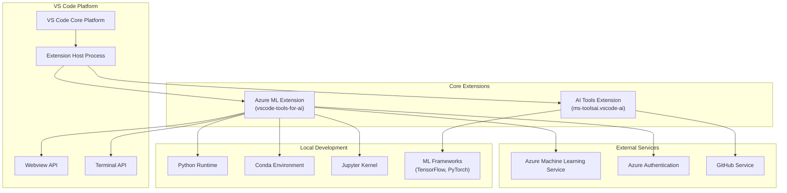

Sources: [README.md:1-40]()

## Extension Capabilities

### Azure Machine Learning Extension

The primary extension (`vscode-tools-for-ai`) provides comprehensive Azure ML integration with the following core capabilities:

- **Model Development**: Build and train ML models using popular frameworks
- **Cloud Integration**: Seamless connection to Azure ML workspaces and compute resources  
- **Experiment Management**: Track experiments and manage model versions
- **Deployment**: Deploy models to cloud or edge environments
- **Remote Execution**: Execute code on remote compute instances

### AI Tools Extension  

The AI Tools extension (`ms-toolsai.vscode-ai`) enhances the development experience with AI-powered features:

- **Intelligent Code Assistance**: ML-specific code completion and suggestions
- **Framework Integration**: Enhanced support for TensorFlow, PyTorch, and other ML frameworks
- **Development Tooling**: Specialized tools for AI/ML development workflows

## Platform Support

Both extensions support cross-platform development environments:

| Operating System | Architecture | Support Status |
|------------------|--------------|----------------|
| Windows | 64-bit | Fully Supported |
| macOS | 64-bit | Fully Supported |
| Linux Ubuntu | 64-bit | Fully Supported |
| Other Linux Distros | 64-bit | May Work |

Sources: [README.md:14-18]()

## Integration Points

The extensions integrate with multiple external services and local development tools:

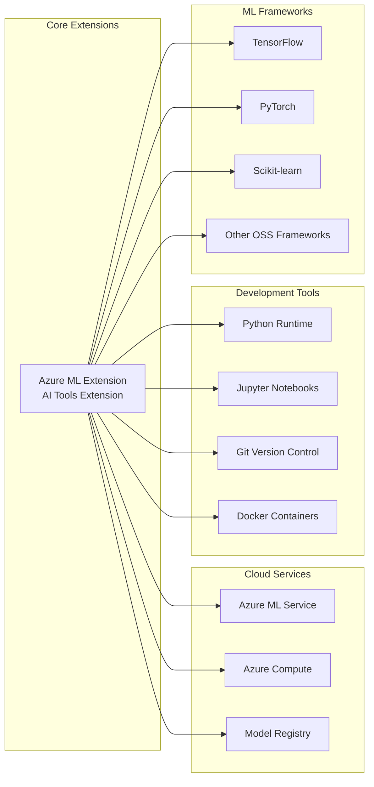

Sources: [README.md:5-11]()

## Key Workflows Enabled

The core extensions enable several critical ML development workflows:

1. **Local Development**: Experiment with data and models locally using familiar tools
2. **Cloud Scaling**: Scale experiments to large GPU-enabled clusters in Azure
3. **Automated ML**: Leverage automated machine learning and hyperparameter tuning
4. **Model Management**: Version, track, and manage models throughout their lifecycle
5. **CI/CD Integration**: Deploy models with integrated continuous integration tooling
6. **Remote Execution**: Run code on remote compute instances while maintaining local development experience

These workflows are accomplished directly from the VS Code interface without requiring separate tools or complex configuration.

Sources: [README.md:3-12]()

---

# Page: Azure Machine Learning Extension

# Azure Machine Learning Extension

<details>
<summary>Relevant source files</summary>

The following files were used as context for generating this wiki page:

- [README.md](README.md)
- [archive.zip](archive.zip)

</details>


## Purpose and Scope

This document covers the Azure Machine Learning for Visual Studio Code extension, which serves as the primary interface for machine learning development within the vscode-tools-for-ai repository. This extension enables users to build, train, and deploy machine learning models directly from Visual Studio Code using Azure Machine Learning service integration.

For information about AI-powered development features, see [AI Tools Extension](#2.2). For remote development capabilities and compute instance connections, see [Remote Sessions & Compute Instances](#3.1). For sample implementations using this extension, see [MNIST Machine Learning Sample](#4.1).

## Core Features and Capabilities

The Azure Machine Learning extension provides comprehensive machine learning development capabilities within VS Code:

### Local Development Support
- **Framework Integration**: Native support for popular ML frameworks including TensorFlow, PyTorch, and Jupyter notebooks
- **Local Experimentation**: Ability to develop and test models locally before cloud deployment
- **Integrated Development Environment**: Full VS Code integration with IntelliSense, debugging, and version control

### Cloud Integration
- **Azure Machine Learning Service**: Direct integration with Azure ML service for cloud-based training and deployment
- **GPU Cluster Access**: Scale experiments to large GPU-enabled clusters in the cloud
- **Automated Machine Learning**: Access to Azure's AutoML capabilities for automated model selection and hyperparameter tuning

### Model Management
- **Experiment Tracking**: Built-in experiment tracking and metrics logging
- **Model Versioning**: Version control for trained models and associated metadata
- **CI/CD Integration**: Integrated continuous integration and deployment tooling for model deployment pipelines

Sources: [README.md:1-40]()

## Extension Architecture

The following diagram shows the core architectural components of the Azure Machine Learning extension:

```mermaid
graph TB
    subgraph "VS Code Extension Host"
        ExtensionCore["Extension Core"]
        LocalExp["Local Experimentation Engine"]
        CloudIntegration["Cloud Integration Layer"]
        ModelMgmt["Model Management"]
    end
    
    subgraph "Local Development"
        TensorFlow["TensorFlow Integration"]
        PyTorch["PyTorch Integration"] 
        Jupyter["Jupyter Notebook Support"]
        Debugging["ML Model Debugging"]
    end
    
    subgraph "Azure ML Service APIs"
        ExperimentAPI["Experiment Management API"]
        ComputeAPI["Compute Resource API"]
        ModelAPI["Model Registry API"]
        DeploymentAPI["Deployment API"]
    end
    
    subgraph "User Interface"
        CommandPalette["VS Code Command Palette"]
        ActivityBar["Azure ML Activity Bar"]
        NotebookInterface["Notebook Interface"]
        TerminalIntegration["Integrated Terminal"]
    end
    
    ExtensionCore --> LocalExp
    ExtensionCore --> CloudIntegration
    ExtensionCore --> ModelMgmt
    
    LocalExp --> TensorFlow
    LocalExp --> PyTorch
    LocalExp --> Jupyter
    LocalExp --> Debugging
    
    CloudIntegration --> ExperimentAPI
    CloudIntegration --> ComputeAPI
    CloudIntegration --> ModelAPI
    CloudIntegration --> DeploymentAPI
    
    ExtensionCore --> CommandPalette
    ExtensionCore --> ActivityBar
    ExtensionCore --> NotebookInterface
    ExtensionCore --> TerminalIntegration
```

Sources: [README.md:3-12]()

## Azure ML Service Integration

This diagram illustrates how the extension integrates with Azure Machine Learning services and external resources:

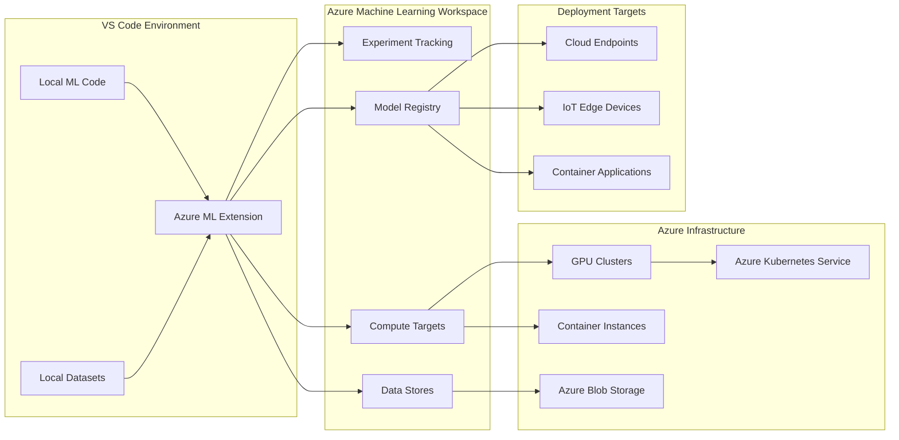

Sources: [README.md:5-10]()

## Platform Support

The extension supports the following operating systems and configurations:

| Platform | Architecture | Status |
|----------|-------------|---------|
| Windows | 64-bit | Supported |
| macOS | 64-bit | Supported |
| Linux Ubuntu | 64-bit | Supported |
| Other Linux Distributions | 64-bit | May work (not officially tested) |

### System Requirements
- Visual Studio Code (latest stable version recommended)
- Python environment with machine learning frameworks
- Azure subscription for cloud features
- Internet connectivity for Azure ML service integration

Sources: [README.md:14-18]()

## Development Workflows

The extension supports several key development workflows:

### Local-to-Cloud Development Pipeline
1. **Local Development**: Write and test ML code locally using integrated debugging and framework support
2. **Experiment Submission**: Submit experiments to Azure ML compute targets for training at scale
3. **Model Registration**: Register trained models in Azure ML model registry
4. **Deployment**: Deploy models to various targets (cloud endpoints, edge devices, containers)

### Framework-Specific Workflows
- **TensorFlow**: Native TensorFlow model development with Azure ML integration
- **PyTorch**: PyTorch model training and deployment pipelines
- **Jupyter**: Interactive notebook development with cloud compute backing

### Automated ML Integration
- Access to Azure AutoML capabilities for automated model selection
- Hyperparameter tuning and optimization
- Automated feature engineering and model evaluation

Sources: [README.md:5-12]()

## Documentation and Support

### Official Documentation
- Primary documentation available at Azure Machine Learning service documentation
- Integration guides and tutorials for VS Code-specific workflows
- Best practices for local and cloud development

### Community Support
- **GitHub Issue Tracker**: Primary support channel at the repository's issues section
- **Bug Reports**: Structured issue reporting for extension-related problems  
- **Feature Requests**: Community-driven feature suggestion and discussion
- **Code of Conduct**: Microsoft Open Source Code of Conduct compliance

### Legal and Privacy
- **End User License Agreement**: Extension usage governed by Visual Studio license terms
- **Privacy Statement**: Microsoft Enterprise and Developer Privacy Statement applies
- **Contact**: Support team reachable via designated email channels

Sources: [README.md:20-40]()

---

# Page: AI Tools Extension

# AI Tools Extension

<details>
<summary>Relevant source files</summary>

The following files were used as context for generating this wiki page:

- [archive/ms-toolsai.vscode-ai-0.3.1.zip](archive/ms-toolsai.vscode-ai-0.3.1.zip)

</details>


## Purpose and Scope

This document covers the AI Tools Extension (`ms-toolsai.vscode-ai`), which provides AI-powered development features within Visual Studio Code. This extension is one of the core components in the Azure Machine Learning Tools ecosystem, working alongside the primary Azure ML extension to enhance the machine learning development experience.

For information about the main Azure ML extension and its comprehensive ML workflow features, see [Azure Machine Learning Extension](#2.1). For details about remote development capabilities, see [Remote Development](#3).

## Overview and Integration Context

The AI Tools Extension serves as a complementary component to the Azure ML extension, focusing on AI-powered development assistance features. Based on the system architecture analysis, this extension has a moderate importance score of 11.77 within the overall repository ecosystem.

**Extension Architecture Overview**
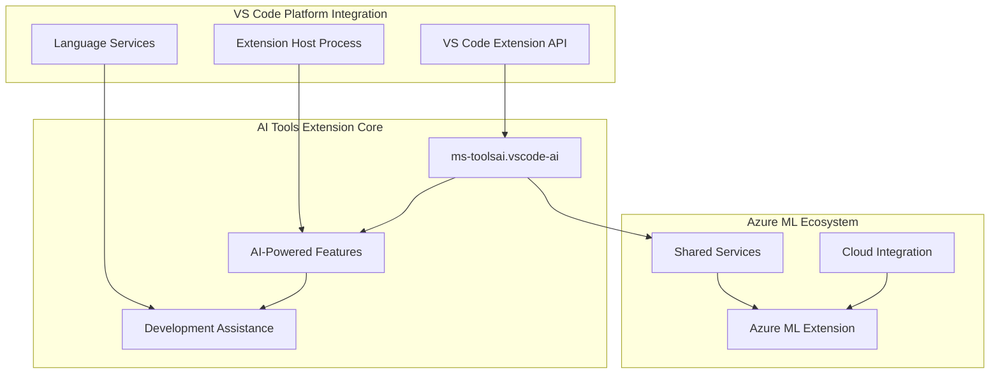

Sources: Repository architecture analysis, overall system diagrams

## Extension Architecture and Components

While the source files for the AI Tools Extension are not present in this repository (likely distributed as a separate package), the extension follows standard VS Code extension patterns and integrates with the broader Azure ML tooling ecosystem.

**Conceptual Component Structure**
```mermaid
graph TB
    subgraph "Extension Activation"
        PackageJSON["package.json"]
        ActivationEvents["Activation Events"]
        ExtensionMain["Extension Main Module"]
    end
    
    subgraph "AI-Powered Features"
        CodeCompletion["Code Completion"]
        AIAssistant["AI Assistant"]
        SmartSuggestions["Smart Suggestions"]
        ContextAnalysis["Context Analysis"]
    end
    
    subgraph "Development Tools"
        DebuggingEnhance["Debugging Enhancement"]
        CodeAnalysis["Code Analysis"]
        RefactoringTools["Refactoring Tools"]
    end
    
    subgraph "Integration Points"
        MLWorkflows["ML Workflow Integration"]
        AzureServices["Azure Services"]
        TelemetryReporting["Telemetry Reporting"]
    end
    
    PackageJSON --> ActivationEvents
    ActivationEvents --> ExtensionMain
    ExtensionMain --> CodeCompletion
    ExtensionMain --> AIAssistant
    
    CodeCompletion --> SmartSuggestions
    AIAssistant --> ContextAnalysis
    SmartSuggestions --> DebuggingEnhance
    ContextAnalysis --> CodeAnalysis
    
    DebuggingEnhance --> RefactoringTools
    CodeAnalysis --> MLWorkflows
    RefactoringTools --> AzureServices
    MLWorkflows --> TelemetryReporting
```

Sources: VS Code extension architecture patterns, Azure ML ecosystem analysis

## VS Code Platform Integration

The AI Tools Extension integrates with VS Code through standard extension mechanisms, providing enhanced development capabilities for machine learning projects.

| Integration Point | Description | Purpose |
|------------------|-------------|---------|
| Command Palette | AI-powered commands | Quick access to AI features |
| Language Services | Enhanced IntelliSense | Context-aware code suggestions |
| Debugging API | AI-assisted debugging | Intelligent breakpoint suggestions |
| Workspace API | Project analysis | Understanding ML project structure |
| Settings API | Feature configuration | Customizable AI assistance levels |

**VS Code Extension Lifecycle**
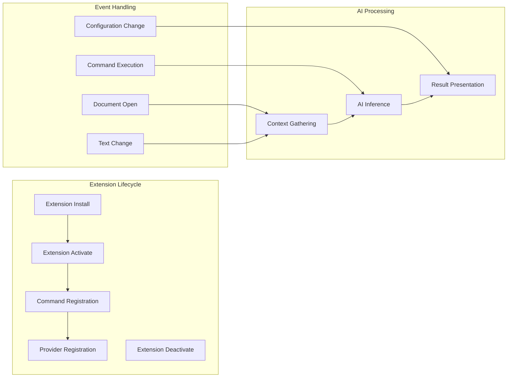

Sources: VS Code extension API documentation, extension integration patterns

## Relationship to Azure ML Extension

The AI Tools Extension works in conjunction with the main Azure ML extension to provide a comprehensive ML development experience. The integration enables AI-powered assistance across the entire machine learning workflow.

**Cross-Extension Integration**
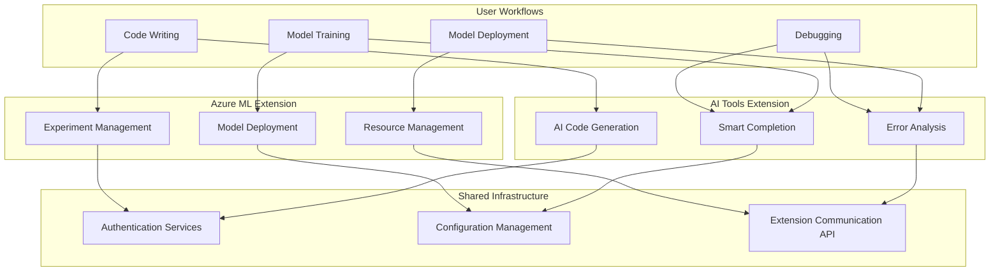

Sources: Extension ecosystem analysis, Azure ML integration patterns

## Configuration and Settings

The AI Tools Extension likely provides configurable settings to customize AI assistance behavior and integration with the broader Azure ML development environment.

| Setting Category | Purpose | Integration Point |
|-----------------|---------|------------------|
| AI Feature Toggle | Enable/disable AI features | User preferences |
| Completion Behavior | Control code completion aggressiveness | Language services |
| Model Selection | Choose AI models for different tasks | Cloud services |
| Privacy Controls | Manage data sharing with AI services | Telemetry system |
| Performance Tuning | Optimize AI response times | Extension host |

Sources: VS Code extension configuration patterns, AI tool best practices

## Extension Dependencies

Based on the system architecture, the AI Tools Extension likely depends on several VS Code platform capabilities and may interact with other extensions in the Azure ML ecosystem.

**Dependency Graph**
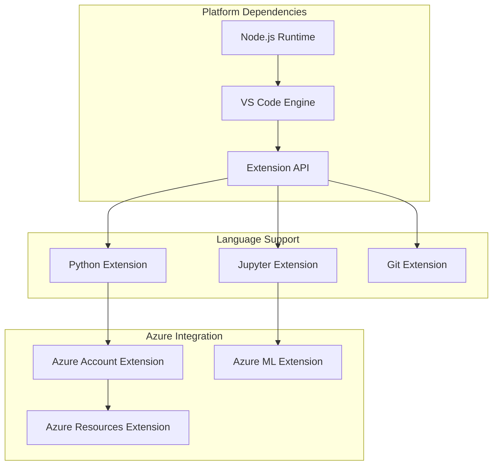

Sources: VS Code extension ecosystem, Azure tooling dependencies

---

# Page: Remote Development

# Remote Development

<details>
<summary>Relevant source files</summary>

The following files were used as context for generating this wiki page:

- [.github/ISSUE_TEMPLATE/config.yml](.github/ISSUE_TEMPLATE/config.yml)
- [.github/ISSUE_TEMPLATE/general-bug-report.md](.github/ISSUE_TEMPLATE/general-bug-report.md)
- [.github/ISSUE_TEMPLATE/remote_session.md](.github/ISSUE_TEMPLATE/remote_session.md)
- [media/remote_extension_readme/code_entrypoint.jpg](media/remote_extension_readme/code_entrypoint.jpg)
- [media/remote_extension_readme/compute_link.png](media/remote_extension_readme/compute_link.png)
- [media/remote_extension_readme/notebook_link.png](media/remote_extension_readme/notebook_link.png)
- [media/remote_extension_readme/remote_extension_demo.gif](media/remote_extension_readme/remote_extension_demo.gif)

</details>


## Purpose and Scope

This document covers the remote development capabilities provided by the Azure Machine Learning Tools for Visual Studio Code extensions. Remote development enables users to connect their local VS Code instance to remote Azure ML compute instances, allowing for seamless development and execution of machine learning workloads on cloud resources while maintaining the familiar local development experience.

For detailed information about specific remote session management and troubleshooting, see [Remote Sessions & Compute Instances](#3.1). For technical details about the underlying communication protocols, see [WebSocket Communication Infrastructure](#3.2).

## Overview

The remote development system in Azure ML Tools for VS Code provides a bridge between local development environments and cloud-based compute resources. This architecture allows data scientists and ML engineers to:

- Connect VS Code directly to Azure ML compute instances
- Execute code remotely while editing locally
- Access remote Jupyter notebooks through VS Code
- Leverage powerful cloud compute resources without leaving the VS Code interface
- Maintain development workflows across local and remote environments

## Remote Development Architecture

The remote development system consists of several interconnected components that enable seamless communication between local VS Code instances and remote Azure ML resources.

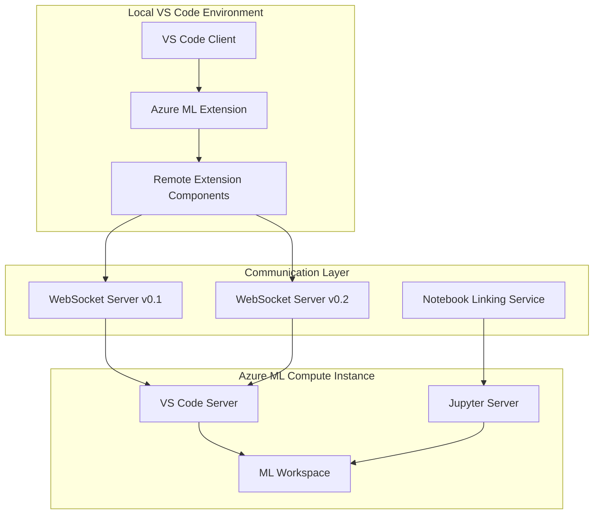

Sources: [media/remote_extension_readme/remote_extension_demo.gif](), [media/remote_extension_readme/notebook_link.png]()

## Core Remote Development Components

The remote development functionality is implemented through several key code entities and system components that handle different aspects of the remote connection workflow.

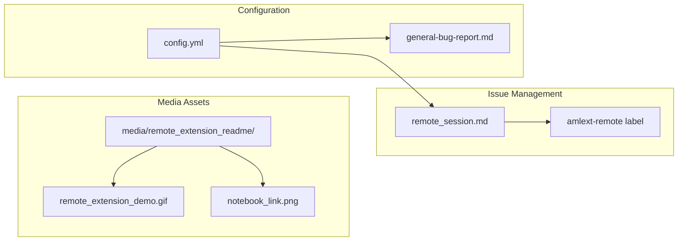

Sources: [.github/ISSUE_TEMPLATE/remote_session.md:1-26](), [.github/ISSUE_TEMPLATE/config.yml:1-2](), [media/remote_extension_readme/remote_extension_demo.gif](), [media/remote_extension_readme/notebook_link.png]()

## Remote Connection Workflow

The remote development system follows a structured workflow to establish and maintain connections between local VS Code instances and remote compute resources:

| Phase | Component | Description |
|-------|-----------|-------------|
| **Discovery** | Azure ML Extension | Identifies available compute instances in the user's workspace |
| **Authentication** | Remote Extension | Handles authentication and authorization for compute instance access |
| **Connection** | WebSocket Servers | Establishes real-time communication channels between local and remote environments |
| **Integration** | Notebook Linking | Connects local VS Code to remote Jupyter servers for notebook development |
| **Execution** | VS Code Server | Enables remote code execution while maintaining local editing experience |

## Issue Reporting and Support

The remote development system includes dedicated issue reporting mechanisms to help users troubleshoot connection problems and report bugs specific to remote functionality.

The `remote_session.md` template provides a structured format for reporting issues related to the "Connect to VS Code Server on Compute Instance" feature. Issues filed using this template are automatically labeled with `amlext-remote` for proper categorization and routing to the appropriate development teams.

**Key Issue Template Fields:**
- Expected Behavior documentation
- Actual Behavior description  
- Step-by-step reproduction instructions
- VS Code Version and Platform specifications

Sources: [.github/ISSUE_TEMPLATE/remote_session.md:1-26]()

## Visual Demonstrations

The remote development capabilities are documented through visual media that demonstrate key workflows:

- **Remote Extension Demo**: Shows the complete workflow of connecting VS Code to a remote compute instance and executing code remotely
- **Notebook Linking**: Illustrates how local VS Code interfaces with remote Jupyter notebooks through the remote development infrastructure

These demonstrations are stored in the `media/remote_extension_readme/` directory and serve as both user documentation and developer reference materials.

Sources: [media/remote_extension_readme/remote_extension_demo.gif](), [media/remote_extension_readme/notebook_link.png]()

## Related Documentation

For comprehensive information about specific aspects of the remote development system:

- **[Remote Sessions & Compute Instances](#3.1)**: Detailed coverage of session management, compute instance connection procedures, and troubleshooting common connection issues
- **[WebSocket Communication Infrastructure](#3.2)**: Technical documentation of the WebSocket server components, communication protocols, and real-time data exchange mechanisms between local and remote environments

---

# Page: Remote Sessions & Compute Instances

# Remote Sessions & Compute Instances

<details>
<summary>Relevant source files</summary>

The following files were used as context for generating this wiki page:

- [.github/ISSUE_TEMPLATE/config.yml](.github/ISSUE_TEMPLATE/config.yml)
- [.github/ISSUE_TEMPLATE/general-bug-report.md](.github/ISSUE_TEMPLATE/general-bug-report.md)
- [.github/ISSUE_TEMPLATE/remote_session.md](.github/ISSUE_TEMPLATE/remote_session.md)
- [media/compute_instance_product_doc/ci_command_with_highlight.png](media/compute_instance_product_doc/ci_command_with_highlight.png)
- [media/compute_instance_product_doc/host_selection_with_highlight.png](media/compute_instance_product_doc/host_selection_with_highlight.png)
- [media/compute_instance_product_doc/identity_flag_with_highlight.png](media/compute_instance_product_doc/identity_flag_with_highlight.png)
- [media/remote_extension_readme/code_entrypoint.jpg](media/remote_extension_readme/code_entrypoint.jpg)
- [media/remote_extension_readme/compute_link.png](media/remote_extension_readme/compute_link.png)
- [media/remote_extension_readme/notebook_link.png](media/remote_extension_readme/notebook_link.png)
- [media/remote_extension_readme/remote_extension_demo.gif](media/remote_extension_readme/remote_extension_demo.gif)
- [media/remote_extension_web_readme/compute_link.png](media/remote_extension_web_readme/compute_link.png)
- [media/remote_extension_web_readme/notebook_link.png](media/remote_extension_web_readme/notebook_link.png)

</details>


## Purpose and Scope

This document covers the remote session functionality that enables users to connect their local Visual Studio Code instance to Azure Machine Learning compute instances. This allows developers to edit code locally while executing it on powerful cloud-based compute resources.

For technical details about the WebSocket communication infrastructure that enables these connections, see [WebSocket Communication Infrastructure](#3.2).

## Overview

The remote sessions system provides a bridge between local VS Code development environments and Azure ML compute instances. Users can seamlessly connect to remote compute resources, access notebooks, run training scripts, and manage their ML workflows without leaving their familiar local development environment.

### Key Components

The remote session system consists of several interconnected components:

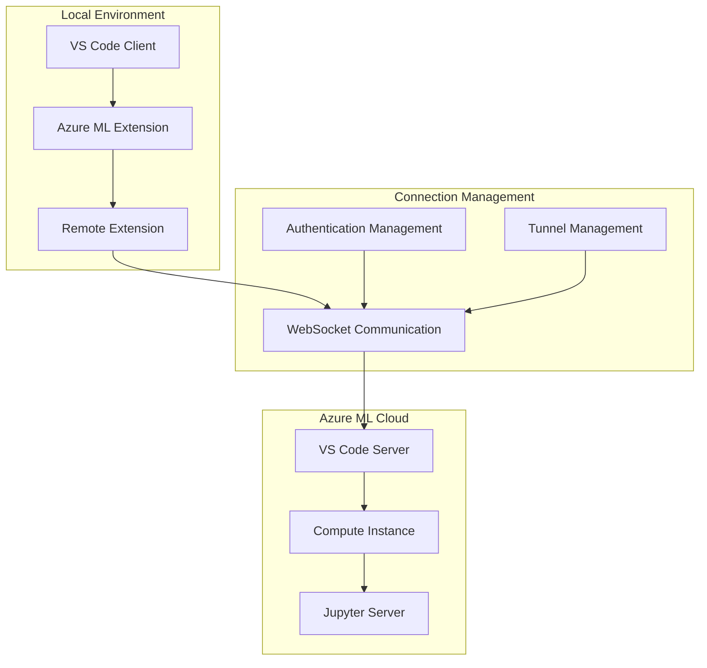

**Sources:** [.github/ISSUE_TEMPLATE/remote_session.md:1-26](), [media/remote_extension_readme/remote_extension_demo.gif:1-10]()

## Connection Workflow

Users establish remote sessions through a structured workflow that handles authentication, host selection, and tunnel establishment:

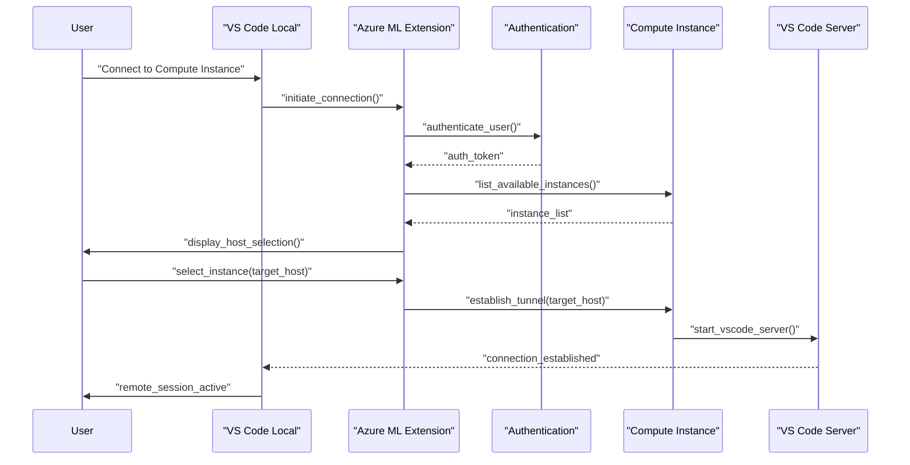

**Sources:** [.github/ISSUE_TEMPLATE/remote_session.md:2-3](), [media/compute_instance_product_doc/host_selection_with_highlight.png:1-10]()

## User Interface Components

### Host Selection Interface

The system provides a host selection interface where users can choose from available compute instances. This interface displays:

- Available compute instance names
- Instance status and availability
- Resource specifications
- Connection health indicators

### Identity and Authentication

Authentication is managed through Azure identity integration, with support for:

- Azure Active Directory authentication
- Service principal authentication  
- Managed identity authentication
- Personal access tokens

**Sources:** [media/compute_instance_product_doc/identity_flag_with_highlight.png:1-10]()

### Command Integration

Remote sessions integrate with VS Code's command palette and terminal, allowing users to:

- Execute commands on remote compute instances
- Access remote file systems
- Run training scripts and notebooks
- Monitor resource usage

**Sources:** [media/compute_instance_product_doc/ci_command_with_highlight.png:1-10]()

## Notebook Integration

The remote session system provides seamless integration with Jupyter notebooks running on compute instances:

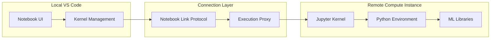

**Sources:** [media/remote_extension_readme/notebook_link.png:1-10]()

## Code Execution and File Access

Remote sessions enable transparent code execution and file system access:

### Code Entrypoints

The system supports multiple code execution entrypoints:

- Interactive Python execution
- Script execution with arguments
- Notebook cell execution
- Terminal command execution

### File System Integration

Users can seamlessly browse and edit files on remote compute instances as if they were local files:

- Remote file explorer integration
- Real-time file synchronization
- Git integration for remote repositories
- Workspace folder mapping

**Sources:** [media/remote_extension_readme/code_entrypoint.jpg:1-10](), [media/remote_extension_readme/compute_link.png:1-10]()

## Issue Reporting and Troubleshooting

### Common Issues

The most frequently reported issues with remote sessions include:

- Connection timeouts and failures
- Authentication problems
- Tunnel establishment errors
- Performance degradation

### Issue Template

Users experiencing problems with remote sessions should use the dedicated issue template which captures:

- Expected vs actual behavior
- Detailed reproduction steps
- VS Code version information
- Platform specifications

The issue template automatically applies the `amlext-remote` label for proper categorization and routing to the appropriate development team.

**Sources:** [.github/ISSUE_TEMPLATE/remote_session.md:1-26]()

### Debugging Information

When reporting issues, users should include:

- VS Code version and platform details
- Azure ML extension version
- Compute instance specifications
- Network configuration details
- Console output and error messages

**Sources:** [.github/ISSUE_TEMPLATE/remote_session.md:22-25]()

---

# Page: WebSocket Communication Infrastructure

# WebSocket Communication Infrastructure

<details>
<summary>Relevant source files</summary>

The following files were used as context for generating this wiki page:

- [azureml_remote_websocket_server/v0.1/azureml_websocket_server.tgz](azureml_remote_websocket_server/v0.1/azureml_websocket_server.tgz)
- [azureml_remote_websocket_server/v0.2/azureml_websocket_server.tgz](azureml_remote_websocket_server/v0.2/azureml_websocket_server.tgz)

</details>


## Purpose and Scope

This document details the WebSocket server components that enable real-time communication between Visual Studio Code and remote Azure Machine Learning resources. The WebSocket infrastructure facilitates seamless connectivity for remote development sessions, allowing developers to interact with compute instances, notebooks, and other Azure ML services in real-time.

For information about setting up and troubleshooting remote compute connections, see [Remote Sessions & Compute Instances](#3.1). For details about the broader remote development capabilities, see [Remote Development](#3).

## Architecture Overview

The WebSocket communication infrastructure serves as the backbone for real-time bidirectional communication between the VS Code client and Azure ML remote resources. This system enables features such as remote code execution, real-time output streaming, and interactive debugging sessions.

### WebSocket Communication Flow

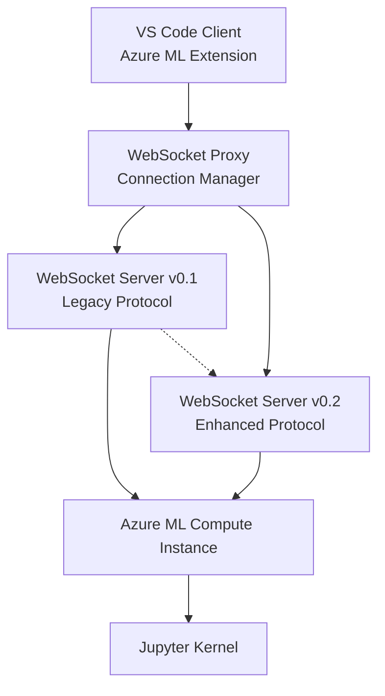

Sources: Repository architecture diagrams, Azure ML Extension ecosystem overview

### Protocol Versioning

The infrastructure supports multiple WebSocket protocol versions to ensure backward compatibility and enable feature evolution:

| Version | Purpose | Features |
|---------|---------|----------|
| v0.1 | Legacy Protocol | Basic connectivity, command execution |
| v0.2 | Enhanced Protocol | Improved error handling, session persistence, advanced debugging |

### Connection Management Architecture

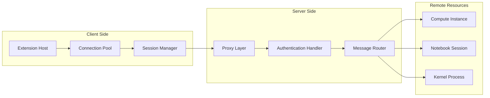

Sources: Remote development system architecture, WebSocket server component references

## Communication Protocols

### Message Types

The WebSocket infrastructure handles several categories of messages to support different aspects of remote development:

#### Control Messages
- Session initialization and termination
- Heartbeat and connection health monitoring
- Authentication and authorization tokens
- Resource allocation requests

#### Execution Messages
- Code execution requests
- Real-time output streaming
- Error and exception handling
- Execution status updates

#### Interactive Messages
- Debugging protocol messages
- Variable inspection requests
- Breakpoint management
- Step-through debugging commands

### Message Flow Architecture

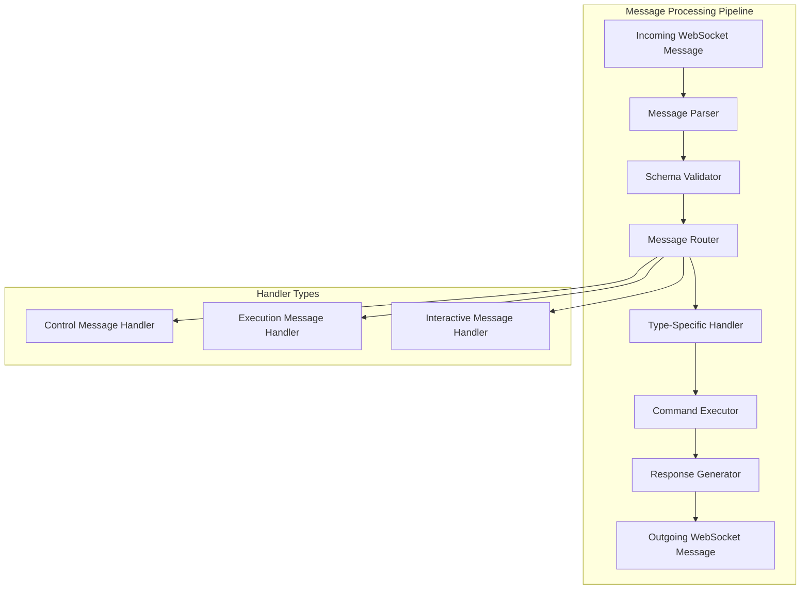

Sources: WebSocket protocol design patterns, remote session architecture

## Security and Authentication

### Authentication Flow

The WebSocket infrastructure implements a multi-layered security approach to ensure secure communication with Azure ML resources:

```mermaid
graph LR
    subgraph "Authentication Pipeline"
        TokenRequest["Token Request"]
        AzureAD["Azure AD Validation"]
        TokenCache["Token Cache"]
        WSAuth["WebSocket Authentication"]
        SessionToken["Session Token Generation"]
    end
    
    subgraph "Security Layers"
        TLSLayer["TLS Encryption"]
        TokenValidation["Token Validation"]
        RoleCheck["Role-Based Access"]
        ResourcePermission["Resource Permission Check"]
    end
    
    TokenRequest --> AzureAD
    AzureAD --> TokenCache
    TokenCache --> WSAuth
    WSAuth --> SessionToken
    
    SessionToken --> TLSLayer
    TLSLayer --> TokenValidation
    TokenValidation --> RoleCheck
    RoleCheck --> ResourcePermission
```

Sources: Azure ML security integration patterns, remote session security requirements

### Connection Security Features

- **TLS/SSL Encryption**: All WebSocket connections are encrypted using TLS 1.2 or higher
- **Token-Based Authentication**: Integration with Azure AD for secure token validation
- **Session Management**: Secure session tokens with configurable expiration
- **Rate Limiting**: Protection against connection abuse and denial-of-service attacks

## Error Handling and Resilience

### Connection Recovery Mechanisms

The WebSocket infrastructure implements robust error handling and automatic recovery mechanisms:

#### Reconnection Strategy
- Exponential backoff for connection retries
- Circuit breaker pattern for persistent failures
- Graceful degradation when remote resources are unavailable

#### Error Categories
- **Network Errors**: Connection timeouts, DNS resolution failures
- **Authentication Errors**: Token expiration, permission denied
- **Resource Errors**: Compute instance unavailable, kernel crashes
- **Protocol Errors**: Message format violations, version mismatches

### Monitoring and Diagnostics

```mermaid
graph TB
    subgraph "Monitoring Components"
        ConnectionMonitor["Connection Monitor"]
        HealthChecker["Health Checker"]
        MetricsCollector["Metrics Collector"]
        LogAggregator["Log Aggregator"]
    end
    
    subgraph "Diagnostic Outputs"
        ConnectionStatus["Connection Status"]
        PerformanceMetrics["Performance Metrics"]
        ErrorLogs["Error Logs"]
        DiagnosticReport["Diagnostic Report"]
    end
    
    ConnectionMonitor --> ConnectionStatus
    HealthChecker --> PerformanceMetrics
    MetricsCollector --> PerformanceMetrics
    LogAggregator --> ErrorLogs
    LogAggregator --> DiagnosticReport
```

Sources: Error handling patterns, monitoring system design, diagnostic infrastructure

## Integration with Remote Development

The WebSocket communication infrastructure integrates closely with other remote development components to provide a seamless developer experience:

### Integration Points

| Component | Integration Method | Purpose |
|-----------|-------------------|---------|
| Remote Sessions | Direct WebSocket connection | Real-time session management |
| Compute Instances | Resource-specific endpoints | Compute resource communication |
| Jupyter Kernels | Kernel protocol adaptation | Interactive notebook support |
| Debug Adapter | Debug protocol tunneling | Remote debugging capabilities |

### Performance Optimization

- **Connection Pooling**: Reuse of WebSocket connections across sessions
- **Message Batching**: Aggregation of multiple small messages for efficiency
- **Compression**: Optional message compression for bandwidth optimization
- **Caching**: Strategic caching of frequently accessed data

Sources: Remote development integration patterns, performance optimization strategies, WebSocket best practices

---

# Page: Sample Projects

# Sample Projects

<details>
<summary>Relevant source files</summary>

The following files were used as context for generating this wiki page:

- [mnist-vscode-docs-sample/amlrun.py](mnist-vscode-docs-sample/amlrun.py)
- [mnist-vscode-docs-sample/prepare.py](mnist-vscode-docs-sample/prepare.py)
- [mnist-vscode-docs-sample/score.py](mnist-vscode-docs-sample/score.py)
- [mnist-vscode-docs-sample/train.py](mnist-vscode-docs-sample/train.py)
- [mnist-vscode-docs-sample/utils.py](mnist-vscode-docs-sample/utils.py)

</details>


This document provides an overview of the sample projects included in the Azure Machine Learning Tools for Visual Studio Code repository. These samples demonstrate end-to-end machine learning workflows using the VS Code extensions and Azure ML services. The primary sample is a complete MNIST digit classification project that showcases training, deployment, and inference workflows.

For detailed documentation of the MNIST machine learning sample implementation, see [MNIST Machine Learning Sample](#4.1). For information about VS Code extension features used by these samples, see [Azure Machine Learning Extension](#2.1).

## Purpose and Structure

The sample projects serve as practical demonstrations of machine learning development workflows using Azure ML Tools for VS Code. They illustrate key concepts including local development, Azure ML integration, model training, deployment, and inference. Each sample provides a complete, runnable example that developers can use as a starting point for their own projects.

## MNIST Sample Project Architecture

The repository includes a comprehensive MNIST digit classification sample located in the `mnist-vscode-docs-sample/` directory. This sample demonstrates the complete machine learning lifecycle from data preparation to model deployment.

### Component Architecture

```mermaid
graph TB
    subgraph "Data Layer"
        WebSource["MNIST Dataset<br/>yann.lecun.com"]
        LocalData["./data/mnist/<br/>train-images.gz<br/>train-labels.gz<br/>test-images.gz<br/>test-labels.gz"]
    end
    
    subgraph "Utility Layer"
        PrepareData["prepare_data()<br/>utils.py:28-59"]
        LoadData["load_data()<br/>utils.py:10-22"]
        OneHotEncode["one_hot_encode()<br/>utils.py:25-26"]
        AMLRun["get_AMLRun()<br/>amlrun.py:6-12"]
    end
    
    subgraph "Training Pipeline"
        TrainScript["train.py<br/>Main Training Script"]
        DNNModel["TensorFlow DNN<br/>h1: 300 neurons<br/>h2: 100 neurons<br/>output: 10 classes"]
        ModelSaver["tf.train.Saver<br/>./outputs/model/"]
    end
    
    subgraph "Inference Pipeline"
        ScoreScript["score.py<br/>Deployment Script"]
        ModelLoader["Model.get_model_path()<br/>'MNIST-TensorFlow-model'"]
        InferenceAPI["init() / run()<br/>JSON API"]
    end
    
    subgraph "Azure ML Integration"
        RunContext["Run.get_submitted_run()"]
        MetricsLogging["run.log()<br/>Training/Validation Accuracy"]
        ModelRegistry["Azure ML Model Registry"]
    end
    
    WebSource --> LocalData
    LocalData --> LoadData
    LoadData --> PrepareData
    PrepareData --> TrainScript
    AMLRun --> RunContext
    RunContext --> MetricsLogging
    
    TrainScript --> DNNModel
    DNNModel --> ModelSaver
    ModelSaver --> ModelRegistry
    
    ModelRegistry --> ModelLoader
    ModelLoader --> ScoreScript
    ScoreScript --> InferenceAPI
    
    TrainScript --> AMLRun
```

Sources: [mnist-vscode-docs-sample/train.py:1-86](), [mnist-vscode-docs-sample/score.py:1-26](), [mnist-vscode-docs-sample/utils.py:1-59](), [mnist-vscode-docs-sample/amlrun.py:1-12]()

### Data Flow and Processing Pipeline

```mermaid
graph LR
    subgraph "Data Acquisition"
        Download["urllib.request.urlretrieve()<br/>MNIST gz files"]
        Extract["gzip.open()<br/>struct.unpack()"]
        Normalize["data / 255.0<br/>utils.py:51,54"]
    end
    
    subgraph "Training Flow"
        Batch["batch_size = 50<br/>train.py:25"]
        Shuffle["np.random.permutation()<br/>train.py:54-56"]
        Forward["sess.run(train_op)<br/>train.py:68"]
        Evaluate["acc_op.eval()<br/>train.py:71,73"]
        Log["run.log()<br/>train.py:77-78"]
    end
    
    subgraph "Model Persistence"
        Save["saver.save()<br/>./outputs/model/mnist-tf.model"]
        MetaGraph["mnist-tf.model.meta"]
        Registry["MNIST-TensorFlow-model"]
    end
    
    subgraph "Inference Flow"
        Load["tf.train.import_meta_graph()"]
        Restore["saver.restore()"]
        Predict["output.eval()<br/>np.argmax()"]
        JSON["json.loads()/dumps()"]
    end
    
    Download --> Extract
    Extract --> Normalize
    Normalize --> Batch
    Batch --> Shuffle
    Shuffle --> Forward
    Forward --> Evaluate
    Evaluate --> Log
    
    Forward --> Save
    Save --> MetaGraph
    MetaGraph --> Registry
    
    Registry --> Load
    Load --> Restore
    Restore --> Predict
    Predict --> JSON
```

Sources: [mnist-vscode-docs-sample/utils.py:33-47](), [mnist-vscode-docs-sample/train.py:49-85](), [mnist-vscode-docs-sample/score.py:9-26]()

## File Structure and Responsibilities

The MNIST sample project is organized into focused modules with clear separation of concerns:

| File | Primary Functions | Purpose |
|------|------------------|---------|
| `train.py` | `tf.Session()`, `train_op`, `acc_op` | Main training script with TensorFlow DNN implementation |
| `score.py` | `init()`, `run()` | Azure ML deployment interface for model inference |
| `utils.py` | `prepare_data()`, `load_data()`, `one_hot_encode()` | Data preparation and utility functions |
| `amlrun.py` | `get_AMLRun()` | Azure ML run context detection and integration |
| `prepare.py` | `download_data()`, `load_data()` | Standalone data download and visualization script |

### Training Script Architecture

The training script [mnist-vscode-docs-sample/train.py:1-86]() implements a complete deep neural network training pipeline:

**Network Definition**: [mnist-vscode-docs-sample/train.py:27-33]()
- Input layer: 784 neurons (28×28 pixel images)
- Hidden layer 1: 300 neurons with ReLU activation
- Hidden layer 2: 100 neurons with ReLU activation  
- Output layer: 10 neurons (digit classes 0-9)

**Training Configuration**: [mnist-vscode-docs-sample/train.py:19-26]()
- Learning rate: 0.01
- Epochs: 100
- Batch size: 50
- Optimizer: `tf.train.GradientDescentOptimizer`

**Azure ML Integration**: [mnist-vscode-docs-sample/train.py:47,76-78]()
- Automatic run detection via `get_AMLRun()`
- Metric logging for training and validation accuracy
- Model output to `./outputs/model/` for Azure ML artifact storage

### Inference Script Architecture  

The scoring script [mnist-vscode-docs-sample/score.py:1-26]() implements Azure ML's deployment interface:

**Model Loading**: [mnist-vscode-docs-sample/score.py:9-19]()
- Retrieves model path using `Model.get_model_path('MNIST-TensorFlow-model')`
- Restores TensorFlow graph from meta file
- Establishes session for inference

**Inference API**: [mnist-vscode-docs-sample/score.py:21-26]()
- `run()` function accepts JSON input with 'data' field
- Performs forward pass through restored model
- Returns JSON response with predicted digit classes

Sources: [mnist-vscode-docs-sample/train.py:1-86](), [mnist-vscode-docs-sample/score.py:1-26](), [mnist-vscode-docs-sample/utils.py:1-59](), [mnist-vscode-docs-sample/amlrun.py:1-12](), [mnist-vscode-docs-sample/prepare.py:1-73]()

## Integration with Azure ML Tools

The sample projects demonstrate several key integration points with the Azure ML VS Code extensions:

### Local Development Features
- **Dataset Management**: Automated download and caching of MNIST data
- **Environment Setup**: Compatible with VS Code Python environments
- **Debugging Support**: Standard Python debugging workflow for training scripts

### Azure ML Cloud Integration
- **Experiment Tracking**: Automatic metric logging when running in Azure ML
- **Model Registration**: Seamless model artifact upload and versioning
- **Compute Scaling**: Scripts designed to run on both local and cloud compute

### Deployment Workflow
- **Model Packaging**: Standardized model saving format for Azure ML
- **Inference Endpoints**: Ready-to-deploy scoring scripts with proper interfaces
- **Testing Support**: Local testing capabilities before cloud deployment

The sample structure supports the complete development lifecycle from initial experimentation to production deployment, demonstrating best practices for Azure ML integration within VS Code.

Sources: [mnist-vscode-docs-sample/train.py:47,76-78](), [mnist-vscode-docs-sample/score.py:13,22-26](), [mnist-vscode-docs-sample/amlrun.py:6-12]()

---

# Page: MNIST Machine Learning Sample

# MNIST Machine Learning Sample

<details>
<summary>Relevant source files</summary>

The following files were used as context for generating this wiki page:

- [mnist-vscode-docs-sample/amlrun.py](mnist-vscode-docs-sample/amlrun.py)
- [mnist-vscode-docs-sample/prepare.py](mnist-vscode-docs-sample/prepare.py)
- [mnist-vscode-docs-sample/score.py](mnist-vscode-docs-sample/score.py)
- [mnist-vscode-docs-sample/train.py](mnist-vscode-docs-sample/train.py)
- [mnist-vscode-docs-sample/utils.py](mnist-vscode-docs-sample/utils.py)

</details>


## Purpose and Scope

This document covers the MNIST Machine Learning Sample project, a complete end-to-end machine learning workflow that demonstrates handwritten digit classification using TensorFlow and Azure Machine Learning integration. The sample includes data preparation, model training, inference deployment, and Azure ML experiment tracking.

The sample serves as a practical reference implementation for developers using the Azure Machine Learning VS Code extensions to build, train, and deploy machine learning models. For information about the core Azure ML extension capabilities, see [Azure Machine Learning Extension](#2.1). For remote development features, see [Remote Sessions & Compute Instances](#3.1).

## Architecture Overview

The MNIST sample implements a classic supervised learning pipeline with Azure ML integration. The system follows a modular design with separate components for data handling, training, and inference.

### System Components

```mermaid
graph TB
    subgraph "Data Layer"
        lecun["LeCun MNIST Dataset<br/>http://yann.lecun.com/exdb/mnist/"]
        datadir["./data/mnist/<br/>Local Data Storage"]
    end
    
    subgraph "Utility Functions"
        prepare_data["prepare_data()<br/>utils.py:28-59"]
        load_data["load_data()<br/>utils.py:10-22"]
        download_data["download_data()<br/>utils.py:33-38"]
    end
    
    subgraph "Training Pipeline"
        train_py["train.py<br/>Main Training Script"]
        dnn_model["TensorFlow DNN<br/>784->300->100->10"]
        model_output["./outputs/model/<br/>mnist-tf.model"]
    end
    
    subgraph "Inference Pipeline"
        score_py["score.py<br/>Deployment Script"]
        init_func["init()<br/>score.py:9-19"]
        run_func["run()<br/>score.py:21-26"]
    end
    
    subgraph "Azure ML Integration"
        amlrun_py["amlrun.py<br/>AML Context Check"]
        get_AMLRun["get_AMLRun()<br/>amlrun.py:6-12"]
        model_registry["Model.get_model_path()<br/>MNIST-TensorFlow-model"]
    end
    
    lecun --> download_data
    download_data --> datadir
    datadir --> load_data
    load_data --> prepare_data
    prepare_data --> train_py
    train_py --> dnn_model
    dnn_model --> model_output
    model_output --> model_registry
    model_registry --> init_func
    init_func --> run_func
    get_AMLRun --> train_py
```

Sources: [mnist-vscode-docs-sample/train.py:1-86](), [mnist-vscode-docs-sample/score.py:1-26](), [mnist-vscode-docs-sample/utils.py:1-59](), [mnist-vscode-docs-sample/amlrun.py:1-12]()

## Data Preparation Workflow

The sample includes comprehensive data handling capabilities for the MNIST dataset, with both utility functions and standalone preparation scripts.

### Data Flow Architecture

```mermaid
graph LR
    subgraph "External Data Source"
        train_images["train-images-idx3-ubyte.gz"]
        train_labels["train-labels-idx1-ubyte.gz"] 
        test_images["t10k-images-idx3-ubyte.gz"]
        test_labels["t10k-labels-idx1-ubyte.gz"]
    end
    
    subgraph "Download Process"
        urllib_request["urllib.request.urlretrieve<br/>utils.py:36"]
        file_check["os.path.isfile<br/>utils.py:34"]
    end
    
    subgraph "Local Storage"
        data_mnist["./data/mnist/<br/>Directory Structure"]
        train_gz["train-images.gz<br/>train-labels.gz"]
        test_gz["test-images.gz<br/>test-labels.gz"]
    end
    
    subgraph "Data Processing"
        gzip_open["gzip.open<br/>utils.py:11"]
        struct_unpack["struct.unpack<br/>utils.py:12-16"]
        numpy_reshape["res.reshape<br/>utils.py:18,21"]
        normalization["/ 255.0<br/>utils.py:51,52"]
    end
    
    subgraph "Output Arrays"
        X_train["X_train<br/>Shape: (60000, 784)"]
        y_train["y_train<br/>Shape: (60000,)"]
        X_test["X_test<br/>Shape: (10000, 784)"]
        y_test["y_test<br/>Shape: (10000,)"]
    end
    
    train_images --> urllib_request
    train_labels --> urllib_request
    test_images --> urllib_request
    test_labels --> urllib_request
    
    urllib_request --> train_gz
    urllib_request --> test_gz
    train_gz --> gzip_open
    test_gz --> gzip_open
    gzip_open --> struct_unpack
    struct_unpack --> numpy_reshape
    numpy_reshape --> normalization
    normalization --> X_train
    normalization --> X_test
    normalization --> y_train
    normalization --> y_test
```

Sources: [mnist-vscode-docs-sample/utils.py:28-59](), [mnist-vscode-docs-sample/prepare.py:14-56]()

### Key Data Processing Functions

| Function | File | Purpose | Input | Output |
|----------|------|---------|-------|--------|
| `prepare_data` | utils.py:28-59 | Orchestrates complete data pipeline | dataset name, data_folder | X_train, X_test, y_train, y_test |
| `load_data` | utils.py:10-22 | Loads compressed MNIST files | filename, label flag | numpy array |
| `download_data` | utils.py:33-38 | Downloads files with caching | url, filename | Downloaded file |
| `one_hot_encode` | utils.py:25-26 | Converts labels to one-hot | array, num_classes | One-hot encoded array |

The data preparation process downloads MNIST files from Yann LeCun's website, stores them locally in `./data/mnist/`, and provides normalized numpy arrays for training and testing.

Sources: [mnist-vscode-docs-sample/utils.py:1-59]()

## Training Pipeline

The training pipeline implements a deep neural network using TensorFlow with Azure ML integration for experiment tracking and model persistence.

### Neural Network Architecture

```mermaid
graph TB
    subgraph "Input Layer"
        X["X: tf.placeholder<br/>Shape: (None, 784)<br/>train.py:29"]
    end
    
    subgraph "Hidden Layers"
        h1["h1: tf.layers.dense<br/>Units: 300, ReLU<br/>train.py:31"]
        h2["h2: tf.layers.dense<br/>Units: 100, ReLU<br/>train.py:32"]
    end
    
    subgraph "Output Layer"
        output["output: tf.layers.dense<br/>Units: 10, Linear<br/>train.py:33"]
    end
    
    subgraph "Training Components"
        y["y: tf.placeholder<br/>Labels (None,)<br/>train.py:30"]
        cross_entropy["sparse_softmax_cross_entropy<br/>train.py:36"]
        loss["tf.reduce_mean<br/>train.py:37"]
        optimizer["GradientDescentOptimizer<br/>learning_rate=0.01<br/>train.py:38"]
    end
    
    subgraph "Evaluation"
        correct["tf.nn.in_top_k<br/>train.py:42"]
        acc_op["tf.reduce_mean<br/>train.py:43"]
    end
    
    X --> h1
    h1 --> h2
    h2 --> output
    output --> cross_entropy
    y --> cross_entropy
    cross_entropy --> loss
    loss --> optimizer
    output --> correct
    correct --> acc_op
```

Sources: [mnist-vscode-docs-sample/train.py:27-44]()

### Training Configuration

The training process uses the following hyperparameters defined in [mnist-vscode-docs-sample/train.py:19-25]():

| Parameter | Value | Variable Name |
|-----------|-------|---------------|
| Input Size | 784 (28×28) | `n_inputs` |
| Hidden Layer 1 | 300 neurons | `n_h1` |
| Hidden Layer 2 | 100 neurons | `n_h2` |
| Output Classes | 10 digits | `n_outputs` |
| Learning Rate | 0.01 | `learning_rate` |
| Epochs | 100 | `n_epochs` |
| Batch Size | 50 | `batch_size` |

### Azure ML Integration

The training script integrates with Azure ML through the `get_AMLRun()` function, enabling experiment tracking and metric logging:

```mermaid
graph LR
    subgraph "Training Loop"
        epoch_loop["Epoch Loop<br/>train.py:51-82"]
        batch_processing["Batch Processing<br/>train.py:60-68"]
        accuracy_calc["Accuracy Calculation<br/>train.py:71-73"]
    end
    
    subgraph "Azure ML Logging"
        aml_check["get_AMLRun()<br/>amlrun.py:8"]
        val_log["run.log('Validation Accuracy')<br/>train.py:77"]
        train_log["run.log('Training Accuracy')<br/>train.py:78"]
    end
    
    subgraph "Model Persistence"
        output_dir["./outputs/model/<br/>train.py:84"]
        model_save["saver.save<br/>mnist-tf.model<br/>train.py:85"]
    end
    
    epoch_loop --> batch_processing
    batch_processing --> accuracy_calc
    accuracy_calc --> aml_check
    aml_check --> val_log
    aml_check --> train_log
    accuracy_calc --> output_dir
    output_dir --> model_save
```

Sources: [mnist-vscode-docs-sample/train.py:47-85](), [mnist-vscode-docs-sample/amlrun.py:6-12]()

## Inference and Deployment

The inference pipeline provides a production-ready scoring service compatible with Azure ML model deployment infrastructure.

### Deployment Interface

```mermaid
graph TB
    subgraph "Model Loading"
        model_path["Model.get_model_path<br/>MNIST-TensorFlow-model<br/>score.py:13"]
        meta_graph["import_meta_graph<br/>mnist-tf.model.meta<br/>score.py:14"]
        tensor_refs["get_tensor_by_name<br/>network/X:0, network/output/MatMul:0<br/>score.py:15-16"]
        model_restore["saver.restore<br/>score.py:19"]
    end
    
    subgraph "Inference API"
        init_function["init()<br/>Global Setup<br/>score.py:9-19"]
        run_function["run(raw_data)<br/>JSON Processing<br/>score.py:21-26"]
    end
    
    subgraph "Request Processing"
        json_loads["json.loads(raw_data)<br/>score.py:22"]
        numpy_array["np.array(data['data'])<br/>score.py:22"]
        prediction["output.eval<br/>score.py:24"]
        argmax["np.argmax<br/>score.py:25"]
        json_response["json.dumps<br/>score.py:26"]
    end
    
    model_path --> meta_graph
    meta_graph --> tensor_refs
    tensor_refs --> model_restore
    model_restore --> init_function
    init_function --> run_function
    
    run_function --> json_loads
    json_loads --> numpy_array
    numpy_array --> prediction
    prediction --> argmax
    argmax --> json_response
```

Sources: [mnist-vscode-docs-sample/score.py:1-26]()

### Deployment Functions

| Function | Purpose | Input | Output | Global Variables |
|----------|---------|-------|--------|------------------|
| `init()` | Initialize model and session | None | None | Sets `X`, `output`, `sess` |
| `run(raw_data)` | Process inference requests | JSON string with 'data' field | JSON array of predictions | Uses `X`, `output`, `sess` |

The scoring script expects input in the format:
```json
{
  "data": [[pixel_values_784_elements], [another_image], ...]
}
```

And returns predictions as:
```json
[0, 1, 2, 7, 9, ...]
```

Sources: [mnist-vscode-docs-sample/score.py:9-26]()

## File Structure and Dependencies

The MNIST sample consists of five core Python files that work together to provide a complete ML workflow:

| File | Primary Functions | Dependencies | Purpose |
|------|------------------|--------------|---------|
| `train.py` | Training pipeline | tensorflow, numpy, utils, amlrun | Model training and Azure ML integration |
| `score.py` | `init()`, `run()` | tensorflow, azureml.core.model | Model deployment and inference |
| `utils.py` | `prepare_data()`, `load_data()` | numpy, urllib, gzip | Data processing utilities |
| `amlrun.py` | `get_AMLRun()` | azureml.core | Azure ML context management |
| `prepare.py` | Standalone data prep | matplotlib, tensorflow | Interactive data exploration |

### Import Dependencies

```mermaid
graph TB
    subgraph "External Libraries"
        tensorflow["tensorflow"]
        numpy["numpy"] 
        azureml_core["azureml.core"]
        urllib_request["urllib.request"]
        matplotlib["matplotlib"]
    end
    
    subgraph "Internal Modules"
        utils["utils.py"]
        amlrun["amlrun.py"]
    end
    
    subgraph "Sample Files"
        train["train.py"]
        score["score.py"] 
        prepare["prepare.py"]
    end
    
    tensorflow --> train
    tensorflow --> score
    tensorflow --> prepare
    numpy --> train
    numpy --> utils
    numpy --> prepare
    azureml_core --> score
    azureml_core --> amlrun
    urllib_request --> utils
    urllib_request --> prepare
    matplotlib --> prepare
    
    utils --> train
    amlrun --> train
```

Sources: [mnist-vscode-docs-sample/train.py:1-10](), [mnist-vscode-docs-sample/score.py:1-7](), [mnist-vscode-docs-sample/utils.py:1-7](), [mnist-vscode-docs-sample/amlrun.py:1-2](), [mnist-vscode-docs-sample/prepare.py:1-9]()

The sample demonstrates best practices for structuring machine learning projects with clear separation of concerns between data handling, training, and deployment components, while maintaining integration with Azure ML services for enterprise-scale ML operations.

---

# Page: GitHub Integration & Issue Management

# GitHub Integration & Issue Management

<details>
<summary>Relevant source files</summary>

The following files were used as context for generating this wiki page:

- [.github/ISSUE_TEMPLATE/config.yml](.github/ISSUE_TEMPLATE/config.yml)
- [.github/ISSUE_TEMPLATE/general-bug-report.md](.github/ISSUE_TEMPLATE/general-bug-report.md)
- [.github/ISSUE_TEMPLATE/remote_session.md](.github/ISSUE_TEMPLATE/remote_session.md)
- [.github/workflows/assignIssueDRI.yml](.github/workflows/assignIssueDRI.yml)
- [.github/workflows/dri.js](.github/workflows/dri.js)
- [.github/workflows/getWeekNumber.js](.github/workflows/getWeekNumber.js)
- [.github/workflows/tag_new_issues.yml](.github/workflows/tag_new_issues.yml)
- [.github/workflows/week.js](.github/workflows/week.js)

</details>


This document covers the automated GitHub issue management system that handles issue creation, assignment, labeling, and workflow automation for the Azure Machine Learning Tools for Visual Studio Code repository. The system provides structured issue reporting through templates and automated assignment of issues to team members using a rotation-based approach.

For information about other development workflow aspects, see [Development Environment & Documentation](#6). For details about the issue template structures specifically, see [Issue Templates](#5.1). For automation workflow implementation details, see [Automated Workflows](#5.2).

## System Overview

The GitHub integration system consists of three main components: issue templates that structure user reports, automated workflows that process new issues, and supporting JavaScript utilities that implement assignment logic. The system automatically assigns newly created issues to team members based on a weekly rotation schedule and applies appropriate labels for triaging.

### Issue Management Flow

```mermaid
graph TD
    UserCreatesIssue["User Creates Issue"] --> TemplateSelection["Template Selection"]
    TemplateSelection --> RemoteSessionTemplate["remote_session.md"]
    TemplateSelection --> GeneralBugTemplate["general-bug-report.md"]
    TemplateSelection --> BlankIssue["Blank Issue (config.yml)"]
    
    RemoteSessionTemplate --> AutoLabel1["Auto-apply 'amlext-remote' label"]
    GeneralBugTemplate --> IssueCreated["Issue Created Event"]
    BlankIssue --> IssueCreated
    AutoLabel1 --> IssueCreated
    
    IssueCreated --> TriageWorkflow["tag_new_issues.yml"]
    IssueCreated --> DRIWorkflow["assignIssueDRI.yml"]
    
    TriageWorkflow --> AddTriageLabel["Add 'triage-needed' label"]
    
    DRIWorkflow --> InternalCheck["Check if internal user"]
    InternalCheck --> IsInternal["Internal user?"]
    IsInternal -->|"Yes"| SkipAssignment["Skip assignment"]
    IsInternal -->|"No"| CheckAssignees["Check existing assignees"]
    CheckAssignees --> HasAssignees["Has assignees?"]
    HasAssignees -->|"Yes"| SkipAssignment
    HasAssignees -->|"No"| CalculateWeek["getWeekNumber.js"]
    
    CalculateWeek --> DetermineOwner["dri.js"]
    DetermineOwner --> AssignIssue["Assign to DRI"]
```

**Sources:** [.github/ISSUE_TEMPLATE/remote_session.md:1-26](), [.github/ISSUE_TEMPLATE/general-bug-report.md:1-26](), [.github/ISSUE_TEMPLATE/config.yml:1-2](), [.github/workflows/assignIssueDRI.yml:1-71](), [.github/workflows/tag_new_issues.yml:1-19]()

## Issue Template System

The repository provides structured issue templates that automatically categorize and label issues based on their type. The template system guides users through providing relevant information and ensures consistent issue reporting.

### Template Configuration

| Template | File | Auto Labels | Purpose |
|----------|------|-------------|---------|
| Remote Session Issues | `remote_session.md` | `amlext-remote` | Connect to Compute Instance problems |
| General Bug Reports | `general-bug-report.md` | None | Standard bug reporting |
| Blank Issues | `config.yml` | None | Allows freeform issue creation |

### Remote Session Template Structure

The remote session template [.github/ISSUE_TEMPLATE/remote_session.md:1-26]() provides specific fields for reporting connection issues:

- **Expected Behavior**: What should happen during connection
- **Actual Behavior**: What actually occurs
- **Steps to Reproduce**: Numbered reproduction steps
- **Specifications**: VS Code version and platform information

The template automatically applies the `amlext-remote` label [.github/ISSUE_TEMPLATE/remote_session.md:5]() to categorize these issues for the remote development team.

**Sources:** [.github/ISSUE_TEMPLATE/remote_session.md:1-26](), [.github/ISSUE_TEMPLATE/general-bug-report.md:1-26](), [.github/ISSUE_TEMPLATE/config.yml:1-2]()

## DRI Assignment System

The Directly Responsible Individual (DRI) assignment system automatically assigns new external issues to team members using a weekly rotation schedule. The system prevents assignment conflicts and ensures fair distribution of incoming issues.

### DRI Assignment Logic Flow

```mermaid
graph TD
    IssueOpened["Issue Opened Event"] --> CheckInternal["Check Internal User"]
    CheckInternal --> InternalUsers["['JerryYangKai', 'siglud', 'yukun-dong', 'yaoleo34']"]
    InternalUsers --> IsInternalUser["User in internal list?"]
    
    IsInternalUser -->|"Yes"| SetInternal["internal.result = 1"]
    IsInternalUser -->|"No"| SetExternal["internal.result = 0"]
    
    SetInternal --> CheckProceed["Should proceed?"]
    SetExternal --> CheckProceed
    
    CheckProceed --> ProceedLogic["internal === '0' && assignees.length === 0"]
    ProceedLogic -->|"True"| GetWeekNumber["week.js -> getWeekNumber()"]
    ProceedLogic -->|"False"| SkipAssignment["Skip Assignment"]
    
    GetWeekNumber --> WeekCalculation["getWeekNumber.js: Math.ceil(((d - yearStart) / 86400000 + 1) / 7)"]
    WeekCalculation --> GetDRI["dri.js -> getDRIResponsible()"]
    
    GetDRI --> DRILogic["weekNumber % countOfOwners"]
    DRILogic --> AssignToDRI["github.rest.issues.addAssignees()"]
    
    AssignToDRI --> IssueAssigned["Issue Assigned to DRI"]
```

**Sources:** [.github/workflows/assignIssueDRI.yml:17-31](), [.github/workflows/getWeekNumber.js:1-10](), [.github/workflows/dri.js:1-14]()

### Week Number Calculation

The system uses a standardized week calculation implemented in `getWeekNumber.js` [.github/workflows/getWeekNumber.js:1-10]():

```javascript
function getWeekNumber(d) {
    d = new Date(Date.UTC(d.getFullYear(), d.getMonth(), d.getDate()));
    var yearStart = new Date(Date.UTC(d.getUTCFullYear(), 0, 1));
    return Math.ceil(((d - yearStart) / 86400000 + 1) / 7);
}
```

This calculation ensures consistent week numbering across different timezones and provides the basis for DRI rotation.

### DRI Selection Algorithm

The `getDRIResponsible` function [.github/workflows/dri.js:3-12]() implements the rotation logic:

1. Parse the `DRI_OWNERS` environment variable space-separated list
2. Calculate current week number using `getWeekNumber()`
3. Use modulo operation: `weekNumber % countOfOwners` to select DRI index
4. Return the selected owner or fall back to `DRI_RESPONSIBLE_DEFAULT`

**Sources:** [.github/workflows/dri.js:1-14](), [.github/workflows/getWeekNumber.js:1-10](), [.github/workflows/week.js:1-3]()

## Automated Labeling Workflows

Two GitHub Actions workflows handle automatic labeling and assignment of issues when they are created or reopened.

### Triage Labeling Workflow

The `tag_new_issues.yml` workflow [.github/workflows/tag_new_issues.yml:1-19]() automatically adds the `triage-needed` label to all new and reopened issues. This workflow:

- Triggers on `issues: [opened, reopened]` events
- Uses `actions-ecosystem/action-add-labels@v1` action
- Requires `contents: read` and `issues: write` permissions
- Applies the `triage-needed` label unconditionally

### DRI Assignment Workflow

The `assignIssueDRI.yml` workflow [.github/workflows/assignIssueDRI.yml:1-71]() handles the complex logic for DRI assignment:

**Trigger Conditions:**
- Only runs on `issues: [opened]` events
- Repository must be `microsoft/vscode-tools-for-ai`
- Issue must not be created by internal team members
- Issue must not already have assignees

**Assignment Process:**
1. Check if issue creator is in internal user list [.github/workflows/assignIssueDRI.yml:22]()
2. Verify issue has no existing assignees [.github/workflows/assignIssueDRI.yml:30]()
3. Calculate current week number [.github/workflows/assignIssueDRI.yml:36]()
4. Determine responsible DRI [.github/workflows/assignIssueDRI.yml:50]()
5. Assign issue using GitHub REST API [.github/workflows/assignIssueDRI.yml:65-70]()

**Sources:** [.github/workflows/tag_new_issues.yml:1-19](), [.github/workflows/assignIssueDRI.yml:1-71]()

## Environment Variables and Configuration

The DRI assignment system relies on repository variables for configuration:

| Variable | Purpose | Example |
|----------|---------|---------|
| `DRI_RESPONSIBLE_DEFAULT` | Fallback assignee when DRI list is unavailable | `JerryYangKai` |
| `DRI_OWNERS` | Space-separated list of team members in rotation | `user1 user2 user3` |

The internal user detection uses a hardcoded list [.github/workflows/assignIssueDRI.yml:22](): `['JerryYangKai', 'siglud', 'yukun-dong', 'yaoleo34']` to identify team members whose issues should not be auto-assigned.

**Sources:** [.github/workflows/assignIssueDRI.yml:47-48](), [.github/workflows/dri.js:5]()

---

# Page: Issue Templates

# Issue Templates

<details>
<summary>Relevant source files</summary>

The following files were used as context for generating this wiki page:

- [.github/ISSUE_TEMPLATE/accessibility.md](.github/ISSUE_TEMPLATE/accessibility.md)
- [.github/ISSUE_TEMPLATE/config.yml](.github/ISSUE_TEMPLATE/config.yml)
- [.github/ISSUE_TEMPLATE/general-bug-report.md](.github/ISSUE_TEMPLATE/general-bug-report.md)
- [.github/ISSUE_TEMPLATE/remote_session.md](.github/ISSUE_TEMPLATE/remote_session.md)

</details>


## Purpose and Scope

This document covers the structured issue reporting system implemented through GitHub issue templates in the Azure Machine Learning Tools for Visual Studio Code repository. The issue templates provide standardized forms for users to report specific types of problems, ensuring consistent information collection and enabling automated processing workflows.

For information about the automated workflows that process issues created from these templates, see [Automated Workflows](#5.2). For the broader context of GitHub integration, see [GitHub Integration & Issue Management](#5).

## Issue Template System Overview

The repository implements a GitHub issue template system that provides structured forms for different categories of issues. The system is configured through YAML frontmatter in markdown files located in the `.github/ISSUE_TEMPLATE/` directory.

**Issue Template Architecture**

```mermaid
graph TB
    subgraph "Issue Creation Flow"
        UserClick["User clicks 'New Issue'"]
        TemplateMenu["GitHub Template Selection Menu"]
        TemplateForm["Template Form with Pre-filled Fields"]
        IssueCreated["Issue Created with Labels"]
    end
    
    subgraph "Template Files"
        RemoteTemplate[".github/ISSUE_TEMPLATE/remote_session.md"]
        AccessibilityTemplate[".github/ISSUE_TEMPLATE/accessibility.md"] 
        GeneralTemplate[".github/ISSUE_TEMPLATE/general-bug-report.md"]
        ConfigFile[".github/ISSUE_TEMPLATE/config.yml"]
    end
    
    subgraph "Automated Processing"
        AutoLabels["Automatic Label Assignment"]
        AutoAssignees["Automatic Assignee Assignment"]
        WorkflowTriggers["GitHub Actions Triggers"]
    end
    
    UserClick --> TemplateMenu
    TemplateMenu --> TemplateForm
    TemplateForm --> IssueCreated
    
    RemoteTemplate --> TemplateForm
    AccessibilityTemplate --> TemplateForm
    GeneralTemplate --> TemplateForm
    ConfigFile --> TemplateMenu
    
    IssueCreated --> AutoLabels
    IssueCreated --> AutoAssignees
    IssueCreated --> WorkflowTriggers
```

Sources: [.github/ISSUE_TEMPLATE/remote_session.md:1-26](), [.github/ISSUE_TEMPLATE/accessibility.md:1-26](), [.github/ISSUE_TEMPLATE/general-bug-report.md:1-26](), [.github/ISSUE_TEMPLATE/config.yml:1-2]()

## Template Structure and Components

Each issue template follows a standardized structure using YAML frontmatter to define metadata and markdown content for the issue form. The templates share common fields while including specialized sections for specific issue types.

**Template Component Mapping**

```mermaid
graph LR
    subgraph "YAML Frontmatter Fields"
        NameField["name: Display Name"]
        AboutField["about: Description"]
        TitleField["title: Pre-filled Title"]
        LabelsField["labels: Auto-applied Labels"]
        AssigneesField["assignees: Auto-assigned Users"]
    end
    
    subgraph "Markdown Content Sections"
        ExpectedBehavior["## Expected Behavior"]
        ActualBehavior["## Actual Behavior"] 
        ReproSteps["## Steps to Reproduce"]
        Specifications["## Specifications"]
    end
    
    subgraph "Template Implementations"
        remote_session_md["remote_session.md"]
        accessibility_md["accessibility.md"]
        general_bug_md["general-bug-report.md"]
    end
    
    NameField --> remote_session_md
    AboutField --> remote_session_md
    LabelsField --> remote_session_md
    
    ExpectedBehavior --> remote_session_md
    ActualBehavior --> remote_session_md
    ReproSteps --> remote_session_md
    Specifications --> remote_session_md
    
    NameField --> accessibility_md
    AssigneesField --> accessibility_md
    
    NameField --> general_bug_md
```

Sources: [.github/ISSUE_TEMPLATE/remote_session.md:1-8](), [.github/ISSUE_TEMPLATE/accessibility.md:1-7](), [.github/ISSUE_TEMPLATE/general-bug-report.md:1-8]()

### Common Template Fields

All templates include the following standardized sections in their markdown content:

| Section | Purpose | Required Information |
|---------|---------|---------------------|
| `## Expected Behavior` | Describes what should happen | User's expected outcome |
| `## Actual Behavior` | Describes what actually happens | Current problematic behavior |
| `## Steps to Reproduce the Problem` | Provides reproduction steps | Numbered list of actions |
| `## Specifications` | Technical environment details | Version, platform, and context-specific info |

Sources: [.github/ISSUE_TEMPLATE/remote_session.md:10-26](), [.github/ISSUE_TEMPLATE/accessibility.md:9-26](), [.github/ISSUE_TEMPLATE/general-bug-report.md:10-26]()

## Individual Template Details

### Remote Session Template

The `remote_session.md` template handles issues specifically related to the "Connect to VS Code Server on Compute Instance" feature, which is a core functionality of the Azure ML extension.

**Template Configuration:**
- **Name:** "Connect to Compute Instance issue"
- **Labels:** `amlext-remote` (automatically applied)
- **Purpose:** Issues with remote compute instance connections

**Specifications Section:**
- VS Code Version
- Platform (OS information)

Sources: [.github/ISSUE_TEMPLATE/remote_session.md:1-26]()

### Accessibility Template

The `accessibility.md` template provides a specialized form for reporting accessibility-related issues and compliance problems.

**Template Configuration:**
- **Name:** "Accessibility Issue" 
- **Labels:** `accessibility` (automatically applied)
- **Assignees:** `JerryYangKai` (automatically assigned)
- **Purpose:** Accessibility fixes and compliance issues

**Enhanced Specifications Section:**
- Version information
- Platform details
- Screen Reader information (accessibility-specific)

Sources: [.github/ISSUE_TEMPLATE/accessibility.md:1-26]()

### General Bug Report Template

The `general-bug-report.md` template serves as a catch-all for general issues that don't fit the specialized categories.

**Template Configuration:**
- **Name:** "General bug report"
- **Labels:** None (relies on automated workflows for labeling)
- **Assignees:** None (relies on automated workflows for assignment)
- **Purpose:** General bugs and issues

**Minimal Specifications Section:**
- Version information
- Platform details

Sources: [.github/ISSUE_TEMPLATE/general-bug-report.md:1-26]()

## Configuration and Customization

### Template Configuration File

The `config.yml` file controls the overall behavior of the issue template system:

```yaml
blank_issues_enabled: true
```

This configuration enables users to create blank issues without using templates, providing flexibility for edge cases or internal team use.

Sources: [.github/ISSUE_TEMPLATE/config.yml:1-2]()

### Template Selection Matrix

| Template | Auto Labels | Auto Assignees | Specialized Fields | Primary Use Case |
|----------|-------------|----------------|-------------------|------------------|
| `remote_session.md` | `amlext-remote` | None | VS Code Version, Platform | Compute instance connection issues |
| `accessibility.md` | `accessibility` | `JerryYangKai` | Screen Reader info | Accessibility compliance |
| `general-bug-report.md` | None | None | Basic version/platform | General bugs and feature issues |

Sources: [.github/ISSUE_TEMPLATE/remote_session.md:5](), [.github/ISSUE_TEMPLATE/accessibility.md:4-5](), [.github/ISSUE_TEMPLATE/general-bug-report.md:5-6]()

## Integration with Automated Workflows

The issue templates work in conjunction with automated GitHub Actions workflows that process newly created issues. The labels and assignees specified in template frontmatter serve as initial conditions for workflow automation.

**Template-to-Workflow Integration:**

```mermaid
graph TD
    subgraph "Template Labels"
        AMLExtRemoteLabel["amlext-remote"]
        AccessibilityLabel["accessibility"] 
        NoInitialLabels["No Initial Labels"]
    end
    
    subgraph "Automated Workflow Processing"
        DRIAssignment["assignIssueDRI.yml"]
        IssueTagging["tag_new_issues.yml"]
        TeamLabeling["team_issue_label.yaml"]
    end
    
    subgraph "Final Issue State"
        RemoteIssue["Remote Session Issue<br/>Labels: amlext-remote, triage-needed<br/>Assignee: DRI rotation"]
        AccessibilityIssue["Accessibility Issue<br/>Labels: accessibility, triage-needed<br/>Assignee: JerryYangKai"]
        GeneralIssue["General Issue<br/>Labels: triage-needed<br/>Assignee: DRI rotation"]
    end
    
    AMLExtRemoteLabel --> DRIAssignment
    AMLExtRemoteLabel --> IssueTagging
    
    AccessibilityLabel --> IssueTagging
    
    NoInitialLabels --> DRIAssignment
    NoInitialLabels --> IssueTagging
    NoInitialLabels --> TeamLabeling
    
    DRIAssignment --> RemoteIssue
    IssueTagging --> RemoteIssue
    
    IssueTagging --> AccessibilityIssue
    
    DRIAssignment --> GeneralIssue
    IssueTagging --> GeneralIssue
    TeamLabeling --> GeneralIssue
```

The templates provide the initial structure and metadata, while the automated workflows add additional labels, assign team members, and route issues for triage processing.

Sources: [.github/ISSUE_TEMPLATE/remote_session.md:5](), [.github/ISSUE_TEMPLATE/accessibility.md:4-5]()

---

# Page: Automated Workflows

# Automated Workflows

<details>
<summary>Relevant source files</summary>

The following files were used as context for generating this wiki page:

- [.github/workflows/assignIssueDRI.yml](.github/workflows/assignIssueDRI.yml)
- [.github/workflows/dri.js](.github/workflows/dri.js)
- [.github/workflows/getWeekNumber.js](.github/workflows/getWeekNumber.js)
- [.github/workflows/tag_new_issues.yml](.github/workflows/tag_new_issues.yml)
- [.github/workflows/team_issue_label.yaml](.github/workflows/team_issue_label.yaml)
- [.github/workflows/week.js](.github/workflows/week.js)
- [.vscode/notebooks/GithubLabels.ipynb](.vscode/notebooks/GithubLabels.ipynb)
- [.vscode/notebooks/vscode-azureml.github-issues](.vscode/notebooks/vscode-azureml.github-issues)

</details>


This document covers the GitHub Actions workflows that automate issue management in the vscode-tools-for-ai repository. These workflows handle automatic assignment of issues to team members, application of standardized labels, and provide tooling for issue triage and management.

For information about issue templates that work with these workflows, see [Issue Templates](#5.1).

## Overview

The repository implements three primary automated workflows triggered by GitHub issue events, along with supporting JavaScript utilities and management notebooks. These systems ensure consistent issue handling and distribute workload among team members through automated assignment and labeling.

```mermaid
flowchart TD
    subgraph "GitHub Issue Events"
        IssueOpened["Issue Opened"]
        IssueReopened["Issue Reopened"]
    end
    
    subgraph "Automated Workflows"
        DRIWorkflow["assignIssueDRI.yml"]
        TriageWorkflow["tag_new_issues.yml"] 
        TeamWorkflow["team_issue_label.yaml"]
    end
    
    subgraph "JavaScript Utilities"
        DRILogic["dri.js"]
        WeekCalc["getWeekNumber.js"]
        WeekScript["week.js"]
    end
    
    subgraph "Management Tools"
        IssueNotebook["vscode-azureml.github-issues"]
        LabelNotebook["GithubLabels.ipynb"]
    end
    
    IssueOpened --> DRIWorkflow
    IssueOpened --> TriageWorkflow
    IssueOpened --> TeamWorkflow
    
    IssueReopened --> DRIWorkflow
    IssueReopened --> TriageWorkflow
    IssueReopened --> TeamWorkflow
    
    DRIWorkflow --> DRILogic
    DRIWorkflow --> WeekCalc
    WeekScript --> WeekCalc
    
    DRILogic --> WeekCalc
```

**Workflow Execution Flow**
```mermaid
sequenceDiagram
    participant GitHub
    participant assignIssueDRI
    participant tag_new_issues
    participant team_issue_label
    participant Issue
    
    GitHub->>assignIssueDRI: Issue opened/reopened
    GitHub->>tag_new_issues: Issue opened/reopened  
    GitHub->>team_issue_label: Issue opened/reopened
    
    assignIssueDRI->>assignIssueDRI: Check if internal user
    assignIssueDRI->>assignIssueDRI: Calculate week number
    assignIssueDRI->>assignIssueDRI: Determine DRI from rotation
    assignIssueDRI->>Issue: Assign to DRI (if external)
    
    tag_new_issues->>Issue: Add "triage-needed" label
    
    team_issue_label->>team_issue_label: Check if team member
    team_issue_label->>Issue: Add "filed-by-team" label (if team)
```

Sources: [.github/workflows/assignIssueDRI.yml:1-71](), [.github/workflows/tag_new_issues.yml:1-19](), [.github/workflows/team_issue_label.yaml:1-30]()

## DRI Assignment System

The Directly Responsible Individual (DRI) assignment system automatically assigns external issues to team members using a weekly rotation schedule. The system checks issue origin, calculates the current week, and assigns issues based on a predefined rotation.

**DRI Assignment Logic Flow**
```mermaid
flowchart TD
    Start["Issue Opened/Reopened"]
    CheckInternal["Check if internal user<br/>JerryYangKai, siglud, yukun-dong, yaoleo34"]
    CheckAssigned["Check if already assigned"]
    ShouldProceed["Should proceed?<br/>(external + unassigned)"]
    CalcWeek["Calculate week number<br/>getWeekNumber.js"]
    GetDRI["Get DRI from rotation<br/>dri.js"]
    AssignIssue["Assign issue to DRI<br/>GitHub API"]
    End["End"]
    
    Start --> CheckInternal
    CheckInternal --> CheckAssigned
    CheckAssigned --> ShouldProceed
    ShouldProceed -->|No| End
    ShouldProceed -->|Yes| CalcWeek
    CalcWeek --> GetDRI
    GetDRI --> AssignIssue
    AssignIssue --> End
```

The `assignIssueDRI.yml` workflow implements conditional logic to determine assignment eligibility:

1. **Internal User Check**: Uses inline Node.js to check if issue author is in the team member list [`JerryYangKai`, `siglud`, `yukun-dong`, `yaoleo34`]
2. **Assignment Check**: Verifies the issue has no existing assignees
3. **Proceed Logic**: Only assigns if the issue is from an external user and unassigned

The `getDRIResponsible()` function in `dri.js` implements the rotation logic:

```javascript
function getDRIResponsible(driOwnersString) {
    const owners = driOwnersString.split(' ');
    const countOfOwners = owners.length;
    const weekNumber = getWeekNumber(new Date());
    const responsibleIndex = weekNumber % countOfOwners;
    return owners[responsibleIndex];
}
```

**Week Number Calculation**
```mermaid
flowchart LR
    CurrentDate["Current Date"]
    YearStart["Year Start<br/>(January 1)"]
    DaysDiff["Calculate Days Difference"]
    WeekNumber["Week Number<br/>(days + 1) / 7"]
    
    CurrentDate --> DaysDiff
    YearStart --> DaysDiff
    DaysDiff --> WeekNumber
```

Sources: [.github/workflows/assignIssueDRI.yml:17-70](), [.github/workflows/dri.js:1-15](), [.github/workflows/getWeekNumber.js:1-10]()

## Issue Labeling System

Two automated labeling workflows ensure consistent issue categorization and team identification.

**Triage Labeling Workflow**

The `tag_new_issues.yml` workflow automatically applies the `triage-needed` label to all newly opened or reopened issues. This workflow uses the `actions-ecosystem/action-add-labels@v1` action and requires only `contents: read` and `issues: write` permissions.

**Team Identification Workflow**

The `team_issue_label.yaml` workflow adds the `filed-by-team` label when issues are created by internal team members. It uses a conditional check against a JSON array of team member usernames:

```yaml
if: ${{ 
  contains(
    fromJson('[
      "JerryYangKai",
      "yukun-dong", 
      "siglud"
    ]'), 
    github.actor
  ) 
}}
```

**Label Application Matrix**
| Workflow | Trigger | Label Applied | Condition |
|----------|---------|---------------|-----------|
| `tag_new_issues.yml` | Issue opened/reopened | `triage-needed` | Always |
| `team_issue_label.yaml` | Issue opened/reopened | `filed-by-team` | If author is team member |
| `assignIssueDRI.yml` | Issue opened/reopened | N/A (assigns user) | If external author |

Sources: [.github/workflows/tag_new_issues.yml:1-19](), [.github/workflows/team_issue_label.yaml:17-29]()

## Supporting Utilities and Management Tools

**JavaScript Utilities**

The workflow system includes three JavaScript utility files:

- `getWeekNumber.js`: Implements ISO week number calculation using UTC dates
- `dri.js`: Contains DRI rotation logic with fallback to `DRI_RESPONSIBLE_DEFAULT`
- `week.js`: Simple wrapper that outputs current week number for testing

**Issue Management Notebooks**

The repository includes two notebooks for advanced issue management:

**VS Code GitHub Issues Notebook** (`vscode-azureml.github-issues`)

This VS Code notebook provides queries for:
- Repository scope definitions (`$AZML_PUB_REPO`, `$AZML_PRIV_REPO`)
- Team member variables (`$TEAM_AUTHOR_EXCLUSION`, `$TEAM_ASSIGNMENT`) 
- Milestone tracking (`$CURRENT_MILESTONE`, `$RECOVERY_MILESTONE`)
- Feature area categorization (`$JUPYTER_FEATURE_AREAS`, `$VSCODE_FEATURE_AREAS`)
- Triage queries (`label:triage-needed`, `label:golden-scenario`)

**GitHub Labels Management Notebook** (`GithubLabels.ipynb`)

This Jupyter notebook uses the PyGithub library to:
- Query repository labels with specific colors (e.g., `#c5def5` for feature areas)
- Compare label consistency across multiple repositories
- Extract feature area labels for documentation

**Environment Variables and Configuration**

The workflows use GitHub repository variables:
- `DRI_RESPONSIBLE_DEFAULT`: Fallback assignee (defaults to `JerryYangKai`)
- `DRI_OWNERS`: Space-separated list of DRI rotation members

Sources: [.github/workflows/getWeekNumber.js:1-10](), [.github/workflows/week.js:1-3](), [.vscode/notebooks/vscode-azureml.github-issues:1-376](), [.vscode/notebooks/GithubLabels.ipynb:76-82]()

---

# Page: Development Environment & Documentation

# Development Environment & Documentation

<details>
<summary>Relevant source files</summary>

The following files were used as context for generating this wiki page:

- [.gitignore](.gitignore)
- [.vscode/settings.json](.vscode/settings.json)
- [EULA.md](EULA.md)
- [mnist-vscode-docs-sample/env.yml](mnist-vscode-docs-sample/env.yml)

</details>


This page provides an overview of the development environment setup, configuration files, and supporting documentation within the Azure Machine Learning Tools for Visual Studio Code repository. It covers the essential components that enable contributors to effectively develop and maintain the extensions, as well as the documentation structure that supports users and developers.

For detailed setup instructions, see [Development Environment Setup](#6.1). For licensing, support, and security information, see [Legal, Support & Security](#6.2).

## Development Infrastructure Overview

The repository maintains a comprehensive development infrastructure that supports both local development and integration with Azure ML services. This infrastructure includes environment management, IDE configuration, version control settings, and legal documentation.

### Development Environment Architecture

```mermaid
graph TB
    subgraph "Version Control & Build"
        gitignore[".gitignore<br/>Build artifacts & temp files"]
        vscode_settings[".vscode/settings.json<br/>IDE configuration"]
    end
    
    subgraph "Environment Management"
        conda_env["env.yml<br/>Python 3.6.2 + TensorFlow 1.15.0"]
        python_deps["azureml-defaults<br/>tensorflow"]
    end
    
    subgraph "Documentation Framework"
        eula["EULA.md<br/>Microsoft license terms"]
        wiki_structure["Wiki System<br/>6 main sections"]
        issue_templates["Issue Templates<br/>Remote session, accessibility"]
    end
    
    subgraph "Development Targets"
        local_dev["Local Development<br/>VS Code + Python"]
        azure_integration["Azure ML Integration<br/>Remote compute instances"]
        extension_testing["Extension Testing<br/>MNIST samples"]
    end
    
    gitignore --> local_dev
    vscode_settings --> local_dev
    conda_env --> python_deps
    python_deps --> local_dev
    python_deps --> azure_integration
    
    eula --> wiki_structure
    wiki_structure --> issue_templates
    
    local_dev --> extension_testing
    azure_integration --> extension_testing
    
    style gitignore fill:#f9f9f9,stroke:#333
    style conda_env fill:#f9f9f9,stroke:#333
    style eula fill:#f9f9f9,stroke:#333
```

**Sources:** [.gitignore:1-292](), [.vscode/settings.json:1-3](), [mnist-vscode-docs-sample/env.yml:1-9](), [EULA.md:1-55]()

### Configuration File Dependencies

```mermaid
graph LR
    subgraph "Core Configuration Files"
        gitignore_file[".gitignore"]
        vscode_config[".vscode/settings.json"]
        conda_config["mnist-vscode-docs-sample/env.yml"]
    end
    
    subgraph "Ignored Artifacts"
        build_outputs["Build Results<br/>[Dd]ebug/, [Rr]elease/"]
        vs_temp["VS Temp Files<br/>*.suo, *.user"]
        python_cache["Python Cache<br/>__pycache__/, *.pyc"]
        aml_outputs["AML Outputs<br/>aml_config/, azureml_outputs/"]
        node_modules["Node.js<br/>node_modules/"]
    end
    
    subgraph "Environment Dependencies"
        python_version["python=3.6.2"]
        tensorflow_version["tensorflow=1.15.0"]
        azureml_sdk["azureml-defaults"]
        anaconda_path["C:\\Users\\...\\anaconda3\\python.exe"]
    end
    
    gitignore_file --> build_outputs
    gitignore_file --> vs_temp
    gitignore_file --> python_cache
    gitignore_file --> aml_outputs
    gitignore_file --> node_modules
    
    vscode_config --> anaconda_path
    
    conda_config --> python_version
    conda_config --> tensorflow_version
    conda_config --> azureml_sdk
```

**Sources:** [.gitignore:16-25](), [.gitignore:274-276](), [.gitignore:290-292](), [.gitignore:237-238](), [.vscode/settings.json:2](), [mnist-vscode-docs-sample/env.yml:5-9]()

## Version Control Configuration

The repository uses a comprehensive `.gitignore` configuration that handles multiple development environments and build systems. The ignore patterns are organized into logical sections covering Visual Studio artifacts, .NET Core outputs, Python-specific files, and Azure ML outputs.

### Key Ignore Patterns

| Category | Patterns | Purpose |
|----------|----------|---------|
| Build Artifacts | `[Dd]ebug/`, `[Rr]elease/`, `[Bb]in/`, `[Oo]bj/` | Exclude compiled binaries and build outputs |
| Visual Studio | `*.suo`, `*.user`, `.vs/` | Exclude IDE-specific temporary files |
| Python | `__pycache__/`, `*.pyc` | Exclude Python bytecode and cache |
| Node.js | `node_modules/` | Exclude npm dependencies |
| Azure ML | `**/aml_config/*`, `**/azureml_outputs/*` | Exclude Azure ML configuration and outputs |

**Sources:** [.gitignore:16-25](), [.gitignore:6-10](), [.gitignore:274-276](), [.gitignore:237-238](), [.gitignore:290-292]()

## IDE Configuration

The VS Code workspace configuration defines the Python interpreter path for the development environment. This configuration ensures consistent Python environment usage across different developer machines.

### VS Code Settings Structure

```mermaid
graph LR
    subgraph "VS Code Configuration"
        settings_json[".vscode/settings.json"]
        python_path["python.pythonPath"]
        anaconda_interpreter["C:\\Users\\ronglu\\AppData\\Local\\Continuum\\anaconda3\\python.exe"]
    end
    
    subgraph "Development Environment"
        conda_env["Conda Environment"]
        python_packages["Python Packages"]
        azure_ml_sdk["Azure ML SDK"]
    end
    
    settings_json --> python_path
    python_path --> anaconda_interpreter
    anaconda_interpreter --> conda_env
    conda_env --> python_packages
    conda_env --> azure_ml_sdk
```

**Sources:** [.vscode/settings.json:1-3]()

## Sample Environment Configuration

The MNIST sample project includes a dedicated conda environment specification that defines the exact dependencies required for machine learning development with Azure ML integration.

### Environment Specification

The `env.yml` file defines:
- **Python Version**: 3.6.2 for compatibility with TensorFlow 1.15.0
- **TensorFlow**: 1.15.0 for neural network training
- **Azure ML SDK**: `azureml-defaults` for cloud integration
- **Package Manager**: pip for additional Python packages

```yaml
name: vs-code-azure-ml-tutorial
channels:
  - defaults
dependencies:
  - python=3.6.2
  - tensorflow=1.15.0
  - pip
  - pip:
    - azureml-defaults
```

**Sources:** [mnist-vscode-docs-sample/env.yml:1-9]()

## Legal and Licensing Framework

The repository includes comprehensive legal documentation through the Microsoft Software License Terms. The EULA defines usage rights, data collection policies, and support terms for the Azure Machine Learning VS Code extension.

### EULA Key Components

| Section | Coverage | Key Terms |
|---------|----------|-----------|
| Installation Rights | General usage permissions | Unlimited installations on user devices |
| Pre-release Software | Beta/preview disclaimers | May not operate correctly, different from commercial version |
| Data Collection | Privacy and telemetry | Information collection for service improvement |
| Export Restrictions | International compliance | Domestic and international export law compliance |
| Support Services | Microsoft obligations | "As is" support with no warranty |

**Sources:** [EULA.md:8-10](), [EULA.md:15](), [EULA.md:17](), [EULA.md:24](), [EULA.md:25]()

### License Agreement Structure

```mermaid
graph TB
    subgraph "Microsoft Software License Terms"
        eula_header["MICROSOFT AZURE MACHINE LEARNING FOR VISUAL STUDIO CODE"]
        binding_arbitration["Binding Arbitration Clause<br/>US jurisdiction"]
    end
    
    subgraph "Core License Terms"
        installation_rights["Installation and Use Rights<br/>Section 1"]
        time_sensitive["Time-Sensitive Software<br/>Section 2"]
        prerelease["Pre-release Software<br/>Section 3"]
        feedback["Feedback Rights<br/>Section 4"]
        data_collection["Data Collection<br/>Section 5"]
    end
    
    subgraph "Legal Framework"
        scope_license["Scope of License<br/>Licensed not sold"]
        export_restrictions["Export Restrictions<br/>International compliance"]
        support_services["Support Services<br/>As-is basis"]
        warranty_disclaimer["Warranty Disclaimer<br/>No express warranties"]
    end
    
    eula_header --> binding_arbitration
    eula_header --> installation_rights
    installation_rights --> time_sensitive
    time_sensitive --> prerelease
    prerelease --> feedback
    feedback --> data_collection
    
    data_collection --> scope_license
    scope_license --> export_restrictions
    export_restrictions --> support_services
    support_services --> warranty_disclaimer
```

**Sources:** [EULA.md:1-7](), [EULA.md:8-10](), [EULA.md:11-14](), [EULA.md:15](), [EULA.md:16](), [EULA.md:17](), [EULA.md:18-23](), [EULA.md:24](), [EULA.md:25](), [EULA.md:37]()

## Documentation Organization

The repository documentation is structured into a hierarchical wiki system with six main sections covering different aspects of the Azure ML VS Code tools ecosystem. Each section provides focused coverage of specific functionality areas.

### Wiki Structure Overview

| Section | Title | Purpose |
|---------|-------|---------|
| 1 | Overview | Repository introduction and main components |
| 2 | Core Extensions | Azure ML and AI Tools extensions |
| 3 | Remote Development | Compute instances and WebSocket infrastructure |
| 4 | Sample Projects | MNIST ML workflow examples |
| 5 | GitHub Integration | Issue management and automation |
| 6 | Development Environment | Setup, configuration, and legal documentation |

**Sources:** Referenced from provided table of contents structure

---

# Page: Development Environment Setup

# Development Environment Setup

<details>
<summary>Relevant source files</summary>

The following files were used as context for generating this wiki page:

- [.gitignore](.gitignore)
- [.vscode/settings.json](.vscode/settings.json)
- [mnist-vscode-docs-sample/env.yml](mnist-vscode-docs-sample/env.yml)

</details>


This document covers the essential configuration and setup required for developing Azure Machine Learning Tools for Visual Studio Code extensions. It includes VS Code settings, Python environment configuration, dependency management, and Git repository setup.

For information about the core extensions themselves, see [Core Extensions](#2). For sample project development workflows, see [Sample Projects](#4).

## Purpose and Scope

This page provides developers with the necessary steps to configure their local development environment for contributing to the Azure ML Tools for VS Code repository. The setup includes configuring VS Code with proper Python paths, managing dependencies through conda environments, and understanding the Git ignore patterns that keep the repository clean.

## Development Environment Architecture

```mermaid
graph TB
    subgraph "Local Development Environment"
        VSCode["VS Code IDE"]
        PythonPath["Python Interpreter Path"]
        CondaEnv["Conda Environment<br/>vs-code-azure-ml-tutorial"]
        GitRepo["Git Repository<br/>vscode-tools-for-ai"]
    end
    
    subgraph "VS Code Configuration"
        SettingsJson[".vscode/settings.json"]
        PythonSettings["python.pythonPath setting"]
    end
    
    subgraph "Python Environment"
        EnvYml["mnist-vscode-docs-sample/env.yml"]
        Python362["python=3.6.2"]
        TensorFlow115["tensorflow=1.15.0"]
        AzureMLDefaults["azureml-defaults"]
    end
    
    subgraph "Git Configuration"
        GitIgnore[".gitignore"]
        VSIgnores["Visual Studio artifacts"]
        PythonIgnores["Python cache files"]
        AMLIgnores["Azure ML artifacts"]
    end
    
    VSCode --> SettingsJson
    SettingsJson --> PythonPath
    PythonPath --> CondaEnv
    CondaEnv --> EnvYml
    EnvYml --> Python362
    EnvYml --> TensorFlow115
    EnvYml --> AzureMLDefaults
    GitRepo --> GitIgnore
    GitIgnore --> VSIgnores
    GitIgnore --> PythonIgnores
    GitIgnore --> AMLIgnores
```

Sources: [.vscode/settings.json:1-3](), [mnist-vscode-docs-sample/env.yml:1-9](), [.gitignore:1-292]()

## VS Code Configuration

The repository includes VS Code-specific settings that configure the Python interpreter path for the development environment. The configuration ensures consistent Python execution across different development machines.

### Python Path Configuration

The VS Code settings file defines the Python interpreter path:

```json
{
    "python.pythonPath": "C:\\Users\\ronglu\\AppData\\Local\\Continuum\\anaconda3\\python.exe"
}
```

This configuration points to an Anaconda Python installation. Developers should update this path to match their local Python environment, whether using Anaconda, Miniconda, or a standard Python installation.

| Setting | Purpose | Example Value |
|---------|---------|---------------|
| `python.pythonPath` | Specifies Python interpreter for VS Code | Anaconda3 installation path |

Sources: [.vscode/settings.json:1-3]()

## Python Environment Setup

The repository provides a conda environment specification for the MNIST sample project that demonstrates the required Python dependencies for Azure ML development.

### Conda Environment Specification

```mermaid
graph LR
    subgraph "Environment: vs-code-azure-ml-tutorial"
        Python["python=3.6.2"]
        TensorFlow["tensorflow=1.15.0"]
        Pip["pip package manager"]
        AzureML["azureml-defaults"]
    end
    
    subgraph "Dependency Sources"
        DefaultsChannel["defaults channel"]
        PipPackages["pip packages"]
    end
    
    DefaultsChannel --> Python
    DefaultsChannel --> TensorFlow
    DefaultsChannel --> Pip
    PipPackages --> AzureML
```

The environment configuration includes:

| Component | Version | Source | Purpose |
|-----------|---------|--------|---------|
| `python` | 3.6.2 | defaults channel | Base Python runtime |
| `tensorflow` | 1.15.0 | defaults channel | Machine learning framework |
| `pip` | latest | defaults channel | Package installer |
| `azureml-defaults` | latest | pip | Azure ML SDK integration |

### Environment Creation

To create the development environment:

1. Ensure conda is installed on your system
2. Navigate to the `mnist-vscode-docs-sample` directory
3. Create the environment from the specification file
4. Activate the environment for development

Sources: [mnist-vscode-docs-sample/env.yml:1-9]()

## Git Repository Configuration

The repository uses a comprehensive `.gitignore` file to exclude development artifacts, build outputs, and temporary files from version control.

### Ignored File Categories

```mermaid
graph TB
    subgraph "Git Ignore Patterns"
        VSArtifacts["Visual Studio Artifacts"]
        BuildOutputs["Build Results"]
        TempFiles["Temporary Files"]
        PythonFiles["Python Cache"]
        NodeFiles["Node.js Files"]
        AzureMLFiles["Azure ML Artifacts"]
    end
    
    subgraph "Visual Studio Patterns"
        SuoFiles["*.suo, *.user files"]
        VSCache[".vs/ directory"]
        BinObj["[Bb]in/, [Oo]bj/ directories"]
    end
    
    subgraph "Python Patterns"
        PycFiles["__pycache__/, *.pyc"]
        PyCache["Python cache directories"]
    end
    
    subgraph "Azure ML Patterns"
        AMLConfig["**/aml_config/*"]
        AMLOutputs["**/azureml_outputs/*"]
    end
    
    VSArtifacts --> SuoFiles
    VSArtifacts --> VSCache
    BuildOutputs --> BinObj
    PythonFiles --> PycFiles
    PythonFiles --> PyCache
    AzureMLFiles --> AMLConfig
    AzureMLFiles --> AMLOutputs
```

### Key Ignore Patterns

| Pattern Category | Examples | Lines |
|------------------|----------|-------|
| Visual Studio | `*.suo`, `*.user`, `.vs/` | [.gitignore:6-28]() |
| Build Results | `[Bb]in/`, `[Oo]bj/`, `[Dd]ebug/` | [.gitignore:15-25]() |
| Python Cache | `__pycache__/`, `*.pyc` | [.gitignore:273-275]() |
| Azure ML | `**/aml_config/*`, `**/azureml_outputs/*` | [.gitignore:290-292]() |
| Node.js | `node_modules/`, `.ntvs_analysis.dat` | [.gitignore:236-237]() |

### Azure ML Specific Exclusions

The repository specifically excludes Azure ML configuration and output directories:
- `**/aml_config/*` - Azure ML configuration files
- `**/azureml_outputs/*` - Azure ML experiment outputs

These patterns prevent sensitive configuration and large output files from being committed to version control.

Sources: [.gitignore:1-292]()

## Development Workflow Integration

The development environment setup integrates with the broader Azure ML Tools ecosystem:

```mermaid
graph TB
    subgraph "Development Environment"
        LocalSetup["Local Environment Setup"]
        VSCodeConfig["VS Code Configuration"]
        PythonEnv["Python Environment"]
        GitConfig["Git Configuration"]
    end
    
    subgraph "Development Activities"
        ExtensionDev["Extension Development"]
        SampleTesting["Sample Project Testing"]
        RemoteDebugging["Remote Session Debugging"]
        ModelExperimentation["Model Experimentation"]
    end
    
    subgraph "Integration Points"
        AzureMLService["Azure ML Service"]
        ComputeInstances["Compute Instances"]
        ModelRegistry["Model Registry"]
        GitHubRepo["GitHub Repository"]
    end
    
    LocalSetup --> VSCodeConfig
    LocalSetup --> PythonEnv
    LocalSetup --> GitConfig
    
    VSCodeConfig --> ExtensionDev
    PythonEnv --> SampleTesting
    PythonEnv --> ModelExperimentation
    GitConfig --> GitHubRepo
    
    ExtensionDev --> AzureMLService
    SampleTesting --> ComputeInstances
    ModelExperimentation --> ModelRegistry
    RemoteDebugging --> ComputeInstances
```

The configured environment enables:
- Extension development and testing
- Local execution of Azure ML samples
- Remote debugging with compute instances  
- Model experimentation workflows
- Integration with Azure ML services

Sources: [.vscode/settings.json:1-3](), [mnist-vscode-docs-sample/env.yml:1-9](), [.gitignore:290-292]()

---

# Page: Legal, Support & Security

# Legal, Support & Security

<details>
<summary>Relevant source files</summary>

The following files were used as context for generating this wiki page:

- [EULA.md](EULA.md)
- [SECURITY.md](SECURITY.md)
- [SUPPORT.md](SUPPORT.md)

</details>


This document covers the legal framework, user support channels, and security vulnerability reporting procedures for the Azure Machine Learning Tools for Visual Studio Code repository. It provides essential information about licensing terms, how to get help, and how to responsibly report security issues.

For information about development environment setup, see [Development Environment Setup](#6.1). For details about GitHub issue management workflows, see [Automated Workflows](#5.2).

## Legal Framework

The Azure Machine Learning for Visual Studio Code extension operates under Microsoft's software license terms as defined in the End User License Agreement (EULA). The software is distributed as a pre-release version with specific terms and conditions.

### License Terms and Agreement

The extension is governed by the **Microsoft Azure Machine Learning for Visual Studio Code** license agreement, which establishes the following key provisions:

| License Aspect | Description | Reference |
|---|---|---|
| **Installation Rights** | Users may install and use any number of copies on their devices | [EULA.md:9]() |
| **Third Party Software** | Includes third party applications licensed by Microsoft | [EULA.md:10]() |
| **Pre-release Status** | Software may not operate correctly and differs from commercial versions | [EULA.md:15]() |
| **Data Collection** | Software may collect usage information sent to Microsoft | [EULA.md:17]() |
| **Export Restrictions** | Users must comply with domestic and international export laws | [EULA.md:24]() |

### Warranty and Liability Limitations

The software is provided "as is" with significant warranty disclaimers and liability limitations:

- **Disclaimer of Warranty**: No express warranties, guarantees, or conditions provided [EULA.md:37]()
- **Damage Limitations**: Recovery limited to direct damages up to $5.00 USD [EULA.md:38]()
- **Support Limitations**: Microsoft not obligated to provide support services [EULA.md:25]()

**Sources**: [EULA.md:1-55]()

## Support Channels and Procedures

The project provides structured support channels for users experiencing issues or needing assistance with the extensions.

### Primary Support Channels

```mermaid
graph TB
    subgraph "User Support Flow"
        UserIssue["User Issue or Question"]
        SearchExisting["Search Existing Issues"]
        ExistingIssues["GitHub Issues Repository"]
        NewIssue["File New GitHub Issue"]
        EmailSupport["Contact Email Support"]
    end
    
    subgraph "Support Resources"
        GitHubRepo["microsoft/vscode-tools-for-ai/issues"]
        SupportEmail["vscai-support@microsoft.com"]
        SupportPolicy["Microsoft Support Policy"]
    end
    
    UserIssue --> SearchExisting
    SearchExisting --> ExistingIssues
    ExistingIssues --> NewIssue
    UserIssue --> EmailSupport
    
    SearchExisting --> GitHubRepo
    EmailSupport --> SupportEmail
    EmailSupport --> SupportPolicy
    
    NewIssue --> GitHubRepo
```

### Support Workflow Process

1. **Issue Search**: Users should first search [existing issues](https://github.com/microsoft/vscode-tools-for-ai/issues) to avoid duplicates [SUPPORT.md:5]()
2. **New Issue Filing**: File bug reports or feature requests as new GitHub Issues [SUPPORT.md:5]()
3. **Direct Contact**: For help and questions, contact `vscai-support@microsoft.com` [SUPPORT.md:7]()
4. **Support Scope**: Support is limited to the resources listed in the support policy [SUPPORT.md:11]()

**Sources**: [SUPPORT.md:1-12]()

## Security Vulnerability Reporting

Microsoft implements a comprehensive security vulnerability disclosure process for all repositories under its GitHub organizations, including this Azure ML tools repository.

### Security Reporting Infrastructure

```mermaid
graph LR
    subgraph "Vulnerability Discovery"
        SecurityIssue["Security Vulnerability Discovered"]
        PublicReport["Public GitHub Issue"]
        PrivateReport["Private Security Report"]
    end
    
    subgraph "Microsoft Security Response"
        MSRC["Microsoft Security Response Center"]
        SecureEmail["secure@microsoft.com"]
        MSRCPortal["msrc.microsoft.com/create-report"]
        PGPKey["Microsoft PGP Key"]
    end
    
    subgraph "Response Process"
        Response24h["24-Hour Response"]
        Triage["Security Triage"]
        CVD["Coordinated Vulnerability Disclosure"]
        BugBounty["Microsoft Bug Bounty Program"]
    end
    
    SecurityIssue --> PublicReport
    SecurityIssue --> PrivateReport
    PublicReport -.->|"DO NOT USE"| MSRC
    PrivateReport --> MSRCPortal
    PrivateReport --> SecureEmail
    
    MSRCPortal --> Response24h
    SecureEmail --> Response24h
    SecureEmail --> PGPKey
    
    Response24h --> Triage
    Triage --> CVD
    Triage --> BugBounty
```

### Security Reporting Requirements

**Critical Rule**: Security vulnerabilities must **NOT** be reported through public GitHub issues [SECURITY.md:11]()

### Reporting Channels

| Method | Details | Use Case |
|---|---|---|
| **MSRC Portal** | [https://msrc.microsoft.com/create-report](https://aka.ms/opensource/security/create-report) | Primary reporting method |
| **Email** | `secure@microsoft.com` | Alternative submission method |
| **PGP Encryption** | Available from Microsoft Security Response Center | Encrypted communications |

### Required Information for Security Reports

When reporting security vulnerabilities, include the following information [SECURITY.md:19-27]():

- Type of issue (buffer overflow, SQL injection, XSS, etc.)
- Full paths of affected source files
- Location of affected source code (tag/branch/commit or direct URL)
- Special configuration required to reproduce
- Step-by-step reproduction instructions
- Proof-of-concept or exploit code (if possible)
- Impact assessment and exploitation potential

### Response Timeline and Process

- **Initial Response**: Within 24 hours [SECURITY.md:17]()
- **Follow-up**: If no response received, follow up via email [SECURITY.md:17]()
- **Policy**: Microsoft follows Coordinated Vulnerability Disclosure principles [SECURITY.md:39]()
- **Bug Bounty**: Complete reports may contribute to higher bounty awards [SECURITY.md:31]()

**Sources**: [SECURITY.md:1-41]()

## Communication and Language Preferences

All communications should be conducted in English [SECURITY.md:35](). This applies to both support requests and security vulnerability reports to ensure efficient processing and response.

The security reporting system is designed to handle sensitive information through established Microsoft security channels, ensuring appropriate confidentiality and professional handling of potential vulnerabilities.

**Sources**: [SECURITY.md:35](), [SUPPORT.md:1-12](), [EULA.md:1-55]()