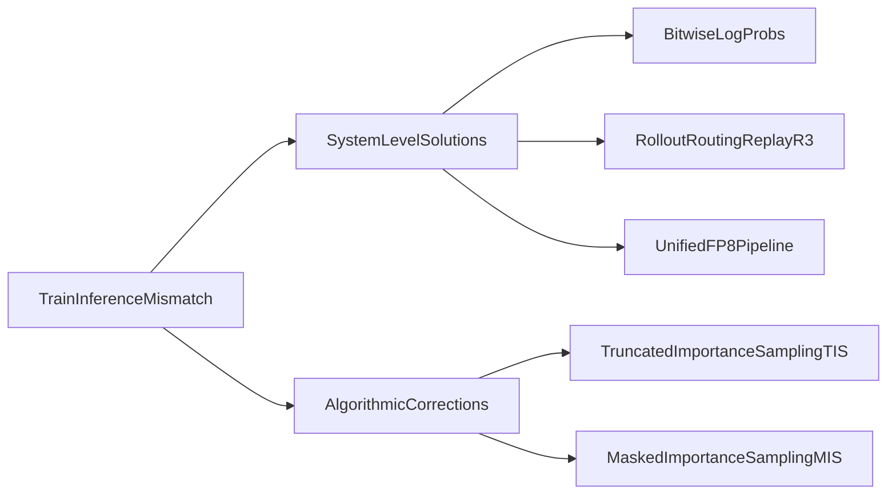
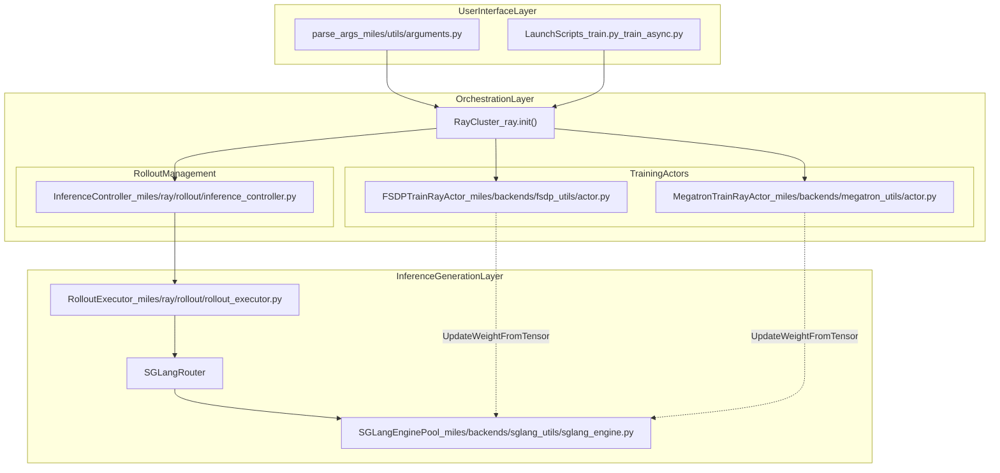
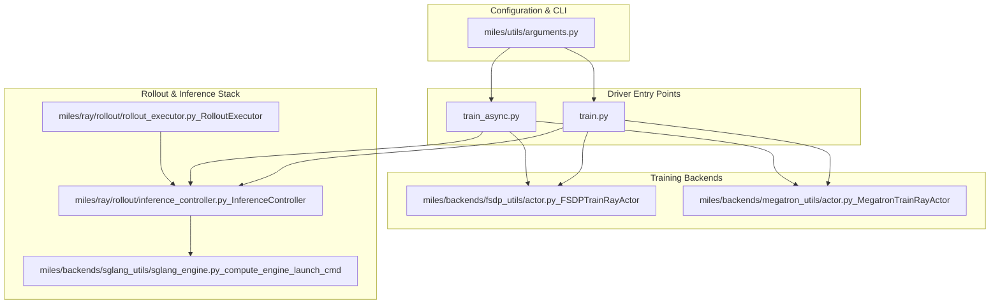
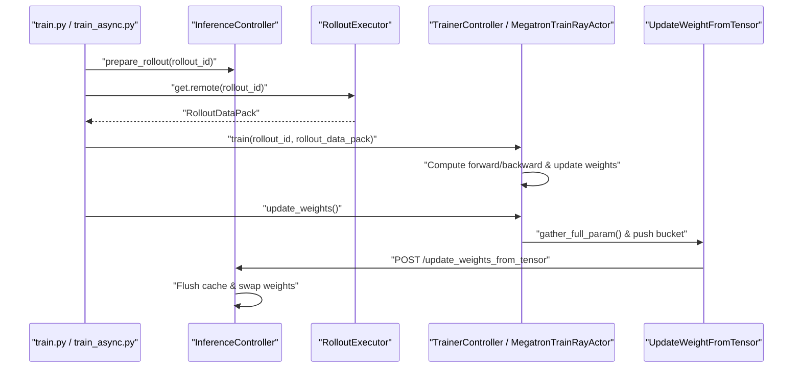

<!-- source: DeepWiki mcp.deepwiki.com · repo radixark/miles · page 1 Overview · fetched 2026-10-21 -->

# Overview

Relevant source files

The following files were used as context for generating this wiki page:

- [.gitignore](.gitignore)
- [README.md](README.md)
- [docker/patch/fla_kda_hoist_next_power_of_2.patch](docker/patch/fla_kda_hoist_next_power_of_2.patch)
- [docs/README.md](docs/README.md)
- [docs/advanced/lora.md](docs/advanced/lora.md)
- [docs/assets/images/acknowledgment.png](docs/assets/images/acknowledgment.png)
- [docs/docs.json](docs/docs.json)
- [docs/index.md](docs/index.md)
- [docs/models/glm/glm5-2.md](docs/models/glm/glm5-2.md)
- [docs/models/glm/glm5-3-flash.md](docs/models/glm/glm5-3-flash.md)
- [docs/models/glm/glm5-3.md](docs/models/glm/glm5-3.md)
- [docs/models/glm/glm5.md](docs/models/glm/glm5.md)
- [docs/models/glm/index.md](docs/models/glm/index.md)
- [docs/models/index.md](docs/models/index.md)
- [miles/backends/megatron_utils/megatron_to_hf/glm5_next.py](miles/backends/megatron_utils/megatron_to_hf/glm5_next.py)
- [miles/ray/wiring.py](miles/ray/wiring.py)
- [miles/utils/async_utils.py](miles/utils/async_utils.py)
- [miles/utils/orchestration_utils.py](miles/utils/orchestration_utils.py)
- [tests/fast/fixtures/driver_fakes.py](tests/fast/fixtures/driver_fakes.py)
- [tests/fast/ray/test_wiring.py](tests/fast/ray/test_wiring.py)
- [tests/fast/test_platform_contract.py](tests/fast/test_platform_contract.py)
- [tests/fast/test_train.py](tests/fast/test_train.py)
- [tests/fast/test_train_async.py](tests/fast/test_train_async.py)
- [tests/fast/test_train_multi_policy.py](tests/fast/test_train_multi_policy.py)
- [tests/fast/utils/test_async_utils.py](tests/fast/utils/test_async_utils.py)
- [tests/fast/utils/test_orchestration_utils.py](tests/fast/utils/test_orchestration_utils.py)
- [tests/fast/utils/workers/test_ray_communication_boundary.py](tests/fast/utils/workers/test_ray_communication_boundary.py)
- [tests/manual/launch_scripts/test_py_launch_scripts.py](tests/manual/launch_scripts/test_py_launch_scripts.py)
- [train.py](train.py)
- [train_async.py](train_async.py)
- [train_multi_policy.py](train_multi_policy.py)

This page provides a high-level technical introduction to Miles, explaining its architecture, core design philosophy around train-inference alignment, and its structural relationship to foundational components like SGLang, Megatron-LM, and Ray [README.md:32-42]().

---

## What is Miles?

**Miles** is an enterprise-grade reinforcement learning (RL) framework built for large-scale model post-training [README.md:32-34](). Originating as a production-hardened fork of `slime`, Miles bridges the gap between research prototypes and production-scale training infrastructure by pairing **SGLang** for high-throughput rollout generation with **Megatron-LM** for parallelized large-scale training [README.md:32-36](). Native PyTorch FSDP2 and `torchtitan` backends are also provided for alternative training workflows, though primary scaling, multi-LoRA, and frontier model recipes target Megatron-LM [README.md:32-45](), [docs/index.md:6-13]().

Sources: [README.md:32-45](), [docs/index.md:6-13]()

---

## Core Value Proposition: Train-Inference Alignment

The central challenge in large-scale RL post-training is **train-inference mismatch**—discrepancies between the rollout generation environment (SGLang) and the training environment (Megatron-LM or FSDP) regarding numerical precision, kernel execution, or expert routing in Mixture-of-Experts (MoE) architectures. These discrepancies cause training instability and collapse during on-policy RL [README.md:39-80]().

Miles addresses this through a multi-layered correction strategy:

**Train-Inference Alignment Strategy**

*   **System-level solutions**: Enforce exact bit-wise log probability matching using deterministic kernels (e.g., FlashAttention-3, DeepGEMM) and **Rollout Routing Replay (R3)** to record and replay MoE expert routing decisions [README.md:69-80]().
*   **Algorithmic corrections**: Apply **Truncated Importance Sampling (TIS)** and **Masked Importance Sampling (MIS)** in asynchronous drivers like `train_async.py` to compensate for unavoidable off-policy lag [README.md:51-53](), [train_async.py:24-26]().

Sources: [README.md:39-80](), [train_async.py:24-26]()

---

## Three-Layer System Architecture

Miles organizes its execution graph into three distinct architectural layers managed through Ray placement groups [README.md:39-80](), [train.py:25-38]().

**Three-Layer System Architecture**

### Layer Responsibilities

1.  **User Interface Layer**: Parses arguments and configures execution environments via entry points like `train.py` [train.py:25-28]() and `train_async.py` [train_async.py:23-27]().
2.  **Orchestration & Training Layer**: Ray orchestrates distributed training actors (`MegatronTrainRayActor`, `FSDPTrainRayActor`) alongside rollout controllers (`InferenceController`) [README.md:39-53](), [train.py:37-41]().
3.  **Inference & Generation Layer**: High-throughput generation is driven by SGLang engines managed by `RolloutExecutor` and bridged back to training via tensor-bucket weight updates [README.md:39-60](), [train.py:37-48]().

Sources: [README.md:39-60](), [train.py:25-48](), [train_async.py:23-27]()

---

## Component-to-Code Entity Mapping

The following diagram maps high-level framework subsystems to their underlying codebase implementations, highlighting key classes and execution modules.

**Component to Code Entity Mapping**

Sources: [train.py:25-45](), [train_async.py:24-38]()

---

## Training Workflow Implementation

Miles supports synchronous training (`train.py`), asynchronous pipelined training (`train_async.py`), and multi-policy coordination (`train_multi_policy.py`) [train.py:25-156](), [train_async.py:23-137](), [train_multi_policy.py:32-102](). The sequence below details the interaction between the driver, rollout generation workers, and training actors during a rollout-training iteration [train.py:103-132](), [train_async.py:71-96]().

**Training Loop Sequence**

### Workflow Highlights

1.  **Preparation**: The driver instructs `InferenceController` to prepare SGLang engines for the upcoming rollout [train.py:104](), [train_async.py:66]().
2.  **Rollout Collection**: `RolloutExecutor` generates or fetches trajectories and returns a rollout data pack [train.py:105](), [train_async.py:67]().
3.  **Training Step**: The training actor executes policy optimization on the rollout batch [train.py:121-130](), [train_async.py:86-95]().
4.  **Weight Synchronization**: Updated weights are synchronized back to the SGLang inference engines via zero-copy tensor streaming or NCCL broadcast (`update_weights`) [train.py:48](), [train_async.py:41](), [train_multi_policy.py:58]().

Sources: [train.py:25-156](), [train_async.py:23-137](), [train_multi_policy.py:32-102]()

---

