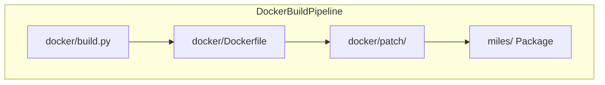
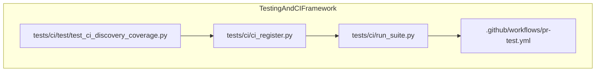
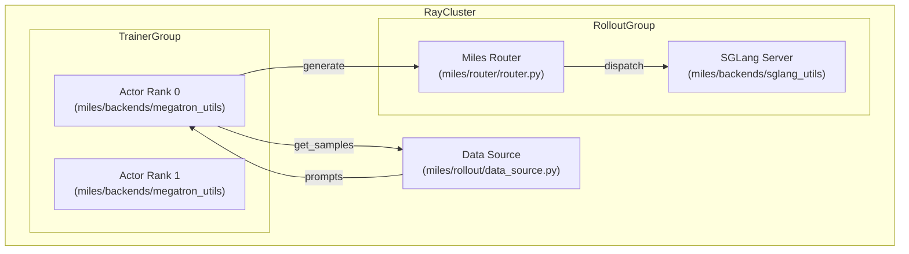

<!-- source: DeepWiki mcp.deepwiki.com · repo radixark/miles · page 10 Development Guide · fetched 2026-10-21 -->

# Development Guide

Relevant source files

The following files were used as context for generating this wiki page:

- [.claude/rules/ci-failure-triage.md](.claude/rules/ci-failure-triage.md)
- [.claude/rules/ci-test-registration.md](.claude/rules/ci-test-registration.md)
- [.claude/rules/partial-model-ci.md](.claude/rules/partial-model-ci.md)
- [docs/developer/contributor-guide.md](docs/developer/contributor-guide.md)
- [docs/developer/index.md](docs/developer/index.md)
- [tests/ci/test/test_ci_disabled_reasons.py](tests/ci/test/test_ci_disabled_reasons.py)
- [tests/ci/test/test_ci_discovery_coverage.py](tests/ci/test/test_ci_discovery_coverage.py)
- [tests/ci/test/test_ci_rocm_nightly_gpu_count.py](tests/ci/test/test_ci_rocm_nightly_gpu_count.py)

This guide serves as an entry point for developers contributing to or extending the Miles framework. It outlines the build system, patch management, testing infrastructure, CI/CD pipeline, and core developer architecture [docs/developer/contributor-guide.md:1-4]. 

For detailed deep-dives, please refer to the child pages linked throughout this document.

---

## Docker Build System

Miles relies on a multi-stage Docker build system (`docker/build.py`, `docker/Dockerfile`) to bundle complex dependencies like SGLang, Megatron-Core, FlashAttention, and TransformerEngine [docs/developer/contributor-guide.md:34]. The build system manages image input hashing, dependency layering, and automatic patching via `git apply --3way` [docs/developer/contributor-guide.md:34].

Title: Docker Build and Patch System Flow

Sources: [docs/developer/contributor-guide.md:34-37]()

For details on the Dockerfile, build variants, image input hashing, and patch application, see [Docker Build System](#10.1).

---

## Patch System

To support advanced features like Rollout Routing Replay (R3), memory offloading, and INT4 Quantization-Aware Training, Miles maintains patches against upstream SGLang and Megatron-LM repositories [docs/developer/contributor-guide.md:34]. These patches adapt inference engines and training backends for seamless train-inference alignment.

| Patch Domain | Target Repository | Key Code Artifacts |
| :--- | :--- | :--- |
| **SGLang Adaptations** | SGLang | `release_memory_occupation()`, R3 routing [docs/developer/contributor-guide.md:34]() |
| **Megatron Adaptations** | Megatron-LM | `_FakeInt4QuantizationSTE`, `mtp_labels` [docs/developer/contributor-guide.md:34]() |

Sources: [docs/developer/contributor-guide.md:34-37]()

For details on how patches are structured, applied, and modified for ROCm/NPU variants, see [Patch System](#10.2).

---

## Testing Framework

The testing infrastructure supports both fast unit tests and GPU-accelerated end-to-end integration suites (`tests/fast`, `tests/fast-gpu`, `tests/e2e`) [tests/ci/test/test_ci_discovery_coverage.py:25-30, .claude/rules/ci-test-registration.md:17-22]. It utilizes custom mock SGLang servers and resource locking mechanisms (`tests/ci/ci_register.py`) to safely execute parallel tests on shared hardware clusters [tests/ci/test/test_ci_discovery_coverage.py:25-30].

Title: Testing Framework and CI Discovery Integration

Sources: [tests/ci/test/test_ci_discovery_coverage.py:25-30](), [.github/workflows/pr-test.yml:1-360]()

For details on fixtures, mock servers, and test suites, see [Testing Framework](#10.3).

---

## CI/CD Pipeline

Miles uses GitHub Actions workflows generated from templates [.github/workflows/pr-test.yml.j2:1-177] to manage automated testing and deployment. The pipeline uses PR labels (e.g., `run-ci-megatron`, `run-ci-fsdp`), stage selection rules, metric-history gates, and Lark failure notifications to maintain code quality [.github/workflows/pr-test.yml:1-360, .claude/rules/ci-test-registration.md:88-96].

* **Workflow Definitions**: Managed via `.github/workflows/pr-test.yml` and `.github/workflows/pr-test-rocm.yml` [docs/developer/contributor-guide.md:127-128].
* **Job Triggers**: Controlled by domain labels and stage registration parameters [.github/workflows/pr-test.yml:1-360, .claude/rules/ci-test-registration.md:60-72].

Sources: [.github/workflows/pr-test.yml:1-360](), [.claude/rules/ci-test-registration.md:60-96]()

For details on CI policies, label filtering, and gate checks, see [CI/CD Pipeline](#10.4).

---

## Architecture for Developers

Understanding Miles' internal design patterns (`miles/`), Ray orchestration (`miles/ray/`), and component interaction (`train.py`, `train_async.py`) is vital for extension [docs/developer/contributor-guide.md:8-37]. The system separates rollout generation (`miles/rollout/`) from training via distinct actor groups and proxy routers (`miles/router/router.py`) [docs/developer/contributor-guide.md:11-25].

Title: Miles Core Developer Architecture

Sources: [docs/developer/contributor-guide.md:8-37]()

For a deep dive into code organization, design patterns, and debugging utilities like `run_megatron`, see [Architecture for Developers](#10.5).

---

