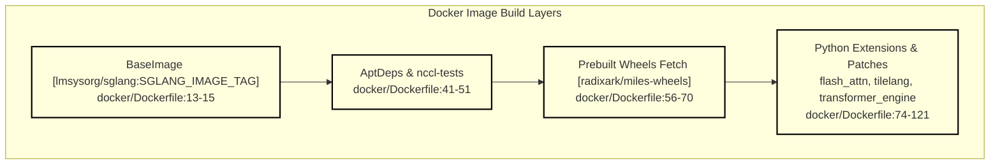
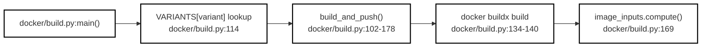
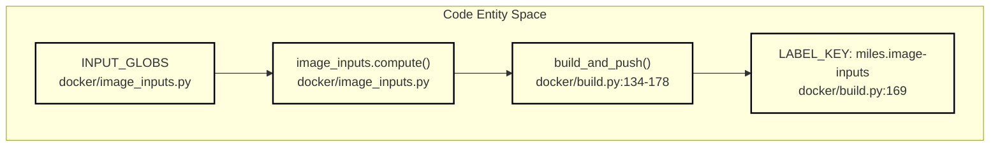
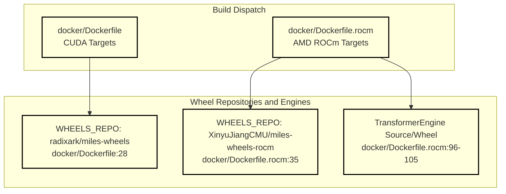

<!-- source: DeepWiki mcp.deepwiki.com · repo radixark/miles · page 10.1 Docker Build System · fetched 2026-10-21 -->

# Docker Build System

Relevant source files

The following files were used as context for generating this wiki page:

- [.github/workflows/docker-build.yml](.github/workflows/docker-build.yml)
- [docker/Dockerfile](docker/Dockerfile)
- [docker/Dockerfile.rocm](docker/Dockerfile.rocm)
- [docker/amd/prebuild_aiter_jit.py](docker/amd/prebuild_aiter_jit.py)
- [docker/build.py](docker/build.py)
- [docs/developer/ci/02-docker-build.md](docs/developer/ci/02-docker-build.md)
- [docs/developer/versions.md](docs/developer/versions.md)
- [docs/getting-started/installation.md](docs/getting-started/installation.md)
- [docs/hardware-platforms/amd-gpus.md](docs/hardware-platforms/amd-gpus.md)
- [requirements.txt](requirements.txt)
- [scripts/amd/run_qwen3_30b_a3b.py](scripts/amd/run_qwen3_30b_a3b.py)
- [scripts/amd/run_qwen3_4b.py](scripts/amd/run_qwen3_4b.py)
- [tests/fast/test_docker_image_inputs.py](tests/fast/test_docker_image_inputs.py)

The Docker build system provides a containerized, reproducible build environment for Miles across multiple hardware targets (CUDA and AMD ROCm). It orchestrates variant-based image compilation, dependency layering, prebuilt wheel integration, content-hash change detection, and specialized source patching to ensure stable high-performance execution.

---

## Purpose and Scope

This page documents the internal architecture of the Miles container build system. It covers `docker/Dockerfile` [docker/Dockerfile:1-121]() and `docker/Dockerfile.rocm` [docker/Dockerfile.rocm:1-138](), python build automation via `docker/build.py` [docker/build.py:1-203](), Python dependencies defined in `requirements.txt` [requirements.txt:1-35](), content hashing mechanisms in `docker/image_inputs.py` [tests/fast/test_docker_image_inputs.py:7-10](), and how CI orchestrates these components via `.github/workflows/docker-build.yml` [.github/workflows/docker-build.yml:1-170]().

Sources: [docker/Dockerfile:1-121](), [docker/Dockerfile.rocm:1-138](), [docker/build.py:1-203](), [requirements.txt:1-35](), [.github/workflows/docker-build.yml:1-170]()

---

## Overview and Dependency Layering

The Miles container is constructed in sequential layers starting from an official SGLang base image (`lmsysorg/sglang` or ROCm equivalents). Packages are layered strategically to maximize Docker layer caching: system diagnostic tools and NCCL test binaries are compiled first, followed by prebuilt wheels from `radixark/miles-wheels`, framework packages (`mbridge`, `Megatron-LM`), and core Python runtime requirements from `requirements.txt` [requirements.txt:1-35]().

Title: "Docker Image Build Layering and Dependencies"

Sources: [docker/Dockerfile:13-121](), [docs/developer/versions.md:30-48](), [requirements.txt:1-35]()

---

## Build Automation and Variants (`build.py`)

The python script `docker/build.py` acts as the single source of truth for variant definitions, target platforms, tag postfixes, and build arguments [docker/build.py:23-92](). It wraps `docker buildx build` to support multi-architecture target manifests and parameterized overrides [docker/build.py:134-178]().

The `VARIANTS` dictionary in `docker/build.py` configures targets such as `cu13`, `cu13-x86`, `cu13-aarch64`, `rubin`, and ROCm variants like `rocm724-mi35x`, `rocm10-mi35x`, and `rocm10-mi30x` [docker/build.py:23-92]().

Title: "Build Automation Data Flow"

| Variant | Target Platforms | Dockerfile | Default Build Args / Notes |
|---|---|---|---|
| `cu13` | `linux/amd64`, `linux/arm64` | `docker/Dockerfile` | Multi-arch CUDA 13 default daily image [docker/build.py:24-29]() |
| `rubin` | `linux/arm64` | `docker/Dockerfile.rubin` | Vera Rubin architecture target [docker/build.py:42-48]() |
| `rocm724-mi35x` | native | `docker/Dockerfile.rocm` | AMD MI35x (ROCm 7.2.4, `gfx950`) [docker/build.py:49-62]() |

Sources: [docker/build.py:23-92](), [docker/build.py:102-178]()

---

## Image Input Hashing and Change Detection (`image_inputs.py`)

To avoid redundant builds, `docker/image_inputs.py` computes a cryptographic SHA-256 content hash over all files that influence the container build recipe. The resulting digest is written into the built container image as a Docker label (`miles.image-inputs`) via `docker/build.py` [docker/build.py:169](). 

CI pipelines (`docker-build.yml`) inspect upstream commit SHAs (`sglang-miles`, `miles-main`) and asset fingerprints (`radixark/miles-wheels`) to decide whether to trigger a rebuild [sources: .github/workflows/docker-build.yml:101-145]().

Title: "Image Input Hashing and Labeling Architecture"

Sources: [docker/build.py:169](), [.github/workflows/docker-build.yml:101-145](), [tests/fast/test_docker_image_inputs.py:7-10]()

---

## Hardware Variants: CUDA vs. ROCm

Miles maintains separate Dockerfiles for NVIDIA CUDA (`docker/Dockerfile`) and AMD ROCm (`docker/Dockerfile.rocm`) [docs/developer/ci/02-docker-build.md:10-15](). While CUDA variants pull prebuilt wheels from `radixark/miles-wheels` [docker/Dockerfile:28](), ROCm variants target repositories like `XinyuJiangCMU/miles-wheels-rocm` [docker/Dockerfile.rocm:35]() and configure platform-specific build parameters such as `GPU_ARCH=gfx950` or `gfx942` [docker/Dockerfile.rocm:32](), along with AITER JIT prebuilding [docs/developer/ci/02-docker-build.md:40]().

Title: "Hardware Platform Dockerfile Routing"

Sources: [docker/Dockerfile:28](), [docker/Dockerfile.rocm:32-35](), [docker/Dockerfile.rocm:96-105](), [docs/developer/ci/02-docker-build.md:10-15]()

---

## Dependency Patching and Source Overrides

Because Miles relies on bleeding-edge developments in SGLang, Megatron-LM, and specialized low-precision kernels, the build process applies inline git checkouts and targeted patch files during container construction [docker/Dockerfile:88-106](). Examples include patching Flash Linear Attention (`fla_kda_hoist_next_power_of_2.patch`) [docker/Dockerfile:89-93](), TileLang pack fix (`tilelang_pack_float16x4.patch`) [docker/Dockerfile:97-100](), and TileKernels targets (`tile_kernels_target.patch`) [docker/Dockerfile:102-106]().

Sources: [docker/Dockerfile:88-106](), [docs/developer/versions.md:19-23]()

---

