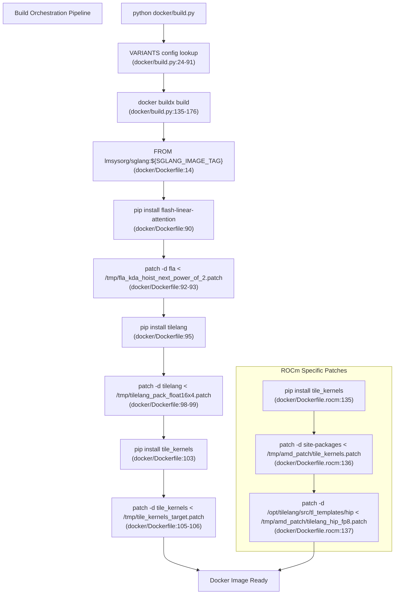

<!-- source: DeepWiki mcp.deepwiki.com · repo radixark/miles · page 10.2 Patch System · fetched 2026-10-21 -->

# Patch System

Relevant source files

The following files were used as context for generating this wiki page:

- [.github/workflows/docker-build.yml](.github/workflows/docker-build.yml)
- [.pre-commit-config.yaml](.pre-commit-config.yaml)
- [docker/Dockerfile](docker/Dockerfile)
- [docker/Dockerfile.rocm](docker/Dockerfile.rocm)
- [docker/amd/prebuild_aiter_jit.py](docker/amd/prebuild_aiter_jit.py)
- [docker/build.py](docker/build.py)
- [docs/developer/ci/02-docker-build.md](docs/developer/ci/02-docker-build.md)
- [docs/developer/versions.md](docs/developer/versions.md)
- [docs/getting-started/installation.md](docs/getting-started/installation.md)
- [docs/hardware-platforms/amd-gpus.md](docs/hardware-platforms/amd-gpus.md)
- [miles/backends/megatron_utils/megatron_to_hf/deepseekv4_1.py](miles/backends/megatron_utils/megatron_to_hf/deepseekv4_1.py)
- [miles/utils/chat_template_utils/deepseek.py](miles/utils/chat_template_utils/deepseek.py)
- [miles/utils/chat_template_utils/templates/encoding_dsv32.py](miles/utils/chat_template_utils/templates/encoding_dsv32.py)
- [requirements.txt](requirements.txt)
- [scripts/amd/run_qwen3_30b_a3b.py](scripts/amd/run_qwen3_30b_a3b.py)
- [scripts/amd/run_qwen3_4b.py](scripts/amd/run_qwen3_4b.py)
- [tests/fast/test_docker_image_inputs.py](tests/fast/test_docker_image_inputs.py)
- [tests/fast/tools/__init__.py](tests/fast/tools/__init__.py)
- [tests/fast/tools/kubernetes/__init__.py](tests/fast/tools/kubernetes/__init__.py)
- [tests/fast/utils/chat_template_utils/test_deepseek_v32.py](tests/fast/utils/chat_template_utils/test_deepseek_v32.py)
- [tests/fast/utils/chat_template_utils/test_deepseek_v4.py](tests/fast/utils/chat_template_utils/test_deepseek_v4.py)

The Patch System in Miles consists of extensive modifications to both SGLang and Megatron-LM frameworks, applied during Docker image construction (`docker/Dockerfile` and `docker/Dockerfile.rocm`). These patches add critical functionality for reinforcement learning training, including train-inference alignment features, low-level memory management, quantization support, and model architecture extensions.

For information about the Docker build infrastructure, see [Docker Build System](). For details on how patches enable specific features like routing replay, see [Rollout Routing Replay (R3)]().

## Patch Organization and Structure

Miles maintains primary patch files that modify the upstream SGLang and Megatron-LM repositories. Additionally, specialized patches for AMD/ROCm and CUDA 13 environments are maintained to support advanced hardware platforms like Blackwell (B300) and MI350.

| Patch File | Target | Purpose |
|------------|--------|---------|
| `docker/patch/fla_kda_hoist_next_power_of_2.patch` | `flash-linear-attention` | Fixes `triton.next_power_of_2` rejection in KDA kernel. |
| `docker/patch/tilelang_pack_float16x4.patch` | `tilelang` | Fixes fp16 256-bit store on Blackwell. |
| `docker/patch/tile_kernels_target.patch` | `tile_kernels` | Fixes target-import for `tile_kernels`. |
| `docker/amd_patch/latest/tile_kernels.patch` | `tile_kernels` (ROCm) | Makes `tile_kernels` import lazy, removes CUDA/Hopper-only PDL. |
| `docker/amd_patch/latest/tilelang_hip_fp8.patch` | `tilelang` (ROCm) | Fixes HIP fp8->float conversion to use ROCm device intrinsics. |

Sources: `[docker/Dockerfile:89-106]`, `[docker/Dockerfile.rocm:69-71]`, `[docker/Dockerfile.rocm:135-137]()`

## Patch Application Process & Build Integration

The patches are automatically applied during Docker image construction [docker/build.py:124-169]() using standard patch utilities. The `docker/build.py` script orchestrates variant-specific builds [docker/build.py:24-82](), feeding build arguments into `docker/Dockerfile` and `docker/Dockerfile.rocm`.

*Figure 1: Docker build and patch application pipeline mapping CLI drivers to specific patch applications.*

Sources: `[docker/build.py:24-169]`, `[docker/Dockerfile:14-106]`, `[docker/Dockerfile.rocm:12-137]()`

## SGLang Patch Categories

Miles integrates with SGLang primarily through its base Docker images, which are built on `lmsysorg/sglang`. The `sglang-miles` branch of `sgl-project/sglang` is used, which contains necessary modifications. Miles also vendors specific SGLang components, such as chat templates for DeepSeek models.

### DeepSeek Chat Template Integration

**Purpose:** Ensure correct chat template rendering for DeepSeek V3.2 and V4 models, maintaining parity with SGLang's `encode_messages` function.

**Modified Components:**
- `miles.utils.chat_template_utils.templates.encoding_dsv32`: A vendored version of SGLang's `encoding_dsv32.py` [miles/utils/chat_template_utils/templates/encoding_dsv32.py]().
- `miles.utils.chat_template_utils.deepseek`: Provides detection logic for DeepSeek V3.2 and V4 models based on `config.json`'s `model_type` [miles/utils/chat_template_utils/deepseek.py]().
- `apply_chat_template`: Dispatches to the correct DeepSeek renderer based on detected model type [tests/fast/utils/chat_template_utils/test_deepseek_v32.py:120-122](), [tests/fast/utils/chat_template_utils/test_deepseek_v4.py:147-149]().

**Key Changes:**
- **Detection:** `deepseek.model_type` checks `config.json` for `"model_type": "deepseek_v32"` or `"model_type": "deepseek_v4"` [tests/fast/utils/chat_template_utils/test_deepseek_v32.py:59](), [tests/fast/utils/chat_template_utils/test_deepseek_v4.py:75]().
- **Rendering Parity:** `deepseek.V32.render_messages` and `deepseek.V4.render_messages` are tested to match `sglang.srt.entrypoints.openai.encoding_dsv32.encode_messages` and `sglang.srt.entrypoints.openai.encoding_dsv4.encode_messages` respectively [tests/fast/utils/chat_template_utils/test_deepseek_v32.py:117-122](), [tests/fast/utils/chat_template_utils/test_deepseek_v4.py:140-142]().
- **Tool Call Argument Normalization:** DeepSeek V3.2 and V4 dispatch normalizes dictionary tool arguments to JSON strings for consistent rendering [tests/fast/utils/chat_template_utils/test_deepseek_v32.py:137-153]().
- **`drop_thinking` Extension:** Miles extends the DeepSeek V3.2 template to support `drop_thinking=False` at the render level, which is not directly exposed by the upstream SGLang encoder [tests/fast/utils/chat_template_utils/test_deepseek_v32.py:164-166]().

Sources: `[docker/Dockerfile:13-14]`, `[docs/developer/versions.md:10-15]`, `[miles/utils/chat_template_utils/templates/encoding_dsv32.py]()`, `[miles/utils/chat_template_utils/deepseek.py]()`, `[tests/fast/utils/chat_template_utils/test_deepseek_v32.py:22-24]`, `[tests/fast/utils/chat_template_utils/test_deepseek_v32.py:59]`, `[tests/fast/utils/chat_template_utils/test_deepseek_v32.py:117-122]`, `[tests/fast/utils/chat_template_utils/test_deepseek_v32.py:137-153]`, `[tests/fast/utils/chat_template_utils/test_deepseek_v32.py:164-166]`, `[tests/fast/utils/chat_template_utils/test_deepseek_v4.py:75]`, `[tests/fast/utils/chat_template_utils/test_deepseek_v4.py:140-142]()`

## Megatron Patch Categories

Miles uses a patched version of Megatron-LM from `radixark/Megatron-LM` on the `miles-main` branch [docs/developer/versions.md:15](). This branch contains modifications necessary for Miles' training features.

### DeepSeek V4.1 Megatron Bridge

**Purpose:** Provide specific model provider and configuration for DeepSeek V4.1 within the Megatron-LM framework, enabling its use in Miles.

**Implementation Details:**
- **`DeepseekV4_1ModelProvider`:** Defines how DeepSeek V4.1 models are initialized and configured within Megatron-LM [miles/backends/megatron_utils/megatron_to_hf/deepseekv4_1.py]().
- **`deepseek_v4_1_config_to_megatron_args`:** Maps HuggingFace configuration parameters to Megatron-LM arguments for DeepSeek V4.1 [miles/backends/megatron_utils/megatron_to_hf/deepseekv4_1.py]().
- **`deepseek_v4_1_megatron_to_hf_config`:** Converts Megatron-LM configuration back to HuggingFace format for DeepSeek V4.1 [miles/backends/megatron_utils/megatron_to_hf/deepseekv4_1.py]().

Sources: `[docs/developer/versions.md:15]`, `[miles/backends/megatron_utils/megatron_to_hf/deepseekv4_1.py]()`

## AMD/ROCm Specialized Patches

For AMD MI300X/MI325X/MI350X/MI355X hardware (`docker/Dockerfile.rocm`), Miles applies specialized patches to integrate with ROCm-specific libraries and optimize performance.

### TileKernels and TileLang Patches

**Purpose:** Enable `deepseek-ai/TileKernels` on ROCm/gfx950 for features like mHC and FP8 QAT cast-back, and fix TileLang's HIP fp8 conversion.

**Implementation Details:**
- **`tile_kernels.patch`:** Applied to `tile_kernels` to make its import lazy and remove CUDA/Hopper-only PDL from `mhc_post` [docker/Dockerfile.rocm:136]().
- **`tilelang_hip_fp8.patch`:** Applied to TileLang's HIP templates to fix fp8->float conversion, ensuring it uses ROCm device intrinsics instead of SDK host-only operators [docker/Dockerfile.rocm:137]().

Sources: `[docker/Dockerfile.rocm:69-71]`, `[docker/Dockerfile.rocm:135-137]()`

### ROCm-Specific Python Dependencies

Miles installs several Python dependencies with ROCm-specific considerations:
- **Transformer Engine:** Can be installed via a prebuilt wheel or source build, controlled by `TE_USE_WHEEL` [docker/Dockerfile.rocm:97-105]().
- **FlashAttention:** Installed from a prebuilt wheel specific to ROCm [docker/Dockerfile.rocm:106]().
- **Apex:** Prebuilt ROCm/apex wheel is used if `APEX_USE_PREBUILT` is enabled, which is required by Megatron's fused ops [docker/Dockerfile.rocm:108-122]().
- **Mooncake:** Installed as `mooncake-transfer-engine-non-cuda` and its Python files are copied into the `mooncake` package directory [docker/Dockerfile.rocm:124-127]().
- **Flash-Linear-Attention:** Installed at version `0.5.2` [docker/Dockerfile.rocm:129]().

Sources: `[docker/Dockerfile.rocm:97-129]()`

---

