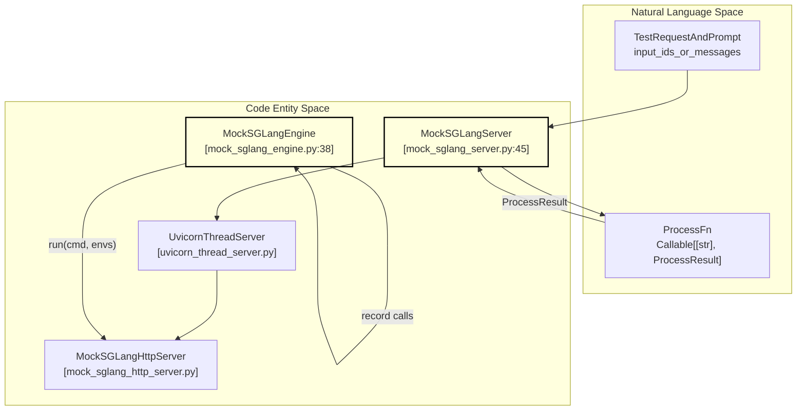
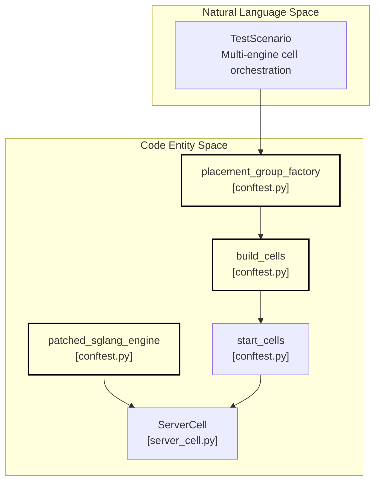

<!-- source: DeepWiki mcp.deepwiki.com · repo radixark/miles · page 10.3 Testing Framework · fetched 2026-10-21 -->

# Testing Framework

<details>
<summary>Relevant source files</summary>

The following files were used as context for generating this wiki page:

- [miles/rollout/generate_hub/multi_turn.py](miles/rollout/generate_hub/multi_turn.py)
- [miles/rollout/generate_hub/single_turn.py](miles/rollout/generate_hub/single_turn.py)
- [miles/utils/mask_utils.py](miles/utils/mask_utils.py)
- [miles/utils/misc.py](miles/utils/misc.py)
- [miles/utils/processing_utils.py](miles/utils/processing_utils.py)
- [miles/utils/test_utils/__init__.py](miles/utils/test_utils/__init__.py)
- [miles/utils/test_utils/mock_sglang_engine.py](miles/utils/test_utils/mock_sglang_engine.py)
- [miles/utils/test_utils/mock_sglang_http_server.py](miles/utils/test_utils/mock_sglang_http_server.py)
- [miles/utils/test_utils/mock_sglang_server.py](miles/utils/test_utils/mock_sglang_server.py)
- [miles/utils/test_utils/mock_tools.py](miles/utils/test_utils/mock_tools.py)
- [miles/utils/test_utils/uvicorn_thread_server.py](miles/utils/test_utils/uvicorn_thread_server.py)
- [miles/utils/workers/addr_allocator.py](miles/utils/workers/addr_allocator.py)
- [miles/utils/workers/launch_gate.py](miles/utils/workers/launch_gate.py)
- [tests/e2e/common_dirs.py](tests/e2e/common_dirs.py)
- [tests/e2e/long/test_qwen2.5_0.5B_gsm8k.py](tests/e2e/long/test_qwen2.5_0.5B_gsm8k.py)
- [tests/e2e/long/test_qwen2.5_0.5B_gsm8k_async.py](tests/e2e/long/test_qwen2.5_0.5B_gsm8k_async.py)
- [tests/e2e/lora/test_lora_qwen2.5_0.5B.py](tests/e2e/lora/test_lora_qwen2.5_0.5B.py)
- [tests/e2e/megatron/test_mimo_7B_mtp_only_grad.py](tests/e2e/megatron/test_mimo_7B_mtp_only_grad.py)
- [tests/e2e/megatron/test_qwen3_30B_A3B/test_baseline.py](tests/e2e/megatron/test_qwen3_30B_A3B/test_baseline.py)
- [tests/e2e/precision/test_qwen3_5_cp_correctness.py](tests/e2e/precision/test_qwen3_5_cp_correctness.py)
- [tests/e2e/sglang_config/test_sglang_config.py](tests/e2e/sglang_config/test_sglang_config.py)
- [tests/e2e/sglang_config/test_sglang_config_mixed_offload.py](tests/e2e/sglang_config/test_sglang_config_mixed_offload.py)
- [tests/e2e/sglang_config/test_sglang_config_mixed_offload_ft.py](tests/e2e/sglang_config/test_sglang_config_mixed_offload_ft.py)
- [tests/e2e/short/test_qwen2.5_0.5B_gsm8k_async_short.py](tests/e2e/short/test_qwen2.5_0.5B_gsm8k_async_short.py)
- [tests/e2e/short/test_qwen2.5_0.5B_gsm8k_short.py](tests/e2e/short/test_qwen2.5_0.5B_gsm8k_short.py)
- [tests/e2e/short/test_qwen3_0.6B_fsdp_colocated_2xGPU.py](tests/e2e/short/test_qwen3_0.6B_fsdp_colocated_2xGPU.py)
- [tests/fast/e2e/test_common_dirs.py](tests/fast/e2e/test_common_dirs.py)
- [tests/fast/ray/rollout/test_engine_addressing.py](tests/fast/ray/rollout/test_engine_addressing.py)
- [tests/fast/rollout/generate_hub/test_tool_call_utils.py](tests/fast/rollout/generate_hub/test_tool_call_utils.py)
- [tests/fast/rollout/inference_rollout/integration/test_agent_metadata.py](tests/fast/rollout/inference_rollout/integration/test_agent_metadata.py)
- [tests/fast/rollout/inference_rollout/integration/test_multi_turn.py](tests/fast/rollout/inference_rollout/integration/test_multi_turn.py)
- [tests/fast/utils/test_misc.py](tests/fast/utils/test_misc.py)
- [tests/fast/utils/test_utils/test_mock_sglang_engine.py](tests/fast/utils/test_utils/test_mock_sglang_engine.py)
- [tests/fast/utils/test_utils/test_mock_sglang_http_server.py](tests/fast/utils/test_utils/test_mock_sglang_http_server.py)
- [tests/fast/utils/test_utils/test_mock_sglang_server.py](tests/fast/utils/test_utils/test_mock_sglang_server.py)
- [tests/fast/utils/test_utils/test_mock_tools.py](tests/fast/utils/test_utils/test_mock_tools.py)
- [tests/fast/utils/test_utils/test_uvicorn_thread_server.py](tests/fast/utils/test_utils/test_uvicorn_thread_server.py)
- [tests/fast/utils/workers/conftest.py](tests/fast/utils/workers/conftest.py)
- [tests/fast/utils/workers/test_addr_allocator.py](tests/fast/utils/workers/test_addr_allocator.py)
- [tests/fast/utils/workers/test_launch_gate.py](tests/fast/utils/workers/test_launch_gate.py)
- [tools/convert_fsdp_to_hf.py](tools/convert_fsdp_to_hf.py)
- [tools/convert_to_hf.py](tools/convert_to_hf.py)

</details>


The purpose of this page is to document Miles' test infrastructure, detailing the test utilities, mock SGLang server and engine actors, pytest fixtures, and test suite structures (`fast`, `fast-gpu`, and `e2e`) that validate distributed RL training pipelines without requiring full multi-node GPU clusters.

---

## Overview

Distributed RL training systems like Miles normally require large-scale GPU infrastructure, making rapid local iteration and unit testing difficult. The Miles testing framework solves this by providing comprehensive in-memory mocks, deterministic test runners, and robust fixtures.

**Key Design Principles:**
- **Zero-GPU Fallback:** Core rollout logic, state machines, and session managers run entirely in-process using CPU mocks.
- **Protocol Fidelity:** Mocks implement exact SGLang API contracts (`/generate`, `/v1/chat/completions`) and Ray actor interfaces (`CommandActor`).
- **Deterministic Simulation:** Configurable `ProcessFn` and fault-injection mechanisms allow testing edge cases, disconnections, and recovery paths.

Sources: [miles/utils/test_utils/mock_sglang_server.py:43-201](), [miles/utils/test_utils/mock_sglang_engine.py:38-122]()

---

## Mock SGLang Server and Engine Architecture

The testing stack splits inference mocking into two tiers: `MockSGLangServer` for HTTP-level protocol testing, and `MockSGLangEngine` for Ray-actor-level lifecycle and command validation.


**Diagram: Inference Mocking Stack Mapping**

Sources: [miles/utils/test_utils/mock_sglang_server.py:45-114](), [miles/utils/test_utils/mock_sglang_engine.py:38-89]()

### `MockSGLangServer` Implementation

`MockSGLangServer` spins up a FastAPI background application using `UvicornThreadServer` [miles/utils/test_utils/mock_sglang_server.py:61-79](). It processes generation and chat completion requests against a tokenizer and a user-supplied `ProcessFn` [miles/utils/test_utils/mock_sglang_server.py:55-56]().

Metadata structures track weight versions and speculative decoding states:
```python
@dataclass(frozen=True)
class ProcessResultMetaInfo:
    weight_version: str | None = None
    weight_versions: list[dict[str, str | int]] | None = None
    routed_experts: str | None = None
    spec_num_correct_drafts: int | None = None
    spec_num_proposed_drafts: int | None = None
    spec_verify_ct: int | None = None

@dataclass(frozen=True)
class ProcessResult:
    text: str
    finish_reason: str = "stop"
    cached_tokens: int = 0
    meta_info: ProcessResultMetaInfo = ProcessResultMetaInfo()
```
Sources: [miles/utils/test_utils/mock_sglang_server.py:21-41]()

### `MockSGLangEngine` and Fault Injection

`MockSGLangEngine` acts as an in-memory stand-in for the Ray `CommandActor` [miles/utils/test_utils/mock_sglang_engine.py:38-123](). It records all incoming method calls (`run`, `shutdown`, `_get_free_port_block`) and supports fault injection via `set_fault()` to test actor resilience and error handling [miles/utils/test_utils/mock_sglang_engine.py:42-53]().

Sources: [miles/utils/test_utils/mock_sglang_engine.py:38-123]()

---

## Ray Rollout and Cell Fixtures

Tests driving real Ray actors for rollout generation use specialized conftest fixtures located under test directories.


**Diagram: Ray Cell Fixture Orchestration**

### Key Fixtures
- `placement_group_factory`: Yields a helper to create Ray placement groups with CPU/GPU bundles matching SGLang actor requirements.
- `build_cells`: Constructs configured `ServerCell` instances for placement groups.
- `patched_sglang_engine`: Monkeypatches `CommandActor` with `MockSGLangEngine` so that cell-derived URLs serve requests without requiring real GPUs.

Sources: [miles/utils/test_utils/mock_sglang_engine.py:38-123]()

---

## Port Allocator & Address Management

Distributed workers and mock engines require dynamic port allocation to avoid port collisions on shared nodes. The `PortAllocator` manages per-node port cursors and interacts with actors via `_get_free_port_block` [miles/utils/workers/addr_allocator.py:12-28]().

```python
@dataclass
class PortAllocator:
    _next_port_of_ip: dict[str, int] = field(default_factory=dict)
    _lock: asyncio.Lock = field(default_factory=asyncio.Lock)

    async def alloc(self, actor, *, node_ip: str, consecutive: int = 1) -> int:
        async with self._lock:
            start_port = self._next_port_of_ip.get(node_ip, _DYNAMIC_PORT_START)
            if start_port + consecutive - 1 > _MAX_PORT:
                start_port = _DYNAMIC_PORT_START
            port: int = await actor._get_free_port_block.remote(
                start_port=start_port,
                count=consecutive,
            )
            self._next_port_of_ip[node_ip] = port + consecutive
            return port
```
Sources: [miles/utils/workers/addr_allocator.py:12-28](), [tests/fast/utils/workers/test_addr_allocator.py:30-146]()

---

## Agentic and Tool Call Testing

The testing framework provides stubs and tool executors in `mock_tools.py` for validating agentic tool-use loops and multi-turn conversations [miles/utils/test_utils/mock_tools.py:1-193]().

- `run_agentic_tool_call`: Drives multi-turn loops against mock endpoints, executing functions defined in `TOOL_EXECUTORS` (e.g., `get_year`, `get_temperature`) [miles/utils/test_utils/mock_tools.py:52-117]().
- `TwoTurnStub`: Provides static prompt/response pairs and token IDs for testing 2-turn tool interaction workflows [miles/utils/test_utils/mock_tools.py:153-193]().

Sources: [miles/utils/test_utils/mock_tools.py:1-193]()

---

## Test Suites and CI Integration

Miles organizes tests into three distinct tiers:
1. **`fast` Suite (`tests/fast/`)**: Unit tests, mock server tests, and utility checks running entirely on CPU (`test_misc.py`, `test_addr_allocator.py`, `test_mock_sglang_server.py`) [tests/fast/utils/test_misc.py:1-170](), [tests/fast/utils/workers/test_addr_allocator.py:30-146]().
2. **`fast-gpu` Suite**: Tests requiring single-GPU operations (e.g., small-scale weight synchronization or tokenization).
3. **`e2e` Suite (`tests/e2e/`)**: Full integration and checkpointing tests registered via CI decorators (`register_cuda_ci`, `register_rocm_ci`) [tests/e2e/short/test_qwen2.5_0.5B_gsm8k_short.py:10-18]().

```python
register_cuda_ci(
    est_time=400,
    suite="stage-c-2-gpu-h200",
    labels=["short", "mooncake"],
    hardware=["hopper", "blackwell"],
    num_gpus=2,
)
```
Sources: [tests/e2e/short/test_qwen2.5_0.5B_gsm8k_short.py:1-18]()

---

