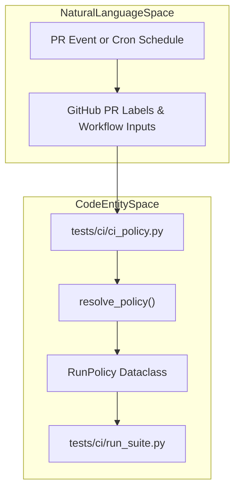
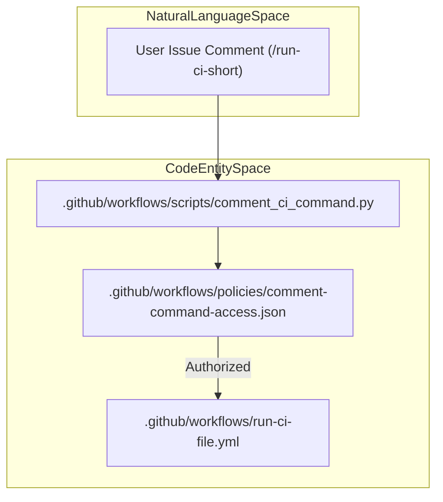

<!-- source: DeepWiki mcp.deepwiki.com · repo radixark/miles · page 10.4 CI/CD Pipeline · fetched 2026-10-21 -->

# CI/CD Pipeline

<details>
<summary>Relevant source files</summary>

The following files were used as context for generating this wiki page:

- [.github/actions/install-megatron-bridge/action.yml](.github/actions/install-megatron-bridge/action.yml)
- [.github/workflows/_run-ci-rocm.yml](.github/workflows/_run-ci-rocm.yml)
- [.github/workflows/_run-ci.yml](.github/workflows/_run-ci.yml)
- [.github/workflows/_run-cpu-ci.yml](.github/workflows/_run-cpu-ci.yml)
- [.github/workflows/build-wheels.yml](.github/workflows/build-wheels.yml)
- [.github/workflows/cancel-merged-file-ci.yml](.github/workflows/cancel-merged-file-ci.yml)
- [.github/workflows/ci-lark-notify.yml](.github/workflows/ci-lark-notify.yml)
- [.github/workflows/comment-ci-command.yml](.github/workflows/comment-ci-command.yml)
- [.github/workflows/policies/ci-failure-analysis.json](.github/workflows/policies/ci-failure-analysis.json)
- [.github/workflows/policies/ci-failure-response-schema.json](.github/workflows/policies/ci-failure-response-schema.json)
- [.github/workflows/policies/ci-failure-tags.json](.github/workflows/policies/ci-failure-tags.json)
- [.github/workflows/policies/comment-command-access.json](.github/workflows/policies/comment-command-access.json)
- [.github/workflows/pr-test-rocm.yml](.github/workflows/pr-test-rocm.yml)
- [.github/workflows/pr-test.yml](.github/workflows/pr-test.yml)
- [.github/workflows/prompts/ci-failure-analysis.md](.github/workflows/prompts/ci-failure-analysis.md)
- [.github/workflows/release-branch-cut.yml](.github/workflows/release-branch-cut.yml)
- [.github/workflows/run-ci-file.yml](.github/workflows/run-ci-file.yml)
- [.github/workflows/scripts/cancel_merged_file_ci.py](.github/workflows/scripts/cancel_merged_file_ci.py)
- [.github/workflows/scripts/ci_failure_analysis.py](.github/workflows/scripts/ci_failure_analysis.py)
- [.github/workflows/scripts/comment_ci_command.py](.github/workflows/scripts/comment_ci_command.py)
- [.github/workflows/scripts/lark_notify.py](.github/workflows/scripts/lark_notify.py)
- [.github/workflows/scripts/requirements-ci-lark-notify.txt](.github/workflows/scripts/requirements-ci-lark-notify.txt)
- [docker/Dockerfile.cu12](docker/Dockerfile.cu12)
- [docs/developer/ci/00-stage.md](docs/developer/ci/00-stage.md)
- [docs/developer/ci/01-label.md](docs/developer/ci/01-label.md)
- [docs/developer/ci/03-metric-history-gate.md](docs/developer/ci/03-metric-history-gate.md)
- [docs/developer/ci/04-release.md](docs/developer/ci/04-release.md)
- [docs/developer/ci/05-command-identity.md](docs/developer/ci/05-command-identity.md)
- [docs/developer/ci/06-build-wheels.md](docs/developer/ci/06-build-wheels.md)
- [docs/developer/reconcile-loop.md](docs/developer/reconcile-loop.md)
- [docs/examples/geo3k-vlm.md](docs/examples/geo3k-vlm.md)
- [docs/examples/geo3k-vlm/multi-turn.md](docs/examples/geo3k-vlm/multi-turn.md)
- [examples/geo3k_vlm/README.md](examples/geo3k_vlm/README.md)
- [examples/geo3k_vlm/multi_turn/README.md](examples/geo3k_vlm/multi_turn/README.md)
- [miles/utils/tracking_utils/ci_history.py](miles/utils/tracking_utils/ci_history.py)
- [scripts/models/qwen3.5-0.8B.py](scripts/models/qwen3.5-0.8B.py)
- [tests/ci/README.md](tests/ci/README.md)
- [tests/ci/ci_policy.py](tests/ci/ci_policy.py)
- [tests/ci/ci_utils.py](tests/ci/ci_utils.py)
- [tests/ci/github_runner/.env.example](tests/ci/github_runner/.env.example)
- [tests/ci/github_runner/.gitignore](tests/ci/github_runner/.gitignore)
- [tests/ci/github_runner/docker-compose.yml](tests/ci/github_runner/docker-compose.yml)
- [tests/ci/labels.py](tests/ci/labels.py)
- [tests/ci/metric_history/__init__.py](tests/ci/metric_history/__init__.py)
- [tests/ci/metric_history/gate.py](tests/ci/metric_history/gate.py)
- [tests/ci/metric_history/register.py](tests/ci/metric_history/register.py)
- [tests/ci/metric_history/storage/__init__.py](tests/ci/metric_history/storage/__init__.py)
- [tests/ci/metric_history/storage/neon_store.py](tests/ci/metric_history/storage/neon_store.py)
- [tests/ci/metric_history/storage/sqlite_store.py](tests/ci/metric_history/storage/sqlite_store.py)
- [tests/ci/requirements-ci-cpu.txt](tests/ci/requirements-ci-cpu.txt)
- [tests/ci/run_suite.py](tests/ci/run_suite.py)
- [tests/ci/stage_selection.py](tests/ci/stage_selection.py)
- [tests/ci/test/test_build_wheels.py](tests/ci/test/test_build_wheels.py)
- [tests/ci/test/test_cancel_merged_file_ci.py](tests/ci/test/test_cancel_merged_file_ci.py)
- [tests/ci/test/test_ci_failure_analysis.py](tests/ci/test/test_ci_failure_analysis.py)
- [tests/ci/test/test_ci_history.py](tests/ci/test/test_ci_history.py)
- [tests/ci/test/test_ci_policy.py](tests/ci/test/test_ci_policy.py)
- [tests/ci/test/test_comment_ci_command.py](tests/ci/test/test_comment_ci_command.py)
- [tests/ci/test/test_failure_tail.py](tests/ci/test/test_failure_tail.py)
- [tests/ci/test/test_file_run.py](tests/ci/test/test_file_run.py)
- [tests/ci/test/test_gate_integration.py](tests/ci/test/test_gate_integration.py)
- [tests/ci/test/test_gpu_job_plan.py](tests/ci/test/test_gpu_job_plan.py)
- [tests/ci/test/test_history_gate.py](tests/ci/test/test_history_gate.py)
- [tests/ci/test/test_lark_notify.py](tests/ci/test/test_lark_notify.py)
- [tests/ci/test/test_metric_history_store.py](tests/ci/test/test_metric_history_store.py)
- [tests/ci/test/test_metric_selection.py](tests/ci/test/test_metric_selection.py)
- [tests/ci/test/test_neon_store.py](tests/ci/test/test_neon_store.py)
- [tests/ci/test/test_run_suite.py](tests/ci/test/test_run_suite.py)
- [tests/ci/test/test_stage_selection.py](tests/ci/test/test_stage_selection.py)
- [tests/e2e/k8s_apiserver/test_environment.py](tests/e2e/k8s_apiserver/test_environment.py)
- [tests/e2e/k8s_apiserver/test_k8s_reflector.py](tests/e2e/k8s_apiserver/test_k8s_reflector.py)
- [tests/e2e/k8s_kind/test_environment.py](tests/e2e/k8s_kind/test_environment.py)
- [tests/e2e/k8s_kind/test_k8s_reflector.py](tests/e2e/k8s_kind/test_k8s_reflector.py)
- [tests/e2e/k8s_kind/test_launcher_observability.py](tests/e2e/k8s_kind/test_launcher_observability.py)
- [tests/fast/backends/training_utils/test_ci_utils.py](tests/fast/backends/training_utils/test_ci_utils.py)

</details>


This page documents Miles' continuous integration and continuous deployment (CI/CD) infrastructure. The pipeline validates code changes through automated testing on GPU-enabled self-hosted runners and GitHub-hosted CPU runners. The system uses GitHub Actions workflows with label-based job triggering, dynamic policy resolution via `ci_policy.py`, suite partitioning via `run_suite.py`, metric-history regression gates, and Lark failure notifications.

Sources: [.github/workflows/pr-test.yml:1-185](), [tests/ci/ci_policy.py:1-10]()

## Overview and Policy Resolution

Miles' CI/CD pipeline relies on explicit policy resolution rather than implicit event inference. The core orchestration is defined in [.github/workflows/pr-test.yml:1-185](). The workflow invokes `tests/ci/ci_policy.py` to process triggers, cadences, and raw labels into a strict `RunPolicy` [tests/ci/ci_policy.py:44-55]().

### Cadences and Scope Rules
Supported cadences defined in `ci_policy.py` include `regular`, `nightly`, `weekly`, and `release` [tests/ci/ci_policy.py:27-34]():
- **Regular**: Default PR testing scope determined by explicitly provided `run-ci-<key>` labels.
- **Nightly**: Scheduled runs that include most tests minus long-running soak suites (`long`, `ft-long`) [tests/ci/ci_policy.py:126-127]().
- **Weekly / Release**: Comprehensive execution including all domain labels. Release branches use frozen dependency SHAs and do not write performance baselines [tests/ci/ci_policy.py:30-34]().

Label sanitization and prefix stripping are handled by `strip_run_ci_prefix`, which strips the `run-ci-` prefix from PR labels while ignoring workflow-only modifiers like `nightly` or `bypass-fastfail` [tests/ci/ci_policy.py:66-89]().

**Diagram: Policy Resolution and Suite Execution Bridge**

Sources: [tests/ci/ci_policy.py:44-155](), [tests/ci/run_suite.py:1-25]()

## Stage Selection and Test Suite Management

Test files register themselves using metadata decorators (`register_cuda_ci` or `register_cpu_ci`), specifying estimated execution time (`est_time`) and target suite [tests/ci/run_suite.py:38-52]().

### Suite Taxonomy and Partitioning
`run_suite.py` manages execution suites across hardware backends (`CPU`, `CUDA`, `ROCM`) [tests/ci/run_suite.py:38-52](). For large GPU suites, `auto_partition` distributes test loads using a Longest Processing Time (LPT) greedy heuristic to balance execution time across parallel runners [tests/ci/run_suite.py:124-148]().

```python
# Partitioning logic pattern in tests/ci/run_suite.py
def auto_partition(files: list[CIRegistry], rank, size):
    ...
```
Sources: [tests/ci/run_suite.py:38-148](), [tests/ci/ci_register.py:1-20]()

## Labels and Comment Command Infrastructure

Tests are filtered dynamically based on canonical domain labels defined in `tests/ci/labels.py` [tests/ci/labels.py:1-42](). Maintainers can interactively trigger workflows or adjust labels using comment commands parsed by `comment_ci_command.py` [.github/workflows/scripts/comment_ci_command.py:1-40]().

### Canonical Labels (`KNOWN_LABELS`)
Key domains include:
- `megatron`: Megatron-LM training tests [tests/ci/labels.py:21]()
- `sglang`: SGLang patch and equivalence tests [tests/ci/labels.py:23]()
- `fsdp`: FSDP training tests [tests/ci/labels.py:24]()
- `ckpt`: Checkpoint save/load tests [tests/ci/labels.py:27]()
- `ft-short` / `ft-long`: Fault-tolerance verification tests [tests/ci/labels.py:32-33]()

Access control for comment commands (`/run-ci`, `/rerun-test`, `/clear-labels`) is enforced via `.github/workflows/policies/comment-command-access.json` [.github/workflows/policies/comment-command-access.json:1-64]().

**Diagram: Comment Command Dispatch Flow**

Sources: [tests/ci/labels.py:20-42](), [.github/workflows/scripts/comment_ci_command.py:1-65](), [.github/workflows/policies/comment-command-access.json:1-64]()

## Metric-History Gates and Performance Regression

To prevent silent performance degradation, Miles records key training metrics per run attempt under a designated directory defined by `MILES_CI_GATE_RECORD_DIR` [tests/ci/ci_utils.py:26-28]().

### Gate Evaluation
- **Neon Metric Store**: `NeonMetricHistoryStore` collects time-series metrics from training runs [tests/ci/ci_utils.py:17-23]().
- **Gate Evaluation**: `evaluate_gate` assesses whether a given run meets historical throughput and accuracy thresholds before marking the CI job successful [tests/ci/metric_history/gate.py:1-30]().

Sources: [tests/ci/ci_utils.py:17-57](), [tests/ci/metric_history/gate.py:1-35]()

## Lark Failure Notification System

When CI workflows fail, `.github/workflows/scripts/lark_notify.py` aggregates job results and pushes structured health cards to a Lark group via webhook [.github/workflows/scripts/lark_notify.py:1-25]().

### Failure Analysis
The notification system interfaces with GitHub REST APIs to inspect failed runs, aggregate error logs, and filter out noisy aggregator jobs [.github/workflows/scripts/lark_notify.py:36-105]().

Sources: [.github/workflows/scripts/lark_notify.py:1-120](), [tests/ci/test/test_lark_notify.py:1-50]()

---

