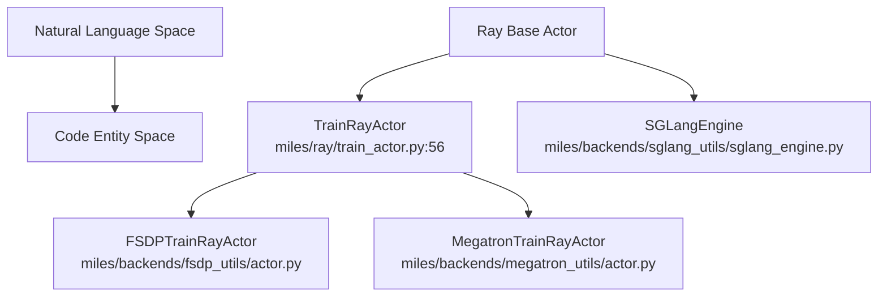
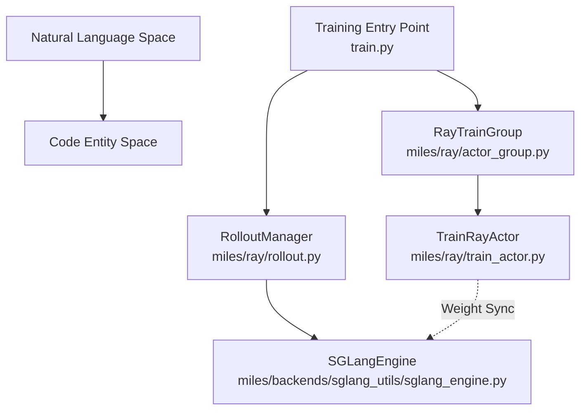

<!-- source: DeepWiki mcp.deepwiki.com · repo radixark/miles · page 10.5 Architecture for Developers · fetched 2026-10-21 -->

# Architecture for Developers

<details>
<summary>Relevant source files</summary>

The following files were used as context for generating this wiki page:

- [.github/CODEOWNERS](.github/CODEOWNERS)
- [miles/backends/fsdp_utils/__init__.py](miles/backends/fsdp_utils/__init__.py)
- [miles/backends/fsdp_utils/adaptations/__init__.py](miles/backends/fsdp_utils/adaptations/__init__.py)
- [miles/backends/fsdp_utils/adaptations/class_patches.py](miles/backends/fsdp_utils/adaptations/class_patches.py)
- [miles/backends/fsdp_utils/adaptations/packing/__init__.py](miles/backends/fsdp_utils/adaptations/packing/__init__.py)
- [miles/backends/fsdp_utils/adaptations/packing/boundaries.py](miles/backends/fsdp_utils/adaptations/packing/boundaries.py)
- [miles/ray/train_actor.py](miles/ray/train_actor.py)
- [miles/utils/audit_utils/event_logger/checkpoint.py](miles/utils/audit_utils/event_logger/checkpoint.py)
- [miles/utils/debug_utils/run_megatron/cli/commands/__init__.py](miles/utils/debug_utils/run_megatron/cli/commands/__init__.py)
- [miles/utils/debug_utils/run_megatron/cli/commands/args.py](miles/utils/debug_utils/run_megatron/cli/commands/args.py)
- [miles/utils/debug_utils/run_megatron/cli/commands/compare.py](miles/utils/debug_utils/run_megatron/cli/commands/compare.py)
- [miles/utils/debug_utils/run_megatron/cli/commands/run.py](miles/utils/debug_utils/run_megatron/cli/commands/run.py)
- [miles/utils/debug_utils/run_megatron/cli/commands/run_and_compare.py](miles/utils/debug_utils/run_megatron/cli/commands/run_and_compare.py)
- [miles/utils/debug_utils/run_megatron/cli/worker_executor.py](miles/utils/debug_utils/run_megatron/cli/worker_executor.py)
- [miles/utils/debug_utils/run_megatron/worker/main.py](miles/utils/debug_utils/run_megatron/worker/main.py)
- [miles/utils/debug_utils/run_megatron/worker/output.py](miles/utils/debug_utils/run_megatron/worker/output.py)
- [miles/utils/debug_utils/run_megatron/worker/replay.py](miles/utils/debug_utils/run_megatron/worker/replay.py)
- [miles/utils/debug_utils/run_megatron/worker/script_args.py](miles/utils/debug_utils/run_megatron/worker/script_args.py)
- [miles/utils/external_utils/command_utils/ray_backend/command.py](miles/utils/external_utils/command_utils/ray_backend/command.py)
- [miles/utils/external_utils/ray_job.py](miles/utils/external_utils/ray_job.py)
- [miles/utils/init_once.py](miles/utils/init_once.py)
- [miles/utils/pydantic_utils.py](miles/utils/pydantic_utils.py)
- [miles/utils/workers/reconcile/k8s_api.py](miles/utils/workers/reconcile/k8s_api.py)
- [miles/utils/workers/reconcile/k8s_reflector.py](miles/utils/workers/reconcile/k8s_reflector.py)
- [tests/e2e/deploy/conftest_deploy/hot_restart/assert_redone_from_scratch.py](tests/e2e/deploy/conftest_deploy/hot_restart/assert_redone_from_scratch.py)
- [tests/e2e/k8s_apiserver/reflector_utils.py](tests/e2e/k8s_apiserver/reflector_utils.py)
- [tests/e2e/short/test_run_megatron.py](tests/e2e/short/test_run_megatron.py)
- [tests/fast/backends/fsdp_utils/test_actor.py](tests/fast/backends/fsdp_utils/test_actor.py)
- [tests/fast/e2e/deploy/hot_restart/test_assert_redone_from_scratch.py](tests/fast/e2e/deploy/hot_restart/test_assert_redone_from_scratch.py)
- [tests/fast/ray/test_train_actor.py](tests/fast/ray/test_train_actor.py)
- [tests/fast/utils/debug_utils/run_megatron/cli/commands/test_compare.py](tests/fast/utils/debug_utils/run_megatron/cli/commands/test_compare.py)
- [tests/fast/utils/debug_utils/run_megatron/cli/commands/test_run.py](tests/fast/utils/debug_utils/run_megatron/cli/commands/test_run.py)
- [tests/fast/utils/debug_utils/run_megatron/cli/commands/test_run_and_compare.py](tests/fast/utils/debug_utils/run_megatron/cli/commands/test_run_and_compare.py)
- [tests/fast/utils/debug_utils/run_megatron/cli/test_worker_executor.py](tests/fast/utils/debug_utils/run_megatron/cli/test_worker_executor.py)
- [tests/fast/utils/debug_utils/run_megatron/worker/test_batch.py](tests/fast/utils/debug_utils/run_megatron/worker/test_batch.py)
- [tests/fast/utils/debug_utils/run_megatron/worker/test_replay.py](tests/fast/utils/debug_utils/run_megatron/worker/test_replay.py)
- [tests/fast/utils/debug_utils/run_megatron/worker/test_script_args.py](tests/fast/utils/debug_utils/run_megatron/worker/test_script_args.py)
- [tests/fast/utils/event_logger/test_checkpoint.py](tests/fast/utils/event_logger/test_checkpoint.py)
- [tests/fast/utils/external_utils/command_utils/ray_backend/conftest.py](tests/fast/utils/external_utils/command_utils/ray_backend/conftest.py)
- [tests/fast/utils/test_init_once.py](tests/fast/utils/test_init_once.py)
- [tests/fast/utils/test_pydantic_utils.py](tests/fast/utils/test_pydantic_utils.py)
- [tests/fast/utils/workers/reconcile/test_k8s_api.py](tests/fast/utils/workers/reconcile/test_k8s_api.py)
- [tests/fast/utils/workers/reconcile/test_k8s_reflector.py](tests/fast/utils/workers/reconcile/test_k8s_reflector.py)
- [tests/fast/utils/workers/reconcile/utils.py](tests/fast/utils/workers/reconcile/utils.py)

</details>


This document provides a technical deep-dive into Miles' internal architecture for developers contributing to or extending the codebase. It covers code organization, design patterns, module interactions, Ray actor management via `TrainRayActor`, audit and event logging infrastructure, and the implementation details of the `run_megatron` debugging CLI.

**Target Audience:** Contributors modifying Miles internals, adding new training backends, or debugging complex distributed RL workflows.

---

## Repository Structure and Code Organization

Miles follows a modular structure that separates concerns across training backends, Ray orchestration, rollout generation, and shared utilities.

### Directory Layout

The core python package and auxiliary directories are organized as follows:

```text
miles/
├── backends/                    # Training backend implementations
│   ├── fsdp_utils/             # FSDP (PyTorch native) backend
│   │   ├── actor.py            # FSDPTrainRayActor
│   │   ├── checkpoint.py       # Distributed checkpoint I/O
│   │   └── update_weight_utils.py  # Weight sync strategies
│   ├── megatron_utils/         # Megatron-LM backend
│   │   ├── actor.py            # MegatronTrainRayActor
│   │   ├── initialize.py       # Megatron initialization
│   │   └── update_weight/      # Weight update strategies
│   └── sglang_utils/           # SGLang inference integration
│   │   ├── sglang_engine.py    # SGLangEngine Ray actor
│   │   └── arguments.py        # SGLang-specific configuration
├── ray/                        # Ray orchestration layer
│   ├── rollout.py              # RolloutManager actor
│   ├── actor_group.py          # RayTrainGroup wrapper
│   └── train_actor.py          # TrainRayActor base class
├── rollout/                    # Data generation logic
│   ├── sglang_rollout.py       # Legacy rollout implementation
│   ├── data_source.py          # RolloutDataSourceWithBuffer
│   └── fully_async_rollout.py  # FullyAsyncRolloutFn implementation
├── router/                     # Miles Router FastAPI proxy
├── dashboard/                  # Run dashboard and collector
└── utils/                      # Shared utilities, audit, and debug tools
```

**Design Principle:** Backends are pluggable via `--train-backend fsdp|megatron`. The orchestration layer (`miles/ray/`) remains backend-agnostic by wrapping training actors in `RayTrainGroup`.

Sources: `miles/ray/train_actor.py:56-170](), [.github/CODEOWNERS:3-13]()

---

## Core Module Architecture and Ray Communication

Miles implements a multi-actor design where components like `RolloutManager`, `TrainRayActor` subclasses (`FSDPTrainRayActor`, `MegatronTrainRayActor`), and `SGLangEngine` communicate via Ray remote procedure calls.

### Class Hierarchy and Code Mapping

Diagram Title: "Actor Class Hierarchy Mapping"



Sources: `miles/ray/train_actor.py:56-121](), [tests/fast/ray/test_train_actor.py:8-27]()

### Ray Actor Communication Pattern

Diagram Title: "Ray Actor Communication Data Flow"



Sources: `miles/ray/train_actor.py:56-156](), [tests/fast/ray/test_train_actor.py:109-153]()

---

## Audit and Event Logging Infrastructure

Miles maintains comprehensive audit tracking for distributed training processes, process identities, witness allocation, and checkpoints.

### Audit Process Identity and Witnesses

The audit system associates log entries and telemetry with specific training process identities and hardware witnesses.

Diagram Title: "Audit Subsystem Mapping"

```mermaid
graph TB
    subg1["Natural Language Space"] --> subg2["Code Entity Space"]
    TrainProcess[""Train Process Identity<br/>miles/utils/audit_utils/process_identity.py""] --> ConfigureLogger[""configure_logger()<br/>miles/ray/train_actor.py:80-88""]
    Witness[""Witness Allocator<br/>miles/utils/audit_utils/witness/allocator.py""] --> Heartbeat[""SimpleHeartbeat<br/>miles/ray/train_actor.py:69""]
    CheckpointAudit[""Checkpoint Audit Logger<br/>miles/utils/audit_utils/checkpoint.py""] --> SaveState[""Checkpoint I/O Operations""]
```

Sources: `miles/ray/train_actor.py:17-18](), [miles/ray/train_actor.py:69-88]()

---

## Debugging CLI: `run_megatron`

The `run_megatron` utility provides a developer-focused CLI to execute, inspect, and compare Megatron model forward/backward passes and activation/logprob discrepancies across varying parallel configurations (`tp`, `pp`, `cp`, `ep`).

### CLI Command Architecture

Configuration options and commands are defined via dataclasses and Typer handlers under `miles/utils/debug_utils/run_megatron/cli/commands/args.py`.

Diagram Title: "Run Megatron CLI and Worker Architecture"

```mermaid
graph TB
    subg1["Natural Language Space"] --> subg2["Code Entity Space"]
    CLI[""run_megatron CLI Entry Point""] --> RunArgs[""RunArgs / CommonRunArgs<br/>miles/utils/debug_utils/run_megatron/cli/commands/args.py:16-50""]
    CLI --> CompareArgs[""RunAndCompareArgs<br/>miles/utils/debug_utils/run_megatron/cli/commands/args.py:51-69""]
    RunArgs --> RunImpl[""run_impl()<br/>miles/utils/debug_utils/run_megatron/cli/commands/run.py:33-89""]
    RunImpl --> WorkerExecutor[""build_torchrun_cmd()<br/>miles/utils/debug_utils/run_megatron/cli/worker_executor.py""]
    WorkerExecutor --> WorkerMain[""main()<br/>miles/utils/debug_utils/run_megatron/worker/main.py:46-109""]
    WorkerMain --> ScriptArgs[""WorkerScriptArgs<br/>miles/utils/debug_utils/run_megatron/worker/script_args.py:16-28""]
```

Sources: `miles/utils/debug_utils/run_megatron/cli/commands/args.py:16-81](), [miles/utils/debug_utils/run_megatron/worker/main.py:46-110](), [miles/utils/debug_utils/run_megatron/worker/script_args.py:16-34]()

---

