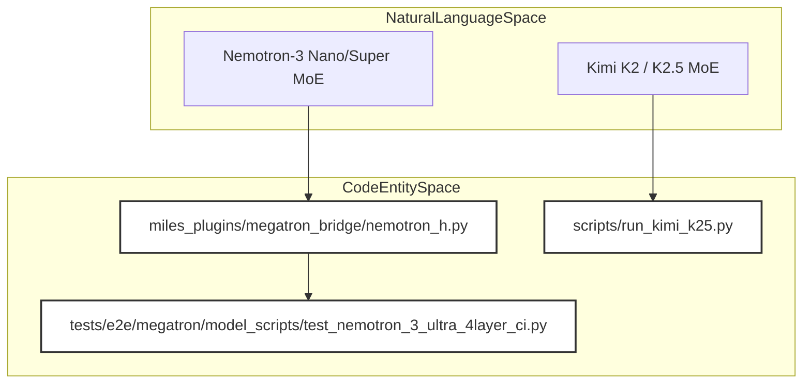
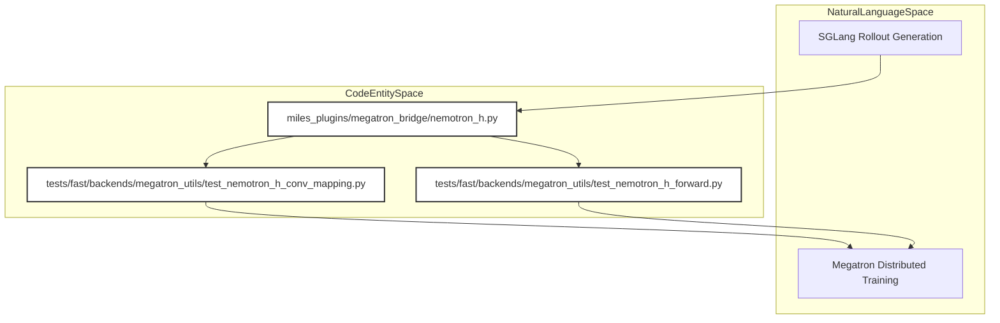

<!-- source: DeepWiki mcp.deepwiki.com · repo radixark/miles · page 11 Model Support and Integration · fetched 2026-10-21 -->

# Model Support and Integration

Relevant source files

The following files were used as context for generating this wiki page:

- [docs/models/kimi/kimi-k2.5.md](docs/models/kimi/kimi-k2.5.md)
- [docs/models/kimi/kimi-k2.md](docs/models/kimi/kimi-k2.md)
- [docs/models/nemotron/nemotron-3-nano-moe.md](docs/models/nemotron/nemotron-3-nano-moe.md)
- [docs/models/nemotron/nemotron-3-super.md](docs/models/nemotron/nemotron-3-super.md)
- [docs/models/qwen/qwen3-5.md](docs/models/qwen/qwen3-5.md)
- [docs/models/qwen/qwen3-6.md](docs/models/qwen/qwen3-6.md)
- [docs/models/qwen/qwen3-moe.md](docs/models/qwen/qwen3-moe.md)
- [miles_plugins/megatron_bridge/nemotron_h.py](miles_plugins/megatron_bridge/nemotron_h.py)
- [tests/e2e/megatron/model_scripts/test_nemotron_3_ultra_4layer_ci.py](tests/e2e/megatron/model_scripts/test_nemotron_3_ultra_4layer_ci.py)
- [tests/fast/backends/megatron_utils/test_nemotron_h_conv_mapping.py](tests/fast/backends/megatron_utils/test_nemotron_h_conv_mapping.py)
- [tests/fast/backends/megatron_utils/test_nemotron_h_forward.py](tests/fast/backends/megatron_utils/test_nemotron_h_forward.py)

## Purpose and Scope

This document provides a high-level overview of how Miles supports diverse model architectures through its dual-path integration system (SGLang for inference and Megatron-LM for training), its extension plugins like `miles_plugins/megatron_bridge/nemotron_h.py` [miles_plugins/megatron_bridge/nemotron_h.py:1-20](), and its HuggingFace-to-Megatron conversion utilities. 

For comprehensive technical details, configuration files, and implementation guides, refer to the child pages:
- Supported model families and recipes: see [Supported Models](#11.1)
- Adding new custom model architectures: see [Custom Model Architectures](#11.2)
- Bidirectional checkpoint conversion and bridging: see [HuggingFace Bridge](#11.3)
- Hardware platforms and companion projects: see [Hardware Platforms and Miles-Diffusion](#11.4)

---

## Supported Model Families

Miles ships built-in recipes and architectural specs for leading dense, sparse Mixture-of-Experts (MoE), and hybrid linear-attention models such as DeepSeek, Qwen [docs/models/qwen/qwen3-6.md:1-18](), GLM, Kimi [docs/models/kimi/kimi-k2.5.md:1-34](), Nemotron [docs/models/nemotron/nemotron-3-nano-moe.md:1-25](), Inkling/ThinkingMachines, GPT-OSS, and Gemma. For instance, the Nemotron-3 family introduces hybrid Mamba and attention architectures combined with MoE routing [docs/models/nemotron/nemotron-3-nano-moe.md:1-25](), [docs/models/nemotron/nemotron-3-super.md:1-26](), while Kimi K2.5 and Qwen3 series provide massive multimodal and trillion-parameter capabilities [docs/models/kimi/kimi-k2.5.md:1-34](), [docs/models/qwen/qwen3-moe.md:1-15]().

**Diagram:** Mapping model families from natural language specifications to plugin bridges and integration test suites (`miles_plugins/megatron_bridge/nemotron_h.py`, `scripts/run_kimi_k25.py`).

Sources: [miles_plugins/megatron_bridge/nemotron_h.py:1-20](), [docs/models/nemotron/nemotron-3-nano-moe.md:1-25](), [docs/models/kimi/kimi-k2.5.md:1-34](), [tests/e2e/megatron/model_scripts/test_nemotron_3_ultra_4layer_ci.py:1-17]()

For details on configuration examples, hyperparameter settings, and model-specific execution instructions, see [Supported Models](#11.1).

---

## Custom Model Architectures and Extension Plugins

Adding new model architectures requires extending both the inference engine (SGLang model configs) and the training engine (Megatron model specs). Miles isolates these extensions inside the `miles_plugins` package, which houses custom model implementations, architecture bridges, and specialized optimizers [miles_plugins/megatron_bridge/nemotron_h.py:1-20](). For example, hybrid Mamba-attention models use specialized shims to handle expert routing mappings and MTP kwargs [miles_plugins/megatron_bridge/nemotron_h.py:31-46]().

**Diagram:** Data flow linking inference execution and validation unit tests (`test_nemotron_h_conv_mapping.py`, `test_nemotron_h_forward.py`) to `miles_plugins/megatron_bridge/nemotron_h.py`.

Sources: [miles_plugins/megatron_bridge/nemotron_h.py:31-46](), [tests/fast/backends/megatron_utils/test_nemotron_h_conv_mapping.py:1-20](), [tests/fast/backends/megatron_utils/test_nemotron_h_forward.py:1-20]()

For step-by-step instructions on implementing custom model providers, extending SGLang configs, and registering new architectures, see [Custom Model Architectures](#11.2).

---

## HuggingFace Bridge

To bridge the gap between HuggingFace model repositories and Megatron-LM distributed training layouts, Miles provides the `miles_plugins/megatron_bridge` package and conversion utilities. This layer handles bidirectional parameter mapping, MoE tensor fusion, and pipeline parallel shape re-sharding—such as mapping Nemotron-H mixer and router parameters directly without a separate `torch_dist` conversion step [docs/models/nemotron/nemotron-3-nano-moe.md:43-54]().

For information on converting HuggingFace checkpoints to Megatron `torch_dist` format, handling custom parameter namespaces, and enabling bridge modes, see [HuggingFace Bridge](#11.3).

Sources: [miles_plugins/megatron_bridge/nemotron_h.py:31-46](), [docs/models/nemotron/nemotron-3-nano-moe.md:43-54]()

---

## Hardware Platforms and Miles-Diffusion

Miles supports diverse hardware accelerators including NVIDIA GPUs, AMD ROCm platforms, and specialized NPUs, integrating necessary hardware-specific patches and kernel bindings [docs/models/qwen/qwen3-moe.md:120-131](). Additionally, generative diffusion workflows are supported via the companion project Miles-Diffusion.

For hardware setup details, platform-specific flags, and diffusion integration instructions, see [Hardware Platforms and Miles-Diffusion](#11.4).

Sources: [docs/models/qwen/qwen3-moe.md:120-131]()

---

