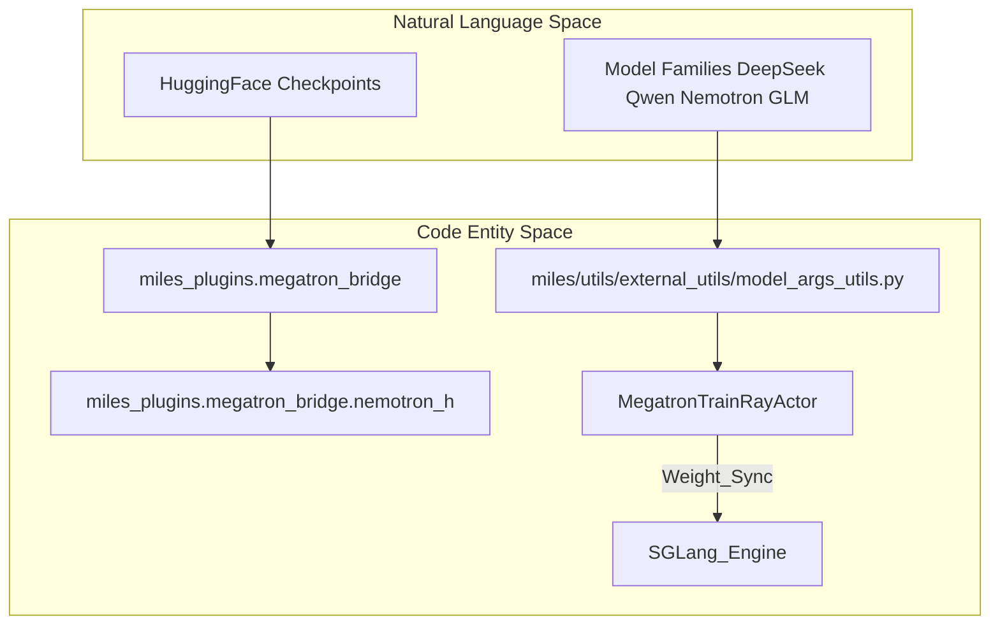
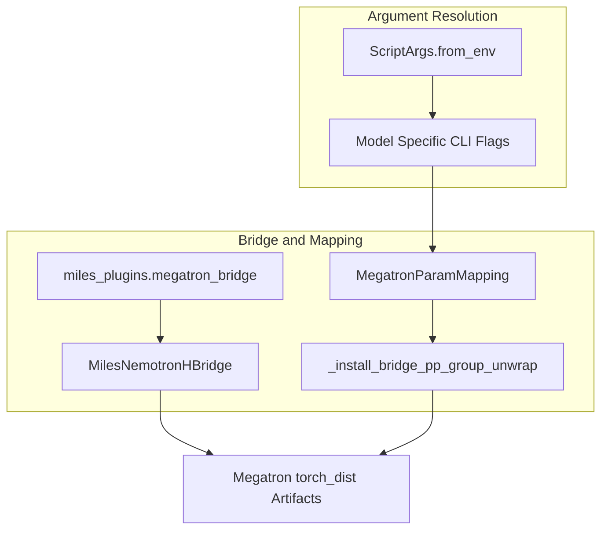

<!-- source: DeepWiki mcp.deepwiki.com · repo radixark/miles · page 11.1 Supported Models · fetched 2026-10-21 -->

# Supported Models

<details>
<summary>Relevant source files</summary>

The following files were used as context for generating this wiki page:

- [docs/models/kimi/kimi-k2.5.md](docs/models/kimi/kimi-k2.5.md)
- [docs/models/kimi/kimi-k2.md](docs/models/kimi/kimi-k2.md)
- [docs/models/mimo/mimo-v2-6-flash.md](docs/models/mimo/mimo-v2-6-flash.md)
- [docs/models/nemotron/nemotron-3-nano-moe.md](docs/models/nemotron/nemotron-3-nano-moe.md)
- [docs/models/nemotron/nemotron-3-super.md](docs/models/nemotron/nemotron-3-super.md)
- [docs/models/qwen/qwen3-5.md](docs/models/qwen/qwen3-5.md)
- [docs/models/qwen/qwen3-6.md](docs/models/qwen/qwen3-6.md)
- [docs/models/qwen/qwen3-moe.md](docs/models/qwen/qwen3-moe.md)
- [miles/utils/external_utils/command_utils/__init__.py](miles/utils/external_utils/command_utils/__init__.py)
- [miles_plugins/megatron_bridge/__init__.py](miles_plugins/megatron_bridge/__init__.py)
- [miles_plugins/megatron_bridge/mimo_v2.py](miles_plugins/megatron_bridge/mimo_v2.py)
- [miles_plugins/megatron_bridge/nemotron_h.py](miles_plugins/megatron_bridge/nemotron_h.py)
- [scripts/models/mimo-v2.6-flash-4layer.py](scripts/models/mimo-v2.6-flash-4layer.py)
- [scripts/models/mimo-v2.6-flash.py](scripts/models/mimo-v2.6-flash.py)
- [scripts/run_mimo_v2_6_flash.py](scripts/run_mimo_v2_6_flash.py)
- [tests/e2e/megatron/model_scripts/test_deepseek_v32_5layer_fp8.py](tests/e2e/megatron/model_scripts/test_deepseek_v32_5layer_fp8.py)
- [tests/e2e/megatron/model_scripts/test_deepseek_v4_flash_4layer_ci.py](tests/e2e/megatron/model_scripts/test_deepseek_v4_flash_4layer_ci.py)
- [tests/e2e/megatron/model_scripts/test_glm5_1_744b_a40b_6layer_lora_ci.py](tests/e2e/megatron/model_scripts/test_glm5_1_744b_a40b_6layer_lora_ci.py)
- [tests/e2e/megatron/model_scripts/test_glm5_2_744b_a40b_5layer_ci.py](tests/e2e/megatron/model_scripts/test_glm5_2_744b_a40b_5layer_ci.py)
- [tests/e2e/megatron/model_scripts/test_glm5_2_744b_a40b_5layer_lora_ci.py](tests/e2e/megatron/model_scripts/test_glm5_2_744b_a40b_5layer_lora_ci.py)
- [tests/e2e/megatron/model_scripts/test_glm5_744b_a40b_4layer_ci.py](tests/e2e/megatron/model_scripts/test_glm5_744b_a40b_4layer_ci.py)
- [tests/e2e/megatron/model_scripts/test_glm5_744b_a40b_4layer_r3.py](tests/e2e/megatron/model_scripts/test_glm5_744b_a40b_4layer_r3.py)
- [tests/e2e/megatron/model_scripts/test_kimi_k25_2layer_ci.py](tests/e2e/megatron/model_scripts/test_kimi_k25_2layer_ci.py)
- [tests/e2e/megatron/model_scripts/test_mimo_v2_6_flash_4layer_ci.py](tests/e2e/megatron/model_scripts/test_mimo_v2_6_flash_4layer_ci.py)
- [tests/e2e/megatron/model_scripts/test_nemotron_3_ultra_4layer_ci.py](tests/e2e/megatron/model_scripts/test_nemotron_3_ultra_4layer_ci.py)
- [tests/e2e/megatron/test_qwen3_5_35b_a3b_lora_ci.py](tests/e2e/megatron/test_qwen3_5_35b_a3b_lora_ci.py)
- [tests/fast/backends/megatron_utils/test_nemotron_h_conv_mapping.py](tests/fast/backends/megatron_utils/test_nemotron_h_conv_mapping.py)
- [tests/fast/backends/megatron_utils/test_nemotron_h_forward.py](tests/fast/backends/megatron_utils/test_nemotron_h_forward.py)

</details>


## Purpose and Scope

This page documents the model architectures and families officially supported by Miles for reinforcement learning (RL) post-training. Miles provides a unified framework for training these models using either the **Megatron-LM** or **FSDP** backends while leveraging **SGLang** for high-throughput rollout generation.

The framework is optimized for large-scale Mixture-of-Experts (MoE) models, hybrid Mamba-attention architectures, and reasoning-heavy models, ensuring bit-wise train-inference alignment through features like FlashAttention-3, deep-quantization bridges, and Rollout Routing Replay (R3).

Sources: [docs/models/deepseek/index.md:6-7](), [docs/models/qwen/index.md:6-7]()

---

## Architecture Compatibility and Bridge Layer

Miles' model support is built upon a modular integration strategy managed via `miles_plugins.megatron_bridge` and specialized model handlers that map high-level model families down to distributed training actors and inference engines.

**Diagram: Model Integration and Data Flow to Code Entities**


Sources: [miles_plugins/megatron_bridge/__init__.py:1-79](), [miles_plugins/megatron_bridge/nemotron_h.py:1-82]()

---

## Supported Model Families

### Qwen Family
Miles ships ready-to-run RL recipes for the Qwen line, ranging from dense variants to hybrid Gated-Delta-Net (GDN), QSA, and MoE architectures.

| Family | Class | Sizes | Key Integration Files |
| :--- | :--- | :--- | :--- |
| **Qwen3** | Dense / MoE | 0.6B to 235B | `scripts/run_qwen3_dense.py`, `tests/e2e/megatron/test_qwen3_5_35b_a3b_lora_ci.py` |
| **Qwen3.5** | Dense / MoE | 4B to 35B | `miles_plugins.models.qwen3_5`, `tests/e2e/megatron/test_qwen3_5_35b_a3b_lora_ci.py` |
| **Qwen3.8-Flash-Next** | MoE (GDN + QSA) | 6B / 176B | `scripts/models/qwen3.8-flash-next.py` |

**Configuration Example (Qwen3.5 LoRA & MoE):**
```bash
python scripts/run_qwen3_5_35b_a3b_lora.py --model-name Qwen3.5-35B-A3B --num-gpus-per-node 8
```
Sources: [tests/e2e/megatron/test_qwen3_5_35b_a3b_lora_ci.py:34-52](), [docs/models/qwen/index.md:6-7]()

### DeepSeek Family
DeepSeek models across multiple generations (V3, V4 Flash, V3.2) are supported with specialized paths for Multi-head Latent Attention (MLA), DeepSeek Sparse Attention (DSA), hyper-connection routing, and FP8/BF16 mixed training.

| Model | Active / Total | Special Features | Recipe / Launcher |
| :--- | :--- | :--- | :--- |
| **DeepSeek-V3.2** | MoE | DeepSeek Sparse Attention, FP8/BF16 | `scripts/run_deepseek_v32.py`, `tests/e2e/megatron/model_scripts/test_deepseek_v32_5layer_fp8.py` |
| **DeepSeek-V4-Flash** | 13B / 284B | CSA/HCA, Hyper-connections | `scripts/run_deepseek_v4.py`, `tests/e2e/megatron/model_scripts/test_deepseek_v4_flash_4layer_ci.py` |

**DeepSeek-V4 Flash Launch Example:**
```bash
python scripts/run_deepseek_v4.py --model-name DeepSeek-V4-Flash-FP8-4layer --num-gpus-per-node 4
```
Sources: [tests/e2e/megatron/model_scripts/test_deepseek_v4_flash_4layer_ci.py:34-49](), [tests/e2e/megatron/model_scripts/test_deepseek_v32_5layer_fp8.py:30-52]()

### GLM Family
Zhipu AI's GLM models are supported via dedicated plugins and Megatron specs, featuring large-scale MoE configurations, DSA cross-layer index-sharing paths, and rollout indexer replay (`--use-rollout-indexer-replay`).

| Model | Key Files | Special Features |
| :--- | :--- | :--- |
| **GLM-5 / GLM-5.2** | `scripts/run_glm5_2_744b_a40b.py`, `tests/e2e/megatron/model_scripts/test_glm5_2_744b_a40b_5layer_ci.py` | MoE, DSA, Indexer Replay |
| **GLM-5.1 LoRA** | `scripts/run_glm5_1_744b_a40b_lora.py` | LoRA matrix, tilelang backend |

**GLM-5.2 Configuration Example:**
```bash
python scripts/run_glm5_2_744b_a40b.py --model-name GLM-5.2_5layer --num-gpus-per-node 4
```
Sources: [tests/e2e/megatron/model_scripts/test_glm5_2_744b_a40b_5layer_ci.py:52-63](), [tests/e2e/megatron/model_scripts/test_glm5_744b_a40b_4layer_r3.py:34-58]()

### Kimi Family
Kimi models (such as Kimi-K2.5) combine MoE and MLA structures, supported by custom bridging routines and INT4/BF16 conversion pathways.
* **Launcher:** `scripts/run_kimi_k25.py`
* **Smoke Test:** `tests/e2e/megatron/model_scripts/test_kimi_k25_2layer_ci.py`

Sources: [tests/e2e/megatron/model_scripts/test_kimi_k25_2layer_ci.py:28-40](), [docs/models/kimi/index.md:1-10]()

### Nemotron Family
Nemotron models include hybrid Mamba-Attention architectures (e.g., Nemotron-H Mamba2 + Attention + latent-MoE) registered via `miles_plugins.megatron_bridge.nemotron_h`.
* **Bridge Class:** `MilesNemotronHBridge` [miles_plugins/megatron_bridge/nemotron_h.py:70]()
* **Launcher:** `scripts/run_nemotron_3_ultra_550b_a55b.py`

Sources: [miles_plugins/megatron_bridge/nemotron_h.py:1-82](), [tests/e2e/megatron/model_scripts/test_nemotron_3_ultra_4layer_ci.py:33-47]()

### Inkling, MiMo, GPT-OSS, and Gemma
* **Inkling & Inkling-Small:** Multimodal MoE models supporting ShortConv, relative attention, and shared-expert sink routing (`scripts/run_inkling.py`).
* **MiMo Family:** MiMo-v2.6-Flash integration (`miles_plugins.megatron_bridge.mimo_v2`, `scripts/run_mimo_v2_6_flash.py`).
* **GPT-OSS & Gemma:** Standardized decoder adaptations and HuggingFace-to-Megatron conversion bridges (`miles_plugins.mbridge`).

Sources: [miles_plugins/megatron_bridge/__init__.py:72-83](), [docs/models/thinkingmachines/index.md:1-10]()

---

## Technical Implementation: Model Specification & Conversion

The pipeline from raw HuggingFace weights to Megatron torch-dist shards and active training actors relies on argument utility scripts, conversion tools, and bridge subclasses that intercept mapping registries.

**Diagram: Model Parameter and Conversion Execution Flow**


Sources: [miles_plugins/megatron_bridge/__init__.py:23-55](), [miles_plugins/megatron_bridge/nemotron_h.py:59-82]()

---

## Configuration Matrix & Performance Arguments

When executing large model family training runs, common configuration parameters control parallelism, activation recomputation, and optimizer offloading across backends:

| Parameter Flag | Purpose / Scope |
| :--- | :--- |
| `--tensor-model-parallel-size` | Shards attention and dense projections across TP ranks. |
| `--expert-model-parallel-size` | Shards MoE expert MLPs across EP ranks (e.g., DeepEP integration). |
| `--recompute-granularity full` | Saves VRAM by recomputing activations during backward passes. |
| `--optimizer-cpu-offload` | Offloads optimizer states to host RAM or NVMe streaming buffers. |
| `--use-rollout-routing-replay` | Enables R3 routing replay for MoE alignment. |

Sources: [tests/e2e/megatron/model_scripts/test_deepseek_v32_5layer_fp8.py:30-52](), [tests/e2e/megatron/model_scripts/test_glm5_744b_a40b_4layer_r3.py:34-58]()

---

