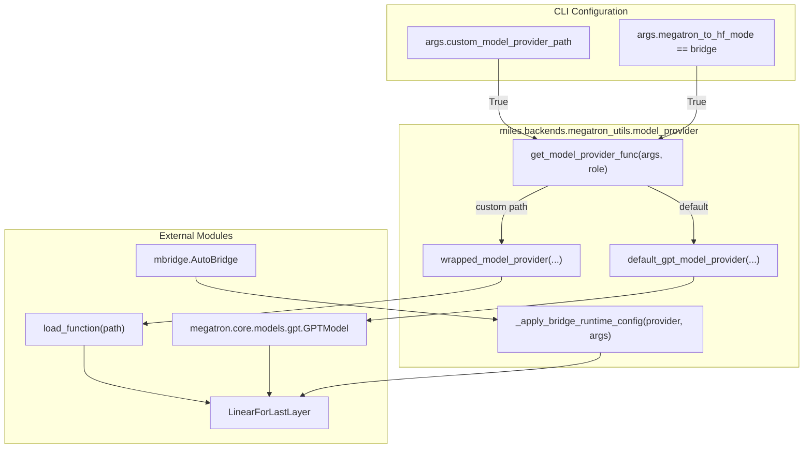
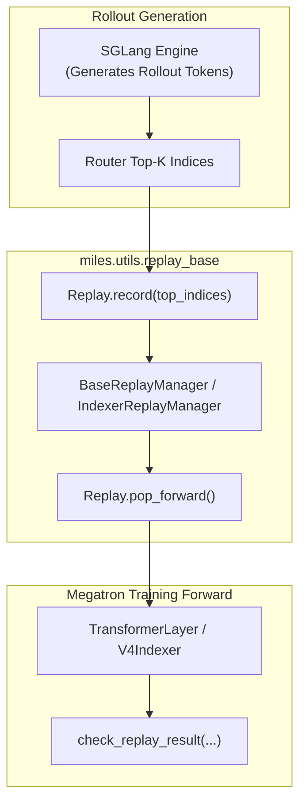

<!-- source: DeepWiki mcp.deepwiki.com · repo radixark/miles · page 11.2 Custom Model Architectures · fetched 2026-10-21 -->

# Custom Model Architectures

Relevant source files

The following files were used as context for generating this wiki page:

- [miles/backends/megatron_utils/checkpoint.py](miles/backends/megatron_utils/checkpoint.py)
- [miles/backends/megatron_utils/megatron_to_hf/linear_attn_layout.py](miles/backends/megatron_utils/megatron_to_hf/linear_attn_layout.py)
- [miles/backends/megatron_utils/model_provider.py](miles/backends/megatron_utils/model_provider.py)
- [miles/backends/training_utils/weight_update/hf_weight_iterator/atomic_groups.py](miles/backends/training_utils/weight_update/hf_weight_iterator/atomic_groups.py)
- [miles/utils/hf_rollout_schema.py](miles/utils/hf_rollout_schema.py)
- [miles/utils/hf_utils/config.py](miles/utils/hf_utils/config.py)
- [miles/utils/hf_utils/weight_mapping.py](miles/utils/hf_utils/weight_mapping.py)
- [miles/utils/megatron_bridge_utils.py](miles/utils/megatron_bridge_utils.py)
- [miles/utils/metric_checker.py](miles/utils/metric_checker.py)
- [miles/utils/mxfp8.py](miles/utils/mxfp8.py)
- [miles/utils/profile_utils.py](miles/utils/profile_utils.py)
- [miles_plugins/mbridge/deepseek_v4.py](miles_plugins/mbridge/deepseek_v4.py)
- [miles_plugins/mbridge/qwen3_5.py](miles_plugins/mbridge/qwen3_5.py)
- [miles_plugins/models/cp_utils.py](miles_plugins/models/cp_utils.py)
- [miles_plugins/models/deepseek_v4/deepseek_v4.py](miles_plugins/models/deepseek_v4/deepseek_v4.py)
- [miles_plugins/models/deepseek_v4/ops/compressor.py](miles_plugins/models/deepseek_v4/ops/compressor.py)
- [miles_plugins/models/deepseek_v4/ops/thd_utils.py](miles_plugins/models/deepseek_v4/ops/thd_utils.py)
- [miles_plugins/models/deepseek_v4/ops/v4_indexer.py](miles_plugins/models/deepseek_v4/ops/v4_indexer.py)
- [miles_plugins/models/glm5/glm5.py](miles_plugins/models/glm5/glm5.py)
- [miles_plugins/models/hf_attention.py](miles_plugins/models/hf_attention.py)
- [miles_plugins/models/linear_attn.py](miles_plugins/models/linear_attn.py)
- [miles_plugins/models/qwen3_5.py](miles_plugins/models/qwen3_5.py)
- [miles_plugins/models/qwen3_next.py](miles_plugins/models/qwen3_next.py)
- [tests/e2e/precision/test_hf_attention_cp_relayout.py](tests/e2e/precision/test_hf_attention_cp_relayout.py)
- [tests/fast-gpu/linear_attn_reference.py](tests/fast-gpu/linear_attn_reference.py)
- [tests/fast-gpu/test_linear_attn_head_sharded.py](tests/fast-gpu/test_linear_attn_head_sharded.py)
- [tests/fast-gpu/test_linear_attn_layer.py](tests/fast-gpu/test_linear_attn_layer.py)
- [tests/fast-gpu/test_linear_attn_short_conv.py](tests/fast-gpu/test_linear_attn_short_conv.py)
- [tests/fast/backends/megatron_utils/test_bridge_mtp_detachment.py](tests/fast/backends/megatron_utils/test_bridge_mtp_detachment.py)
- [tests/fast/backends/training_utils/weight_update/test_atomic_groups.py](tests/fast/backends/training_utils/weight_update/test_atomic_groups.py)
- [tests/fast/models/test_linear_attn_kernel_selection.py](tests/fast/models/test_linear_attn_kernel_selection.py)
- [tests/fast/test_dsv4_thd.py](tests/fast/test_dsv4_thd.py)
- [tests/fast/utils/hf_utils/test_weight_mapping.py](tests/fast/utils/hf_utils/test_weight_mapping.py)
- [tests/manual/models/deepseek_v4/test_v4_thd_compressor.py](tests/manual/models/deepseek_v4/test_v4_thd_compressor.py)
- [tools/convert_hf_to_torch_dist.py](tools/convert_hf_to_torch_dist.py)

This wiki page provides a comprehensive technical guide for adding and configuring new model architectures in Miles. It covers custom model providers in the Megatron backend, the `miles_plugins` package (`models`, `mbridge`, `optimizers`), SGLang model configuration extensions, and the specialized rollout routing replay (R3) infrastructure required to maintain train-inference alignment for hybrid and mixture-of-experts (MoE) architectures.

---

## 1. Overview

Miles isolates training and inference across decoupled worker pools, requiring architecture support to be mirrored in both the training backend (Megatron-LM or FSDP) and the SGLang inference engine. Custom architectures are integrated through several core entry points:

| Integration Point | Module / Path | Purpose |
|------------------|---------------|---------|
| Custom Model Provider | `miles/backends/megatron_utils/model_provider.py` | Overrides Megatron model instantiation logic via `--custom-model-provider-path` |
| Megatron Bridge | `miles_plugins/mbridge/` | Direct bidirectional HF-to-Megatron conversion without intermediate `torch_dist` steps |
| Architecture Plugins | `miles_plugins/models/` | Custom attention variants (e.g., CSA, MLA), state-space models, and hybrid blocks |
| Routing Replay | `miles/utils/replay_base.py` | Records and replays MoE expert routing and indexer decisions during training forward passes |

Sources: [miles/backends/megatron_utils/model_provider.py:143-152](), [tools/convert_hf_to_torch_dist.py:11-49]()

---

## 2. Custom Model Providers & Runtime Configuration

For the Megatron backend, Miles allows substituting the default core GPT model instantiation function by passing `--custom-model-provider-path` [miles/backends/megatron_utils/model_provider.py:143-152](). 

### Diagram: Model Provider Resolution and Bridge Flow

**Description**: The resolution pipeline in `get_model_provider_func` inspects command-line arguments to dynamically load user-defined python callables or bridge-converted models, automatically injecting output projection wrappers for critic roles.

Sources: [miles/backends/megatron_utils/model_provider.py:27-152]()

### Runtime Configuration Propagation (`_apply_bridge_runtime_config`)
When building models via bridge mode, upstream initialization scripts skip `core_transformer_config_from_args`. Consequently, command-line arguments must be explicitly applied onto the instantiated provider via `_apply_bridge_runtime_config` [miles/backends/megatron_utils/model_provider.py:27-39](). This function propagates:
- **Parallelism & Sharding**: TP, PP, EP, ET, CP, and sequence parallel flags [miles/backends/megatron_utils/model_provider.py:40-47]().
- **Numerics & Recomputation**: Attention softmax in FP32, gradient accumulation fusion, deterministic mode, and activation checkpointing configurations [miles/backends/megatron_utils/model_provider.py:56-67]().
- **MoE & Hybrid Parameters**: Router bias update rate, aux loss coefficients, and token dispatcher options [miles/backends/megatron_utils/model_provider.py:90-104]().

### Critic Head Wrappers (`LinearForLastLayer`)
When model roles are designated as `critic`, Miles wraps the final projection using `LinearForLastLayer` to ensure correct handling of scalar value outputs under sequence parallelism [miles/backends/megatron_utils/model_provider.py:112-141]():
- **Sequence Parallel Gathering**: Automatically gathers sequence-sharded logits using `tensor_parallel.gather_from_sequence_parallel_region` [miles/backends/megatron_utils/model_provider.py:138-140]().
- **Weight Initialization**: Initialized with normal distribution ($mean=0.0, std=0.02$) and zeroed biases [miles/backends/megatron_utils/model_provider.py:126-128]().

Sources: [miles/backends/megatron_utils/model_provider.py:27-141]()

---

## 3. Plugin-Based Architectures (`miles_plugins`)

For highly customized or state-space hybrid models (such as Qwen3.5, Qwen3-Next, DeepSeek-V4, and GLM-5), Miles provides extension hooks under `miles_plugins/`.

### Linear Attention and Hybrid Modules (`miles_plugins/models/linear_attn.py`)
Miles supports head-sharded linear attention mechanisms (such as Gated Delta Networks and Kimi Delta Attention) implemented as Megatron modules [miles_plugins/models/linear_attn.py:1-12]().
- **Head Sharding & Sharded Linears**: `LinearAttentionLayer` handles input normalization, TP collectives (all-reduce or all-gather/reduce-scatter under sequence parallelism), context-parallel zigzag relayout, and row-parallel output projection [miles_plugins/models/linear_attn.py:1-12]().
- **Kernel Backend Selection**: Supports multiple recurrence backends including `fla` (`chunk_gated_delta_rule`) and `flashqla` [miles_plugins/models/linear_attn.py:56-73]().

### Qwen3.5 and Qwen3-Next Gated Delta Networks (`miles_plugins/models/qwen3_5.py`, `qwen3_next.py`)
- **Qwen3.5**: Implements `Qwen3_5GatedDeltaNet` with group-major projection layouts (`in_proj_qkv`, `in_proj_z`, `in_proj_b`, `in_proj_a`) [miles_plugins/models/qwen3_5.py:23-35]().
- **Qwen3-Next**: Implements `Qwen3NextGatedDeltaNet` which splits fused projections (`in_proj_qkvz`, `in_proj_ba`) [miles_plugins/models/qwen3_next.py:13-43]().

### DeepSeek-V4 and GLM-5 Custom Layers
- **DeepSeek-V4**: Implements Compressed Self-Attention (CSA) and Multi-Latent Attention (MLA) modules with custom tilelang/CUDA kernels (`miles_plugins/models/deepseek_v4/deepseek_v4.py`) [miles_plugins/models/deepseek_v4/deepseek_v4.py:1-150]().
- **GLM-5**: Implements Sparse MLA and indexer submodules with cross-layer top-k sharing (`miles_plugins/models/glm5/glm5.py`) [miles_plugins/models/glm5/glm5.py:37-82]().

Sources: [miles_plugins/models/linear_attn.py:1-112](), [miles_plugins/models/qwen3_5.py:23-35](), [miles_plugins/models/qwen3_next.py:13-43](), [miles_plugins/models/glm5/glm5.py:37-82]()

---

## 4. Routing Replay and State Alignment (R3)

For MoE and hybrid models, expert routing decisions and indexer selections made during SGLang rollouts can diverge from training forward passes due to numerical differences or non-deterministic dispatcher selections. Miles solves this using Rollout Routing Replay (R3).

### Diagram: Routing Replay Data Flow

**Description**: During rollout generation, expert selections and indexer top-k routing decisions are recorded. `BaseReplayManager` and `indexer_replay_manager` buffer these tensors, feeding them into the training forward pass so that modules like `V4Indexer` force exact replayed routing choices.

### Key Classes and Functions
- `Replay`: Buffers and manages pinned CPU tensors holding expert routing or indexer indices, popping them sequentially for forward and backward passes [miles/utils/replay_base.py:14-48]().
- `BaseReplayManager`: Wraps top-k selection functions (`get_topk_fn`) to intercept scoring operations, falling back to standard behavior or feeding replayed indices depending on the active stage [miles/utils/replay_base.py:53-144]().
- `V4Indexer`: Integrates with `indexer_replay_manager` to record and replay sparse attention indexer top-k KV picks during training and rollout [miles_plugins/models/deepseek_v4/ops/v4_indexer.py:78-82]().

Sources: [miles/utils/replay_base.py:14-144](), [miles_plugins/models/deepseek_v4/ops/v4_indexer.py:78-82]()

---

## 5. Summary of Integration Steps

To successfully add a new custom architecture to Miles:
1. **Model Definition**: Implement the model layers inside `miles_plugins/models/` utilizing Megatron-LM core building blocks, Transformer Engine, or custom CUDA/tilelang kernels.
2. **Bridge Mapping**: If loading directly from HuggingFace, add conversion mappings under `miles_plugins/mbridge/` to align parameter names and routing metadata.
3. **Model Provider**: Configure or supply a custom provider function via `--custom-model-provider-path` to handle custom layer configurations and critic head wrapping.
4. **Routing Replay**: For sparse MoE, state-space hybrid, or indexer-based architectures, ensure top-k routing and indexer decisions are registered with `BaseReplayManager` or `indexer_replay_manager` to preserve bit-wise train-inference alignment.

Sources: [miles/backends/megatron_utils/model_provider.py:143-152](), [tools/convert_hf_to_torch_dist.py:38-49](), [miles/utils/replay_base.py:53-144]()

---

