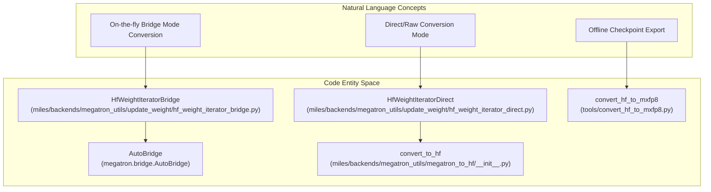
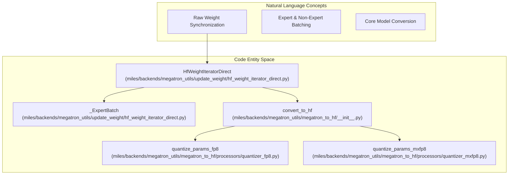

<!-- source: DeepWiki mcp.deepwiki.com · repo radixark/miles · page 11.3 HuggingFace Bridge · fetched 2026-10-21 -->

# HuggingFace Bridge

Relevant source files

The following files were used as context for generating this wiki page:

- [docs/models/mimo/mimo-v2-6-flash.md](docs/models/mimo/mimo-v2-6-flash.md)
- [miles/backends/megatron_utils/megatron_to_hf/__init__.py](miles/backends/megatron_utils/megatron_to_hf/__init__.py)
- [miles/backends/megatron_utils/megatron_to_hf/deepseekv4.py](miles/backends/megatron_utils/megatron_to_hf/deepseekv4.py)
- [miles/backends/megatron_utils/megatron_to_hf/processors/quantizer_fp8.py](miles/backends/megatron_utils/megatron_to_hf/processors/quantizer_fp8.py)
- [miles/backends/megatron_utils/megatron_to_hf/processors/quantizer_mxfp8.py](miles/backends/megatron_utils/megatron_to_hf/processors/quantizer_mxfp8.py)
- [miles/backends/megatron_utils/sglang.py](miles/backends/megatron_utils/sglang.py)
- [miles/backends/megatron_utils/update_weight/hf_weight_iterator_bridge.py](miles/backends/megatron_utils/update_weight/hf_weight_iterator_bridge.py)
- [miles/backends/megatron_utils/update_weight/hf_weight_iterator_direct.py](miles/backends/megatron_utils/update_weight/hf_weight_iterator_direct.py)
- [miles/utils/external_utils/command_utils/__init__.py](miles/utils/external_utils/command_utils/__init__.py)
- [miles_plugins/mbridge/__init__.py](miles_plugins/mbridge/__init__.py)
- [miles_plugins/megatron_bridge/__init__.py](miles_plugins/megatron_bridge/__init__.py)
- [miles_plugins/megatron_bridge/mimo_v2.py](miles_plugins/megatron_bridge/mimo_v2.py)
- [miles_plugins/models/deepseek_v4/arguments.py](miles_plugins/models/deepseek_v4/arguments.py)
- [miles_plugins/models/deepseek_v4/ops/qat.py](miles_plugins/models/deepseek_v4/ops/qat.py)
- [scripts/models/mimo-v2.6-flash-4layer.py](scripts/models/mimo-v2.6-flash-4layer.py)
- [scripts/models/mimo-v2.6-flash.py](scripts/models/mimo-v2.6-flash.py)
- [scripts/run_mimo_v2_6_flash.py](scripts/run_mimo_v2_6_flash.py)
- [tests/e2e/megatron/model_scripts/test_mimo_v2_6_flash_4layer_ci.py](tests/e2e/megatron/model_scripts/test_mimo_v2_6_flash_4layer_ci.py)
- [tests/fast/backends/megatron_utils/test_hf_weight_iterator_direct.py](tests/fast/backends/megatron_utils/test_hf_weight_iterator_direct.py)
- [tests/fast/backends/megatron_utils/test_lora_hf_weight_iterator.py](tests/fast/backends/megatron_utils/test_lora_hf_weight_iterator.py)
- [tools/convert_hf_to_mxfp8.py](tools/convert_hf_to_mxfp8.py)

## Purpose and Scope

The HuggingFace Bridge provides bidirectional checkpoint conversion between HuggingFace format and Megatron-LM format. It enables two operational modes for the Megatron training backend:

1. **Raw Mode (`--megatron-to-hf-mode raw`)**: Uses direct conversion via `HfWeightIteratorDirect` and custom model converters (`miles/backends/megatron_utils/megatron_to_hf/__init__.py`) [miles/backends/megatron_utils/update_weight/hf_weight_iterator_direct.py:31-34](), [miles/backends/megatron_utils/megatron_to_hf/__init__.py:28-81]().
2. **Bridge Mode (`--megatron-to-hf-mode bridge`)**: Performs on-the-fly weight mapping and conversion at runtime using `AutoBridge` from the `megatron.bridge` package via `HfWeightIteratorBridge` [miles/backends/megatron_utils/update_weight/hf_weight_iterator_bridge.py:26-38]().

This system ensures that Miles can utilize high-throughput inference engines (like SGLang) which expect HuggingFace formats, while training on Megatron-LM which uses sharded model parallel formats.

Sources: [miles/backends/megatron_utils/update_weight/hf_weight_iterator_bridge.py:26-38](), [miles/backends/megatron_utils/update_weight/hf_weight_iterator_direct.py:31-34](), [miles/backends/megatron_utils/megatron_to_hf/__init__.py:28-81]()

---

## Architecture Overview

### Bridge Component Relationships

The following diagram bridges natural language concepts of format conversion to the concrete code entities (`HfWeightIteratorBridge`, `HfWeightIteratorDirect`, `AutoBridge`, and `convert_to_hf`) responsible for execution.

Sources: [miles/backends/megatron_utils/update_weight/hf_weight_iterator_bridge.py:26-38](), [miles/backends/megatron_utils/update_weight/hf_weight_iterator_direct.py:31-34](), [miles/backends/megatron_utils/megatron_to_hf/__init__.py:28-81](), [tools/convert_hf_to_mxfp8.py:1-46]()

---

## Bridge Mode Implementation

### On-the-fly Weight Conversion

When `--megatron-to-hf-mode bridge` is enabled, Miles uses `HfWeightIteratorBridge` to synchronize weights between the training model and the rollout inference engine [miles/backends/megatron_utils/update_weight/hf_weight_iterator_bridge.py:26-38]().

**Key Class: `HfWeightIteratorBridge`**
This class inherits from `MegatronHfWeightIteratorBase` and utilizes `AutoBridge` to export weights directly into HuggingFace format without intermediate disk storage [miles/backends/megatron_utils/update_weight/hf_weight_iterator_bridge.py:26-38]().

- **Initialization**: Loads the bridge using `AutoBridge.from_hf_pretrained(bridge_checkpoint, trust_remote_code=True)` and resolves namespace remappings via `_load_checkpoint_name_remap` [miles/backends/megatron_utils/update_weight/hf_weight_iterator_bridge.py:30-38]().
- **Parameter Units Iteration (`_iter_hf_param_units`)**: Temporarily patches hyperparameters (such as hyper-connection alphas and head read sibling parameters) and executes `self._bridge.get_conversion_tasks(self.model)` and `self._bridge.export_hf_weights` [miles/backends/megatron_utils/update_weight/hf_weight_iterator_bridge.py:41-74]().
- **Post-processing and Quantization**: Applies `_postprocess_and_quantize` to match target rollout formats (such as FP8 storage formats) [miles/backends/megatron_utils/update_weight/hf_weight_iterator_bridge.py:85-90]().
- **LoRA Adapter Export**: Exports local LoRA adapter weights via `_export_pp_local_lora` and `_export_current_adapter` using `AutoBridge.export_adapter_weights` [miles/backends/megatron_utils/update_weight/hf_weight_iterator_bridge.py:95-117]().

Sources: [miles/backends/megatron_utils/update_weight/hf_weight_iterator_bridge.py:26-117]()

---

## Direct Mode Implementation and Quantization

### Direct Mode (`HfWeightIteratorDirect`)

When `--megatron-to-hf-mode raw` is selected, `HfWeightIteratorDirect` manages parameter grouping, expert gathering across expert-parallel (EP) and expert-data-parallel (EDP) dimensions, and batching based on `update_weight_buffer_size` [miles/backends/megatron_utils/update_weight/hf_weight_iterator_direct.py:31-76]().

Sources: [miles/backends/megatron_utils/update_weight/hf_weight_iterator_direct.py:31-109](), [miles/backends/megatron_utils/megatron_to_hf/__init__.py:28-34](), [miles/backends/megatron_utils/megatron_to_hf/processors/quantizer_fp8.py:16-25](), [miles/backends/megatron_utils/megatron_to_hf/processors/quantizer_mxfp8.py:6-12]()

### Quantization Processors

During direct conversion, parameters pass through quantization processors:
- **FP8 Quantization (`quantize_params_fp8`)**: Handles per-tensor or per-block FP8 (`e4m3`) quantization, including block scaling (`ue8m0`) and FusedMoE expert layers [miles/backends/megatron_utils/megatron_to_hf/processors/quantizer_fp8.py:16-124]().
- **MXFP8 Quantization (`quantize_params_mxfp8`)**: Applies Microscaling Formats (MXFP8) quantization to attention, MLP, and MoE layers while respecting skip lists and precision bounds [miles/backends/megatron_utils/megatron_to_hf/processors/quantizer_mxfp8.py:6-107]().

Sources: [miles/backends/megatron_utils/megatron_to_hf/processors/quantizer_fp8.py:16-124](), [miles/backends/megatron_utils/megatron_to_hf/processors/quantizer_mxfp8.py:6-107]()

---

## Miles Plugins Megatron Bridge Package (`miles_plugins/megatron_bridge`)

The `miles_plugins/megatron_bridge` package registers custom bridge subclasses with `AutoBridge` and installs runtime shims [miles_plugins/megatron_bridge/__init__.py:1-14]().

- **Process Group Unwrap Shim (`_install_bridge_pp_group_unwrap`)**: Patches `MegatronParamMapping.broadcast_obj_from_pp_rank` to unwrap Miles' `ReloadableProcessGroup` wrappers during pipeline-parallel object broadcasting [miles_plugins/megatron_bridge/__init__.py:23-56]().
- **Model Subclasses**: Automatically imports model-specific bridge modules such as `nemotron_h` and `mimo_v2` upon package import [miles_plugins/megatron_bridge/__init__.py:72-83]().

Sources: [miles_plugins/megatron_bridge/__init__.py:1-83]()

---

## Offline Conversion Tools

For offline conversions (e.g., converting Safetensors checkpoints to MXFP8 format), tools such as `tools/convert_hf_to_mxfp8.py` are provided [tools/convert_hf_to_mxfp8.py:1-46]().

- **Source Checkpoint Inspection**: Detects whether the input is a block-scaled FP8 checkpoint with UE8M0 scales or a standard BF16 checkpoint [tools/convert_hf_to_mxfp8.py:40-54]().
- **Quantization and Rewriting**: Iterates over safetensor files, applies MXFP8 quantization via `quantize_mxfp8`, and writes out updated tensor indices and weights [tools/convert_hf_to_mxfp8.py:159-190]().

Sources: [tools/convert_hf_to_mxfp8.py:1-190]()

---

