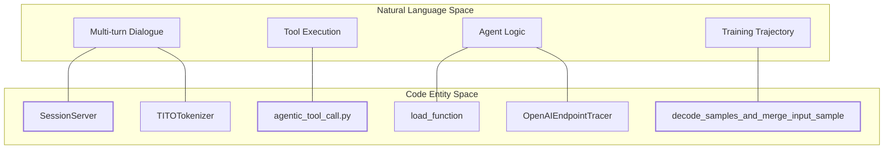
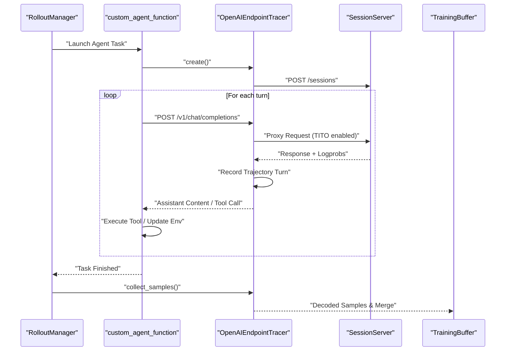

<!-- source: DeepWiki mcp.deepwiki.com · repo radixark/miles · page 12 Agentic and Multi-Turn Workflows · fetched 2026-10-21 -->

# Agentic and Multi-Turn Workflows

Relevant source files

The following files were used as context for generating this wiki page:

- [miles/rollout/generate_hub/agentic_tool_call.py](miles/rollout/generate_hub/agentic_tool_call.py)
- [miles/rollout/generate_utils/openai_endpoint_utils.py](miles/rollout/generate_utils/openai_endpoint_utils.py)
- [miles/rollout/session/anthropic_adapter.py](miles/rollout/session/anthropic_adapter.py)
- [miles/rollout/session/linear_trajectory.py](miles/rollout/session/linear_trajectory.py)
- [miles/rollout/session/sessions.py](miles/rollout/session/sessions.py)
- [miles/rollout/session/types.py](miles/rollout/session/types.py)
- [tests/fast/fixtures/generation_fixtures.py](tests/fast/fixtures/generation_fixtures.py)
- [tests/fast/fixtures/rollout_fixtures.py](tests/fast/fixtures/rollout_fixtures.py)
- [tests/fast/rollout/generate_hub/test_agentic_v2.py](tests/fast/rollout/generate_hub/test_agentic_v2.py)
- [tests/fast/rollout/generate_hub/test_multi_turn.py](tests/fast/rollout/generate_hub/test_multi_turn.py)
- [tests/fast/rollout/generate_hub/test_single_turn.py](tests/fast/rollout/generate_hub/test_single_turn.py)
- [tests/fast/rollout/generate_utils/test_openai_endpoint_utils.py](tests/fast/rollout/generate_utils/test_openai_endpoint_utils.py)
- [tests/fast/router/session_pretokenized_test_utils.py](tests/fast/router/session_pretokenized_test_utils.py)
- [tests/fast/router/test_linear_trajectory.py](tests/fast/router/test_linear_trajectory.py)
- [tests/fast/router/test_session_anthropic.py](tests/fast/router/test_session_anthropic.py)
- [tests/fast/router/test_session_race_conditions.py](tests/fast/router/test_session_race_conditions.py)
- [tests/session_parity_utils.py](tests/session_parity_utils.py)

Miles provides a comprehensive infrastructure for training Large Language Models (LLMs) on complex, multi-step trajectories. This includes native support for multi-turn dialogue, tool-use interactions, and multi-agent coordination. The system is designed to bridge the gap between flexible agentic environments (such as SWE-agent) and the rigorous requirements of Reinforcement Learning (RL), specifically ensuring that multi-turn data is correctly tokenized and aligned for gradient updates.

## High-Level Architecture

The agentic workflow in Miles centers around the `SessionServer` and `OpenAIEndpointTracer`, which act as a stateful proxy between an external agent (or environment) and the SGLang inference engines.

### Natural Language to Code Entity Mapping

The following diagram illustrates how high-level agentic concepts map to specific code entities within the Miles repository.

**Diagram: Agentic Workflow Mapping**

Sources: [miles/rollout/generate_hub/agentic_tool_call.py:47-67](), [miles/rollout/generate_utils/openai_endpoint_utils.py:27-46](), [miles/rollout/session/sessions.py:43-88]()

---

## Session Management and TITO

Multi-turn RL requires a mechanism to track the "Token-In, Token-Out" (TITO) flow to ensure that the log probabilities calculated during rollout exactly match the sequence used during training. The `SessionServer` manages this by maintaining an active trajectory registry (`SessionRegistry` or `SessionRegistryV2`) [miles/rollout/session/sessions.py:78-88]().

*   **SessionServer**: A FastAPI-based adapter that proxies OpenAI-compatible chat completion requests and manages session lifecycles (`CreateSessionRequest`, `/sessions`) [miles/rollout/session/sessions.py:1-114]().
*   **TITO Token Tracking**: Miles uses `TITOTokenizer` and associated chat template utilities to handle prompt tokenization, incremental message addition, and prefix validation (`assert_pretokenized_prefix`) [miles/rollout/session/linear_trajectory.py:27-57]().
*   **Trailing Token Trimming**: Models often emit stop tokens or formatting tokens that require codec conversions and trajectory tracking during sample collection [miles/rollout/generate_utils/openai_endpoint_utils.py:10-17]().

For details, see [Session Management and TITO](#12.1).

**Sources**: [miles/rollout/session/sessions.py:58-122](), [miles/rollout/session/linear_trajectory.py:27-82](), [miles/rollout/generate_utils/openai_endpoint_utils.py:10-17]()

---

## Agentic Tool Call and SWE-Agent

Miles supports agentic workflows where the model interacts with an external environment (e.g., a bash shell, a web browser, or a coding sandbox).

*   **Rollout Variant**: The `agentic_tool_call` rollout variant (`miles.rollout.generate_hub.agentic_tool_call`) is the primary entry point for environment-based RL [miles/rollout/generate_hub/agentic_tool_call.py:1-11](). It uses `OpenAIEndpointTracer` to record every interaction between the agent and the session server [miles/rollout/generate_hub/agentic_tool_call.py:59-61]().
*   **Custom Agent Functions**: Users can define arbitrary agent logic in a Python function loaded via `--custom-agent-function-path` [miles/rollout/generate_hub/agentic_tool_call.py:4-10](). This function receives a `base_url` pointing to the session infrastructure, allowing it to call the model while Miles transparently records the trajectory [miles/rollout/generate_hub/agentic_tool_call.py:86-93]().
*   **External Integration**: Miles dispatches to specialized agent functions and handles result collection, sample truncation, and error fallback states (`Sample.Status.ABORTED`) [miles/rollout/generate_hub/agentic_tool_call.py:105-121]().

For details, see [Agentic Tool Call and SWE-Agent](#12.2).

**Sources**: [miles/rollout/generate_hub/agentic_tool_call.py:1-122](), [miles/rollout/generate_utils/openai_endpoint_utils.py:27-80]()

---

## Multi-Agent Systems and Retool

Beyond single-agent tool use, Miles enables multi-agent co-evolution where multiple models or instances interact to solve a task.

*   **Multi-Agent Rollout**: Orchestrates complex systems where agents may have different roles (e.g., proposer, verifier, or tool-use executors) operating across distributed Ray actors.
*   **Retool Integration**: Supports tool-use RL through adapters that allow agents to iteratively refine tool calls based on feedback, distributing rewards across the multi-turn trajectory.
*   **Co-evolution Architecture**: Uses session-managed tracing (`OpenAIEndpointTracer`) to record interactions between different agents, merging individual turns into unified training samples.

For details, see [Multi-Agent Systems and Retool](#12.3).

**Sources**: [miles/rollout/generate_hub/agentic_tool_call.py:51-115](), [miles/rollout/generate_utils/openai_endpoint_utils.py:82-110]()

---

## Environments and Sandbox Providers

Miles integrates with standard RL evaluation environments and sandbox providers to execute untrusted code or interact with external environments securely.

*   **Environment Integrations**: Supports frameworks such as OpenEnv, Harbor, NemoGym, tau-bench, and verifiers for task execution and reward computation.
*   **Sandbox Providers**: Integrates with container and execution backends including Daytona, E2B, Modal, and Docker to isolate agent actions during rollout.

For details, see [Environments and Sandbox Providers](#12.4).

**Sources**: [miles/rollout/generate_hub/agentic_tool_call.py:1-15](), [miles/rollout/generate_utils/openai_endpoint_utils.py:27-50]()

---

## Trajectory Processing Flow

The diagram below shows the data flow from an initial prompt through the agentic environment and back into the training pipeline.

**Diagram: Multi-Turn Trajectory Data Flow**

Sources: [miles/rollout/generate_hub/agentic_tool_call.py:51-111](), [miles/rollout/generate_utils/openai_endpoint_utils.py:53-110]()

---

