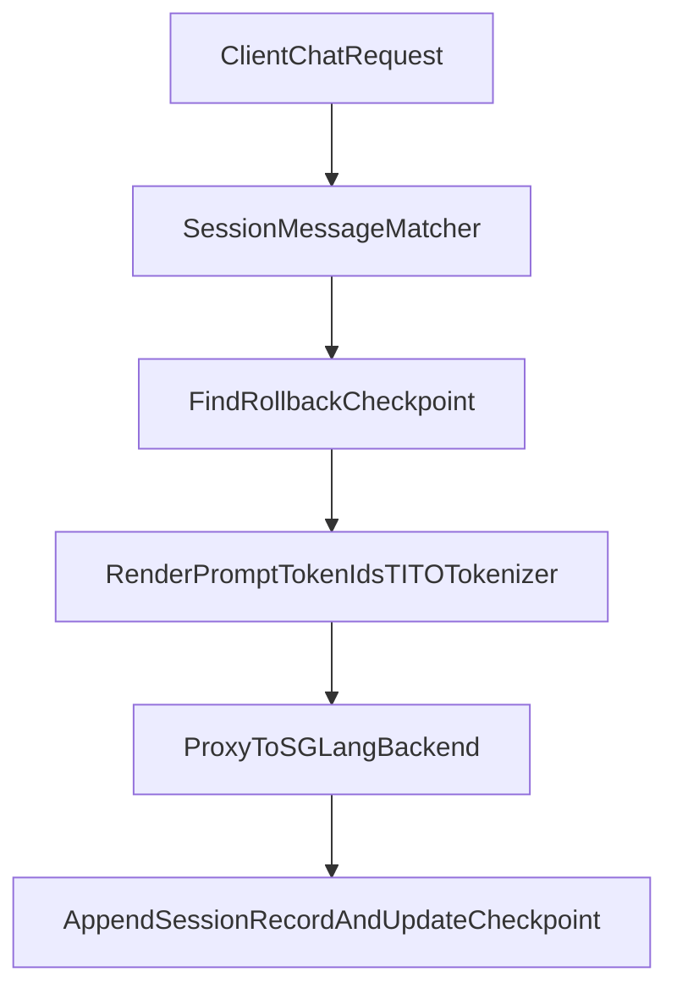
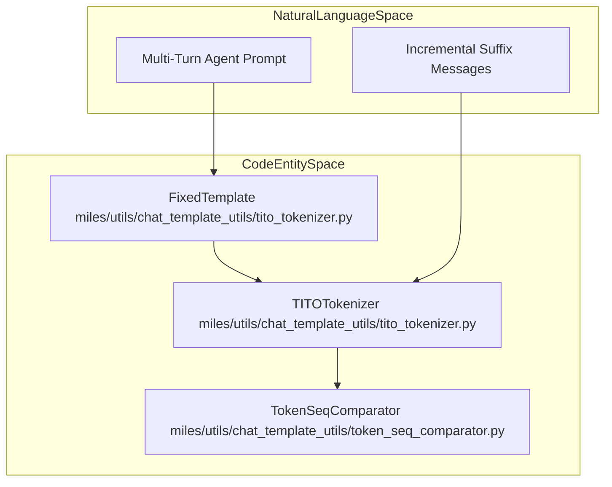
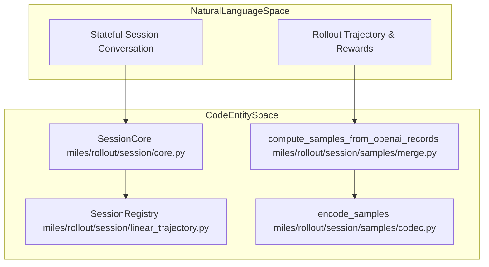
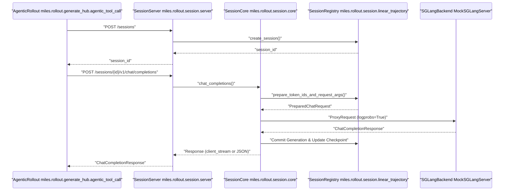

<!-- source: DeepWiki mcp.deepwiki.com · repo radixark/miles · page 12.1 Session Management and TITO · fetched 2026-10-21 -->

# Session Management and TITO

Relevant source files

The following files were used as context for generating this wiki page:

- [docs/user-guide/agentic-rollout.md](docs/user-guide/agentic-rollout.md)
- [miles/backends/sglang_utils/server_args_utils.py](miles/backends/sglang_utils/server_args_utils.py)
- [miles/rollout/session/config.py](miles/rollout/session/config.py)
- [miles/rollout/session/core.py](miles/rollout/session/core.py)
- [miles/rollout/session/errors.py](miles/rollout/session/errors.py)
- [miles/rollout/session/request_args.py](miles/rollout/session/request_args.py)
- [miles/rollout/session/samples/merge.py](miles/rollout/session/samples/merge.py)
- [miles/rollout/session/v2/core.py](miles/rollout/session/v2/core.py)
- [miles/rollout/session/v2/picker_hub/__init__.py](miles/rollout/session/v2/picker_hub/__init__.py)
- [miles/rollout/session/v2/picker_hub/drop_rolled_back_leaves.py](miles/rollout/session/v2/picker_hub/drop_rolled_back_leaves.py)
- [miles/rollout/session/v2/picker_hub/drop_same_prompt_retries.py](miles/rollout/session/v2/picker_hub/drop_same_prompt_retries.py)
- [miles/rollout/session/v2/session_state.py](miles/rollout/session/v2/session_state.py)
- [miles/rollout/session/v2/utils.py](miles/rollout/session/v2/utils.py)
- [miles/utils/chat_template_utils/__init__.py](miles/utils/chat_template_utils/__init__.py)
- [miles/utils/chat_template_utils/template.py](miles/utils/chat_template_utils/template.py)
- [miles/utils/chat_template_utils/templates/qwen3.5_fixed.jinja](miles/utils/chat_template_utils/templates/qwen3.5_fixed.jinja)
- [miles/utils/chat_template_utils/tito_tokenizer.py](miles/utils/chat_template_utils/tito_tokenizer.py)
- [miles/utils/test_utils/chat_template_verify.py](miles/utils/test_utils/chat_template_verify.py)
- [miles/utils/test_utils/mock_trajectories.py](miles/utils/test_utils/mock_trajectories.py)
- [miles/utils/test_utils/session_verify_agent.py](miles/utils/test_utils/session_verify_agent.py)
- [miles/utils/test_utils/session_verify_runner.py](miles/utils/test_utils/session_verify_runner.py)
- [miles/utils/workers/argv_utils.py](miles/utils/workers/argv_utils.py)
- [scripts/tools/verify_session_tito_tokenizer.py](scripts/tools/verify_session_tito_tokenizer.py)
- [tests/e2e/ckpt/test_glm47_flash_ckpt.py](tests/e2e/ckpt/test_glm47_flash_ckpt.py)
- [tests/e2e/fsdp/test_qwen3_0.6B_fsdp_distributed.py](tests/e2e/fsdp/test_qwen3_0.6B_fsdp_distributed.py)
- [tests/e2e/sglang/test_chat_input_ids_equivalence.py](tests/e2e/sglang/test_chat_input_ids_equivalence.py)
- [tests/e2e/sglang/test_r3_router_equivalence.py](tests/e2e/sglang/test_r3_router_equivalence.py)
- [tests/e2e/sglang/test_session_server_addition_r3.py](tests/e2e/sglang/test_session_server_addition_r3.py)
- [tests/e2e/sglang/test_session_server_multi_role/_common.py](tests/e2e/sglang/test_session_server_multi_role/_common.py)
- [tests/e2e/sglang/test_session_server_multi_role/test_deepseekv4.py](tests/e2e/sglang/test_session_server_multi_role/test_deepseekv4.py)
- [tests/e2e/sglang/test_session_server_multi_role/test_glm47.py](tests/e2e/sglang/test_session_server_multi_role/test_glm47.py)
- [tests/e2e/sglang/test_session_server_multi_role/test_inkling.py](tests/e2e/sglang/test_session_server_multi_role/test_inkling.py)
- [tests/e2e/sglang/test_session_server_multi_role/test_minimax_m27.py](tests/e2e/sglang/test_session_server_multi_role/test_minimax_m27.py)
- [tests/e2e/sglang/test_session_server_multi_role/test_nemotron3.py](tests/e2e/sglang/test_session_server_multi_role/test_nemotron3.py)
- [tests/e2e/sglang/test_session_server_multi_role/test_qwen3.py](tests/e2e/sglang/test_session_server_multi_role/test_qwen3.py)
- [tests/e2e/sglang/test_session_server_multi_role/test_qwen35.py](tests/e2e/sglang/test_session_server_multi_role/test_qwen35.py)
- [tests/e2e/sglang/test_session_v1_v2_parity.py](tests/e2e/sglang/test_session_v1_v2_parity.py)
- [tests/e2e/sglang/utils/sglang_server.py](tests/e2e/sglang/utils/sglang_server.py)
- [tests/fast/fixtures/session_fixtures.py](tests/fast/fixtures/session_fixtures.py)
- [tests/fast/rollout/session/test_config.py](tests/fast/rollout/session/test_config.py)
- [tests/fast/rollout/session/test_request_args.py](tests/fast/rollout/session/test_request_args.py)
- [tests/fast/rollout/session/test_samples.py](tests/fast/rollout/session/test_samples.py)
- [tests/fast/router/test_session_evaluation.py](tests/fast/router/test_session_evaluation.py)
- [tests/fast/router/test_session_message_matcher.py](tests/fast/router/test_session_message_matcher.py)
- [tests/fast/router/test_session_pretokenized_e2e.py](tests/fast/router/test_session_pretokenized_e2e.py)
- [tests/fast/router/test_session_samples_op.py](tests/fast/router/test_session_samples_op.py)
- [tests/fast/router/test_session_samples_op_v2.py](tests/fast/router/test_session_samples_op_v2.py)
- [tests/fast/router/test_session_state.py](tests/fast/router/test_session_state.py)
- [tests/fast/router/test_session_v1_v2_parity.py](tests/fast/router/test_session_v1_v2_parity.py)
- [tests/fast/router/test_sessions.py](tests/fast/router/test_sessions.py)
- [tests/fast/router/test_sessions_v2.py](tests/fast/router/test_sessions_v2.py)
- [tests/fast/router/test_tree_assembly_invariants.py](tests/fast/router/test_tree_assembly_invariants.py)
- [tests/fast/utils/chat_template_utils/test_fixed_templates.py](tests/fast/utils/chat_template_utils/test_fixed_templates.py)
- [tests/fast/utils/chat_template_utils/test_pretokenized_chat.py](tests/fast/utils/chat_template_utils/test_pretokenized_chat.py)
- [tests/fast/utils/chat_template_utils/test_pretokenized_via_tito.py](tests/fast/utils/chat_template_utils/test_pretokenized_via_tito.py)
- [tests/fast/utils/chat_template_utils/test_template.py](tests/fast/utils/chat_template_utils/test_template.py)
- [tests/fast/utils/chat_template_utils/test_tito_tokenizer.py](tests/fast/utils/chat_template_utils/test_tito_tokenizer.py)
- [tests/fast/utils/test_utils/test_session_verify_runner.py](tests/fast/utils/test_utils/test_session_verify_runner.py)
- [tests/fast/utils/workers/test_argv_utils.py](tests/fast/utils/workers/test_argv_utils.py)
- [tests/manual/session/bench_session_server_overhead.py](tests/manual/session/bench_session_server_overhead.py)

## Purpose and Scope

This wiki page provides full technical documentation for Miles' session management subsystem, **SessionServer** (supporting both v1 linear sessions and v2 tree-structured trajectories), **TITO (Token In Token Out)** incremental tokenizers, chat template harmonization, trajectory state tracking, and sample merging/codec utilities. It explains how multi-turn agentic conversations and tool-use episodes are recorded, validated, and converted into training samples.

---

## 1. Overview of Session Management & Architecture

In multi-turn reinforcement learning (RL) training, such as agentic tool use and interactive reasoning, standard stateless inference APIs make it difficult to reconstruct the exact token sequences and KV-cache lineages seen by the model during generation. Miles addresses this via a stateful session layer (`SessionServer`) that proxies requests to SGLang while maintaining conversation histories, token checkpoints, and trajectory trees `[miles/rollout/session/core.py:1-9]()`.

The architecture separates HTTP transport adaptation from core state and token management:
- **FastAPI Adapters**: `miles/rollout/session/sessions.py` handles HTTP endpoints (`/sessions`, `/sessions/{id}`, `/sessions/{id}/v1/chat/completions`) and error translation `[tests/fast/router/test_sessions.py:1-138]()`.
- **Logic Layers**: `SessionCore` (`[miles/rollout/session/core.py:1-9]()`) manages v1 linear state, while `SessionCoreV2` (`[tests/fast/router/test_sessions_v2.py:25-25]()`) extends it to support tree-structured rollout exploration, custom sample pickers, and postprocessors.
- **Registries**: `SessionRegistry` (`[miles/rollout/session/linear_trajectory.py:60-82]()`) and `SessionRegistryV2` (`[tests/fast/router/test_sessions_v2.py:1-32]()`) store active session instances and manage lock-free or locked state transitions.

| Route | Method | Description | Source |
| :--- | :--- | :--- | :--- |
| `/sessions` | POST | Instantiates a new session and returns a unique 32-character `session_id` | `[tests/fast/router/test_sessions.py:105-111]()` |
| `/sessions/{id}` | GET | Returns session records, accumulated token IDs, and tree/mismatch metadata | `[tests/fast/router/test_sessions.py:112-120]()` |
| `/sessions/{id}` | DELETE | Tears down and removes the session state from the registry | `[tests/fast/router/test_sessions.py:126-134]()` |
| `/sessions/{id}/v1/chat/completions` | POST | Proxies OpenAI chat requests, injecting TITO-derived `input_ids` and recording records | `[tests/fast/router/test_sessions.py:141-167]()` |

Sources: `[miles/rollout/session/core.py:1-9]()`, `[tests/fast/router/test_sessions.py:1-138]()`, `[tests/fast/router/test_sessions_v2.py:1-32]()`

---

## 2. TITO: Token In Token Out and Chat Templates

Standardizing multi-turn tokenization is challenging because model generation stops at boundary tokens (e.g., `<|im_end|>`) which are also rendered by chat templates as prefixes for the next turn. Re-encoding historical messages from scratch causes token divergence and training instability. **TITO (`TITOTokenizer`)** solves this by computing incremental token IDs for messages appended after assistant generation and merging them with pretokenized prefixes `[miles/utils/chat_template_utils/tito_tokenizer.py:1-6]`.

### Key Components of `TITOTokenizer`
- **`FixedTemplate`**: Defines model-family-specific chat templates, required kwargs (e.g., `preserve_thinking=True`), and allowed append roles (`VALID_APPEND_ROLES`) `[miles/utils/chat_template_utils/tito_tokenizer.py:47-63]()`.
- **Incremental Tokenization**: `tokenize_additional_messages()` computes token IDs for newly appended suffix messages under synthetic prefix contexts `[tests/fast/utils/chat_template_utils/test_tito_tokenizer.py:31-42]()`.
- **Boundary Merging**: `merge_tokens()` handles model-specific junction adjustments—such as inserting missing newline tokens for Qwen or stripping trailing observation tokens for GLM `[tests/fast/utils/chat_template_utils/test_tito_tokenizer.py:24-30]()`.

Sources: `[miles/utils/chat_template_utils/tito_tokenizer.py:1-137]`, `[tests/fast/utils/chat_template_utils/test_tito_tokenizer.py:1-46]`

---

## 3. Trajectory Management and Tree-Based Serving

Sessions track conversation flow either linearly (`LinearTrajectory`) or as branchable trees (`SessionRegistryV2`) `[miles/rollout/session/linear_trajectory.py:60-91]()`. 

### Linear Trajectory State (`LinearTrajectory`)
- Maintains `messages`, `records`, `trajectory_token_ids`, and `generated_checkpoint_message_ends` `[miles/rollout/session/linear_trajectory.py:82-91]()`.
- Supports single-step assistant rollback (`MAX_ASSISTANT_ROLLBACK_STEPS = 1`) when agents retry or correct invalid tool calls `[miles/rollout/session/linear_trajectory.py:22-25]()`.
- **Prefix Verification**: `assert_pretokenized_prefix()` ensures stored token IDs match new prompt checkpoints within a tolerance of `max_trim_tokens` `[miles/rollout/session/linear_trajectory.py:27-37]()`.

Sources: `[miles/rollout/session/linear_trajectory.py:1-138]()`, `[miles/rollout/session/core.py:1-9]()`

---

## 4. Sample Merging, Codec, and Training Recording

Once rollout execution completes, session records are converted into training samples (`Sample` objects) on the server side `[miles/rollout/session/core.py:8-9]`.

- **Sample Computation**: `compute_samples_from_openai_records()` extracts token sequences, logprobs, and reward signals from session records `[miles/rollout/session/core.py:30-30]()`.
- **Truncation and Merging**: `truncate_samples_by_total_tokens()` and `merge_samples_with_addition_r3()` handle sequence length caps and MoE routing replay payloads (`routed_experts`, `indexer_topk`) `[miles/rollout/session/core.py:29-33]()`.
- **Codec Serialization**: `encode_samples()` serializes training samples into binary safetensors payloads for efficient IPC transmission between rollout servers and training actors `[miles/rollout/session/core.py:28-28]()`.

Sources: `[miles/rollout/session/core.py:1-35]()`

---

## 5. Implementation & Data Flow

### Natural Language Space to Code Entity Space: Tokenization & Templates

Sources: `[miles/utils/chat_template_utils/tito_tokenizer.py:1-137]()`, `[tests/fast/utils/chat_template_utils/test_tito_tokenizer.py:1-46]()`

### Natural Language Space to Code Entity Space: Session & Sampling

Sources: `[miles/rollout/session/core.py:1-35]()`, `[miles/rollout/session/linear_trajectory.py:60-91]()`

### Session Request Execution Sequence

Sources: `[miles/rollout/session/core.py:1-144]()`, `[miles/rollout/session/linear_trajectory.py:60-138]()`, `[tests/fast/router/test_sessions.py:29-167]()`

---

