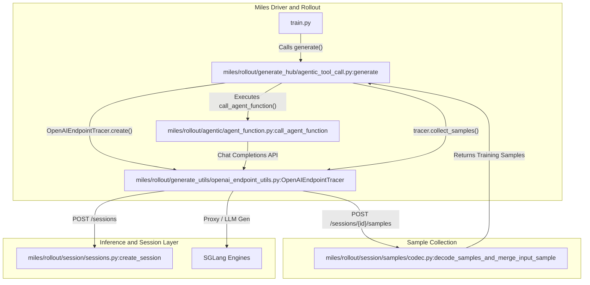
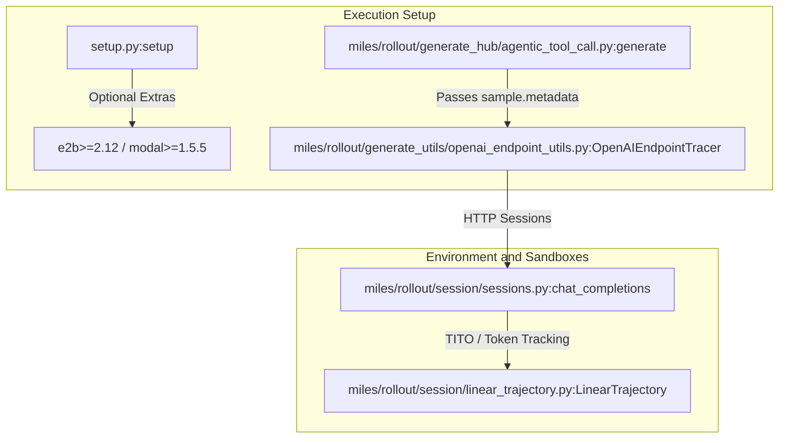

<!-- source: DeepWiki mcp.deepwiki.com · repo radixark/miles · page 12.2 Agentic Tool Call and SWE-Agent · fetched 2026-10-21 -->

# Agentic Tool Call and SWE-Agent

<details>
<summary>Relevant source files</summary>

The following files were used as context for generating this wiki page:

- [docs/examples/swe-agent-harbor-docker.md](docs/examples/swe-agent-harbor-docker.md)
- [examples/experimental/openenv/tb2_sandbox_modal.py](examples/experimental/openenv/tb2_sandbox_modal.py)
- [examples/experimental/terminus-compaction/README.md](examples/experimental/terminus-compaction/README.md)
- [examples/experimental/terminus-compaction/run.py](examples/experimental/terminus-compaction/run.py)
- [examples/swe-agent-harbor-docker/README.md](examples/swe-agent-harbor-docker/README.md)
- [examples/swe-agent-harbor-docker/run_glm52_lora_tb2_daytona.py](examples/swe-agent-harbor-docker/run_glm52_lora_tb2_daytona.py)
- [miles/ray/rollout/metrics.py](miles/ray/rollout/metrics.py)
- [miles/rollout/agentic/credentials.py](miles/rollout/agentic/credentials.py)
- [miles/rollout/generate_hub/agentic_tool_call.py](miles/rollout/generate_hub/agentic_tool_call.py)
- [miles/rollout/generate_utils/openai_endpoint_utils.py](miles/rollout/generate_utils/openai_endpoint_utils.py)
- [miles/rollout/session/anthropic_adapter.py](miles/rollout/session/anthropic_adapter.py)
- [miles/rollout/session/linear_trajectory.py](miles/rollout/session/linear_trajectory.py)
- [miles/rollout/session/sessions.py](miles/rollout/session/sessions.py)
- [miles/rollout/session/types.py](miles/rollout/session/types.py)
- [setup.py](setup.py)
- [tests/fast/examples/experimental/openenv/test_openenv_modal_agent_function.py](tests/fast/examples/experimental/openenv/test_openenv_modal_agent_function.py)
- [tests/fast/examples/experimental/openenv/test_tb2_sandbox_modal.py](tests/fast/examples/experimental/openenv/test_tb2_sandbox_modal.py)
- [tests/fast/examples/experimental/terminus_compaction/test_run.py](tests/fast/examples/experimental/terminus_compaction/test_run.py)
- [tests/fast/fixtures/generation_fixtures.py](tests/fast/fixtures/generation_fixtures.py)
- [tests/fast/fixtures/rollout_fixtures.py](tests/fast/fixtures/rollout_fixtures.py)
- [tests/fast/ray/rollout/test_metrics.py](tests/fast/ray/rollout/test_metrics.py)
- [tests/fast/ray/rollout/test_rollout_data_conversion.py](tests/fast/ray/rollout/test_rollout_data_conversion.py)
- [tests/fast/rollout/agentic/test_credentials.py](tests/fast/rollout/agentic/test_credentials.py)
- [tests/fast/rollout/generate_hub/test_agentic_v2.py](tests/fast/rollout/generate_hub/test_agentic_v2.py)
- [tests/fast/rollout/generate_hub/test_multi_turn.py](tests/fast/rollout/generate_hub/test_multi_turn.py)
- [tests/fast/rollout/generate_hub/test_single_turn.py](tests/fast/rollout/generate_hub/test_single_turn.py)
- [tests/fast/rollout/generate_utils/test_openai_endpoint_utils.py](tests/fast/rollout/generate_utils/test_openai_endpoint_utils.py)
- [tests/fast/router/session_pretokenized_test_utils.py](tests/fast/router/session_pretokenized_test_utils.py)
- [tests/fast/router/test_linear_trajectory.py](tests/fast/router/test_linear_trajectory.py)
- [tests/fast/router/test_session_anthropic.py](tests/fast/router/test_session_anthropic.py)
- [tests/fast/router/test_session_race_conditions.py](tests/fast/router/test_session_race_conditions.py)
- [tests/session_parity_utils.py](tests/session_parity_utils.py)
- [tests/test_fsdp_import.py](tests/test_fsdp_import.py)

</details>


## Purpose and Scope

This page documents the integration of agentic workflows into the Miles RL framework. It details the `agentic_tool_call` rollout variant implemented in `miles/rollout/generate_hub/agentic_tool_call.py`, credentials handling, the SWE-agent integration, and how external agent functions plug into Miles via session tracing (`OpenAIEndpointTracer`) and the session server infrastructure (`miles/rollout/session/sessions.py`).

Sources: [miles/rollout/generate_hub/agentic_tool_call.py:1-44](), [miles/rollout/generate_utils/openai_endpoint_utils.py:1-24](), [miles/rollout/session/sessions.py:1-6]().

---

## Overview of Agentic Workflows

Miles supports agent-environment RL training by decoupling the LLM policy (running on SGLang or Megatron inference engines) from external agent execution frameworks (such as SWE-agent, Harbor, or custom async agent functions). The core mechanism is the `agentic_tool_call` rollout variant, which delegates conversation and tool execution to a user-provided agent function while utilizing `OpenAIEndpointTracer` [miles/rollout/generate_utils/openai_endpoint_utils.py:27-46]() to track token-level interactions through the session server [miles/rollout/session/sessions.py:58-88]().

### Key Components
*   **Custom Agent Function**: An asynchronous function specified via `--custom-agent-function-path` that executes the agent loop, interacts with the LLM via a session base URL, and returns metadata [miles/rollout/generate_hub/agentic_tool_call.py:12-25]().
*   **`OpenAIEndpointTracer`**: Manages session creation (`POST /sessions`), base URL construction (`/sessions/{session_id}`), and sample collection (`POST /sessions/{session_id}/samples`) [miles/rollout/generate_utils/openai_endpoint_utils.py:27-110]().
*   **Session Server & Router**: Background FastAPI services (`setup_session_routes`) that host session trajectories, handle TITO (Token In Token Out) alignment, and assemble training samples [miles/rollout/session/sessions.py:58-88]().

Sources: [miles/rollout/generate_hub/agentic_tool_call.py:45-84](), [miles/rollout/generate_utils/openai_endpoint_utils.py:24-68](), [miles/rollout/session/sessions.py:58-88]().

---

## System Architecture and Data Flow

The following diagram bridges natural language descriptions to code entities, illustrating how `agentic_tool_call.py` orchestrates execution between Miles, `OpenAIEndpointTracer`, the session server route endpoints, and external agent callables.

### Agentic Rollout and Session Tracing Architecture

Sources: [miles/rollout/generate_hub/agentic_tool_call.py:51-111](), [miles/rollout/generate_utils/openai_endpoint_utils.py:53-110]().

---

## Implementation Details

### The `agentic_tool_call` Rollout Function

The generation entry point for agentic workflows is defined in `miles/rollout/generate_hub/agentic_tool_call.py`. It asserts that partial rollouts are disabled, validates the presence of session server instances (`--use-session-server`), initializes the `OpenAIEndpointTracer`, and loads the user-specified custom agent function [miles/rollout/generate_hub/agentic_tool_call.py:51-67]().

```python
async def generate(input: GenerateFnInput) -> GenerateFnOutput:
    assert not input.args.partial_rollout, "Partial rollout is not supported"
    assert getattr(input.args, "session_server_instances", None), (
        "agentic_tool_call.generate requires session_server_instances. "
        "Pass --use-session-server to start the session server."
    )
    ...
```
Sources: [miles/rollout/generate_hub/agentic_tool_call.py:51-67]().

### `OpenAIEndpointTracer`

The `OpenAIEndpointTracer` class in `miles/rollout/generate_utils/openai_endpoint_utils.py` manages the lifecycle of an agent session over HTTP. During `create()`, it selects a session server instance, initializes a session via a `POST` request to `/sessions`, and configures wire fields (`COMPUTED_FIELDS` for v1 or `COMPUTED_FIELDS_V2` for v2) [miles/rollout/generate_utils/openai_endpoint_utils.py:53-80]().

| Method / Property | Description | Source |
| :--- | :--- | :--- |
| `OpenAIEndpointTracer.create` | Selects a backend instance, requests a new session ID, and returns a tracer instance. | [miles/rollout/generate_utils/openai_endpoint_utils.py:53-80]() |
| `collect_samples` | Posts a request to `/sessions/{id}/samples` to fetch assembled training samples, then sends a `DELETE` request to clean up the session. | [miles/rollout/generate_utils/openai_endpoint_utils.py:82-110]() |
| `session_server_id` | Returns the `ip:port` of the specific instance owning the session. | [miles/rollout/generate_utils/openai_endpoint_utils.py:47-51]() |

Sources: [miles/rollout/generate_utils/openai_endpoint_utils.py:27-110]().

---

## SWE-Agent Integration and External Agent Functions

External agent frameworks (such as SWE-agent or Harbor environments) plug into Miles by conforming to a specific function contract defined in `miles/rollout/generate_hub/agentic_tool_call.py`. The custom agent function receives the base URL of the session tracer, prompt data, request parameters, and metadata, and executes its agentic loop independently [miles/rollout/generate_hub/agentic_tool_call.py:12-25]().

### Agent Function Contract
```python
async def my_agent(
    base_url: str,
    prompt: ...,
    request_kwargs: dict,
    metadata: dict,       # sample.metadata — env-specific fields
    **kwargs,
) -> dict | None:
    ...
```
*   **Returning `None`**: Indicates no extra metadata needs to be attached [miles/rollout/generate_hub/agentic_tool_call.py:22]().
*   **Returning a `dict`**: Merges the returned dictionary into every sample's metadata, enabling downstream reward models (`--custom-rm-path`) or metrics loggers to read environment results or tool call counts [miles/rollout/generate_hub/agentic_tool_call.py:22-25]().

Sources: [miles/rollout/generate_hub/agentic_tool_call.py:1-29]().

---

## Credentials and Environment Handling

Agentic runs interacting with external platforms (e.g., GitHub, SWE-bench APIs, sandbox providers) require secure credentials management and container networking setup.

### Code-Entity Space Bridge for Sandbox and Credentials

Sources: [setup.py:62-72](), [miles/rollout/generate_hub/agentic_tool_call.py:70-80](), [miles/rollout/session/sessions.py:123-133](), [miles/rollout/session/linear_trajectory.py:60-95]().

*   **Credential Forwarding**: Environment variables such as API keys and credentials are injected into runtime environments or passed through `sample.metadata` [miles/rollout/generate_hub/agentic_tool_call.py:70-80]().
*   **Sandbox & Container Providers**: Extras like `e2b` and `modal` are defined in `setup.py` [setup.py:62-72](), supporting containerized agent environments and sandbox communication via `LinearTrajectory` state tracking [miles/rollout/session/linear_trajectory.py:60-95]().

Sources: [setup.py:62-72](), [miles/rollout/generate_hub/agentic_tool_call.py:70-80](), [miles/rollout/session/linear_trajectory.py:60-95]().

---

