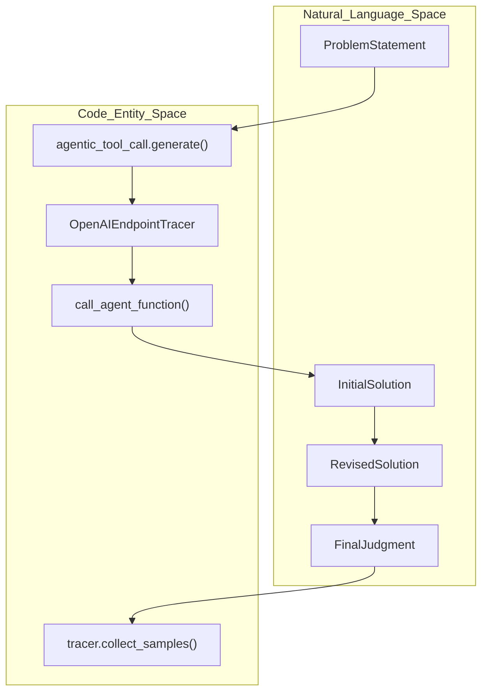
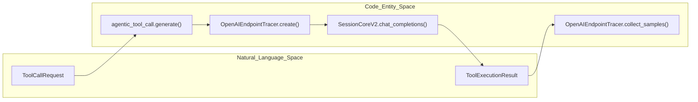
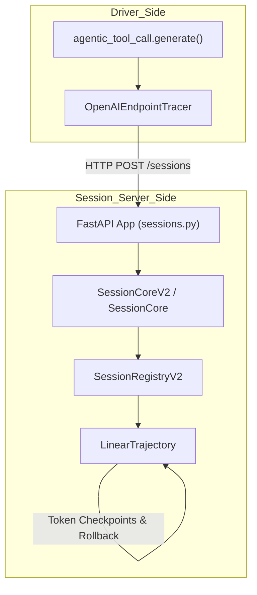

<!-- source: DeepWiki mcp.deepwiki.com · repo radixark/miles · page 12.3 Multi-Agent Systems and Retool · fetched 2026-10-21 -->

# Multi-Agent Systems and Retool

Relevant source files

The following files were used as context for generating this wiki page:

- [docs/examples/index.md](docs/examples/index.md)
- [docs/examples/infra-features/hot-restart.md](docs/examples/infra-features/hot-restart.md)
- [docs/examples/ppo.md](docs/examples/ppo.md)
- [examples/README.md](examples/README.md)
- [examples/infra_features/hot_restart/README.md](examples/infra_features/hot_restart/README.md)
- [examples/infra_features/hot_restart/__init__.py](examples/infra_features/hot_restart/__init__.py)
- [examples/infra_features/hot_restart/run_qwen3_0_6b_hot_restart.py](examples/infra_features/hot_restart/run_qwen3_0_6b_hot_restart.py)
- [examples/ppo/README.md](examples/ppo/README.md)
- [examples/ppo/run_qwen3_4b_ppo.py](examples/ppo/run_qwen3_4b_ppo.py)
- [miles/backends/megatron_utils/ft/indep_dp.py](miles/backends/megatron_utils/ft/indep_dp.py)
- [miles/rollout/generate_hub/agentic_tool_call.py](miles/rollout/generate_hub/agentic_tool_call.py)
- [miles/rollout/generate_utils/openai_endpoint_utils.py](miles/rollout/generate_utils/openai_endpoint_utils.py)
- [miles/rollout/session/anthropic_adapter.py](miles/rollout/session/anthropic_adapter.py)
- [miles/rollout/session/linear_trajectory.py](miles/rollout/session/linear_trajectory.py)
- [miles/rollout/session/sessions.py](miles/rollout/session/sessions.py)
- [miles/rollout/session/types.py](miles/rollout/session/types.py)
- [tests/fast/fixtures/generation_fixtures.py](tests/fast/fixtures/generation_fixtures.py)
- [tests/fast/fixtures/rollout_fixtures.py](tests/fast/fixtures/rollout_fixtures.py)
- [tests/fast/rollout/generate_hub/test_agentic_v2.py](tests/fast/rollout/generate_hub/test_agentic_v2.py)
- [tests/fast/rollout/generate_hub/test_multi_turn.py](tests/fast/rollout/generate_hub/test_multi_turn.py)
- [tests/fast/rollout/generate_hub/test_single_turn.py](tests/fast/rollout/generate_hub/test_single_turn.py)
- [tests/fast/rollout/generate_utils/test_openai_endpoint_utils.py](tests/fast/rollout/generate_utils/test_openai_endpoint_utils.py)
- [tests/fast/router/session_pretokenized_test_utils.py](tests/fast/router/session_pretokenized_test_utils.py)
- [tests/fast/router/test_linear_trajectory.py](tests/fast/router/test_linear_trajectory.py)
- [tests/fast/router/test_session_anthropic.py](tests/fast/router/test_session_anthropic.py)
- [tests/fast/router/test_session_race_conditions.py](tests/fast/router/test_session_race_conditions.py)
- [tests/session_parity_utils.py](tests/session_parity_utils.py)

This page documents Miles' capabilities for training complex agentic workflows, including multi-agent co-evolution, session management via TITO (Token-In-The-Loop), and the Retool/agentic tool-call integration for tool-use reinforcement learning. These systems leverage Miles' high-throughput rollout architecture and session servers to simulate multi-turn interactions, tool executions in sandboxed environments, and collaborative agent behaviors.

---

## Multi-Agent Co-evolution

Miles supports multi-agent reinforcement learning (MARL) where multiple agent roles (e.g., Solvers, Rewriters, Selectors) interact to solve complex tasks. This is implemented via a custom rollout function that orchestrates multiple calls to the inference engines through standardized endpoints.

### Architecture and Data Flow

The multi-agent system follows a structured pipeline where different agent types are represented by specific prompt templates and logic. The results from each agent are collected into a `Sample` object for training.

- **Agent Function Contract**: Custom agent logic is encapsulated in an asynchronous function loaded via `--custom-agent-function-path` [miles/rollout/generate_hub/agentic_tool_call.py:63-66](). It accepts a base URL, prompt, request kwargs, and sample metadata, returning either `None` or a dictionary of metadata merged into downstream sample records [miles/rollout/generate_hub/agentic_tool_call.py:12-24]().
- **Execution Modes**: Agents can run in `subproc` mode (isolated child process where state lasts a single call) or `inline` mode for debugging [miles/rollout/generate_hub/agentic_tool_call.py:26-28]().

### Multi-Agent Interaction Diagram

The following diagram bridges natural language spaces to code entities for the multi-agent rollout and agent function execution pipeline.

Sources: [miles/rollout/generate_hub/agentic_tool_call.py:51-105](), [miles/rollout/generate_utils/openai_endpoint_utils.py:27-110]()

---

## Retool Integration and Agentic Tool Calls

Retool and agentic tool-call pipelines provide frameworks for tool-enabled RL, focusing on mathematical reasoning, interactive tool invocation, and sandboxed code execution interleaved with model thinking.

### Core Components

1.  **OpenAIEndpointTracer**: Manages session creation and lifecycle on session server instances. It constructs session requests, tracks the session URL (`f"{router_url}/sessions/{session_id}"`), and collects worker-assembled training samples [miles/rollout/generate_utils/openai_endpoint_utils.py:27-110]().
2.  **Agentic Generate Pipeline**: Implemented in `miles/rollout/generate_hub/agentic_tool_call.py`, this module disables partial rollouts, initializes the `OpenAIEndpointTracer`, loads the custom agent function, injects metadata (`max_seq_len`, `session_server_id`), and invokes `collect_samples()` in a guaranteed `finally` block [miles/rollout/generate_hub/agentic_tool_call.py:51-110]().
3.  **Session Server v1 vs v2**: 
    - *v1*: Basic session routing and primitive record collection.
    - *v2*: Advanced session tracking with expanded wire fields (`COMPUTED_FIELDS_V2`), strict trajectory validation, and native support for speculative decoding metrics (`SESSION_ROLLOUT_METRICS_KEY`) [miles/rollout/session/sessions.py:78-88](), [miles/rollout/generate_utils/openai_endpoint_utils.py:68-71]().

### Tool-Use Execution Flow

The following diagram maps tool-call generation and session tracing to the session server and endpoint tracer.

Sources: [miles/rollout/generate_hub/agentic_tool_call.py:51-115](), [miles/rollout/generate_utils/openai_endpoint_utils.py:53-110](), [miles/rollout/session/sessions.py:78-88]()

---

## Multi-Agent Rollout Architecture & Session Management

Multi-agent and multi-turn tool-use workflows interact directly with Miles' session infrastructure (`miles.rollout.session`), managing linear trajectories, token pretokenization, and rollback logic.

### Trajectory Management and Rollback

The session server tracks conversation state and token histories using `LinearTrajectory` and `SessionRegistry` [miles/rollout/session/linear_trajectory.py:60-94]().

- **Rollback Limits**: Supports incremental multi-turn rollbacks restricted by `MAX_ASSISTANT_ROLLBACK_STEPS = 1` to enable agent self-correction during tool execution loops [miles/rollout/session/linear_trajectory.py:22-24]().
- **Pretokenized Prefix Validation**: `assert_pretokenized_prefix` ensures that stored token IDs remain a valid prefix of new request checkpoints, tolerating up to `max_trim_tokens` trailing differences [miles/rollout/session/linear_trajectory.py:27-56]().
- **Request Preparation**: `prepare_token_ids_and_request_args` resolves chat requests against the active checkpoint, renders prompt token IDs via the TITO tokenizer, and executes rollbacks atomically under an `asyncio.Lock` [miles/rollout/session/linear_trajectory.py:80-149]().

### Session Routing Architecture

Sources: [miles/rollout/generate_hub/agentic_tool_call.py:51-110](), [miles/rollout/generate_utils/openai_endpoint_utils.py:27-110](), [miles/rollout/session/sessions.py:58-88](), [miles/rollout/session/linear_trajectory.py:60-94]()

---

