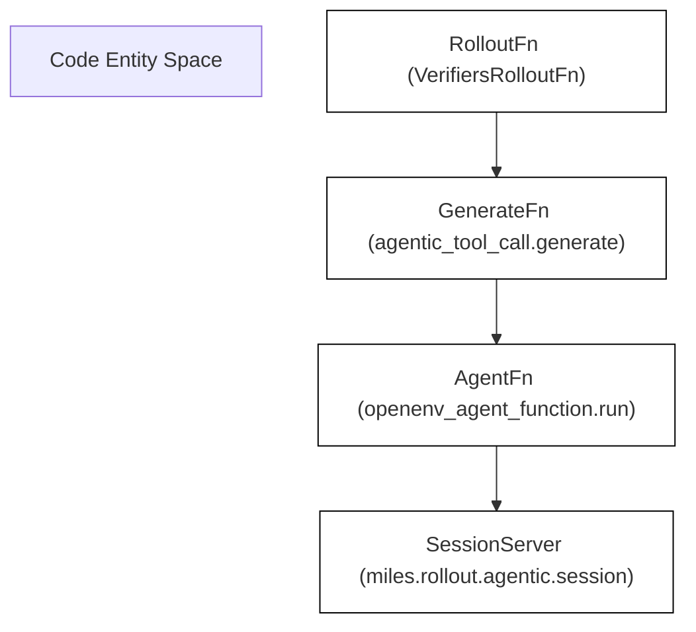
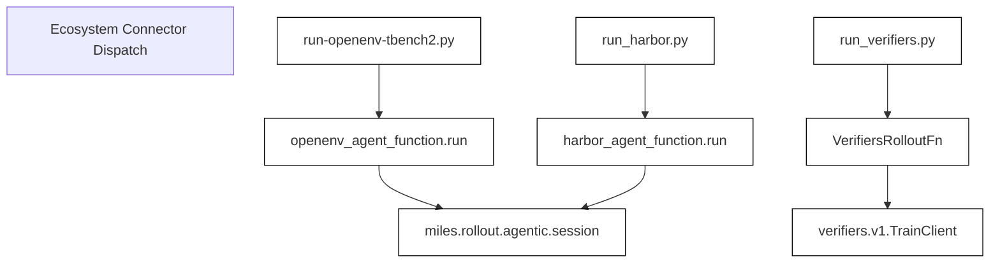

<!-- source: DeepWiki mcp.deepwiki.com · repo radixark/miles · page 12.4 Environments and Sandbox Providers · fetched 2026-10-21 -->

# Environments and Sandbox Providers

<details>
<summary>Relevant source files</summary>

The following files were used as context for generating this wiki page:

- [docs/examples/index.md](docs/examples/index.md)
- [docs/examples/infra-features/hot-restart.md](docs/examples/infra-features/hot-restart.md)
- [docs/examples/ppo.md](docs/examples/ppo.md)
- [docs/user-guide/environments.md](docs/user-guide/environments.md)
- [docs/user-guide/harbor.md](docs/user-guide/harbor.md)
- [docs/user-guide/openenv.md](docs/user-guide/openenv.md)
- [examples/README.md](examples/README.md)
- [examples/experimental/agentenv/README.md](examples/experimental/agentenv/README.md)
- [examples/experimental/openenv/README.md](examples/experimental/openenv/README.md)
- [examples/experimental/openenv/eval_tbench2_via_api.py](examples/experimental/openenv/eval_tbench2_via_api.py)
- [examples/experimental/openenv/glm52_tbench2/README.md](examples/experimental/openenv/glm52_tbench2/README.md)
- [examples/experimental/openenv/glm52_tbench2/launch_16node_slurm.sh](examples/experimental/openenv/glm52_tbench2/launch_16node_slurm.sh)
- [examples/experimental/openenv/glm52_tbench2/run_glm5_2_744b_a40b_daytona.py](examples/experimental/openenv/glm52_tbench2/run_glm5_2_744b_a40b_daytona.py)
- [examples/experimental/openenv/openenv_agent_function.py](examples/experimental/openenv/openenv_agent_function.py)
- [examples/experimental/openenv/openenv_daytona_agent_function.py](examples/experimental/openenv/openenv_daytona_agent_function.py)
- [examples/experimental/openenv/openenv_e2b_agent_function.py](examples/experimental/openenv/openenv_e2b_agent_function.py)
- [examples/experimental/openenv/openenv_launch_common.py](examples/experimental/openenv/openenv_launch_common.py)
- [examples/experimental/openenv/openenv_modal_agent_function.py](examples/experimental/openenv/openenv_modal_agent_function.py)
- [examples/experimental/openenv/openenv_sandbox_common.py](examples/experimental/openenv/openenv_sandbox_common.py)
- [examples/experimental/openenv/run-openenv-tbench2.py](examples/experimental/openenv/run-openenv-tbench2.py)
- [examples/experimental/openenv/scan_golden.py](examples/experimental/openenv/scan_golden.py)
- [examples/experimental/openenv/tb2_sandbox_daytona.py](examples/experimental/openenv/tb2_sandbox_daytona.py)
- [examples/experimental/openenv/tb2_sandbox_e2b.py](examples/experimental/openenv/tb2_sandbox_e2b.py)
- [examples/experimental/openenv/tb2_sandbox_recipe.py](examples/experimental/openenv/tb2_sandbox_recipe.py)
- [examples/experimental/verifiers/requirements.txt](examples/experimental/verifiers/requirements.txt)
- [examples/experimental/verifiers/verifiers_rollout.py](examples/experimental/verifiers/verifiers_rollout.py)
- [examples/infra_features/hot_restart/README.md](examples/infra_features/hot_restart/README.md)
- [examples/infra_features/hot_restart/__init__.py](examples/infra_features/hot_restart/__init__.py)
- [examples/infra_features/hot_restart/run_qwen3_0_6b_hot_restart.py](examples/infra_features/hot_restart/run_qwen3_0_6b_hot_restart.py)
- [examples/ppo/README.md](examples/ppo/README.md)
- [examples/ppo/run_qwen3_4b_ppo.py](examples/ppo/run_qwen3_4b_ppo.py)
- [miles/backends/megatron_utils/ft/indep_dp.py](miles/backends/megatron_utils/ft/indep_dp.py)
- [miles/rollout/filter_hub/base_types.py](miles/rollout/filter_hub/base_types.py)
- [tests/fast/examples/experimental/openenv/test_openenv_agent_function.py](tests/fast/examples/experimental/openenv/test_openenv_agent_function.py)
- [tests/fast/examples/experimental/openenv/test_openenv_daytona_agent_function.py](tests/fast/examples/experimental/openenv/test_openenv_daytona_agent_function.py)
- [tests/fast/examples/experimental/verifiers/__init__.py](tests/fast/examples/experimental/verifiers/__init__.py)
- [tests/fast/examples/experimental/verifiers/test_run.py](tests/fast/examples/experimental/verifiers/test_run.py)
- [tests/fast/examples/experimental/verifiers/test_verifiers_rollout.py](tests/fast/examples/experimental/verifiers/test_verifiers_rollout.py)
- [tests/fast/examples/experimental/verifiers/test_verifiers_runtime.py](tests/fast/examples/experimental/verifiers/test_verifiers_runtime.py)
- [tests/fast/rollout/filter_hub/__init__.py](tests/fast/rollout/filter_hub/__init__.py)
- [tests/fast/rollout/filter_hub/test_base_types.py](tests/fast/rollout/filter_hub/test_base_types.py)
- [tests/fast/rollout/inference_rollout/integration/test_dynamic_filter.py](tests/fast/rollout/inference_rollout/integration/test_dynamic_filter.py)
- [tests/fast/rollout/test_fully_async_data_buffer.py](tests/fast/rollout/test_fully_async_data_buffer.py)

</details>


## Purpose and Scope

This document details Miles' integration architecture for external reinforcement learning environments (such as OpenEnv, Harbor, NeMo Gym, tau-bench, HUD, and Verifiers) and cloud sandbox providers (Daytona, E2B/AgentENV, Modal, and self-hosted Docker environments). It explains the three-tiered rollout plugin system, container materialization logic, credential resolution, and the structure of the `examples/` directory layout.

---

## 1. Architectural Role and Integration Layers

Miles owns the training infrastructure for environment-based reinforcement learning—including batch orchestration, lossless token-in/token-out (TITO) recording, reward hooks, dynamic sampling filters, and distributed weight updates [docs/user-guide/environments.md:7-9](). Miles remains agnostic to where environments are hosted, supporting zero environments (single-turn RLVR), custom self-wired environments, and external ecosystem connectors [docs/user-guide/environments.md:10-20]().

The rollout stack consists of three nested plug-in layers. Each outer layer wraps the inner layers, allowing external connectors to hook into specific abstraction boundaries [docs/user-guide/environments.md:38-43]().


*Figure 1: Rollout Stack Code Hierarchy bridging plug-in flags to execution entry points.*

Sources: `docs/user-guide/environments.md:7-68`

### Integration Layer Comparison

| Layer | Plug-Point Flag | Agent–Environment Loop | Trajectory Recording | Reward Pathway | Data Source & Batching |
| :--- | :--- | :---: | :---: | :---: | :---: |
| **Innermost: Agent Function** | `--custom-agent-function-path` [docs/user-guide/environments.md:49]() | ✓ [docs/user-guide/environments.md:50]() | ○ (Miles TITO) [docs/user-guide/environments.md:51]() | ○ (Miles RM) [docs/user-guide/environments.md:52]() | ○ (Miles Dataset) [docs/user-guide/environments.md:53]() |
| **Middle: Generate Function** | `--custom-generate-function-path` [docs/user-guide/environments.md:49]() | ✓ [docs/user-guide/environments.md:50]() | ✓ (Native/Harness) [docs/user-guide/environments.md:51]() | ○ (Miles RM) [docs/user-guide/environments.md:52]() | ○ (Miles Dataset) [docs/user-guide/environments.md:53]() |
| **Outermost: Rollout Function** | `--rollout-function-path` [docs/user-guide/environments.md:49]() | ✓ [docs/user-guide/environments.md:50]() | ✓ (External) [docs/user-guide/environments.md:51]() | ✓ (External) [docs/user-guide/environments.md:52]() | ✓ (External) [docs/user-guide/environments.md:53]() |

Sources: `docs/user-guide/environments.md:7-68`

---

## 2. External Environment Integrations

Connectors plug into one of the three layers described above, enabling specialized agent ecosystems to train directly on Miles' distributed policy backends.

### OpenEnv and Terminal-Bench-2
OpenEnv integrates at the innermost agent function layer (`openenv_agent_function.run`) [docs/user-guide/environments.md:26](). The multi-turn loop executes `reset(task_id)` followed by policy emission of single shell commands inside ```bash blocks, stepping through environment execution, and finishing with `evaluate` [examples/experimental/openenv/openenv_agent_function.py:1-46](). 
- **Session Server Integration:** The policy is accessed via `base_url/v1` through Miles' session server, capturing token IDs, logprobs, and loss masks natively without re-tokenization [examples/experimental/openenv/openenv_agent_function.py:8-10]().
- **Capacity Management:** Finite environment slots are handled via jittered backoff and retry (`_CAPACITY_MAX_WAIT_S`) to serialize surplus requests [examples/experimental/openenv/openenv_agent_function.py:62-75]().

### Harbor
Harbor integrates via the agent function layer, unifying agent orchestration and grading in a single `Trial.run()` call [docs/user-guide/harbor.md:6-16](). Each session passes an OpenAI-compatible URL to Harbor, which runs the task sandbox, executes the agent, and grades the result into sample rewards [docs/user-guide/harbor.md:12-16]().

### Verifiers (Prime Intellect)
Verifiers integrates at the outermost rollout function layer using `VerifiersRolloutFn` [examples/experimental/verifiers/verifiers_rollout.py:1-9](). It delegates grouped episode execution and reward computation entirely to Verifiers' `EnvConfig` and `TrainClient` while Miles manages training, policy updates, and advantage estimation [examples/experimental/verifiers/verifiers_rollout.py:1-139]().

### NeMo Gym, tau-bench, HUD, and Strands Agents
Other experimental ecosystems hook into either the agent function, generate function, or rollout function layers [docs/user-guide/environments.md:21-30](). For example, HUD stitches per-turn token IDs and sampling logprobs returned by SGLang natively [docs/user-guide/environments.md:64-66]().


*Figure 2: Mapping launcher scripts to internal connector functions.*

Sources: `docs/user-guide/environments.md:21-30`, `docs/user-guide/harbor.md:6-16`, `examples/experimental/openenv/openenv_agent_function.py:1-46`, `examples/experimental/verifiers/verifiers_rollout.py:1-139`

---

## 3. Sandbox Providers and Container Materialization

Sandboxes provision task execution containers inside connectors rather than occupying rollout layers [docs/user-guide/environments.md:31-34](). Miles supports multiple providers with unified credential resolution and container lifecycle management.

### Daytona
Daytona materializes per-task sandboxes declaratively per episode straight from `Image` definitions without pre-registered snapshots [examples/experimental/openenv/tb2_sandbox_daytona.py:1-23](). 
- **Build Caching:** The image definition acts as the cache key, avoiding organization-level snapshot quotas [examples/experimental/openenv/tb2_sandbox_daytona.py:19-23]().
- **Keepalive Mechanism:** A background heartbeat thread (`_start_keepalive`) periodically calls `sandbox.refresh_activity` to prevent auto-stopping during long episodes, acting as a dead-man's switch if the creating process terminates [examples/experimental/openenv/tb2_sandbox_daytona.py:73-94]().

### E2B and AgentENV
E2B builds named templates per task from which subsequent episodes warm-start [examples/experimental/openenv/README.md:85-106](). `agentenv` serves as an alias for self-hosted Firecracker microVM clusters implementing the E2B API via `E2B_API_URL` and `E2B_SANDBOX_URL` [examples/experimental/openenv/openenv_launch_common.py:109-118]().

### Modal
Modal expresses task recipes as individual image layers per command, utilizing layer hashes as cache keys [examples/experimental/openenv/README.md:109-129](). Sandbox timeouts are strictly bounded by `OPENENV_MODAL_SANDBOX_TTL_S` [examples/experimental/openenv/README.md:121-125]().

### Shared Docker Environments
Alternatively, a long-lived shared env server can host task containers across episodes using standard Docker daemons without a cloud sandbox platform [examples/experimental/openenv/README.md:130-150]().

Sources: `docs/user-guide/sandbox-providers.md:1-73`, `examples/experimental/openenv/tb2_sandbox_daytona.py:1-161`, `examples/experimental/openenv/README.md:36-150`

---

## 4. The `examples/` Directory Layout

The `examples/` directory contains reference implementations and experimental launch scripts organized by framework and model architecture.

```mermaid
graph TD
    sub-graph-2["Examples Layout Structure"]
    Examples["examples/"] --> OpenEnv["experimental/openenv/"]
    Examples --> Harbor["experimental/harbor/"]
    Examples --> Verifiers["experimental/verifiers/"]
    Examples --> NemoGym["experimental/nemo-gym/"]
    Examples --> SweAgent["swe-agent-harbor-docker/"]
    
    OpenEnv --> OE1["run-openenv-tbench2.py"]
    OpenEnv --> OE2["openenv_agent_function.py"]
    OpenEnv --> OE3["tb2_sandbox_daytona.py"]
    
    Harbor --> H1["run.py"]
    Harbor --> H2["harbor_agent_function.py"]
    
    Verifiers --> V1["run.py"]
    Verifiers --> V2["verifiers_rollout.py"]
    
    style Examples fill:none,stroke:#000,stroke-width:1px
    style OpenEnv fill:none,stroke:#000,stroke-width:1px
    style Harbor fill:none,stroke:#000,stroke-width:1px
    style Verifiers fill:none,stroke:#000,stroke-width:1px
    style NemoGym fill:none,stroke:#000,stroke-width:1px
    style SweAgent fill:none,stroke:#000,stroke-width:1px
    style OE1 fill:none,stroke:#000,stroke-width:1px
    style OE2 fill:none,stroke:#000,stroke-width:1px
    style OE3 fill:none,stroke:#000,stroke-width:1px
    style H1 fill:none,stroke:#000,stroke-width:1px
    style H2 fill:none,stroke:#000,stroke-width:1px
    style V1 fill:none,stroke:#000,stroke-width:1px
    style V2 fill:none,stroke:#000,stroke-width:1px
```


*Figure 3: Organization of experimental environment directories under `examples/`.*

Sources: `examples/README.md:1-69`, `docs/examples/index.md:1-57`

### Key Directories and Files
- `examples/experimental/openenv/`: Contains Terminal-Bench-2 launchers, Daytona/E2B/Modal sandbox bindings (`tb2_sandbox_daytona.py`, `tb2_sandbox_e2b.py`, `tb2_sandbox_modal.py`), and shared helpers (`openenv_launch_common.py`) [examples/experimental/openenv/openenv_launch_common.py:1-10]().
- `examples/experimental/harbor/`: Harbor integration scripts and agent adapters [docs/user-guide/harbor.md:20-26]().
- `examples/experimental/verifiers/`: Verifiers integration configuration and rollout runners [examples/experimental/verifiers/verifiers_rollout.py:1-9]().
- `examples/experimental/nemo-gym/`: NeMo Gym agent functions and prompt processors [docs/user-guide/environments.md:25]().

Sources: `docs/user-guide/environments.md:21-30`, `docs/user-guide/harbor.md:20-26`, `examples/experimental/openenv/openenv_launch_common.py:1-10`, `examples/experimental/openenv/tb2_sandbox_daytona.py:1-30`

---

