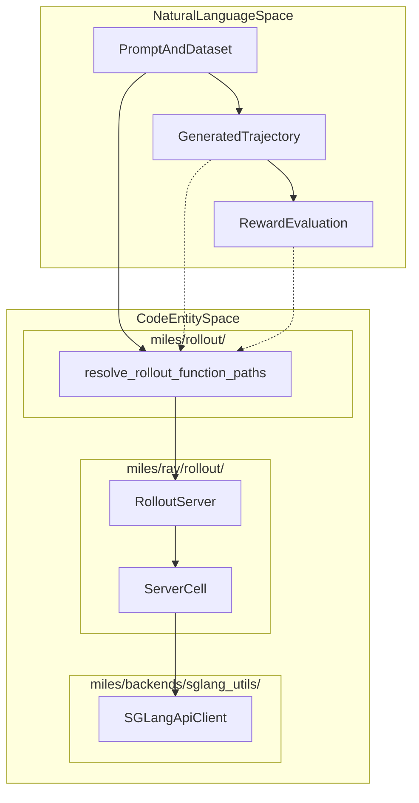
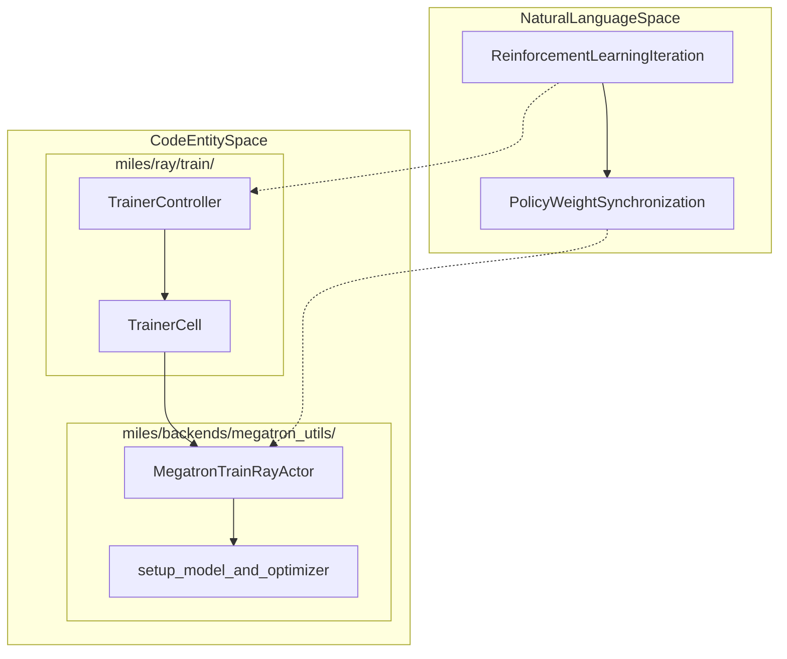

<!-- source: DeepWiki mcp.deepwiki.com · repo radixark/miles · page 13 Glossary · fetched 2026-10-21 -->

# Glossary

Relevant source files

The following files were used as context for generating this wiki page:

- [.gitignore](.gitignore)
- [README.md](README.md)
- [docker/patch/fla_kda_hoist_next_power_of_2.patch](docker/patch/fla_kda_hoist_next_power_of_2.patch)
- [docs/README.md](docs/README.md)
- [docs/advanced/lora.md](docs/advanced/lora.md)
- [docs/assets/images/acknowledgment.png](docs/assets/images/acknowledgment.png)
- [docs/docs.json](docs/docs.json)
- [docs/index.md](docs/index.md)
- [docs/models/glm/glm5-2.md](docs/models/glm/glm5-2.md)
- [docs/models/glm/glm5-3-flash.md](docs/models/glm/glm5-3-flash.md)
- [docs/models/glm/glm5-3.md](docs/models/glm/glm5-3.md)
- [docs/models/glm/glm5.md](docs/models/glm/glm5.md)
- [docs/models/glm/index.md](docs/models/glm/index.md)
- [docs/models/index.md](docs/models/index.md)
- [miles/backends/fsdp_utils/actor.py](miles/backends/fsdp_utils/actor.py)
- [miles/backends/fsdp_utils/arguments.py](miles/backends/fsdp_utils/arguments.py)
- [miles/backends/fsdp_utils/checkpoint.py](miles/backends/fsdp_utils/checkpoint.py)
- [miles/backends/megatron_utils/actor.py](miles/backends/megatron_utils/actor.py)
- [miles/backends/megatron_utils/megatron_to_hf/glm5_next.py](miles/backends/megatron_utils/megatron_to_hf/glm5_next.py)
- [miles/backends/megatron_utils/model.py](miles/backends/megatron_utils/model.py)
- [miles/backends/megatron_utils/optimizer_state_reset.py](miles/backends/megatron_utils/optimizer_state_reset.py)
- [miles/ray/train/cell.py](miles/ray/train/cell.py)
- [miles/ray/train/cell_monitor.py](miles/ray/train/cell_monitor.py)
- [miles/ray/train/cell_state.py](miles/ray/train/cell_state.py)
- [miles/ray/train/group.py](miles/ray/train/group.py)
- [miles/utils/arguments.py](miles/utils/arguments.py)
- [miles/utils/audit_utils/event_analyzer/analyzer.py](miles/utils/audit_utils/event_analyzer/analyzer.py)
- [miles/utils/ft_utils/api_server/models.py](miles/utils/ft_utils/api_server/models.py)
- [miles/utils/workers/naming.py](miles/utils/workers/naming.py)
- [miles/utils/workers/types.py](miles/utils/workers/types.py)
- [tests/fast/backends/megatron_utils/test_model_initialize.py](tests/fast/backends/megatron_utils/test_model_initialize.py)
- [tests/fast/backends/megatron_utils/test_optimizer_state_reset.py](tests/fast/backends/megatron_utils/test_optimizer_state_reset.py)
- [tests/fast/backends/megatron_utils/test_shared_ppo_lifecycle.py](tests/fast/backends/megatron_utils/test_shared_ppo_lifecycle.py)
- [tests/fast/ray/rollout/conftest.py](tests/fast/ray/rollout/conftest.py)
- [tests/fast/ray/train/conftest.py](tests/fast/ray/train/conftest.py)
- [tests/fast/ray/train/dummy_actor.py](tests/fast/ray/train/dummy_actor.py)
- [tests/fast/ray/train/fake_worker_manager.py](tests/fast/ray/train/fake_worker_manager.py)
- [tests/fast/ray/train/test_cell.py](tests/fast/ray/train/test_cell.py)
- [tests/fast/ray/train/test_cell_monitor.py](tests/fast/ray/train/test_cell_monitor.py)
- [tests/fast/ray/train/test_cell_restart.py](tests/fast/ray/train/test_cell_restart.py)
- [tests/fast/ray/train/test_group.py](tests/fast/ray/train/test_group.py)
- [tests/fast/ray/train/test_group_failure_reporting.py](tests/fast/ray/train/test_group_failure_reporting.py)
- [tests/fast/ray/train/test_load_state.py](tests/fast/ray/train/test_load_state.py)
- [tests/fast/ray/train/test_train_external_data.py](tests/fast/ray/train/test_train_external_data.py)
- [tests/fast/ray/train/test_train_return_value.py](tests/fast/ray/train/test_train_return_value.py)
- [tests/fast/utils/api_server/test_models.py](tests/fast/utils/api_server/test_models.py)
- [tests/fast/utils/event_analyzer/test_analyzer.py](tests/fast/utils/event_analyzer/test_analyzer.py)
- [tests/fast/utils/test_arguments.py](tests/fast/utils/test_arguments.py)
- [tests/fast/utils/workers/test_worker_comm_backend.py](tests/fast/utils/workers/test_worker_comm_backend.py)
- [tests/manual/launch_scripts/test_py_launch_scripts.py](tests/manual/launch_scripts/test_py_launch_scripts.py)

## Purpose and Scope
This page defines codebase-specific terms, jargon, abbreviations, and domain concepts used in the Miles framework. It serves as a comprehensive technical reference for developers and onboarding engineers, bridging high-level Reinforcement Learning (RL) abstractions with their concrete implementations and file locations across the Miles codebase.

---

## Core System Concepts

### Rollout
In Miles, a **Rollout** refers to the execution phase where the policy model interacts with an environment or a dataset of prompts to generate response trajectories, compute log-probabilities, and collect rewards.
*   **Implementation**: Coordinated via inference controllers and execution pipelines [miles/utils/arguments.py:58-70]().
*   **Data Flow**: Prompts are sampled from datasets, routed through SGLang server cells, and packaged into sample structures for downstream training consumption.

Sources: `[miles/utils/arguments.py:58-70]()`

### Actor (Training Actor)
The **Actor** represents the distributed training participant responsible for computing policy and value updates using algorithms like PPO, GRPO, or GSPO.
*   **Implementation**: Implemented via `TrainRayActor` and specialized backends such as `MegatronTrainRayActor` [miles/backends/megatron_utils/actor.py:105-135]() and `FSDPTrainRayActor` [miles/backends/fsdp_utils/actor.py:36-65]().
*   **Role**: Consumes rollout batches, computes objectives, runs backpropagation, and synchronizes updated weights to rollout inference engines.

Sources: `[miles/backends/megatron_utils/actor.py:105-135]()`, `[miles/backends/fsdp_utils/actor.py:36-65]()`

### Train-Inference Alignment
A primary architectural pillar of Miles is resolving train-inference mismatch—discrepancies between inference generation engines (e.g., SGLang) and training backends (e.g., Megatron-LM) that can trigger training collapse.
*   **Solution Approach**: Combines deterministic kernel configurations, routing replays, and precise weight synchronization strategies.

Sources: `[miles/backends/megatron_utils/actor.py:105-135]()`

---

## Codebase-Specific Jargon & Abbreviations

| Term | Definition | Code Pointer |
| :--- | :--- | :--- |
| **R3** | **Rollout Routing Replay**. Records Mixture-of-Experts (MoE) expert routing decisions during inference and replays them during training to ensure exact expert alignment. | `[miles/backends/megatron_utils/actor.py:126-129]()` |
| **TITO** | **Token-In-Token-Out**. A specialized tokenizer and session wrapper used for multi-turn dialogues and tool-use trajectories to maintain raw token boundaries across turns without detokenization round-trips. | `[miles/utils/arguments.py:24-24]()` |
| **Indep DP** | **Independent Data Parallelism**. A fault-tolerance and scale-out training mode where training replicas operate with isolated data parallel groups and independent checkpoints. | `[miles/backends/megatron_utils/actor.py:116-118]()`, `[miles/ray/train/cell.py:62-88]()` |
| **Cell / ServerCell** | A foundational deployment unit in Ray orchestration representing a localized group of worker processes or inference engine shards. | `[miles/ray/train/cell.py:29-60]()`, `[miles/ray/train/group.py:52-95]()` |
| **Quorum** | A group of replicas or cells required to achieve consensus or fault-tolerant operation during independent DP or distributed checkpoint recovery. | `[miles/backends/fsdp_utils/actor.py:54-56]()` |
| **Colocate** | A deployment mode where training actors and inference engines share the same physical GPUs, swapping weights via zero-copy tensor buffers to minimize latency. | `[miles/utils/arguments.py:93-93]()` |
| **Partial Rollout** | A training optimization where unfinished or intermediate rollout trajectories are recycled into the training loop under specific mask configurations. | `[miles/utils/arguments.py:79-83]()` |
| **TIS / MIS** | **Truncated Importance Sampling / Modified Importance Sampling**. Algorithms used to correct off-policy bias when training on stale or asynchronous rollouts. | `[miles/utils/arguments.py:31-31]()` |
| **THD / BSHD** | Tensor layout formats for packed sequences (`[Total_Tokens, Hidden_Dim]` vs `[Batch, Sequence_Height, Hidden_Dim]`) utilized across Megatron sequence packing adaptations. | `[miles/backends/fsdp_utils/adaptations/packing.py:25-25]()` |
| **CP** | **Context Parallelism**. Sharding long sequence dimensions across multiple GPUs to handle extended context windows. | `[miles/backends/fsdp_utils/actor.py:64-64]()` |
| **TP / PP / EP** | Tensor, Pipeline, and Expert Parallelism (standard Megatron-LM parallelism axes). | `[miles/backends/megatron_utils/model.py:14-18]()` |

Sources: `[miles/utils/arguments.py:24-93]()`, `[miles/backends/megatron_utils/actor.py:116-129]()`, `[miles/backends/fsdp_utils/actor.py:54-64]`, `[miles/ray/train/cell.py:29-88]()`, `[miles/ray/train/group.py:52-95]()`

---

## Key Data Structures & Component Stack

### Sample and RolloutBatch
*   **`Sample`**: The atomic unit of data representing a single prompt-response trajectory with associated log-probabilities, rewards, and metadata.
*   **`RolloutBatch`**: An aggregated container of multiple `Sample` objects structured into batched tensors for objective loss computation.

Sources: `[tests/fast/ray/rollout/conftest.py:185-188]()`

### TrainerCell and TrainerController
*   **`TrainerCell`**: Manages worker handles, initialization state machines, and execution loops for a distinct training cell (`[miles/ray/train/cell.py:29-60]`).
*   **`TrainerController`**: Orchestrates multi-cell training pools, health monitoring, and scaling events (`[miles/ray/train/group.py:52-95]`).

Sources: `[miles/ray/train/cell.py:29-60]()`, `[miles/ray/train/group.py:52-95]()`

---

## Architectural Mapping Diagrams

### Natural Language Space to Code Entity Space: Rollout & Inference Stack
The following diagram maps high-level rollout concepts to their concrete classes and execution modules in the codebase.

*Sources: `[miles/utils/arguments.py:58-70]()`, `[miles/ray/train/cell.py:29-60]()`*

### Natural Language Space to Code Entity Space: Training Orchestration Stack
The following diagram connects training orchestration concepts to their Ray actors and controller classes.

*Sources: `[miles/ray/train/group.py:52-95]()`, `[miles/ray/train/cell.py:29-60]()`, `[miles/backends/megatron_utils/actor.py:105-135]()`, `[miles/backends/megatron_utils/model.py:133-150]()`*

---
**Sources:**
*   `[miles/utils/arguments.py:24-93]()`
*   `[miles/backends/megatron_utils/actor.py:105-135]()`
*   `[miles/backends/fsdp_utils/actor.py:36-65]()`
*   `[miles/ray/train/group.py:52-95]()`
*   `[miles/ray/train/cell.py:29-88]()`
*   `[miles/backends/megatron_utils/model.py:133-150]()`