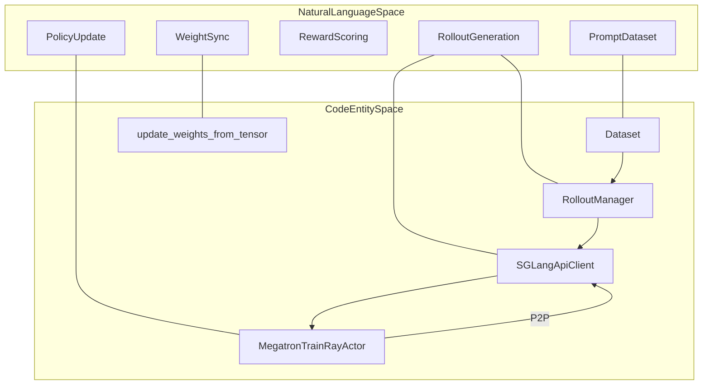
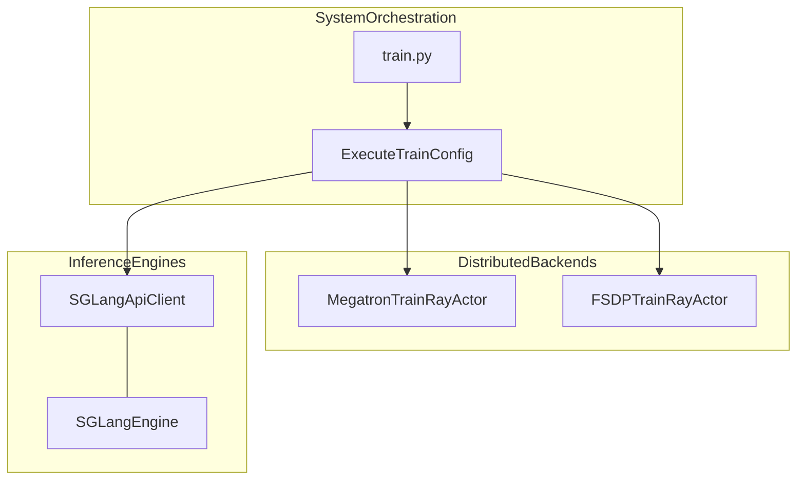

<!-- source: DeepWiki mcp.deepwiki.com · repo radixark/miles · page 2 Getting Started · fetched 2026-10-21 -->

# Getting Started

Relevant source files

The following files were used as context for generating this wiki page:

- [docs/advanced/disaggregated-rollout.md](docs/advanced/disaggregated-rollout.md)
- [docs/advanced/disk-offload.md](docs/advanced/disk-offload.md)
- [docs/advanced/pd-disaggregation.md](docs/advanced/pd-disaggregation.md)
- [docs/getting-started/quick-start.md](docs/getting-started/quick-start.md)
- [docs/models/deepseek/deepseek-v4-1-flash.md](docs/models/deepseek/deepseek-v4-1-flash.md)
- [docs/models/deepseek/deepseek.md](docs/models/deepseek/deepseek.md)
- [docs/models/deepseek/index.md](docs/models/deepseek/index.md)
- [docs/user-guide/training-backend.md](docs/user-guide/training-backend.md)
- [examples/infra_features/fully_async/run_qwen3_30b_a3b_fully_async.py](examples/infra_features/fully_async/run_qwen3_30b_a3b_fully_async.py)
- [examples/infra_features/random_async/run_random_async_3node.py](examples/infra_features/random_async/run_random_async_3node.py)
- [examples/swe-agent-harbor-docker/run-glm47-flash-agentic-async.py](examples/swe-agent-harbor-docker/run-glm47-flash-agentic-async.py)
- [examples/swe-agent-harbor-docker/run.py](examples/swe-agent-harbor-docker/run.py)
- [miles/backends/sglang_utils/sglang_api_client.py](miles/backends/sglang_utils/sglang_api_client.py)
- [miles_plugins/optimizers/__init__.py](miles_plugins/optimizers/__init__.py)
- [miles_plugins/optimizers/nvme_stream.py](miles_plugins/optimizers/nvme_stream.py)
- [tests/fast-gpu/test_nvme_optimizer_streamed_grads.py](tests/fast-gpu/test_nvme_optimizer_streamed_grads.py)
- [tests/fast/backends/megatron_utils/test_lora_model_branches.py](tests/fast/backends/megatron_utils/test_lora_model_branches.py)
- [tests/fast/backends/sglang_utils/test_sglang_api_client.py](tests/fast/backends/sglang_utils/test_sglang_api_client.py)
- [tests/fast/examples/test_example_launcher_flags.py](tests/fast/examples/test_example_launcher_flags.py)
- [tests/fast/optimizers/__init__.py](tests/fast/optimizers/__init__.py)
- [tests/fast/optimizers/test_nvme_stream.py](tests/fast/optimizers/test_nvme_stream.py)

This page provides a high-level overview of how to get started with Miles, covering prerequisites, the basic training workflow, installation summaries, and quick-start entry points. 

**Child Pages**: 
- For detailed installation instructions including Docker setup and dependency management, see [Installation and Docker Setup](#2.1). 
- For a step-by-step tutorial with a working example using a small model, see [Quick Start Tutorial](#2.2). 
- For comprehensive configuration options and the argument parsing system, see [Configuration System](#2.3).

---

## Purpose and Scope

This parent page guides you through the high-level concepts required to begin working with Miles:
- System prerequisites and hardware requirements
- The high-level training workflow bridging natural language concepts to code entities
- Quick installation options via Docker or from source
- References to detailed child guides for setup, tutorials, and configuration

---

## Prerequisites and System Requirements

Miles is engineered for GPU-accelerated post-training across large-scale distributed clusters [docs/getting-started/quick-start.md:5-9]().

| Component | Requirement | Recommended |
|-----------|-------------|-------------|
| **GPU** | NVIDIA (H100, H200, B-series) or AMD | H100 or B-series for FP8/FA3 support [docs/getting-started/quick-start.md:5-9]() |
| **VRAM** | 40GB+ per GPU | 80GB+ per GPU |
| **Network** | High-bandwidth (InfiniBand, RoCEv2) | 200Gbps+ per node for multi-node |
| **Storage** | 500GB+ free disk space | NVMe SSD for fast checkpointing [docs/getting-started/quick-start.md:8-9]() |

- **Operating System**: Linux (Ubuntu 20.04+ recommended)
- **Docker**: Required with GPU access for the recommended installation path [docs/getting-started/quick-start.md:9-17]()

Sources: [docs/getting-started/quick-start.md:5-20]()

---

## High-Level Training Workflow

Miles implements an on-policy reinforcement learning workflow alternating between rollout generation and policy training [docs/getting-started/quick-start.md:134-142](). 

### Training Loop Code Mapping

Title: Training Loop Natural Language to Code Mapping

Sources: [docs/getting-started/quick-start.md:117-142](), [miles/backends/sglang_utils/sglang_api_client.py:112-137]()

---

## Installation Overview

The recommended installation path utilizes Docker images containing patched versions of SGLang and Megatron-LM [docs/getting-started/quick-start.md:34-47](). 

For full instructions covering container execution, source builds, and verification checks, see [Installation and Docker Setup](#2.1).

Sources: [docs/getting-started/quick-start.md:34-53]()

---

## Quick Start Overview

A minimal training run can be executed using dense models such as Qwen3-4B via provided launcher scripts [docs/getting-started/quick-start.md:24-93](). 

For a complete walk-through including dataset downloads, Megatron weight conversion, and monitoring metrics, see [Quick Start Tutorial](#2.2).

Sources: [docs/getting-started/quick-start.md:1-124]()

---

## Configuration System Overview

Miles provides a comprehensive argument parsing system via `arguments.py`, organizing flags into distinct functional categories (checkpointing, rollout, optimization, and parallelisms) [docs/user-guide/training-backend.md:79-90]().

For details on parameter groups and tuning options, see [Configuration System](#2.3).

Sources: [docs/user-guide/training-backend.md:79-90]()

---

## System Architecture Mapping

Title: System Architecture and Orchestration Mapping

Sources: [docs/user-guide/training-backend.md:5-14](), [miles/backends/sglang_utils/sglang_api_client.py:59-90]()

---

## Next Steps

1. **[Installation and Docker Setup](#2.1)**: Install dependencies and configure environment images.
2. **[Quick Start Tutorial](#2.2)**: Run your first training job.
3. **[Configuration System](#2.3)**: Explore configuration options and argument groups.

Sources: [docs/getting-started/quick-start.md:1-124](), [docs/user-guide/training-backend.md:1-38]()

---

