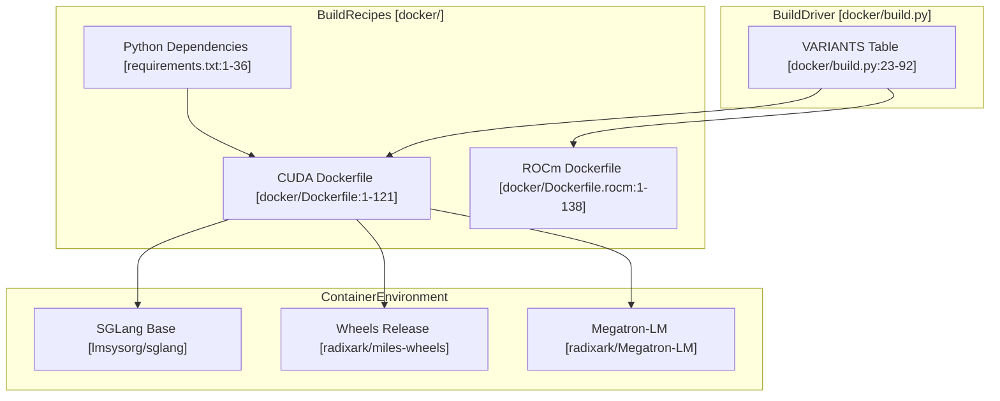
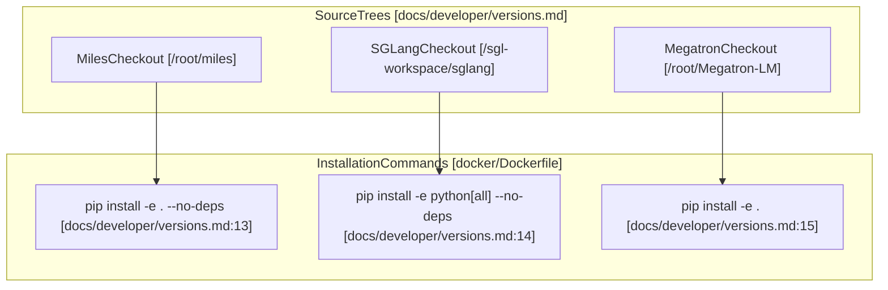

<!-- source: DeepWiki mcp.deepwiki.com · repo radixark/miles · page 2.1 Installation and Docker Setup · fetched 2026-10-21 -->

# Installation and Docker Setup

<details>
<summary>Relevant source files</summary>

The following files were used as context for generating this wiki page:

- [.github/workflows/docker-build.yml](.github/workflows/docker-build.yml)
- [docker/Dockerfile](docker/Dockerfile)
- [docker/Dockerfile.rocm](docker/Dockerfile.rocm)
- [docker/amd/prebuild_aiter_jit.py](docker/amd/prebuild_aiter_jit.py)
- [docker/build.py](docker/build.py)
- [docs/developer/ci/02-docker-build.md](docs/developer/ci/02-docker-build.md)
- [docs/developer/versions.md](docs/developer/versions.md)
- [docs/getting-started/installation.md](docs/getting-started/installation.md)
- [docs/hardware-platforms/amd-gpus.md](docs/hardware-platforms/amd-gpus.md)
- [examples/experimental/openenv/tb2_sandbox_modal.py](examples/experimental/openenv/tb2_sandbox_modal.py)
- [miles/rollout/agentic/credentials.py](miles/rollout/agentic/credentials.py)
- [requirements.txt](requirements.txt)
- [scripts/amd/run_qwen3_30b_a3b.py](scripts/amd/run_qwen3_30b_a3b.py)
- [scripts/amd/run_qwen3_4b.py](scripts/amd/run_qwen3_4b.py)
- [setup.py](setup.py)
- [tests/fast/examples/experimental/openenv/test_openenv_modal_agent_function.py](tests/fast/examples/experimental/openenv/test_openenv_modal_agent_function.py)
- [tests/fast/examples/experimental/openenv/test_tb2_sandbox_modal.py](tests/fast/examples/experimental/openenv/test_tb2_sandbox_modal.py)
- [tests/fast/rollout/agentic/test_credentials.py](tests/fast/rollout/agentic/test_credentials.py)
- [tests/fast/test_docker_image_inputs.py](tests/fast/test_docker_image_inputs.py)
- [tests/test_fsdp_import.py](tests/test_fsdp_import.py)

</details>


This page explains how to install Miles via Docker or from source, including the setup of patched SGLang and Megatron-LM dependencies. Miles is designed for high-performance RL post-training and requires specific versions of its dependencies to ensure train-inference alignment.

Sources: [docs/getting-started/installation.md:1-7]()

## Docker Build Architecture and Variants

Miles uses a multi-stage Docker build process managed via `docker/build.py` [docker/build.py:3-10]() and `docker/Dockerfile` [docker/Dockerfile:1-13](). The build system integrates a complex stack of dependencies, including custom forks of SGLang and Megatron-LM, prebuilt wheels, and hardware-specific runtime components.

### Build Variants
The framework defines several standard build variants in `docker/build.py` [docker/build.py:23-92]():
- `cu13`: Multi-arch (`linux/amd64`, `linux/arm64`) CUDA 13 base image (`radixark/miles`) [docker/build.py:24-29]().
- `cu13-x86` / `cu13-aarch64`: Single-architecture builds for CUDA 13 [docker/build.py:30-41]().
- `rubin`: Vera Rubin (aarch64/SM107) build variant using `docker/Dockerfile.rubin` [docker/build.py:42-48]().
- `rocm724-mi35x`, `rocm10-mi35x`, `rocm10-mi30x`: AMD ROCm variants using `docker/Dockerfile.rocm` [docker/Dockerfile.rocm:4-15](), [docker/build.py:49-91]().

### Dependency Graph and Code Mapping

The following diagram bridges system architecture descriptions to the underlying build configuration files and directories.



Sources: [docker/build.py:23-92](), [docker/Dockerfile:1-121](), [docker/Dockerfile.rocm:1-138](), [requirements.txt:1-35]()

---

## The Three Dependency Trees and Patched Dependencies

A Miles execution environment operates across three active Python source trees on a single `PYTHONPATH`, as detailed in `docs/developer/versions.md` [docs/developer/versions.md:5-16](). Because Miles relies on specialized kernel features (such as bit-wise identical log-probability matching and MoE routing replay), stock releases of upstream dependencies are insufficient.

| Tree | Repository / Branch | In-Container Path | Purpose |
|---|---|---|---|
| **Miles** | `radixark/miles` (this repo) | `/root/miles` | Core RL framework, orchestration, actors, and collectors [docs/developer/versions.md:13]() |
| **SGLang** | [`sgl-project/sglang`](https://github.com/sgl-project/sglang) (`sglang-miles`) | `/sgl-workspace/sglang` | High-throughput inference engine, router, and KV cache manager [docs/developer/versions.md:14]() |
| **Megatron-LM** | [`radixark/Megatron-LM`](https://github.com/radixark/Megatron-LM) (`miles-main`) | `/root/Megatron-LM` | Distributed training backend with 4D parallelism [docs/developer/versions.md:15]() |

### Dependency Integration and Tree Layout

The following diagram maps the logical dependency hierarchy to the concrete directory layout and installation commands inside the container image.



Sources: [docs/developer/versions.md:5-16](), [docker/Dockerfile:1-121]()

---

## Installation Procedures

### 1. Using Pre-built Docker Images
The standard deployment method utilizes pre-built Docker images from Docker Hub (`radixark/miles`) [docs/developer/versions.md:84-85]() or ROCm dev registries [docs/hardware-platforms/amd-gpus.md:12-20](). 

```bash
# Pull the latest development container image (NVIDIA)
docker pull radixark/miles:latest

# Launch container with GPU access and shared memory configuration for Ray
docker run --rm \
  --gpus all --ipc=host --shm-size=32g \
  --ulimit memlock=-1 --ulimit stack=67108864 \
  --network=host \
  -it radixark/miles:latest /bin/bash
```

Sources: [docs/getting-started/installation.md:8-43](), [docs/developer/versions.md:84-96]()

### 2. Building from Source via Build Script
To build custom images locally with modified pins or local source trees, invoke `docker/build.py` [docker/build.py:3-10]():

```bash
# Build multi-arch CUDA 13 image
python docker/build.py --variant cu13 --image-tag dev --dry-run

# Build single-arch CUDA 13 x86 image with a custom tag
python docker/build.py --variant cu13-x86 --image-tag custom --custom-tag my-experiment --push
```

Sources: [docker/build.py:3-10](), [docs/developer/versions.md:100-108]()

### 3. Manual Source Installation
For bare-metal or non-containerized environments, install the core requirements and package dependencies directly:

1. **Clone and Install Dependencies**:
   ```bash
   git clone https://github.com/radixark/miles.git
   cd miles
   pip install -r requirements.txt
   pip install -e . --no-deps
   ```
2. **Patched Dependencies Warning**: Installing stock SGLang or Megatron-LM at the wrong commit causes alignment issues. Use Docker or check out the exact branches (`sglang-miles` and `miles-main`) [docs/getting-started/installation.md:53-69]().

Sources: [docs/getting-started/installation.md:53-69](), [requirements.txt:1-35](), [setup.py:40-48]()

---

## Platform-Specific Setup

### NVIDIA Hopper and Blackwell
For Hopper (`sm_90a`) and Blackwell architectures, the Docker build fetches prebuilt wheels (`radixark/miles-wheels`) containing optimized kernels such as FlashAttention-3 (`flash_attn_3`), Flash-MLA, and Transformer Engine [docker/Dockerfile:28-83](). Transformer Engine installation is verified automatically during image assembly.

### AMD ROCm (MI350 / gfx950)
AMD ROCm deployments rely on `docker/Dockerfile.rocm` [docker/Dockerfile.rocm:1-138](), utilizing specialized ROCm base images (`rocm/sgl-dev`) and the `XinyuJiangCMU/miles-wheels-rocm` repository for prebuilt components like Apex and Transformer Engine [docker/Dockerfile.rocm:17-47]().

Sources: [docker/Dockerfile:28-83](), [docker/Dockerfile.rocm:1-138](), [docs/hardware-platforms/amd-gpus.md:1-48]()

---

