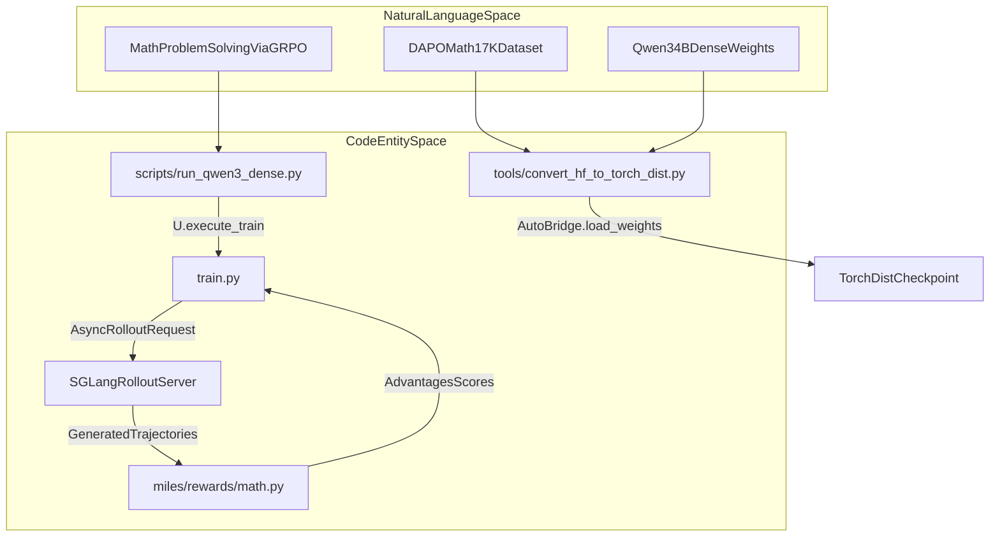
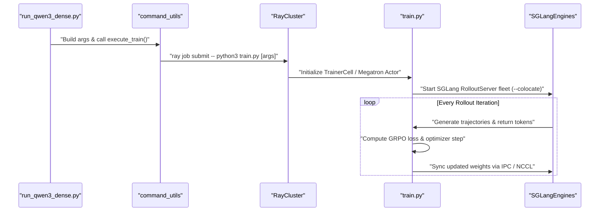

<!-- source: DeepWiki mcp.deepwiki.com · repo radixark/miles · page 2.2 Quick Start Tutorial · fetched 2026-10-21 -->

# Quick Start Tutorial

<details>
<summary>Relevant source files</summary>

The following files were used as context for generating this wiki page:

- [docs/advanced/disaggregated-rollout.md](docs/advanced/disaggregated-rollout.md)
- [docs/advanced/disk-offload.md](docs/advanced/disk-offload.md)
- [docs/advanced/pd-disaggregation.md](docs/advanced/pd-disaggregation.md)
- [docs/getting-started/quick-start.md](docs/getting-started/quick-start.md)
- [docs/models/deepseek/deepseek-v4-1-flash.md](docs/models/deepseek/deepseek-v4-1-flash.md)
- [docs/models/deepseek/deepseek.md](docs/models/deepseek/deepseek.md)
- [docs/models/deepseek/index.md](docs/models/deepseek/index.md)
- [docs/user-guide/training-backend.md](docs/user-guide/training-backend.md)
- [examples/infra_features/fully_async/run_qwen3_30b_a3b_fully_async.py](examples/infra_features/fully_async/run_qwen3_30b_a3b_fully_async.py)
- [examples/infra_features/random_async/run_random_async_3node.py](examples/infra_features/random_async/run_random_async_3node.py)
- [examples/swe-agent-harbor-docker/run-glm47-flash-agentic-async.py](examples/swe-agent-harbor-docker/run-glm47-flash-agentic-async.py)
- [examples/swe-agent-harbor-docker/run.py](examples/swe-agent-harbor-docker/run.py)
- [miles/backends/sglang_utils/sglang_api_client.py](miles/backends/sglang_utils/sglang_api_client.py)
- [miles_plugins/optimizers/__init__.py](miles_plugins/optimizers/__init__.py)
- [miles_plugins/optimizers/nvme_stream.py](miles_plugins/optimizers/nvme_stream.py)
- [tests/e2e/common_dirs.py](tests/e2e/common_dirs.py)
- [tests/e2e/long/test_qwen2.5_0.5B_gsm8k.py](tests/e2e/long/test_qwen2.5_0.5B_gsm8k.py)
- [tests/e2e/long/test_qwen2.5_0.5B_gsm8k_async.py](tests/e2e/long/test_qwen2.5_0.5B_gsm8k_async.py)
- [tests/e2e/lora/test_lora_qwen2.5_0.5B.py](tests/e2e/lora/test_lora_qwen2.5_0.5B.py)
- [tests/e2e/megatron/test_mimo_7B_mtp_only_grad.py](tests/e2e/megatron/test_mimo_7B_mtp_only_grad.py)
- [tests/e2e/megatron/test_qwen3_30B_A3B/test_baseline.py](tests/e2e/megatron/test_qwen3_30B_A3B/test_baseline.py)
- [tests/e2e/precision/test_qwen3_5_cp_correctness.py](tests/e2e/precision/test_qwen3_5_cp_correctness.py)
- [tests/e2e/sglang_config/test_sglang_config.py](tests/e2e/sglang_config/test_sglang_config.py)
- [tests/e2e/sglang_config/test_sglang_config_mixed_offload.py](tests/e2e/sglang_config/test_sglang_config_mixed_offload.py)
- [tests/e2e/sglang_config/test_sglang_config_mixed_offload_ft.py](tests/e2e/sglang_config/test_sglang_config_mixed_offload_ft.py)
- [tests/e2e/short/test_qwen2.5_0.5B_gsm8k_async_short.py](tests/e2e/short/test_qwen2.5_0.5B_gsm8k_async_short.py)
- [tests/e2e/short/test_qwen2.5_0.5B_gsm8k_short.py](tests/e2e/short/test_qwen2.5_0.5B_gsm8k_short.py)
- [tests/e2e/short/test_qwen3_0.6B_fsdp_colocated_2xGPU.py](tests/e2e/short/test_qwen3_0.6B_fsdp_colocated_2xGPU.py)
- [tests/fast-gpu/test_nvme_optimizer_streamed_grads.py](tests/fast-gpu/test_nvme_optimizer_streamed_grads.py)
- [tests/fast/backends/megatron_utils/test_lora_model_branches.py](tests/fast/backends/megatron_utils/test_lora_model_branches.py)
- [tests/fast/backends/sglang_utils/test_sglang_api_client.py](tests/fast/backends/sglang_utils/test_sglang_api_client.py)
- [tests/fast/e2e/test_common_dirs.py](tests/fast/e2e/test_common_dirs.py)
- [tests/fast/examples/test_example_launcher_flags.py](tests/fast/examples/test_example_launcher_flags.py)
- [tests/fast/optimizers/__init__.py](tests/fast/optimizers/__init__.py)
- [tests/fast/optimizers/test_nvme_stream.py](tests/fast/optimizers/test_nvme_stream.py)

</details>


This page walks through a minimal training example using a small model (`Qwen3-4B`), explaining the basic end-to-end workflow, data flow, key launcher scripts, and core configuration concepts in Miles [docs/getting-started/quick-start.md:1-25]().

---

## Overview

Miles pairs [SGLang](https://github.com/sgl-project/sglang) for high-throughput rollout generation with [Megatron-LM](https://github.com/NVIDIA/Megatron-LM) for distributed training [docs/getting-started/quick-start.md:117-124](). The quick start workflow runs a Group Relative Policy Optimization (GRPO) training loop on a math problem dataset using a dense model [docs/getting-started/quick-start.md:22-25]().

Sources: [docs/getting-started/quick-start.md:1-28](), [docs/getting-started/quick-start.md:117-124]()

---

## Prerequisites and Environment Setup

Before launching a training job, verify that your hardware and container environment meet the requirements [docs/getting-started/quick-start.md:5-20]():
- **Hardware**: A node with 8 GPUs (NVIDIA H100, H200, or B-series) with NVLink [docs/getting-started/quick-start.md:7]().
- **Storage**: At least 500 GB of free disk space for models, datasets, and checkpoints [docs/getting-started/quick-start.md:8]().
- **Software**: Docker with NVIDIA Container Toolkit enabled [docs/getting-started/quick-start.md:9]().

Verify the environment with pre-flight checks:
```bash
nvidia-smi -L
docker run --rm --gpus all ubuntu nvidia-smi
df -h $(docker info -f '{{.DockerRootDir}}')
```
Sources: [docs/getting-started/quick-start.md:11-20]()

---

## Architecture & Data Flow

The training loop alternates between generation (SGLang rollout engines) and policy optimization (Megatron actor trainer), synchronizing weights in-loop [docs/getting-started/quick-start.md:117-142]().

Title: Miles Quick Start Natural Language to Code Entity Mapping

Sources: [docs/getting-started/quick-start.md:117-152](), [tools/convert_hf_to_torch_dist.py:12-48]()

---

## Step 1: Start the Container

Pull and launch the official Miles container image with the required IPC, memory, and host networking flags [docs/getting-started/quick-start.md:31-43]():

```bash
docker pull radixark/miles:latest
docker run --rm \
  --gpus all \
  --ipc=host \
  --shm-size=32g \
  --ulimit memlock=-1 \
  --ulimit stack=67108864 \
  --network=host \
  -it radixark/miles:latest /bin/bash
```

Inside the container, ensure your editable installation of Miles and Megatron-LM paths are synchronized [docs/getting-started/quick-start.md:45-51]():
```bash
cd /root/miles && git pull && pip install -e . --no-deps
```

Sources: [docs/getting-started/quick-start.md:29-53]()

---

## Step 2: Download Model and Dataset

Download the base model and training/evaluation datasets using HuggingFace CLI utilities [docs/getting-started/quick-start.md:55-66]():

```bash
# Target model for training
hf download Qwen/Qwen3-4B --local-dir /root/models/Qwen3-4B

# Training prompts (math problems with verifiable answers)
hf download --repo-type dataset zhuzilin/dapo-math-17k --local-dir /root/datasets/dapo-math-17k

# Evaluation benchmark (AIME 2024)
hf download --repo-type dataset zhuzilin/aime-2024 --local-dir /root/datasets/aime-2024
```

Sources: [docs/getting-started/quick-start.md:55-66]()

---

## Step 3: Convert Checkpoint to Megatron Format

Megatron-LM requires sharded `torch_dist` checkpoints. Map the downloaded HuggingFace weights using `tools/convert_hf_to_torch_dist.py` [docs/getting-started/quick-start.md:68-87](), [tools/convert_hf_to_torch_dist.py:22-48]():

```bash
cd /root/miles
MODEL_ARGS_LINE="$(python3 miles/utils/external_utils/model_args_utils.py qwen3-4B)" || exit 1
read -ra MODEL_ARGS <<< "${MODEL_ARGS_LINE}"

PYTHONPATH=/root/Megatron-LM python tools/convert_hf_to_torch_dist.py \
   "${MODEL_ARGS[@]}" \
   --hf-checkpoint /root/models/Qwen3-4B \
   --save /root/models/Qwen3-4B_torch_dist
```

Sources: [docs/getting-started/quick-start.md:68-87](), [tools/convert_hf_to_torch_dist.py:117-148]()

---

## Step 4: Launch Training

Launch the training script using the provided Qwen dense runner [docs/getting-started/quick-start.md:89-95]():

```bash
python scripts/run_qwen3_dense.py --model-name Qwen3-4B
```

Title: Training Job Execution Flow

Sources: [docs/getting-started/quick-start.md:89-142](), [docs/getting-started/quick-start.md:162-176]()

---

## Key Concepts & Batch Sizing

The batch-sizing configuration satisfies the identity relation where Miles automatically resolves any unspecified parameter [docs/getting-started/quick-start.md:143-152]():

```text
rollout_batch_size × n_samples_per_prompt
  = global_batch_size × num_steps_per_rollout
```

- **Colocation**: The recipe sets `--colocate` where four SGLang engines (2 GPUs each) and the Megatron trainer share the same 8 GPUs, alternating between generation and training [docs/getting-started/quick-start.md:168-170]().
- **Weight Transfer Modes**: For disaggregated runs, modes include `broadcast`, `broadcast_packed`, `p2p`, or `disk-delta` [docs/getting-started/quick-start.md:172-177]().

Sources: [docs/getting-started/quick-start.md:143-177]()

---

## Step 5: Monitoring and Verification

Once engines warm up, console outputs stream structured metric groups per rollout iteration [docs/getting-started/quick-start.md:104-115]():

```text
perf 0: {'perf/rollout_time': 98.6, ...}
rollout 0: {'rollout/raw_reward': 0.32, 'rollout/log_probs': -0.27, ...}
step 0: {'train/loss': 0.0021, 'train/pg_loss': 0.0018, 'train/grad_norm': 0.62, ...}
```

- **`rollout/raw_reward`**: Mean score of generated responses evaluated against dataset verification rules, drifting upward during training [docs/getting-started/quick-start.md:114-115]().
- **Checkpointing**: Checkpoints are saved under `/root/shared_data/checkpoints` every 20 rollouts [docs/getting-started/quick-start.md:98-99]().

Sources: [docs/getting-started/quick-start.md:104-116]()

---

## Troubleshooting

- **Out of Memory (OOM) during Rollout**: Tune `--sglang-mem-fraction-static` down (e.g., from `0.7` to `0.4`) to free memory for generation [docs/getting-started/quick-start.md:195-197]().
- **Ray Connection Failures**: Reset local cluster state with `ray stop && ray start --head --port=6379` [docs/getting-started/quick-start.md:198-200]().

Sources: [docs/getting-started/quick-start.md:195-202]()

---

