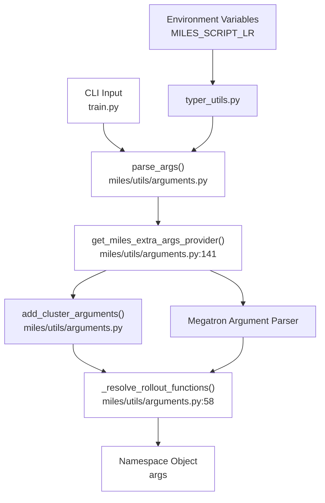
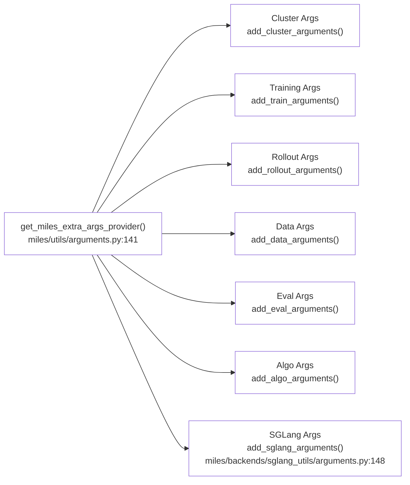
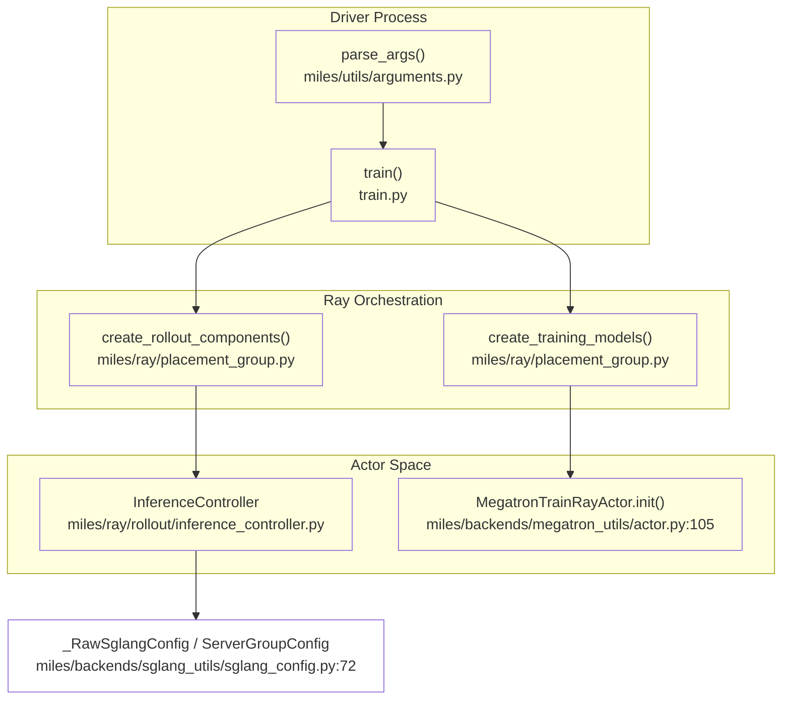

<!-- source: DeepWiki mcp.deepwiki.com · repo radixark/miles · page 2.3 Configuration System · fetched 2026-10-21 -->

# Configuration System

Relevant source files

The following files were used as context for generating this wiki page:

- [miles/backends/fsdp_utils/actor.py](miles/backends/fsdp_utils/actor.py)
- [miles/backends/fsdp_utils/arguments.py](miles/backends/fsdp_utils/arguments.py)
- [miles/backends/fsdp_utils/checkpoint.py](miles/backends/fsdp_utils/checkpoint.py)
- [miles/backends/megatron_utils/actor.py](miles/backends/megatron_utils/actor.py)
- [miles/backends/megatron_utils/model.py](miles/backends/megatron_utils/model.py)
- [miles/backends/megatron_utils/optimizer_state_reset.py](miles/backends/megatron_utils/optimizer_state_reset.py)
- [miles/backends/sglang_utils/arguments.py](miles/backends/sglang_utils/arguments.py)
- [miles/backends/sglang_utils/sglang_config.py](miles/backends/sglang_utils/sglang_config.py)
- [miles/utils/arguments.py](miles/utils/arguments.py)
- [miles/utils/workers/types.py](miles/utils/workers/types.py)
- [tests/fast/backends/megatron_utils/test_model_initialize.py](tests/fast/backends/megatron_utils/test_model_initialize.py)
- [tests/fast/backends/megatron_utils/test_optimizer_state_reset.py](tests/fast/backends/megatron_utils/test_optimizer_state_reset.py)
- [tests/fast/backends/megatron_utils/test_shared_ppo_lifecycle.py](tests/fast/backends/megatron_utils/test_shared_ppo_lifecycle.py)
- [tests/fast/backends/sglang_utils/test_arguments.py](tests/fast/backends/sglang_utils/test_arguments.py)
- [tests/fast/backends/sglang_utils/test_sglang_config.py](tests/fast/backends/sglang_utils/test_sglang_config.py)
- [tests/fast/ray/rollout/conftest.py](tests/fast/ray/rollout/conftest.py)
- [tests/fast/utils/test_arguments.py](tests/fast/utils/test_arguments.py)
- [tests/fast/utils/test_sglang_config.py](tests/fast/utils/test_sglang_config.py)
- [tests/fast/utils/workers/test_worker_comm_backend.py](tests/fast/utils/workers/test_worker_comm_backend.py)

## Purpose and Scope

This document describes Miles' comprehensive configuration system, which provides a centralized approach to managing training, rollout, evaluation, and system parameters through a hierarchical argument parsing framework implemented in `miles/utils/arguments.py` [miles/utils/arguments.py:1-42](). The configuration system supports command-line arguments, environment variables, and YAML files, with specialized backend extensions for SGLang and Megatron-LM.

Sources: [miles/utils/arguments.py:1-42]()

---

## Configuration Architecture

Miles uses a multi-layered configuration system centered around `miles/utils/arguments.py`, which integrates with Megatron-LM's argument parser while adding extensive RL-specific and distributed training capabilities via `get_miles_extra_args_provider` [miles/utils/arguments.py:141-146]().

### Configuration Initialization Flow

**Sources**: [miles/utils/arguments.py:1-146](), [miles/utils/typer_utils.py:1-50]()

---

## Main Configuration Groups

The configuration system organizes parameters into logical groups, each managed by a dedicated function or argument provider.

### Configuration Group Structure

**Sources**: [miles/utils/arguments.py:141-146](), [miles/backends/sglang_utils/arguments.py:148-172]()

---

## Key Configuration Categories

### 1. Cluster Configuration

Defines the distributed computing environment using Ray placement groups and resource allocation.

| Parameter | Type | Default | Description |
|-----------|------|---------|-------------|
| `--actor-num-nodes` | int | 1 | Number of nodes for training actor [tests/fast/ray/rollout/conftest.py:75]() |
| `--actor-num-gpus-per-node` | int | 8 | GPUs per node for training actor [tests/fast/ray/rollout/conftest.py:76]() |
| `--rollout-num-gpus` | int | None | Total GPUs for inference engines [tests/fast/ray/rollout/conftest.py:27]() |
| `--rollout-num-gpus-per-engine` | int | 1 | GPUs per SGLang engine (TP size) [tests/fast/ray/rollout/conftest.py:28]() |
| `--colocate` | bool | False | Co-locate training and inference on same GPUs [tests/fast/ray/rollout/conftest.py:74]() |

**Key Features**:
- **Colocation Mode**: When `--colocate` is enabled, resource allocations share physical hardware between training actors and rollout engines.
- **Resource Reordering**: Ray placement groups reorder bundles to match physical node topologies.

**Sources**: [tests/fast/ray/rollout/conftest.py:25-95]()

---

### 2. Training Configuration & Backends

Controls the training backend (`MegatronTrainRayActor` or `FSDPTrainRayActor`) and architectural specifications.

| Parameter | Type | Default | Description |
|-----------|------|---------|-------------|
| `--train-backend` | str | "megatron" | Training backend selection (`megatron` or `fsdp`) [tests/fast/ray/rollout/conftest.py:78]() |
| `--hf-checkpoint` | path | None | HF directory providing tokenizer and config [tests/fast/ray/rollout/conftest.py:149]() |
| `--load` | path | None | Checkpoint path to resume training from [tests/fast/ray/rollout/conftest.py:168]() |
| `--save` | path | None | Directory to store actor checkpoints [tests/fast/ray/rollout/conftest.py:169]() |

**True On-Policy Mode**: Configures deterministic execution flags across backends to match rollout log-probabilities with training forward passes [miles/backends/fsdp_utils/actor.py:97-98]().

**Sources**: [miles/backends/megatron_utils/actor.py:105-160](), [miles/backends/fsdp_utils/actor.py:36-100]()

---

### 3. Rollout Configuration

Manages the generation of trajectories during the rollout phase.

| Parameter | Type | Default | Description |
|-----------|------|---------|-------------|
| `--rollout-temperature` | float | 1.0 | Sampling temperature for text generation [tests/fast/ray/rollout/conftest.py:37]() |
| `--rollout-max-response-len` | int | None | Maximum response length in tokens [tests/fast/ray/rollout/conftest.py:36]() |
| `--rollout-function-path` | str | None | Custom rollout generation function path [tests/fast/ray/rollout/conftest.py:151]() |
| `--n-samples-per-prompt` | int | 1 | Responses per prompt for group sampling [tests/fast/ray/rollout/conftest.py:34]() |
| `--partial-rollout` | bool | False | Recycle unfinished samples |

**Sources**: [miles/utils/arguments.py:58-120](), [tests/fast/ray/rollout/conftest.py:26-48]()

---

### 4. SGLang and Server Group Configuration (`_RawSglangConfig` / `ServerGroupConfig`)

Miles forwards arguments prefixed with `--sglang-` directly to the SGLang inference server [miles/backends/sglang_utils/arguments.py:148-172](). Advanced deployments use `--sglang-config` to specify heterogeneous server groups (`_RawSglangConfig`) [miles/backends/sglang_utils/sglang_config.py:72-116]().

| Parameter | Type | Default | Description |
|-----------|------|---------|-------------|
| `--sglang-mem-fraction-static` | float | 0.8 | KV cache memory fraction allocation |
| `--sglang-router-port` | int | None | Port for the SGLang router [miles/backends/sglang_utils/arguments.py:13]() |
| `--sglang-dp-size` | int | 1 | Data parallel size for SGLang engine [miles/backends/sglang_utils/arguments.py:122]() |
| `--sglang-config` | str | None | Path to YAML config for SGLang engine deployment [miles/backends/sglang_utils/arguments.py:167]() |

**Sources**: [miles/backends/sglang_utils/arguments.py:1-172](), [miles/backends/sglang_utils/sglang_config.py:21-140]()

---

## Configuration Flow Through System

### Runtime Configuration Propagation Pipeline

**Sources**: [miles/ray/placement_group.py:1-180](), [miles/backends/megatron_utils/actor.py:105-160](), [miles/backends/sglang_utils/sglang_config.py:72-140]()

---

## Advanced Configuration Features

### 1. Argument Resetting
Miles uses `reset_arg` to override Megatron-LM or parser defaults for specialized RL workloads [miles/utils/arguments.py:121-135]().

### 2. Checkpoint Management
The system differentiates between various checkpoint roles:
- `--load`: Path to resume actor weights.
- `--pretrained-checkpoint`: Pretrained initialization weights [miles/backends/megatron_utils/model.py:152]().

### 3. YAML Configuration Validation
FSDP and SGLang configs support YAML file loading with strict validation checking via `reject_unknown_config_keys` and Pydantic models (`_RawSglangConfig`, `ServerGroupConfig`) [miles/backends/fsdp_utils/arguments.py:117-127](), [miles/backends/sglang_utils/sglang_config.py:21-152]().

Sources: [miles/utils/arguments.py:121-135](), [miles/backends/fsdp_utils/arguments.py:117-148](), [miles/backends/sglang_utils/sglang_config.py:21-152]()

---

