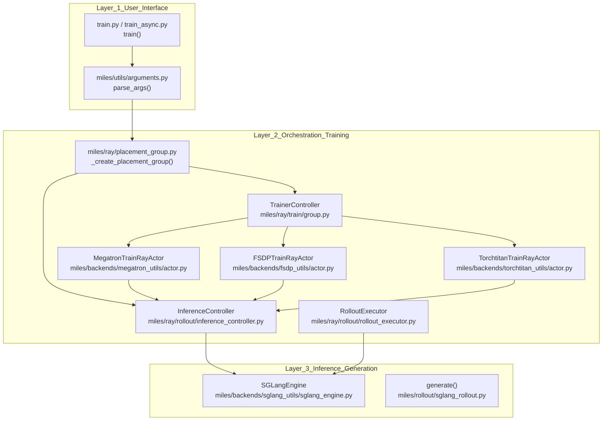
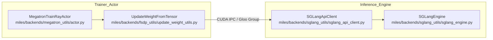

<!-- source: DeepWiki mcp.deepwiki.com · repo radixark/miles · page 3.1 System Design and Components · fetched 2026-10-21 -->

# System Design and Components

<details>
<summary>Relevant source files</summary>

The following files were used as context for generating this wiki page:

- [miles/ray/placement_group.py](miles/ray/placement_group.py)
- [miles/ray/specs/entrypoint.py](miles/ray/specs/entrypoint.py)
- [miles/ray/specs/train.py](miles/ray/specs/train.py)
- [miles/ray/wiring.py](miles/ray/wiring.py)
- [miles/utils/async_utils.py](miles/utils/async_utils.py)
- [miles/utils/audit_utils/process_identity.py](miles/utils/audit_utils/process_identity.py)
- [miles/utils/hot_restart.py](miles/utils/hot_restart.py)
- [miles/utils/orchestration_utils.py](miles/utils/orchestration_utils.py)
- [tests/fast/fixtures/driver_fakes.py](tests/fast/fixtures/driver_fakes.py)
- [tests/fast/ray/rollout/test_rollout_executor_init.py](tests/fast/ray/rollout/test_rollout_executor_init.py)
- [tests/fast/ray/specs/test_entrypoint.py](tests/fast/ray/specs/test_entrypoint.py)
- [tests/fast/ray/specs/test_train.py](tests/fast/ray/specs/test_train.py)
- [tests/fast/ray/test_cell_meta.py](tests/fast/ray/test_cell_meta.py)
- [tests/fast/ray/test_placement_group.py](tests/fast/ray/test_placement_group.py)
- [tests/fast/ray/test_placement_group_shared_ppo.py](tests/fast/ray/test_placement_group_shared_ppo.py)
- [tests/fast/ray/test_wiring.py](tests/fast/ray/test_wiring.py)
- [tests/fast/test_platform_contract.py](tests/fast/test_platform_contract.py)
- [tests/fast/test_train.py](tests/fast/test_train.py)
- [tests/fast/test_train_async.py](tests/fast/test_train_async.py)
- [tests/fast/test_train_multi_policy.py](tests/fast/test_train_multi_policy.py)
- [tests/fast/utils/test_async_utils.py](tests/fast/utils/test_async_utils.py)
- [tests/fast/utils/test_hot_restart.py](tests/fast/utils/test_hot_restart.py)
- [tests/fast/utils/test_orchestration_utils.py](tests/fast/utils/test_orchestration_utils.py)
- [tests/fast/utils/test_process_identity.py](tests/fast/utils/test_process_identity.py)
- [tests/fast/utils/workers/test_ray_communication_boundary.py](tests/fast/utils/workers/test_ray_communication_boundary.py)
- [train.py](train.py)
- [train_async.py](train_async.py)
- [train_multi_policy.py](train_multi_policy.py)

</details>


## Purpose and Scope

This page explains Miles' high-level system architecture, the separation of training and inference workloads, Ray-based orchestration, and how major system components interact. It details the transition from high-level orchestration down to concrete classes like `TrainerController`, `InferenceController`, `RolloutExecutor`, and training backend actors (`MegatronTrainRayActor`, `FSDPTrainRayActor`, and `TorchtitanTrainRayActor`).

For specific training backends, see [FSDP Backend](4.1) and [Megatron Backend](4.2). For details on the training loop, see [Training Orchestration](3.2). For rollout generation mechanics, see [Rollout Generation System](3.3).

---

## Three-Layer Architecture Overview

Miles implements a clean separation of concerns across three layers: **User Interface**, **Orchestration & Training**, and **Inference & Generation**. This architecture enables independent scaling, memory management, and asynchronous execution of training versus inference workloads.

### Architecture Diagram: Component Hierarchy



Sources: [train.py:25-45](), [train_async.py:24-38](), [miles/ray/placement_group.py:81-163](), [miles/ray/specs/train.py:40-46]()

---

## Core Components

The following table summarizes the responsibilities of each major component in the Miles codebase:

| Component | File Path | Key Responsibilities | Ray Actor / Class |
|-----------|-----------|---------------------|-----------|
| **InferenceController** | `miles/ray/rollout/inference_controller.py` | Manages the SGLang server fleet, lifecycle, weight updates, and KV cache operations. | Ray Actor Group / Manager |
| **RolloutExecutor** | [miles/ray/placement_group.py:19]() | Executes rollout generation pipelines, fetches trajectories, and buffers samples. | Ray Actor (`@ray.remote`) |
| **TrainerController** | [miles/ray/specs/train.py:40]() | Coordinates training actors (actor/critic), manages gradient steps, and invokes weight syncing. | Ray Actor (`TrainerController`) |
| **MegatronTrainRayActor** | [miles/ray/specs/train.py:43]() | Megatron-LM training actor supporting 4D parallelism (TP/PP/EP/CP). | Ray Actor (`TrainRayActor`) |
| **FSDPTrainRayActor** | [miles/ray/specs/train.py:44]() | PyTorch FSDP2 training actor supporting stock HuggingFace models and LoRA. | Ray Actor (`TrainRayActor`) |
| **TorchtitanTrainRayActor** | [miles/ray/specs/train.py:45]() | TorchTitan training actor for experimental modular PyTorch pipelines. | Ray Actor (`TrainRayActor`) |
| **SGLangEngine** | [miles/backends/sglang_utils/sglang_engine.py]() | High-throughput inference worker running `sglang.launch_server`. | External Process / Ray Worker |

Sources: [miles/ray/placement_group.py:122-162](), [miles/ray/specs/train.py:40-46]()

---

## Component Interaction Flow

The interaction between the main driver script (`train.py` or `train_async.py`) and Ray actors follows a structured sequence to guarantee resource allocation, initialization order, and synchronization before training loops begin.

### Sequence Diagram: Training Initialization and Synchronous Step

```mermaid
sequenceDiagram
    participant Driver as train.py
    participant PG as miles/ray/placement_group.py
    participant IC as InferenceController
    participant RE as RolloutExecutor
    participant TC as TrainerController
    participant Actor as MegatronTrainRayActor
    
    Driver->>PG: create_placement_groups(args)
    PG-->>Driver: Placement groups (actor, rollout)
    
    Driver->>IC: create_rollout_components(args)
    IC->>IC: init() (launch SGLang engine pool)
    
    Driver->>TC: create_training_models(args, rollout_executor)
    TC->>Actor: init() (Megatron initialization & topology setup)
    
    Driver->>TC: update_weights(args, actor_model, rollout_executor, inference_controller)
    TC->>IC: update_weights() / IPC sync
    
    loop Rollout & Training Epoch
        Driver->>IC: prepare_rollout(rollout_id)
        Driver->>RE: rollout_executor.get(rollout_id)
        RE-->>Driver: RolloutBatch data pack
        
        Driver->>TC: actor_model.train(rollout_id, rollout_data_pack)
        TC->>Actor: train step execution
        Actor-->>TC: loss and metrics
        TC-->>Driver: step complete
    end
```

Sources: [train.py:25-131](), [miles/ray/placement_group.py:146-163]()

---

## Key Architectural Decisions

### 1. Separation of Training and Inference
Miles separates training backends from inference execution. This is controlled via runtime arguments in `miles/utils/arguments.py`:
- **Colocation Mode**: Training and inference share identical physical GPUs (`--colocate`). To prevent Out-Of-Memory (OOM) errors, offloading of model weights and KV caches between rollout and training phases is enforced [train.py:107-118]().
- **Disaggregated Mode**: Inference runs on dedicated SGLang engine pools while training runs on separate Ray actors, enabling overlapping asynchronous execution [train_async.py:24-25]().

Sources: [train.py:107-118](), [train_async.py:24-25]()

### 2. Ray-Based Resource Management
Miles relies on Ray placement groups to guarantee deterministic worker placement and topology constraints:
- `_create_placement_group` allocates bundles with `strategy="PACK"` to minimize cross-node communication overhead [miles/ray/placement_group.py:81-87]().
- `InfoActor` queries node IPs and physical GPU IDs, sorting them via `sort_key` to maintain deterministic rank assignments across nodes [miles/ray/placement_group.py:48-72]().

Sources: [miles/ray/placement_group.py:48-119]()

### 3. Unified Actor Abstraction (`TrainRayActor`)
All training backends (Megatron, FSDP, TorchTitan) map to concrete subclasses of `TrainRayActor`, exposing standard RPC entry points for `.init()`, `.train()`, `.save_model()`, and weight updates [miles/ray/specs/train.py:42-46]().

Sources: [miles/ray/specs/train.py:40-46]()

---

## Data Flow and Code Entity Mapping

The diagrams below bridge Natural Language Space concepts to Code Entity Space implementations across rollout generation and weight synchronization.

### Diagram: Rollout to Training Data Flow

```mermaid
graph LR
    subgraph "Inference_Rollout_Space"
        SGL["SGLangEngine<br/>miles/backends/sglang_utils/sglang_engine.py"]
        Gen["generate()<br/>miles/rollout/sglang_rollout.py"]
        RE["RolloutExecutor<br/>miles/ray/rollout/rollout_executor.py"]
    end
    
    subgraph "Training_Space"
        TC["TrainerController<br/>miles/ray/train/group.py"]
        Actor["MegatronTrainRayActor<br/>miles/backends/megatron_utils/actor.py"]
        Loss["compute_advantages_and_returns<br/>miles/backends/training_utils/loss.py"]
    end
    
    SGL --> Gen
    Gen -- "Sample / RolloutBatch" --> RE
    RE -- "get()" --> TC
    TC --> Actor
    Actor --> Loss
```



Sources: [miles/ray/specs/train.py:40-46](), [train.py:105-130]()

### Diagram: Weight Synchronization Data Flow



Sources: [train.py:48-48](), [train_async.py:41-41]()

---

## Configuration System Overview

System configuration is parsed via `parse_args()` in `miles/utils/arguments.py`, merging CLI flags, dataclass defaults, and YAML config files. Major configuration categories include cluster topology (`--actor-num-nodes`, `--rollout-num-gpus`), backend selection (`--train-backend`), offloading policies (`--offload-train`, `--offload-rollout`), and rollout sampling parameters [train.py:14-14]().

Sources: [train.py:14-14](), [train_async.py:12-12]()

---

## Summary of Interaction Modes

- **Synchronous Training (`train.py`)**: Strictly alternates between generation and training steps. Rollout data is fetched completely before model training begins, ensuring synchronous execution [train.py:103-131]().
- **Asynchronous Training (`train_async.py`)**: Overlaps rollout generation for epoch `N+1` with training on epoch `N` using futures created via `eager_create_task`, maximizing hardware utilization [train_async.py:70-96]().
- **Multi-Policy Training (`train_multi_policy.py`)**: Coordinates multiple policy actors with synchronization primitives (`Parker`) to run heterogeneous or co-evolving policy experiments simultaneously [train_multi_policy.py:32-101]().

Sources: [train.py:103-131](), [train_async.py:70-96](), [train_multi_policy.py:32-101]()

---

