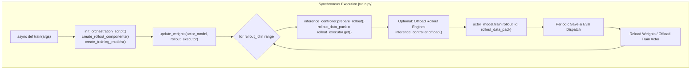
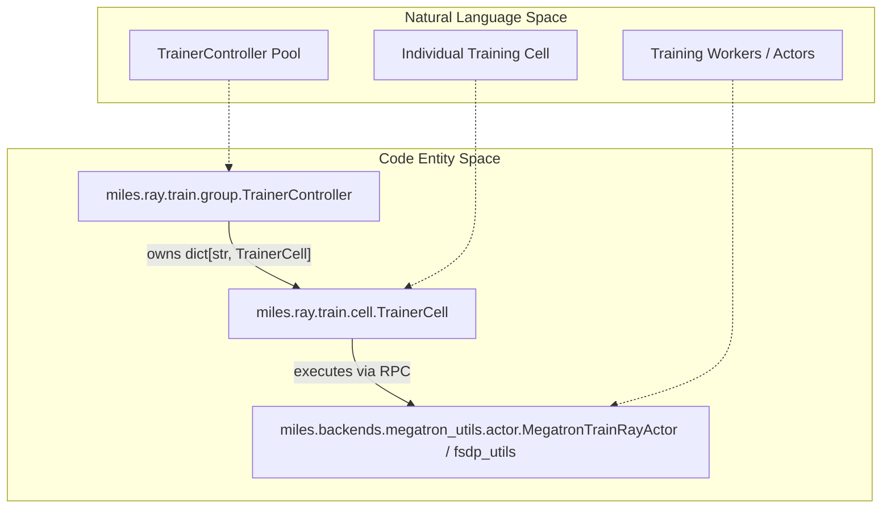

<!-- source: DeepWiki mcp.deepwiki.com · repo radixark/miles · page 3.2 Training Orchestration · fetched 2026-10-21 -->

# Training Orchestration

<details>
<summary>Relevant source files</summary>

The following files were used as context for generating this wiki page:

- [miles/ray/train/cell.py](miles/ray/train/cell.py)
- [miles/ray/train/cell_monitor.py](miles/ray/train/cell_monitor.py)
- [miles/ray/train/cell_state.py](miles/ray/train/cell_state.py)
- [miles/ray/train/group.py](miles/ray/train/group.py)
- [miles/ray/wiring.py](miles/ray/wiring.py)
- [miles/utils/async_utils.py](miles/utils/async_utils.py)
- [miles/utils/audit_utils/event_analyzer/analyzer.py](miles/utils/audit_utils/event_analyzer/analyzer.py)
- [miles/utils/ft_utils/api_server/models.py](miles/utils/ft_utils/api_server/models.py)
- [miles/utils/orchestration_utils.py](miles/utils/orchestration_utils.py)
- [miles/utils/workers/naming.py](miles/utils/workers/naming.py)
- [tests/fast/fixtures/driver_fakes.py](tests/fast/fixtures/driver_fakes.py)
- [tests/fast/ray/test_wiring.py](tests/fast/ray/test_wiring.py)
- [tests/fast/ray/train/conftest.py](tests/fast/ray/train/conftest.py)
- [tests/fast/ray/train/dummy_actor.py](tests/fast/ray/train/dummy_actor.py)
- [tests/fast/ray/train/fake_worker_manager.py](tests/fast/ray/train/fake_worker_manager.py)
- [tests/fast/ray/train/test_cell.py](tests/fast/ray/train/test_cell.py)
- [tests/fast/ray/train/test_cell_monitor.py](tests/fast/ray/train/test_cell_monitor.py)
- [tests/fast/ray/train/test_cell_restart.py](tests/fast/ray/train/test_cell_restart.py)
- [tests/fast/ray/train/test_group.py](tests/fast/ray/train/test_group.py)
- [tests/fast/ray/train/test_group_failure_reporting.py](tests/fast/ray/train/test_group_failure_reporting.py)
- [tests/fast/ray/train/test_load_state.py](tests/fast/ray/train/test_load_state.py)
- [tests/fast/ray/train/test_train_external_data.py](tests/fast/ray/train/test_train_external_data.py)
- [tests/fast/ray/train/test_train_return_value.py](tests/fast/ray/train/test_train_return_value.py)
- [tests/fast/test_platform_contract.py](tests/fast/test_platform_contract.py)
- [tests/fast/test_train.py](tests/fast/test_train.py)
- [tests/fast/test_train_async.py](tests/fast/test_train_async.py)
- [tests/fast/test_train_multi_policy.py](tests/fast/test_train_multi_policy.py)
- [tests/fast/utils/api_server/test_models.py](tests/fast/utils/api_server/test_models.py)
- [tests/fast/utils/event_analyzer/test_analyzer.py](tests/fast/utils/event_analyzer/test_analyzer.py)
- [tests/fast/utils/test_async_utils.py](tests/fast/utils/test_async_utils.py)
- [tests/fast/utils/test_orchestration_utils.py](tests/fast/utils/test_orchestration_utils.py)
- [tests/fast/utils/workers/test_ray_communication_boundary.py](tests/fast/utils/workers/test_ray_communication_boundary.py)
- [train.py](train.py)
- [train_async.py](train_async.py)
- [train_multi_policy.py](train_multi_policy.py)

</details>


## Purpose and Scope

This page documents the training orchestration layer in Miles, focusing on the synchronous (`train.py`) [train.py:25-156]() and asynchronous (`train_async.py`) [train_async.py:24-137]() entry points, synchronous vs. asynchronous execution modes, and the group abstraction layer centered around `TrainerController` [miles/ray/train/group.py:52]() and `TrainerCell` [miles/ray/train/cell.py:29](). It details how orchestration coordinates rollout generation, actor-critic training steps, memory offloading, and parameter synchronization across distributed Ray workers.

Sources: [train.py:25-156](), [train_async.py:24-137](), [miles/ray/train/group.py:52-166](), [miles/ray/train/cell.py:29-107]()

---

## Entry Points: Synchronous vs. Asynchronous Training Modes

Miles provides two primary execution scripts depending on hardware topology, colocation preferences, and throughput requirements.

| Entry Point | Execution Mode | Key Characteristics | Source Citations |
|-------------|----------------|---------------------|------------------|
| `train.py` | Synchronous | Sequential execution; generates rollout data, offloads/clears cache, executes training on actor/critic models, updates weights, and loops. Supports colocation (`--colocate`). | [train.py:25-156]() |
| `train_async.py` | Asynchronous | Pipelines rollout generation of step $N+1$ concurrently with training on step $N$ using `eager_create_task` and future resolution. Does not support colocation. | [train_async.py:24-137]() |

### Synchronous Training Flow (`train.py`)
The synchronous loop instantiates worker managers, object stores, tracking utilities, rollout components via `create_rollout_components` [train.py:37](), and model trainers via `create_training_models` [train.py:41](). It ensures weights are synchronized (`update_weights`) before iterating through rollout epochs [train.py:48-105]().



Sources: [train.py:25-156](), [train_async.py:24-137]()

### Asynchronous Training Flow (`train_async.py`)
The asynchronous loop enforces that colocation is disabled (`assert not args.colocate`) [train_async.py:24]() and validates async off-policy correction settings [train_async.py:25](). It initiates future tasks for the next rollout using `eager_create_task` while training on the current rollout buffer [train_async.py:70-83]().

Sources: [train_async.py:24-137](), [miles/ray/placement_group.py:127-180]()

---

## Training Control Abstraction: `TrainerController` and `TrainerCell`

Training compute nodes are managed via a hierarchical group abstraction layer defined in `miles/ray/train/group.py` and `miles/ray/train/cell.py`.

### `TrainerController`
`TrainerController` acts as the orchestrator for a role pool (such as `actor` or `critic`) [miles/ray/train/group.py:52](). It manages `TrainerCell` instances (`self._cells_by_id`) [miles/ray/train/group.py:81](), oversees worker reconciliation (`_reconcile`, `_add_cell`, `_remove_cell`) [miles/ray/train/group.py:121-137](), handles witness ID allocations for audit logging, and dispatches distributed training steps across cells.

### `TrainerCell`
`TrainerCell` represents an individual replica or independent data parallel (Indep-DP) cell [miles/ray/train/cell.py:29](). Each cell manages its own worker handles (`RayWorkerProvider`), master addresses [miles/ray/train/cell.py:53](), state transitions (`StateAllocatedUninitialized`, `StateAllocatedAlive`, `StateAllocatedErrored`) [miles/ray/train/cell.py:58](), and execution of remote actor methods such as `init` and `train` [miles/ray/train/cell.py:62-107]().

### Diagram: Controller-to-Cell Code Mapping
The following diagram bridges the high-level training group abstractions to their concrete code entities and execution paths.



Sources: [miles/ray/train/group.py:52-160](), [miles/ray/train/cell.py:29-107]()

---

## Main Training Loop & Data Flow

During each iteration of the training loop (`train.py` or `train_async.py`), data flows from prompt generation in SGLang rollout engines through the `RolloutExecutor` into the training actor group managed by `TrainerController`.

### Detailed Step-by-Step Data Flow

1. **Rollout Preparation**: The `InferenceController` prepares the rollout engines for the given `rollout_id` [train.py:104](), [train_async.py:66]().
2. **Rollout Fetching**: The `RolloutExecutor` asynchronous actor returns a `rollout_data_pack` containing generated trajectories, prompt-response pairs, and log probabilities [train.py:105](), [train_async.py:67]().
3. **Memory Offloading**: If `args.offload_rollout` is active, KV caches or weights on the inference engine are offloaded or cleared to free GPU memory for training [train.py:107-118]().
4. **Training Execution**: `actor_model.train(rollout_id, rollout_data_pack)` (which invokes `TrainerController.train()` and subsequently `TrainerCell.train()` [miles/ray/train/cell.py:92]()) executes the forward-backward passes on the underlying training actor.
5. **Parameter Synchronization**: Updated actor weights are pushed back to the rollout inference engines via `update_weights(args, actor_model, rollout_executor, inference_controller)` [train.py:48](), [train_async.py:115]().

### Diagram: Execution Flow & Actor Interaction

```mermaid
sequenceDiagram
    participant Script as "train.py / train_async.py"
    participant IC as "InferenceController"
    participant RE as "RolloutExecutor"
    participant TC as "TrainerController"
    participant Cell as "TrainerCell"
    participant Actor as "Megatron/FSDPTrainRayActor"

    Script->>IC: prepare_rollout(rollout_id)
    Script->>RE: get(rollout_id)
    RE-->>Script: rollout_data_pack
    
    Note over Script,Actor: Training Phase
    Script->>TC: train(rollout_id, rollout_data_pack)
    TC->>Cell: train(rollout_id, rollout_data_ref, ...)
    Cell->>Actor: execute("train", ...)
    Actor-->>Cell: TrainStepOutput
    Cell-->>TC: Results list
    TC-->>Script: Completed training step
    
    Script->>TC: update_weights()
    TC->>RE: set_weight_version(version)
```

Sources: [train.py:101-132](), [train_async.py:65-96](), [miles/ray/train/group.py:169-174](), [miles/ray/train/cell.py:92-113]()

---

## Summary of Configuration Parameters in Orchestration

The orchestration layer relies on several key configuration attributes parsed via `arguments.py`:

* `args.fully_async`: Selects fully asynchronous pipeline execution [train.py:26]().
* `args.colocate`: Places inference engines and training actors on the same physical GPUs [train_async.py:24]().
* `args.offload_train` / `args.offload_rollout`: Manages CPU/GPU memory offloading strategies during step transitions [train.py:58](), [train.py:72]().
* `args.update_weights_interval`: Frequency of weight synchronization updates in asynchronous runs [train_async.py:77]().

Sources: [train.py:25-156](), [train_async.py:24-137]()

---

