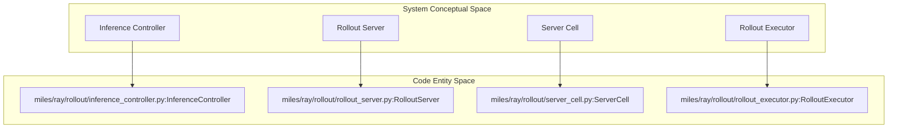
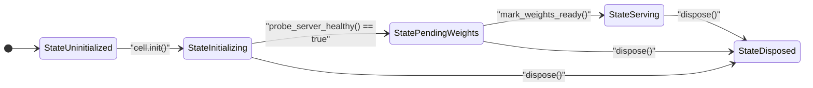
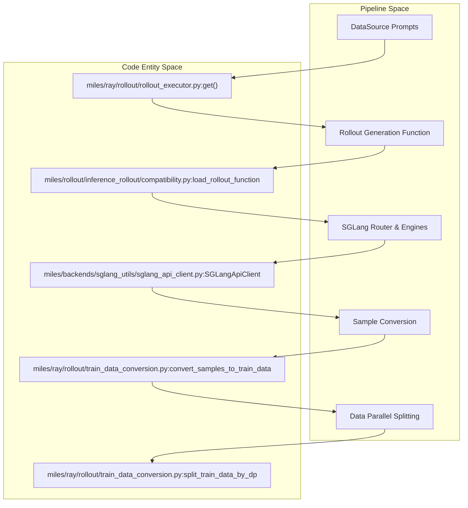
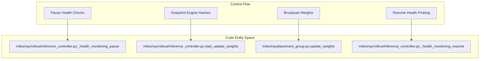

<!-- source: DeepWiki mcp.deepwiki.com · repo radixark/miles · page 3.3 Rollout Generation System · fetched 2026-10-21 -->

# Rollout Generation System

Relevant source files

The following files were used as context for generating this wiki page:

- [docs/developer/architecture.md](docs/developer/architecture.md)
- [docs/user-guide/fully-async.md](docs/user-guide/fully-async.md)
- [examples/infra_features/fully_async/external_eval_fn.py](examples/infra_features/fully_async/external_eval_fn.py)
- [miles/dashboard/hooks.py](miles/dashboard/hooks.py)
- [miles/ray/rollout/inference_controller.py](miles/ray/rollout/inference_controller.py)
- [miles/ray/rollout/rollout_executor.py](miles/ray/rollout/rollout_executor.py)
- [miles/ray/rollout/rollout_server.py](miles/ray/rollout/rollout_server.py)
- [miles/ray/rollout/server_cell.py](miles/ray/rollout/server_cell.py)
- [miles/rollout/base_types.py](miles/rollout/base_types.py)
- [miles/rollout/checkpoint_eval.py](miles/rollout/checkpoint_eval.py)
- [miles/rollout/filter_hub/common_filters.py](miles/rollout/filter_hub/common_filters.py)
- [miles/rollout/filter_hub/dynamic_sampling_filters.py](miles/rollout/filter_hub/dynamic_sampling_filters.py)
- [miles/rollout/fully_async_data_buffer.py](miles/rollout/fully_async_data_buffer.py)
- [miles/rollout/fully_async_rollout.py](miles/rollout/fully_async_rollout.py)
- [miles/utils/workers/worker_info.py](miles/utils/workers/worker_info.py)
- [tests/fast/dashboard/test_hooks.py](tests/fast/dashboard/test_hooks.py)
- [tests/fast/ray/rollout/real_ray/test_rollout_executor.py](tests/fast/ray/rollout/real_ray/test_rollout_executor.py)
- [tests/fast/ray/rollout/test_config_matrix.py](tests/fast/ray/rollout/test_config_matrix.py)
- [tests/fast/ray/rollout/test_inference_controller.py](tests/fast/ray/rollout/test_inference_controller.py)
- [tests/fast/ray/rollout/test_rollout_executor.py](tests/fast/ray/rollout/test_rollout_executor.py)
- [tests/fast/ray/rollout/test_rollout_executor_rpc_surface.py](tests/fast/ray/rollout/test_rollout_executor_rpc_surface.py)
- [tests/fast/ray/rollout/test_rollout_server.py](tests/fast/ray/rollout/test_rollout_server.py)
- [tests/fast/ray/rollout/test_rollout_server_expected_num_cells.py](tests/fast/ray/rollout/test_rollout_server_expected_num_cells.py)
- [tests/fast/ray/rollout/test_rollout_server_locking.py](tests/fast/ray/rollout/test_rollout_server_locking.py)
- [tests/fast/ray/rollout/test_rollout_server_wait_cells.py](tests/fast/ray/rollout/test_rollout_server_wait_cells.py)
- [tests/fast/ray/rollout/test_server_cell.py](tests/fast/ray/rollout/test_server_cell.py)
- [tests/fast/ray/test_kubernetes_assembly.py](tests/fast/ray/test_kubernetes_assembly.py)
- [tests/fast/ray/test_update_weights_ordering.py](tests/fast/ray/test_update_weights_ordering.py)
- [tests/fast/ray/train/test_trainer_controller_rpc_surface.py](tests/fast/ray/train/test_trainer_controller_rpc_surface.py)
- [tests/fast/rollout/inference_rollout/test_sample_completion_backfill.py](tests/fast/rollout/inference_rollout/test_sample_completion_backfill.py)
- [tests/fast/rollout/test_checkpoint_eval.py](tests/fast/rollout/test_checkpoint_eval.py)
- [tests/fast/rollout/test_filters.py](tests/fast/rollout/test_filters.py)
- [tests/fast/rollout/test_fully_async_rollout.py](tests/fast/rollout/test_fully_async_rollout.py)

## Purpose and Scope

The Rollout Generation System manages high-throughput inference generation, rollout coordination, and the translation of generated trajectories into training data. It replaces older monolithic rollout managers with a structured, decoupled stack consisting of `InferenceController`, `RolloutServer`, `ServerCell`, and the `RolloutExecutor` Ray actor.

This page explains the implementation of this stack, the `ServerCell` state machine, the data flow from prompts to training data tensors, and engine lifecycle management including weight synchronization and memory offloading.

---

## Architecture and Component Stack

The rollout infrastructure divides responsibilities across three hierarchical layers: `InferenceController` manages global model servers and synchronization; `RolloutServer` groups engine instances behind shared routers; and `ServerCell` manages individual engine processes, network gates, and health tracking.

Sources: [miles/ray/rollout/inference_controller.py:46-159](), [miles/ray/rollout/rollout_server.py:68-181](), [miles/ray/rollout/server_cell.py:56-179](), [miles/ray/rollout/rollout_executor.py:53-100]()

### Core Component Responsibilities

| Component | Class / File Path | Role and Responsibilities |
|-----------|-------------------|---------------------------|
| `InferenceController` | `miles/ray/rollout/inference_controller.py` | Orchestrates rollout servers, eval fleets, weight update windows, and health-monitoring pauses. |
| `RolloutServer` | `miles/ray/rollout/rollout_server.py` | Manages a collection of `ServerCell` instances sharing a single router IP and port. |
| `ServerCell` | `miles/ray/rollout/server_cell.py` | Encapsulates a specific engine worker cell, tracking its state machine, health checker, and SGLang API client. |
| `RolloutExecutor` | `miles/ray/rollout/rollout_executor.py` | Ray actor that executes rollout functions, loads data sources, manages debug logs, and converts raw samples into DP-sharded training data. |

Sources: [miles/ray/rollout/inference_controller.py:46-77](), [miles/ray/rollout/rollout_server.py:68-78](), [miles/ray/rollout/server_cell.py:56-78](), [miles/ray/rollout/rollout_executor.py:53-100]()

---

## ServerCell State Machine and Lifecycle

Each `ServerCell` progresses through a strict state machine defined in `miles/ray/rollout/cell_state.py`. 

Sources: [miles/ray/rollout/cell_state.py:4-31](), [miles/ray/rollout/server_cell.py:155-179]()

### Cell States and Transitions

1. **`StateUninitialized`**: The initial bookkeeping state after construction [miles/ray/rollout/cell_state.py:21-21]().
2. **`StateInitializing`**: Triggered via `ServerCell.init()`. Activates the launch gate and waits for the SGLang server endpoint to pass health probes [miles/ray/rollout/server_cell.py:155-171]().
3. **`StatePendingWeights`**: The engine is healthy and responding, but waiting for initial or updated weights to be loaded before serving live traffic [miles/ray/rollout/cell_state.py:19-19]().
4. **`StateServing`**: The cell is fully active, accepting rollout requests via the router [miles/ray/rollout/cell_state.py:20-20]().
5. **`StateDisposed`**: Cleaned up and shut down, releasing all associated Ray actors and health-check loops [miles/ray/rollout/cell_state.py:17-17]().

Sources: [miles/ray/rollout/server_cell.py:86-146](), [miles/ray/rollout/cell_state.py:4-31]()

---

## Data Flow: Prompts to Training Data

The `RolloutExecutor` actor orchestrates the transformation of raw data source prompts into structured training tensors.

Sources: [miles/ray/rollout/rollout_executor.py:53-140](), [miles/ray/rollout/train_data_conversion.py:15-18](), [miles/rollout/inference_rollout/compatibility.py:26-26]()

### Data Flow Execution Steps

1. **Prompt Fetching**: `RolloutExecutor` runs generation loops using loaded rollout functions (such as `FullyAsyncRolloutFn`) [miles/rollout/fully_async_rollout.py:56-99]().
2. **Generation**: The loaded rollout function executes inference calls against the active rollout engines through the SGLang routing layer, returning a collection of `Sample` objects containing tokens, responses, rewards, and log probabilities [miles/rollout/fully_async_rollout.py:134-142]().
3. **Conversion**: `convert_samples_to_train_data` transforms the list of samples into token ID tensors, loss masks, rollout log probabilities, and MoE routing records (`rollout_routed_experts`) [miles/ray/rollout/train_data_conversion.py:15-18]().
4. **Sharding**: Depending on configuration, data is split or packed for distribution across data-parallel ranks using `split_train_data_by_dp` [miles/ray/rollout/train_data_conversion.py:17-17]().

Sources: [miles/ray/rollout/rollout_executor.py:53-140](), [miles/ray/rollout/train_data_conversion.py:15-18]()

---

## Weight Updates, Offloading, and Health Monitoring

To support colocated training and inference on limited GPU hardware, the rollout system manages memory offloading and pauses health checks during weight synchronization.

### InferenceController Lifecycle Integration

- **Weight Update Windows**: When training finishes a step, `InferenceController` manages active server states and update orchestration [miles/ray/rollout/inference_controller.py:90-111]().
- **Memory Offloading**: `RolloutServer.offload()` and `onload()` manage releasing or resuming GPU memory occupations across all managed server cells [miles/ray/rollout/rollout_server.py:142-151]().

Sources: [miles/ray/rollout/inference_controller.py:149-159](), [miles/ray/rollout/rollout_server.py:142-151]()

---

