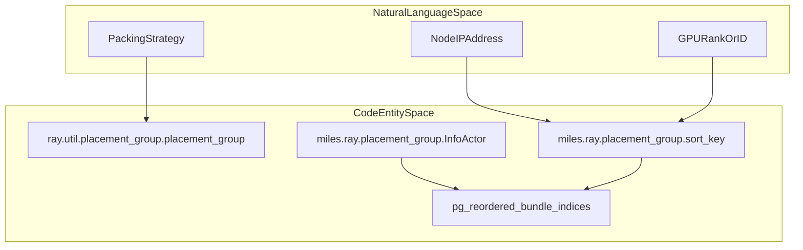
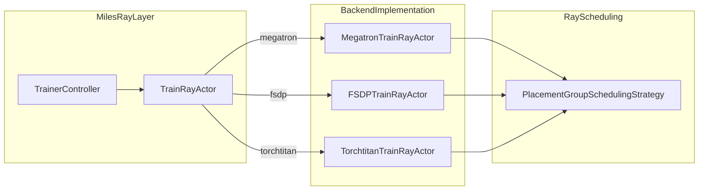

<!-- source: DeepWiki mcp.deepwiki.com · repo radixark/miles · page 3.4 Ray Resource Management · fetched 2026-10-21 -->

# Ray Resource Management

Relevant source files

The following files were used as context for generating this wiki page:

- [miles/ray/placement_group.py](miles/ray/placement_group.py)
- [miles/ray/specs/entrypoint.py](miles/ray/specs/entrypoint.py)
- [miles/ray/specs/train.py](miles/ray/specs/train.py)
- [miles/utils/audit_utils/process_identity.py](miles/utils/audit_utils/process_identity.py)
- [miles/utils/hot_restart.py](miles/utils/hot_restart.py)
- [miles/utils/workers/backend_capability/__init__.py](miles/utils/workers/backend_capability/__init__.py)
- [miles/utils/workers/backend_capability/base.py](miles/utils/workers/backend_capability/base.py)
- [miles/utils/workers/backend_capability/ray.py](miles/utils/workers/backend_capability/ray.py)
- [miles/utils/workers/cell_operations/ray.py](miles/utils/workers/cell_operations/ray.py)
- [miles/utils/workers/worker_provider/ray.py](miles/utils/workers/worker_provider/ray.py)
- [tests/fast/fixtures/capability_fixtures.py](tests/fast/fixtures/capability_fixtures.py)
- [tests/fast/ray/rollout/test_rollout_executor_init.py](tests/fast/ray/rollout/test_rollout_executor_init.py)
- [tests/fast/ray/specs/test_entrypoint.py](tests/fast/ray/specs/test_entrypoint.py)
- [tests/fast/ray/specs/test_train.py](tests/fast/ray/specs/test_train.py)
- [tests/fast/ray/test_cell_meta.py](tests/fast/ray/test_cell_meta.py)
- [tests/fast/ray/test_placement_group.py](tests/fast/ray/test_placement_group.py)
- [tests/fast/ray/test_placement_group_shared_ppo.py](tests/fast/ray/test_placement_group_shared_ppo.py)
- [tests/fast/utils/test_hot_restart.py](tests/fast/utils/test_hot_restart.py)
- [tests/fast/utils/test_process_identity.py](tests/fast/utils/test_process_identity.py)
- [tests/fast/utils/workers/backend_capability/test_ray.py](tests/fast/utils/workers/backend_capability/test_ray.py)
- [tests/fast/utils/workers/cell_operations/test_ray.py](tests/fast/utils/workers/cell_operations/test_ray.py)
- [tests/fast/utils/workers/worker_provider/test_ray.py](tests/fast/utils/workers/worker_provider/test_ray.py)

This document explains how Miles manages GPU resources across distributed nodes using Ray's placement groups, actor groups, and scheduling strategies. It covers the allocation of GPUs for training actors (actor and critic models) and rollout engines, coordination protocols for distributed initialization, and deployment patterns (colocated vs. distributed).

For training orchestration details, see [3.2 Training Orchestration](). For rollout generation specifics, see [3.3 Rollout Generation System]().

---

## Overview

Miles uses **Ray placement groups** to reserve and allocate GPU resources deterministically across a cluster. Three logical components are mapped to these resources:

- **actor**: Primary training model (Actor in RL terms). `[miles/ray/placement_group.py:123-124]()`
- **critic**: Optional value model for algorithms like PPO. `[miles/ray/placement_group.py:160-161]()`
- **rollout**: SGLang inference engines for data generation. `[miles/ray/placement_group.py:129-131]()`

The system supports two main deployment strategies via command-line configuration:
- **Colocated**: Training and rollout share the same GPUs, using memory offloading to toggle between phases. `[miles/ray/placement_group.py:136-137]()`
- **Distributed**: Training and rollout use separate GPU sets for simultaneous execution or higher throughput. `[miles/ray/placement_group.py:138-138]()`

Resource management is coordinated through `TrainerController` for training actors and `InferenceController` for inference engines. `[miles/ray/placement_group.py:124-124]`, `[miles/ray/placement_group.py:130-131]()`

Sources: `[miles/ray/placement_group.py:122-140]()`, `[miles/ray/placement_group.py:146-162]()`

---

## Placement Group Architecture

### Bundle Creation and Ordering

Ray placement groups allocate resources as **bundles**, where each bundle represents one GPU plus associated CPU resources (`{"GPU": 1, "CPU": 1}`). `[miles/ray/placement_group.py:86-86]()`

**Placement Group Entity Mapping**

Sources: `[miles/ray/placement_group.py:48-73]`, `[miles/ray/placement_group.py:81-120]()`

The `_create_placement_group` function ensures deterministic mapping by:
1. **Instantiating the PG**: Using `strategy="PACK"` to minimize fragmentation. `[miles/ray/placement_group.py:87-87]()`
2. **Querying physical IDs**: Spawning temporary `InfoActor` instances on every bundle to retrieve `(node_ip, gpu_id)`. `[miles/ray/placement_group.py:92-102]()`
3. **Sorting**: The `sort_key` function parses IP addresses or hostnames to provide a stable numerical representation for sorting. `[miles/ray/placement_group.py:54-72]()`
4. **Reordering**: Mapping logical rank `i` to the actual Ray bundle index that sits on the expected physical hardware. `[miles/ray/placement_group.py:106-110]()`

Sources: `[miles/ray/placement_group.py:81-120]`, `[miles/ray/placement_group.py:48-73]()`

### Resource Allocation Strategies

The `_get_placement_group_layout` function calculates total GPU requirements based on the operational mode. `[miles/ray/placement_group.py:122-139]()`

| Mode | GPU Calculation Logic | Bundle Index Slicing |
|:---|:---|:---|
| **Colocated** | `max(trainer_num_gpus, rollout_num_gpus)` | `rollout_offset = 0` (Shares with actor). `[miles/ray/placement_group.py:136-137]()` |
| **Distributed** | `trainer_num_gpus + rollout_num_gpus` | `rollout_offset = trainer_num_gpus`. `[miles/ray/placement_group.py:138-138]()` |
| **Debug Train Only** | `trainer_num_gpus + eval_num_gpus` | `rollout_offset = trainer_num_gpus`. `[miles/ray/placement_group.py:125-127]()` |

Sources: `[miles/ray/placement_group.py:122-139]()`, `[miles/ray/placement_group.py:146-162]()`

---

## TrainerGroup: Managing Training Actors

The training infrastructure manages collections of training actor instances via controller classes (`TrainerController`), handling their lifecycle and distributed communication setup. `[miles/ray/specs/train.py:40-46]()`

### Actor Allocation and Implementation

**Training Actor Entity Mapping**

Sources: `[miles/ray/specs/train.py:40-46]()`, `[miles/ray/specs/train.py:123-150]()`

The training actors execute backend-specific initialization loops:
- **Backend Selection**: Dynamically routes execution to `MegatronTrainRayActor`, `FSDPTrainRayActor`, or `TorchtitanTrainRayActor`. `[miles/ray/specs/train.py:42-46]()`
- **Cell and Worker Specs**: `specs_trainer` maps configurations into `ServeWorkerSpec` instances specifying cell structures and resource requests. `[miles/ray/specs/train.py:153-174]()`
- **GPU Pinning**: Uses Ray scheduling strategies referencing placement group bundle indices to enforce physical locality. `[miles/ray/placement_group.py:95-101]()`

Sources: `[miles/ray/specs/train.py:40-46]`, `[miles/ray/specs/train.py:123-174]()`

---

## Worker Provider & Ray Infrastructure

Ray actor management integrates with worker providers (`RayWorkerProvider`) to monitor worker life cycles, fetch addresses, and handle cell replication. `[miles/utils/workers/worker_provider/ray.py:16-27]()`

- **Cell Management**: `RayWorkerProvider` communicates with a worker manager handle to list alive cells, stop cells, and fetch worker info structures. `[miles/utils/workers/worker_provider/ray.py:30-61]()`
- **Process Identity**: Components are uniquely identified across the cluster using typed identities like `TrainProcessIdentity` and `TrainerControllerProcessIdentity`. `[miles/utils/audit_utils/process_identity.py:27-46]()`

Sources: `[miles/utils/workers/worker_provider/ray.py:16-73]`, `[miles/utils/audit_utils/process_identity.py:27-46]()`

---

## Configuration Summary

Resource allocation is primarily driven by command-line arguments and cluster configuration flags:

| Category | Argument | Description |
|:---|:---|:---|
| **Training** | `--actor-num-nodes` | Number of nodes for training actor. `[miles/ray/placement_group.py:143-143]()` |
| | `--actor-num-gpus-per-node` | GPUs per node for training actor. `[miles/ray/placement_group.py:143-143]()` |
| **Rollout** | `--rollout-num-gpus` | Total GPUs for inference (ignored if colocated). `[miles/ray/placement_group.py:129-130]()` |
| **Strategy** | `--colocate` | Share GPUs between training and rollout. `[miles/ray/placement_group.py:136-137]()` |

Sources: `[miles/ray/placement_group.py:122-144]()`

---

