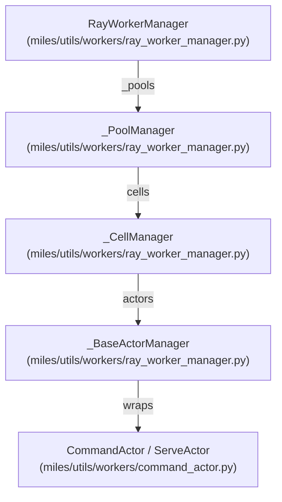
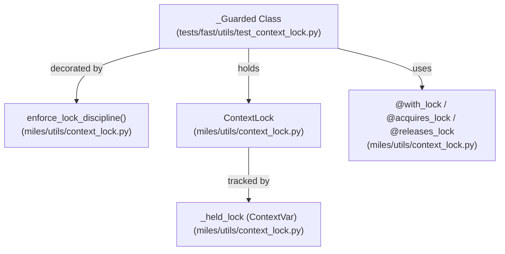

<!-- source: DeepWiki mcp.deepwiki.com · repo radixark/miles · page 3.5 Worker Management and RPC Infrastructure · fetched 2026-10-21 -->

# Worker Management and RPC Infrastructure

<details>
<summary>Relevant source files</summary>

The following files were used as context for generating this wiki page:

- [miles/ray/specs/inference.py](miles/ray/specs/inference.py)
- [miles/rollout/session/server.py](miles/rollout/session/server.py)
- [miles/utils/context_lock.py](miles/utils/context_lock.py)
- [miles/utils/workers/ray_worker_handle.py](miles/utils/workers/ray_worker_handle.py)
- [miles/utils/workers/ray_worker_manager.py](miles/utils/workers/ray_worker_manager.py)
- [miles/utils/workers/rpc/client/call.py](miles/utils/workers/rpc/client/call.py)
- [miles/utils/workers/rpc/client/handle.py](miles/utils/workers/rpc/client/handle.py)
- [miles/utils/workers/rpc/client/misc.py](miles/utils/workers/rpc/client/misc.py)
- [miles/utils/workers/rpc/common/metadata.py](miles/utils/workers/rpc/common/metadata.py)
- [miles/utils/workers/rpc/common/serialization.py](miles/utils/workers/rpc/common/serialization.py)
- [miles/utils/workers/rpc/server/executor.py](miles/utils/workers/rpc/server/executor.py)
- [miles/utils/workers/worker_handle.py](miles/utils/workers/worker_handle.py)
- [miles/utils/workers/worker_spec.py](miles/utils/workers/worker_spec.py)
- [tests/fast/ray/specs/test_inference.py](tests/fast/ray/specs/test_inference.py)
- [tests/fast/rollout/session/test_server.py](tests/fast/rollout/session/test_server.py)
- [tests/fast/utils/test_context_lock.py](tests/fast/utils/test_context_lock.py)
- [tests/fast/utils/test_context_lock_failure_patterns.py](tests/fast/utils/test_context_lock_failure_patterns.py)
- [tests/fast/utils/test_mini_ft_controller.py](tests/fast/utils/test_mini_ft_controller.py)
- [tests/fast/utils/workers/e2e/conftest.py](tests/fast/utils/workers/e2e/conftest.py)
- [tests/fast/utils/workers/e2e/e2e_worker.py](tests/fast/utils/workers/e2e/e2e_worker.py)
- [tests/fast/utils/workers/e2e/test_client_local_validation.py](tests/fast/utils/workers/e2e/test_client_local_validation.py)
- [tests/fast/utils/workers/e2e/test_client_retry.py](tests/fast/utils/workers/e2e/test_client_retry.py)
- [tests/fast/utils/workers/e2e/test_complex_types.py](tests/fast/utils/workers/e2e/test_complex_types.py)
- [tests/fast/utils/workers/e2e/test_concurrency.py](tests/fast/utils/workers/e2e/test_concurrency.py)
- [tests/fast/utils/workers/e2e/test_happy_path.py](tests/fast/utils/workers/e2e/test_happy_path.py)
- [tests/fast/utils/workers/e2e/test_protocol_raw_http.py](tests/fast/utils/workers/e2e/test_protocol_raw_http.py)
- [tests/fast/utils/workers/e2e/test_worker_errors.py](tests/fast/utils/workers/e2e/test_worker_errors.py)
- [tests/fast/utils/workers/fake_ray.py](tests/fast/utils/workers/fake_ray.py)
- [tests/fast/utils/workers/real_ray/test_ray_worker_manager.py](tests/fast/utils/workers/real_ray/test_ray_worker_manager.py)
- [tests/fast/utils/workers/real_ray/test_worker_handle.py](tests/fast/utils/workers/real_ray/test_worker_handle.py)
- [tests/fast/utils/workers/rpc/client/test_handle.py](tests/fast/utils/workers/rpc/client/test_handle.py)
- [tests/fast/utils/workers/rpc/client/test_misc.py](tests/fast/utils/workers/rpc/client/test_misc.py)
- [tests/fast/utils/workers/rpc/common/postponed_annotation_worker.py](tests/fast/utils/workers/rpc/common/postponed_annotation_worker.py)
- [tests/fast/utils/workers/rpc/common/test_metadata.py](tests/fast/utils/workers/rpc/common/test_metadata.py)
- [tests/fast/utils/workers/rpc/common/test_serialization.py](tests/fast/utils/workers/rpc/common/test_serialization.py)
- [tests/fast/utils/workers/test_ray_worker_manager.py](tests/fast/utils/workers/test_ray_worker_manager.py)
- [tests/fast/utils/workers/test_ray_worker_manager_serve.py](tests/fast/utils/workers/test_ray_worker_manager_serve.py)
- [tests/fast/utils/workers/test_worker_handle.py](tests/fast/utils/workers/test_worker_handle.py)
- [tests/fast/utils/workers/test_worker_spec.py](tests/fast/utils/workers/test_worker_spec.py)
- [tests/snapshots/charts/miles-run/typical-values.yaml](tests/snapshots/charts/miles-run/typical-values.yaml)
- [tests/snapshots/charts/miles-run/typical.yaml](tests/snapshots/charts/miles-run/typical.yaml)

</details>


## 1. Purpose and Scope
Miles orchestrates heterogeneous distributed workers—including SGLang inference engines, routers, session servers, and rollout managers—across Ray clusters. The worker management infrastructure (`miles/utils/workers/`) provides:
- Declarative worker specifications via `BaseWorkerSpec`, `CommandWorkerSpec`, and `ServeWorkerSpec` [miles/utils/workers/worker_spec.py:97-152]().
- Ray orchestration and lifecycle management via `RayWorkerManager`, pool managers, and cell managers [miles/utils/workers/ray_worker_manager.py:56-104]().
- Dynamic port allocation and address resolution via `PortAllocator` [miles/utils/workers/ray_worker_manager.py:58]().
- An asynchronous RPC client/server layer (`miles/utils/workers/rpc/`) for inter-actor messaging.
- Reentrant concurrency control and discipline enforcement via `ContextLock` and function decorators (`miles/utils/context_lock.py`) [miles/utils/context_lock.py:33-145]().

Sources: `miles/utils/workers/ray_worker_manager.py`, `miles/utils/workers/worker_spec.py`, `miles/utils/context_lock.py`

---

## 2. Worker Specifications and Hierarchy
Worker configurations are defined using Pydantic models in `miles/utils/workers/worker_spec.py` [miles/utils/workers/worker_spec.py:1-166]().

### Spec Types and Configuration
- **`BaseWorkerSpec`**: Defines base pool properties such as `name`, `port_infos`, `env_var` builders, and `SchedulingSpec` [miles/utils/workers/worker_spec.py:97-106]().
- **`CommandWorkerSpec`**: Extends `BaseWorkerSpec` for subprocess-backed actors using a `launch_command` callback that accepts a `LaunchCommandContext` [miles/utils/workers/worker_spec.py:145-147]().
- **`ServeWorkerSpec`**: Extends `BaseWorkerSpec` for Ray Actor-backed workers (`worker_class`, `ctor_kwargs`), automatically injecting an `rpc` port info entry if absent [miles/utils/workers/worker_spec.py:150-166]().

### Pools and Cells Topology
Workers are grouped into logical **Pools** (e.g., `INFERENCE_CONTROLLER_POOL_ID` [miles/ray/specs/inference.py:37](), `SESSION_SERVER_POOL_ID` [miles/ray/specs/inference.py:38]()) and partitioned into **Cells** [miles/utils/workers/ray_worker_manager.py:79](). Each cell contains worker actors managed by `_BaseActorManager` subclasses [miles/utils/workers/ray_worker_manager.py:130]().

Diagram: Ray Worker Management Code Entity Topology

Sources: `miles/utils/workers/ray_worker_manager.py`, `miles/ray/specs/inference.py`, `miles/utils/workers/worker_spec.py`

---

## 3. RayWorkerManager and Lifecycle Orchestration
`RayWorkerManager` is a singleton Ray actor registered under the well-known name `_ACTOR_NAME = "ray_worker_manager"` [miles/utils/workers/ray_worker_manager.py:51]().

### Initialization and Lifecycle Flow
1. **Launch**: `RayWorkerManager.launch()` initializes the Ray remote actor and invokes `init()` [miles/utils/workers/ray_worker_manager.py:60-66]().
2. **Cell Startup**: `init()` builds pool managers and calls `start_cells()` across cell identifiers [miles/utils/workers/ray_worker_manager.py:72-84]().
3. **Actor Launch & Port Allocation**: `_CellManager` coordinates `launch_actors()`, `alloc_ports()`, and `post_setup()` under an asynchronous `_membership_lock` [miles/utils/workers/ray_worker_manager.py:85-95]().
4. **Fault Rollback**: Failures during cell startup trigger `asyncio.gather(*[c.stop() for c in cells])` to clean up partially provisioned resources [miles/utils/workers/ray_worker_manager.py:92-95]().

Diagram: RayWorkerManager Lifecycle Sequence
```mermaid
sequenceDiagram
    participant Driver as "Driver"
    participant RWM as "RayWorkerManager\n(ray_worker_manager.py)"
    participant CM as "_CellManager\n(ray_worker_manager.py)"
    participant Actor as "_BaseActorManager\n(ray_worker_manager.py)"

    Driver->>RWM: "launch(args, specs, pgs)"
    RWM->>RWM: "init(args, specs, pgs)"
    RWM->>CM: "start_cells(cell_ids)"
    CM->>Actor: "launch_actors()"
    CM->>Actor: "alloc_ports()"
    CM->>Actor: "post_setup()"
    RWM-->>Driver: "ActorHandle"
```
Sources: `miles/utils/workers/ray_worker_manager.py`

---

## 4. Port and Address Allocation
Port configuration and allocation are managed by `PortAllocator` and `PortInfo` [miles/utils/workers/ray_worker_manager.py:58](), [miles/utils/workers/worker_spec.py:20]().

### Port Properties & Constraints
- **`mode`**: Supports `"per_worker"` (unique ports per instance) or `"master"` (shared endpoint across the pod) [miles/utils/workers/worker_spec.py:23]().
- **`allow_dynamic`**: Allows dynamic port fallback if a static port is unavailable [miles/utils/workers/worker_spec.py:24]().
- **`num_consecutive`**: Reserves contiguous port ranges for libraries like NCCL [miles/utils/workers/worker_spec.py:25]().
- **`offset_by_cell`**: Shifts static ports by cell index, rejecting dynamic allocation configurations via Pydantic model validation [miles/utils/workers/worker_spec.py:26-38]().

Workers retrieve addresses via `get_worker_addrs(worker_name)` returning `NamedHostAndPorts` (`dict[str, HostAndPort]`) [miles/utils/workers/ray_worker_manager.py:116-122](), [miles/utils/workers/worker_spec.py:135-136]().

Sources: `miles/utils/workers/ray_worker_manager.py`, `miles/utils/workers/worker_spec.py`

---

## 5. Worker RPC Client and Server Layer
The `miles/utils/workers/rpc/` module implements asynchronous RPC communication between Ray actors and external clients.
- **Server Execution**: FastAPI/ASGI servers hosted via `ServeActor` dispatch requests through internal executors (`miles/utils/workers/rpc/server/executor.py`) [miles/utils/workers/ray_worker_manager.py:27](), [miles/utils/workers/rpc/server/executor.py]().
- **Client Handling**: `RayWorkerHandle` and RPC client modules manage HTTP request dispatching, structured serialization of tensors/metadata, and automatic retries [miles/utils/workers/ray_worker_manager.py:25](), [miles/utils/workers/rpc/common/serialization.py]().

Sources: `miles/utils/workers/ray_worker_manager.py`, `miles/utils/workers/rpc/server/executor.py`, `miles/utils/workers/rpc/common/serialization.py`

---

## 6. Context Locking and Discipline Utilities
Concurrency safety inside controllers and rollout components is enforced using reentrant-aware `ContextLock` primitives and decorator validation in `miles/utils/context_lock.py` [miles/utils/context_lock.py:33-192]().

### `ContextLock` Mechanics
- Uses `contextvars.ContextVar` (`_held_lock`) to track lock ownership per asynchronous execution context [miles/utils/context_lock.py:30, 50-54]().
- **`acquire()`**: Acquires the underlying `asyncio.Lock`, logs warnings if waiting exceeds `WAIT_LOG_INTERVAL_SECONDS = 5.0`, and records a generation grant [miles/utils/context_lock.py:14, 71-79]().
- **`detach()` / `reattach()`**: Permits tasks to temporarily yield lock ownership across asynchronous boundaries [miles/utils/context_lock.py:100-112]().

### Discipline Decorators
Classes wrapped with `@enforce_lock_discipline` enforce that methods use proper locking markers [miles/utils/context_lock.py:134-145]():
- **`@with_lock`**: Automatically acquires and releases the object's `ContextLock` [miles/utils/context_lock.py:148-158]().
- **`@acquires_lock`**: Acquires the lock and detaches it upon completion [miles/utils/context_lock.py:160-176]().
- **`@releases_lock`**: Reattaches a detached lock and releases it [miles/utils/context_lock.py:179-192]().
- **`@requires_lock`**: Asserts that `held_in_current_context` is true [tests/fast/utils/test_context_lock.py:74-86]().
- **`@lock_exempt`**: Bypasses discipline checks for initialization methods [tests/fast/utils/test_context_lock.py:40-41]().

Diagram: Context Locking Discipline Code Entity Architecture

Sources: `miles/utils/context_lock.py`, `tests/fast/utils/test_context_lock.py`

---

