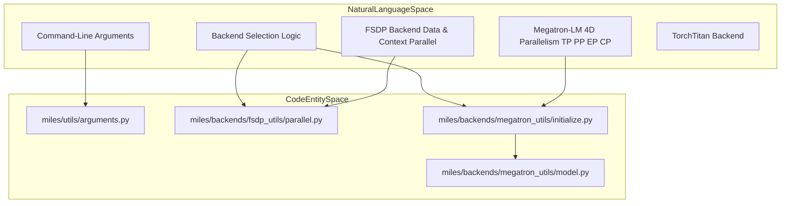
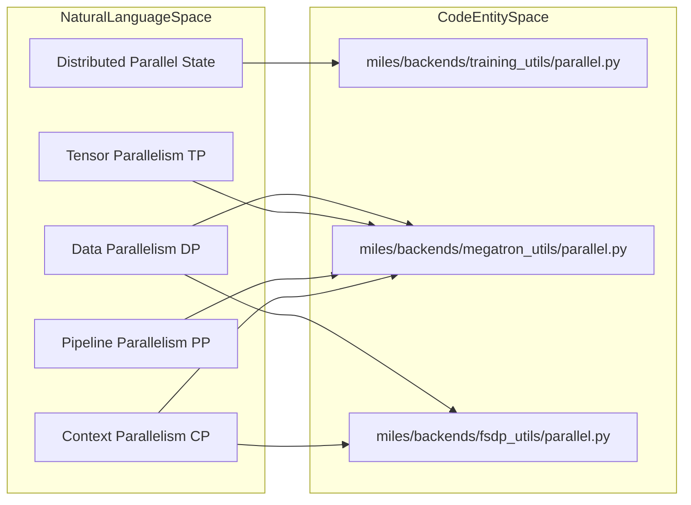

<!-- source: DeepWiki mcp.deepwiki.com · repo radixark/miles · page 4 Distributed Training Backends · fetched 2026-10-21 -->

# Distributed Training Backends

Relevant source files

The following files were used as context for generating this wiki page:

- [miles/backends/fsdp_utils/actor.py](miles/backends/fsdp_utils/actor.py)
- [miles/backends/fsdp_utils/arguments.py](miles/backends/fsdp_utils/arguments.py)
- [miles/backends/fsdp_utils/checkpoint.py](miles/backends/fsdp_utils/checkpoint.py)
- [miles/backends/megatron_utils/actor.py](miles/backends/megatron_utils/actor.py)
- [miles/backends/megatron_utils/model.py](miles/backends/megatron_utils/model.py)
- [miles/backends/megatron_utils/optimizer_state_reset.py](miles/backends/megatron_utils/optimizer_state_reset.py)
- [miles/utils/arguments.py](miles/utils/arguments.py)
- [miles/utils/workers/types.py](miles/utils/workers/types.py)
- [tests/fast/backends/megatron_utils/test_model_initialize.py](tests/fast/backends/megatron_utils/test_model_initialize.py)
- [tests/fast/backends/megatron_utils/test_optimizer_state_reset.py](tests/fast/backends/megatron_utils/test_optimizer_state_reset.py)
- [tests/fast/backends/megatron_utils/test_shared_ppo_lifecycle.py](tests/fast/backends/megatron_utils/test_shared_ppo_lifecycle.py)
- [tests/fast/ray/rollout/conftest.py](tests/fast/ray/rollout/conftest.py)
- [tests/fast/utils/test_arguments.py](tests/fast/utils/test_arguments.py)
- [tests/fast/utils/workers/test_worker_comm_backend.py](tests/fast/utils/workers/test_worker_comm_backend.py)

## Purpose and Scope

This page provides an architectural overview of Miles' distributed training backend options: **FSDP** (Fully Sharded Data Parallel via PyTorch FSDP2), **Megatron-LM**, and **TorchTitan**. It details how training backends are abstracted, compares their capabilities and parallelism trade-offs, and guides developers on choosing the appropriate backend for large-scale RL training.

For implementation specifics of each backend, consult the respective child pages:
- FSDP implementation: [FSDP Backend](#4.1)
- Megatron implementation: [Megatron Backend](#4.2)
- TorchTitan implementation: [TorchTitan Backend](#4.3)

For overarching training orchestration details, see [Training Orchestration](#3.2).

---

## Backend Architecture and Selection

Miles abstracts distributed training actors behind a unified interface (`TrainRayActor`), allowing seamless switching between backend implementations via command-line arguments. The initialization and parallel state configuration are handled during actor setup.

### Backend Initialization and Code Mapping

Sources: [miles/utils/arguments.py:1-70](), [miles/backends/megatron_utils/initialize.py:64-135](), [miles/backends/fsdp_utils/parallel.py:14-43]()

### Parallel State and Distributed Topology

Both backends construct a uniform `ParallelState` instance to manage process topologies for tensor parallelism, pipeline parallelism, context parallelism, and data parallelism.

Sources: [miles/backends/training_utils/parallel.py:33-51](), [miles/backends/megatron_utils/parallel.py:18-65](), [miles/backends/fsdp_utils/parallel.py:14-43]()

---

## Backend Comparison

### Parallelism Strategies

*   **FSDP Backend**: Operates primarily via PyTorch FSDP2 sharding across the data-parallel group, combined with Context Parallelism (`cp`) for long-sequence training. It operates without Tensor or Pipeline Parallelism. [miles/backends/fsdp_utils/arguments.py:58-65]()
*   **Megatron-LM Backend**: Implements full 4D parallelism (`tp`, `pp`, `ep`, `cp`), making it suitable for massive models (70B+ parameters) and Mixture-of-Experts (MoE) architectures. [miles/backends/megatron_utils/actor.py:105-160]()
*   **TorchTitan Backend**: Leverages native PyTorch modular training components (`miles/backends/torchtitan_utils`), providing a lightweight alternative configured for modern modular parallelism and HuggingFace weight iterators.

Sources: [miles/backends/megatron_utils/arguments.py:12-17](), [miles/backends/fsdp_utils/arguments.py:58-65]()

### Feature Matrix

| Feature | FSDP Backend | Megatron-LM Backend | TorchTitan Backend |
|---------|--------------|---------------------|---------------------|
| **Tensor Parallelism (TP)** | ✗ | ✓ [miles/backends/megatron_utils/parallel.py:41-45]() | ✓ (Modular TP) |
| **Pipeline Parallelism (PP)** | ✗ | ✓ [miles/backends/megatron_utils/parallel.py:46-50]() | ✗ |
| **Expert Parallelism (EP)** | ✗ | ✓ [miles/backends/megatron_utils/parallel.py:51-55]() | ✓ (TorchTitan MoE) |
| **Context Parallelism (CP)** | ✓ (Ring/Ulysses) | ✓ [miles/backends/megatron_utils/initialize.py:50-51]() | ✓ |
| **Optimizer Support** | PyTorch / Custom Muon | Distributed Optimizer / Adam / Muon [miles/backends/megatron_utils/arguments.py:20-27]() | PyTorch Native / Titan Optimizers |
| **True On-Policy Mode** | Fully Supported | Not Supported | Supported via Native PyTorch |

Sources: [miles/utils/arguments.py:10-21](), [miles/backends/megatron_utils/arguments.py:12-27](), [miles/backends/fsdp_utils/arguments.py:10-29]()

---

## Decision Guide: When to Use Each Backend

### Choose FSDP When:
1.  **Training smaller to medium models** (< 70B parameters) where single-node or standard data parallelism suffices.
2.  **Running True On-Policy Mode (`--true-on-policy-mode`)**, which currently requires the FSDP backend due to deterministic kernel and log-probability alignment constraints.
3.  **Prototyping rapidly** with standard HuggingFace model loading and minimal parallelism configuration overhead.

Sources: [miles/utils/arguments.py:10-21](), [miles/backends/fsdp_utils/arguments.py:61-65]()

### Choose Megatron-LM When:
1.  **Scaling to 70B+ parameter models** requiring Pipeline Parallelism (`pp`) and Tensor Parallelism (`tp`) to fit within GPU memory limits.
2.  **Training Mixture-of-Experts (MoE)** models that mandate Expert Parallelism (`ep`) and custom routing handling.
3.  **Handling extreme context lengths** where Megatron's optimized Context Parallelism stack is required.

Sources: [miles/backends/megatron_utils/arguments.py:12-17](), [miles/backends/megatron_utils/initialize.py:41-62]()

### Choose TorchTitan When:
1.  **Leveraging PyTorch native modular components** (`miles/backends/torchtitan_utils`) for experimental parallel configurations.
2.  **Integrating native HuggingFace weight iterators** with custom loss and routing replay logic outside of Megatron's ecosystem.

Sources: [miles/utils/arguments.py:10-35]()

---

## Child Pages

For deep technical dives into each implementation, refer to the child pages:
- [FSDP Backend](#4.1) — Details on `FSDPTrainRayActor`, FSDP2 wrapping strategy, LoRA support, and checkpoint management.
- [Megatron Backend](#4.2) — Details on `MegatronTrainRayActor`, 4D parallelism (`tp`/`pp`/`ep`/`cp`), model providers, and Megatron-LM integration.
- [TorchTitan Backend](#4.3) — Details on `miles/backends/torchtitan_utils` backend: actor, trainer, parallel config, loss, routing replay, and HF weight iterator.

---

