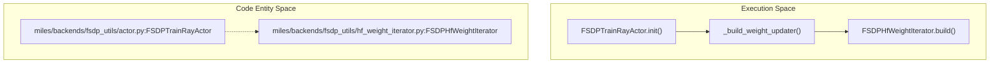

<!-- source: DeepWiki mcp.deepwiki.com · repo radixark/miles · page 4.1 FSDP Backend · fetched 2026-10-21 -->

# FSDP Backend

Relevant source files

The following files were used as context for generating this wiki page:

- [miles/backends/fsdp_utils/actor.py](miles/backends/fsdp_utils/actor.py)
- [miles/backends/fsdp_utils/arguments.py](miles/backends/fsdp_utils/arguments.py)
- [miles/backends/fsdp_utils/checkpoint.py](miles/backends/fsdp_utils/checkpoint.py)
- [miles/backends/fsdp_utils/parallel.py](miles/backends/fsdp_utils/parallel.py)
- [miles/backends/megatron_utils/actor.py](miles/backends/megatron_utils/actor.py)
- [miles/backends/megatron_utils/ci_utils.py](miles/backends/megatron_utils/ci_utils.py)
- [miles/backends/megatron_utils/initialize.py](miles/backends/megatron_utils/initialize.py)
- [miles/backends/megatron_utils/model.py](miles/backends/megatron_utils/model.py)
- [miles/backends/megatron_utils/optimizer_state_reset.py](miles/backends/megatron_utils/optimizer_state_reset.py)
- [miles/backends/megatron_utils/parallel.py](miles/backends/megatron_utils/parallel.py)
- [miles/backends/training_utils/parallel.py](miles/backends/training_utils/parallel.py)
- [miles/utils/arguments.py](miles/utils/arguments.py)
- [miles/utils/workers/types.py](miles/utils/workers/types.py)
- [tests/fast-gpu/_fsdp_hybrid_shard_worker.py](tests/fast-gpu/_fsdp_hybrid_shard_worker.py)
- [tests/fast/backends/megatron_utils/test_initialize.py](tests/fast/backends/megatron_utils/test_initialize.py)
- [tests/fast/backends/megatron_utils/test_model_initialize.py](tests/fast/backends/megatron_utils/test_model_initialize.py)
- [tests/fast/backends/megatron_utils/test_optimizer_state_reset.py](tests/fast/backends/megatron_utils/test_optimizer_state_reset.py)
- [tests/fast/backends/megatron_utils/test_shared_ppo_lifecycle.py](tests/fast/backends/megatron_utils/test_shared_ppo_lifecycle.py)
- [tests/fast/ray/rollout/conftest.py](tests/fast/ray/rollout/conftest.py)
- [tests/fast/utils/test_arguments.py](tests/fast/utils/test_arguments.py)
- [tests/fast/utils/workers/test_worker_comm_backend.py](tests/fast/utils/workers/test_worker_comm_backend.py)

## Purpose and Scope

The FSDP Backend provides a PyTorch-native distributed training implementation using FSDP2 (Fully Sharded Data Parallel, version 2) for training large language models. This backend serves as an alternative to the Megatron backend and is selected via configuration arguments or the FSDP argument parser (`build_fsdp_parser`).

Key characteristics:
- **Direct HuggingFace Loading**: Loads models directly from HuggingFace format via `load_hf_assets` and `AutoModelForCausalLM.from_pretrained()`, bypassing manual checkpoint conversion steps `[miles/backends/fsdp_utils/actor.py:84]()`.
- **Hybrid Sharding & Parallelism**: Supports data parallelism and optional context parallelism via `create_fsdp_parallel_state` `[miles/backends/fsdp_utils/actor.py:64]()`, with configurable replication size (`dp_replicate_size`) `[miles/backends/fsdp_utils/arguments.py:59]()`.
- **CPU Offloading**: Supports aggressive CPU offloading for states, parameters, and gradients via `fsdp_cpu_offload` `[miles/backends/fsdp_utils/arguments.py:52-54]()`.

Sources: `[miles/backends/fsdp_utils/actor.py:36-85]()`, `[miles/backends/fsdp_utils/arguments.py:10-77]()`

---

## Architecture Overview and FSDPTrainRayActor

The core execution unit of the FSDP backend is `FSDPTrainRayActor`, which inherits from `TorchNativeTrainRayActor` `[miles/backends/fsdp_utils/actor.py:36-37]()`. It manages initialization, precision policies, patching, FSDP2 model wrapping, and weight updates.

### FSDP Actor Initialization and Training Flow

```mermaid
graph TB
    subgraph "Execution Space"
        INIT["FSDPTrainRayActor.init()"]
        PARALLEL["create_fsdp_parallel_state()"]
        LOAD_HF["load_hf_assets()"]
        PATCH["apply_class_patches()"]
        BUILD_MODEL["_build_model_with_attn_bridge()"]
        FSDP_WRAP["apply_fsdp2()"]
        
        INIT --> PARALLEL
        PARALLEL --> LOAD_HF
        LOAD_HF --> PATCH
        PATCH --> BUILD_MODEL
        BUILD_MODEL --> FSDP_WRAP
    end
    
    subgraph "Code Entity Space"
        ACTOR["miles/backends/fsdp_utils/actor.py:FSDPTrainRayActor"]
        PARALLEL_MOD["miles/backends/fsdp_utils/parallel.py:create_fsdp_parallel_state"]
        WEIGHT_ITER["miles/backends/fsdp_utils/hf_weight_iterator.py:FSDPHfWeightIterator"]
        
        ACTOR -.-> PARALLEL_MOD
        ACTOR -.-> WEIGHT_ITER
    end
```

**Key Components:**
- **`FSDPTrainRayActor`**: Manages the local training process, model weights, and integration with Ray `[miles/backends/fsdp_utils/actor.py:36-37]()`.
- **Precision Policy**: Resolved via `resolve_precision_policy()`, dictating parameter and reduction data types `[miles/backends/fsdp_utils/actor.py:86]()`.
- **Routing Replay**: Integrated via `routing_replay.enable()` and `routing_replay.install()` for MoE expert routing consistency `[miles/backends/fsdp_utils/actor.py:88,108]()`.

Sources: `[miles/backends/fsdp_utils/actor.py:36-114]()`, `[miles/backends/fsdp_utils/parallel.py]()`

---

## FSDP2 Configuration and Wrapping Strategy

The FSDP2 wrapping strategy handles sharding across device meshes and applies precision configurations defined in `FSDPArgs` `[miles/backends/fsdp_utils/arguments.py:10-77]()`.

### Configuration Parameters

| Argument | Type | Default | Description |
|----------|------|---------|-------------|
| `fsdp_cpu_offload` | `bool` | `False` | Offloads parameters, gradients, and optimizer states to CPU `[miles/backends/fsdp_utils/arguments.py:52-54]()`. |
| `fsdp_state_dict_cpu_offload` | `bool` | `True` | Offloads full state dict to CPU during collection `[miles/backends/fsdp_utils/arguments.py:51]()`. |
| `dp_replicate_size` | `int` | `1` | FSDP2 hybrid-shard replica count `[miles/backends/fsdp_utils/arguments.py:59]()`. |
| `fsdp_cpu_backend` | `str \| None` | `"gloo"` | CPU backend for FSDP CPU offload `[miles/backends/fsdp_utils/arguments.py:55-57]()`. |

Sources: `[miles/backends/fsdp_utils/arguments.py:10-77]()`

---

## Checkpoint Management

Checkpoint saving and loading in the FSDP backend leverages PyTorch's native state dict collection utilities, coordinated by the `checkpoint` module `[miles/backends/fsdp_utils/checkpoint.py]` and invoked within `FSDPTrainRayActor.init()` `[miles/backends/fsdp_utils/actor.py:160]()`.

- **Full State Dict Loading**: `_fsdp2_load_full_state_dict()` reloads complete state dictionaries into the sharded FSDP model instance `[miles/backends/fsdp_utils/actor.py:131-136]()`.
- **CPU Offloading during Checkpointing**: Controlled by `fsdp_state_dict_cpu_offload` to prevent out-of-memory errors on GPU when gathering parameters for serialization `[miles/backends/fsdp_utils/arguments.py:51]()`.

Sources: `[miles/backends/fsdp_utils/actor.py:131-160]()`, `[miles/backends/fsdp_utils/checkpoint.py]()`, `[miles/backends/fsdp_utils/arguments.py:51]()`

---

## Weight Synchronization and Iteration

Weight updates transferred from the training actor to the SGLang rollout engines are managed via `FSDPHfWeightIterator` `[miles/backends/fsdp_utils/actor.py:170]()`, which iterates over sharded parameters and prepares them for synchronization.

### Weight Sync Architecture

- **`FSDPHfWeightIterator`**: Extracts and formats model weights from the FSDP2 sharded state structures into HuggingFace-compatible formats for downstream rollout consumption `[miles/backends/fsdp_utils/actor.py:170]()`.
- **Optimizer Integration**: Supports standard AdamW optimization configured via `FSDPArgs` parameters (`lr`, `adam_beta1`, `adam_beta2`, `weight_decay`) bound directly to model parameters `[miles/backends/fsdp_utils/actor.py:143-150]()`.

Sources: `[miles/backends/fsdp_utils/actor.py:143-172]()`, `[miles/backends/fsdp_utils/hf_weight_iterator.py]()`

---

