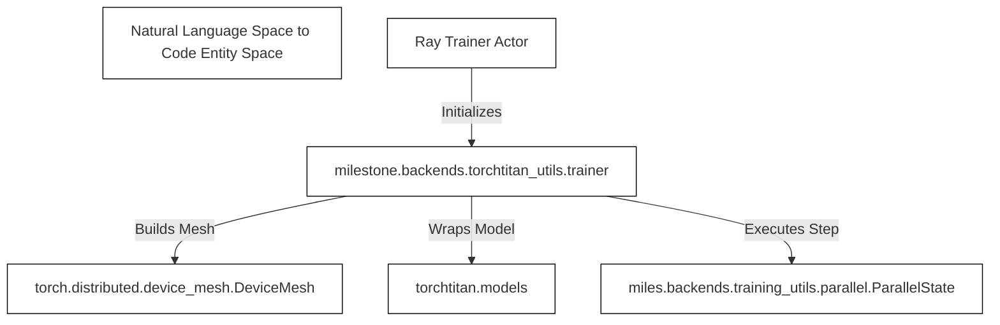
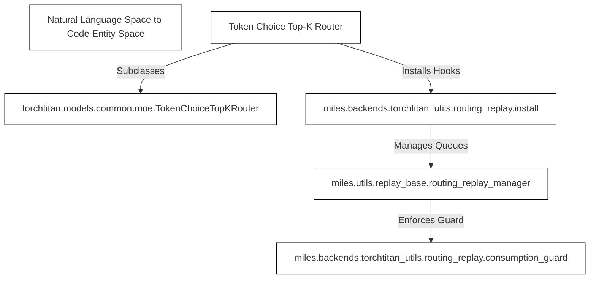

<!-- source: DeepWiki mcp.deepwiki.com · repo radixark/miles · page 4.3 TorchTitan Backend · fetched 2026-10-21 -->

# TorchTitan Backend

<details>
<summary>Relevant source files</summary>

The following files were used as context for generating this wiki page:

- [miles/backends/fsdp_utils/parallel.py](miles/backends/fsdp_utils/parallel.py)
- [miles/backends/megatron_utils/ci_utils.py](miles/backends/megatron_utils/ci_utils.py)
- [miles/backends/megatron_utils/initialize.py](miles/backends/megatron_utils/initialize.py)
- [miles/backends/megatron_utils/parallel.py](miles/backends/megatron_utils/parallel.py)
- [miles/backends/training_utils/parallel.py](miles/backends/training_utils/parallel.py)
- [miles_plugins/models/qwen3_8_next/hyper_connection.py](miles_plugins/models/qwen3_8_next/hyper_connection.py)
- [miles_plugins/models/qwen3_8_next/ops/attention.py](miles_plugins/models/qwen3_8_next/ops/attention.py)
- [miles_plugins/models/qwen3_8_next/ops/ple.py](miles_plugins/models/qwen3_8_next/ops/ple.py)
- [tests/fast-gpu/_fsdp_hybrid_shard_worker.py](tests/fast-gpu/_fsdp_hybrid_shard_worker.py)
- [tests/fast-gpu/test_nvme_optimizer_main_init.py](tests/fast-gpu/test_nvme_optimizer_main_init.py)
- [tests/fast-gpu/test_qwen3_8_next_long_offsets.py](tests/fast-gpu/test_qwen3_8_next_long_offsets.py)
- [tests/fast-gpu/test_qwen3_8_next_ops.py](tests/fast-gpu/test_qwen3_8_next_ops.py)
- [tests/fast-gpu/test_torchtitan_routing_replay.py](tests/fast-gpu/test_torchtitan_routing_replay.py)
- [tests/fast/backends/megatron_utils/test_initialize.py](tests/fast/backends/megatron_utils/test_initialize.py)
- [tests/fast/test_qsa_block_sparse_attn.py](tests/fast/test_qsa_block_sparse_attn.py)
- [tests/fast/test_qsa_tile_index.py](tests/fast/test_qsa_tile_index.py)

</details>


## Purpose and Scope
This document provides full technical documentation for the TorchTitan backend integration within Miles (`miles/backends/torchtitan_utils`). It covers the actor and trainer abstractions, parallel configuration, loss integration, MoE routing replay mechanisms, HuggingFace weight iteration strategies, and architectural comparisons against the FSDP and Megatron backend implementations.

---

## 1. TorchTitan Actor and Trainer Integration
The TorchTitan backend wraps PyTorch-native native training paradigms (leveraging FSDP2 and device meshes) into the Ray-based actor framework used by Miles. While Megatron-LM manages custom 4D parallelism and FSDP utilizes direct `fully_shard` APIs, the TorchTitan backend uses TorchTitan's modular components for configuring transformer layers, optimizers, and data parallel execution.


*Figure 1: Natural Language Space to Code Entity Space mapping for TorchTitan initialization.*

Sources: `miles/backends/training_utils/parallel.py:33-87`

---

## 2. Parallelism Configuration and State Management
Parallelism state across all backends is unified through the `ParallelState` dataclass defined in `miles/backends/training_utils/parallel.py`. The TorchTitan backend populates these fields using PyTorch device meshes and process groups.

```python
@dataclass
class ParallelState:
    intra_dp: GroupInfo
    intra_dp_cp: GroupInfo
    cp: GroupInfo
    tp: GroupInfo
    pp: GroupInfo
    ep: GroupInfo
    etp: GroupInfo
    indep_dp: GroupInfo
    edp: GroupInfo | None = None
    tp_dp_cp: GroupInfo | None = None
    meshes: dict[str, DeviceMesh] = field(default_factory=dict)
    cp_comm_type: str | list[str] | tuple[str, ...] | None = None
    is_pp_last_stage: bool = True
    vpp_size: int | None = 1
    microbatch_group_size_per_vp_stage: int | None = None
```
*(Reference: `miles/backends/training_utils/parallel.py:33-54`)*

The `ParallelState` exposes property evaluators for runtime mode detection (`_DPMode.INTRA` vs `_DPMode.INDEP`), metrics reporting rank checks (`is_metrics_rank`), and communication backend selection (`is_ulysses_cp`):

```python
    @property
    def is_metrics_rank(self) -> bool:
        return self.effective_dp_cp.rank == 0 and self.tp.rank == 0 and self.is_pp_last_stage

    @property
    def is_ulysses_cp(self) -> bool:
        cp_comm_type = self.cp_comm_type
        if isinstance(cp_comm_type, (list, tuple)):
            cp_comm_type = cp_comm_type[0] if cp_comm_type else None
        return self.cp.size > 1 and cp_comm_type == "a2a"
```
*(Reference: `miles/backends/training_utils/parallel.py:75-84`)*

Sources: `miles/backends/training_utils/parallel.py:33-87`

---

## 3. MoE Routing Replay in TorchTitan
To prevent train-inference divergence in Mixture-of-Experts (MoE) models, the TorchTitan backend implements Rollout Routing Replay (R3). During rollout generation, expert routing choices are recorded and subsequently replayed during training microbatches.


*Figure 2: Routing Replay mapping for MoE expert synchronization.*

Sources: `tests/fast-gpu/test_torchtitan_routing_replay.py:38-78`

The routing replay mechanism ensures that microbatches consume exact recorded expert selections, throwing errors if stray forwards or unaligned recomputes occur:

```python
def test_each_microbatch_replays_its_own_entry(part):
    _queue_microbatches(3)
    scores = torch.rand(1, 4, 8, device="cuda")

    with routing_replay.consumption_guard([part], 3):
        for expected in range(3):
            assert part(scores).unique().tolist() == [expected]
```
*(Reference: `tests/fast-gpu/test_torchtitan_routing_replay.py:91-98`)*

Sources: `tests/fast-gpu/test_torchtitan_routing_replay.py:33-164`

---

## 4. HF Weight Iterator and Backend Comparisons
Unlike Megatron (which requires explicit weight layout transformations or bridge files) and FSDP (which natively loads PyTorch state dicts), the TorchTitan backend interfaces directly with HuggingFace (HF) weight iterators to stream model parameters into sharded device tensors.

| Feature / Dimension | FSDP Backend (`miles/backends/fsdp_utils`) | Megatron Backend (`miles/backends/megatron_utils`) | TorchTitan Backend (`miles/backends/torchtitan_utils`) |
| :--- | :--- | :--- | :--- |
| **Sharding Strategy** | FSDP2 (`fully_shard`) | 4D Parallelism (TP/PP/EP/CP) | TorchTitan / FSDP Device Mesh |
| **Model Definition** | Native PyTorch `nn.Module` | Megatron Core Modules (`MegatronModule`) | TorchTitan Modular Architectures |
| **Weight Loading** | Direct state-dict sharding | Custom Bridge / HF Converter | HF Weight Iterator Streamer |
| **Routing Replay** | Optional / Custom | Native Megatron MoE Integration | `torchtitan_utils.routing_replay` |

Sources: `miles/backends/fsdp_utils/parallel.py:46-99`, `miles/backends/megatron_utils/parallel.py:19-77`, `tests/fast-gpu/test_torchtitan_routing_replay.py:28-56`

---

