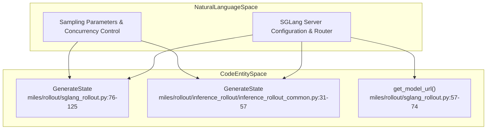
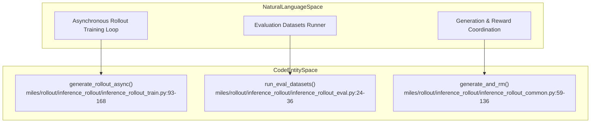
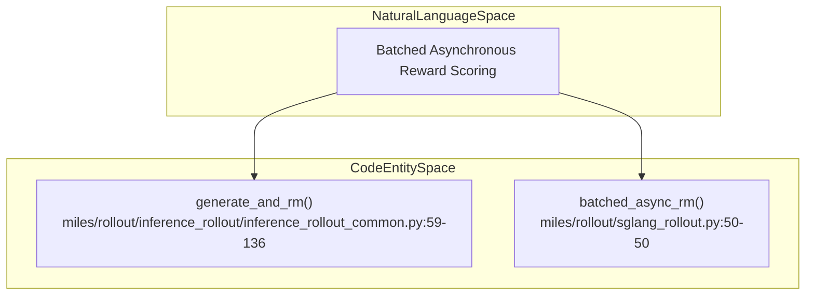

<!-- source: DeepWiki mcp.deepwiki.com · repo radixark/miles · page 5 Inference and Generation · fetched 2026-10-21 -->

# Inference and Generation

Relevant source files

The following files were used as context for generating this wiki page:

- [miles/rollout/inference_rollout/compatibility.py](miles/rollout/inference_rollout/compatibility.py)
- [miles/rollout/inference_rollout/inference_rollout_common.py](miles/rollout/inference_rollout/inference_rollout_common.py)
- [miles/rollout/inference_rollout/inference_rollout_eval.py](miles/rollout/inference_rollout/inference_rollout_eval.py)
- [miles/rollout/inference_rollout/inference_rollout_train.py](miles/rollout/inference_rollout/inference_rollout_train.py)
- [miles/rollout/sglang_rollout.py](miles/rollout/sglang_rollout.py)
- [miles/utils/environ.py](miles/utils/environ.py)
- [tests/fast/rollout/inference_rollout/integration/test_multi_sample.py](tests/fast/rollout/inference_rollout/integration/test_multi_sample.py)
- [tests/fast/rollout/inference_rollout/integration/test_over_sampling.py](tests/fast/rollout/inference_rollout/integration/test_over_sampling.py)
- [tests/fast/rollout/inference_rollout/integration/test_sample_filter.py](tests/fast/rollout/inference_rollout/integration/test_sample_filter.py)
- [tests/fast/rollout/inference_rollout/test_compatibility.py](tests/fast/rollout/inference_rollout/test_compatibility.py)
- [tests/fast/rollout/inference_rollout/test_inference_rollout_train.py](tests/fast/rollout/inference_rollout/test_inference_rollout_train.py)
- [tests/fast/rollout/test_sglang_rollout.py](tests/fast/rollout/test_sglang_rollout.py)

This page documents how inference is performed during rollouts and evaluation in Miles. As a parent page, it provides a high-level architectural overview of SGLang integration, generation pipelines, and reward model evaluation. 

For deep technical details, see the child pages:
- SGLang Integration: [SGLang Integration](#5.1)
- Generation Pipeline: [Generation Pipeline](#5.2)
- Reward Model Hub: [Reward Model Hub](#5.3)

---

## 5.1 SGLang Integration

Miles integrates SGLang to provide high-throughput generation and inference capabilities during reinforcement learning rollouts. The generation state and router interfaces manage multi-model deployments, concurrent requests via `asyncio.Semaphore`, and sampling parameter configurations [miles/rollout/sglang_rollout.py:76-125](), [miles/rollout/inference_rollout/inference_rollout_common.py:31-57]().

**Sources:** `[miles/rollout/sglang_rollout.py:57-125]()`, `[miles/rollout/inference_rollout/inference_rollout_common.py:31-57]()`.

For details on how the router, engines, server arguments computation, and API clients are structured, see [SGLang Integration](#5.1).

---

## 5.2 Generation Pipeline

The generation pipeline handles single-turn, multi-turn, and agentic rollout workflows. It manages task submission, asynchronous execution, partial rollout recycling, filtering, and reward computation across trajectories [miles/rollout/inference_rollout/inference_rollout_common.py:59-176](), [miles/rollout/inference_rollout/inference_rollout_train.py:93-168](), [miles/rollout/inference_rollout/inference_rollout_eval.py:24-36]().

**Sources:** `[miles/rollout/inference_rollout/inference_rollout_common.py:59-176]()`, `[miles/rollout/inference_rollout/inference_rollout_train.py:93-168]()`, `[miles/rollout/inference_rollout/inference_rollout_eval.py:24-36]()`.

For details on single-turn/multi-turn generation, agentic workflows, partial rollouts, and filtering logic, see [Generation Pipeline](#5.2).

---

## 5.3 Reward Model Hub

Miles incorporates a modular reward model evaluation system to score rollout trajectories. It supports both built-in reward types and custom user-defined reward functions, coordinating batched asynchronous scoring across evaluation engines via `async_rm` and `batched_async_rm` [miles/rollout/inference_rollout/inference_rollout_common.py:123-132]().

**Sources:** `[miles/rollout/inference_rollout/inference_rollout_common.py:59-136]()`, `[miles/rollout/sglang_rollout.py:50-50]()`.

For details on reward model architectures, built-in types, and custom reward functions, see [Reward Model Hub](#5.3).

---

