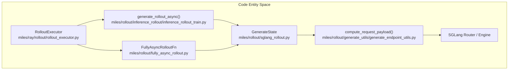
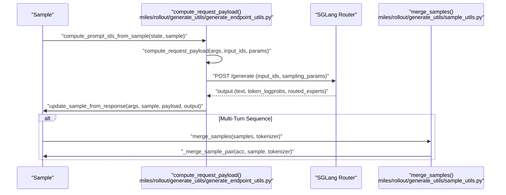
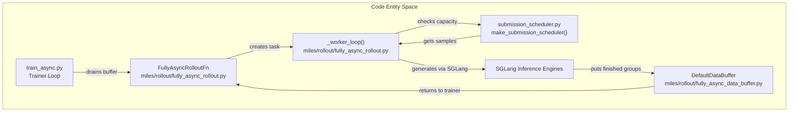

<!-- source: DeepWiki mcp.deepwiki.com · repo radixark/miles · page 5.2 Generation Pipeline · fetched 2026-10-21 -->

# Generation Pipeline

Relevant source files

The following files were used as context for generating this wiki page:

- [docs/developer/architecture.md](docs/developer/architecture.md)
- [docs/user-guide/fully-async.md](docs/user-guide/fully-async.md)
- [examples/infra_features/fully_async/external_eval_fn.py](examples/infra_features/fully_async/external_eval_fn.py)
- [miles/ray/rollout/rollout_executor.py](miles/ray/rollout/rollout_executor.py)
- [miles/ray/rollout/train_data_conversion.py](miles/ray/rollout/train_data_conversion.py)
- [miles/rollout/base_types.py](miles/rollout/base_types.py)
- [miles/rollout/checkpoint_eval.py](miles/rollout/checkpoint_eval.py)
- [miles/rollout/filter_hub/common_filters.py](miles/rollout/filter_hub/common_filters.py)
- [miles/rollout/filter_hub/dynamic_sampling_filters.py](miles/rollout/filter_hub/dynamic_sampling_filters.py)
- [miles/rollout/fully_async_data_buffer.py](miles/rollout/fully_async_data_buffer.py)
- [miles/rollout/fully_async_rollout.py](miles/rollout/fully_async_rollout.py)
- [miles/rollout/generate_utils/generate_endpoint_utils.py](miles/rollout/generate_utils/generate_endpoint_utils.py)
- [miles/rollout/generate_utils/rollout_topk_logprobs.py](miles/rollout/generate_utils/rollout_topk_logprobs.py)
- [miles/rollout/generate_utils/sample_utils.py](miles/rollout/generate_utils/sample_utils.py)
- [miles/rollout/generate_utils/sampling_mask.py](miles/rollout/generate_utils/sampling_mask.py)
- [miles/rollout/generate_utils/tool_call_utils.py](miles/rollout/generate_utils/tool_call_utils.py)
- [miles/rollout/inference_rollout/compatibility.py](miles/rollout/inference_rollout/compatibility.py)
- [miles/rollout/inference_rollout/inference_rollout_common.py](miles/rollout/inference_rollout/inference_rollout_common.py)
- [miles/rollout/inference_rollout/inference_rollout_eval.py](miles/rollout/inference_rollout/inference_rollout_eval.py)
- [miles/rollout/inference_rollout/inference_rollout_train.py](miles/rollout/inference_rollout/inference_rollout_train.py)
- [miles/rollout/session/samples/codec.py](miles/rollout/session/samples/codec.py)
- [miles/rollout/sglang_rollout.py](miles/rollout/sglang_rollout.py)
- [miles/utils/environ.py](miles/utils/environ.py)
- [miles/utils/rollout_topk_logprobs.py](miles/utils/rollout_topk_logprobs.py)
- [miles/utils/types.py](miles/utils/types.py)
- [tests/fast/fixtures/score_centering_fixtures.py](tests/fast/fixtures/score_centering_fixtures.py)
- [tests/fast/ray/rollout/real_ray/test_rollout_executor.py](tests/fast/ray/rollout/real_ray/test_rollout_executor.py)
- [tests/fast/ray/rollout/test_rollout_executor.py](tests/fast/ray/rollout/test_rollout_executor.py)
- [tests/fast/ray/rollout/test_rollout_executor_rpc_surface.py](tests/fast/ray/rollout/test_rollout_executor_rpc_surface.py)
- [tests/fast/ray/rollout/test_train_data_conversion.py](tests/fast/ray/rollout/test_train_data_conversion.py)
- [tests/fast/ray/test_kubernetes_assembly.py](tests/fast/ray/test_kubernetes_assembly.py)
- [tests/fast/ray/train/test_trainer_controller_rpc_surface.py](tests/fast/ray/train/test_trainer_controller_rpc_surface.py)
- [tests/fast/rollout/generate_utils/test_sampling_mask.py](tests/fast/rollout/generate_utils/test_sampling_mask.py)
- [tests/fast/rollout/generate_utils/test_score_centering_native.py](tests/fast/rollout/generate_utils/test_score_centering_native.py)
- [tests/fast/rollout/inference_rollout/integration/test_multi_sample.py](tests/fast/rollout/inference_rollout/integration/test_multi_sample.py)
- [tests/fast/rollout/inference_rollout/integration/test_over_sampling.py](tests/fast/rollout/inference_rollout/integration/test_over_sampling.py)
- [tests/fast/rollout/inference_rollout/integration/test_sample_filter.py](tests/fast/rollout/inference_rollout/integration/test_sample_filter.py)
- [tests/fast/rollout/inference_rollout/test_compatibility.py](tests/fast/rollout/inference_rollout/test_compatibility.py)
- [tests/fast/rollout/inference_rollout/test_inference_rollout_train.py](tests/fast/rollout/inference_rollout/test_inference_rollout_train.py)
- [tests/fast/rollout/inference_rollout/test_sample_completion_backfill.py](tests/fast/rollout/inference_rollout/test_sample_completion_backfill.py)
- [tests/fast/rollout/test_checkpoint_eval.py](tests/fast/rollout/test_checkpoint_eval.py)
- [tests/fast/rollout/test_filters.py](tests/fast/rollout/test_filters.py)
- [tests/fast/rollout/test_fully_async_rollout.py](tests/fast/rollout/test_fully_async_rollout.py)
- [tests/fast/rollout/test_sglang_rollout.py](tests/fast/rollout/test_sglang_rollout.py)
- [tests/manual/test_score_centering_live.py](tests/manual/test_score_centering_live.py)

## Purpose and Scope

This document details the generation pipeline in Miles (`miles/rollout/`), which transforms prompts into model-generated responses during rollout and evaluation phases. The generation system coordinates single-turn generation [miles/rollout/sglang_rollout.py](), multi-turn dialogues [miles/rollout/generate_utils/sample_utils.py](), agentic tool-use workflows, partial rollouts [miles/rollout/inference_rollout/inference_rollout_train.py](), fully-asynchronous rollout loops [miles/rollout/fully_async_rollout.py](), and downstream conversion to training data tensors [miles/ray/rollout/train_data_conversion.py]().

For information about the underlying SGLang inference engines and routers, see [SGLang Integration (5.1)](). For scoring generated responses, see [Reward Model Hub (5.3)]().

Sources: [miles/rollout/fully_async_rollout.py:1-17](), [miles/rollout/inference_rollout/inference_rollout_train.py:1-22](), [miles/rollout/sglang_rollout.py:1-55]()

---

## Generation Hub Architecture & Execution Modes

The generation pipeline is organized around pluggable generation functions that consume a `GenerateState` object (`miles/rollout/inference_rollout/inference_rollout_common.py` / `miles/rollout/sglang_rollout.py`) and return `Sample` or `list[Sample]` objects (`miles/utils/types.py`).

Diagram: Generation Pipeline Architecture and Code Mapping

Sources: [miles/ray/rollout/rollout_executor.py:53-119](), [miles/rollout/inference_rollout/inference_rollout_train.py:93-123](), [miles/rollout/fully_async_rollout.py:56-99](), [miles/rollout/sglang_rollout.py:76-112](), [miles/rollout/generate_utils/generate_endpoint_utils.py:57-90]()

| Strategy Module | Key Class / Function | Description |
|-----------------|---------------------|-------------|
| `miles/rollout/sglang_rollout.py` | `generate()` / `GenerateState` | Standard prompt-to-response text generation via SGLang `/generate` endpoint with DP balancing. |
| `miles/rollout/generate_utils/sample_utils.py` | `merge_samples()` | Iterative multi-turn conversational loop merging sequences and replay metadata. |
| `miles/rollout/inference_rollout/inference_rollout_train.py` | `generate_rollout_async()` | Synchronous / batch rollout orchestrator coordinating progress and worker aborts. |
| `miles/rollout/fully_async_rollout.py` | `FullyAsyncRolloutFn` | Decoupled background generation loop feeding a ring buffer. |

Sources: [miles/rollout/sglang_rollout.py:76-154](), [miles/rollout/generate_utils/sample_utils.py:18-32](), [miles/rollout/inference_rollout/inference_rollout_train.py:93-168](), [miles/rollout/fully_async_rollout.py:56-99]()

---

## Single-Turn and Multi-Turn Generation

In single-turn generation, a prompt is encoded into `input_ids` via `compute_prompt_ids_from_sample` (`miles/rollout/generate_utils/generate_endpoint_utils.py`) and sent with sampling parameters to the SGLang engine [miles/rollout/sglang_rollout.py:147-180]().

Multi-turn generation handles conversational sequences by sequentially invoking generation across turns, accumulating tokens in `Sample.tokens` and `Sample.rollout_log_probs`, and merging samples via `merge_samples` (`miles/rollout/generate_utils/sample_utils.py`) while preserving routing metadata and sampling masks [miles/rollout/generate_utils/sample_utils.py:18-32]().

Diagram: Single-Turn and Multi-Turn Dataflow

Sources: [miles/rollout/generate_utils/generate_endpoint_utils.py:22-141](), [miles/rollout/generate_utils/sample_utils.py:18-32]()

---

## Partial Rollout Mechanism

Partial rollout (`miles/rollout/inference_rollout/inference_rollout_train.py`) allows Miles to handle interrupted or truncated trajectories across iterations.

1. **In-Flight Capture**: When training iterations abort or timeout, pending generation tasks are collected and abort requests are broadcasted to SGLang workers [miles/rollout/inference_rollout/inference_rollout_train.py:26-40]().
2. **Partial Preservation**: Samples with non-empty responses have their `start_rollout_id` recorded in `sample.metadata` and are pushed back into the data buffer [miles/rollout/inference_rollout/inference_rollout_train.py:46-55]().
3. **Resumption**: Subsequent rollout cycles resume generation from the existing `sample.tokens`, decrementing `max_new_tokens` by the existing response length [miles/rollout/sglang_rollout.py:176-180]().

Sources: [miles/rollout/inference_rollout/inference_rollout_train.py:26-60](), [miles/rollout/sglang_rollout.py:176-180]()

---

## Fully-Asynchronous Rollout Pipeline

Configured via `train_async.py --fully-async`, `FullyAsyncRolloutFn` (`miles/rollout/fully_async_rollout.py`) decouples generation from training steps so rollout never blocks on gradient updates [miles/rollout/fully_async_rollout.py:1-17]().

Diagram: Fully-Asynchronous Rollout Architecture

Sources: [miles/rollout/fully_async_rollout.py:56-155](), [miles/rollout/fully_async_data_buffer.py:1-44]()

### Key Components in Fully-Async Rollout
- **`FullyAsyncRolloutFn`**: Extends `BaseRolloutFn` (`miles/rollout/base_types.py`) to manage background workers and data buffers [miles/rollout/fully_async_rollout.py:56-99]().
- **`_worker_loop`**: A persistent background task that maintains up to `async_max_concurrent_samples` or `rollout_batch_size` groups in flight [miles/rollout/fully_async_rollout.py:122-155]().
- **Staleness Control**: Groups generated under older weight versions are tracked using `WeightVersionsPerCall` (`miles/utils/types.py`) and filtered if `max_weight_staleness` is exceeded [miles/tests/fast/rollout/test_fully_async_rollout.py:84-85]().

Sources: [miles/rollout/fully_async_rollout.py:56-155](), [miles/utils/types.py:14-57](), [tests/fast/rollout/test_fully_async_rollout.py:79-101]()

---

## Rollout Filters and Training Data Conversion

Once samples are generated, they pass through validation and filtering before conversion to training tensors via `convert_samples_to_train_data` (`miles/ray/rollout/train_data_conversion.py`).

| Function / Filter | Location | Purpose |
|-------------------|----------|---------|
| `apply_preput_filters` | `miles/rollout/filter_hub/common_filters.py` | Applies dynamic sampling filters before buffer ingestion. |
| `convert_samples_to_train_data` | `miles/ray/rollout/train_data_conversion.py` | Converts `Sample` objects into ragged tensors and arrays for distributed training backends [miles/ray/rollout/train_data_conversion.py:57-90](). |
| `_post_process_rewards` | `miles/ray/rollout/train_data_conversion.py` | Normalizes and post-processes raw rewards from reward models or heuristics [miles/ray/rollout/train_data_conversion.py:70-75](). |

Sources: [miles/ray/rollout/train_data_conversion.py:57-110](), [miles/rollout/filter_hub/common_filters.py:1-25]()

---

