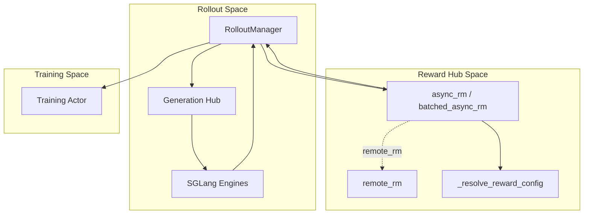
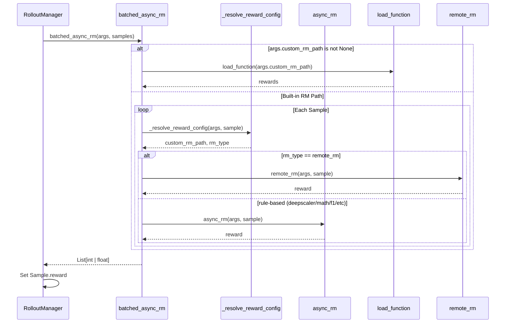
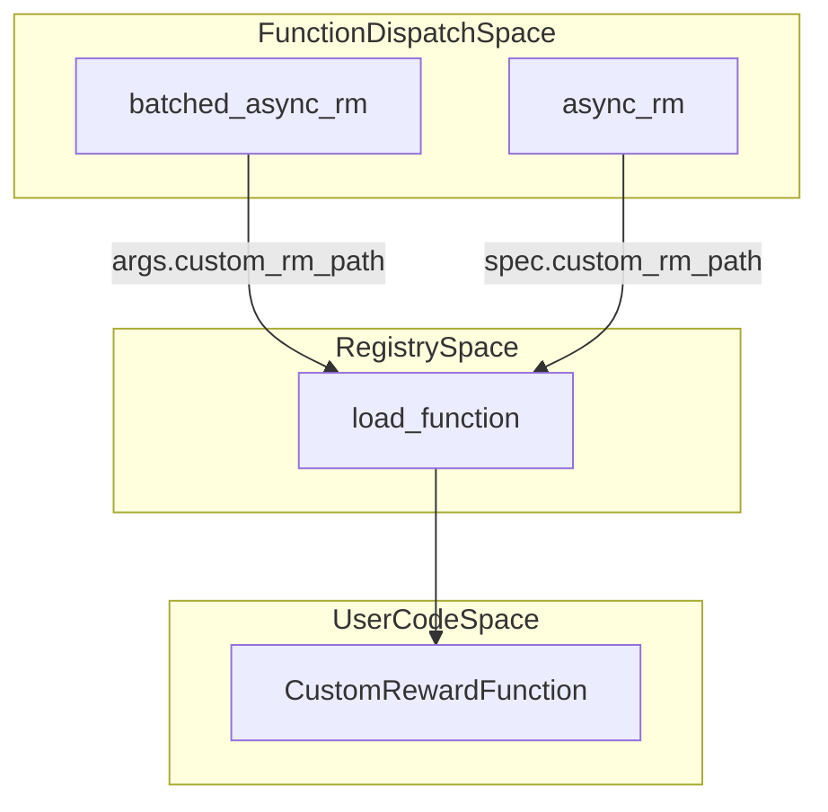

<!-- source: DeepWiki mcp.deepwiki.com · repo radixark/miles · page 5.3 Reward Model Hub · fetched 2026-10-21 -->

# Reward Model Hub

<details>
<summary>Relevant source files</summary>

The following files were used as context for generating this wiki page:

- [miles/rollout/generate_utils/prefill_logprobs.py](miles/rollout/generate_utils/prefill_logprobs.py)
- [miles/rollout/rm_hub/__init__.py](miles/rollout/rm_hub/__init__.py)
- [miles_plugins/models/inkling/lora.py](miles_plugins/models/inkling/lora.py)
- [miles_plugins/models/normalization.py](miles_plugins/models/normalization.py)
- [tests/fast/rollout/generate_utils/test_prefill_logprobs.py](tests/fast/rollout/generate_utils/test_prefill_logprobs.py)
- [tests/fast/rollout/rm_hub/test_reward_config_resolution.py](tests/fast/rollout/rm_hub/test_reward_config_resolution.py)
- [tests/fast/rollout/rm_hub/test_rm_hub.py](tests/fast/rollout/rm_hub/test_rm_hub.py)
- [tests/fast/test_glm5_indexer_query_norm.py](tests/fast/test_glm5_indexer_query_norm.py)

</details>


## Purpose and Scope

The Reward Model Hub provides a pluggable reward evaluation system for scoring generated model responses during RL training. It supports multiple built-in reward types (rule-based, extractive, remote), custom reward functions via dynamic loading, and batched asynchronous evaluation for high throughput.

For information about how rewards are used in training algorithms, see section 6.1. For generation workflows that produce samples to be evaluated, see section 5.2.

---

## System Overview

The Reward Model Hub acts as an abstraction layer between data generation and training, allowing flexible experimentation with different reward signals without modifying core training code.

### Architecture Position



**Sources**: [miles/rollout/rm_hub/__init__.py:1-108](), [miles/utils/types.py:10-52]()

### Core Data Flow



**Sources**: [miles/rollout/rm_hub/__init__.py:18-108](), [miles/utils/types.py:24-24]()

---

## Configuration Resolution and Precedence

The hub determines how a sample should be scored by resolving configuration parameters through `_resolve_reward_config` [miles/rollout/rm_hub/__init__.py:31-39](). Precedence is structured so that fine-grained sample-level specifications override process-wide defaults:

1. **Reward Spec (`sample.reward_spec`)**: If defined, `custom_rm_path` and `rm_type` specified in the sample's `RewardSpec` take highest priority [miles/rollout/rm_hub/__init__.py:33-38](). Empty or unset spec fields correctly fall through rather than disabling downstream defaults [tests/fast/rollout/rm_hub/test_reward_config_resolution.py:1-4]().
2. **Sample Metadata (`sample.metadata`)**: If the reward spec leaves fields unset, the hub checks `sample.metadata.get("rm_type")` [miles/rollout/rm_hub/__init__.py:34-37]().
3. **Process-Wide Arguments (`args`)**: If neither the spec nor metadata provides a value, the hub falls back to global configuration flags (`args.custom_rm_path` and `args.rm_type`) [miles/rollout/rm_hub/__init__.py:35-37]().

**Sources**: [miles/rollout/rm_hub/__init__.py:31-39](), [tests/fast/rollout/rm_hub/test_reward_config_resolution.py:1-39]()

---

## Built-in Reward Types

The hub supports multiple reward types specified via `args.rm_type` or metadata [miles/rollout/rm_hub/__init__.py:31-39](). 

### Reward Type Reference

| Reward Type | Description | Label Required | Implementation |
|-------------|-------------|----------------|----------------|
| `remote_rm` | Calls external reward model via HTTP POST to `args.rm_url` | Yes | `remote_rm` [miles/rollout/rm_hub/__init__.py:18-28]() |
| `deepscaler` | Rule-based reward for DeepScaler reasoning | Yes | `get_deepscaler_rule_based_reward` [miles/rollout/rm_hub/__init__.py:60-61]() |
| `gemma_math` | Gemma math reward evaluation | Yes | `get_gemma_math_reward` [miles/rollout/rm_hub/__init__.py:62-63]() |
| `dapo` | DAPO math scoring (exact match) | Yes | `compute_score_dapo` [miles/rollout/rm_hub/__init__.py:64-65]() |
| `math` | Math problem grading using VERL's answer extractor | Yes | `grade_answer_verl` [miles/rollout/rm_hub/__init__.py:66-67]() |
| `f1` | F1 score between response and label | Yes | `f1_score` [miles/rollout/rm_hub/__init__.py:68-69]() |
| `gpqa` | GPQA multiple choice grading | Yes | `compute_gpqa_reward` [miles/rollout/rm_hub/__init__.py:70-71]() |
| `ifbench` | IFBench instruction following scoring | Yes | `compute_ifbench_reward` [miles/rollout/rm_hub/__init__.py:72-75]() |
| `random` | Random binary reward for testing | No | `random.randint(0, 1)` [miles/rollout/rm_hub/__init__.py:76-77]() |
| `deterministic_random` | Deterministic pseudo-random reward based on hash | No | `hashlib.sha256` [miles/rollout/rm_hub/__init__.py:78-81]() |
| `boxed_*` | Extracts boxed answer, then applies `*` reward type | Yes | `extract_boxed_answer` [miles/rollout/rm_hub/__init__.py:52-55]() |

**Sources**: [miles/rollout/rm_hub/__init__.py:18-86]()

### Boxed Answer Extraction

For math problems, prefixing any reward type with `boxed_` triggers `extract_boxed_answer` to first isolate content within LaTeX `\boxed{...}` tags before scoring [miles/rollout/rm_hub/__init__.py:52-55]().

**Sources**: [miles/rollout/rm_hub/__init__.py:52-55](), [miles/rollout/rm_hub/__init__.py:14-14]()

---

## API Reference

### Core Functions

#### `async_rm`

Evaluates a single sample asynchronously [miles/rollout/rm_hub/__init__.py:42-86]().

```python
async def async_rm(args, sample: Sample, **kwargs) -> int | float | dict
```

**Behavior**:
1. Resolves reward configuration via `_resolve_reward_config(args, sample)` [miles/rollout/rm_hub/__init__.py:31-43]().
2. Checks `custom_rm_path`; if set, loads function via `load_function` and awaits it [miles/rollout/rm_hub/__init__.py:45-47]().
3. Handles `boxed_` prefixing [miles/rollout/rm_hub/__init__.py:52-55]().
4. Dispatches based on `rm_type` to built-in handlers (`remote_rm`, `deepscaler`, `gemma_math`, `dapo`, `math`, `f1`, `gpqa`, `ifbench`, `random`, `deterministic_random`) [miles/rollout/rm_hub/__init__.py:58-86]().

**Sources**: [miles/rollout/rm_hub/__init__.py:31-86]()

#### `batched_async_rm`

Evaluates multiple samples concurrently using `asyncio.gather` [miles/rollout/rm_hub/__init__.py:88-108]().

```python
async def batched_async_rm(
    args,
    samples: list[Sample],
    inplace_set_reward_field: bool = False,
    **kwargs,
) -> list[int | float | dict] | None
```

**Optimizations**:
- If `inplace_set_reward_field` is `True`, it updates `Sample.reward` directly across the batch [miles/rollout/rm_hub/__init__.py:94-101]().
- Custom reward functions at `args.custom_rm_path` are called with the full list of samples to allow batch processing [miles/rollout/rm_hub/__init__.py:103-105]().

**Sources**: [miles/rollout/rm_hub/__init__.py:88-108]()

---

## Custom Reward Functions

Users can provide a custom reward function by specifying a Python import path (e.g., `my_module.my_file:my_func`) via `--custom-rm-path` or sample reward specifications [miles/rollout/rm_hub/__init__.py:33-36]().

### Interface and Dispatch



**Sources**: [miles/rollout/rm_hub/__init__.py:31-47](), [miles/rollout/rm_hub/__init__.py:103-105](), [miles/utils/function_registry.py:7-7]()

---

## Integration with Sample Types

The Reward Model Hub operates on the `Sample` dataclass, mapping prompts, responses, and labels to reward scores [miles/utils/types.py:8-52]().

### Sample Entity Mapping

| Code Entity | Field | Purpose in RM Hub |
|-------------|-------|-------------------|
| `Sample` | `prompt` | Input context sent to remote or rule-based RMs [miles/utils/types.py:10-52]() |
| `Sample` | `response` | Model output evaluated by scoring functions [miles/utils/types.py:10-52]() |
| `Sample` | `label` | Reference answer for correctness checking [miles/utils/types.py:10-52]() |
| `Sample` | `reward` | Target field populated when `inplace_set_reward_field=True` [miles/rollout/rm_hub/__init__.py:94-101]() |
| `Sample` | `metadata` | Per-sample overrides such as `rm_type` [miles/rollout/rm_hub/__init__.py:34-37]() |
| `Sample` | `reward_spec` | Structured reward configuration spec [miles/rollout/rm_hub/__init__.py:33-35]() |

**Sources**: [miles/rollout/rm_hub/__init__.py:31-39](), [miles/utils/types.py:8-52]()

---

## Performance Characteristics

### Concurrency
Built-in reward evaluations are dispatched concurrently via `asyncio.gather` inside `batched_async_rm`, avoiding synchronous blocking during rollout post-processing [miles/rollout/rm_hub/__init__.py:106-107]().

### Remote RM Efficiency
The `remote_rm` implementation leverages `aiohttp.ClientSession` for asynchronous HTTP POST requests to external reward model endpoints [miles/rollout/rm_hub/__init__.py:18-28]().

**Sources**: [miles/rollout/rm_hub/__init__.py:18-28](), [miles/rollout/rm_hub/__init__.py:106-107]()

---

