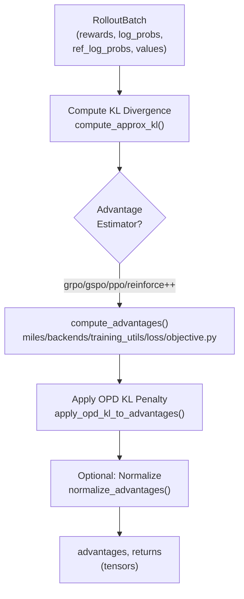

<!-- source: DeepWiki mcp.deepwiki.com · repo radixark/miles · page 6.1 RL Algorithms · fetched 2026-10-21 -->

# RL Algorithms

<details>
<summary>Relevant source files</summary>

The following files were used as context for generating this wiki page:

- [docs/examples/infra-features/score-centering.md](docs/examples/infra-features/score-centering.md)
- [examples/infra_features/score_centering/README.md](examples/infra_features/score_centering/README.md)
- [miles/backends/megatron_utils/arguments.py](miles/backends/megatron_utils/arguments.py)
- [miles/backends/training_utils/loss/hub/score_centering/estimator.py](miles/backends/training_utils/loss/hub/score_centering/estimator.py)
- [miles/backends/training_utils/loss/hub/score_centering/masks.py](miles/backends/training_utils/loss/hub/score_centering/masks.py)
- [miles/utils/score_centering.py](miles/utils/score_centering.py)
- [tests/fast/backends/training_utils/loss/loss_test_utils.py](tests/fast/backends/training_utils/loss/loss_test_utils.py)
- [tests/fast/backends/training_utils/loss/test_advantages_pp_stage_guard.py](tests/fast/backends/training_utils/loss/test_advantages_pp_stage_guard.py)
- [tests/fast/backends/training_utils/loss/test_opd.py](tests/fast/backends/training_utils/loss/test_opd.py)
- [tests/fast/backends/training_utils/loss/test_training_logprob_reuse.py](tests/fast/backends/training_utils/loss/test_training_logprob_reuse.py)
- [tests/fast/backends/training_utils/test_chunked_log_probs.py](tests/fast/backends/training_utils/test_chunked_log_probs.py)
- [tests/fast/backends/training_utils/test_sampling_mask.py](tests/fast/backends/training_utils/test_sampling_mask.py)
- [tests/fast/backends/training_utils/test_score_centering.py](tests/fast/backends/training_utils/test_score_centering.py)
- [tests/fast/backends/training_utils/test_true_on_policy_loss_metrics.py](tests/fast/backends/training_utils/test_true_on_policy_loss_metrics.py)
- [tests/fast/rollout/generate_utils/test_score_centering_contracts.py](tests/fast/rollout/generate_utils/test_score_centering_contracts.py)

</details>


This page documents the reinforcement learning algorithms implemented in Miles, including advantage estimators (GRPO, GSPO, PPO, REINFORCE++), return computation, loss functions, on-policy distillation (OPD), score centering, and algorithm parameters. For reward model integration, see page [5.3](). For the overall training loop that invokes these algorithms, see page [3.2]().

## Overview

Miles implements multiple RL algorithms that compute advantages and returns from rollout data. The core computation happens in the training backends during the actor training phase via `compute_advantages_and_returns()` in `miles/backends/training_utils/loss.py` [tests/fast/backends/training_utils/loss/test_opd.py:102-102]().

All algorithms share a common input structure from rollout data: rewards, log-probabilities, loss masks, and optionally value predictions. The choice of algorithm is controlled by the `--advantage-estimator` argument.

**Sources**: [tests/fast/backends/training_utils/loss/test_opd.py:102-102]()

## Algorithm Selection and Configuration

### Available Algorithms

The framework supports multiple advantage estimators configured via `--advantage-estimator`:

| Algorithm | Description | Requires Value Model | Key Parameters |
|-----------|-------------|---------------------|----------------|
| `grpo` | Group Relative Policy Optimization [tests/fast/backends/training_utils/loss/loss_test_utils.py:78-78]() | No | `--kl-coef`, `--grpo-std-normalization` |
| `gspo` | Group-wise Sequential Policy Optimization | No | `--kl-coef`, `--grpo-std-normalization` |
| `ppo` | Proximal Policy Optimization (GAE) [tests/fast/backends/training_utils/loss/test_true_on_policy_loss_metrics.py:16-16]() | Yes | `--gamma`, `--lambd`, `--kl-coef` |
| `reinforce_plus_plus` | REINFORCE with KL penalty and gamma | No | `--gamma`, `--kl-coef` |
| `reinforce_plus_plus_baseline` | REINFORCE++ with group baseline | No | `--kl-coef` |

### Key Configuration Arguments

```python
# Advantage estimator selection
--advantage-estimator grpo  # Choose algorithm

# PPO-specific (GAE computation)
--gamma 1.0           # Discount factor [tests/fast/backends/training_utils/loss/loss_test_utils.py:84-84]
--lambd 0.95          # GAE lambda parameter [tests/fast/backends/training_utils/loss/loss_test_utils.py:85-85]

# KL penalty (reward shaping before advantage)
--kl-coef 0.1         # KL coefficient for reward shaping [tests/fast/backends/training_utils/loss/loss_test_utils.py:82-82]

# Normalization
--normalize-advantages              # Whiten advantages across DP group
--grpo-std-normalization           # Normalize by std in GRPO/GSPO
--rewards-normalization            # Normalize rewards in GRPO-like methods
```

**Sources**: [tests/fast/backends/training_utils/loss/loss_test_utils.py:78-86]()

## Advantage and Return Computation Flow

The following diagram illustrates the flow from raw rollout data to the final advantages used for backpropagation, linking natural language concepts to specific code entities like `compute_advantages_and_returns` and `compute_advantages`.

### Advantage Pipeline


**Sources**: [tests/fast/backends/training_utils/loss/test_opd.py:95-102]()

## GRPO, GSPO, and PPO Estimators

### GRPO: Group Relative Policy Optimization
GRPO normalizes rewards within groups of responses sharing the same prompt, eliminating the need for a separate value (critic) model. When `--rewards-normalization` is enabled, rewards are centered and scaled within the response group [docs/examples/infra-features/score-centering.md:24-24]().

### GSPO Variant
GSPO (Group-wise Sequential Policy Optimization) handles the KL penalty by computing a sequence-level KL for each sample and broadcasting it to all tokens rather than using per-token KL.

### PPO: Proximal Policy Optimization
PPO uses Generalized Advantage Estimation (GAE) requiring a critic value model. It computes approximate KL divergences and applies probability clipping ratios bounded by `--eps-clip` [tests/fast/backends/training_utils/loss/loss_test_utils.py:93-93]() and `--eps-clip-high` [tests/fast/backends/training_utils/loss/loss_test_utils.py:94-94]().

**Sources**: [docs/examples/infra-features/score-centering.md:24-24](), [tests/fast/backends/training_utils/loss/loss_test_utils.py:93-94]()

## Score Centering: Correcting Off-Policy Drift

Miles implements **Score Centering** (`--loss-type score_centering`) based on arXiv:2609.20807, correcting off-policy score drift using the sampler's top-$k$ probabilities or support replay with optional truncated importance sampling (TIS) or masked importance sampling (MIS) weights [docs/examples/infra-features/score-centering.md:3-8]().

### Enabling Score Centering
Score centering requires specific recipe flags and is compatible with the GRPO advantage estimator [docs/examples/infra-features/score-centering.md:12-25]():
```bash
--loss-type score_centering \
--advantage-estimator grpo \
--rollout-top-logprobs-num 128 \
--score-centering-is none \
--rollout-temperature 1.0 \
--rollout-top-p 1.0 \
--rollout-top-k -1 \
--use-rollout-logprobs \
--disable-grpo-std-normalization \
--calculate-per-token-loss
```

### Mathematical Formulation
As implemented in `score_centering_loss()` in `miles/backends/training_utils/loss/hub/score_centering/estimator.py`, let $p$ be the current trainer distribution, $q$ the rollout sampler distribution, $H$ the stored candidates, $A$ the detached advantage, and $f$ the importance weight function [docs/examples/infra-features/score-centering.md:39-49]():

$$\rho = \frac{\max(1 - \sum q[H], 10^{-6})}{\max(1 - \sum p[H], 10^{-6})}$$

$$\alpha = \rho \cdot f\left(\frac{1}{\rho}\right)$$

$$\text{loss} = -A \cdot \left( \text{stop\_grad}\left(f\left(\frac{p[\text{token}]}{q[\text{token}]}\right)\right) \log p[\text{token}] - \sum \text{stop\_grad}\left(q[H] f\left(\frac{p[H]}{q[H]}\right) - \alpha p[H]\right) \log p[H] \right)$$

Validation contracts for arguments and sampling modes are enforced in `validate_score_centering_args()` (`miles/utils/score_centering.py`) [miles/utils/score_centering.py:10-43]().

**Sources**: [docs/examples/infra-features/score-centering.md:3-49](), [miles/utils/score_centering.py:10-43](), [miles/backends/training_utils/loss/hub/score_centering/estimator.py:64-95]()

## On-Policy Distillation (OPD)

On-policy distillation is applied orthogonally on top of any advantage estimator via `--use-opd`. The function `apply_opd_kl_to_advantages()` (`miles/backends/training_utils/loss/hub/opd.py`) modifies per-token advantages by subtracting a weighted reverse-KL penalty against a teacher policy [tests/fast/backends/training_utils/loss/test_opd.py:28-40]():

$$\text{advantage}_{\text{opd}} = \text{advantage} - \beta_{\text{opd}} \cdot (\log \pi_{\text{student}} - \log \pi_{\text{teacher}})$$

This penalty encourages student trajectories to align with teacher log probabilities without requiring changes to the core policy loss objectives.

**Sources**: [tests/fast/backends/training_utils/loss/test_opd.py:28-40]()

## Loss Functions and Metrics

The final step is the clipped policy loss computation handled inside `policy_loss_function()` (`miles/backends/training_utils/loss/hub/losses.py`), which computes log probabilities, entropy regularization, and PPO/GSPO clipping ratios [tests/fast/backends/training_utils/loss/test_training_logprob_reuse.py:13-13]().

### Tracked RL Metrics

| Metric | Code Symbol | Description |
|--------|-------------|-------------|
| Advantage | `advantages` | Mean advantage after optional normalization [tests/fast/backends/training_utils/loss/loss_test_utils.py:86-86] |
| KL Divergence | `compute_approx_kl` | Approximate KL between current and base policy [tests/fast/backends/training_utils/loss/test_training_logprob_reuse.py:129-129] |
| Clip Fraction | `pg_clipfrac` | Percentage of samples clipped by PPO [tests/fast/backends/training_utils/loss/test_training_logprob_reuse.py:130-130] |
| Train-Rollout Absolute Diff | `train_rollout_logprob_abs_diff` | Mean absolute difference between training and rollout log probabilities [docs/examples/infra-features/score-centering.md:36-36] |

**Sources**: [docs/examples/infra-features/score-centering.md:36-36](), [tests/fast/backends/training_utils/loss/loss_test_utils.py:86-86](), [tests/fast/backends/training_utils/loss/test_training_logprob_reuse.py:129-130]()

---

